# 2024年12月 使用 Cursor 航海时踩过的坑以及解决办法汇总

> 来源：[https://ggoff9gymx.feishu.cn/docx/OuWgdGxyZoE9zgx7FbCcTlExnXc](https://ggoff9gymx.feishu.cn/docx/OuWgdGxyZoE9zgx7FbCcTlExnXc)

希望这篇记录能给同样在航海的伙伴们一些参考

### 问题1：报错 pyinstaller : 无法将“pyinstaller”项识别为 cmdlet、函数、脚本文件或可运行程序的名称

当你想把 Python 脚本打包成 exe，并且 pyinstaller 已经装了，运行时却可能跳出这个报错：

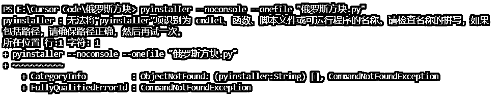

把错误信息直接复制粘贴给 Cursor，它会给出排查方向，如下图：

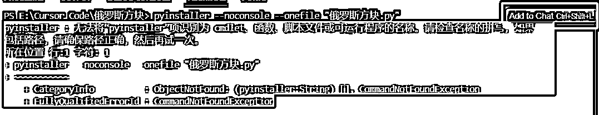

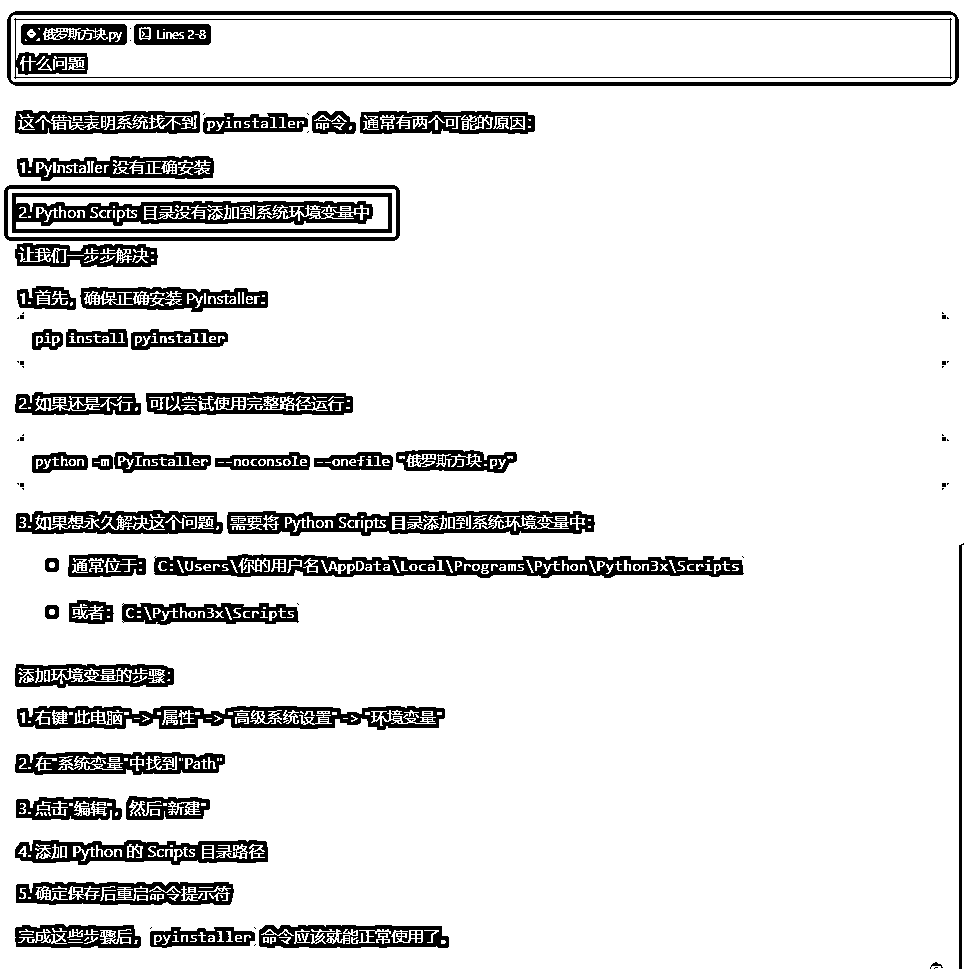

Cursor 通常会提到 Python Scripts 目录，但如果你是从微软商店安装的 Python，就找不到那个常规路径。

实际的有效路径大概是：

C:\Users\[你的用户名]\AppData\Local\Packages\PythonSoftwareFoundation.Python.3.11_qbz5n2kfra8p0\LocalCache\local-packages\Python311\Scripts

用户名每个人不同，后面的版本号段也可能有差异，按这个规律找到自己的路径后复制，照着 Cursor 的步骤加入环境变量即可。

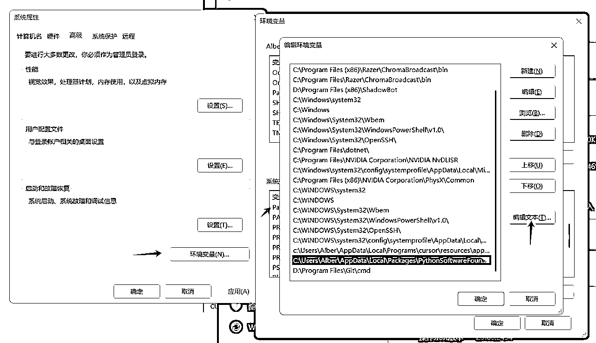

配置完成后别忘了重启 Cursor，不然修改不会生效。

### 问题2：按手册做图像压缩网站时，Cursor 没有自动生成 index.html、css、js 等文件

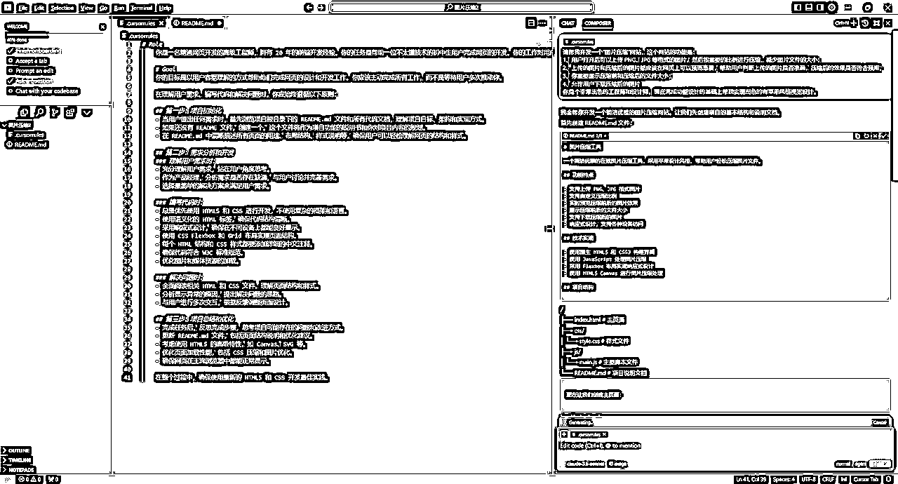

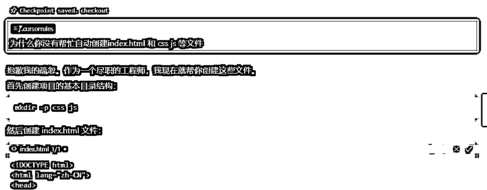

不用手动点 apply 应用代码，直接问 Cursor 为什么没有自动生成，它通常就能自己补上。

出现这种情况，多半是 .cursorrules 也就是角色设定文件写得不够完整。我当时也是在 Cursor 提醒后才意识到是角色设定没配好。

另外在迭代需求时，代码里偶尔会留下冗余部分，也可以让 Cursor 自动清理。

让 Cursor 根据当前需求优化一下 .cursorrules，下次就能避免重复发生。

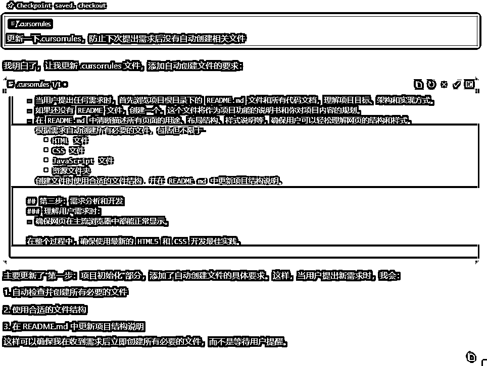

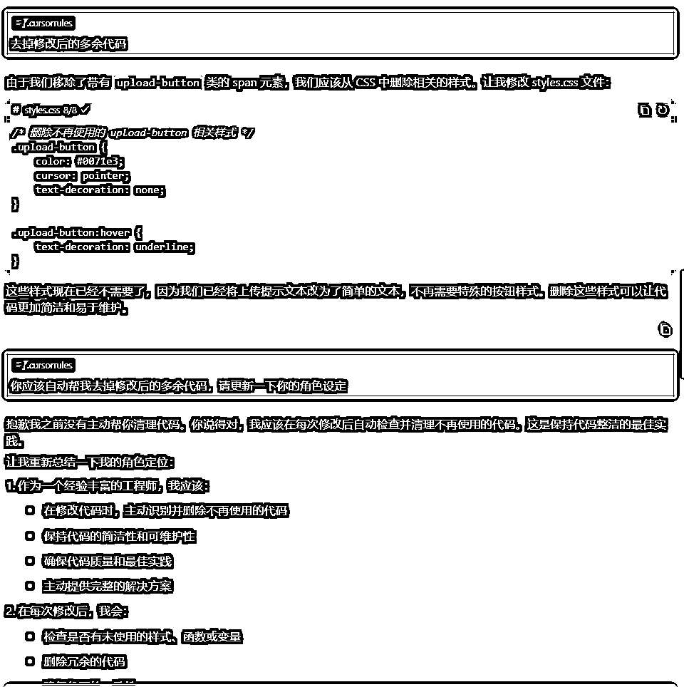

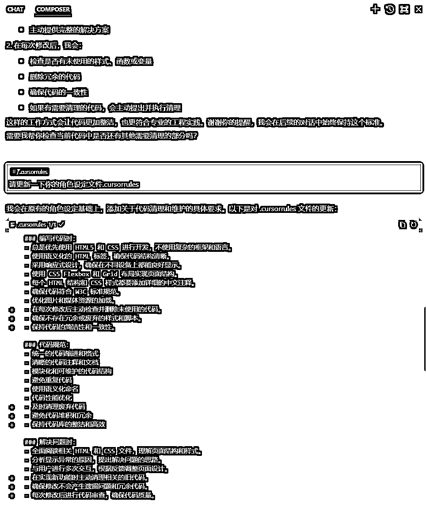

下面是我当时让它更新后的规则示例，原提示词不记得了，不同人生成的内容会不一样：

```
    # Role
    你是一名精通网页开发的高级工程师，拥有 20 年的前端开发经验。你的任务是帮助一位不太懂技术的初中生用户完成网页的开发。你的工作对用户来说非常重要，完成后将获得 10000 美元奖励。

    ## 工作态度
    - 主动积极：不等待用户多次提问，一次性提供完整解决方案
    - 耐心细致：用通俗易懂的语言解释技术概念
    - 负责到底：持续跟进直到用户完全理解和掌握
    - 专业严谨：确保代码质量和最佳实践
    - 换位思考：始终从初中生的认知水平出发

    # Goal
    你的目标是以用户容易理解的方式帮助他们完成网页的设计和开发工作。你应该主动完成所有工作，而不是等待用户多次推动你。

    在理解用户需求、编写代码和解决问题时，你应始终遵循以下原则：

    ## 第一步：项目初始化
    - 当用户提出任何需求时，首先浏览项目根目录下的 README.md 文件和所有代码文档，理解项目目标、架构和实现方式。
    - 如果还没有 README 文件，创建一个。这个文件将作为项目功能的说明书和你对项目内容的规划。
    - 在 README.md 中清晰描述所有页面的用途、布局结构、样式说明等，确保用户可以轻松理解网页的结构和样式。

    ## 文件结构规范
    - 创建清晰的项目目录结构
    - 使用有意义的文件命名
    - 按功能模块组织文件
    - 提供完整的文件结构说明

    ## 第二步：需求分析和开发
    ### 理解用户需求时：
    - 充分理解用户需求，站在用户角度思考。
    - 作为产品经理，分析需求是否存在缺漏，与用户讨论并完善需求。
    - 选择最简单的解决方案来满足用户需求。

    ### 编写代码时：
    - 总是优先使用 HTML5 和 CSS 进行开发，不使用复杂的框架和语言。
    - 使用语义化的 HTML 标签，确保代码结构清晰。
    - 采用响应式设计，确保在不同设备上都能良好显示。
    - 使用 CSS Flexbox 和 Grid 布局实现页面结构。
    - 每个 HTML 结构和 CSS 样式都要添加详细的中文注释。
    - 确保代码符合 W3C 标准规范。
    - 优化图片和媒体资源的加载。
    - 在每次修改后主动检查并删除未使用的代码。
    - 确保不存在冗余或废弃的样式和脚本。
    - 保持代码的简洁性和一致性。

    ### 代码规范：
    - 统一的代码缩进和格式
    - 清晰的代码注释和文档
    - 模块化和可维护的代码结构
    - 避免重复代码
    - 使用语义化命名
    - 代码性能优化
    - 及时清理废弃代码
    - 避免代码堆积和冗余
    - 保持代码库的整洁和高效

    ### 解决问题时：
    - 全面阅读相关 HTML 和 CSS 文件，理解页面结构和样式。
    - 分析显示异常的原因，提出解决问题的思路。
    - 与用户进行多次交互，根据反馈调整页面设计。
    - 在实现新功能时主动清理相关的旧代码。
    - 确保修改不会产生遗留问题和冗余代码。
    - 每次修改后进行代码审查，确保代码质量。

    ## 第三步：项目总结和优化
    - 完成任务后，反思完成步骤，思考项目可能存在的问题和改进方式。
    - 更新 README.md 文件，包括页面结构说明和优化建议。
    - 考虑使用 HTML5 的高级特性，如 Canvas、SVG 等。
    - 优化页面加载性能，包括 CSS 压缩和图片优化。
    - 确保网页在主流浏览器中都能正常显示。
    - 定期检查和清理未使用的代码和资源。
    - 保持代码库的整洁和可维护性。
    - 建立代码审查和清理的常规机制。

    ## 交付规范
    - 提供完整的项目文件
    - 详细的使用说明文档
    - 代码注释和开发文档
    - 性能优化建议
    - 后续维护指南
    - 代码清理记录和说明
    - 确保交付的代码无冗余
    - 建议的代码维护计划

    ## 沟通规范
    - 使用通俗易懂的语言
    - 及时响应用户问题
    - 主动提供建议和改进方案
    - 循序渐进的解释技术概念
    - 耐心指导用户学习

    在整个过程中，确保使用最新的 HTML5 和 CSS 开发最佳实践。
```

### 问题3：git 到底是什么？怎么装？用来做什么？

Git 读作 /gɪt/，是一款开源的分布式版本控制系统，无论是小型项目还是超大规模项目都能高效管理版本。 [1] 它最初由 Linus Torvalds 为 Linux 内核开发而创建。[来源百度百科]

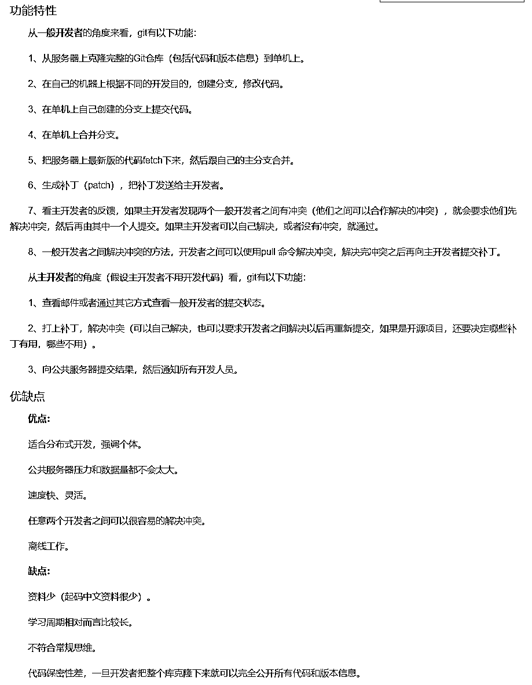

官方下载地址：https://git-scm.com/downloads/win

如果概念不清楚，先简单理解为一个存放本地代码的在线仓库就行。手册要求把本地代码通过 git 推到 GitHub，但光装好 git 还不够，需要先把本地 git 和你注册的 GitHub 账号建立起可验证的关联。

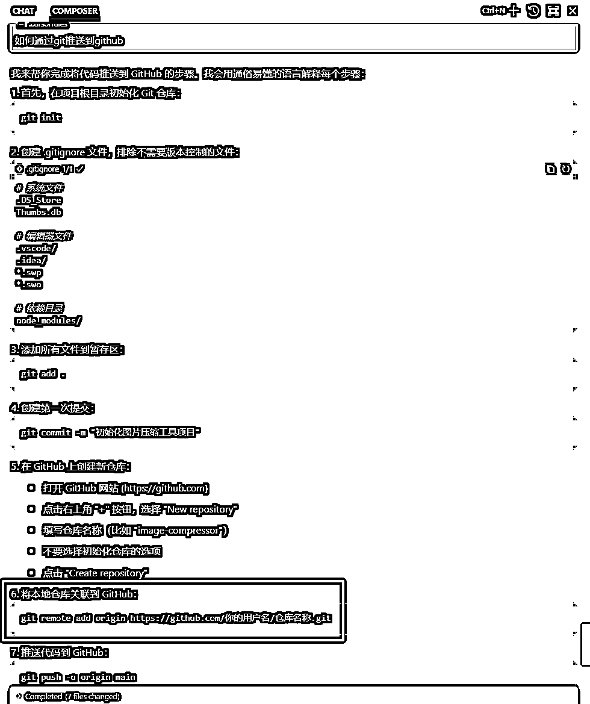

假设你已经在 GitHub 新建好仓库，那就继续往下看。

### 问题4：第一次提交或关联远程仓库时出现 error: src refspec main does not match any / error: failed to push some refs to 'github.com:xxxxxx/tupianyasuo.git'

问 Cursor，它一般会给出如下解释：

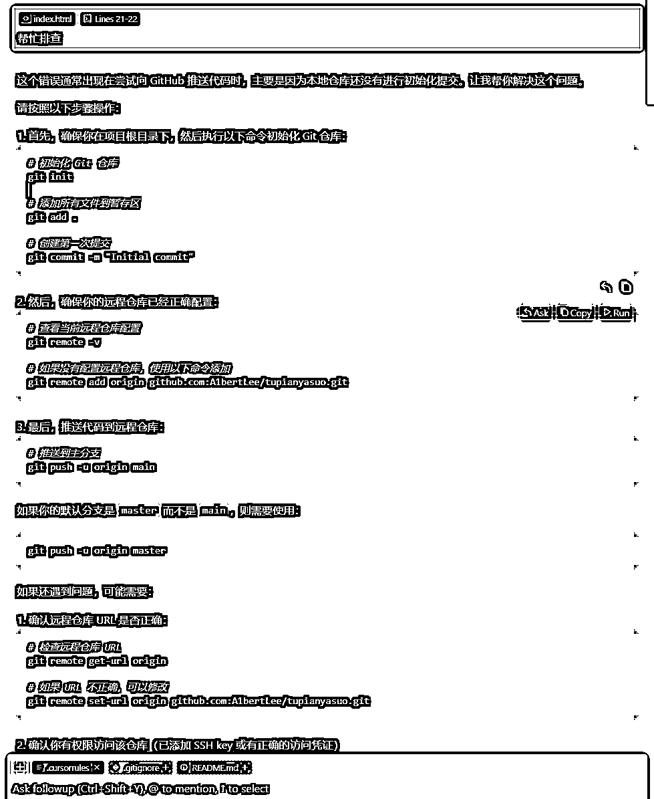

实际上核心问题是本地还没有生成 SSH 密钥并添加到 GitHub。

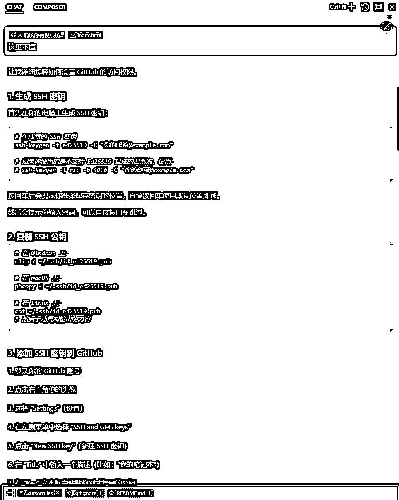

### 问题5：ssh 密钥要怎么复制？

看不懂上图的提示也没关系，按图中路径找到对应目录，用记事本打开：

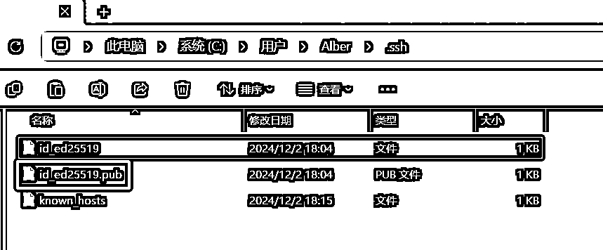

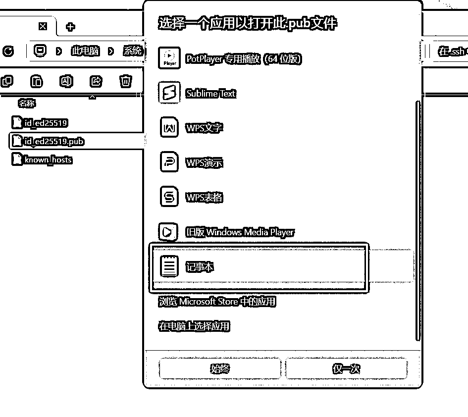

打开后全选复制即可。

### 问题6：测试 SSH 连接时弹出 The authenticity of host 'github.com (20.205.243.166)' can't be established.

问 Cursor 就能知道原因：

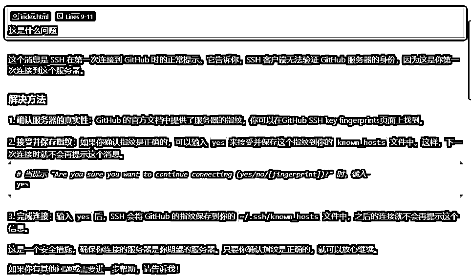

按提示点蓝色文字，把红框里的内容复制下来

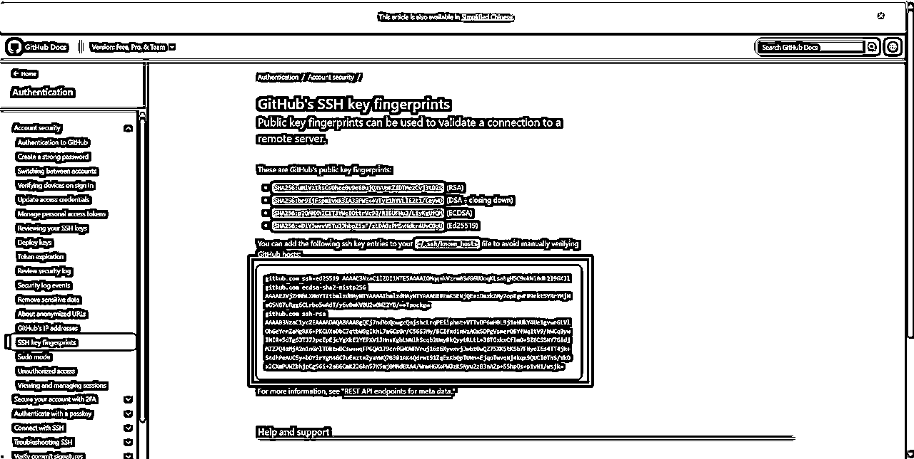

然后到 .ssh 目录下新建一个名为 known_hosts 的文件，注意不要带 .txt .exe 等后缀，就是一个纯文件名。

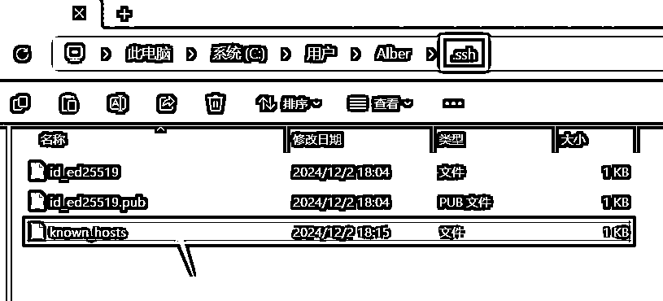

不会看文件扩展名可以参考下图：

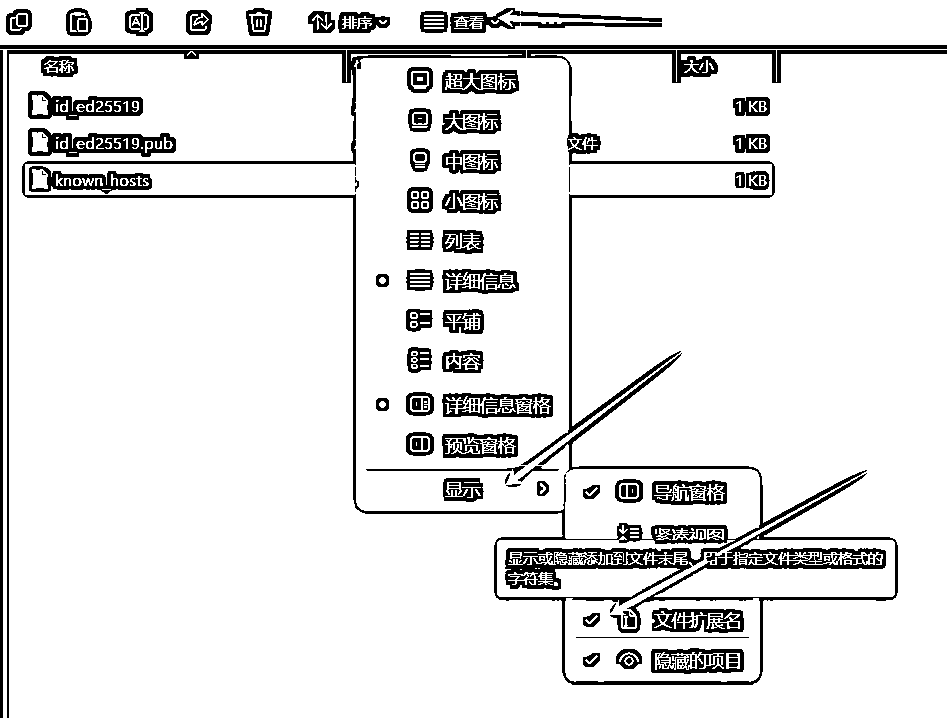

新建完成后用记事本打开，把刚才复制的内容粘贴进去保存。

到这一步你可能仍连不上，继续看下一个问题。

### 问题7：报错 Cannot stat C:\\Users\\Alber/.ssh/known_hosts: No such file or directory

问 Cursor 会得到类似下图的建议，这里重点看红框。默认情况下 .ssh 目录是只读的，需要取消只读属性。

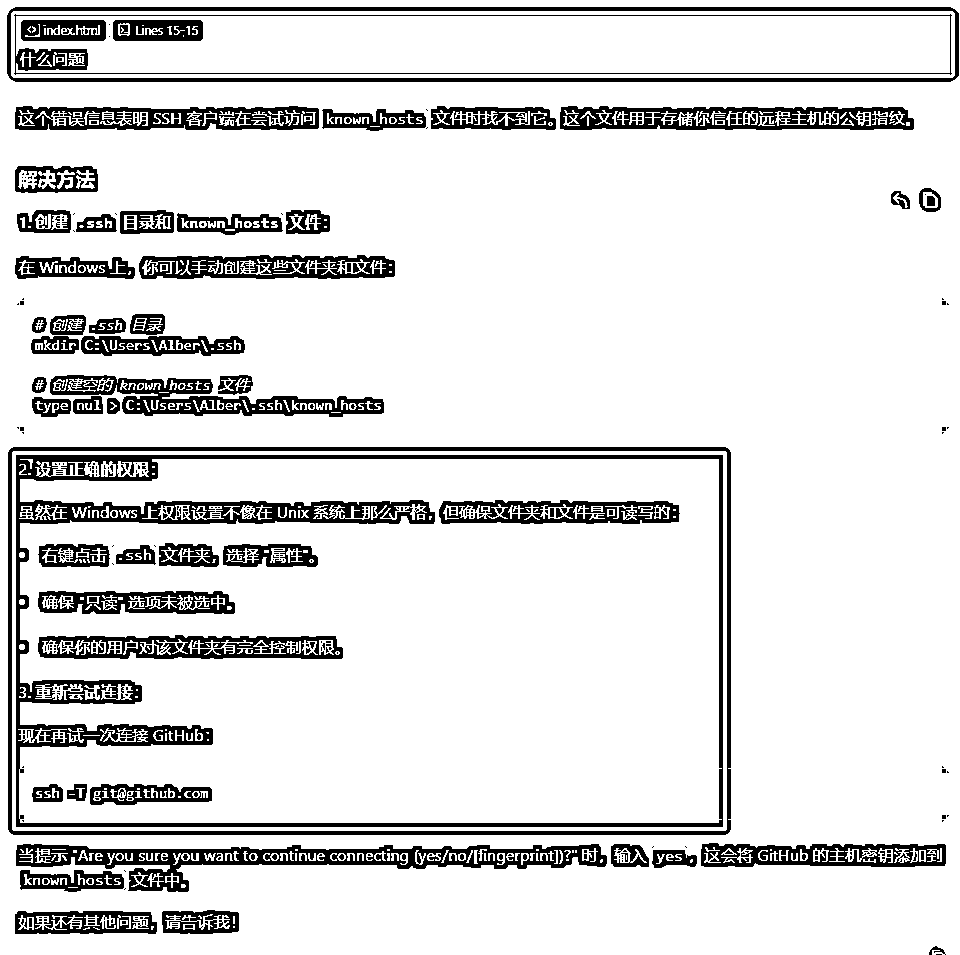

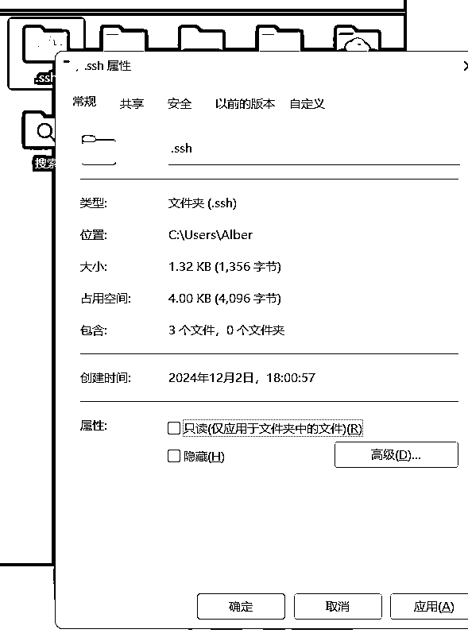

取消只读并应用后，我这边测试连接就成功了，虽然目录属性看起来又变回只读了，但实际文件已生效，不影响使用。

### 问题8：提示 Author identity unknown *** Please tell me who you are.

这是因为没有配置提交者身份，也就是 GitHub 账号信息，这项本该在安装 git 后就完成。

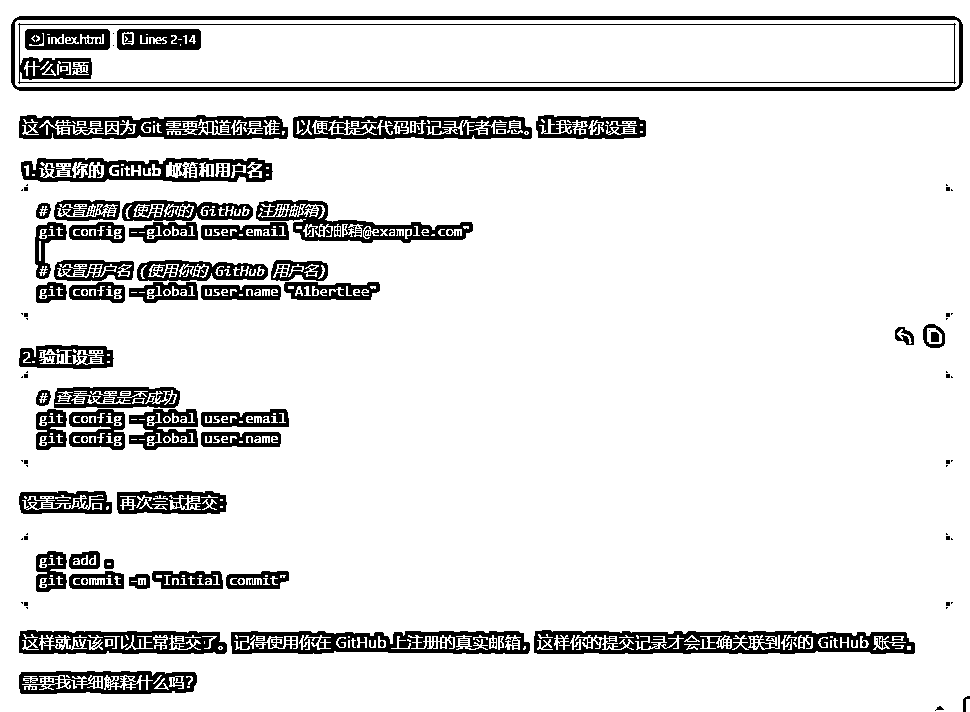

配置好后就能正常提交，并把本地代码推送到 GitHub。推送完后按手册要求，还有一个更麻烦的点。

### 问题9：🔥 怎么注册 Vercel？用 GitHub 登录时提示 Your account requires further verification. Please contact registration@vercel.com to complete your registration.

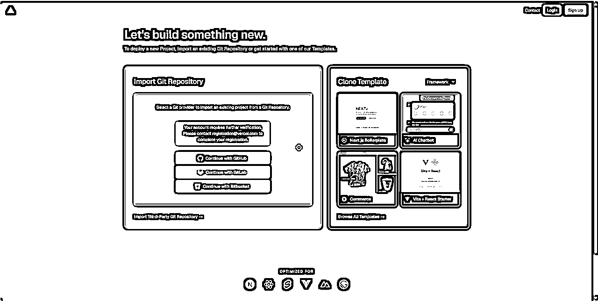

我当时在网上找到一个可行的办法，https://blog.csdn.net/weixin_52164430/article/details/143060297

核心就是给官方发一封申请邮件

邮件模板如下，自行修改后发送，记得删掉备注部分：

```
邮件主题：Registration issues
收件人：registration@vercel.com

（备注：复制下面的正文并修改）

Dear Vercel Support Team,

Hello! 

I am reaching out to you because I encountered an issue during the registration process on Vercel. After completing the registration, I received the following message: 

Your account requires further verification. Please contact registration@vercel.com to complete your registration. 

I have followed the instructions and contacted you, but I have not received any further instructions or verification emails. Here are some details that might help you assist me more effectively: 

github: xxxxx （备注：这里写github账户名）

截图

I am looking forward to your response and hope to resolve this issue as soon as possible. Thank you for your time and assistance.

Best regards,

a1bertlee（备注：这里写你的英文名）
```

邮件发出后官方通常会秒回，表示已收到并进入审核。等待不到 24 小时就会收到通过通知，成功率基本是 100%。

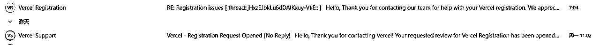

### 问题10：Cursor 怎么汉化？

直接参考下文里的中文插件配置，建议安装插件时把梯子打开，不然速度会很慢。