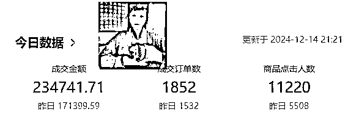
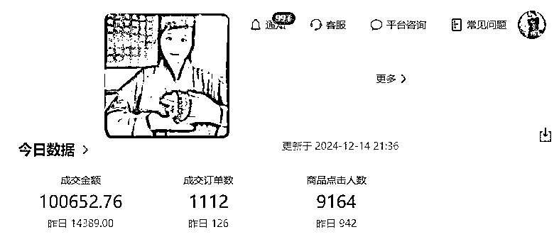
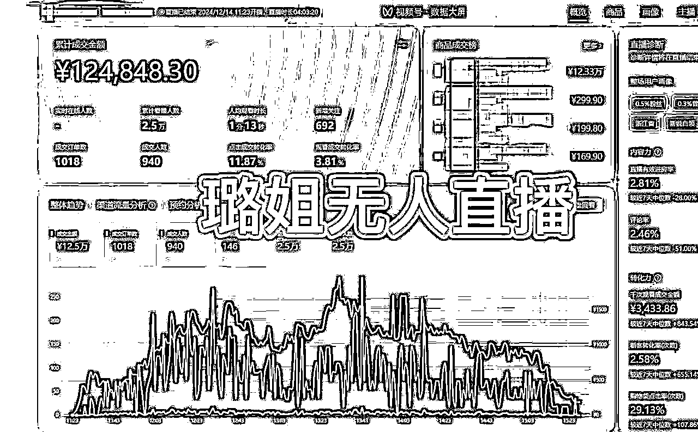
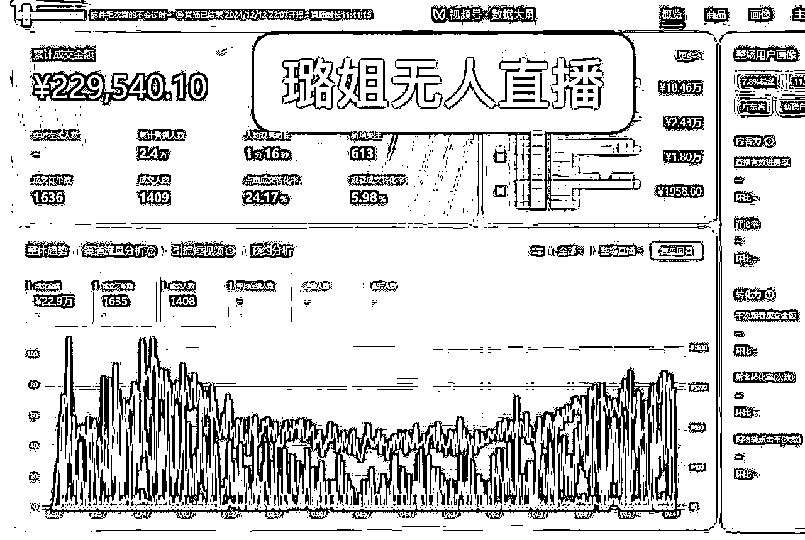
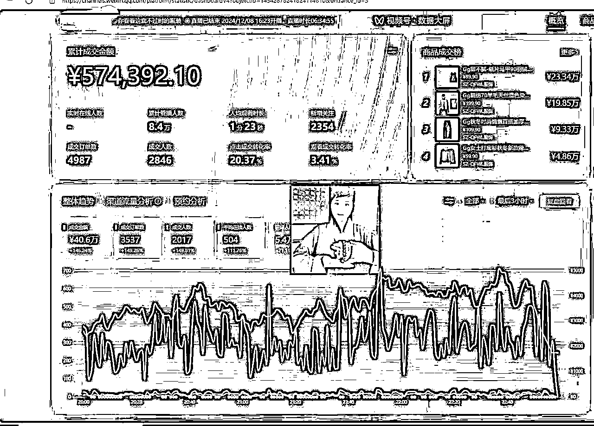
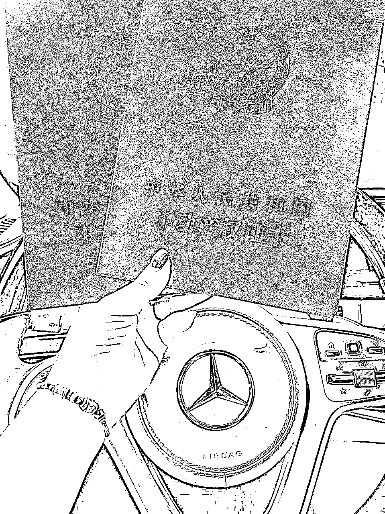
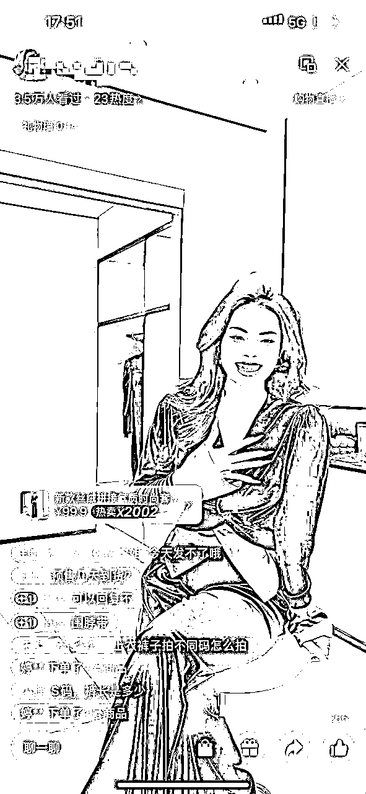
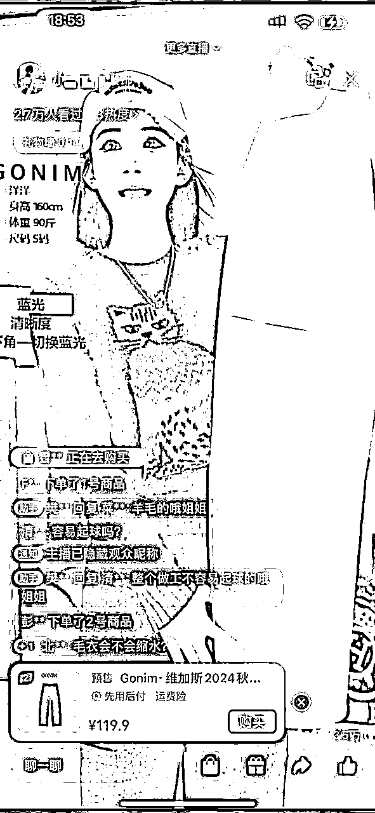
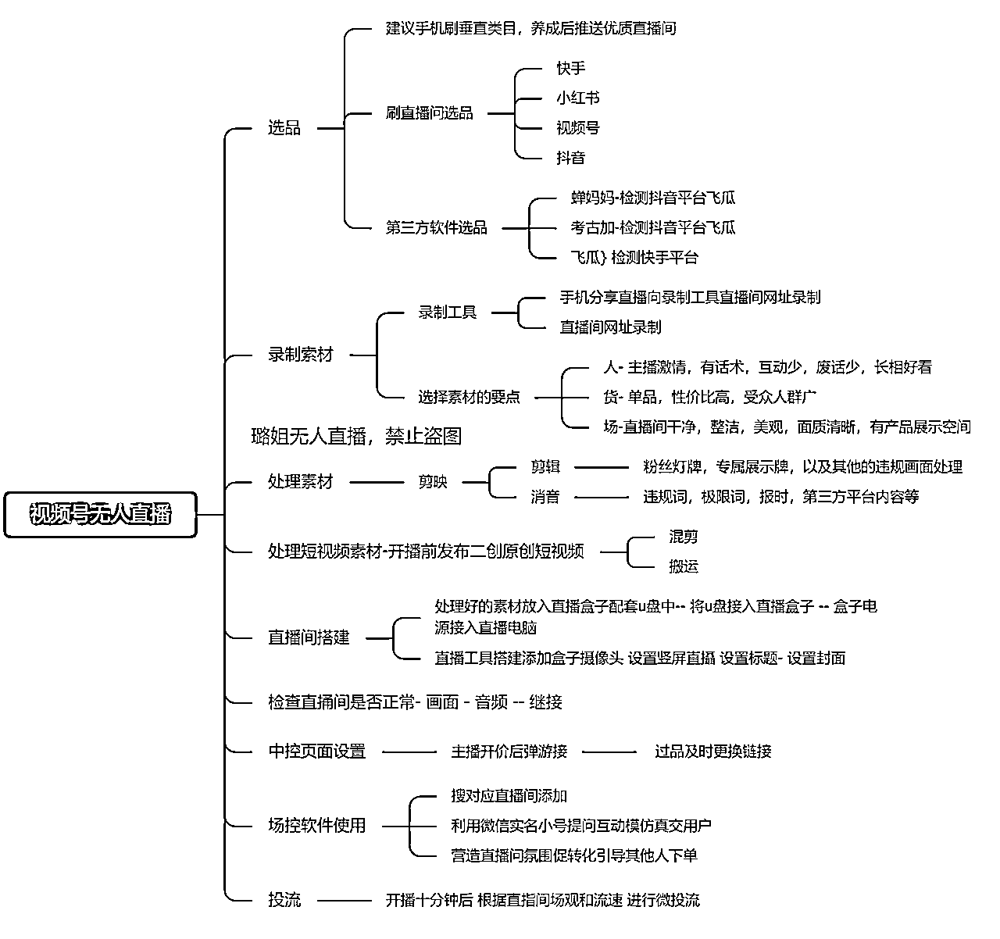

# 折腾了四年无人直播，终究是视频号这条路最香！附赠完整实操脑图

跟我熟的赚钱老友都知道，我在无人直播这条赛道里已经深耕四年了。从义乌那间逼仄的小单间，到如今杭州五百平的团队办公室，平台也从快手切到抖音再回快手，反反复复试错、大起大落。直到今年9月，一个同行私聊我一句：你做视频号无人了吗？这句话点醒了我，原来这块机会一直都在。

前两天刚拿到龙哥盟的传术师身份，实在太激动了。看到群里大佬们都在分享干货，我也得拿出点真东西。所以连夜整理了这篇笔记，希望对还在摸索的圈友有帮助。

一定要看到底，文末有无人直播电商实操思维导图送上。

# 视频号无人直播的真实战绩

这阵子我沉下心小半个月研究视频号，已经锁定了靠谱的供应链和号源，有需求的兄弟我可以对接。

先晒个战绩，数据都是团队自己操盘的，真实无水分。

重点划三遍：不废号、不封号、不炸号！

真的有点后悔，当初要是早半年all in视频号无人，路子能更顺。

如果你对无人直播的底层逻辑还陌生，可以回看我以前写的抖音无人直播拆解，玩法内核是通的。

别再来问我无人直播能不能做，能不能赚钱了。

做不好我也不会在广州付两套房首付，开一辆奔驰一辆宾利。

怀疑的声音没意义，真正关键的是把玩法套路和底层逻辑吃透。

# 真人直播电商到底难在哪

做过真人直播的老玩家都明白，这条路有多重负担。

## 人力与运营成本太重

一套完整的直播间需要主播、助播、中控、运营。光出镜主播一个月起步1.5万加提成，有经验的中控也得一万出头，到头来老板的到手还不如主播。

再加上要做投放拉新，成本只会更高。

## 库存和履约压力大

直播是脉冲式爆发，一场爆了可能瞬间几千单。备货太多压资金，太少断货差评，对库存和物流的考验极大。

## 利润被层层分走

平台抽佣、主播分成、同行低价战，产品毛利被不断挤压，越卷越难赚钱。

## 技术门槛和稳定性要求高

画面卡顿、声音失真、掉线直接等于掉单。需要投入不少在设备和技术维护上。

# 为什么视频号无人直播值得all in

视频号站着腾讯和🛰️这两个巨头的肩膀，流量池、社交关系和转化闭环都非常完整。

## 社交引流天然有优势

🛰️十多亿活跃用户背后是熟人社交的信任背书，一条直播内容很容易裂变传播，受众精准且消费意愿强。

## 变现能力强

直播带货、商品橱窗、广告投放多渠道并行，客单价能扛得住，客群消费力高，退货率也比抖音快手低很多。

## 上手门槛低

操作界面简单，无需专业培训就能开播。前期投入和试错成本远低于其他平台，非常适合个人和中小团队。

## 技术这块不用操心

腾讯自家底座，画面清晰、延迟低、稳定性强，直播体验很顺滑。

官方说的好听点就是生态完善，实操层面就是：视频号更适合卖高客单、复购率高的好货，用户素质更高。

# 无人直播的底层优势是什么

## 人力成本直接清零

没有主播、没有助播、没有控场，24小时自动跑。人工成本和日常维护成本都大幅下降。

## 硬件投入大幅缩减

不需要租直播间，不需要专业灯光摄像机，一台电脑就能搞定。

## 内容更灵活可迭代

靠大数据和脚本自动匹配用户偏好，个性化推荐更精准。素材可以反复测试优化。

## 变现方式更多元

既能卖货转化，又能接广告投放，直播间本身就是一个持续获客的资产。

## 稳定性更高

提前录制剪辑好的内容自动播放，避免了真人直播的临场失误和技术事故。内容质量可控，可复用性强。

# 视频号无人直播现在卖什么

目前主力品类是女装，临近过年换冬装需求旺盛，客单价控制在120元左右，转化最好。男装主推户外风衣、马甲。

另外生鲜、酒水类目也在跑。

我手上的供应链复刻度很高，原版链接基本能达到95%相似度，直接搬运即可。

重点

# 视频号无人直播实操思维导图

附赠

# 无人直播电脑配置清单

● CPU：12400F / i5级别
● 内存：16G 推荐
● 硬盘：3T 机械盘，素材多必须大
● 显卡：2060
● 网络：不限运营商，上行带宽50M以上，单机必须单IP

核心就是硬盘要大，网络要稳，单机单IP千万别省。