# 别急着说👸号没戏了！科技号的红利还在，还能靠 AI 批量吃到流量

嗨，我是柒，也有人叫我晓智。炼丹家AI工具的发起人，长期深耕 AI 写作、AI 绘画相关内容，累计服务用户超10万。

科技类软件👸号大盘收益在走平，但机会窗口依旧存在。关键是用 AI 把个人耗时压到最低，把矩阵产出速度拉到最高。

下面就把我实操的科技软件号运营方法拆开讲，重点落在第四章《软件合集文的快做方法》，一篇文章2000字左右，拿着就能用。

# 一、为什么现在还要做科技号

①行业现状：🛰️上的科技软件类账号整体增速放缓，没有持续堆价值内容，很难看到新增用户。
②做号意义：内容质量提升了，IP才有记忆点，才会把路人转化为持续关注的铁粉。
③写给谁看：这篇就是给写软件文写到疲惫、产出卡壳、想省时间做矩阵的运营者准备的，帮你更快迭代、复盘、拿到高阅读。

# 二、账号怎么定位才吃香

①人群画像：以互联网小白为主，追新科技资讯、痴迷黑科技工具和操作技巧，多为年轻群体，执行力强、嗅觉灵敏、爱搞副业变现，付费意愿相对偏低。
②内容赛道：聚焦实用软件盘点、AI工具实战、副业变现案例、软件保姆级教程、行业科技动态等。
③差异化打法：做成保姆级解读，信息密度高、互动性强，让读者愿意点赞收藏。

# 三、内容怎么做才有留存

①软件合集：以合集形式呈现，一目了然，满足用户一次性扫完的需求。
②AI内容：紧跟AI热点案例，输出工具实测、技巧拆解、落地教程。
③副业变现：用最细致的教程还原真实副业路径，让用户感觉离赚钱更近。
④软件教程：热门工具的完整流程拆解，解决痛点问题。
⑤科技资讯：捕捉行业动态和时事热点，加入个人观点，提升内容厚度。

# 四、软件合集文的速成打法

对标的是科技软件类博主的爆款合集文。对读者而言单篇价值感极强。

提示：文中配图仅作参考，并非指向具体号。可以直接在🛰️、知乎搜索关键词「黑科技软件」「XX款软件」就能看到大量范例。

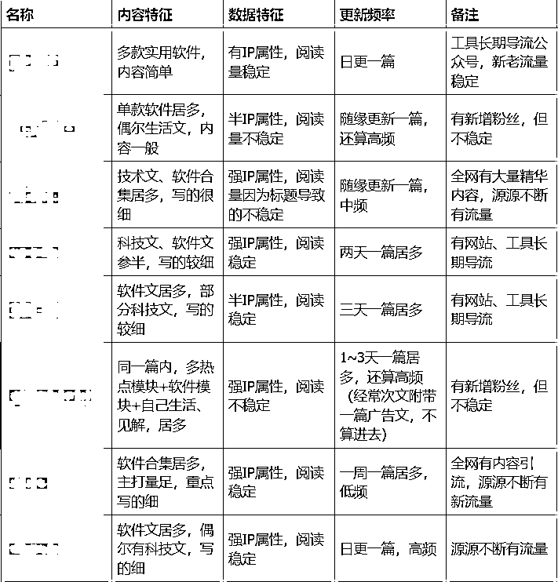

标题打法：要吸睛、要抓人，普遍走标题党+封面冲击路线。

软件类标题生成

示例入口：炼丹家AI - AI灵动模板 - 科技软件标题党

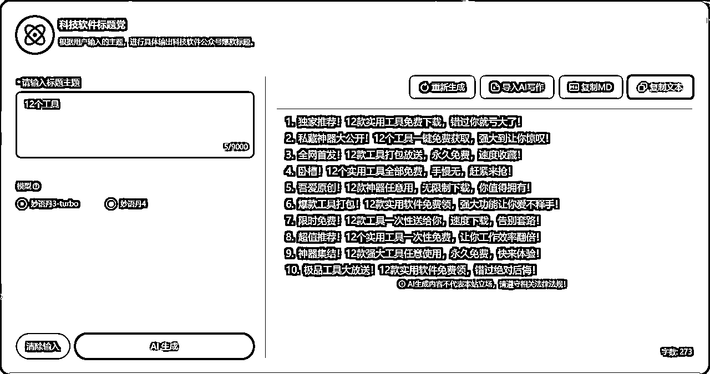

封面制作：尺寸 900 x 383

①进入炼丹家AI - 图片广场，挑出喜欢的风格。
②点“一键同款”。

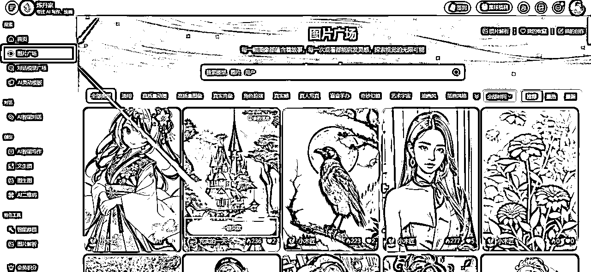

③重点调整尺寸为 900 x 383、数量以便筛选。

注：还能进一步自定义绘画模型、提示词参数等。

开头段落：语言简洁、逻辑清楚，适当带点情绪和人设感，强化IP味道。

软件文章开场助手

示例入口：炼丹家AI - AI灵动模板 - 软件文章前言助手

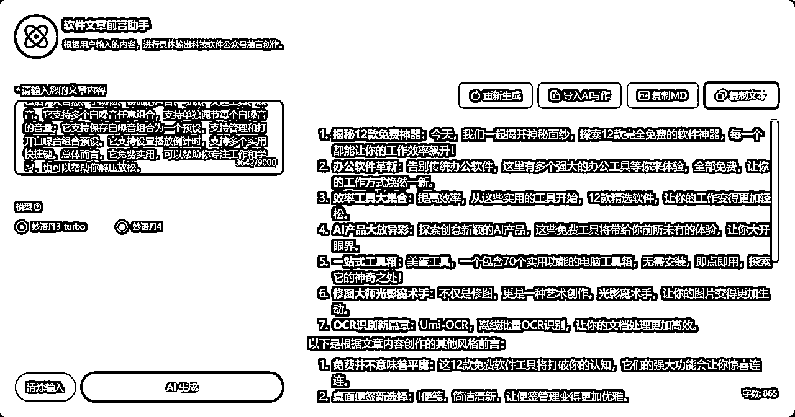

正文搭建：思路清晰、分层明确，文笔一般就直接给用户要点。

注：可以先搜集各软件的官方介绍，提炼拼接成完整段落。提示词已深度调优，但建议人工再润色一遍，效率与质量兼顾。

软件文章内容助手

软件合集示例入口：炼丹家AI - AI灵动模板 - 软件文章内容助手

软件合集示例

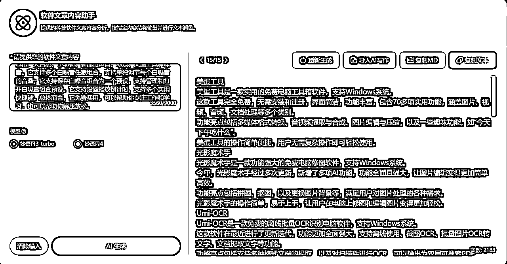

单款软件示例

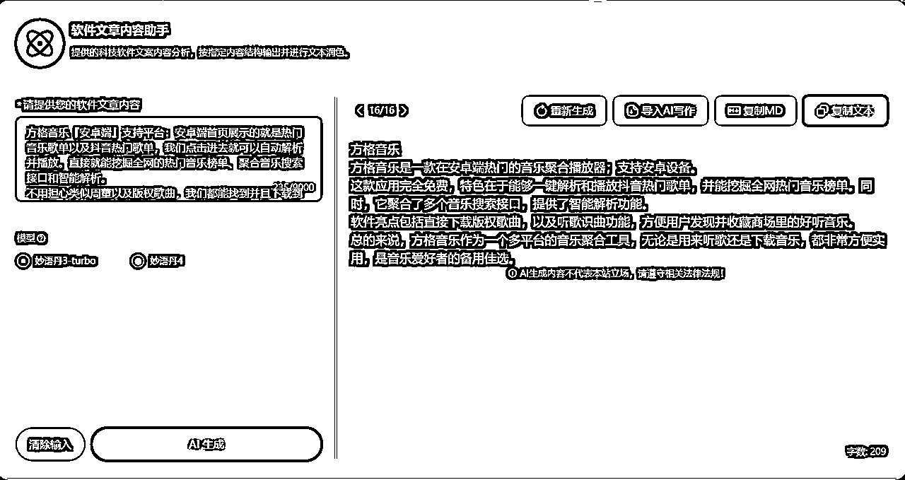

常用结构：标题 - 前言 - 软件模块① - 软件模块②...

注：排版模板网上很多，挑一套喜欢的改成自己的风格即可。

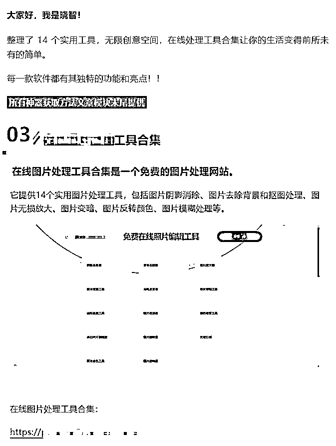

补充工具：本文第四章用到的工具为炼丹家AI官网：https://www.liandanjia.com/

②文字功底好的，完全可以持续优化自己的AI提示词，不会被工具限制；我本人文笔普通，所以更依赖提效。

# 五、互动与放大

①回复：积极回留言，提升粉丝粘性。
②互推：和其他同类👸号做资源互换，扩大曝光。
③社群：搭建🛰️群、🐧群，做更深的私域互动。
④矩阵玩法：单人搭建50个👸号的操作思路：

准备清单

新注册一个订阅号，需要准备：

①一个全新邮箱，如🐧邮箱、网易邮箱、新浪邮箱等
②一个手机号，同一手机号可复用多次
③一个👸号名称，避免重名、敏感词
④一个身份证号，个人最多1个、个体户2个、企业资质可达50个+，规则动态变化
⑤一个未绑定过👸号且已开通支付功能的🛰️号，用于扫码登录，单个🛰️号可绑定10个+

一、订阅号注册流程

1.打开🛰️公众平台官网

网址：https://mp.weixin.qq.com/

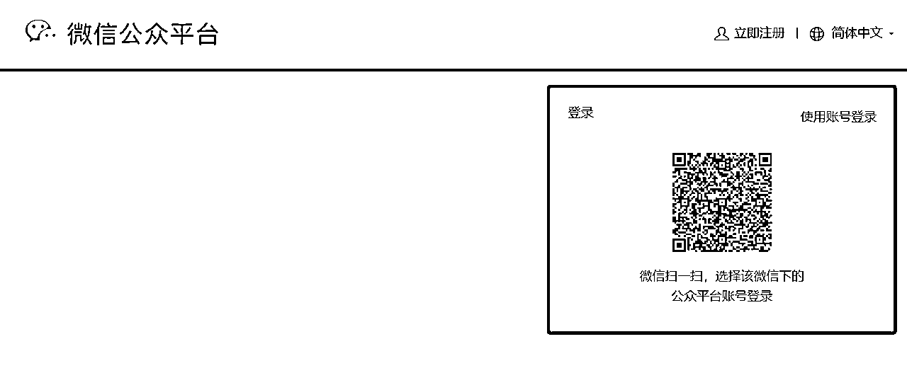

2.点击右上角立即注册，选择订阅号

按需选择账号类型，这里演示订阅号。

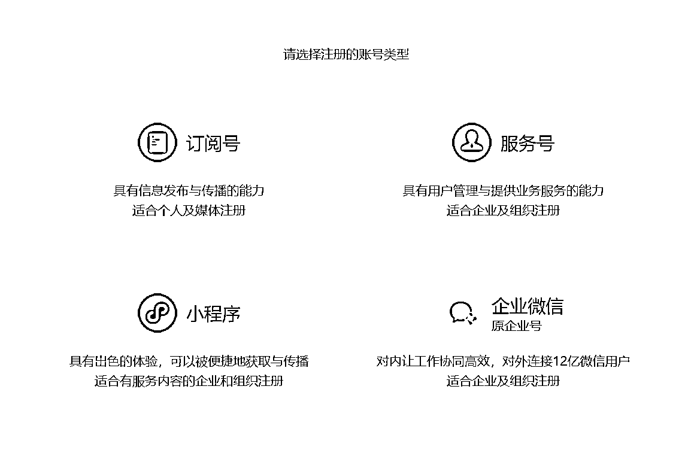

3.填写资料

基本信息 -> 选择地区中国大陆 -> 信息登记 -> 按需选择账号性质 -> 👸号信息填写用于登录的🛰️

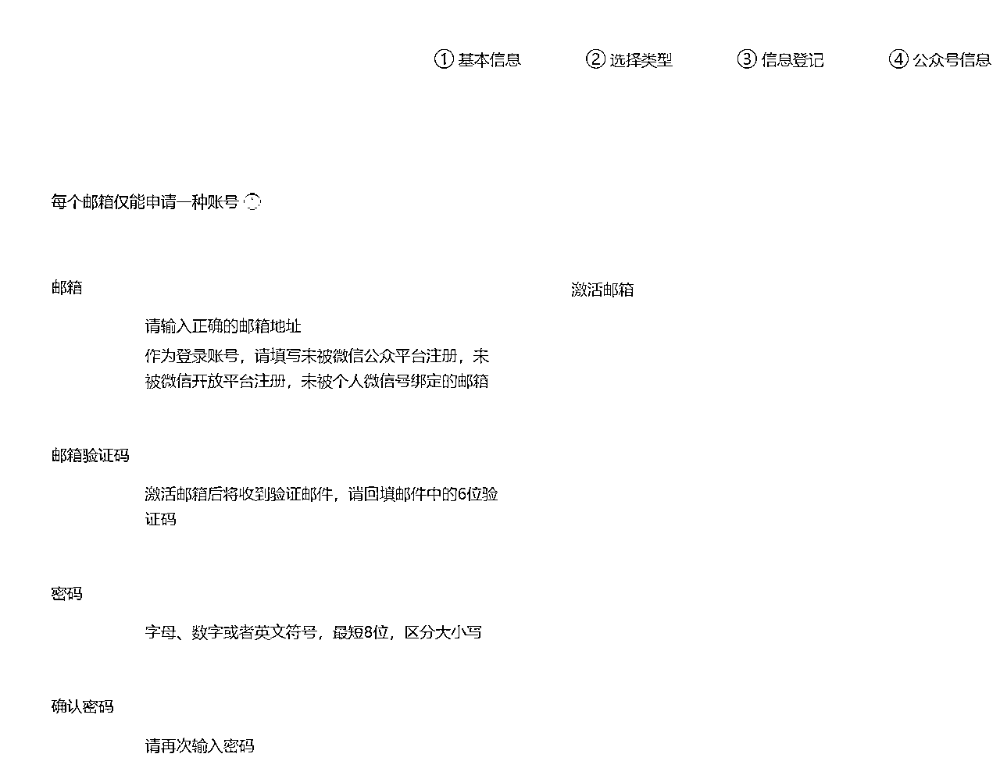

4.信息登记页选择“企业”方式注册。

同一个企业主体，正常可创建50个👸号。

同一个体户，正常可创建2个👸号。

个人身份证，正常可创建1个👸号。

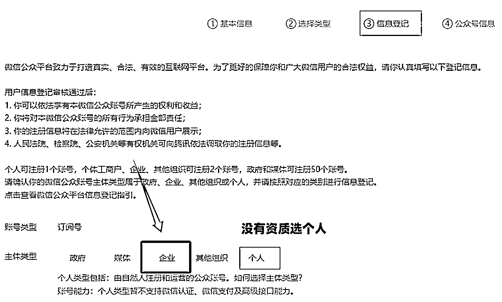

# 六、收尾总结

①核心判断：👸号现阶段偏公域、半私域，内容为王必须重视。
②阅读量提升：紧跟热点，稳定产出高质量内容。尤其参考数据榜上近一个月低粉高爆文，以及长期稳定爆的选题。
③爆款效率：借助AI快速铺量，抢流量、拿收益。
④变现路径：广告投放、带货分销、私域转化...变现不难，核心是先做流量。一起加油！

⑤工具集中地：文中第四章工具统一在炼丹家AI官网：https://www.liandanjia.com/

写作模板覆盖绝大多数场景，快速一览：

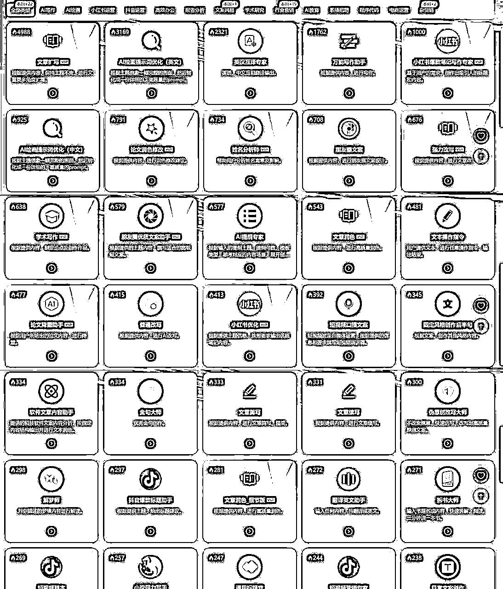