# ('黄金买卖/代购项目分享-省钱有术', (2, 18))

黄金首饰去哪儿买？先别急着冲品牌店，深圳水贝了解一下。

这里可以说是全国贵金属的批发集散地，黄金、白银、铂金都在这儿集散。价格怎么算？就是上海黄金交易所的当天金价，再加上每克十几块到三十几块的工费，常见工艺这个价足够了。对比一下：品牌店每克普遍贵上近200块。30克的手镯，分分钟省五千多。至于款式，水贝几乎什么款都有；纯度，正规柜台也靠谱。买首饰不就图个好看和放心嘛。

不管你是爱买首饰的姐妹，还是想给女朋友/老婆/家人买金的兄弟，这条省钱路子真的值得收藏。

先声明一下，这就是个实操分享贴，没有任何商业合作。深圳，如果看到了请记得给我打钱哈哈。

之前我想拿旧金去品牌店以旧换新，某凤祥给我算：旧金折价50元/克，新工费再加50元/克，当时它家金价还比水贝贵181元/克，里外里每克多掏两百多块，心都在滴血。自从摸清水贝的路子，真的“省钱有术”了。

先说怎么去。地图直接搜“深圳水贝”，满屏都是珠宝大厦。外地朋友可以高铁到深圳北站，或者飞机到宝安机场，然后导航到水贝地铁站，或者金展珠宝广场、水贝金座、水贝银座都行。

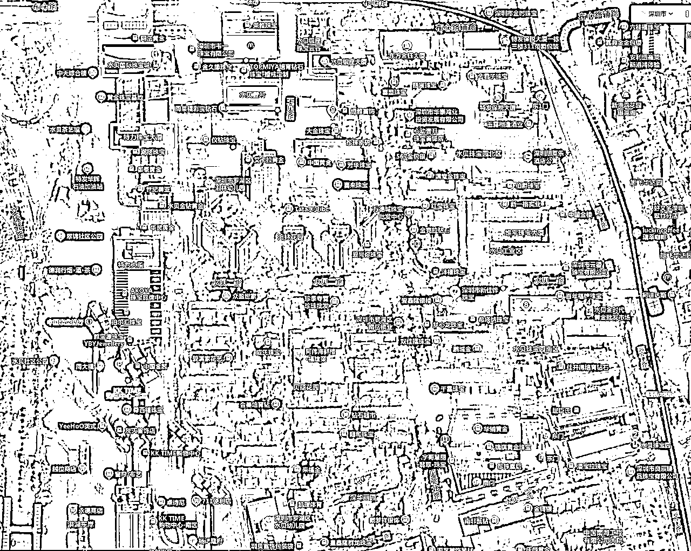

买之前，先看实时金价。微信小程序搜“融通金”或“今日金价行情”，国内买卖金价实时变动；也可以打开上海黄金交易所官网，数据最权威。

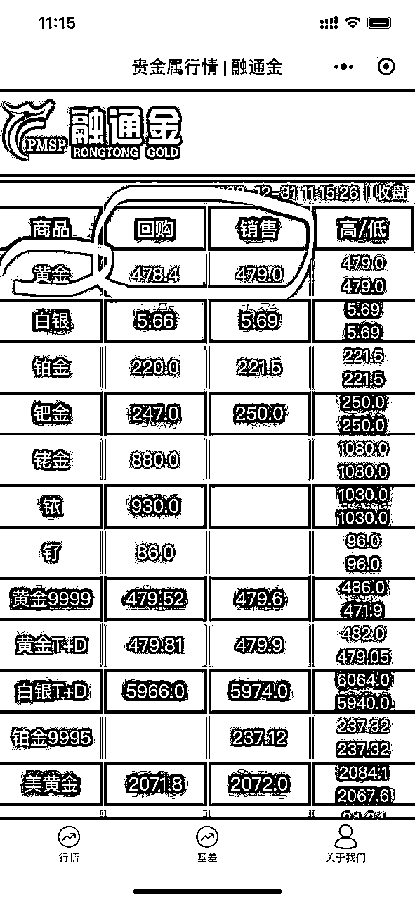
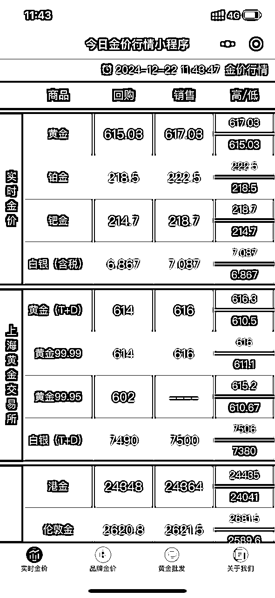

接着科普一下纯度：足金999也叫千足金，含量99.9%；足金9999也叫万足金，含量99.99%；这两种放心买。至于18K金（含金75%）和足金99%的饰品，知道一下就行。

到了水贝，买金流程很清晰：
- 优先挑按克卖的商家，水贝大多数柜台都这样。
- 问价直接问：“老板，今天金价多少一克？”一般按当天上金所价格，但个别小店会加价，多问一句不吃亏。
- 看中款式后，再问是足金999还是9999，顺便问工费多少一克。普通工艺十几到三十几块一克就算合理。就算碰到卖镀金产品的小店，老板也会表明，毕竟有监管。

不方便亲自来的，也可以让深圳的朋友帮买，或者找代购——选代购要自己擦亮眼睛。如果春节有空，干脆来深圳/香港玩一趟，顺手买金，南方冬天暖和，旅游+省钱一次搞定。

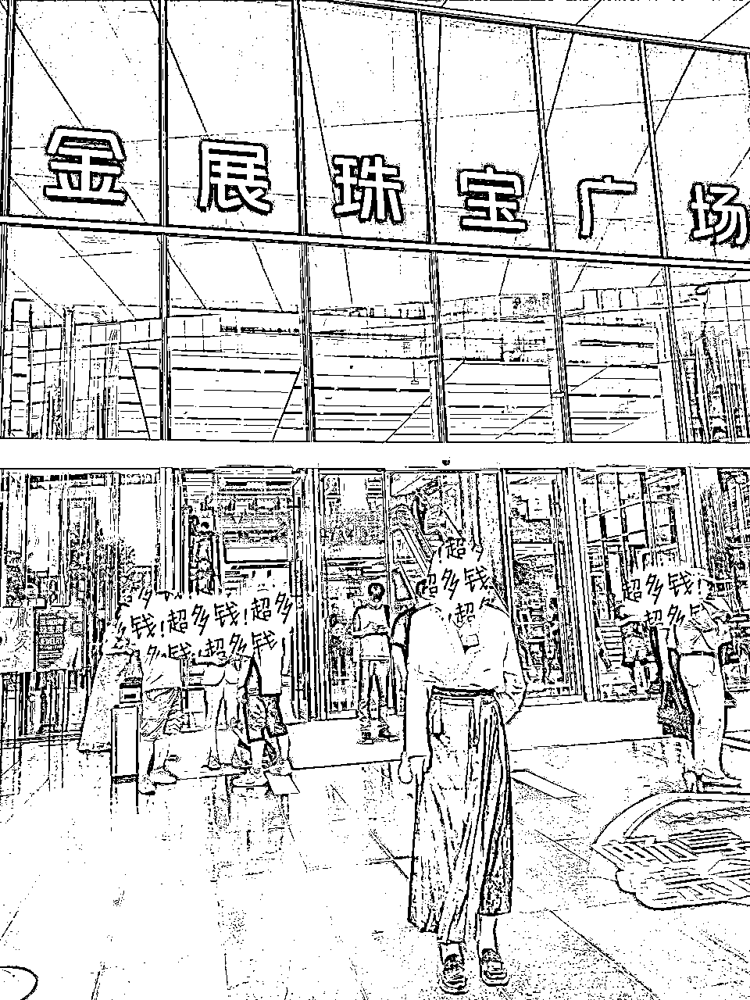
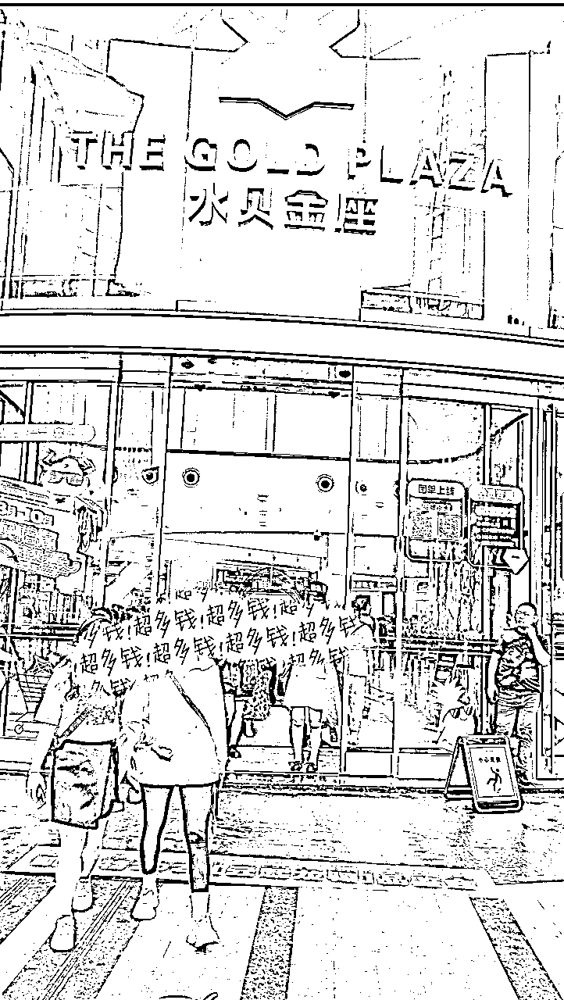

这里有个重点提醒：别被忽悠加价买足金9999。咱们算笔账：假设金价616一克，9999折算下来615.94元，999就是615.38元，每克差6毛钱，真的没必要加价。如果同一个价，那当然选9999。记住：回收的时候也是按这个逻辑折算的，后面会再说。

第一次去怕买到假货？水贝正规珠宝大厦柜台基本没问题，实在不放心，楼里就有珠宝检测中心，可以花5块到十几块做个证书，求个安心。如果买来送人，水贝便宜就在没有包装，需要自己去旁边的精品店买礼盒，几块到几十块都有；问一下店家哪里能买，通常一个楼层就能搞定。自己戴就直接戴上，省一个是一个。

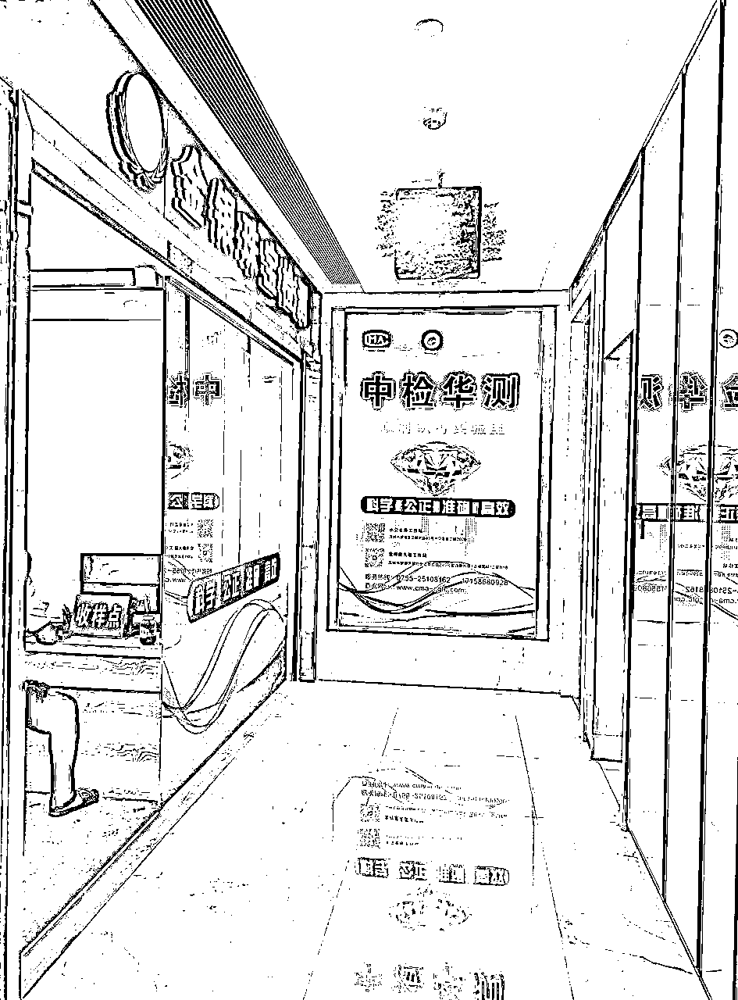
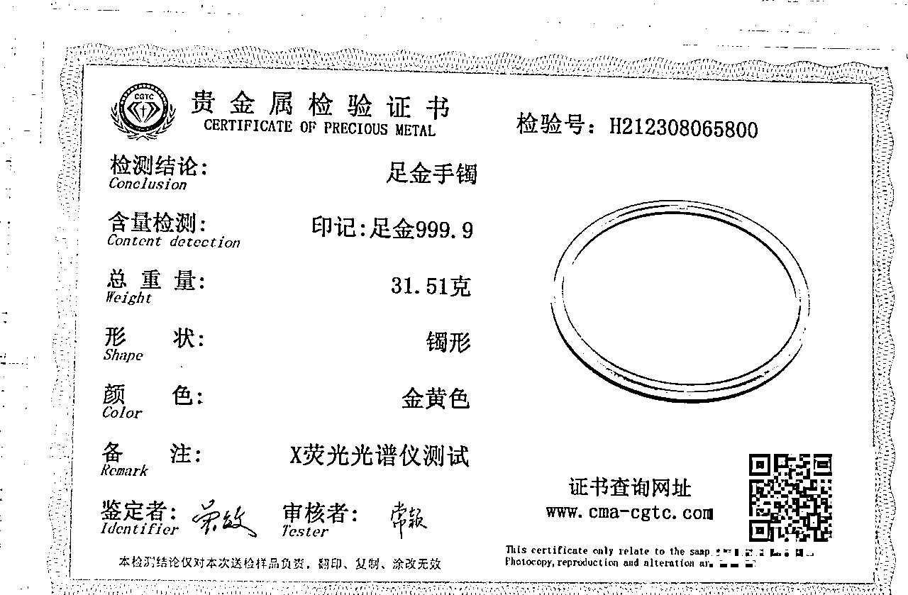

说完买，再说卖。卖黄金一般两条路：
一是去家附近的黄金回收店，但店家通常会在当日金价基础上减10到50元/克。
二是用“融通金”公众号，有实体店，也能顺丰邮寄，买卖都按当天上金所实时价走，中间的损耗基本只在一个手工费上。碰上金价上涨，其实还能赚。这对经常想换款的人来说太友好了，比某福、某凤祥一克便宜一百多块。

有个细节要注意：卖的时候，除了银行买的9999金条，其他首饰基本都按足金999来回收。而且有些卖家会先融掉再测纯度，可能显示998甚至997，这是正常的。举个例子：一个手镯买入31.51克，卖时称重31.49克，纯度99.7%，当天金价480.54元/克，折算下来相当于31.39克，损耗也就58块左右，基本可以忽略。这要是放外面金店，一克先给你减个几十，亏大了。

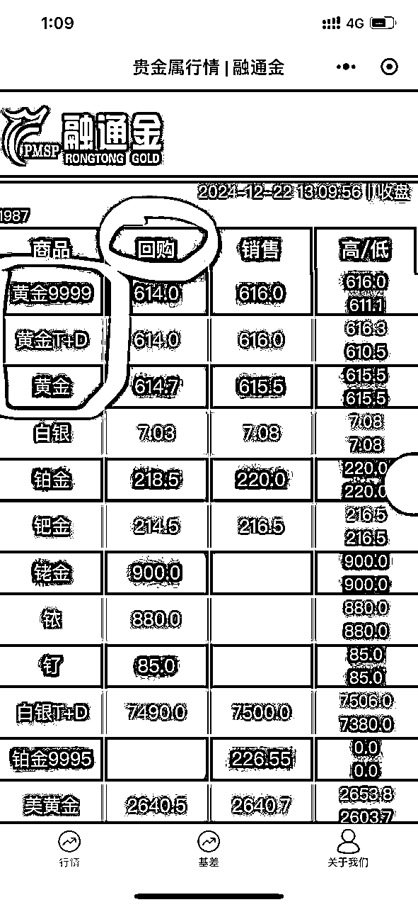
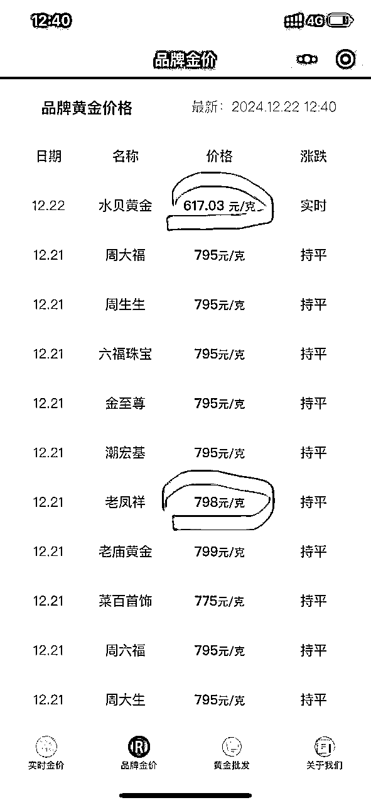

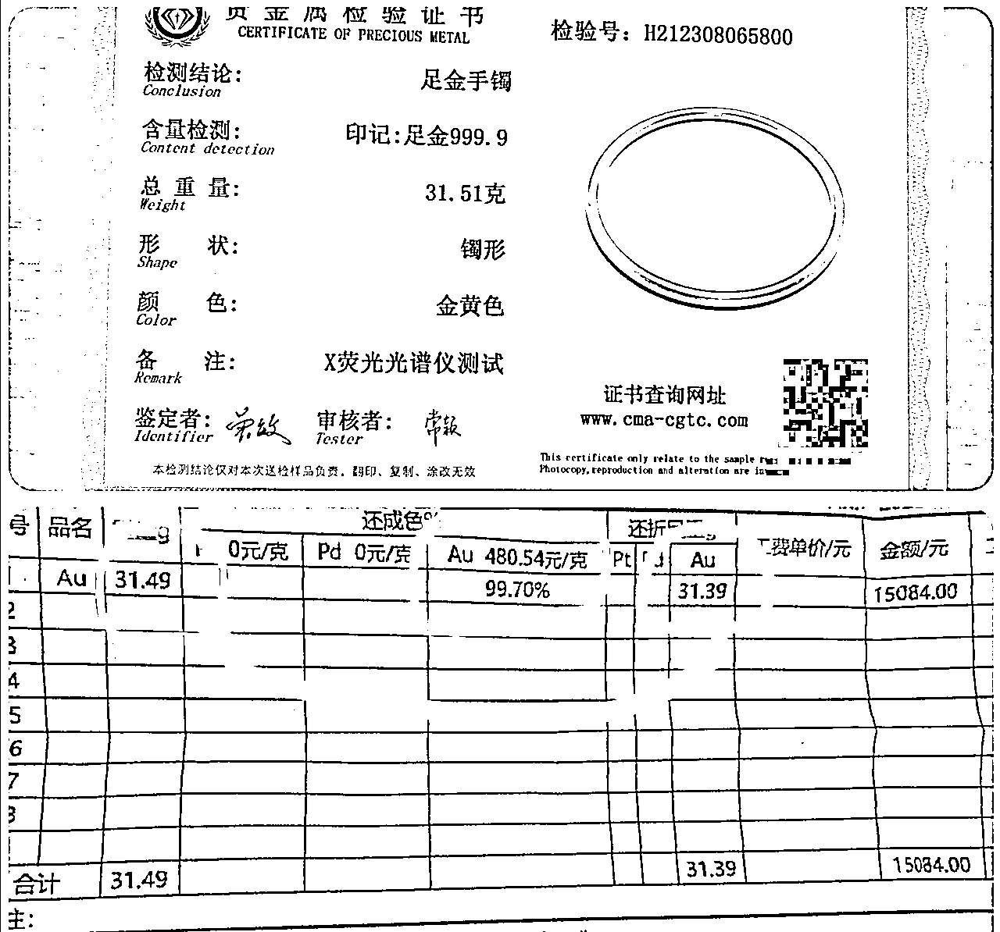

另一个手镯也一样，按实时金价卖，融掉后测出99.8%或99.7%，重量和纯度略低，既有自然磨损，也可能有店家要赚一点的因素，只要在合理范围内都能接受。

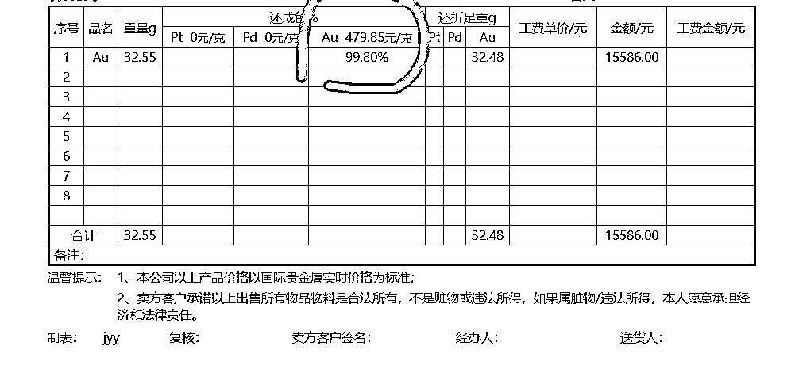

如果你不仅想省钱，还想靠黄金赚点小钱，可以研究一下水贝代购。
打开小红书、抖音、视频号，搜“水贝黄金代购”，能看到一大波同行，翻翻评论区就知道市场需求有多旺。

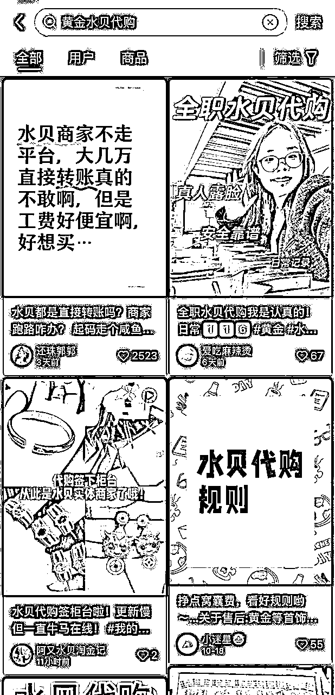
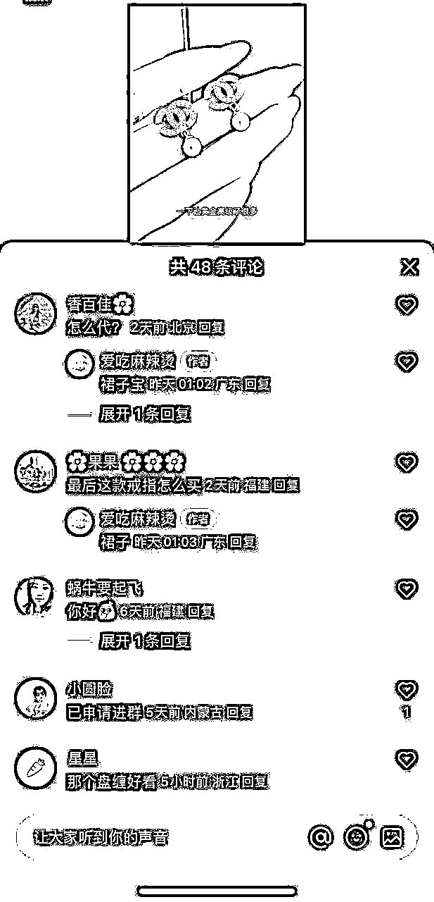

做代购最好住在深圳，离水贝近一点，方便真人出镜拍视频，也方便帮客户一件件挑款式。

拿货也不难：去店里找老板开个户，免费，提供姓名、电话、银行卡就行。直接说你是做代购自媒体的，以后在他家拿货。即使出货量还不大，老板一般也会按正常客户价给你。水贝这边的金价+工费，和品牌店零售价比起来，差价能到差不多200元/克，代购的利润空间相当大。

开户后加老板微信，朋友圈每天会更新新款，沟通和选款都方便。

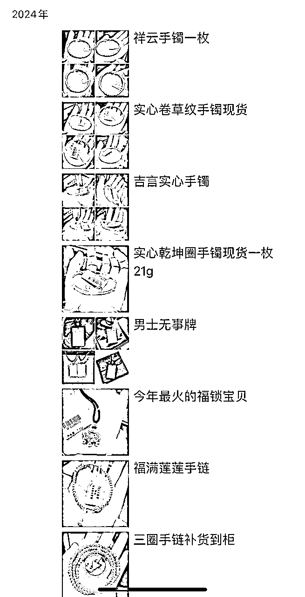
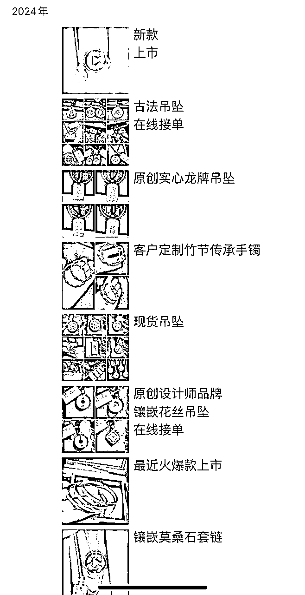
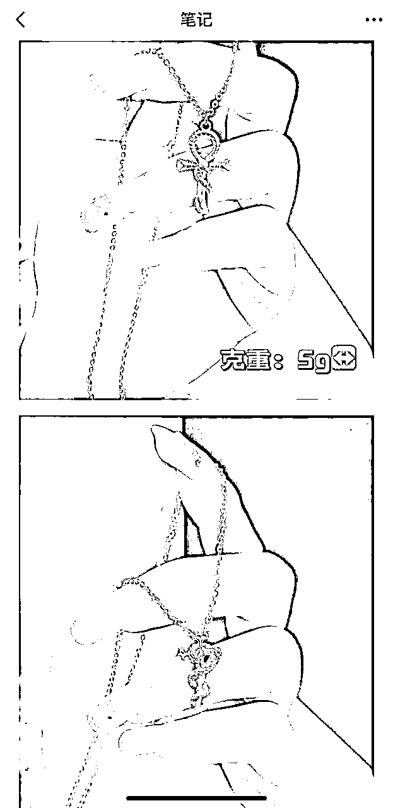
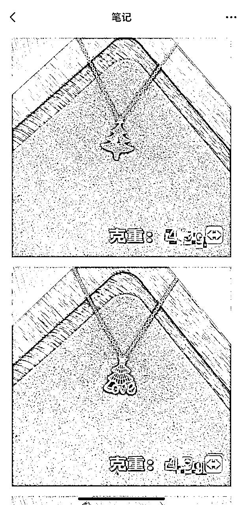

代购的盈利模式就是赚差价。低克重的小饰品，可以收个跑腿起步价；克重大的，每克加10元以上，具体自己定。不知道怎么定价？可以先去同行的引流群里蹲一蹲，加几个同行微信围观一下，看看他们怎么发圈、怎么报价，行业门道很快就能摸清。

再进阶一点，还可以跟店铺合作，或者让店员做直播带货。这篇内容主要分享自用省钱，顺便给代购思路起个头。反正核心就一句：会买会卖，省钱有术；懂得玩法，生财有术。

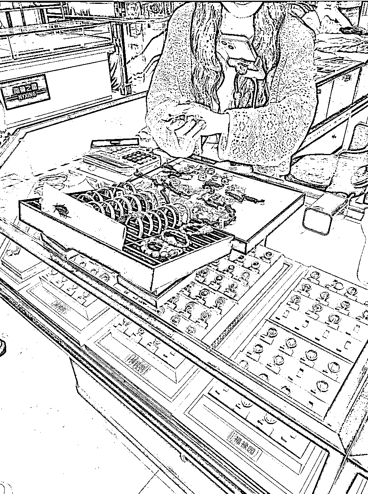