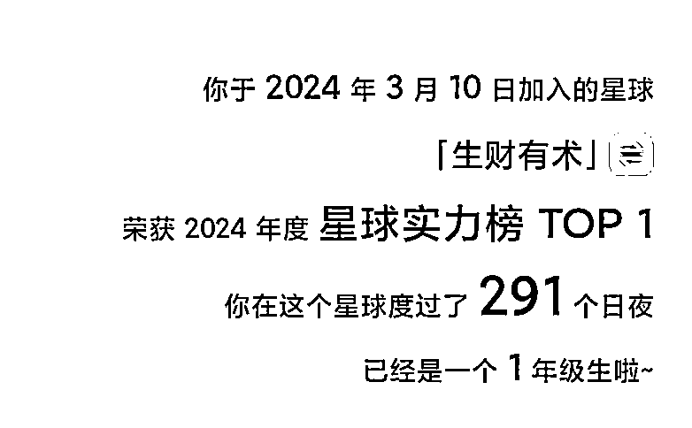
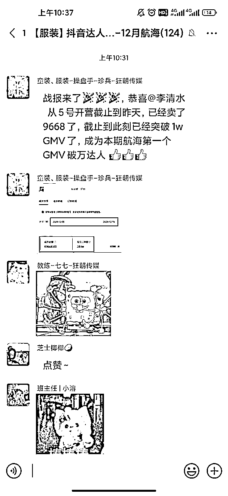
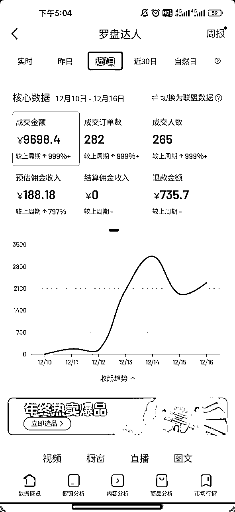
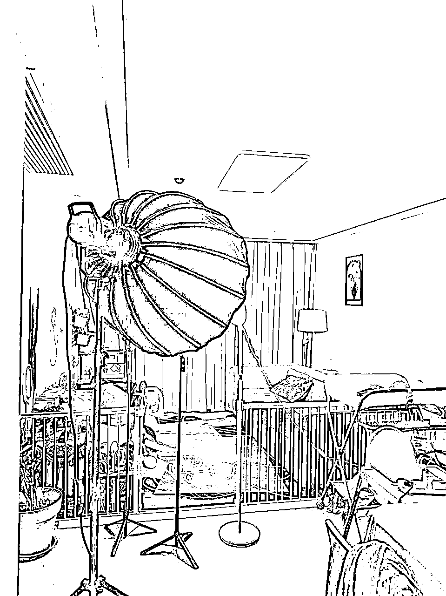
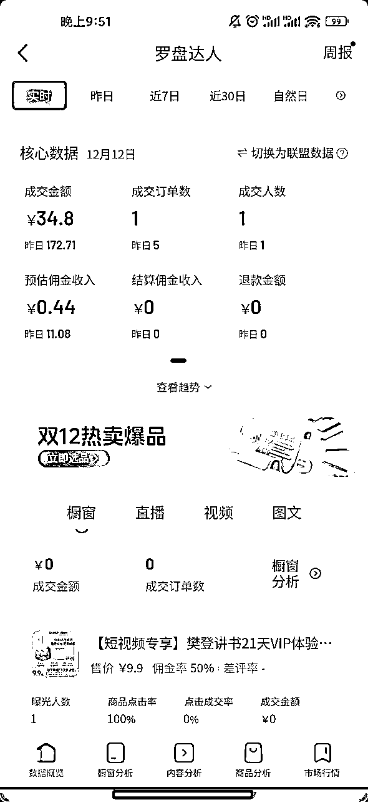
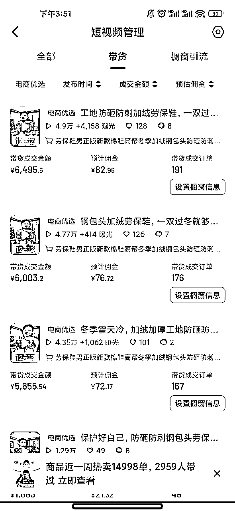
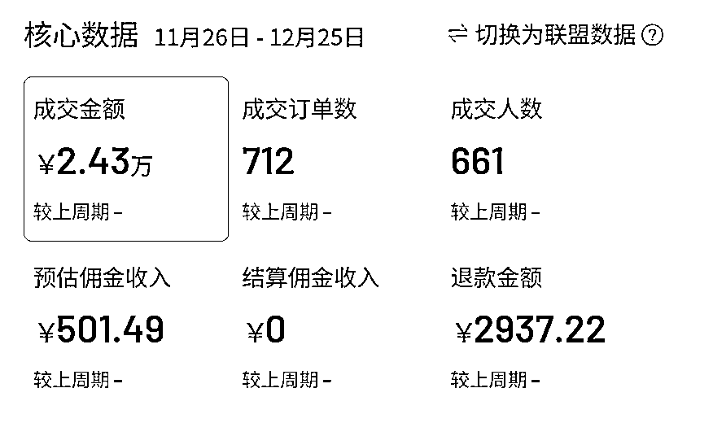

# 为什么长途航海是普通人最稳的破局点？一次抖音达人7天破万GMV的实操复盘

> 来源：[https://eim9fzbtjyh.feishu.cn/docx/UitldngxkoI0xWxMg1zc61Nsn7g](https://eim9fzbtjyh.feishu.cn/docx/UitldngxkoI0xWxMg1zc61Nsn7g)

# 先做个自我介绍

大家好，我是清水，生财有术的一年级学员。

现阶段身份是全职奶爸，还在摸索自己的长期主战场，兼做抖音达人、web3和小红书店铺。

# 我为什么要写这篇流水账

上次在视频号航海结束后，我发了一篇精华帖：

《视频号口播航海，新手第一次爆单1.8GMV，我是如何接住这波流量》

https://scys.com/articleDetail/xq_topic/4844185144884588

写完后我发现，生财上不只有大佬的深度方法论，也很需要像我这种普通人的过程记录和笨拙思考。那些刚入圈没反馈、正被焦虑困住的人，或许能从我的踩坑里得到一点共鸣和安慰。

# 长途航海，为什么值得押注

我现在没基本盘也没啥硬资源，就是个普通自由职业者。生财里跟我处境类似的人应该不少。

跟常规航海比，长途航海周期拉长，能把一个项目真正做透。它通常由一个团队整体带盘，方向更聚焦，专业度更高。对细分赛道的变现打法也更清楚，而且是共建共赢的关系，团队会更愿意手把手带。

对我这种容易迷茫、执行力需要被推动的人来说，长途航海几乎是唯一能真正落地的选择。

幸运的是，这次开营没多久就给了我正反馈。

# 这次的航海：抖音达人带货

12月我继续上了抖音达人的船，说是继续，是因为我之前刚从精致达人下来。

而且开营不到两周，视频上线一周左右，GMV就破了1万。

## 上一期精致达人，我是怎么废掉的

视频号口播停下来后，我一头扎进精致达人的航海，全程参与了两个月。

结果：也就零零星星几单，播放基本破不了百。从一开始的斗志满满，到后来只想快点结束。

失败是常态，但失败里往往藏着转机。

### 复盘失败原因

1. 预期拉得太满。看到同行月入几十万上百万，就以为自己也能。
2. 对自己不够精致。名字都叫精致达人了，我的模仿却很敷衍。
3. 复刻拍摄不专业。遇到效果差就怪空间、怪灯光，不去解决本质问题。
4. 航海期间品类偏女性，有些内容拍摄起来尴尬，自己也抗拒。

归根结底是不够用力，也不敢深究，发现不合适就开始摆烂了。

### 但收获也不少

1. 搞懂了在MCN体系下，达人需要做什么、流程是怎样。
2. 对不同赛道的选品、拍摄、文案、前期准备，两两个月下来基本熟了。
3. 清楚地认识到自己之前的视频有多粗糙。对比回头看视频号口播的作品，差距更明显。

## 这次为什么选服装达人

因为我有老婆。

她形象气质很合适这个赛道，先让她当副业试试，剪辑、选品、杂事我来扛。

航海前我还专门找了指导教练聊过，确认中老年服装是她能驾驭的。

更关键的是，之前两个月做精致达人，账号粉丝画像已经被养成了：小镇中老年人和都市银发人群。

所以精致达人被我不知不觉带成了“精致中老年”，现在转服装，简直是天作之合。

要素全部就位。

## 抖音达人带货的实操链路

再梳理一遍这次的执行路径，加深一下印象：

1. 第一周主要是理论学习，抖音带货的核心逻辑、达人成长路径。
2. 买粉开橱窗，一般起步3000粉，其中1000是有效粉，每天能发5条挂车。1万粉能发10条。精致类5条够用，服装建议直接上万。
3. 账号包装：头像、昵称、简介。
4. 硬件准备：手机、灯光、软装。
5. 场景灯光调试，这一步太关键了，一次到位。软装灯具到货我们花了近一周，教练全程不厌其烦地调。除了表现力，画面感就是观众第一眼的判断。
6. 选品、拿样、文案：教练会准备好，我们提前熟悉并下单样品。
7. 拍摄：先吃透文案和带货结构，爆款开头+产品亮点+促单结尾，照着三段式走基本稳。
8. 剪映发布：服装类视频普遍在一分钟内，不需要太多分镜。把气口剪掉、调字幕、美颜降噪，适当加BGM即可。封面和标题保持统一，对主页颜值很重要。
9. 数据分析与优化：不断测品、出单、优化，直到出爆款。

这就是抖音达人带货的标准打法，有不同意见欢迎指正。

## 爆单是怎么发生的

其实就是准备到位+内容没问题+选品对+人群对，爆款只是时间问题。

我们开营就申请样品、装灯光软装，但前后还是折腾了小一周。账号是边做边调的现场账号，只做了基础包装。

家里其他角落乱成一团，但画面里看起来过得去就行。

发布后没抱太大希望，没想到第二条视频就出了单，虽然佣金不高，但极大提振了士气。

看到有单，我立刻把手头的同款库存也发了上去。然后齿轮就开始转了。

截止现在，这个单品带了500多单，GMV超过2万。虽然利润不算高，但为账号打下扎实的数据基础，也让整个项目信心大增。

目标是本月冲击3万，达人等级冲到L3。

## 关于爆单和航海的阶段性总结

爆单原因我总结为四点：

1. 搭档上手快，形象、动作、表达都在及格线以上。
2. 精致达人时期积累的精准人群和项目熟悉度，起了很大作用。
3. 教练指导细致，我们执行力跟上。
4. 运气，成功一定离不开运气。

对这次航海的感受：

1. 爆单带来了继续做的底气，也算有了初步的基本盘。
2. 正反馈太重要了。但没有正反馈也正常，就像精致达人那次，项目本身没问题，关键是人。
3. 2025年马上到了，航海还没结束，项目才刚开始。

# 2024年，我的生财之路

2024年是我离开工作7年的公司，转为自由职业的第一年。

现在收入还不稳定，基本盘还在找。但很高兴能加入生财这个大家庭。

在这里认识了很多同频的圈友。交流下来我发现，我也能给别人提供一些力量。

至少每次航海都能顺利毕业。

至少试过多个项目都没被打倒。

至少写出过一篇精华帖，也成了传术师。

至少我坚持真诚利他。

至少我还在路上。

最后感谢生财团队、狂潮团队，我的老婆，以及一路交流鼓励的圈友们。祝愿大家都能达成自己的目标。

有问题随时可以找我，我知无不言。

下一次爆单见！