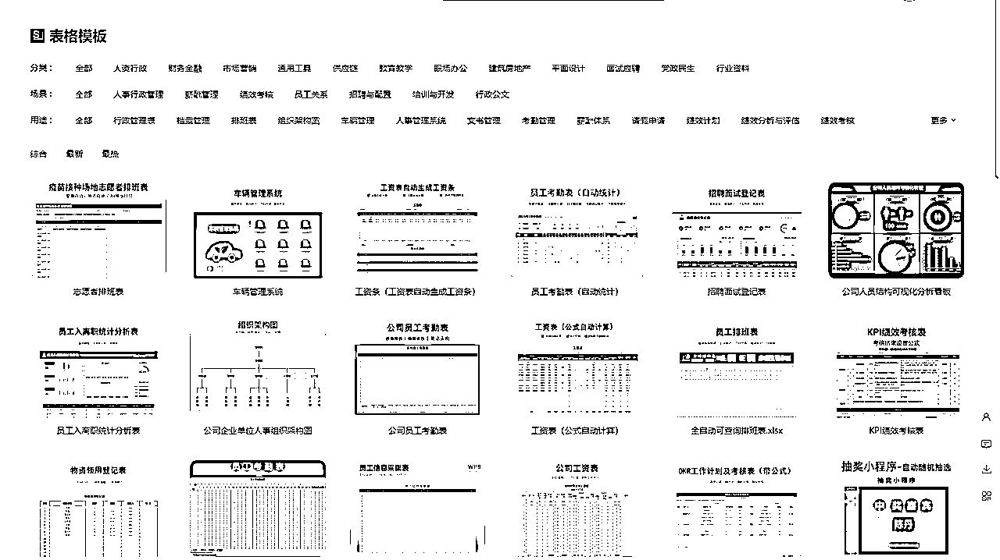
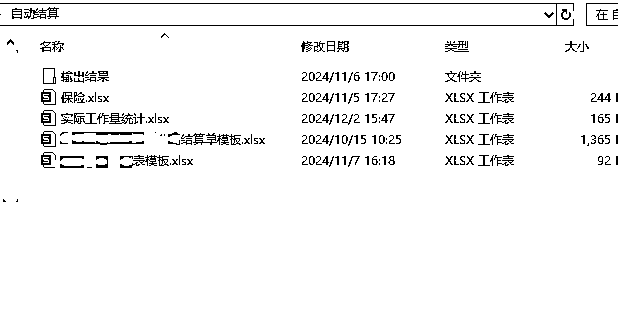
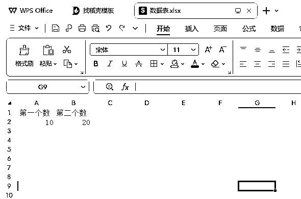
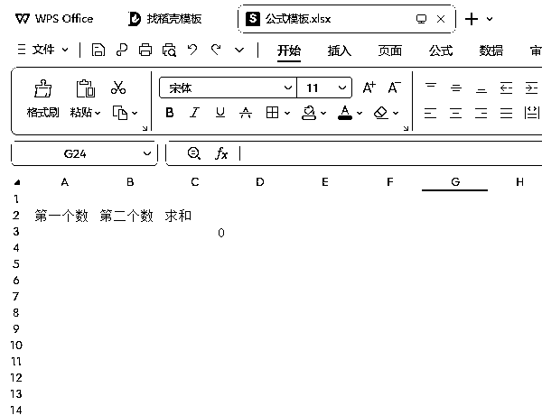
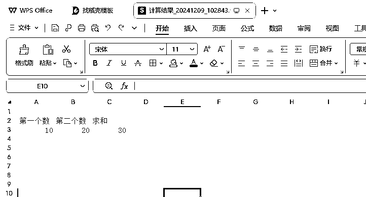

# 被Cursor“改造”的普通打工人：没靠它赚过一分钱，但我的牛马生活彻底变样了
作者：龙哥

大家好，我是龙哥，今年4月才混进赚钱圈子的小金牌志愿者。

大神们的履历咱就不显摆了，单位里虽说还算拿得出手，但说白了，也就是矮子里面拔高个儿。

这篇文不想扯别的，就想聊聊Cursor这个东西，给我这个标准得不能再标准的打工小透明，到底带来了哪些真真切切的转变，顺带分享下咱这种普通社畜平时用Cursor解决问题的路子。

我拿Cursor基本都用来写Python，包括接下来要讲的这些全都是。

不过先说清楚，Cursor这玩意儿可不仅仅能写Python，千万别被我的文章带偏了，不然我可担不起这个“误导”的责任。

（文章最后附了几个新手入坑容易遇到的疑问，都是我个人的看法）

## 1、普通打工人，到底啥活儿能丢给Cursor？

这恐怕是没碰过代码的小白最爱问的点了。答案其实大佬们早就翻来覆去说过很多遍：**凡是客观的、有重复性的活儿，就能扔给Cursor去干。**

说白了，你只要能把处理流程讲明白，这事就能交给它。

再直白点，打开WPS里的那些表格模板看看：

不管你混哪个行业，只要你能用上这些模板，多少都能靠Cursor省下点力气。

后面拿三个例子说话，分别放在2、3、4小段，顺带也聊聊写代码时候踩过的坑、怎么绕过去的。

## 2、报表，打工人的世纪之痛

### 2.1 这活儿到底干了啥

我的工作里报表多得吓人：日报、周报、月报、年报，只要是项工作，恨不得给你整出四五张表，再叠加月底汇总、工作量核算等等。

但这些报表基本都有个共同点：**有规律可循**。

大多数数据类报表，就是把一堆原始数据按一定规则做分类、计算、汇总，说白了，我们打工人要做的就是把数据丢进Excel，让逻辑自己跑出答案。

以前我用Excel公式，已经算是省力了，把数据稍微“规整”一下就能出结果。可我这人懒啊，连规整都不想动手！所以这活儿就顺手丢给了Cursor。

想让Cursor从零开始直接生成一张完美表格，说实话挺费劲，因为格式、关键列之类的东西很难完全对上咱们的心思。

但换个思路：**搞一个Excel计算模板，让Cursor帮咱写个小程序，把数据规整好再粘到模板的指定位置，计算交给Excel完成，搞定！**

思路通了，直接上手！

上图前面两张表是数据来源，别的同事发来的，我需要的都在里面；后面两张是我自己搭的模板，计算公式已经通过Excel函数预置好了。

让Cursor干活时，一定得清清楚楚告诉它：

“我要把某表某某sheet的哪些格子，贴到另一张表某某sheet的哪个格子。”

这句划重点！！极其关键！

接着让模板Excel老老实实把数算完就行，记得强调一句“算完之后再保存”。

有个细节得留神：最好复制一份模板出来操作，别直接拿原模板去折腾，万一代码有毛病把模板搞坏了就麻烦了。

### 2.2 流程长啥样

顺着这个思路，整个流程就成了这样：

1、把模板复制个副本出来

2、把数据源表里指定格子的内容，粘到副本对应位置

3、副本内部自动完成计算

4、保存收工

把流程这么一拆，是不是瞬间清爽了？不管数据量多大，本质就这一套。

也就是说，只要能把“A表A1格搬到B表A2格，再让B表自己算完”这个动作搞定，天大的报表问题都算不上问题。

### 2.3 拿个例子说话

我放了个小演示，里面有两个文件，一个是数据表，一个是计算模板，专供下面展示用。

数据表长这样：

公式模板长这样：

现在咱把这个流程翻译成一段“甲方需求”扔给Cursor。

提示词参考如下：

Cursor给出的回复是这样：

拿代码去跑，一次跑通，稳！

当然，真实报表可能计算链条更复杂，比如第一步的结果要作为第二步的条件啥的，但只要每次都拆成同样的“搬格子→算数”动作，无非就是用同一个积木块反复拼搭而已。

## 3、文件整理，逼疯打工人的第二把刀

### 3.1 这活儿到底干了啥

前阵子我负责的一个项目要搞年度迎检，一堆文件得重新归置，其中两项尤其头大：

1、上百份人员合同里，把属于本项目的那几十个挑出来

2、几百份制式文件里，把某些页删掉

这活儿机械到什么程度？重复到让人想吐。

让我这种懒癌晚期的人去干这个，那真是比要了命还难受！！！

拿第一件事来说，仔细一想会发现：

这些合同的命名规则里，是不是藏着一些咱们手头已有的不重复信息？比如员工编号、身份证号之类的。既然如此，我们能不能拿一份这样的清单，让代码去文件夹里按图索骥，把目标文件复制到新文件夹里？

所以，安排给Cursor。

### 3.2 流程长这样

流程理理：

1、把不重复信息整成一个表格，保存下来，命名为“人员明细”

2、把所有合同丢进一个文件夹，文件命名得带我们要找的关键信息（人劳那帮人保存合同一般命名还算规矩的），给文件夹起个名（我这里顺了之前一段代码的名字，叫“人员身份证”）

3、拿“人员明细”里的某列信息去文件夹里模糊匹配，把命中的文件复制出来

### 3.3 示例

涉及隐私，放个脱敏版演示。

文件夹里放了10个空白文件，命名为1到10。人员明细表里填了1到5，看Cursor能不能精准把这几个挑出来。

按上面的流程，给Cursor发段提示词：

Cursor的回复：

原本得一上午的活儿，5分钟收工了。

## 4、🛰️群发？还有这种操作

🛰️的群发功能，一年可能用不了几次，但每次用都是噩梦。

太不方便了……尤其是好友标签没打理好，简直是灾难。

我这次做纯属因为航海志愿者工作，经常要通知人，例如提醒打卡、课程信息；有些船员还约了特定提醒时间，有人要每天早上的闹钟，有人要晚上的（别问B去哪了）。

这活儿本质不就是机械劳动吗？有目标名单，有话术文本，有工具🛰️，OK，交给Cursor。

这个项目还让我头一回摸到了Python里“类”这玩意儿！！

你看，小白用AI写代码写多了，也慢慢不那么白了，对不对！

### 4.1 拆解工作内容

先有一份名单，包含发给谁、发什么、几点发。

等到点了，把接收人信息复制到🛰️搜索框，进入聊天窗口，粘贴话术，按下发送。

每个对象循环一遍，结束。

自动发🛰️，就这么点事。

### 4.2 示例

拆解完，给Cursor下指令：

这次可没那么顺，中途各种报错，尤其是在“找到好友并发送消息”这一步卡了老半天。

一开始想的方案是用Python自己去屏幕上找🛰️的搜索框（虽然心里清楚CTRL+F就能呼出搜索），AI试了好多回还是定位不到，最后只能改用快捷键方案。

所以说，实际干活的时候，碰到硬骨头绕道走就好，Plan B真香。死磕一个问题真不是聪明的选择。条条大路通罗马嘛！

最终版代码如下：

代码里做了“定时发送”和“立即发送”两种模式，时间那栏留空就是马上发。

模板可以直接生成，免得模板出错导致代码找不到信息。

wxid那栏填🛰️号或昵称都行（昵称最好唯一，不然会发给第一个搜到的）。

## 5、新手刚碰Cursor，这些坑我先帮你踩

**1、Cursor写代码和GPT写代码有啥不一样？**

没啥两样。

你把它当成GPT和编辑器凑一块儿过日子就行：左边写码，右边AI聊，“AI给的代码直接就能落到左边，省事。

**2、零基础好上手吗？**

不难。

只要你能当个靠谱的“甲方”，把需求交代得清清楚楚——像“把A表B3格的数据挪到B表B2格”这种——AI听了贼开心。

还有，别带任何主观词，什么“好看点”、“弄得漂亮点”这类统统别出现。

用的时候多瞄几眼代码和注释，Python上手也快得很。

**3、用Cursor要挂🪜吗？**

不用，直接开干。

**4、全英文界面看着头疼啊？**

点查看→扩展→应用商店，装个Chinese(Simplified)，装完就是中文了。

**5、占内存不？**

主程序大概500M左右，其他库可以扔别的盘里。

**6、免费的吗？**

收费。但新人有15天/5000次调用的免费额度。

可以试试再说。

另外薅羊毛方法：🪜去搜临时邮箱，收Cursor的验证码，再用临时邮箱注册就行。

不过注意，免费额度薅太狠会被封，封了就只剩买Pro这条路了。

**7、太贵不想买咋整？**

试试Windsurf，目前还便宜些。

另外不怕折腾的话，搞个套壳AI搭Cursor的编辑器用，也不是不行。

## 6、写在最后

现在学AI这件事，真的不是可有可无。这句话你可能听得耳朵都起茧了，但只有你亲手碰过AI之后，才能懂其中的分量。

拿Cursor举例，它直接把我跟程序员之间那条鸿沟填平了——我只需要有个想法，就能把它变成趁手的工具。

再比如这阵子特别出圈的圈友花生大佬，那款小猫补光灯就是最好的证明。

希望各位圈友都能从繁琐的杂活里解脱出来，一起龙哥盟。撒花🎉🎉

最后再谢一次上次航海的领队@蓝弈 老大，不厌其烦地帮我审稿~