# 用ComfyUI给“宝宝”拍一张未来职业照：一个建筑设计师的完整工作流拆解

我的本职工作是建筑设计，2024年10月加入生财；这次航海，也是我第一次参加。最近我用ComfyUI搭了一套“未来宝宝职业照”工作流，今天把从设计思路到参数细节完整拆一遍。这套流程的目标很明确：高效、精准，同时保留创意和艺术感。希望这篇拆解能帮正在做类似项目的朋友少走一些弯路。

为什么想做这件事？有天晚上刷视频号，看到一位老师用AI生成学生的梦想职业。镜头里，孩子们看到“未来的自己”时满脸惊喜。那一刻我很触动——这不只是好玩，更是在孩子心里种下了一份期待，也悄悄告诉他们：梦想可以通过努力一步一步靠近。刚好那段时间我在学ComfyUI，就决定自己动手试试。

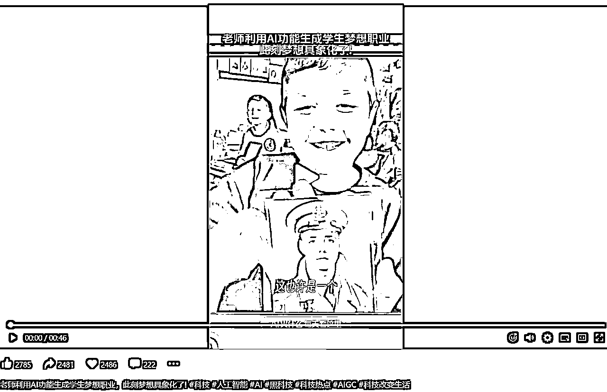

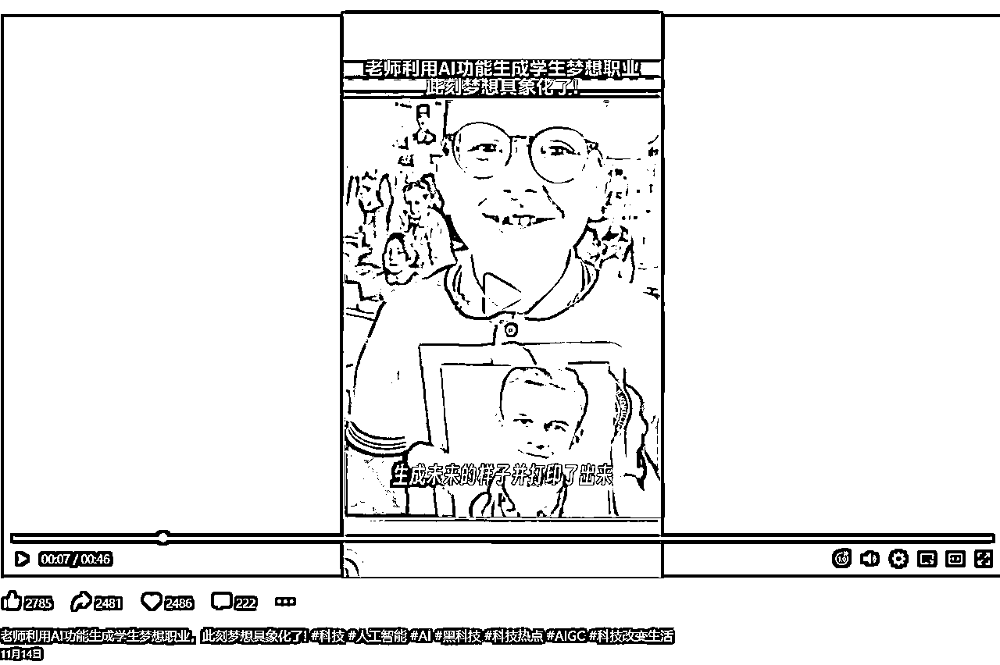

需求端我也提前验证过。去淘宝搜了一圈“未来宝宝职业照”，发现已经有人在卖了，说明这个品类已经被商业化，市场是被认可过的。再往下延伸，还可以跟线下影楼合作，把照片做成实体产品。所以这套工作流既有理想层面的意义，也有实实在在的落地价值。

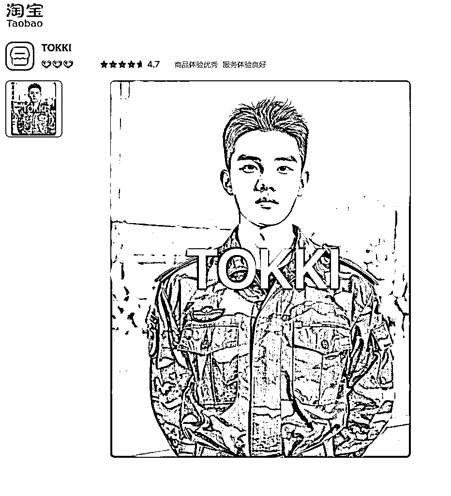

整条流程我是这么设计的：先从一张成年职业照入手，用FLUX图生图把清晰度提上来；再把成人脸部单独提取出来，保证后续换脸不出错；接着加载宝宝照片，用LoRA加FaceID生成宝宝未来的面部特征；最后做面部融合，完成换脸。

## 第一步：底图先选对，再谈高清修复

一开始我是在ComfyUI里直接生成女医生形象，出来的图总差点生活气，不够贴近真实。后来换成了国产工具豆包，在描述里写明：竖版9:16，一位年轻好看的女医生，穿着白大褂站在整洁的病房里，手拿病历单，视线看向镜头；窗外是夏天的阳光，室内光线明亮，整体氛围温馨自然。结果很快就抽到一张很真实的底图。

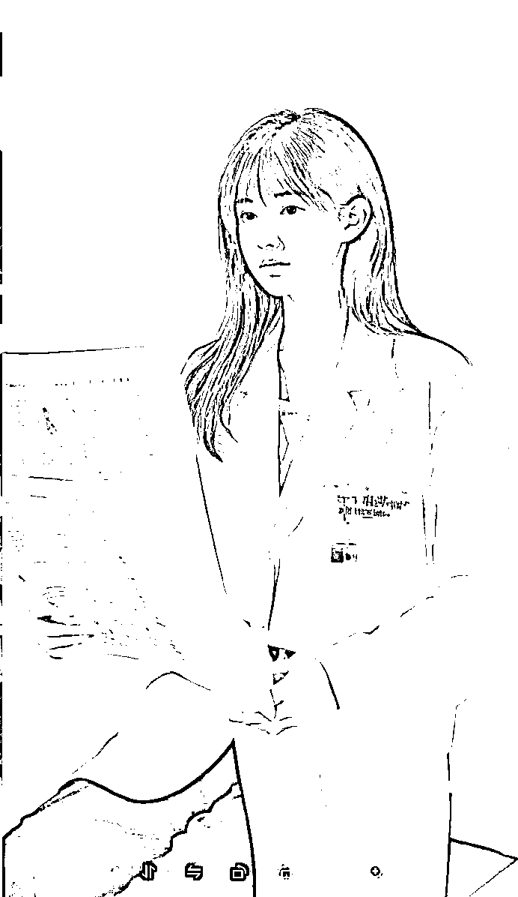

不过抽卡这一步不能省。我挑底图只看两个标准：手部姿态要自然，衣服上不能有多余的图标和文字。否则后面重绘时，手部很容易变形，字体也会跟着扭曲，最终成片的真实感会大打折扣。

豆包出图的构图没问题，但细节和清晰度还有提升空间，所以我又用FLUX图生图做了一轮高清修复。这里有个特别容易踩的坑：如果直接把文生图的流程改成图生图，出来的结果大概率跟原图毫无关系，提示词也像没听见一样。

原因出在K采样器的降噪值上。文生图流程里降噪值默认是1，表示latent是一个空latent；而图生图流程会把原图的latent喂给K采样器，如果降噪值还是1，K采样器就会把图片彻底重画一遍。放到WebUI里更好理解：denoising被翻译成“重绘幅度”，0表示原样保留，1表示完全重绘。我的K采样器里噪波模式选了GPU（=A1111），也就是WebUI的模式；ComfyUI自己的模式是CPU。把这两套工具对照着学，很多参数的意义会瞬间通透。

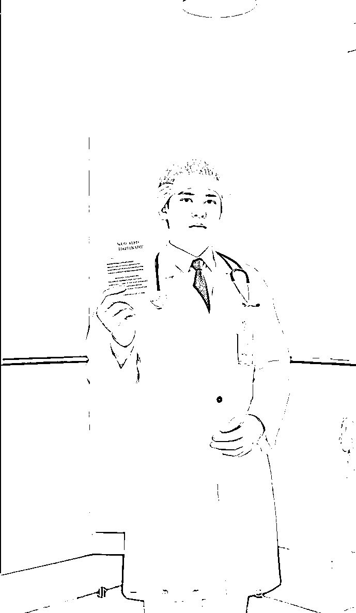

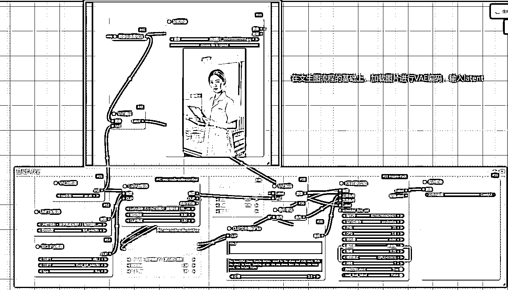

## 第二步：把成人脸部精准抠出来

这里要先明确一个前提：宝宝长大后，发型、服装、姿态都可能变，但脸部的神态特征基本不会变。所以为了省算力，不需要整张图重绘，我直接用了“局部重绘（裁剪）”节点，只处理脸部区域。

这个节点跟普通图像裁剪不一样。图像裁剪会把图片尺寸切掉，后续生图还得想办法恢复；局部重绘（裁剪）只是把要重绘的区域单独送去K采样器，图片本身的尺寸不会被改动。

检测部分我用的是Segment Anything家族的“简易seg检测”节点，BBox模型选face，这个模型也支持人像、手部等。Sam加载器里的设备模式要选“prefer GPU”，兼容性和效果更好。seg本身只负责检测，所以我又接了一个“seg到遮罩及遮罩膨胀”节点，把脸部区域生成遮罩，再送往内部重绘（裁剪），裁剪宽高设为1024×1024。这样脸部就被精准地单独抠出来了。

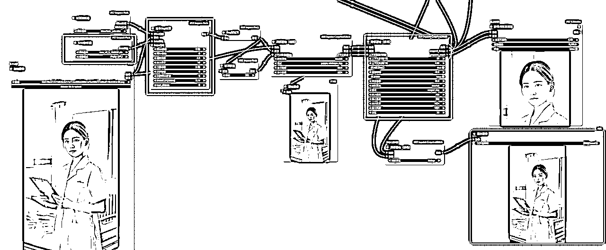

## 第三步：生成宝宝的“未来脸”

大模型我选的是XL，再加一个用于调节人物年龄的LoRA。正面提示词没有堆在同一个文本框里，而是用文本输入节点分开填写：“一个25岁的中国女孩”“肖像照”“高质量、高清、极致细节”。这样分开喂词，可以减轻提示词之间的相互污染。

脸部特征提取我用的是FaceID——因为我在航海过程中最早接触的就是这个方案。Clip视觉图像处理插值方式选了LANCZOS，这个选项大家普遍反馈效果更好。其实类似的节点还有InstantID、PuLID、EcoID等，但对应的大模型和LoRA都要跟着换，具体表现如何，留给大家自己去测。

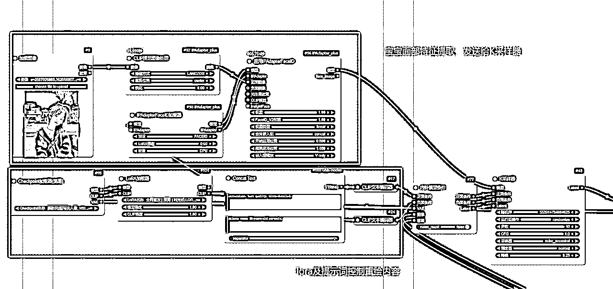

## 第四步：面部融合与参数调优

局部重绘在WebUI里本质上是图生图的一部分，所以迭代步数、CFG、降噪值都不能直接套用文生图的设置。我试过几组数值后，最终用的是：步数10，CFG=1，降噪值0.25，出来的面部过渡很自然。我也试过把CFG调到7，脸的贴合度明显差了一截。

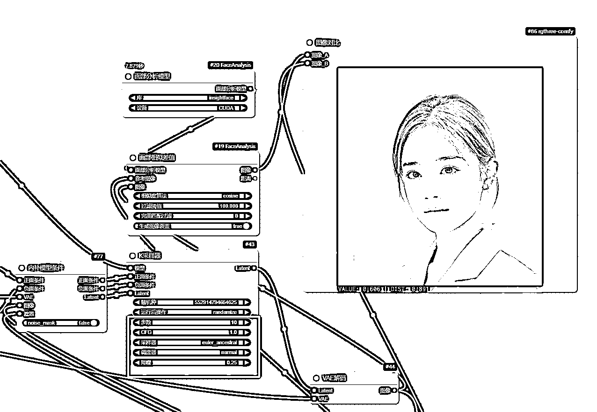

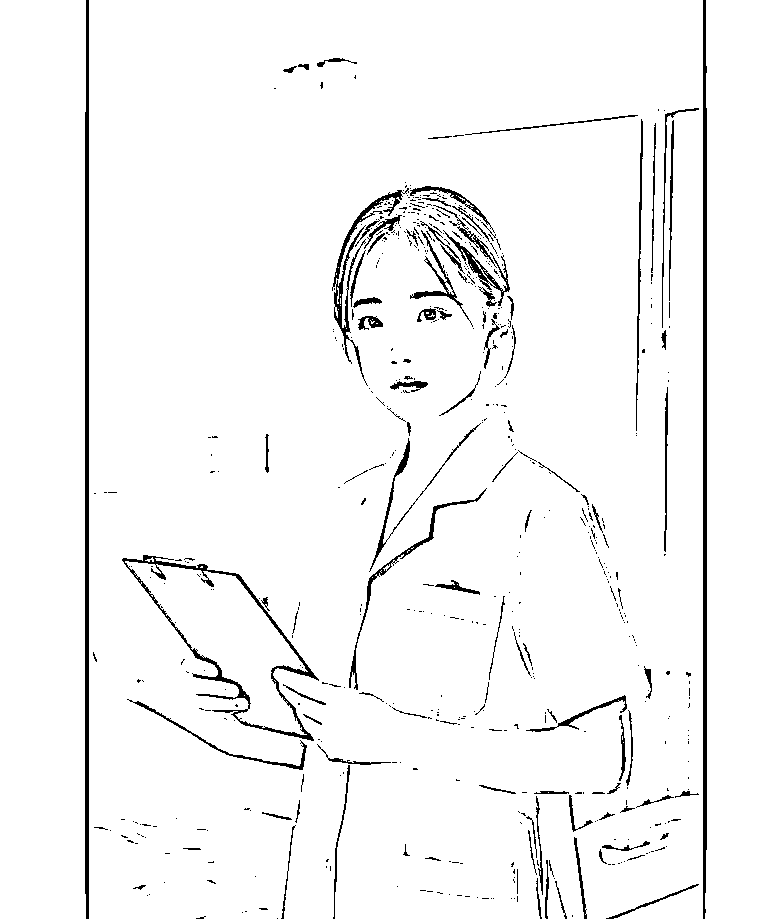

整体调参的过程，最核心的旋钮就是降噪值。FLUX图生图和文生图的采样逻辑完全不同，降噪值必须按需调整。ComfyUI的优势在于灵活，每步都能微调；调参时建议用控制变量法，一次只动一个变量，才能精准判断每个参数到底影响什么。

另外，底图选择也是一个隐性因素。这次我的底图反而靠国产工具救了命——豆包这类本土软件，对国内生活场景的理解和呈现更贴近真实，生成的病房、阳光、人物状态都更有代入感，效率也高了不少。

## 效果与注意点

实际出图效果上，我选的两个宝宝，脸型恰好跟成年医生的脸型比较接近。但如果宝宝是圆脸，选成人照片时也要尽量找圆脸，脸型匹配度越高，合成越自然。

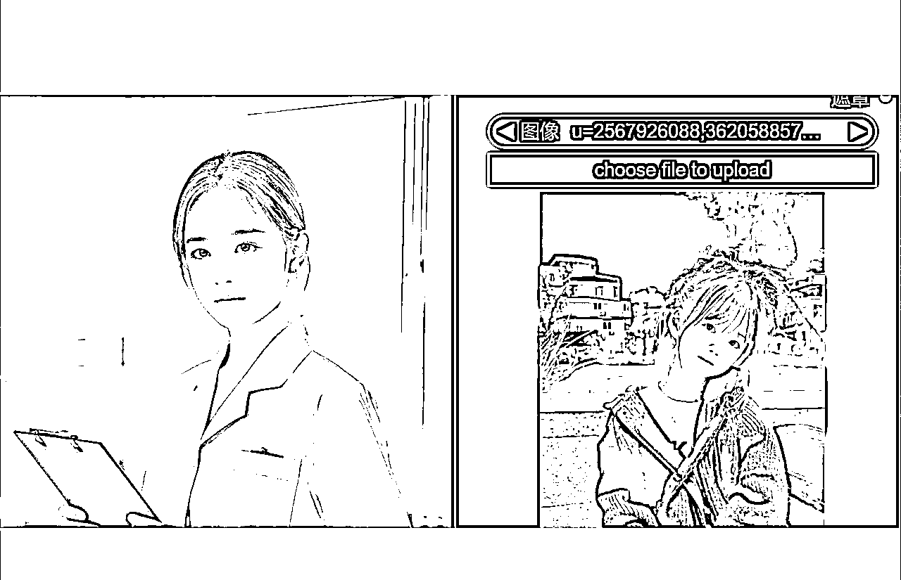

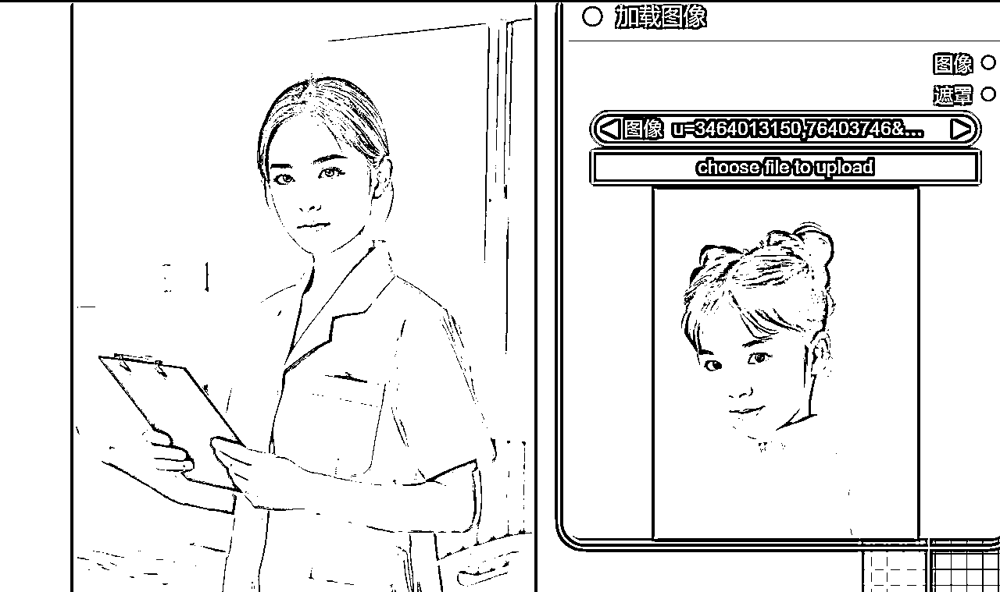

## 优化方向与致谢

这套工作流把多种工具串起来用，解决了不少技术硬骨头，同时保留了图像原有的艺术感和创意。我也尝试过只修改提示词里的宝宝年龄，结果生成了宝宝龙年艺术照。说明同样一条管线，稍微换换输入，就能延伸出更多玩法。

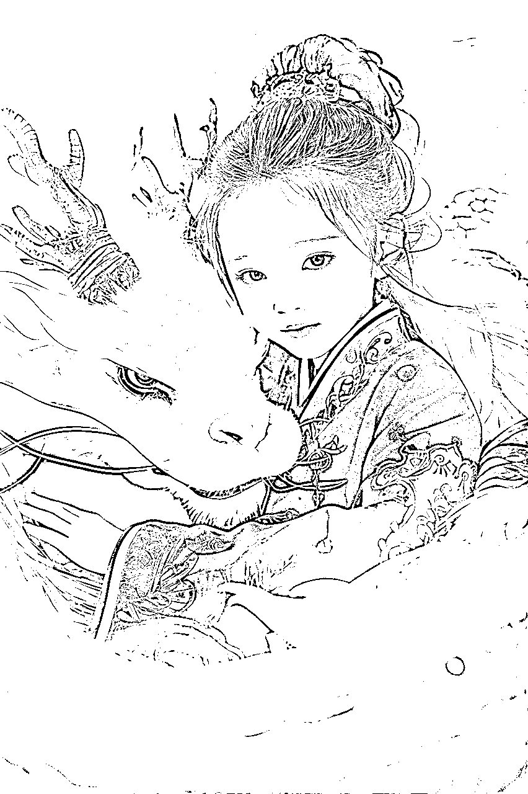

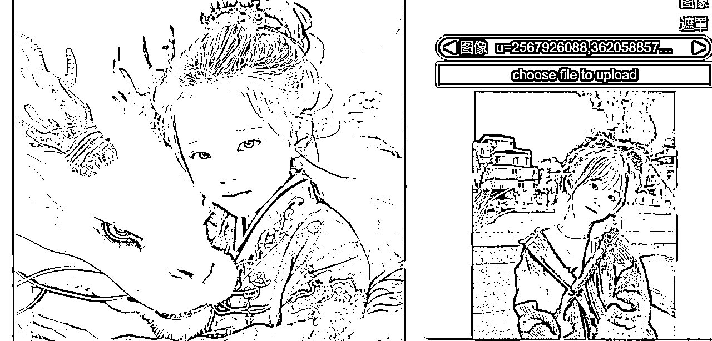

后续我打算继续优化几个方向：第一，在ComfyUI里直接自动生成满意底图，把FLUX高清修复后的图片直接接到seg检测节点，省去反复加载图片的步骤；第二，继续折腾脸部获取节点——我之前以为FaceID不能搭载FLUX模型，今天看到一个工作流居然做到了，所以多尝试不同的大模型与脸部节点组合，也是一个值得推进的方向；第三，后期加上高清放大节点，直接输出4K大图，毕竟顾客永远想要“更好”，而不是“最好”。

希望之后大家能一起迭代优化这套流程，把精度和效率继续拉高，也探索更多有趣的落地场景。也特别感谢生财团队，以及教练、雪荔领队、子凌和所有志愿者，给我这次分享的机会。第一次写这类内容，时间比较赶，有不对的地方欢迎指正，我们一起交流，一起进步。