# 0基础上手，用Cursor做出来一个Excel自动填表的小工具

## 起点：

现在我在无忧传媒做MCN商务，

核心工作就是：给合适的项目匹配自家合适的达人。

每次要提报一个账号，填的东西多到头疼，

举个例子，

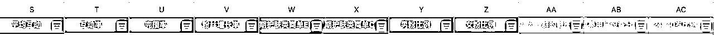

非常细，达人昵称、主页链接、粉丝量级、星图八大人群、男女粉丝画像分布等等，全都要填…

填完提交上去能不能中，变数太多，人工也管不住。

这种情况下，反复让媒介同事去填表，产出没保障，配合度慢慢就低了。

嘴上没提，但我也不好意思硬压着人家第一时间配合。

于是就想，能不能做个自动匹配的工具，把这事交给AI来搞定，

效率上去，也不用总麻烦别人。

## 先说结果：

搞出来了，而且跑得很顺。当时第一反应就是直接发朋友圈宣传。

## 从零摸索的过程：

## 先理清匹配的思路，

需要两张表配合工作：

1个总表 sheet1，里面堆着全部原始数据

1个待补表 biao2，需要从总表里按行按列把对应信息找过来，填完整。

一开始，我对编程完全一窍不通，

只能靠自然语言跟Cursor交流，

还好现在这个时代，靠最直白的聊天也能把0基础的短板补上。

比如环境配置报错了，就把一堆看不懂的英文报错原封不动复制进去，它分析得很快；

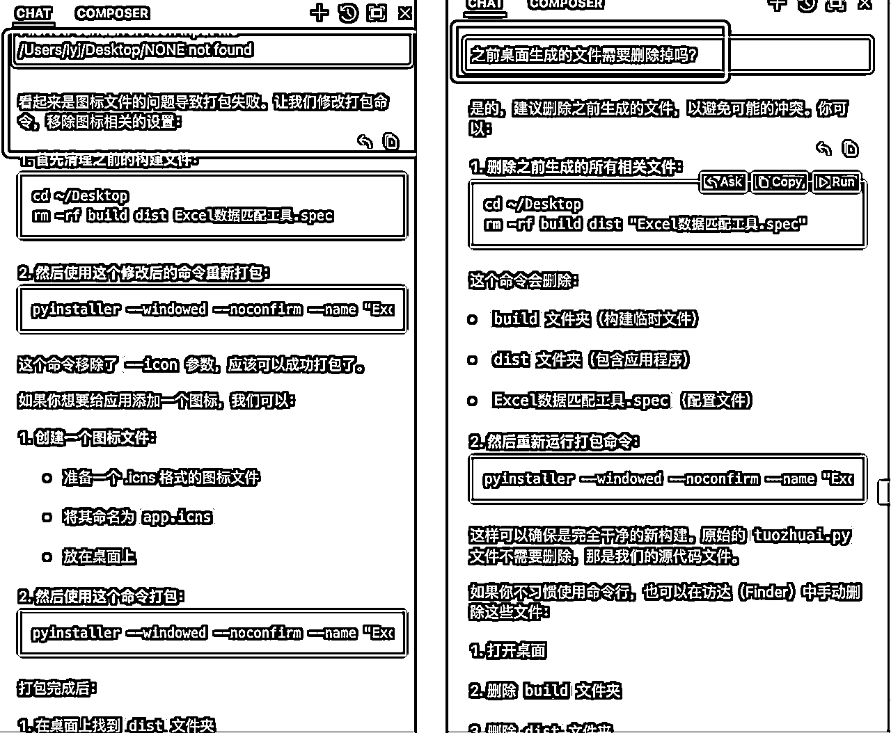

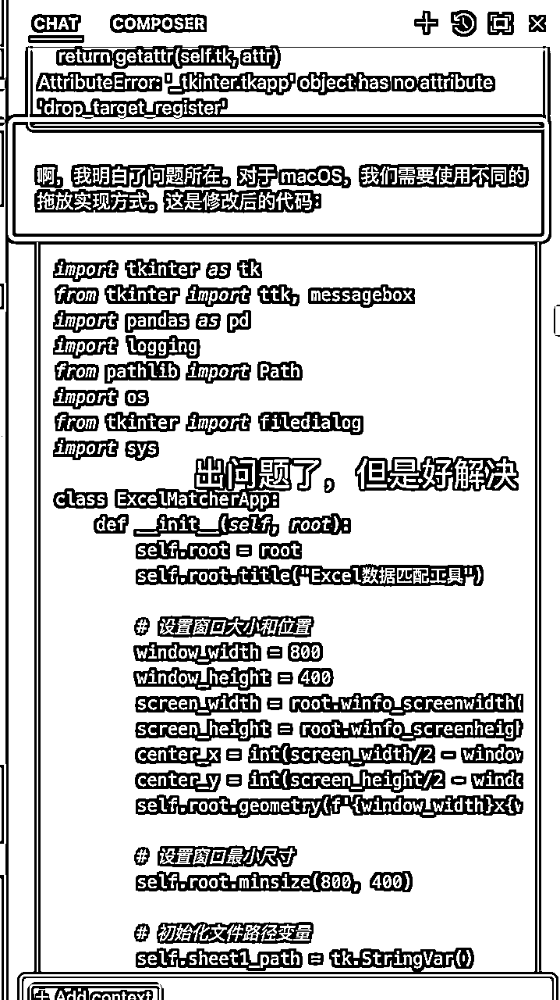

第一版的代码逻辑很僵硬。

biao2的行列必须和sheet1一模一样，字段名、顺序、字数，甚至一个空格都不能差，不然就报错。

比如在中间多加一个总表里没有的【家里是否有电梯？】，程序直接挂掉。

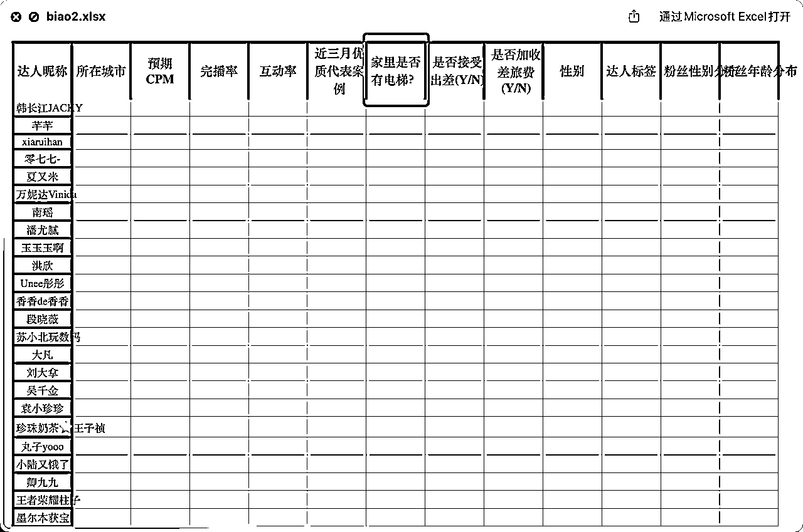

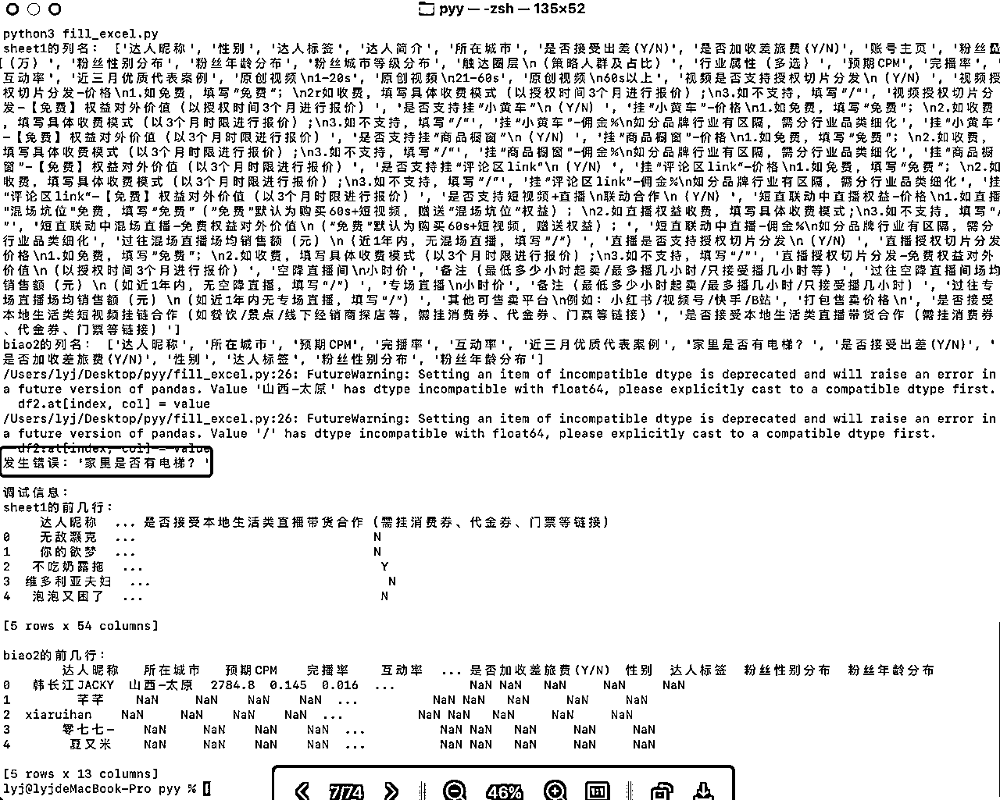

只能笨办法慢慢迭代。

报错了就把错误代码丢回对话框，让它继续分析。

版本一版一版地改，最后摸索出了几个关键优化：

1、总表里没有的字段，直接跳过不填；
2、能不能加个模糊匹配，试错更快，筛数据也更顺。

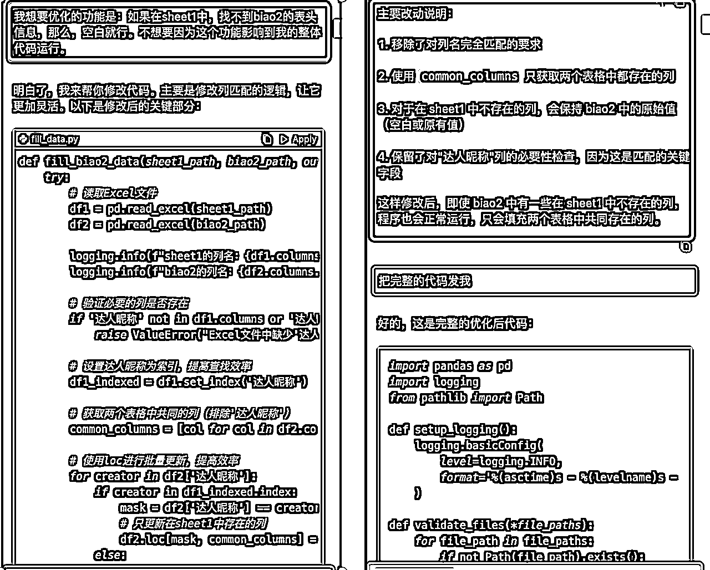

基础功能跑通后，就开始想怎么让它更贴合实际工作。

当时只有

## V1：只能在macOS终端里敲命令跑匹配。

能不能做成桌面程序，双击就能用，离线也能跑？

## 进阶到V2：做成可视化小软件

1、左边放总表，右边放待补充表；
2、支持拖拽导入；
3、指定输出到桌面；
4、等待匹配完成，自动填好表。

自动化填表这件事就彻底闭环了；

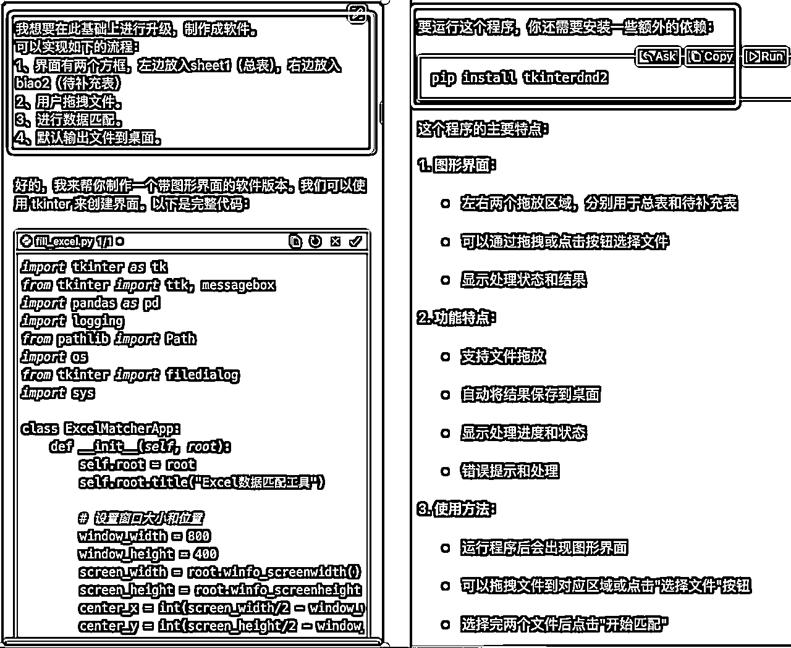

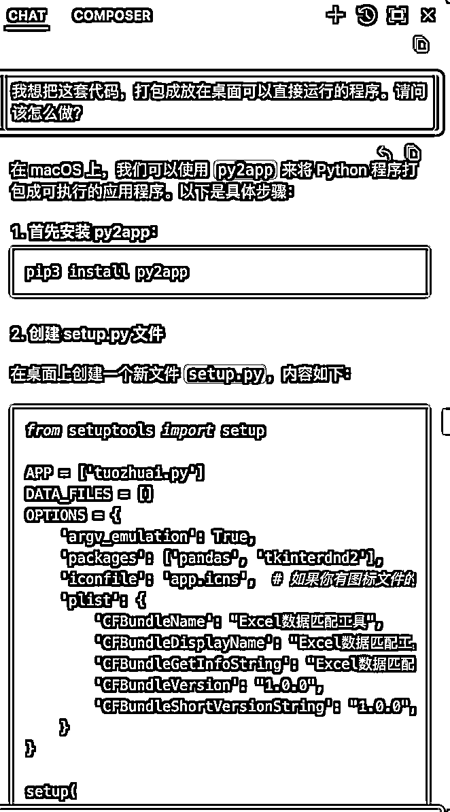

这个阶段的具体想法是这样的：

我想在此基础上把它做成软件。

流程大概是：

1、界面分两块，左边放sheet1总表，右边放biao2待补充表
2、用户直接拖拽文件进来
3、后台执行匹配
4、默认把结果文件丢到桌面

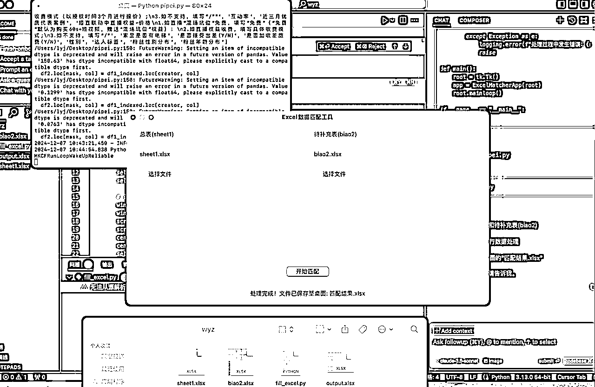

## 优化到V3：支持直接拖拽，不用选文件夹路径

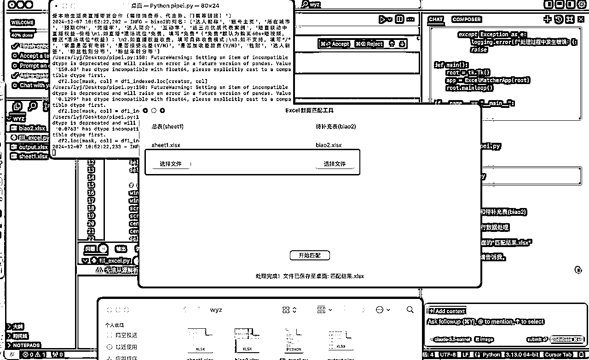

做成了拖拽式操作框，匹配效果非常理想！

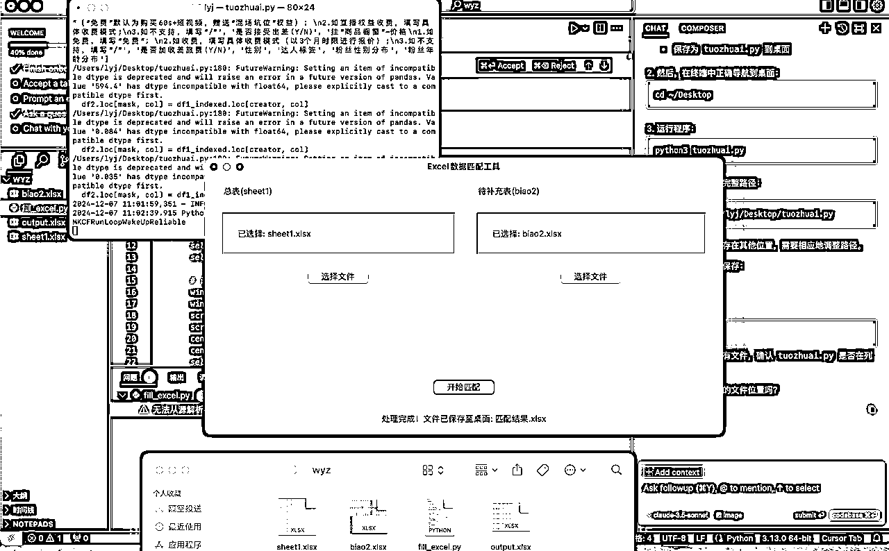

但很快发现一个问题：能跑起来，前提是得先配好系统环境，Python和各种依赖，折腾了我很久。

如果只能在配好环境的电脑上用，那这个工具就没法分享出去。

于是

## V4版本：打成独立软件包，跨设备可用

引导话术1：我想把这个功能做成在Windows和macOS上都能独立运行的软件，不用再装代码插件，行不行？

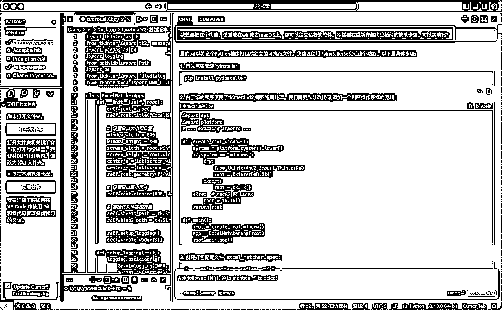

引导话术2：最终目标是，在没装Python环境的电脑上也能直接运行。

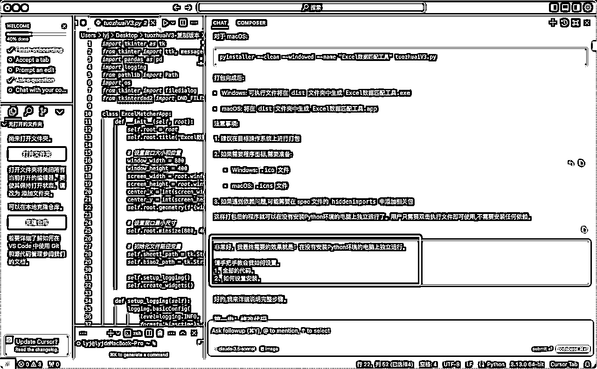

## V5：细节打磨，加上个人联系方式

这一步的想法是，工具稳定后可以免费分享，也可以考虑卖给同行。

于是加上了我的联系方式，方便别人找到我。

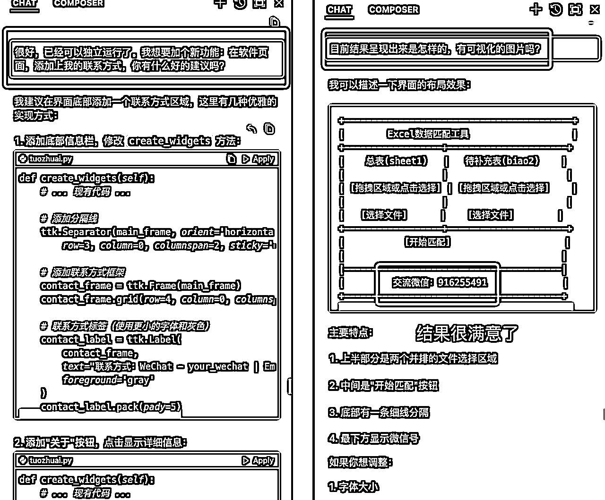

没法放图，但文字描述出来的效果也让我自己惊讶。

## 最终成果

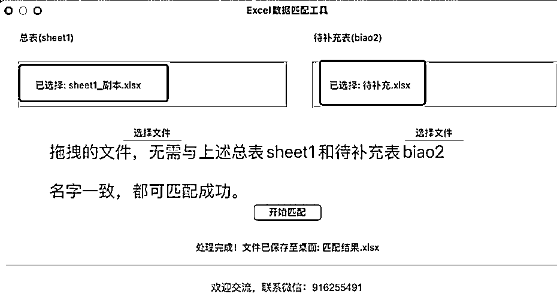

## 一点感悟：

1、个人完全不用会写代码，只要需求够清晰，用最朴素的小白式对话，就能通过Cursor聊天式地把产品搭出来。

这就是时代的红利。

能不能变现、变现多少，关键看你挖的需求有多痛、多准。

2、这次小试牛刀，让我对Cursor的商业化空间有了非常大的想象，而且是完全可以自己掌控的。