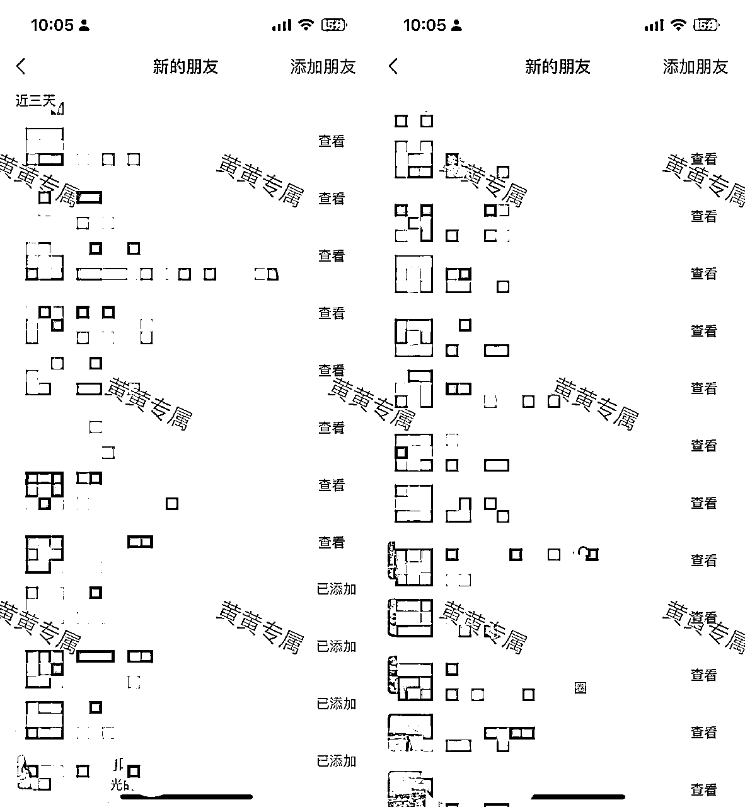
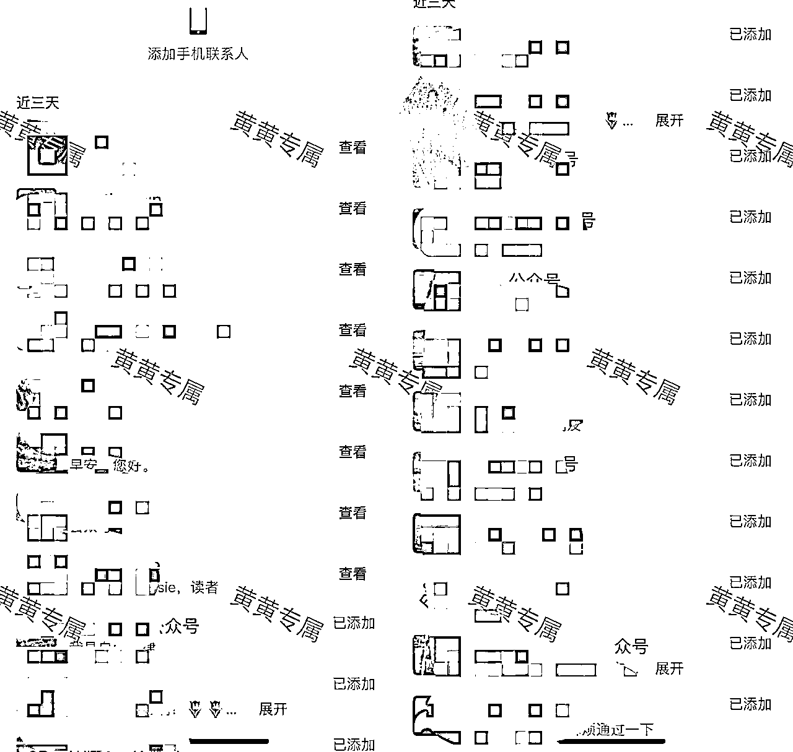
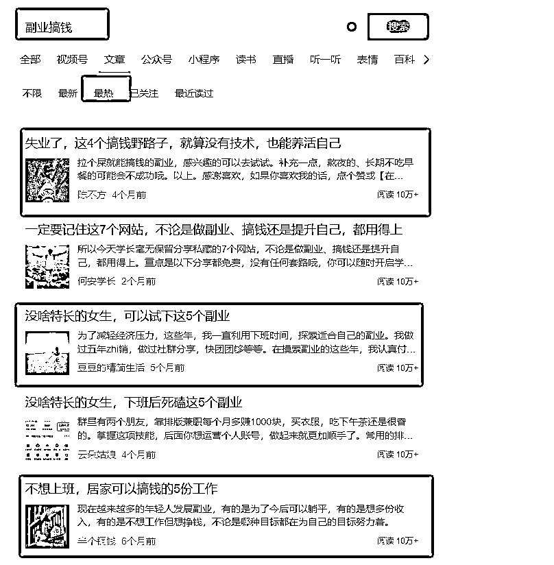
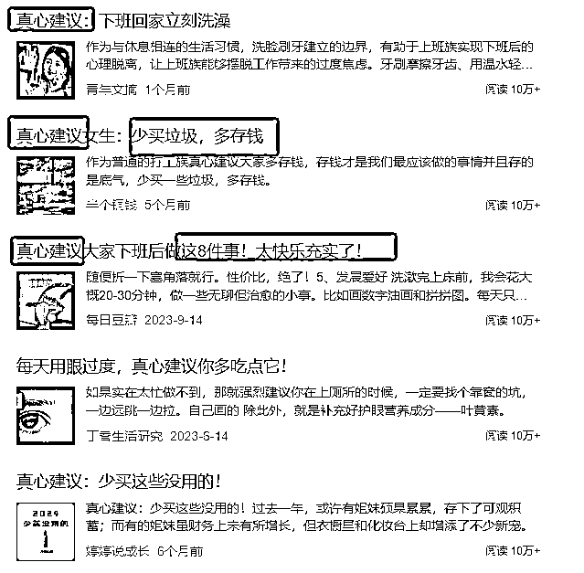
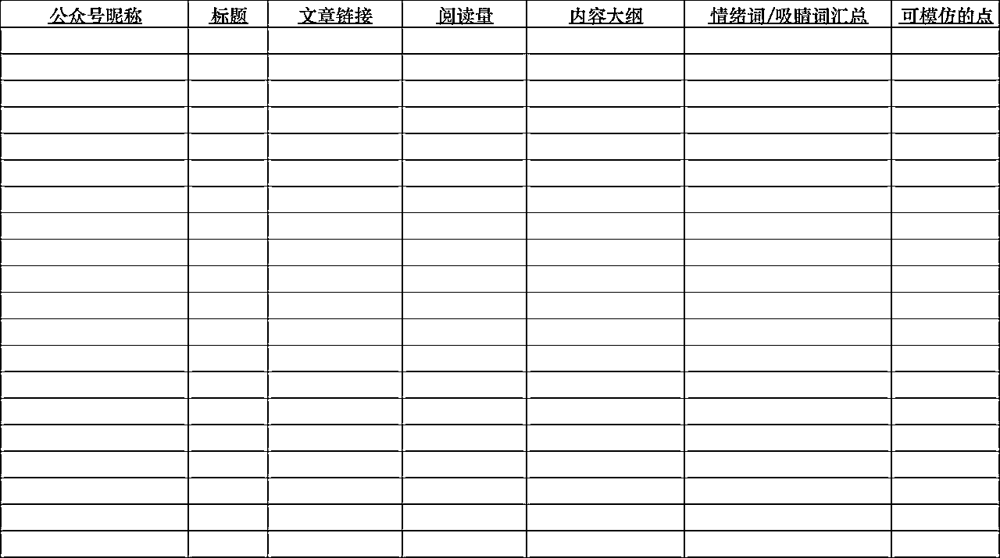
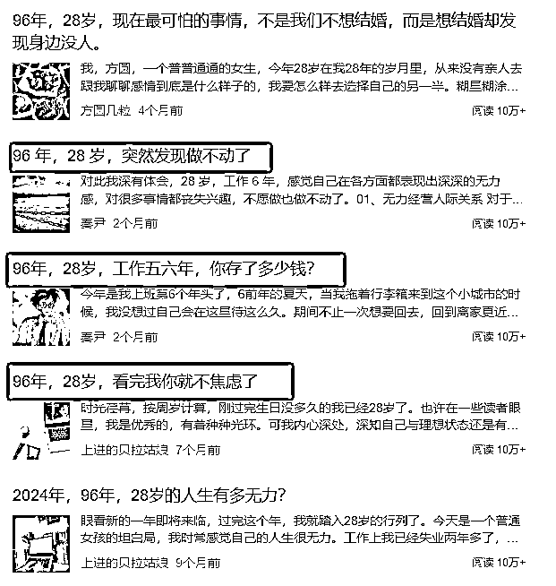
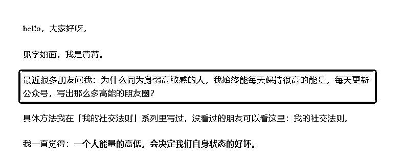
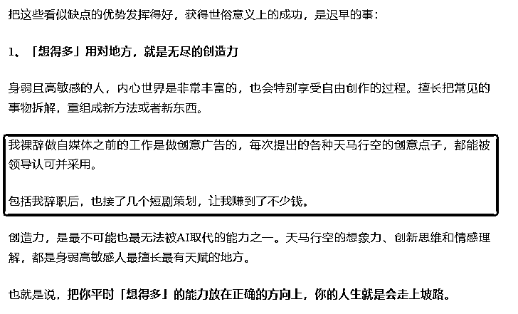
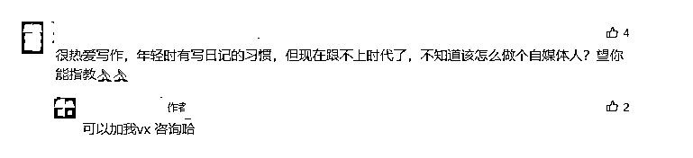

# 3个月从0到2万粉，公众号单月引流2000人，我把整套个人IP打法摊开了说

> 来源：[https://v00gv8edzj.feishu.cn/docx/QQ5vdVzP3o5qEBxx9PpcIaj5nBL](https://v00gv8edzj.feishu.cn/docx/QQ5vdVzP3o5qEBxx9PpcIaj5nBL)

生财的各位朋友大家好，我是黄黄。

曾在4A公司做策划，现在全职自由。加入生财一年多，我踩过得物、小红书、视频号带货的坑，账号被封、流量断崖都是常态。慢慢就明白，公域平台对个体来说不稳定，稍微一点风吹草动就违规。于是我把重心转到私域，更看中可控的微信生态，于是选了公众号作为新的增长阵地。

为什么是公众号？三点说清。

1）推荐机制变了。过去只有粉丝能看到，现在系统会推给非关注用户。没粉丝也能冷启动靠推荐起量。
2）微信内引流顺滑。文章底部能直接挂二维码和微信号，用户扫码一步到位。
3）能和视频号联动。公众号发图文沉淀，视频号发短视频放大，配合朋友圈运营，个体也能在微信生态里稳定变现，一年赚几十万并非幻想。

我从9月初重启公众号，第一篇数据平平，坚持更新3天后有一篇破万阅读，机会感来了。中秋假期我没停更，连续更了20篇，累计阅读破百万，流量主收入过8000，涨粉1.2万，800多人加我微信。

截至现在，公众号累计为我引流超2000人，流量主+私域产品到手5万左右。

成绩不算惊艳，但我的老师张可粒和生财运营官瓜斯老师鼓励我分享，我就把这三个月的复盘整理成了一套可复用的方法论。从定位到选题，从内容结构到朋友圈，回溯我做IP类公众号的全流程，希望对想做个人IP的朋友有帮助：

1、定位定方向，方向对了变现才有天花板
2、做选题库，快速进入系统推荐池
3、搭建黄金结构，让IP公众号也能稳定过万
4、朋友圈做信任沉淀，把陌生人转化成客户

下面拆成四个板块详细说。

一、定位定江山，方向对了，变现没有天花板

1.1 变现先行：写之前想清楚怎么赚钱
1.2 人设清晰：给用户一个加你的理由
1.3 人群聚焦：只服务一类人，做他们爱看的内容

二、选题思路，搭建爆款选题库，快速进入流量池
2.1 从目标用户出发提炼关键词去搜
2.2 标题里必须带情绪词，这是爆款触发器
2.3 别追求高大上，要选能激发你表达欲的题

三、建立黄金内容结构，IP类公众号也能篇篇过万阅读
3.1 标题带情绪，直击爽点或痛点
3.2 开头像聊天，先拉近距离
3.3 正文持续埋钩子，引导进微信
3.4 结尾升华并放联系方式
3.5 评论区二次收割
3.6 测试并复用账号的流量词

四、朋友圈重布局，持续跟陌生用户产生信任感，促成交
4.1 四大类型朋友圈，打破陌生感

# 二、个人IP爆款公众号创作SOP

## 1、定位定江山，方向对了，变现没有天花板

我的号2016年就注册了，写过日记、书评、影评，长期没反馈就停更两年。9月前我也没想明白变现方式，更新没动力，只能偶尔发复盘。

转折点是接触一位国学老师，发现国学疗愈的方法论很有意思，于是把国学+写作+自身经历结合起来，重新定调为轻疗愈型个人IP，并把变现聚焦到知识付费上，目前已收到十几个客户定金。

从踩坑经历总结三点定位经验：

### 1.1、变现定位：更新内容之前，要先想好自己的变现方式

公众号变现无非流量主、广告、私域带货、知识付费。

想靠流量主吃钱，就选民生、职场、情感、故事这类高收益赛道。
想靠内容引流到微信做私域卖课卖品，内容策略就完全不一样。

做内容先想好怎么赚钱。

我一开始就锁定知识付费，哪怕后端产品还没成型，我也可以代销别人的IP产品。所以我所有内容都围绕精准流量做，我加来的每一个人，大概率都知道我在做什么。

如何在泛话题里做精准流量，后面内容布局会详细讲。

### 1.2、人设定位：给别人一个链接你的理由

做人设是为了更快变现。

做账号不是为爱发电，要知道靠什么赚钱，赚谁的钱，还要回答清楚：你是谁，能带来什么价值。

做公众号传播自己，就必须有清晰定位。

你是谁？你提供什么服务？你的优势在哪？
把这几个问题说清，就是一个让别人愿意加你的理由。

举例：我很会靠内容做流量，能帮实体店主或缺流量的个体和公司引流，我的优势是多年内容经验，知道什么内容能吸精准粉。

如果你对优势不清晰，也可以从个人成长或副业搞钱切入，比如读书写作副业、朋友圈美学等，变现路径短，用户对赚钱的需求更强。

### 1.3、人群定位：垂直某类人群，去创作他们爱看的内容

别想着覆盖所有人。上到大爷大妈下到00后，内容就会乱。

锁定一类人群，写他们的痛点就够了。

我的人群是20-45岁高敏感、职场内耗、不想上班的人群。这类人群付费意识和能力都更强，成交更顺。

做IP公众号，人群定位是前提。明确目标人群的困境，持续给解决方案，自然有人来加你。

## 2、选题思路，搭建爆款选题库，快速进入流量池

我的选题库很简单：大量刷内容，看到能写、符合定位或可改编的选题，全部丢到文件传输助手，定期整理。

日常找选题就三步：

### 2.1 针对目标用户，提炼关键词进行搜索

比如做副业赛道，目标用户就是想搞钱的人。收集“副业搞钱”“不上班”等关键词，在公众号、微博、小红书、知乎搜，摘录爆款标题和内容，用1-2个关键词组合成新标题，成功率很高。

### 2.2 选题一定要有「情绪词」，这是出爆款的关键

我拆解大量公众号发现，爆款标题都有情绪词。

比如真心建议、替大家试过了、我发现、大实话、终于明白、告诉大家一件事、突然意识到……

高阅读的内容都提供情绪价值。干货+情绪，阅读量才稳。

### 2.3 选题不需要高大上，而是要激发你的「表达欲」

个人IP和流量主的区别是，你愿不愿意说。

选题能激发表达欲，你才写得真诚，读者才感受到。

我能大量引流且快速成交，核心就是选题既让我想说，又正好戳中用户痛点，还能和后端产品挂钩。

选题时，一定看自己有没有话说，能不能承接后端产品。

收集一批后建一个专属爆款选题库，记录公众号昵称、标题、链接、阅读量、大纲、情绪词。

## 3、建立黄金内容结构，IP类公众号也能篇篇过万阅读

### 3.1 标题，一定要有「情绪」，吸引用户点击

标题是第二道门槛。IP账号标题要下重功夫，要戳痛点或爽点。

我做高敏感系列时，标题必带“高敏感”关键词，再加情绪词如“天选好命、大福气、搞钱圣体”，爽感拉满。

类似“XX岁不上班，看完你就不焦虑了”“不上班也能赚钱的10份工作”，都是情绪驱动。

### 3.2 开头，跟用户对话，快速拉近彼此距离

别上来就引用名人名言。个人IP更适合像朋友聊天，先寒暄“最近很多朋友问我XXX”，或交代写这篇文章的缘由，更利于拉近关系。

也可承接标题直接展示成果：如题，你没看错，一个自媒体新手3个月做到……

开头就能埋钩子：想知道我是怎么做到的吗？我整理了一份入门指南，需要的找我安排。

### 3.3 文中一定要不断埋钩子，引导用户加微信

正文我会大量用个人经历，植入人设更立体。没经历就适当引用案例、金句。

建议每个论点都配个人经历，方便埋钩子引流。我常写不上班靠写作赚钱的故事，写多了形成心锚，用户更容易记住。

### 3.4 结尾总结升华，直接放联系方式

开头决定是否继续看，结尾决定是否点赞转发。结尾要升华主题，强化正能量，引用一句经典收尾并表达祝福，同时引导链接互动。话术要自有风格，别照搬。

### 3.5 评论区埋钩子，引导用户加微信

文章发完后，挑优质评论回复，有人提问就回微信并置顶。内容持续跑流量，评论区也能不断收割精准粉。

### 3.6 不断测自己账号流量词，持续更新内容

一定要测账号的流量词。比如某个读书号，标题带“一定要大量读书”“一定要大量记录”就爆。

我的账号也有类似关键词。原本几十阅读的号，某天一篇破几千，就找到那个词，保持复用就能稳定过万。

## 4、朋友圈重布局，持续跟陌生用户产生信任感，促成交

做爆款号靠流量主是单一收入，还要养5-10个号才行，对小个体不现实。账号一旦掉池，收入就断。

更好的方式是搭建后端产品体系，我做公众号就是为了引流私域卖产品。

有产品有流量，还需要卖出去。朋友圈就是信任桥梁。

用户从加好友到付费需要时间，朋友圈负责建立信任。即便还没产品，也要布局朋友圈，多发生活圈和价值圈。

我每天发5条左右朋友圈，主要四类：

### 4.1 生活状态类：

分享日常、吃喝玩乐、情绪、价值观，保持真实的生活气息。每天至少发一条，否则全是广告会让人屏蔽。

### 4.2 学习成长类：

分享运营干货、实操心得、涨粉变现带来的时间自由、旅行自由等。也可以是读书、新技能、线下课、跟大V学习等。

### 4.3 产品类：

用户加你微信一定会看朋友圈，必须有产品或服务露出。我的产品圈偏少，一天1-2条，好友多可适当增加。

### 4.4 工作状态类：

晒工作场景、专业态度，文案真情实感，拉近距离。

整体思路就是像自我介绍一样，全方位真诚展示自己。

做自媒体本质是开发自己，把自己变成产品卖给目标用户，就够了。

# 三、总结

担心没优势、写作不强？按这7步做，要么涨粉要么赚钱。

## （1）找到自己的精准定位

公式：喜欢什么+擅长什么+赚钱方向

比如我：喜欢写作，擅长爆款文章和图文运营，变现方向接广/知识付费。
再比如可粒：喜欢研究自媒体商业变现，擅长IP孵化，变现多元。

别盲目写内容，账号没有付费人群，接不到广告，书单、电影盘点只会来白嫖党。

## （2）搭建选题库

不是热点号更要养选题库。每周花1-2小时整理10-15天甚至一个月的爆款选题，更新不焦虑。

## （3）标题，有情绪，能引发好奇心或者通俗易懂

图文账号标题要激发好奇又易懂。
常用句式：
建议XX，我发现XXX，千万别XXX……

很多人以为爆款文章靠的是灵感，其实它背后有一套可复制的逻辑。结合我自己做公众号的经验，我把这套逻辑拆成了几个关键动作，希望对你有所启发。

先说说标题。标题不是简单陈述，而是制造一种“认知冲突”。比如你可以用“敏感内耗、精神脆弱，却月入过万”这种反差句式，让读者忍不住点进来：这到底是怎么做到的？

再来看正文内容。写文章最怕两个极端：要么全是个人碎碎念，要么全是枯燥的方法论。前者让人没有收获，后者让人觉得冷冰冰。真正能留住人的内容，应该“干湿结合”——把你的真实经历和可落地的干货揉在一起。讲自己的故事时，自然带出方法和心得；分享方法论时，也穿插你踩过的坑、走过的路。这样你的形象才立体，读者才愿意信任你。

光有人设和干货还不够，一篇文章还需要“点睛之笔”。你要学会在关键处提炼金句，给读者一个情绪出口，或者一句能截图收藏的总结。好的金句能升华全文，也能引发共鸣，甚至成为转发理由。

如果你的目标是把读者引流到私域，那就得学会“秀肌肉”。在你擅长的领域大方展示实力，给用户一个加你微信、关注你的理由。别不好意思，这本身就是价值的传递。

内容发出去了，加了微信，也不代表结束。真正的变现动作在朋友圈。朋友圈就是你的免费广告位，要用心经营。生活状态、认知观点、产品服务，三类内容都要布局，每天至少保持三到五条的更新频率，让用户持续看到你，慢慢拉近距离，信任感自然就建立了。

到这里，你可以用七个问题来检验自己的文章是否具备爆款潜质：

标题有没有勾起点击欲？
内容有没有真诚地结合自身经历？
干货是否真的解决了读者的问题？
全文有没有自然地展示你的产品或服务？
有没有明确的引导关注、收藏、转发的动作？
有没有用金句升华主题，触发情感共鸣？
引流之后有没有准备见面礼？朋友圈布局是否用心？

回答完这些，你心里大概就有数了。

最后，说几句掏心窝的话：

第一，做自媒体一定要有长期主义心态。既然选择公众号，就别因为数据波动而焦虑，更不要轻易退出。先逼自己更新满一百篇，再谈结果。

第二，开始之前先想清楚：你的定位、内容形式、还有变现路径。不要盲目开干，也别什么都想做，否则只会越来越乱，越来越焦虑。

第三，圈子的价值真的被低估了。两年前我遇到张可粒，她带我走进了生财这个平台。在那里，我感受到一种高能场的滋养，也是这种力量让我在自由职业的路上越走越稳。希望未来我们也能够一起进步，一起成长，然后一起快乐搞钱。