# 得物“零元购”实操拆解：单号变现500+，批量规模化打法全公开

开篇照例说清楚：我在赚钱分享的内容全部免费，不组队、不带人、不收费。无论从哪个渠道找来，咨询答疑一律不收钱。有问题可以直接评论区提，我看到了会回，这样也能帮到有同样困惑的人。

## 一、先搞懂这种券的玩法

所谓无门槛券，通俗讲就是哪怕你只买50块的东西，手里有200的券也能直接抵扣。但真这么用就亏了。

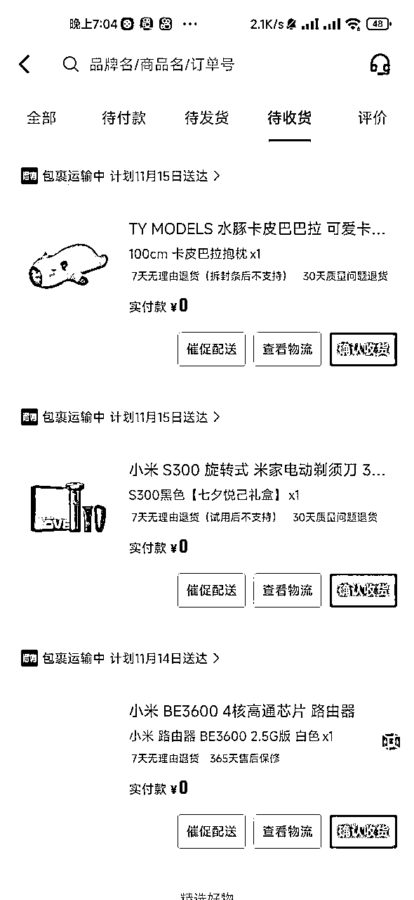

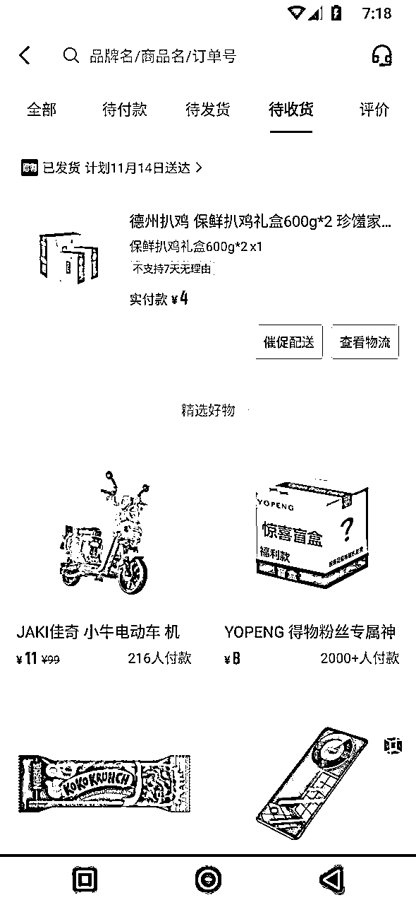

这种券的利润空间其实不小。去闲鱼看一眼就明白，几乎每张都在折价10到35元出货。

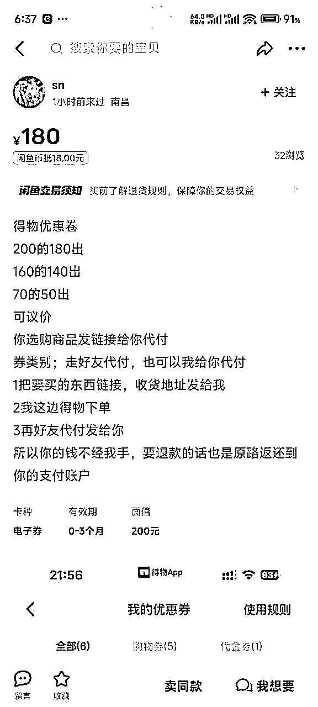

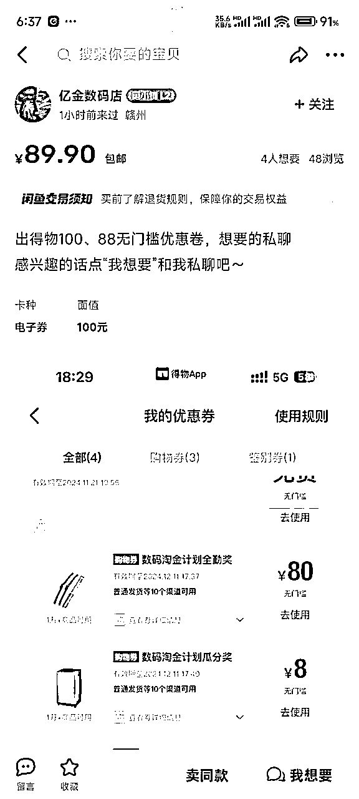

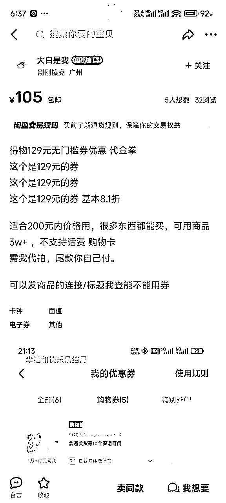

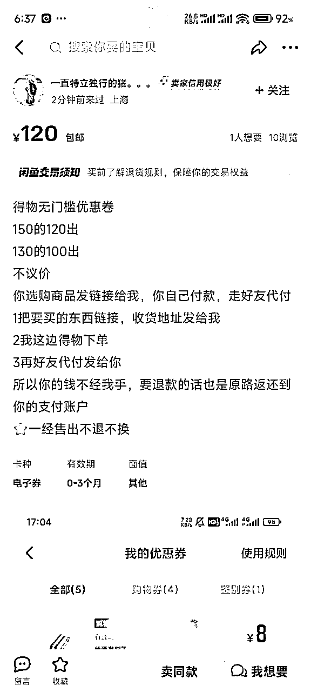

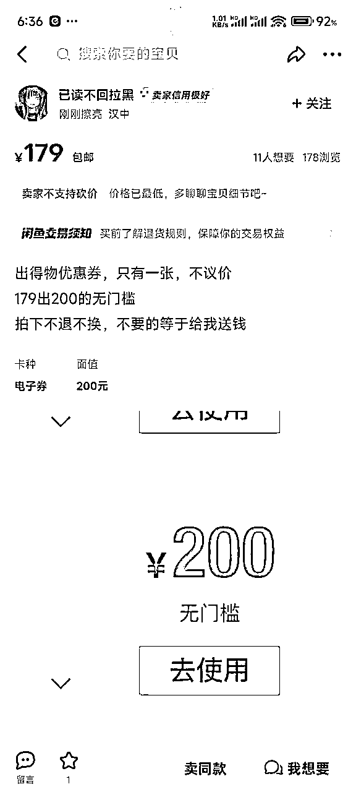

## 二、批量实测：到底赚了多少？

先交底：如果把11月21日当作结算节点，拿我过往做过的项目横向比，这次并不算成功。好在活动延期了，前面的功夫没白费。

我这边当时铺了大约170个号，一部分号领到了1到3周的券，另一部分号刚上线就被风控拍死。总共算下来，成本花了约6000元。除了自己买东西消耗掉部分券，其余券一共回款18063元。这个数字是两个人几乎全身心扑上去换来的，性价比确实一般。不过合作的几个工作室里，有几位成绩略好些，他们报上来的数据，我这边还能分到差不多两万块。

另外，这个项目也倒逼我把代理IP彻底研究了一遍，顺手给自家多账号浏览器加了IP隔离能力，算是意外收获。到了项目后期，我重新调整了打法和投入：一部分号改成6天一轮，另一部分号优先做快速套现。

### 1. 起步阶段：小范围试水到批量铺开

10月27号，我在得物官方社群里看到了这个叫“得物主场计划”的活动。

说白了，它就是早前“潮流主场计划”的替代版。在App里搜“得物主场计划”能直接进活动页，点开后能看到平台要求的审核材料。

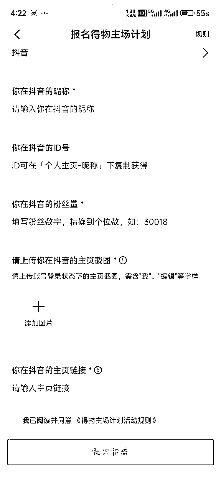

参与门槛不复杂：去外站找一个500粉以上的小红书号，或者1万粉的抖音号即可。把号交上去等审核，过了就能做任务领券。手里没有这种号也能买，单买成本150元左右，渠道我就不提了，免得有打广告嫌疑。想了解流程的可以自己去翻那篇文章。

整个活动周期是6周，每周有对应任务，完成就发不同面额的券。第1周和第6周各给100元券，第2到第5周每周给88元券。另外，两个月内粉丝爬到100，额外给200元券；爬到1000，额外给500元券。全拿齐就是100×2+88×4+200+500=1252元券。

但我是批量干的，算了下投入产出，主动放弃了500那档，只拿100×2+88×4+200=752元券。

### 2. 审核结果能不能提前预判？

凭我的观察，同一批交上去的号，被拒的通常比通过的早1到2天收到通知。要是提交后第三天还没收到坏消息，那这个号基本稳了，通过率接近百分之百。

### 3. 试水与放量

初期注册了5个号，3个顺利过审，2个因条件不符被刷。这次测试确认了玩法可行，我就决定扩大规模。拉上三个工作室的朋友开始批量上号。10月31号，第一批号发完作品、做完任务，顺利领到了100元券，全程无坑。

### 4. 素材怎么搞？怎么处理？

放量之后，短视频素材成了刚需。之前做过批量号，这套流程我熟。为了做任务视频，我用VPN去油管下载。

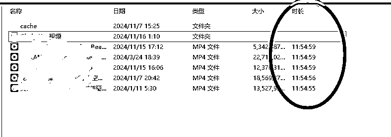

油管单个视频最长12小时，好像平台有上限。以前下载这种长视频，VPN成本很肉疼，后来我自己搭了海外节点，每月1000G流量，一年才99块，彻底解决了。教程放这里了。

加速器教程 · 语雀

下载完的长视频，用视频批量分割工具切成几千个20秒以上的片段。

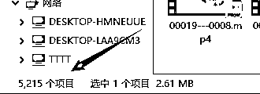

足够所有号发布。这个分割工具也是我以前做项目时自己写的，界面很糙，毕竟自用，不搞花里胡哨的。操作很傻瓜：把原始视频放进一个文件夹，再指定一个输出文件夹，设置好每段时长，点开始就完事。

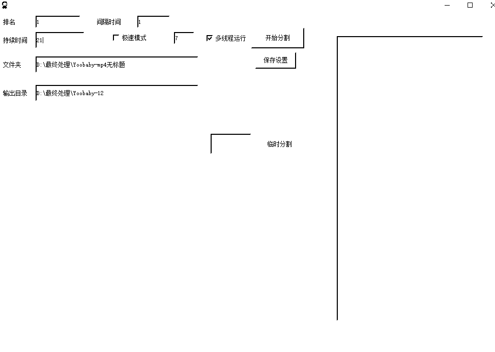

## 三、风控来了：号批量阵亡

11月8号，工作室那边传来坏消息：有号出现异常。

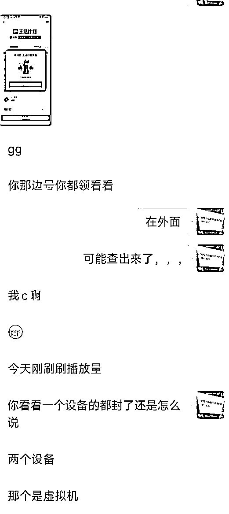

### 1. IP触发风控

之前我在知乎、快手、京东这些平台做矩阵，从没因为IP翻过车。所以一开始没把得物的风控当回事，以为是偶发事件，可能是作品违规。毕竟号这么多，出几个问题也算正常。

但接下来几天，异常号越来越多，活动做完了却领不到券。这时候我赶紧和工作室协商调整：有条件就一机一号，没条件的也尽量把号分散，降低批量操作的痕迹。我自己则开始摸索风控底线——新号分开注册，用流量卡收验证码，发作品也改回手机手动发。

最难搞的是：号出了问题没有任何提示，只有领券那一刻才会告诉你“领取失败”。这意味着你根本不知道是哪一步操作触发了风控，只能等每周任务做完才发现。

11月15号，经过几天的试探，结论很明确：得物的风控没空子可钻，必须一机一号。以前我是用自己写的软件批量发作品，IP固定，现在这招彻底失效。原本想着一个服务器挂几个号，手里还有四五十台轻量云闲置，结果还没用上，突然收到消息说服务器都要到期了。

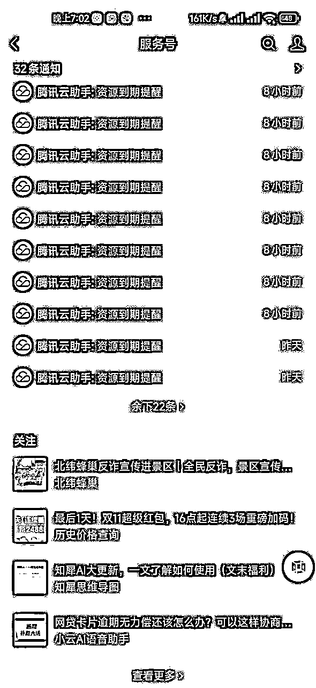

再买服务器又得砸钱，而且几十台服务器同时操作，人工成本也不划算。用比特浏览器的环境隔离倒是可以，但这样一来我的全自动批量发布工具就废了，只能手动做活动。

### 2. 破局方案：自建IP池

正在焦头烂额的时候，我忽然想起之前在赚钱看到毛韩老哥分享过自己搭代理IP的帖子。翻回去重新读了一遍，又查了一堆资料，最后还是决定自己搞一个IP池，顺便把浏览器环境隔离功能加进我的软件里。

上个月还有赚钱的朋友找我付费定制这个功能，我婉拒了——不是自己需要的东西，我不接付费定制。结果没隔多久，自己还是老老实实把功能写出来了。

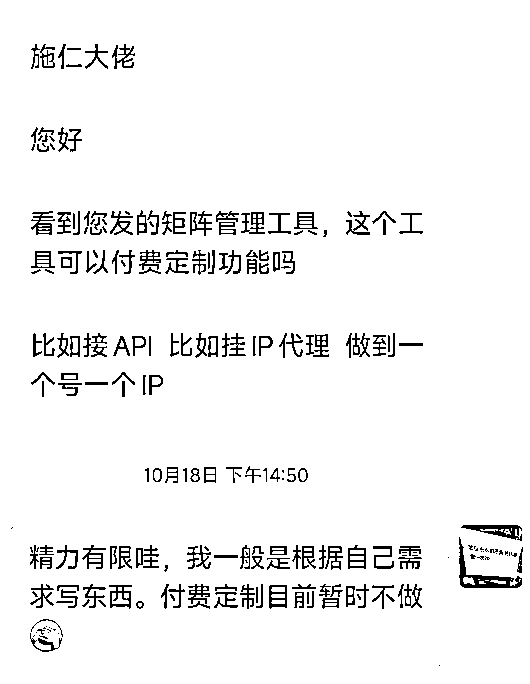

可以说，每次技术能力提升都是被项目需求逼出来的。这个多账号浏览器我写了快一年，视频号、小红书、京东、B站、QQ短视频、快手这些发布功能，全都是不同项目倒逼出来的。

后来又是买IP又是买服务器，可真要挂代理的时候又卡住了。我参考比特浏览器的做法，但它是单独给浏览器进程挂代理，不是直接给电脑挂代理。又查了很多资料，才把这个问题搞定——说起来简单，实际上我在电脑前枯坐了四天，反复修Bug和测试。

搞到这一步，活动时间已经过去一大半。对我来说哪怕项目最终不赚钱，也完全不亏，起码代码能力又往前迈了一小步。我的软件增加了代理IP和浏览器伪装，可以给每个号分配固定代理和参数，功能和比特浏览器已经没什么差别。

我当时判断这个活动不会只活一个月——它是“潮流主场计划”的平替，那个计划的都搞两年了，新活动不可能说停就停。批量发布的问题解决后，注册环节就靠飞行模式、爱加速、自建IP池这些手段来规避风险。

### 3. 稳住军心

那段时间，几个合作的工作室因为问题频出都有些泄气，有的团队甚至停了四五天。

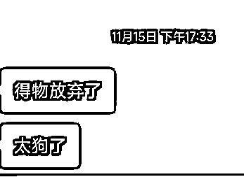

我一直和他们保持沟通，持续更新解决进度，尽量让他们安心。

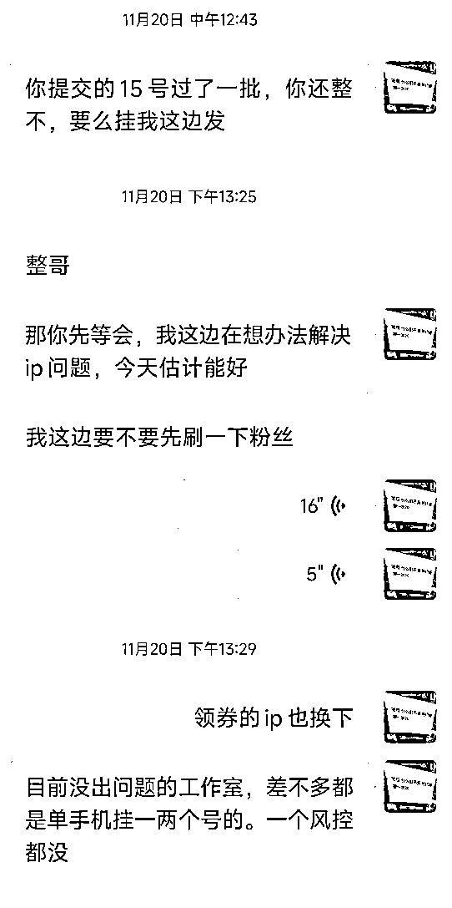

其实过去几年做这类活动，我遇过不少突发状况，每一次都找到了解决办法。正是这些经验积累，让我对这次的问题也有信心，我相信最终能扛过去。

### 4. 死号注销与手机号复用

死号注销不会提示违规，但流程要15天才能走完。这就导致手上很多手机号无法重新注册。试了很多次之后，我发现了一个快速注销的办法：顶号。具体就是：手机号A注册的号死了，我用手机号B注册一个新号，然后用换绑功能把A手机号换绑到新号上，这样原来A绑定的号就被释放了。经过测试，这个操作不会触发任何问题。

## 四、券怎么稳定变现？

去年我就接触过得物券，当时是机构主导的“潮流主场计划”，一个号能做3张166元无门槛券。那时候变现就挺头疼，最后一部分挂闲鱼卖，一部分留着自己用了。

闲鱼变现最大的坑是售后。来买的基本都是买鞋买衣服的，售后问题多到爆炸：不合身要退、有瑕疵要换，一边伺候客户，一边还得跟得物客服扯皮，批量做号的人根本耗不起这个精力。

和几个工作室负责人聊完，我更焦虑了。他们本身都在做撸货，有个工作室今年冬天炒棉服，双十一砸了上百万进货。

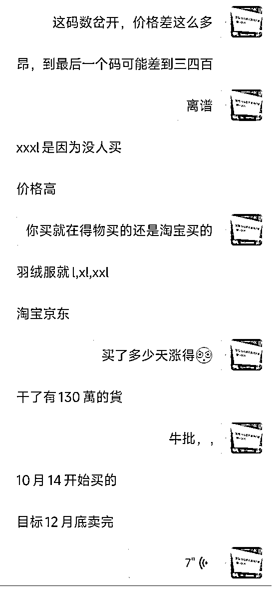

正好可以用券去得物再捞一波。另一个工作室虽然目前出货渠道不多，但也不急着出手。

可我自己不做撸货，要找一个稳定的变现通道实在太难。最后只能找撸货的朋友帮忙把路子跑通，勉强找到一个：小米充电宝和华为手环。华为手环要自己垫7到20元，价格有浮动。

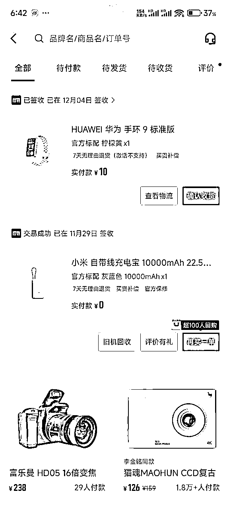

每张券折损25到45元就能出，一个号不出意外能套现500元左右。这个通道还算稳。

## 五、刷粉通道：百粉200元券怎么拿下来？

活动里的“百粉奖励200元券”我一直很惦记。周任务最多才给100元券，百粉直接翻倍，所以我一直在找刷粉渠道。

最开始找了个刷粉平台，成本不算低但还能做。结果没跑几天，平台突然停售了，问客服也说不上来什么时候恢复。

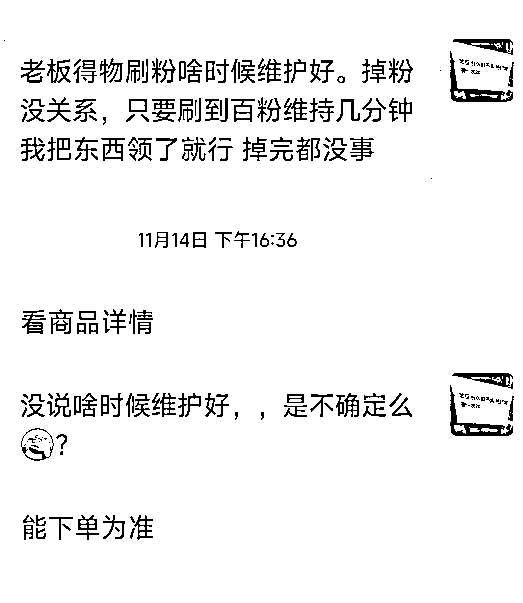

只能重新找。很多平台不注册连单子列表都看不到，我那几天注册了不下50个刷单平台，账号密码输到怀疑人生。然而找到的不是没有得物单，就是同样停售。好不容易找到一个有单的，刷粉成本又太高，算下来200元券的利润跟100元券差不多。

最后是工作室的小伙伴解决了问题。他以前在兼职App上发过任务，就去试了试发布刷粉任务，效果出奇的好，百粉成本控制在了20元以内。他把刷粉情况同步给了我。

打码的地方是我当时忍不住骂的脏话，因为这问题困扰我太久了。

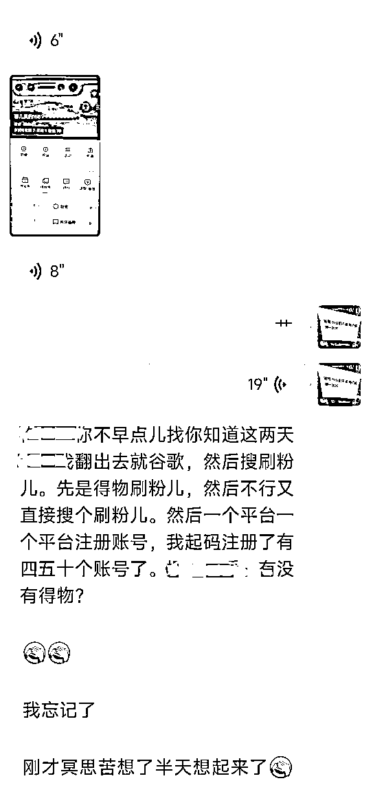

千粉任务奖励500元，我也试过冲击一下，但粉实在不好刷，算成本不划算，就放弃了。

## 六、玩法升级：效率翻倍，6天赚300

### 1. 原始算法：单号利润有限

我测算过，一个号只能领752元券，周期一个半月，变现下来利润顶多400到500元。这和我之前做的项目差距有点远。

当时的组合是：88元券4张、100元券2张、200元券1张，合计752元，但分成7张、不能叠加、面值小、周期长，还有50元成本。虽然通过多环境+多IP降低了风控率，但依然有小部分号会翻车。

### 2. 神级思路：朋友给了我新的打开方式

一个同行朋友给了我一个思路，听完我整个人都愣住了。核心很简单：把流程做减法、把风险做减法、把周期做减法、把利润做加法。

具体操作：

1. 任务下来直接刷百粉，拿200元券；
2. 第一周前三天完成任务，拿第一周的100元券。

这样算下来，6天就能拿到100+200元券。审核大概3天，做任务3天，时间压缩到原来的六分之一，但能拿到接近一半的券。

剩下的4张88元加1张100元券，一共452元，连账号一起转出去，定价100元。接手的人继续做后续任务。

总结一下：用时6天，成本50元以内，拿到300元券，变现约240元，账号转卖100元，净利润约300元。风险更低，不用管后续，人工也省了。

说真的，当时听到这波操作我呆住了。同一个项目，在不同人手里竟然有完全不同的玩法。

### 3. 关键瓶颈：手机号从哪来？

这套玩法需要大量手机号，因为一个号至少占6天。号不够多，循环根本转不起来。

想来想去还是落到了接码平台上。其实最初我就试过，但接码平台的号根本注册不了——获取验证码时直接提示有风险，注册失败。后来继续找人打听、做测试，终于找到一家靠谱的卡商。

### 4. 现在完整跑通的流程

目前的整体节奏是：

- 用实卡或接码平台拿手机号注册；
- 买7天云手机，或者用一卡一机设备提交活动；
- 大概4天出审核结果；
- 审核过了立刻刷粉、领200元券；
- 领完券直接下单买货，寄给收货市场，完成第一轮套现；
- 刷完粉，一部分号挂到软件里做环境IP隔离，全自动批量发；另一部分号直接在手机发作品，同时找学生预定；
- 第三天任务完成后，买充电宝套现，再把账号以100元价格换绑给学生；
- 继续注册新号，再跑一轮。

从27号到今天，到手收益已经接近两万，扣掉成本至少有1.3万利润。这还没算已经交了审核、还没下来的号。坏处是账号太多，核对信息会麻烦。

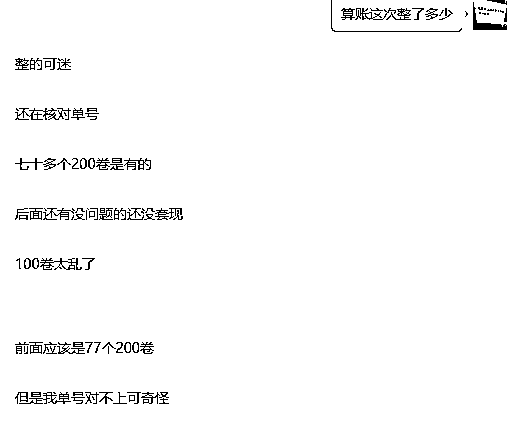

目前来看，这种批量玩法的风险和利润性价比是最优解，就看活动还能撑多久。

## 七、你关心的几个问题

### 1. 怎么注册多个号？

我自己手里大概有60张实卡：移动8元卡，能绑3个和多号，每个5元；电信卡有月租5元的；联通卡绑小号月租12元。又找朋友帮忙办了一些移动联通卡，再开通小号。注意，注册卡从11月15号左右开始就不能参与活动了。

### 2. 电脑上怎么隔离账号？

我用的还是自家写的软件，能自动设置每个号的登录指纹。目前也支持IP隔离，通过SK5协议连接。只要你手里有IP资源，就能直接使用这个软件。

### 3. 单个人、单账号怎么操作？

个人做其实没技术含量。提交审核后，工作日第四天会出结果，有短信通知。

有两点要提醒：审核通过会有App消息，不通过也会推消息。但“不通过”的消息不一定准——我这边大概有二十分之一的号收到不通过通知后，过两天又提示通过了。所以看到不通过也别慌，复制口令进活动页看看是否还在审核中。如果还在审核，就说明还有机会。

过审之后，按活动页面的6周任务去做就行，毫无难度。发三天作品，播放不够就用另一个号刷一下，100播放一两分钟就完事，任务完成就能领券。

### 4. 怎么自建多IP？

赚钱和B站都有相关资料，搜“天翼云IP”就能找到一堆。但有个坑：你看谁的教程注册的账号，就必须找那个人开通最大折扣，而且后续搭建节点所需的脚本也要找那个代理商拿，脚本使用是付费的。你没在他的渠道注册，他根本不会给你脚本。

### 5. 手机一机一号怎么搭？

两条路：

- 云手机：要花钱，但更稳。
- 虚拟机+爱加速改IP：成本低。

这两种方式都能给每个号提供独立IP和环境，满足“一机一号”的要求。

具体说一下VMOS搭建：安卓系统最好在10到12之间，13不太稳定，想用的话自己测。如果提示“网络连接请重试”，多半也是因为系统太新。这一步主要是做环境隔离，防止得物检测到同一设备登录多个号。每次打开虚拟机前，固定用一个爱加速IP。

安装VMOS.apk和VMOS助手。VMOS助手打开后提示授权，一路同意。它会要求开启开发者模式——不会就搜索自己手机型号加“开发者模式”。

最后一步非常关键：有些手机怎么设置都搞不定，我当初也卡了好久。无线调试需要在手机上打开无线调试选项，通知栏会出现对话框，点击“使用配对码配对设备”即可。

很多朋友做多账号时，最头疼的就是环境隔离和批量操作效率。这套流程我实测过，能帮你少走不少弯路，下面直接上手。

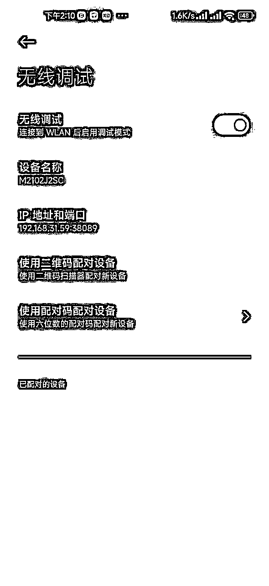
屏幕会突然弹出一列数字，先把这组数字牢牢记住。

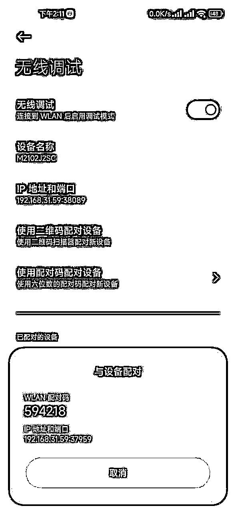
拉下通知面板，点击“输入配对码”。如果对话框一直没有出现，那就退回无线调试的上一级页面，再重新点进去，选择“使用配对码配对设备”，获取数字码之后下拉就能看到。别忘了检查辅助工具是否有通知栏权限，该给的权限一定都要给到位。

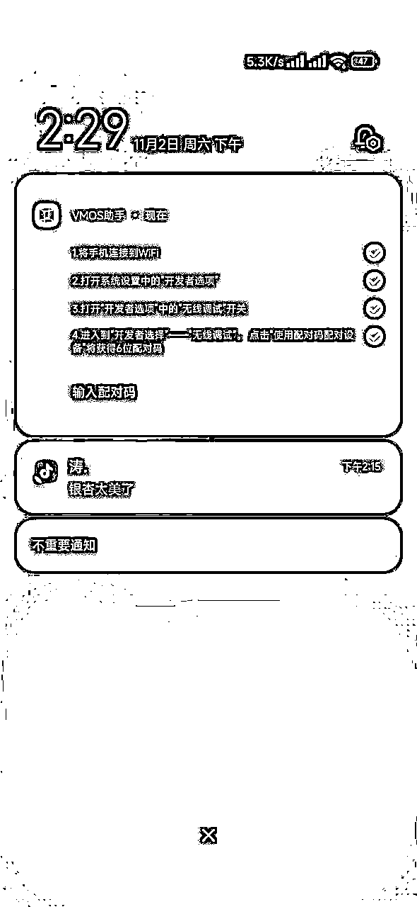
把那组数字输进去，配对就完成了。

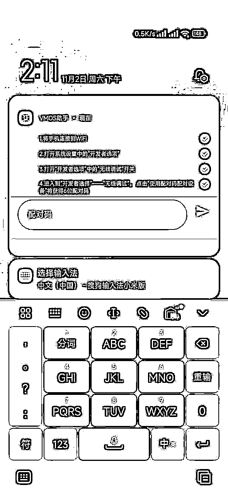
有些设备点击“输入配对码”后毫无反应，这种情况可以到手机设置的“通知栏”部分，把通知样式改成“原生”。如果通知被折叠了，长按通知也能展开完整内容。

这个坑当时也困扰了我很久，翻遍各种原因才终于解决。接下来点击上方的加号，把设备添加进去。

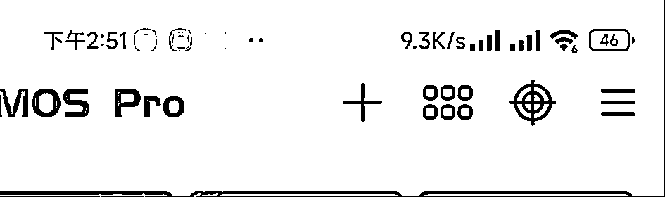
添加设备的页面如果是白屏，完全不用在意，直接点右上角的三个点，选择“导入ROM”，把2024虚拟机备份导入进去，这个压缩包在下文会分享出来。

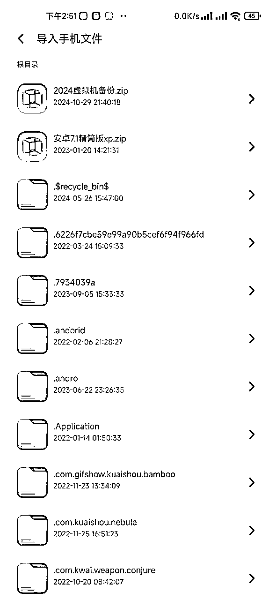
导入过程会有点慢，等个一两分钟很正常。如果虚拟机打开后黑屏，返回手机主界面重新进入就行，或者关闭虚拟机再重新打开。操作时点击最下方的“导入”，勾选“得物”后确认，虚拟机就会自动装好得物App。

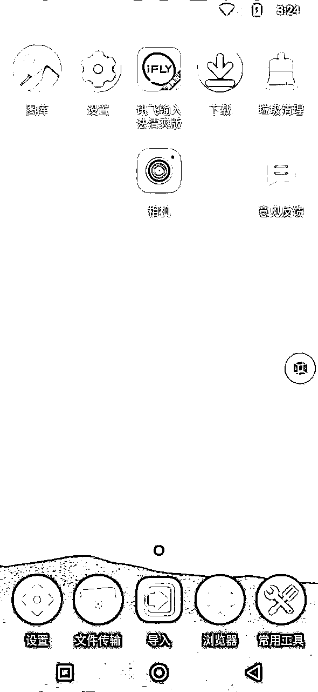
到这一步，虚拟机隔离环境就算彻底搭建好了。

# 3. 实操工具分享

**1. 多账号浏览器**

我自己开发了一款多账号浏览器，支持同时登录多个平台的多个账号，还能自动切换IP、伪装浏览器信息。用它来批量处理任务，效率直接拉满，同时也能避免账号之间产生关联，降低被得物平台识别的风险。软件一直在更新，旧教程看起来可能有点过时，但核心玩法大同小异，具体可以参考软件内的教程。

**2. 批量分割工具**

我还自制了一个批量分割工具，能把长视频立刻切成20秒以上的短视频，省下了大量人工剪辑时间。这样一来，即使同时运营多个账号，素材也能快速供给，任务推进非常顺畅。

**3. 手机虚拟机——搭建独立手机环境**

这里要分享的是VMOS虚拟环境，它能让同一台手机同时跑多个独立系统实例，相当于一台手机模拟出多台手机。这个版本是破解版，使用起来没有限制。

工具链接：
链接: https://pan.baidu.com/s/1JIfs83bfmQMo5PMgWCAkiQ?pwd=tw2a 提取码:tw2a
复制这段内容后打开百度网盘手机App，操作更方便哦。