# B站精细化操作变现指南

B站到底值不值得做？我的答案是：非常值得。原因很简单——B站的内容收录速度极快，搜索排名也相当靠前；它对于引导用户去站外这件事并不像其他平台那样敏感；搬运视频的容忍度也相对较高；流量分发机制就像是抖音、百度、论坛的混合体。所以，只要你手里有货，流量就能像滚雪球一样滚很久，甚至吃到你腻。

不过别急着注册完就发广告。B站不是你爸开的，新号上来就硬广，纯属找骂。现在的审核早就不是人工时代了，机器一眼就能看穿你的小动作。机器怎么判断你的号养没养好？它主要看你的登录时长、浏览视频的时间、操作频率、互动次数等等，通过这些维度来判断你是不是真人在操作。如果你上来就发广告，系统很容易判定为营销号，内容直接不给推荐。

那么养好号之后，怎么变现？先说短期打法：吃创作激励和爆款奖金。激励收益跟播放量直接挂钩。打个比方，一条2分钟的原创视频跑到10万播放，创作激励大概能拿50到100元；每周的“爆款挑战”奖励也有50到100元。这不需要带货，也没有复杂步骤，有点像👸号流量主，但单价其实更高。问题来了：视频怎么做？怎么才能拿到超高曝光？

记住一个核心原则：傻瓜式剪辑，能花多少时间就尽量少花。你可以借助飞瓜数据这类B站数据分析平台，查UP主、看排行榜、分析视频和直播数据，帮你做内容运营和投放决策。

先看一个典型例子，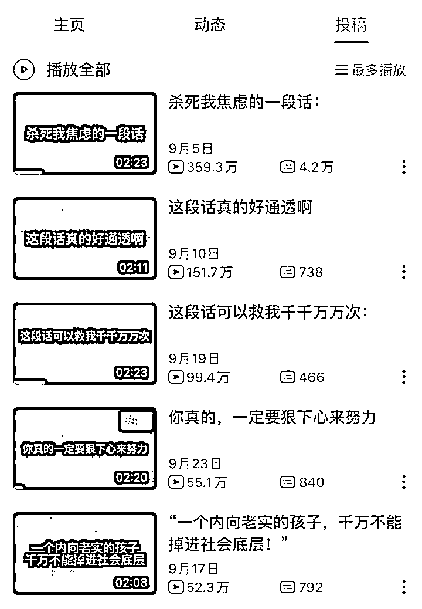 文案、金句类账号。

这类视频通常不超过3分钟，文案来源主要是知乎高赞答案或者自己收藏的金句。制作方式极其简单：一张黑色背景图，把文字贴上去，再用剪映的“朗读”功能生成配音，一键压制。整个流程大概10分钟就能搞定。可一旦播放量突破50万，创作激励就能拿到200到500元。别以为几十万播放需要几十万粉丝，哪怕你只有100个粉丝，只要内容足够吸引人，系统照样给你推荐。

想做台词类素材，有几个工具可以试试：getyarn能查出处，还能直接下载视频片段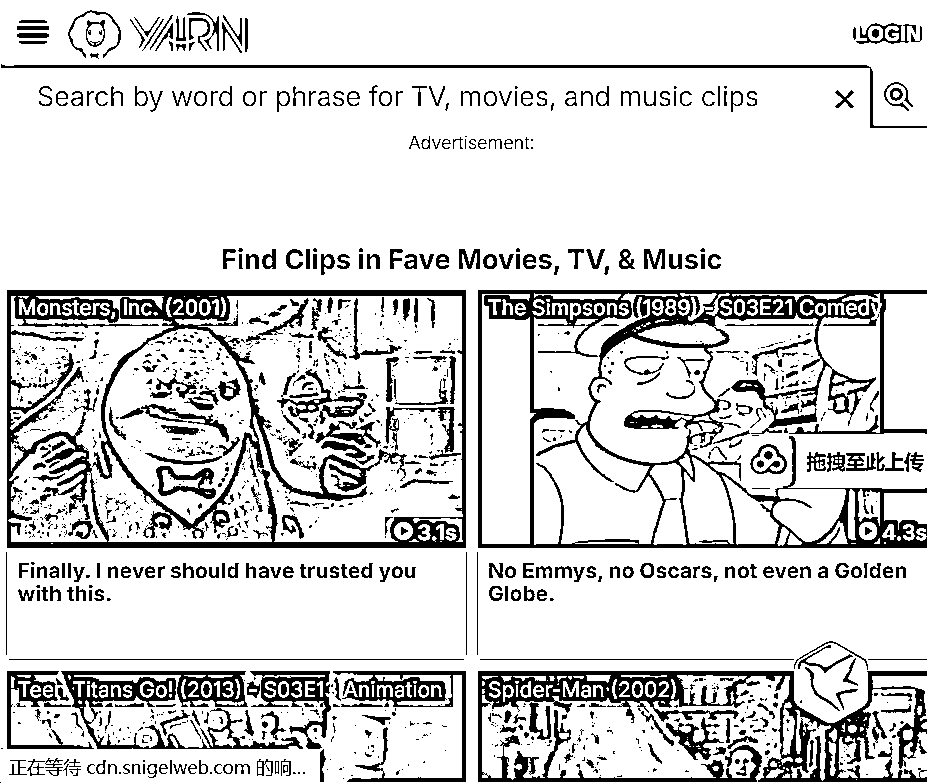；找台词能查出出处，但无法下载视频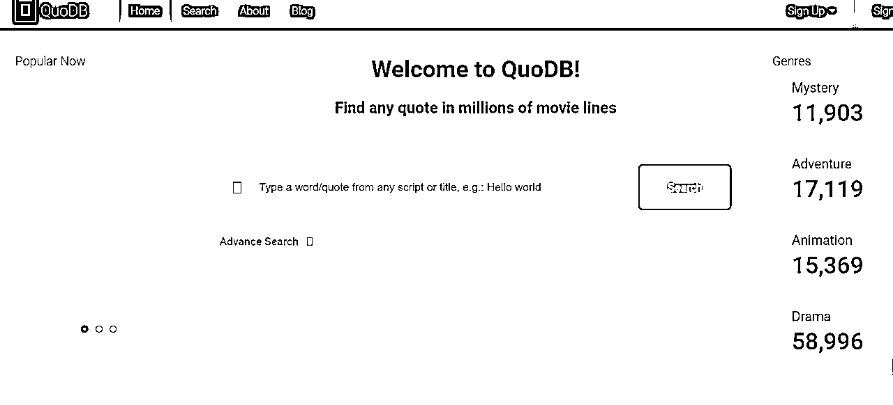；QuoDB同理，只提供出处，不能下载。如果是特别经典的台词，直接百度搜，有时候也能找到源头。

上面这个案例，就是典型的“极短时间、极低成本、撬动大流量、赚取高收益”。

再来看老剧、老电影剪辑赛道。 比如《康熙微服私访记》《铁齿铜牙纪晓岚》《茶馆》这些剧，看到让你拍案叫绝、借古讽今的片段，直接截取下来。核心三要素：内容要扎心，标题要能引起网友强烈共鸣，制作成本必须低——只用剪映的基础功能，完全不用学Pr。配上背景音乐、加几句点评和字幕，就算原创了。内容只要够味，哪怕只有100个粉丝，冲到10万播放也不难，收益就是50到100元。但要注意，投入时间千万别超过1小时，如果剪个3分钟视频花好几个小时，方向就错了。

中文电视剧的台词搜索网站目前很少，大多英文台词站附带的中文资源也有限。可以先试试33台词这个搜索引擎，搜不到的话就用Plan B：把自己常用的中文电影下载到本地，导入剪映后打开自动识别字幕，识别完只导出srt字幕文件；把多部电影都这样处理，然后把所有srt内容复制进同一个Excel表格，以后想找某句台词，直接Ctrl+F搜索就行。

还有一类是动画片。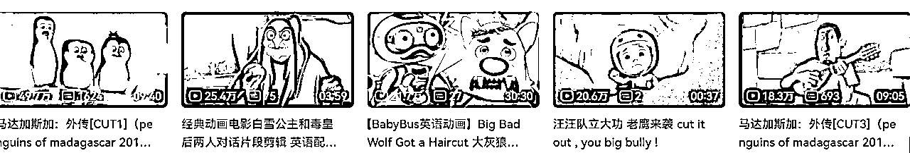 国外老动画版权比较宽松，内容本身就很抓人，剪辑起来更省事，有时候连背景音乐都不用加，看不出剪辑痕迹，只要把两段素材拼在一起就能过原创，拿到不错的激励收益。

所以，如果你想在B站靠创作激励和爆款奖金赚钱，不建议抱“深耕”思维，而是要有“薅羊毛”思维。当然，剪辑时间短不等于内容垃圾，我相信网友的审美，播放量高的作品一定有其道理。

想更快做出视频、更快赚到激励，还有更野的路子：直接把油管、ins、抖音、快手、视频号上的热门视频搬过来，标上原创发到B站。其他平台能火，到B站大概率也能火。播放量一破10万，就是50到200元的收入。有风险吗？搬100期可能有两三期被投诉，那也无所谓，整体稳赚。更稳妥的做法是把两三段风格一致的视频拼在一起，比如很火的“驴子跟狼搏斗”类视频，你去搬几段剪成一条，取个《狼的克星竟然是驴子》的名字，标上原创，这钱赚得比吭哧吭哧自己剪辑轻松多了。而且，纯原创内容没经过市场验证，上热门的概率其实很低，还不如搬运。

当然，你的长期发布风格最好统一：要么全是动物视频，要么全是老外奇葩视频，要么全是搞笑视频，总得给用户一个关注你的理由。从平台角度看，B站巴不得大家多传内容，只要没人投诉，它才懒得管你是不是滥标原创，有热度平台才有收益、股价才能涨、才拉得到投资。B站绝对不想打击创作热情，下架也是迫不得已。所以想快速变现，胆子大一点。

说完短期，再聊长期持续变现。B站有个功能叫“工房”，2022年3月上线，是原创作品交易平台，UP主可以在上面展示和售卖自己的原创作品，用户可以直接购买。举个例子：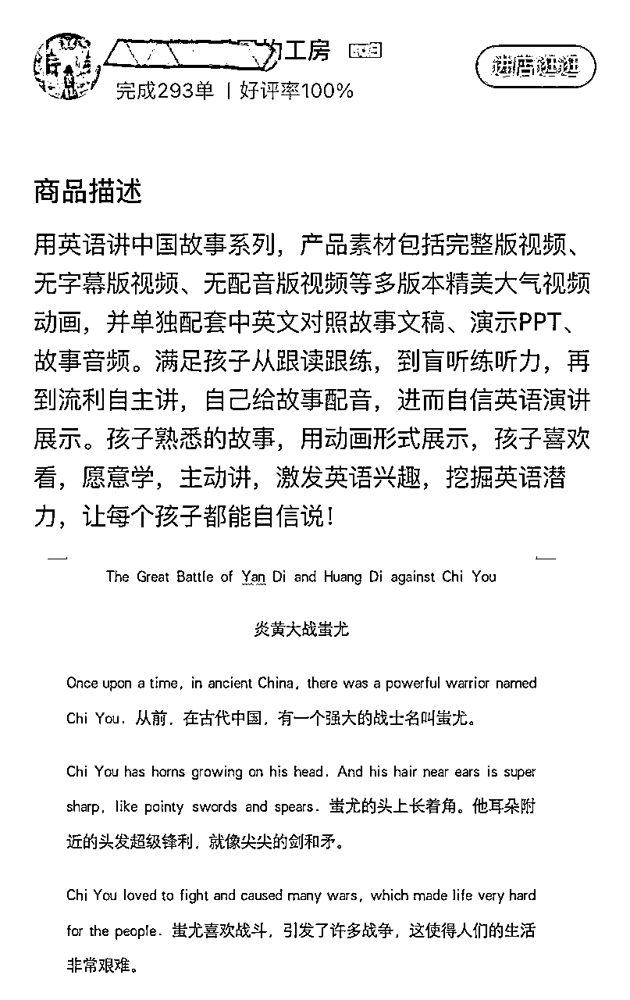

任何项目想赚钱，离不开三个关键词：需求、创新、产品。有需求才有人买单，产品再好没需求照样白搭。这个时代不缺人才，缺的是创新人才，你会发现内容同质化太严重，不是模仿就是抄袭，大家只会拼流量，甚至有人靠骗。但到了2024年，玩法变了，平台已经帮我们搭好了商业闭环：🛰️有🛰️小店，抖音有抖店，B站有工房，📕有薯店。你不用再费劲把流量导到私域，只要在平台上做好内容，就能直接闭环成交。

拿我自己举例。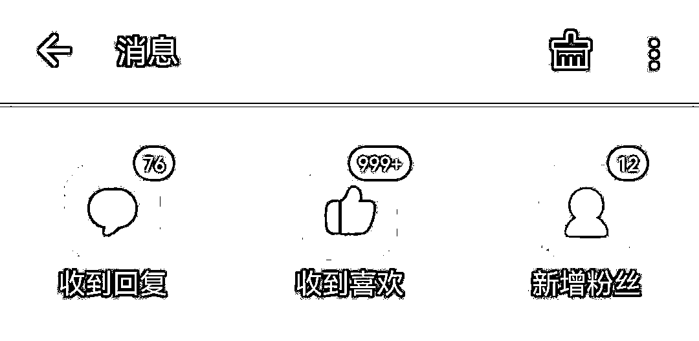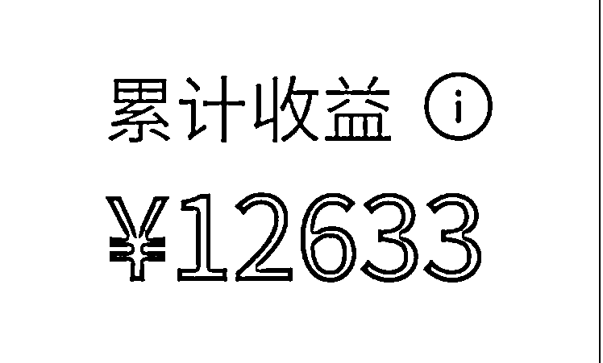 我做了一份飞书文档，靠着B站工房持续出单，累计变现已经超过1万。用户在工房下单，我的发货文件里只放🛰️号，把他们引到🛰️后再发文档。现在🛰️里已经有了一批付费客户，有B站客户转介绍的，也有从📕通过欧美短剧引流过来的。我每更新10期内容就涨一次价：还没到50期的时候上架，原价99元；50期时涨到129；现在70期是189，计划最终涨到599。B站有粉丝优惠，而且工房交易不收手续费。因为视频播放量已经有6万了，所以我目前重心还是放在B站。这份飞书文档包含原视频、译前准备资料、转写原文和注释笔记。反正平时本来就要找素材练习，整理笔记也就是顺手的事。

在我眼里，B站工房就是一个能放心贩卖电子资料和线上服务、不用担心被限流或被封号的地方。UP主通过工房发布和销售原创作品，平台不抽手续费。作品热度高的时候，在评论区放上工房链接，用户一点就能跳转购买，内容顺势带动产品变现。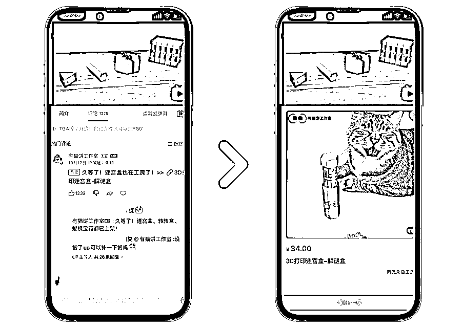

我是怎么发现这个玩法的？其实是偶然看到B站视频下面的一条官方评论。我一直相信机会藏在细节里，所以赶紧整理素材，把资料服务上架到工房。如今除了卖文档，还从B站用户里转化了付费一对一咨询，领域覆盖考研、英语和求职，加起来也变现了1W+。

聊到引流，现阶段B站最靠谱的方式还是内容输出，用视频和文章吸引粉丝，然后再光明正大地把人带走。怎么个光明正大法？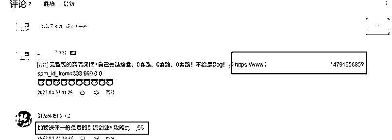

下面分享B站10个引流方式：

1. 工房成交引流。在发货文件里附上个人🛰️号，用户下单后自然就能加到你的🛰️，后续再做转化。比如我的发货文档就是这样写的。

2. 直接在个人简介里放联系方式，硬广也不怕。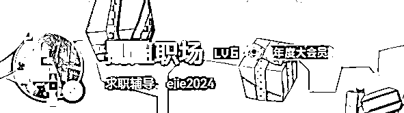

3. 直接在个人简介里放👸号。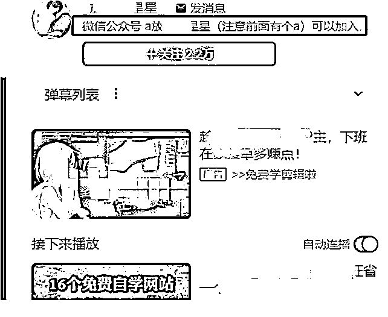

4. 直接在视频简介里放👸号。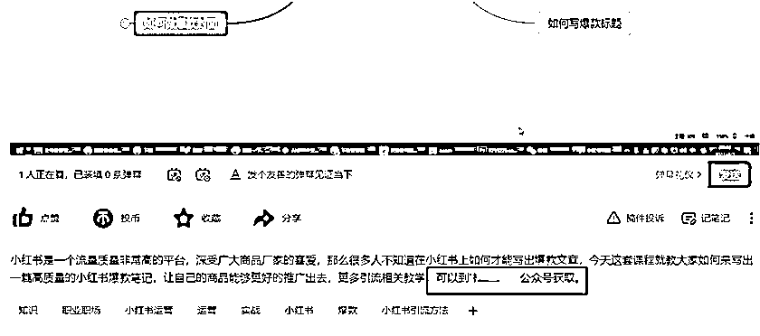

5. 直接在视频简介里放🛰️号。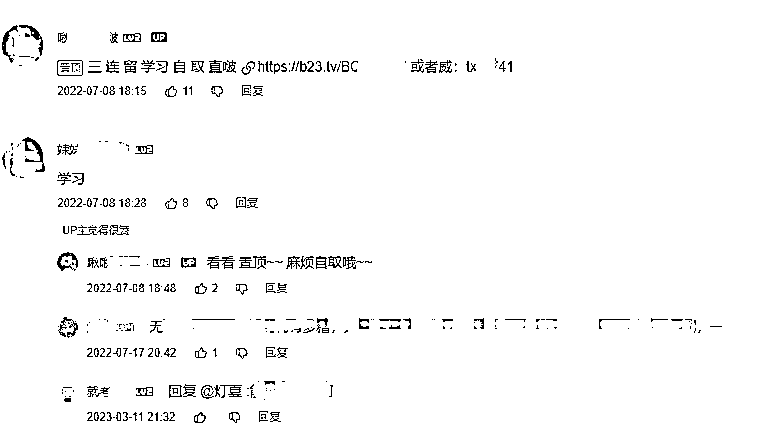

6. 通过引导用户留言，再私信给他们发钩子。这样能带动互动、让作品更火，还能精准筛选目标用户。不过这个方式比较伤号，尽量少用。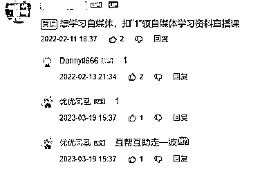

7. 通过评论区引导用户进“动态”页，再做二维码引流。具体操作：在B站个人主页右上角找到“动态”，发布一张带二维码的图片，复制这条动态的链接，然后贴到自己的作品评论区并置顶。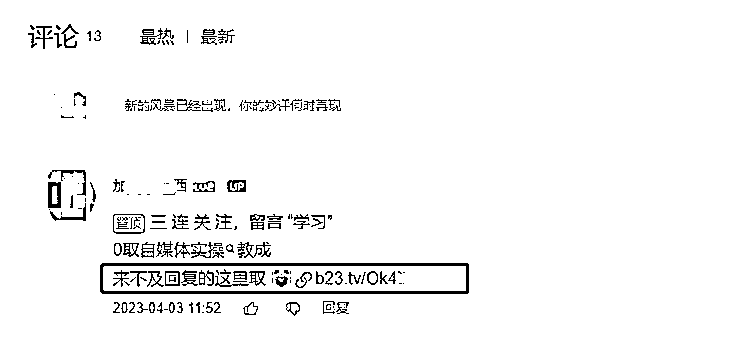

8. 如果自己录视频，可以在视频里口播私域添加方式。

9. 在B站设置自动回复，别人一关注你，系统就会自动发消息，把钩子放进回复里就行。设置路径：打开手机B站，在“我的”页面进入【创作首页】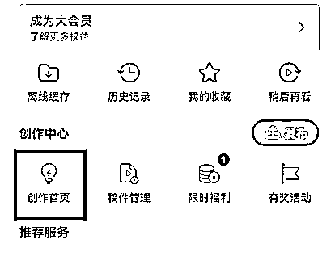；选择【更多功能】→【创作设置】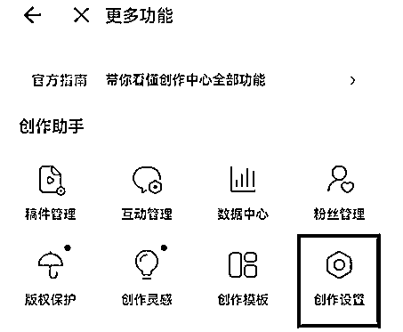；找到【自动回复设置】，填入回复内容，保存即可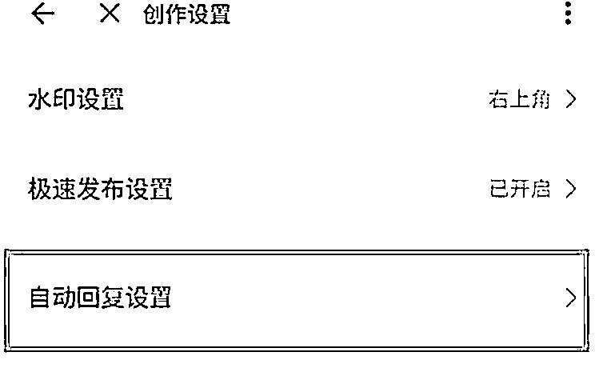。另外，也可以点击首页右上角的信封图标进入消息中心，再点右上角三点，选择自动回复，开启“收到消息回复”并设置内容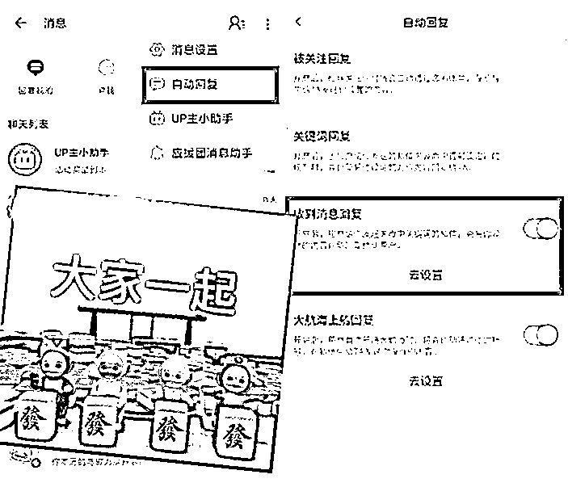。

10. 用小号在评论区引流。这活很简单，但要注意：别每次都发一模一样的评论；尽量找博主最后一条视频发布超过1个月、而且评论区已经出现广告的帖子，这样博主不会及时删评，你的引流内容就能活得更久。

以上就是我的全部分享，希望能给你一些启发。如果你还想深入了解B站创作和变现，我还整理了一份《B站百问百答》，欢迎一起交流，点击上方蓝字就能跳转。