# 一个被忽视的细分赛道，全域账号服务正埋着百万级现金流
作者：龙哥

大家好，我是长期深耕网赚生态的作者。

最近年底，整个市场氛围明显收敛。两年多前起盘的快手磁力聚星无人直播，到了下半年基本已经做不动了。试了不少新赛道，也很难找回当初的冲劲。

今天想聊的，是我们团队内部一直作为长期盘子在运营的业务形态。它不是短期项目，更像一个持续性的连接生意——把终端用户的需求，和上游资源供给方对接起来，赚取中间服务差价。

如果直接说【全域账号服务商】很多人会一脸懵。换成大白话就好懂了：账号买卖、涨粉增量，比如千川投流养粉。我们对外自称服务方，实际覆盖的范围远不止这两件事，互联网账号生态周边的需求我们基本都吃得到。

其实这类服务大家都接触过，只是之前都是作为消费者去找人解决，从未想过这个生意本身的体量和粘性到底有多强。

## 一、这个生意在解决什么痛点

做网赚项目的团队或个人，几乎都在为前置门槛发愁。除了项目本身的成本，还要满足平台的准入门槛。

比如：
- 抖音想做直播间引流，通常要先有1000粉；
- 做带货挂车，粉丝量与挂车权限挂钩，一般在1000到10000区间；
- 视频号带货门槛在100到1000粉；
- 快手申请磁力聚星要500粉；
- 短剧变现账号也普遍要求1000粉起步；

除此之外还有0粉开通直播伴侣、强制开通橱窗、提升口碑分/服务分、更换大号、获取各类工具授权等。

这些就是我们的服务对象。我们扮演的需求响应者和渠道方的桥梁，客户先付费，我们再去执行交付。无需垫资，资金流全程安全，闭环很干净。

部分业务流水截图：

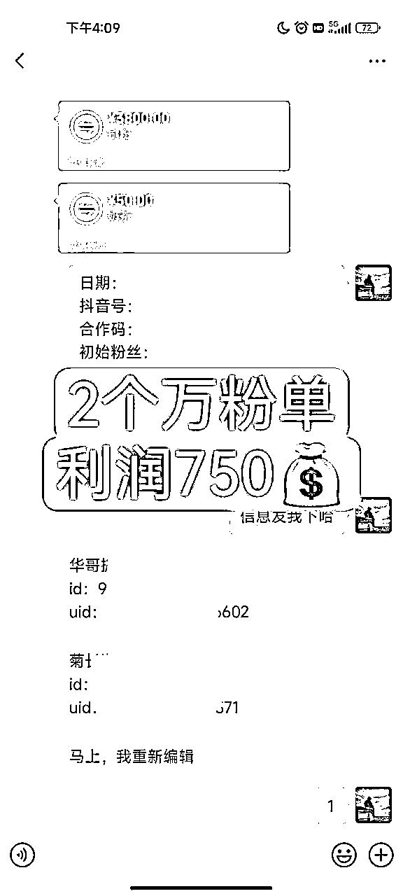

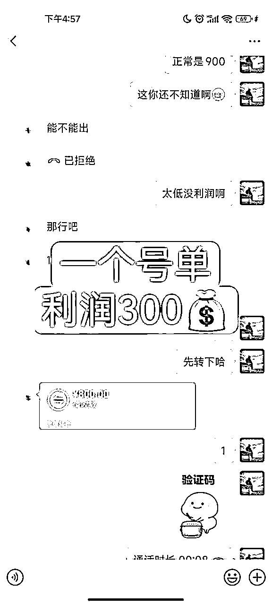

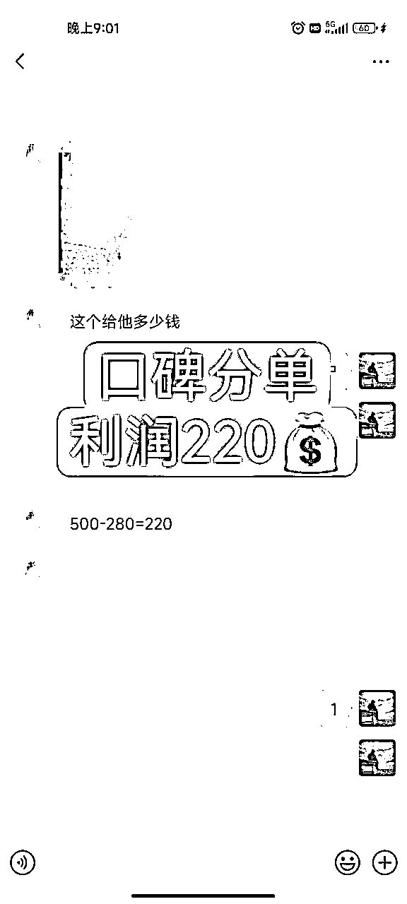

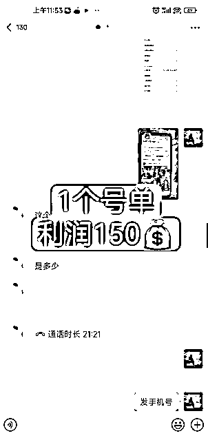

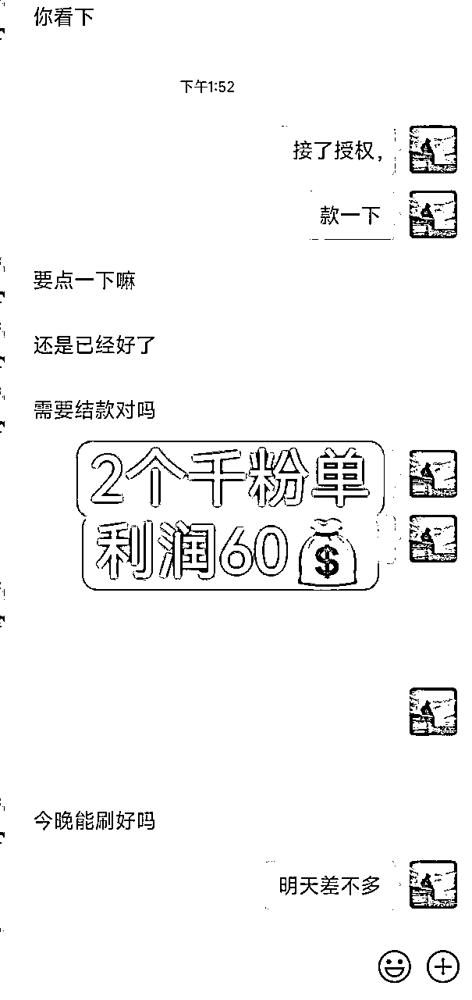

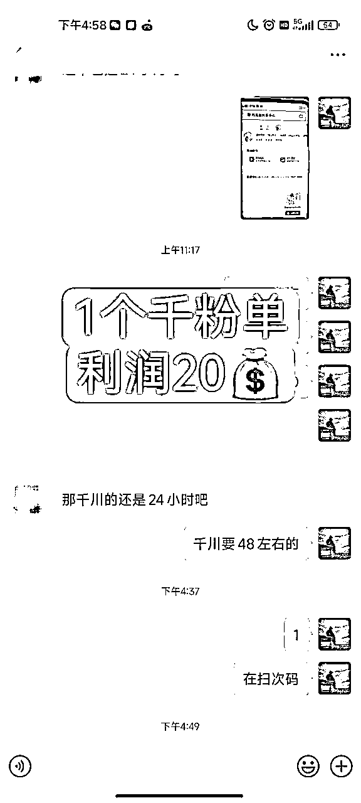

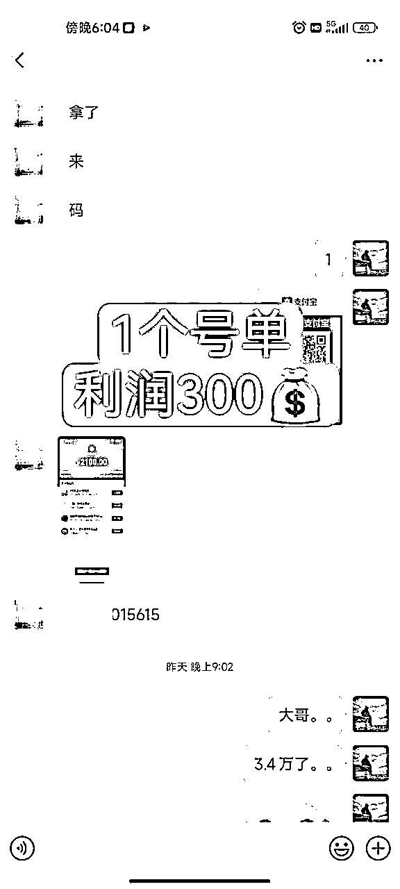

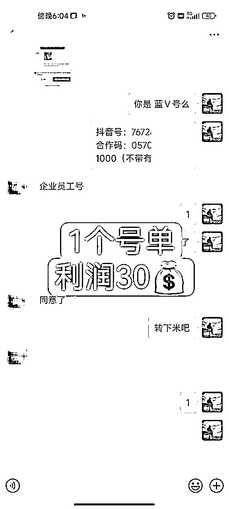

## 二、需求端有多稳

做项目的人，自己就是第一批需求方。再看各大项目交流群里，每天都有类似的求助信息。

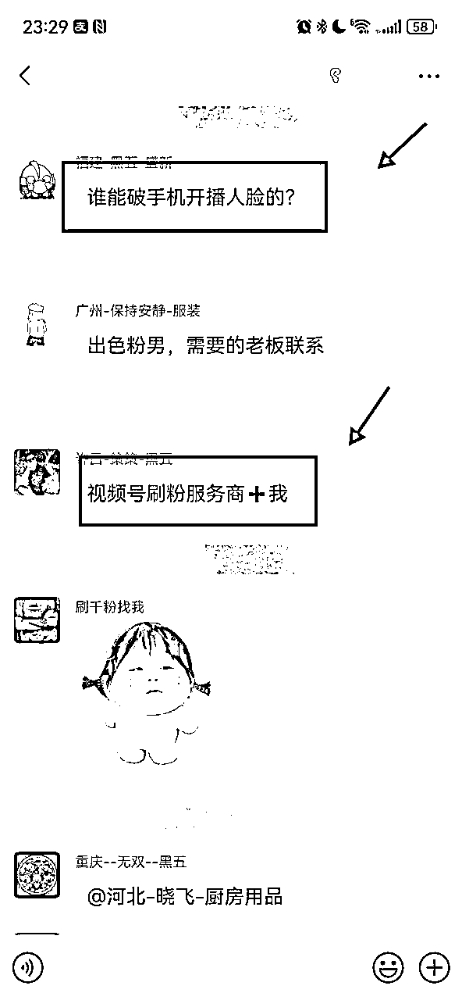

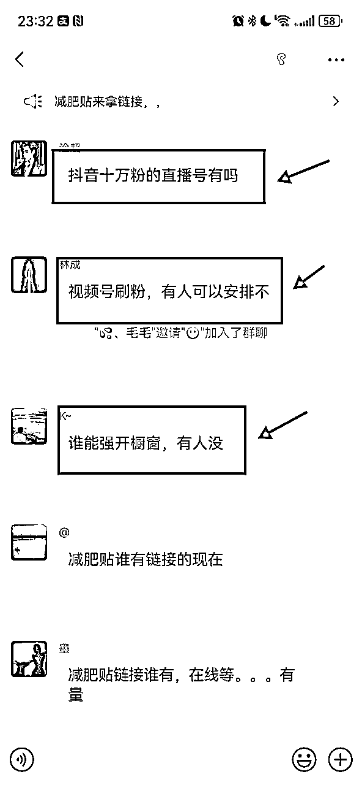

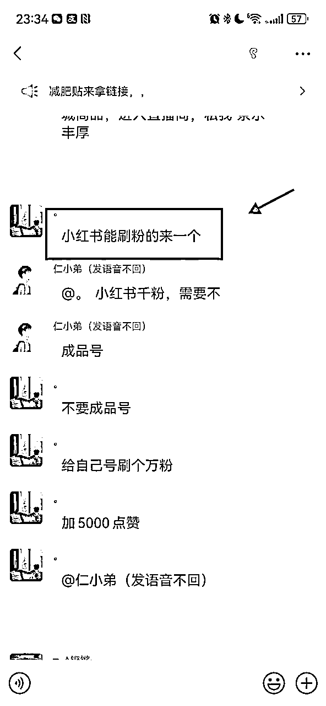

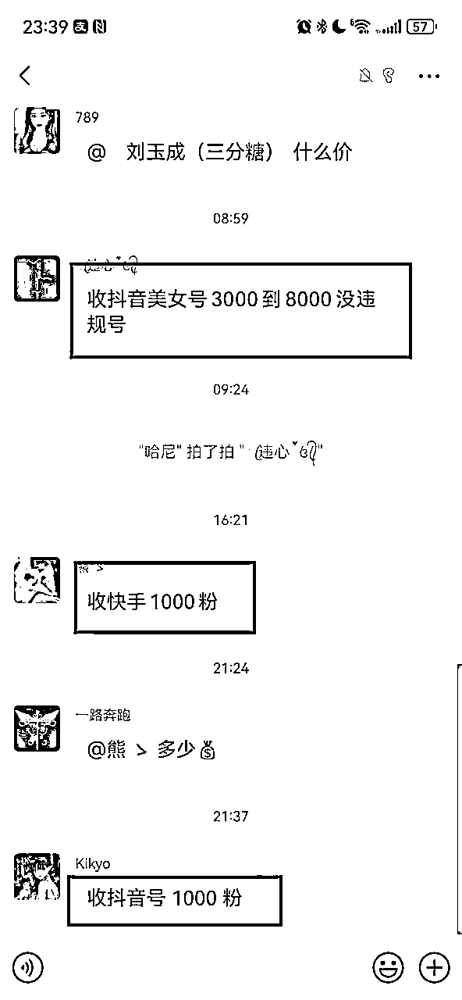

可以说这是典型的刚性需求。只要网赚/互联网创业还在，这个链条就不会消失。现在整体呈现供不应求的状态，除非整个行业清零。

第一次成交后就形成了信任资产。只要客户仍在创业圈活跃，就会持续复购。我们只要做好履约和后续维护即可。

更关键的是转介绍效应。首单跑通后，客户会把我们推荐给同事、朋友。遇到带团队的操盘手，整组人都可能成为常客。后期基本进入被动收单状态，名片在群里流传，主动加人就不断。

## 三、收益模型如何

不同业务的定价和毛利不一样。以抖音涨粉为例，单笔毛利约20-30元。单个客户往往需要处理多个号，一天成交十单左右，这一块就能有小几百的净收入。

下面是我们🛰️收款的部分统计，说明的是流水汇总，并不含支付宝、银行卡。实际净赚根据业务类型差别较大。

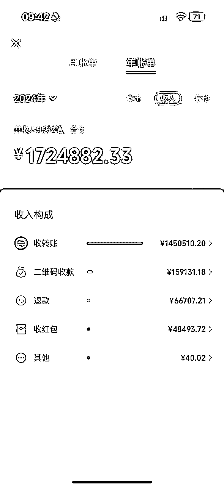

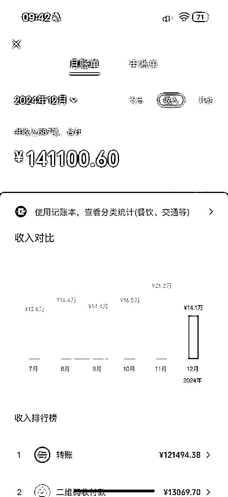

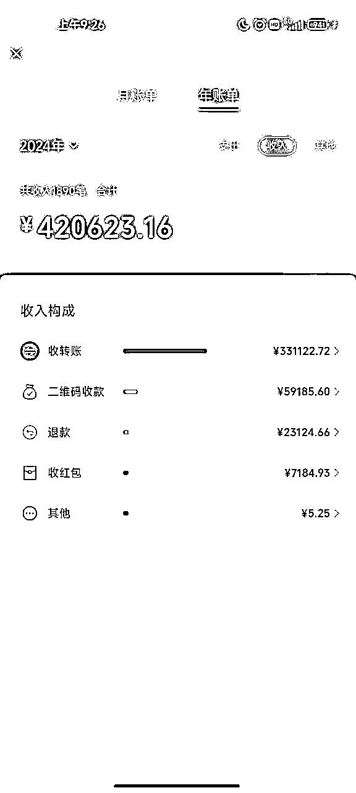

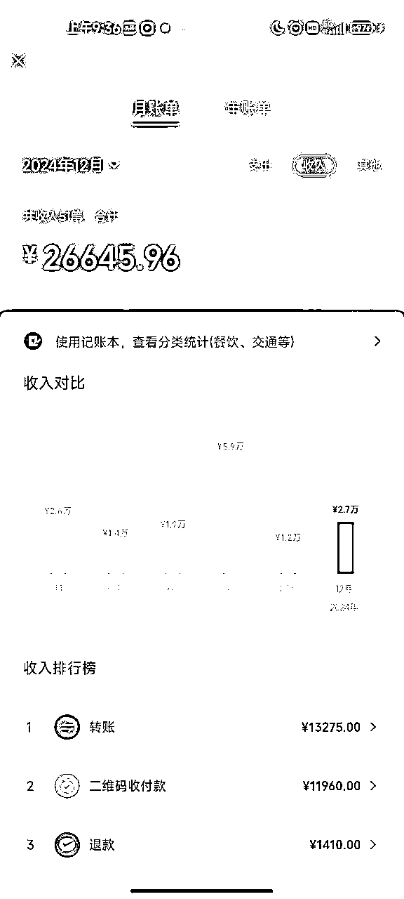

坊间说法是卖项目不如做项目，做项目不如卖项目。但在我看来，卖项目也不如做连接业务。解决供需矛盾，零投入零垫资，每一笔都是纯利。

## 四、服务范围盘点

网赚赛道多，衍生需求就更碎。我们常规接触的板块如下，以抖音需求最集中，决策快、付费果断。

务必注意边界：涉及身份核验的、擦边灰产的，全部不碰。合规是长期生存的前提。

**1. 抖音类**
千川投流涨粉、0粉强制开橱窗、0粉开通直播伴侣权限、口碑分/体验分提升、抖店差评豁免、来客蓝后台权限、场观上榜、人气指标、账号申诉解封等。

**2. 视频号类**
涨粉、账号收购、口碑分维护等。

**3. 快手/📕类**
涨粉、小铃铛跳转、挂铁、点赞评论、私信外链跳转等。

**4. 账号交易类**
抖音、快手、📕、头条、视频号，粉丝量级从1000到百万，品类分为干净号、恢复号、违规号等。

**5. 其他细分**
直播辅助工具、短视频工具包、全平台公会/MCN代办理等。

## 五、人设搭建要点

**1. 账号形象**
🛰️名直接体现业务属性，例如“全网账号服务”、“抖快一体化服务商”、“千川投流服务”等，让人一眼知道定位。

**2. 朋友圈运营**
坚持日常更新业务进展、客户反馈、价格变动等内容，强化专业感。

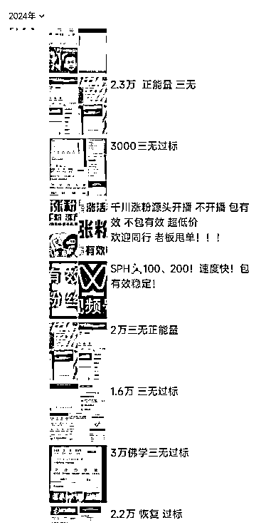

## 六、获客路径

**1. 私域沉淀**

这个生意最适合长期在网赚圈活动的人，项目群本身就是流量池。可以借用朋友资源多加几个交流群，低成本建立信任。

- 群昵称改造：把群名改为“千川涨粉+账号交易+口碑分”，你只需要在群里发个表情，别人也能看出你的定位。

- 保持活跃：自己参与的带货群，如果直接发广告不合适，可以用体验分享的方式带出需求。比如“千川这块我找了个靠谱的渠道，权限当天就开了，价格还行”。自然会有私聊询问，再顺势递名片。
- 选择性投放：对已经沉寂或价值低的群，可以直接发业务广告，被踢也没损失。

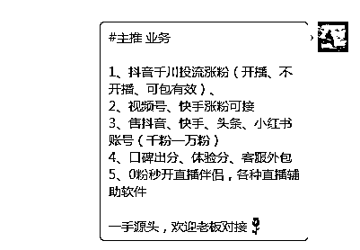

- 群发工具：整理好话术后，批量触达🛰️好友，过滤掉亲友。可参考文案：

业务介绍：
#核心服务
1、抖音千川投流养粉，可开播/不开播，支持包有效
2、视频号、快手养粉业务
3、抖音、快手、头条、📕账号交易，千粉到十万粉
4、口碑/体验分提升，客服外包服务
5、0粉秒开直播伴侣，直播辅助软件资源
源头对接，欢迎同行老板合作

引流优惠：
#今日促销
千川不开播不保有效 千粉200，约24小时内完成
千川不开播保500有效 280元，24-72小时内
千川开播养粉保50%有效 180元，1-2小时完成
注意：操作期间禁止违规断播不售后，开播掉粉快仅售后有效粉问题
不开播养粉需账号登录我方，养粉期间勿自行进入直播间，操作过程会修改头像，不介意再操作，140元/千粉
24小时内完成千粉，大概率不掉粉，有效率50%-90%

**2. 公域截流**
在🧣、抖音、📕等平台发布行业干货图文，或在相关评论区进行精准截流引流。

## 七、成交环节

通常是客户来问，我们根据需求报方案即可。成交快、沟通成本低。价格会随平台规则波动，具体话术不展开。

建议日常观察同行朋友圈报价，合理上浮20%左右作为利润空间给客户。

原则：新客户先以低价建立信任，后续恢复正常价；老客户转介绍的，维持正常报价。

## 结语

身边做项目的人，总会遇到账号、权限、粉丝等各类门槛问题。相比不断换项目去试错，做一个连接型服务，门槛更低，复利更强。找到稳定的上游资源，承接下游需求，就能持续吃到差价。

希望这篇梳理，能帮助大家看清这个小而稳的赛道。也期待能通过这篇文章，连接上需要服务或想入局的朋友。圈子里多一个业务伙伴，就像多一个百宝箱。(*^▽^*)