# YouTube Shorts实战拆解：我的自动养号打法与一路踩坑记录


## 写在前面

1. 最近反复琢磨的几条心得

* 收入高低，本质上取决于你扛住的难题有多大。
* 钱挣不到认知圈层之外。
* 事实告诉我们，丑的也有人爱，笨的方法也有人用。
* 人是人，神是神，关键看你跟他隔多远。

2. 背景说明

* 特别感谢方波妮教练的耐心解答与邀请。秉持授人以渔的思路，我把自己的摸索过程和用到的工具整理出来，希望能帮大家更高效地变现。

3. 使用提醒

* 好好用AI，用对AI。
* 工具终究是工具，价值还是要人来创造。
* 本篇不涉及内容制作，想学制作技巧可去看本期航海的Cursor专题：

https://scys.com/activity/landing?id=4668&tabIndex=0

* 必须配合比特浏览器使用。提前在比特浏览器里把登录、代理等前置配置好，打开就能直接看到已保存Cookie的账号。www.bitbrowser.cn
* 比特浏览器的具体操作，可参考八块腹肌且从不塌房的马哥，@老馬🐎 关于内容出海的YouTube Shorts航海回放。https://scys.com/activity/documents?id=4660&index=1
* 也可以让Cursor调用比特API实现全自动，细节自行探索。
* 本文只提供思路和历程记录，供大家合理使用，早日通过YPP审核。
* 项目已在Mac验证，Windows同样可用。会提问的，直接让Cursor一键运行，报错自动修复。
* 为何没有做成打包软件：
* 留出空间，让你在此基础上叠加自己的功能。
* 我习惯命令行，操作起来反而比点界面更顺手。

1. 打包文件获取方式见文末

## 实操篇

### 一、效果演示

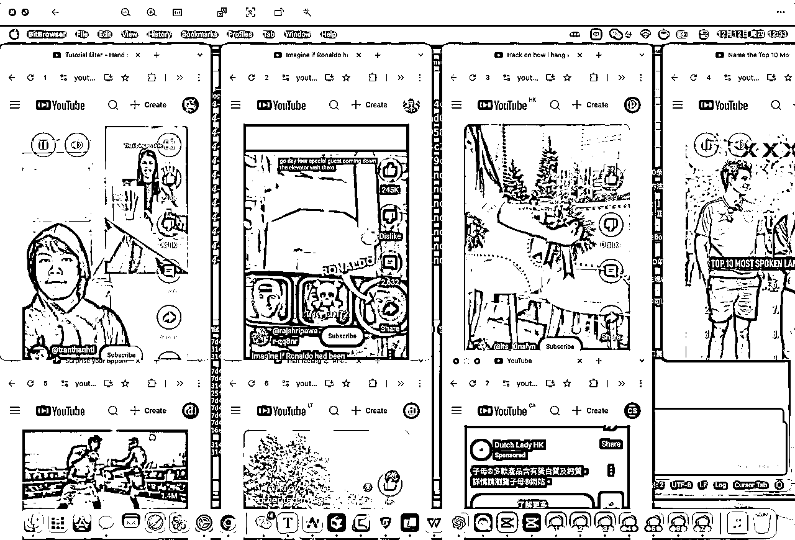

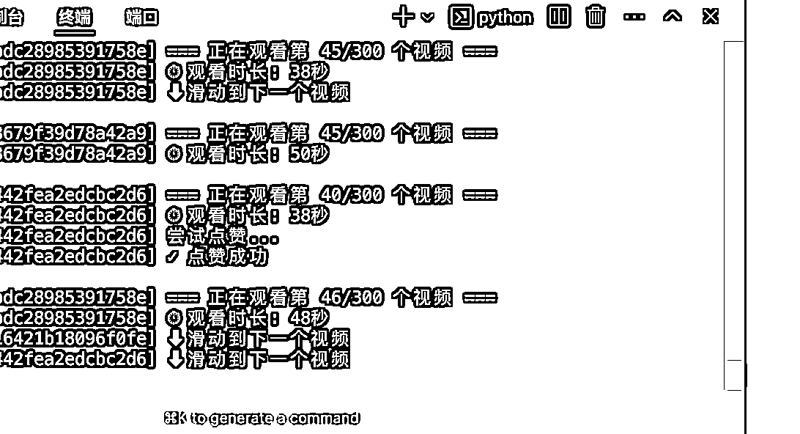

* * *

* 有人会问，批量养号到底能不能养起来。放一组数据：一个刚注册10小时的新号，首条视频的播放表现如下：

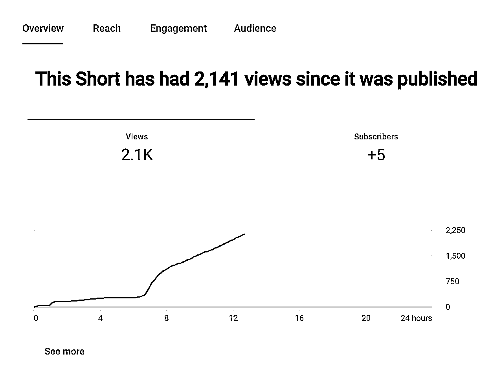

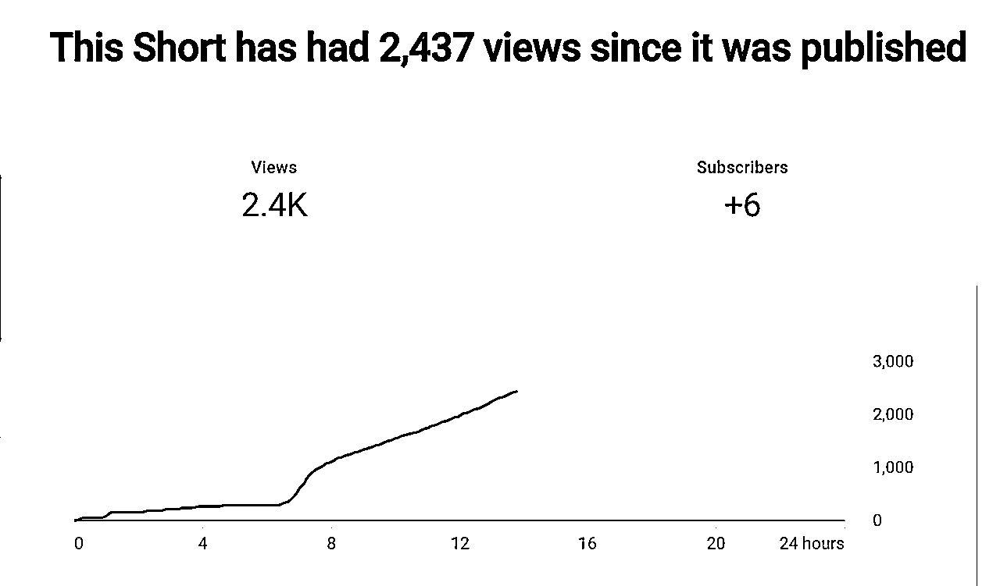

### 二、核心工具：养号自动化脚本

1. 功能概览

* 自动点赞、自动订阅，省时增效。
* 自动刷视频，模拟真实观看行为。

2. 适用场景

* 多账号批量运营，方便统一管理。
* 项目代码开放，可在此基础上二次开发，扩展成你想要的任何功能。

### 三、文件结构解读

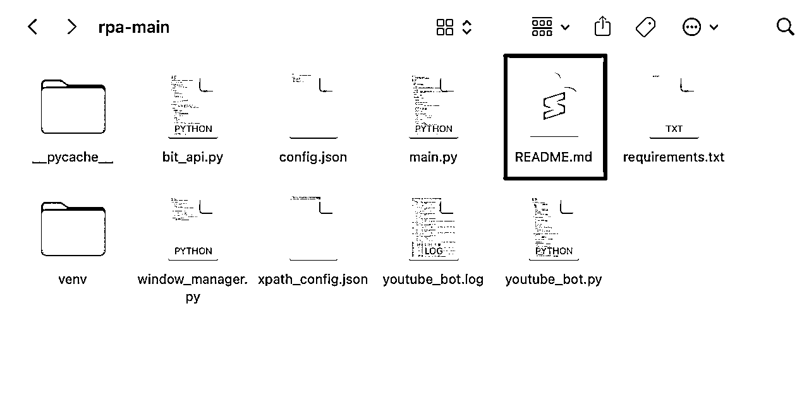

* 两个关键文件需要搞清楚：

* README.md：记录了项目的整体说明和各参数的含义。
* config.json 的各项配置说明：

```
```json

{

    "windows": [  // 浏览器窗口配置

        {

            "browser_id": "浏览器ID"  // 每个窗口的唯一标识

        }

    ],

    "settings": {

        "window_width": 400,        // 窗口宽度（像素）

        "window_height": 600,       // 窗口高度（像素）

        "watch_time_min": 5,        // 最短观看时间（秒）

        "watch_time_max": 30,       // 最长观看时间（秒）

        "like_probability": 0.3,    // 点赞概率,30%

        "subscribe_probability": 0.2,// 订阅概率,20%

        "scroll_count": 50          // 观看视频数量

    }

}

```

### 窗口大小设置
- `window_width`: 设置浏览器窗口和视口的宽度
- `window_height`: 设置浏览器窗口和视口的高度
- 建议设置合适的窗口大小以获得最佳的Shorts观看体验
- 推荐尺寸：
  * 手机视图：400x600 
  * 平板视图：600x800
  * 桌面视图：800x1000
```

* 不想细读也没关系：
* 在Cursor中直接提问：
* 提示词： @README.md 帮我解读项目，他会手把手带你配置。
* cong.json 可按上面代码示例自行修改，注意窗口尺寸别设太小，否则找不到元素导致操作失败。

### 四、获取 browser_id

#### 启动比特浏览器，复制框内ID：

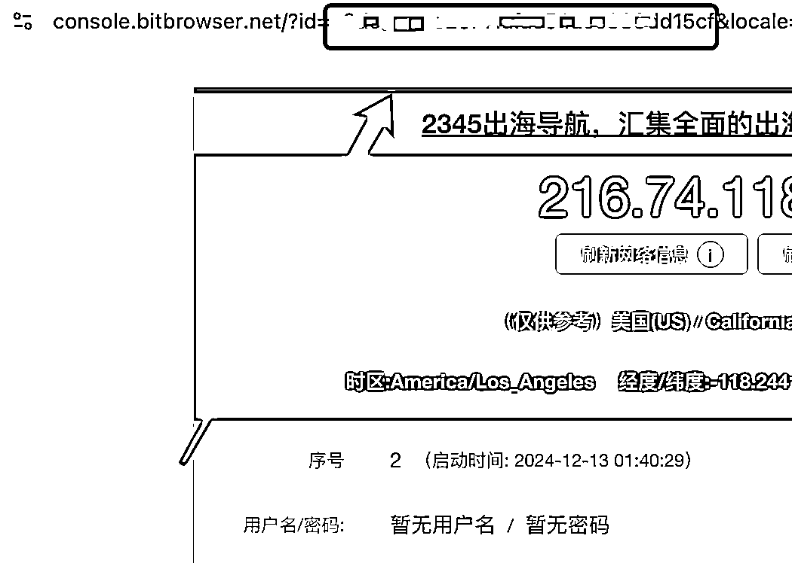

#### 打开 config.json，把复制的ID填入对应的XXXXXXXX，填几个ID就会开几个自动化窗口，对应养几个号：

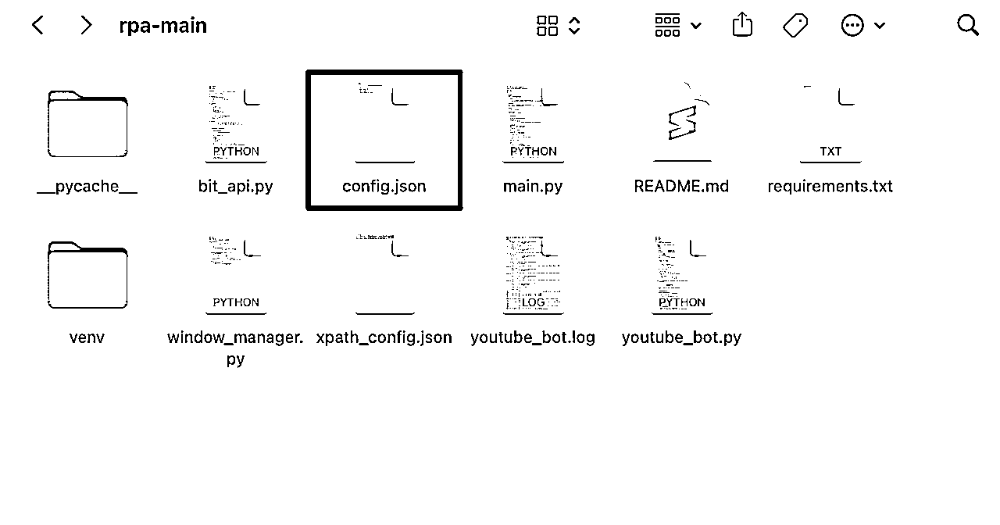

```
{
    "windows": [
        {
            "browser_id": "XXXXXXXXXXXXXXXXXXXXXXXXXXXXXXX"
        },
        {
            "browser_id": "XXXXXXXXXXXXXXXXXXXXXXXXXXXXXX"
        },
        {
            "browser_id": "XXXXXXXXXXXXXXXXXXXXXXXXXXXXXXX"
        },
        {
            "browser_id": "XXXXXXXXXXXXXXXXXXXXXXXXXXXXXXXX"
        },
        {
            "browser_id": "XXXXXXXXXXXXXXXXXXXXXXXXXXXXXXX"
        },
        {
            "browser_id": "XXXXXXXXXXXXXXXXXXXXXXXXXXXXX"
        },
        {
            "browser_id": "XXXXXXXXXXXXXXXXXXXXXXXXXXXXXX"
        },
        {
            "browser_id": "XXXXXXXXXXXXXXXXXXXXXXXXXXXX"
        }
    ],
    "settings": {
        "window_width": 400,
        "window_height": 600,
        "watch_time_min": 5,
        "watch_time_max": 60,
        "like_probability": 0.1,
        "subscribe_probability": 0.05,
        "scroll_count": 300  (这个是刷多少条停止)
    }
} 
```

### 五、运行方法

* 会Python的同学应该直接上手。这里给最省心的方案。
* 在Cursor的Agent模式下输入提示词： “虚拟环境下运行此项目” 即可。也可@main文件提升容错。用虚拟环境是为了不污染本地Python环境。也可以直接双击运行main.py，按submit后交给Cursor处理。

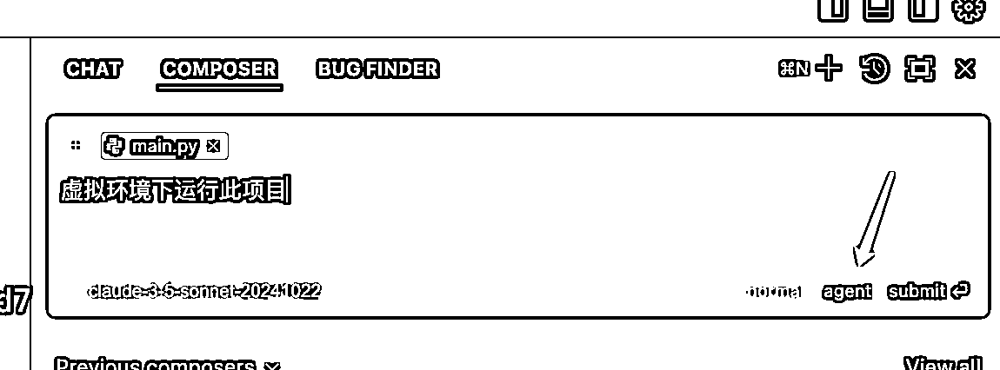

* Cursor使用指南：https://scys.com/view/docx/YIvBdL38ConF89xdBvAckZBPn5e

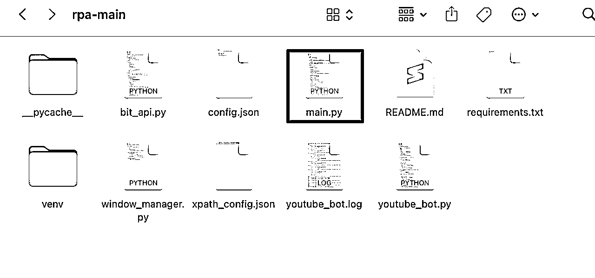

### 六、程序说明

* 本程序采用模拟点击控件的拟人化逻辑：
* 有时会出现重复刷到旧视频，属于正常拟人表现，自动跳过即可。
* 评论功能暂未加入，可自行扩展，我会在下方给出思路。
* 观看时长：
* 每个视频时长随机，在最小值和最大值之间浮动。
* 互动逻辑：
* 已订阅的频道不会重复触发订阅。建议页面设为英文，中文可用，其他语言容易重复触发导致卡顿。
* 互动频率可在config中自由调整。
* 如何中途停止：
* 切到日志窗口，按 Control + C 手动终止，报错属正常现象。所有比特浏览器窗口会自动关闭：

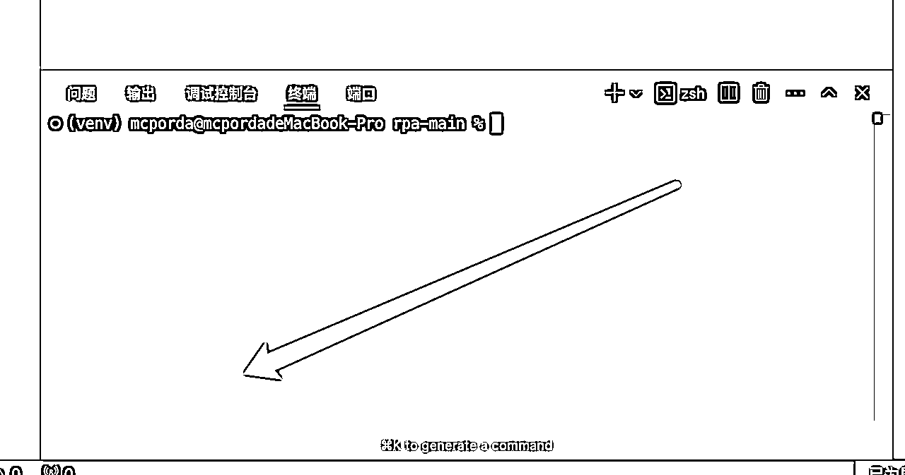

* 能否边跑边干别的：
* Mac自带多桌面，四指上滑即可切换，其他桌面照常工作。
* Windows是否支持需自行测试。
* 能否定时执行：
* 让Cursor定时执行main.py文件即可。

### 七、拓展方向

能否长期用：

* 不能。YouTube一旦更新控件路径，脚本必然失效。

1. 需要掌握Xpath，模块已做解耦，后续会补充相关内容。配置文件为xpath_config.json。

```
{
    "selectors": {
        "like_button": "//*[@id=\"like-button\"]/yt-button-shape/label/button/yt-touch-feedback-shape/div",
        "subscribe_button": "//*[@id=\"metapanel\"]/yt-reel-metapanel-view-model/div/yt-reel-channel-bar-view-model/div/yt-subscribe-button-view-model/yt-animated-action/div/div/button/yt-touch-feedback-shape/div/div",
        "subscribe_text": "//*[@id=\"metapanel\"]/yt-reel-metapanel-view-model/div[1]/yt-reel-channel-bar-view-model/div[1]/yt-subscribe-button-view-model/yt-animated-action/div/div/button/div/text()"
    }
} 
```

2. 不想学Xpath也没关系，看这个：

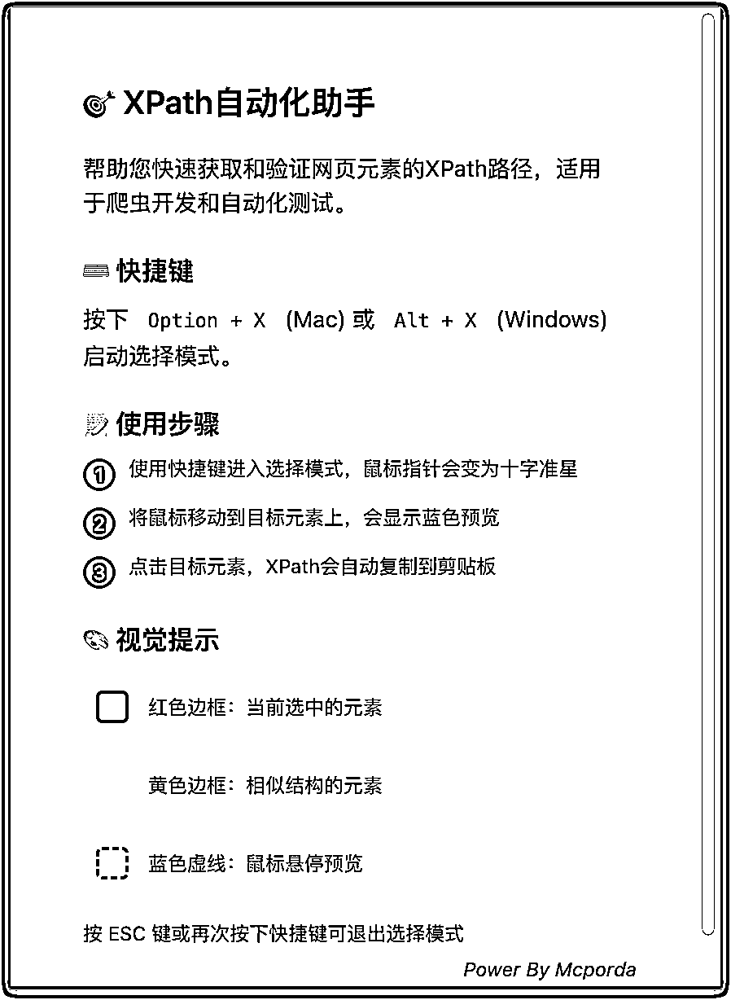

这是我自制的一个Chrome插件，按下快捷键选中元素即可一键复制xpath，告诉Cursor要加什么功能，它会自动写入对应配置。

### 八、后续更新

* 想到什么就补充。

### 九、打包文件下载

链接：https://pan.quark.cn/s/4d734d76fafc

补档：https://pan.quark.cn/s/43872fdad098