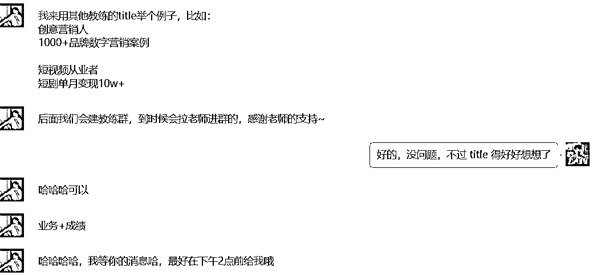
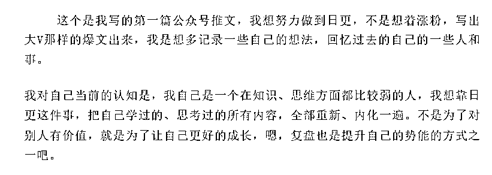
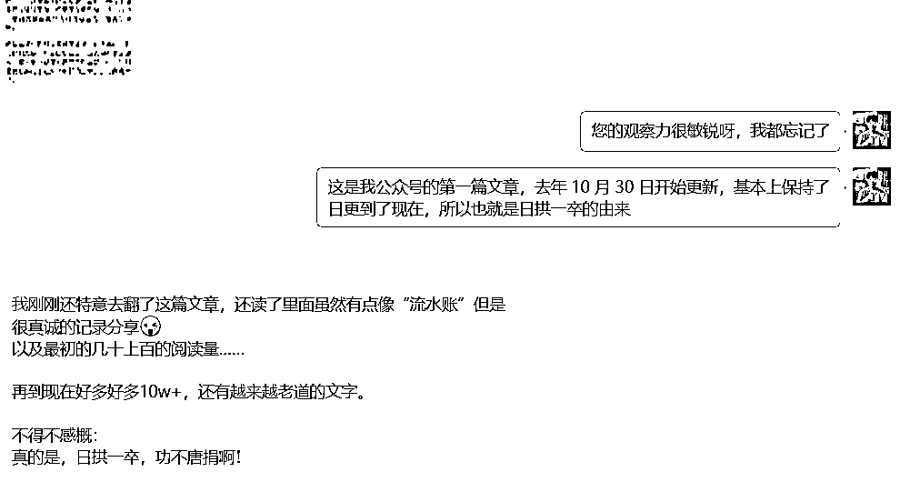
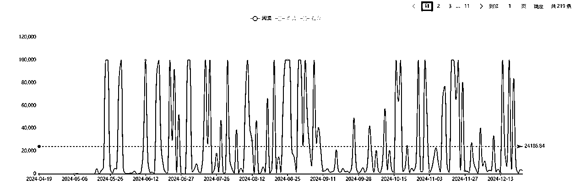

# 👸号日更一年复盘：从追爆文到做自己，我是怎么走过来的

大家好，我是大何，这已经是我第二次以赚钱航海教练的身份来跟大家聊了。航海也接近尾声，受领队邀请，在这最后的阶段，跟大家聊点自己的实操心得。

聊什么主题？我纠结了好几天。

一方面，我真没觉得自己有多厉害。我只是比大部分人早起步了那么一点，又比别人多坚持了那么一点。上一次当教练时，运营让我写自我介绍，我拖了很久才回。不是高冷，是实在想不出几个像样的互联网光环。

另一方面，这期航海的人群特别杂。新手小白、做爆文多年的老手、有粉丝但流量掉队的账号、在爆文和个人IP之间摇摆的人、想做IP却卡在没流量的人都混在一起，需求完全不一样。

不过仔细回想，我过去一年多里，好像把这些状态都轮了一遍。所以今天就摊开说说，我做👸号一年多的真实心路，希望能给不同阶段的你一点参考。

* * *

## 一、我为什么开始写👸号

我的自媒体生涯很短，从去年10月最后一天注册账号到现在。后台查了一下，算上被删的和非原创的，大概发了350篇左右。扣掉封号的空档，基本保持住了日更。

那个时候我刚裸辞两个月。离开干了五年的岗位，突然发现自己好像是个空壳。迷茫、内耗、焦虑、挫败感轮番上场。每天刷着各种互联网赚钱案例，却动弹不得。大脑被恐慌塞满，身体却卡在原地。是的，就是内心在喊，嘴里啃薯片。

转折点是刷完了赚钱的两篇干货。第一篇是明白老师日更1700天的记录，他是怎么在低谷里靠日更爬出来的；第二篇是白龙笔记的创业复盘，离职创业两年沉淀，日更👸号慢慢有了影响力，社群也起来了。

打动我的不是故事有多传奇，是那种平平淡淡却坚定的真诚，和日拱一卒的力量。

我当时在第一篇文章末尾写过：我自认知识和思维都很弱，就想用日更倒逼自己去学、去复盘、去输出，每天进步一点点。

说实话，起初我完全没想过赚钱、10w+。就是想用来整理思路、提升自己。预期越低，反而扛过了最开始无人问津的阶段。

一年下来，我才发现，写两千字已不算难事，十万加也不再是梦。这一切，都藏在日拱一卒的每一天里。不下牌桌，就有机会。写作这条路越走下去，竞争越少，路反而越宽。

* * *

## 二、一年里我走了这几步

**1. 起步期：流水账阶段**

下定决心不代表上手就顺。第一篇文章，我敲了两天，排版啥都不会，粘到编辑器里一团糟。发出来预览了无数遍，最后阅读量是5。

回头看确实很糙，但那是我用尽全力写出来的。基本功太差了，本科土木，语文一直稀烂。

好在那时没压力。我就是瞎写，想到啥写啥，不懂赛道也不懂对标，就是把脑子里的东西敲出来。

前两个月进步肉眼可见，排版、找图、后台设置、引流都在学。但内容基本是自嗨的碎碎念，像大号朋友圈，没水花。

那段时间我也没all in👸号，还在试📕、闲鱼卖二手。都失败了，只有👸号还在坚持。每天写点东西，至少不会觉得自己一事无成，成了对抗焦虑的解药。

最大的问题是写得慢。后来才明白，是输入太少。毕业后基本没看过书。信息量的不足，就是一切困境的根源。你读什么，你就是什么。

出去玩看到美景，文化人能说出大漠孤烟直，我却只能憋出卧槽好美。积累的过程一定得有。

最开始我就给自己定的目标：先日更100天，不管写成什么样。半年多时间，文章基本没人看，只有几个朋友点赞，收益为零。动摇过，自问这东西有意义吗？

没有正反馈的坚持太难了，像吊在栏杆上。不是我有多坚强，是就业市场的冷水更凉。

后来复盘，发现自己一直在舒适区里用战术的勤奋掩盖战略的懒惰。把👸号当朋友圈发，IP根本起不来。正反馈卡住的人太多了。

坚持是胜利，但要坚持在正确的方向上。我才意识到，日更不是目的，关键是日更有没有迭代自己，文章有没有信息增量，有没有解决痛点。否则就是为更新而更新。

写作本质是高效的思考，是能积累、能产生影响力的思考。成长就是认知和思考能力的增长。

**2. 爆文写作期**

12月我第一次参加赚钱的👸号航海，认知被打开了。选题、素材库、赛道选择、起标题、对标账号，这些闭门造车时根本不懂的东西全补上了。

航海期间我开新号按爆文逻辑试水，没出成绩但开了眼界。结束后再入池一篇几万阅读，项目跑通了，信心来了。

过年后我把赚钱的精华帖翻了个遍，有些看了好几遍。实践才发现，懂和真懂是两回事。

这段时间我保持教自己学的习惯，开了个👸号百问百答系列，用费曼法的思路写，写到三十几问基本把👸号的问题摸透了。

3月迎来爆发，同时操盘10个号，4个入池，一周变现6k，拿了第一桶金。我都想好怎么加号放大、怎么走个体户纳税了。

结果4、5月推荐机制大调整，很多爆文号掉池，我的号也全军覆没。两个月收益几乎为零，只有AI用的更熟了。

那阵子特别迷茫。发就没流量，入池也马上掉。那种重复坚持却看不到希望的感觉很难熬。

但我也观察到，小号还能活下来的共性：排版精致、观点独特、像手写没AI味、做小众赛道。总结就是，差异化、有增量、有深度、能引发讨论的内容更抗周期。

**3. 从AI爆文到手搓内容**

AI爆文的好处是批量生产、时效快、矩阵抗风险。但护城河太浅了，门槛低意味着卷到最后看运气，而且账号生命周期短，爆完就凉了，本质是吃推荐流量，承接不住。

手搓文章对个人提升很明显，尤其是网感和思考力，是长期能力。缺点是耗时，深度难保证，即使写得好也不一定入池，可能像之前半年写给自己看。

我更在意复利和积累。于是回到主号，每天花更多时间手搓有增量的内容，开始做能穿越周期的号。

6月的航海是我转折点。确定手搓思路后，每天复盘选题和素材。按1000入池的标准，这段时间文章几乎全入池。最高一篇230w+，另有90w+、80w+、20w+两篇，累计流量484w，变现1.7w，打赏550，涨粉6800+。

这阶段总结就是：用爆文的思路，自己找选题、找素材、手写出来。选题、整合、搜索能力都上来了，也攒了第一批粉丝。

但这还不是IP。说白了就是学会了借流量。我没想好流量主之外的变现方式，只能走一步看一步。

**4. 从爆文向个人IP转向**

7月账号莫名被封半个月，逼着我停下来思考：我要的到底是流量还是品牌。

复更后我开始有意识在文章里输出观点塑造人设，爆文和IP文交替写，并建了知识星球和读者群，做更深的连接。

有个读者想寄小孩穿剩的衣服；有粉丝教我怎么开香港银行卡；还有人帮我追侵权、免费剪视频。那种被真诚回应的感觉很踏实。

这个世界奖励真诚、利他和开放。价值够大，自然会有钱和影响力随之而来。

我现在对IP也只是新手，路径未必适合你，但希望我的经历能给你一个参考样本。

## 三、我对个人IP的浅见

想做IP，先敢于表达，真诚表达。

勇敢的人先享受世界。世界永远偏爱话多的人，甚至有点话痨。先站出来占住注意力，通过反馈不断提升输出，这就是费曼学习法。

普通人做账号的最大红利就是表达。读者能持续关注你，是因为字里行间的人格感。做真实的自己，做有价值的真诚分享，才是做个人品牌的根本。

内容创作不是找观众，是找到自己的过程。也是帮你扫除迷茫、锻炼抗压、明确爱好的过程。

IP本质是人格化产品，用户需要对你有确定性。文章就是在建立信任和确定性的过程。认可，才是个人品牌的底层逻辑。

## 四、最后说点掏心窝的

到现在写每篇文章我都还是很吃力，从未一气呵成。这篇分享也磕磕绊绊写了很久。

写作有技巧，但我只会最笨的办法：多看、多写、多改，把想说的表达清楚。

很多人觉得写作是写作者的专利。其实写作是生存技能，人人需要人人能写好。

现在普通人改变命运的机会越来越窄，写作是几条不靠资源和背景的好路子。一台电脑、一个手机、一颗想改变的心就够了。

写作是你在互联网上的名片，能把观点和认知传播出去，也能扩大影响力。前提是要熬过量变到质变。

做👸号也好，做任何项目也好，长期赚钱靠积累。努力不见得即时回报，可能很久没收获，但积累见效的那一刻，你会忽然明白一切都连起来了。

所以现在要做的，就是先去完成些什么。

以上就是我的复盘，希望对你有用。