# 小红书广告变现全景解码

> 来源：[https://m08zlw24sg0.feishu.cn/docx/CgBSdyEDooCZ75xOsafc0CsunYy](https://m08zlw24sg0.feishu.cn/docx/CgBSdyEDooCZ75xOsafc0CsunYy)

11月底，亦仁在我的笔记下方留言，希望我针对小红书广告变现做一次拆解，我觉得这个方向很有价值，于是启动了。

实操起来才知道难度不小，我前后投入了二十多小时，手动梳理了近1800位博主的蒲公英后台数据，才把基础表格跑通。

汇总后的5张表，足以支撑更宏观的视角去看广告生意，也能为运营提供高维参考。我打算把这件事做成一年一度的复盘。

需要提前说明的是，博主的接单量和报价都是人工统计。为了降低偏差，我在每个赛道、每个粉丝梯队都挑了10位有广告结果、阅读量靠前的博主作为样本。只是抽样，覆盖面有限，存在一定误差，仅供参考。

下面进入正文。

# 先看全量，广告接单与粉丝量级的关系

## 整体盘面

截至2024年11月20日，蒲公英平台上累计博主达961341位。其中粉丝0.1万到1万的账号占比最高，约73.8%；1万到10万粉占比23.1%；10万到50万粉占比2.8%；50万到100万粉占比0.2%；100万到500万粉占比0.1%；500万粉以上仅19位，千万粉博主只有2位。

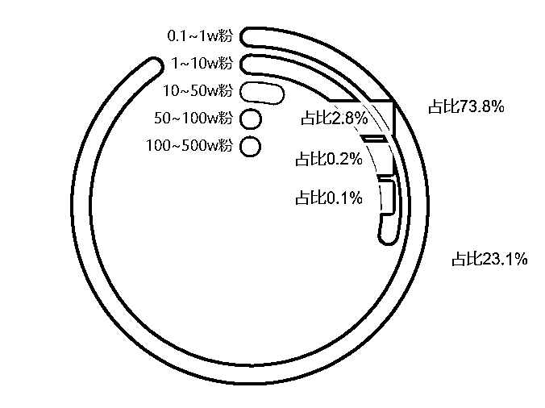

由此可见，破万已属前列，而达到10万粉则相当稀缺。

## 接单表现

在万粉以上的群体里，1万到10万粉的博主接单体量最大。取270位阅读量最高且报价正常的1~10万粉博主，合计接单1263条，人均每月约2.34条。对比同等数量的270位100万到500万粉博主，合计仅622条，人均每月约1.15条。

更关键的是单价。1~10万粉博主的万粉均价约为1371元，而50万粉以上的博主万粉均价已跌至904元，低于全站平均1000元的水平。

小红书本质是内容驱动的平台，账号权重相对偏弱，素人也能爆。小博主报价友好，品牌方在预算收紧、更看重ROI的背景下，倾向于用10万粉以下的尾部博主做铺量。这类创作者内容质量优于千粉号，成本又可控，是拉升出圈率、压低单阅读成本的首选。

所以万粉博主是品牌主眼中最香的投放池。

10万到50万粉则处于甜蜜区：报价比万粉段更高，单条收入更可观，同时接单频率又远高于50万粉以上的腰部头部。

因此从变现角度看，10万粉前主攻涨粉冲量，过了10万粉后则应优化内容方向，筛选更精准的粉丝，提升阅读互动，从而拉升报价与接单量。

# 再看赛道，吸金榜与避坑榜

蒲公英后台共划分27个一级赛道：美妆、科技数码、职场、商业财经、文化艺术、音乐、汽车、游戏、素材、影视综资讯、健康养生、宠物、情感、时尚、个人护理、兴趣爱好、摄影、婚嫁、搞笑、美食、家居家装、运动健身、母婴、护肤、教育、生活记录、出行旅游。

综合博主数量、10-11月接单情况、万粉均价来看，以广告变现为主的创作者，可以优先考虑：

## 推荐的5个赛道

1、个人护理：竞争不算激烈，商单供给稳定。博主总数仅5814位，排名倒数第三，但接单量排第5，万粉均价约1100元，处于中上区间。

2、科技数码：蓝海属性明显。博主总数约一万出头，排名倒数第6，接单量排第4，万粉均价稳定在1100元左右。

3、健康养生：供给不足。博主总数约1.1万多，排名倒数第7，接单量排第3，仅次于护肤和家居家装。万粉均价约850元偏低，主要被大量无IP的工具号拉低，且1~10万粉中健康养生的供给更少，腰部仍有空白。

4、护肤：反常识的高价值赛道。博主总数约1.8万，排名第17，并非想象中红海，接单量为全站最高，万粉均价达1400元，高于均值。

5、搞笑：涨粉效率高。博主总数排名倒数第4，但在100万到500万粉梯队中占据93席，排名第4。接单量排名第11，处于中位。

## 不推荐的5个赛道

1、游戏：商单极难。10-11月接单最少，1~10万粉阅读最高的前20名博主中，10人从未在蒲公英接过广告，万粉均价也是最低。且粉丝年龄偏低，变现能力弱。

2、音乐：获单困难。阅读最高的前34名中，24人无广告记录，万粉均价低于平均线。

3、素材：广告不友好。万粉均价倒数第二，接单量倒数第6，能接单的基本都与时尚穿搭、美妆相关。变现主要靠卖壁纸、头像，广告意愿低。

4、婚嫁：需求有限。接单量倒数第三，博主数量也不多，变现以带货销售为主，除非做婚嫁品牌相关，否则纯内容很难接单。

5、兴趣爱好：卷度极高。博主数量排第4，接单量倒数第4，万粉均价倒数第5。其他变现路径也有限度，除非在某细分兴趣上能做到前20%，否则不建议进入。

# 个体拆解，如何把广告费做到最大

以下聚焦个人护理、科技数码、健康养生、护肤、搞笑这5个赛道，1~10万粉和10~50万粉、非MCN机构的博主中，10-11月广告收入突出的账号进行简析。

## 1~10万粉段

### 个人护理
账号：子子老师
类型：视频
接单情况：4万粉，报价8800元，10.1~11.20共接14单，收入12.3万元。
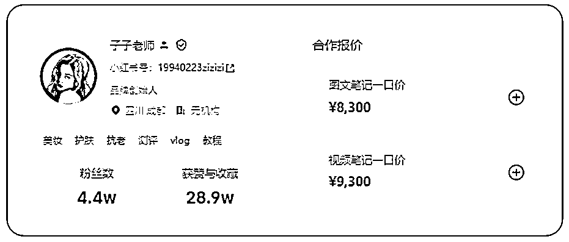
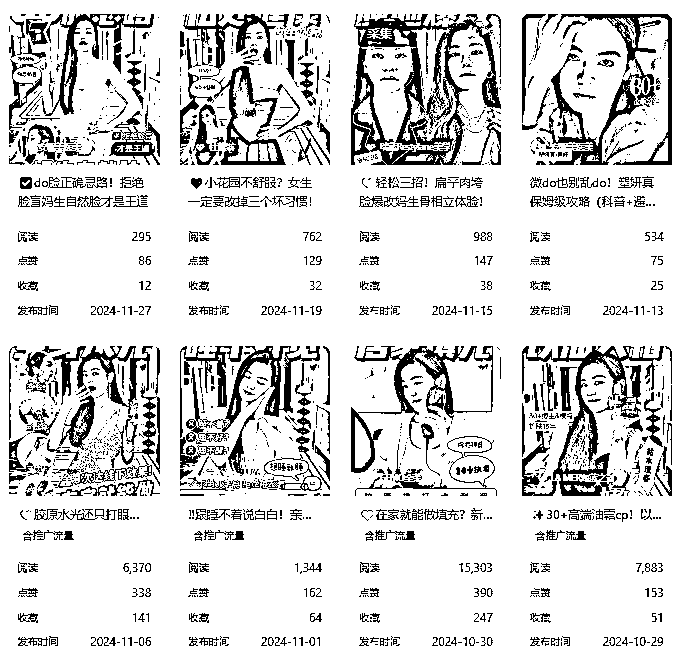
要点：以测评和真实体验为主，品牌方认可度高；视频结构、画面质感、个人表现力均经长期打磨，粉丝粘性强，种草力稳定，报价高仍能持续获单。

### 科技数码
账号：ami.moment
类型：视频
接单情况：9.7万粉，报价4.5万元，10.1~11.20接3单，收入13.5万元。
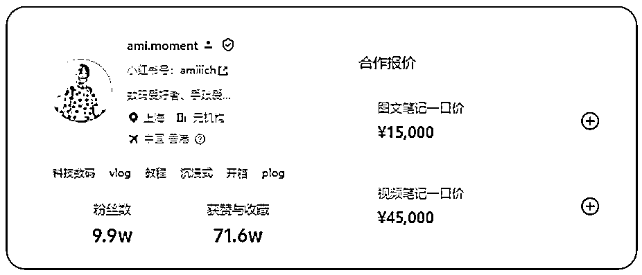
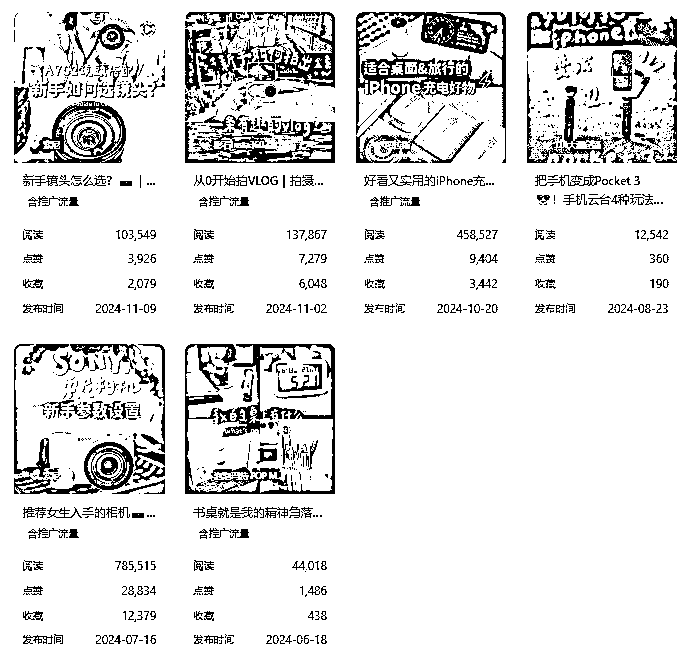
要点：在测评基础上加入vlog式人设内容，信任感强；镜头质感与节奏舒服；选题和色调极适配小红书，可作为科技、穿搭类参考。

### 健康养生
账号：多云转晴
类型：视频
接单情况：6.2万粉，报价4980元，10.1~11.20接13单，收入6.47万元。
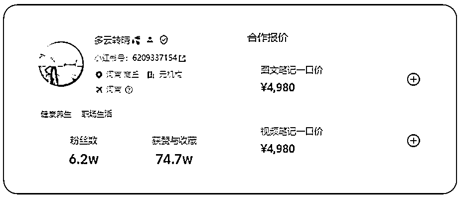
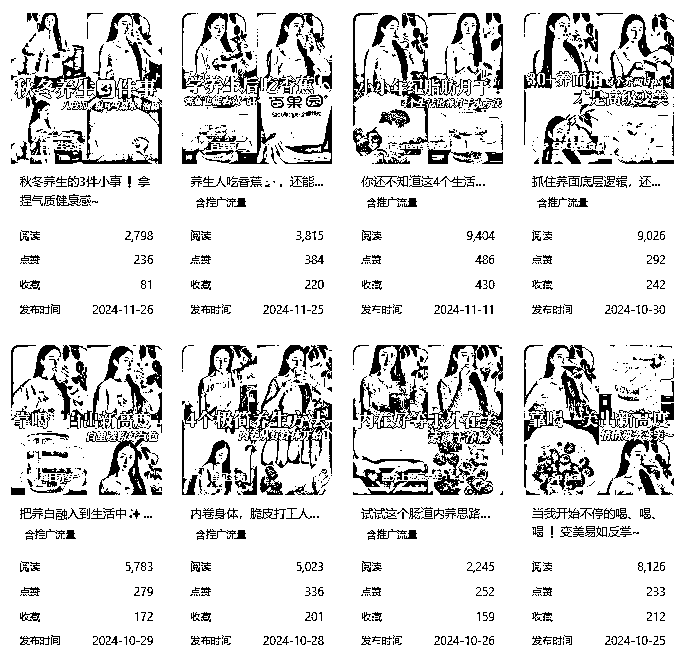
要点：养生+变美或养生+护肤是该赛道涨粉快、品牌喜欢的方向；选题紧跟当下热点，画面质感易被新人复刻。

### 护肤
账号：疯狂的水蜜桃
类型：图文
接单情况：1.4万粉，11月20日报价1000元，10.1~11.20接32单，收入3.2万元。12月提价600元。
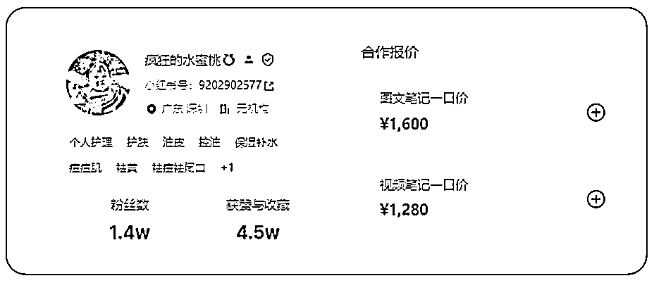
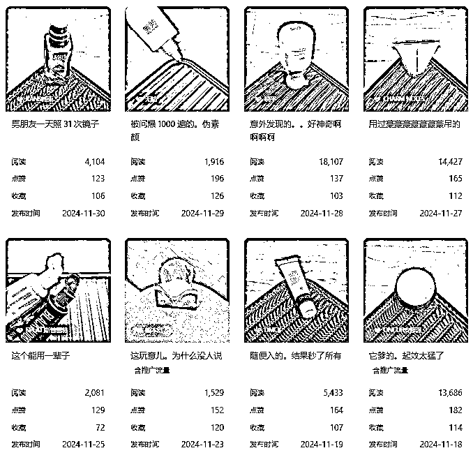
要点：采用当下流行的live动图表情，制作成本低但转化好；门槛低竞争快，需抢占先机后转型；物品置于边角的拍摄形式近期数据表现不错。

### 搞笑
账号：戴阿蒙
类型：视频
接单情况：8.4万粉，报价1.8万元，10.1~11.20接2单，收入3.6万元。
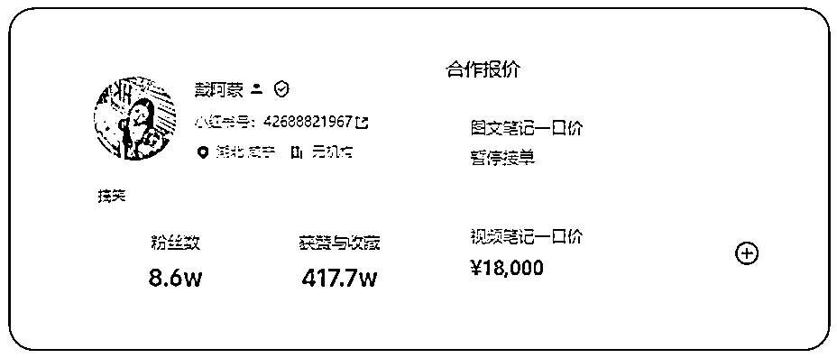
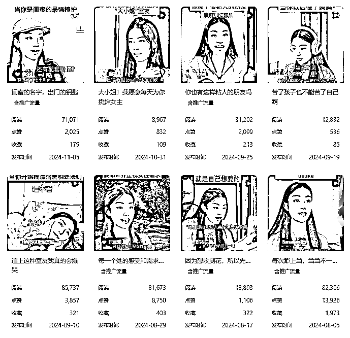
要点：纯搞笑变现难，结合其他赛道效果更好。阿蒙结合情感内容，另有美妆博主“大只（更疯版）”做搞笑+测评，报价超1.6万。搞笑可作为复合元素提升播放与涨粉。

## 10~50万粉段

### 个人护理
账号：猫哥er
类型：视频
接单情况：12万粉，报价1.4万元，10.1~11.20接5单，收入7万元。
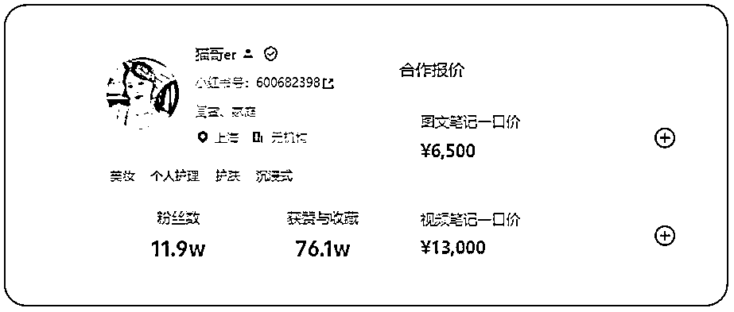
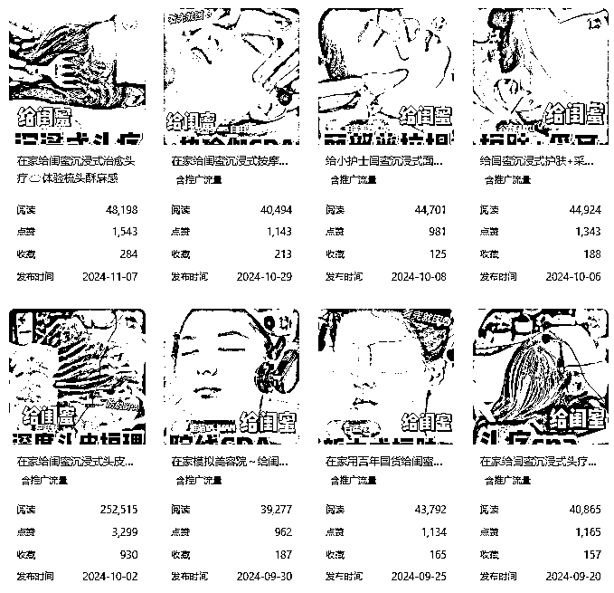
要点：引入“闺蜜”关系增加故事性；沉浸式护肤无bgm，保留涂抹与开包装声，与白噪音结合，营造放松感。

### 科技数码
账号：柏阳兄
类型：视频
接单情况：24万粉，报价3.2万元，10.1~11.20接9单，收入28万元。
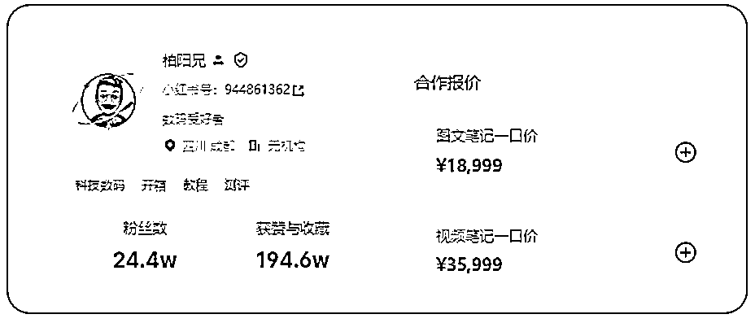
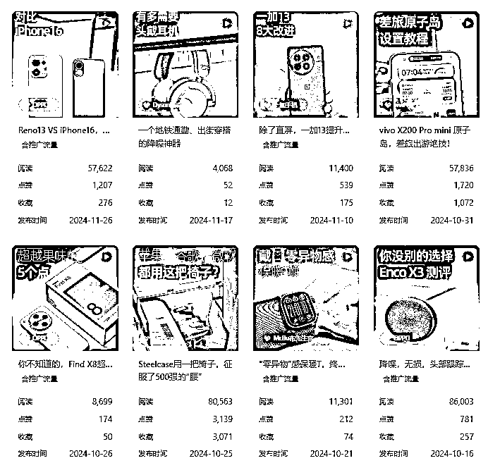
要点：高价高频基本都是测评类；实测类账号粉丝与报价更高，适合有拍摄剪辑基础的创作者；网测类成本低，适合新人快速试错。

### 健康养生
账号：铁血老太培养计划
类型：视频
接单情况：23万粉，报价1.4万元，10.1~11.20接3单，收入4.2万元。
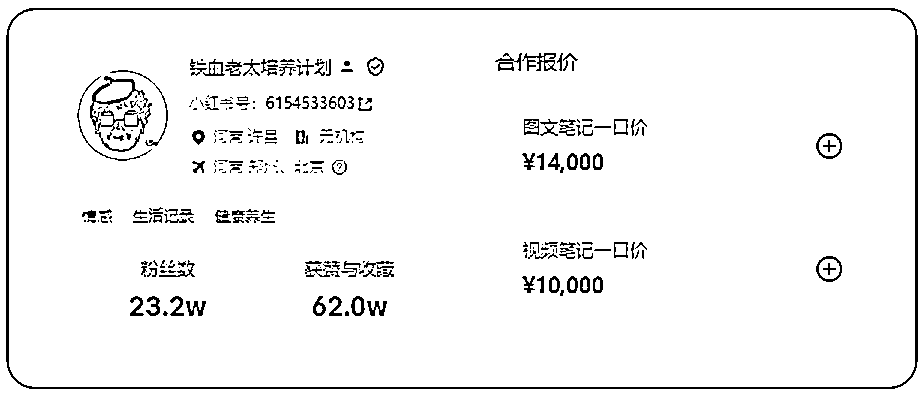
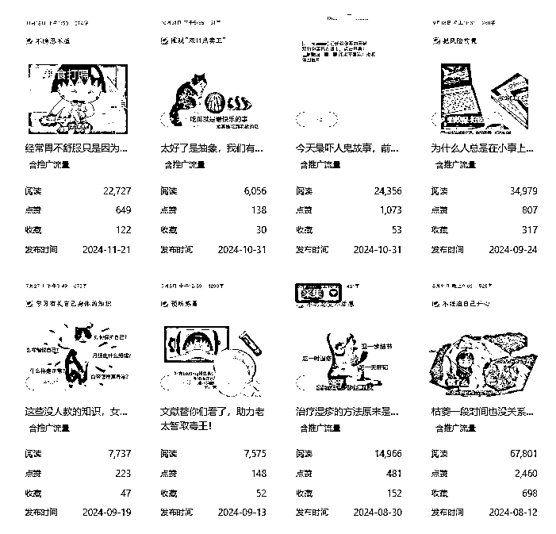
要点：不露脸的养生号制作成本低，可批量生产且变现可观，适合新手起步，需前期模仿成熟选题。

### 护肤
账号：我是霖儿
类型：视频
接单情况：38万粉，报价12.88万元，10.1~11.20接4单，收入51.5万元。
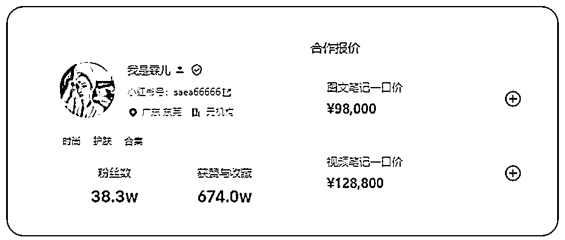
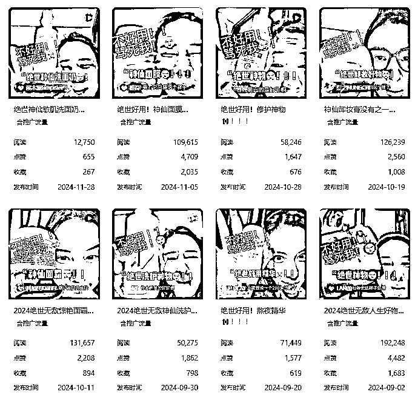
要点：好物分享方向报价较高；夸张情绪化内容今年普遍吃香；霖儿只接护肤主业广告，拒绝穿搭、饰品、零食，保持定位清晰，提升数据稳定性与粘性。

### 搞笑
账号：万能大饼
类型：视频
接单情况：13万粉，报价7.5万元，10.1~11.20接5单，收入37.5万元。
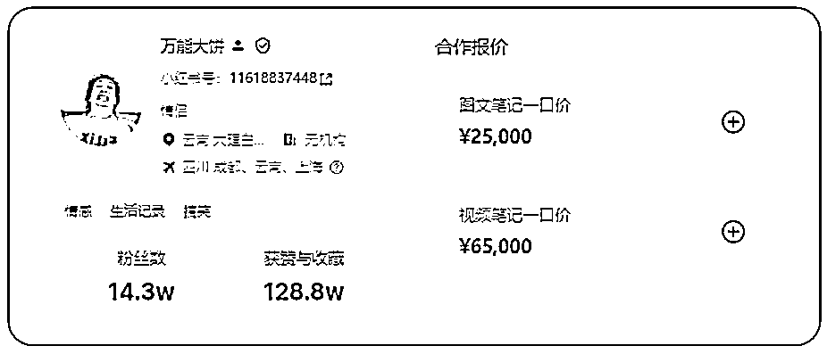
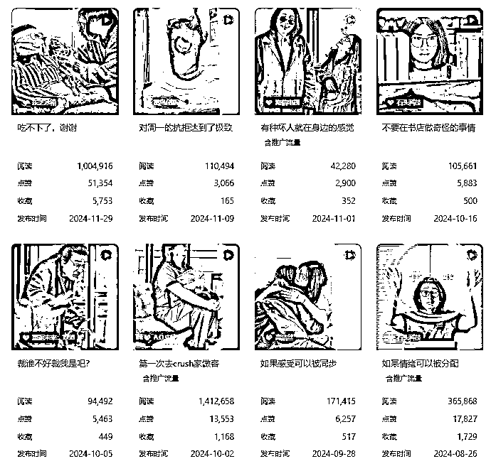
要点：搞笑+生活记录+情感是50万粉内快速涨粉、吸引品牌的公式。小红书搞笑不只是搞笑，还包含无厘头、反转、奇思妙想，快节奏多反转提升完播，贴合生活场景兼顾广告位。

以上为10.1~11.20期间蒲公英后台广告接单的整体复盘，后续若有新发现会持续更新。若有具体问题或想了解的数据，可单独联系子木沟通，付费解答，感谢理解。