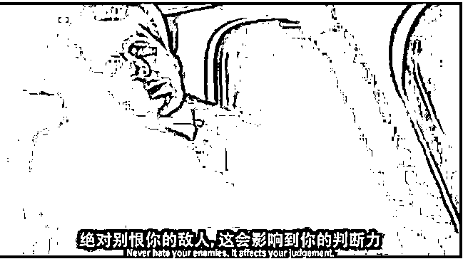
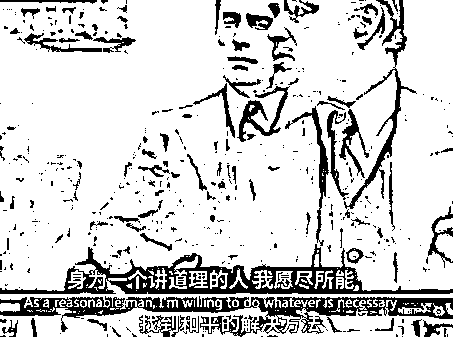
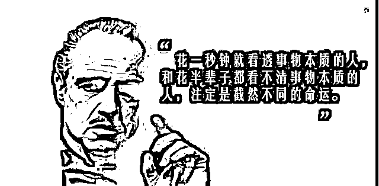
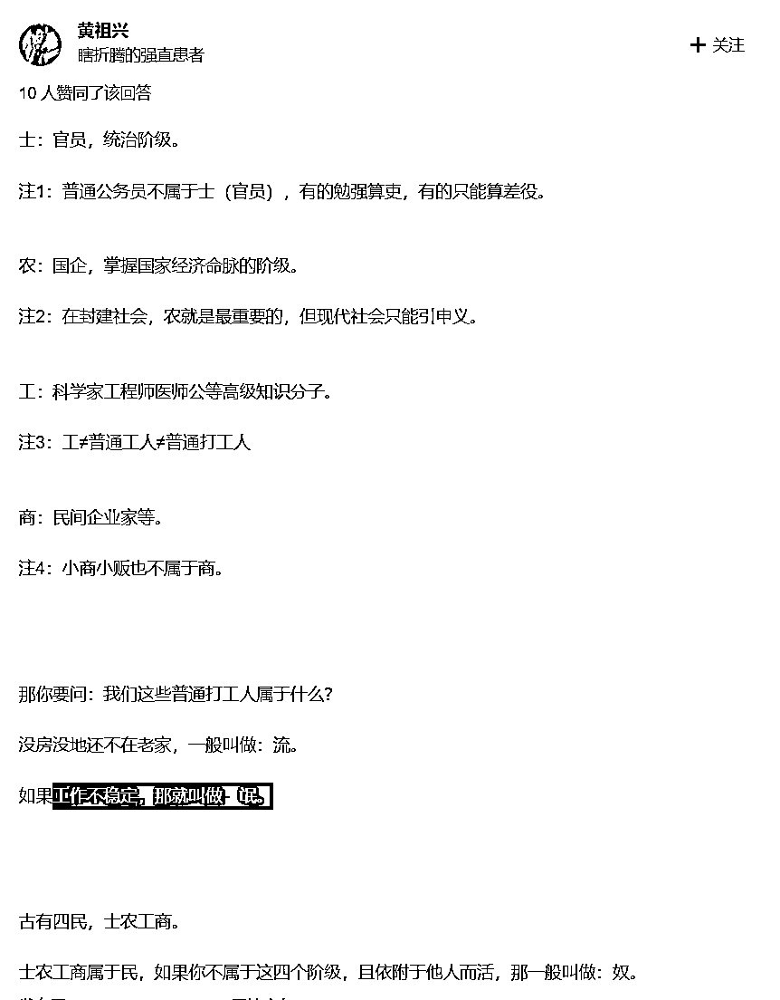

# 以修行的心态谈赚钱：普通人年入百万，已是天花板（上下篇合集）

做人，首要是收心。心一静下来，才能做其他事。

徐公子《神游》里提到的四门十二重楼，我把它换成现实里的个人年收入对照，用来帮助大家看清自己所处的位置，去掉浮躁，踏踏实实地修行致富。

第一重门
1内照 = 年入20W
2炼形 = 年入50W
3大药 = 年入100W

第二重门
4灵丹 = 年入1000W
5还转 = 年入10000W
6金汤 = 年入10000W

第三重门
7胎动 = 年入100000W
8婴儿 = 年入1000000W
9阳神 = 年入10000000W

第四重门
10 = 无穷大
11 忘情
12 元始

再附带引用另一套说法

第一重门
1内照 = xx
2炼形 = xx
3大药 = 副c

第二重门
4灵丹 = 正c
5还转 = 副t
6金汤 = 正t

没有超群天赋和大运加持，普通人能抵达金汤境，年入百万就算封顶，正c基本就是极限了。下面逐层拆解。

# 上篇

## 第一重门

1内照

先要认识自己。明白自己的长短，弄清欲望，贴近本心。

这一层会遇见色欲考验，不管善恶，研究出自我，境界自成。

对照收入：你若在一件事上沉下心去钻研，把它的方方面面都摸透，年入二十万并不难。

修行者分两种。一种偏保守，境界到了不急着破关，用另一种方式继续打磨当下境界，在此盘旋许久，是体验派。

一种偏进取，追求快步提升，境界一成即刻突破，是名利派。

体验派在内照层非常扎实。我有个朋友学国贸，考了初级会计、律考、教师资格，还通过了英语六级，能跟老外流畅对话。她跟我说她不急着赚钱，先玩味各种工作的乐趣。有朝一日想赚钱，一念就能入第二重。

2炼形

能坦然面对外界的闲言碎语，能把普通的批评建议听进去。强化的不是肌肉，是心性。

此层要受“身受劫”，可能被议论，可能被挑刺，要让这些慢慢淡化，不再扰动自己。

地师圈有句话：不因言废行，不因人废事。

很多人卡在这里，虽已认清自我，却被别人的评判和流言牵着走，一辈子忙于应付身受劫，再难前行。

PS：这一层同样无善恶之分。

对照收入：年入二十万，只需把一件事的各个环节做到七十分即可。但要到五十万，就得把整件事做到九十分以上。

而且五十万靠单打独斗不行，必须借助朋友、员工。要处理人际题，做事必有摩擦、有成见，有执念就会被困住。轻则徘徊在20-50万区间，重则项目倒闭，收入跌回0-20万。

认识自己不难，难的是看懂别人的想法，理解人与人之间的差异，并包容他人观点，让对方为你所用。

《金刚经》云：应无所住，而生其心。

何为无住？先无相，再无见。无相是不执着，无见是不分别。

不执着则心静，不分别则心平。清静平等的就是无住心，此心能生般若，能断如金刚般坚固的执见烦恼。

人话说：别执着于他人眼光，别分别好坏意见，用平常心接纳批评，便可入第三重。

3大药

是世界观雏形的象征。能看清自己，能在他人言语中坚守本心后，就要修正心的偏差，实现身心合一。

听起来复杂，其实简单。有了前两步的铺垫，也就是看清自己、守住自己，再用本心管控言行。

大药境的核心是：说出的、做出的，都发自本心，身心一致。心有偏、行有偏，都到不了。有个说法叫“言不由衷”，大多数人就卡死在这里。

这一层仍分不出好坏，关键在于形成自我。对应的劫是“魔境劫”，魔境是心的乱象。不仅在安静时能见本心，更要在纷乱中辨出本心并遵从。若做不到，后面皆是虚妄。

魔镜天劫：吸取教训形成看法经验，但所见所历并非纯净，夹杂乱象。若被迷惑，世界观就会摇摆、心生偏差。只有坚守本心，去芜存菁，看到本质，才能度过此关，生成“灵丹”。

对照收入：把自己的事做到极致后，不是继续埋头干活，而是把高品质服务卖给别人。要说服客户为你的服务买单，且价格不菲。

你自己也要言行合一，清楚告知服务边界，踏实兑现承诺，让客户满意。

此时公司规模已不小，如何让合伙人、员工为你所用且满意？炼形时已开始管理他人，但规模上来后关系更复杂，平衡的点更多，如何让所有人满意？

该如何就如何，喜欢你的人自然喜欢，不喜欢你的人也能理解你。遵从本心，发自内心地做人做事，即可入第四重。

我年收入远未到此，下列只是个人见解，权当体会。若有幸入高人法眼，望多指教。

## 第二重门

4灵丹

由“本心”升华为“世界观”，即灵丹。本心与世界观合一，不再有孤立的“自我”，而是自我与世界观的融合。也可理解为进阶后的“自我”。在此状态下，审视万物皆自然流出于你所形成的那套世界观。

5还转

世界观形成后，就以此来观人、观事、观物，达到行住坐卧不失的境界。世界观立起来后，世界在你眼里的样子，会与之前本心直觉的视角完全不同。

6金汤

为三十六洞天中不堕之境，境成可称真人。为人处世达此境界后，会获得相应能力，让你能做更多事。

此处有妄心天劫：佛家讲修行要去“众生相”……但人本就是众生之一，且欲望无限。何必强去？不如在妄中历练。

当你有能力去做想做的事时，看到什么才是真正想做的？什么才是本心？因前境所得权力带来实现妄心的机会，从这里开始才有本心好坏之分，但这不影响过关。

破妄有两种。

其一以真心破妄境，适合本心偏善或单纯妄心之人。如风君子，妄心只是想牵师父之手，一下就破了，因师父正牵着他。

常人的妄心更复杂，有人想发财，有人想家人幸福，有人想占有诸多美人，甚至有人想屠戮异己。很多人临终顿悟，看似境界提升，正因之前被妄心困住，直到最后一刻审视自己，忽然明白妄心所在。这是洗去妄心的一例，类似“放下屠刀立地成佛”。

徐公子设妄境，不管妄境多久，实境转瞬，如黄粱美梦。你可在其中肆意，几十年后妄心渐淡，此即洗去妄心回归本心的过程。黄粱一梦后书生若修道有成，也是此机缘助他破妄。

其二以妄心合实境，即以妄心应用现实。如希特勒。他的妄心即血统论，有此妄心者千千万，他只是有机会且实现了它。破妄方式即用妄心合实境。

此选择会影响以后的修为，亦即做人方式与结局。

但无论哪种，对达到更高境界并无差别，只是影响后面的事。

破妄的关键显而易见：在妄境中与实境中言行合一。妄心即本心所发，有人最终能看见本心，在长思或顿悟中认清自己真正想要的事。

有人看不见本心，或以妄心替代本心，并以此行事。也有人本就想做坏事，照本心做，也算找到了本心。

只要身处其中者坚持自我，也就是此前所说的认识自我，都可达成破妄。认识自我后坚持不变，最终形成一套为人处世之法，不管妄境实境，发自本心地依此行事，即达成不堕，即“金汤”。

至此者，有完善的世界观与方法论，于任何境遇皆能坚持自己的看法做法。通俗说，给你重来一次，你不会有别的选择。

往后境界，已高不可攀，非我辈凡人可窥。

# 下篇

主题：境界 = 知 + 行 + 修为 + 心境

大纲

起：两年沉淀后，我对之前理论有了新理解
承：1两年的饭没白吃
2人教人教不会，事教人一教就会
转：境界 = 知 + 行 + 修为 + 心境
合：一年顶十年，外表沧桑，心态成熟

起：创业两年沉淀后，我对之前提出的境界理论有了新的理解

两年前我写过《普通人这辈子能年入100w已经是天花板》上篇，数据还不错。惭愧的是中间因创业和偷懒断更很久。但这两年的线下创业没白过，经过磨炼沉淀，我对之前的理论有了完善，所以写下篇。

这两年的饭不是白吃的，踩过的坑一样没落下。如果两年前我只有认知，其他不足，那两年的线下创业让我不会再上台就紧张，说不出话；我能平静站在台上分享，也乐于参与讨论表达观点。

更重要的是明白一个常识：人教人教不会，事教人一教就会。2月失败的一个项目，我犯了“人教人教不会”的错，天天苦口婆心指问题给方法，最后还是一团糟。

反思对她说的话有用吗？有用，但站在她角度，有用不代表她会去做。

能解决的在后一句，及时沟通，深度讨论项目本身。你认同项目，就双方都投入努力，你琢磨怎么解题推进，我根据需要匹配资源配合，让每个人发挥主观能动性解决问题，而不是当妈妈桑做项目。这是公司，不是学校。

事情需要双方付出与自我责任，单方面要立刻停止，不然不仅浪费自己时间，还浪费公司资源。

诸如此类反思，在这两年创业中，该走的弯路、该撞的墙、该吃的苦，一样没少，虽然眼下痛苦，但心态在变好，这些苦都是生命必备，年轻早吃挺好。

说正题，我完善的理论有何变化？修行分十二境，如何区分差距？

境界包含四面：知 + 行 + 修为 + 心境

何为知？很多书很多道理。按中国思维逻辑，知可分五理，成塔状。顶层是天理，第二层伦理，第三层学理，第四层法理，第五层治理。

天理：由神叙述构成。中国有《易经》，讲天理。

伦理：圣人之说，代表作《论语》。中国很妙，天理与伦理之间有《道德经》，既是天理也是伦理。北宋宰相说半部论语治天下，说的是伦理，因无伦理则无制定法理的逻辑基础。伦理至关重要，伟大民族必有一套伦理体系。

之后是学理，中国学理著作汗牛充栋，如管子、《盐铁论》，五千年天文地理社会学理极多就不列举了。

法理我们也很强，从大秦律到大清律，体系完整。

治理经典是《资治通鉴》，多位治国者研读，一条鞭法即治理成效体现。所以神管天理，圣人管伦理，贤者述学理，政治家处法理，能臣管治理。

行：德行 + 执行。

《易经》云：“德不配位，必有灾殃。”德行配不上地位必有灾难。这是从今年合作一家公司得到的感悟，据说快倒闭了。接触较深，当时与老板吃饭，他分享成长史，一顿饭像快速翻书。半年后公司危机，这本书给了我不少启发。

他毕业进大厂五年，后有人投100w做项目，当时能力已蓄积，加上投资就出来干。项目砸了，但疫情时靠积累把新公司做起来，前两年业内有名。

现在看，以他资源，若有想法仍能拿不少钱。结论残忍：看他公司现状，再搞出来也解决不了问题。

回溯他的履历，失败似乎必然。马后炮看，他的认知没问题，决策也没问题，但这恰是问题所在，因他履历带来的“行”太少。

业内同体量另一家，行业受冲击时另一家跌到一半稳住，今年略升。那家老板干这行、这平台已十多年，而他是靠红利快速推起，公司起太快没积累优质班底，导致业内最大公司，底层设计竟不如我们齐全；钱来太快到处投资，业务不聚焦，据说之前机会大把浪费；创始人赚太多飘了，只有知跟上，行落下太多。需要身先士卒时，非常吃力。

以上三点，是他无法拉起公司的最大原因。即便受死骆驼比马大，他能再想办法拿钱，但若不能克服自己这一关，无人能帮他解公司难关。

修为：即阶级，条条大路通罗马，但有人生在罗马。分先天与后天。先天是领导亲儿子，做啥都容易；后天看膝盖多硬，能如吕布般做领导名义“干儿子”，办事也方便。钱在此最不值一提，钱对普通人才是珍宝，对先天之子稀疏平常，对后天之子虽不能摊手可得，也算不上稀奇。

心境：养花如养人，普通人别先养花，先把自己养好。

我喜尼采一句：只有经历七重孤独，才能成为真正的强者。七重是虚词，孤独指经历中自我的超越与孤立思维的习惯与享受。人起初把别人当目标，若有幸超越众人，你会发现对手只有自己。

百尺竿头更进一步。

凡事经历中都有自我冥想过程，如学历造就、事业突破，都需漫长过程，需不断挑战自我。

合：这一遭，算是实现一年顶十年。外表沧桑不少，心态成熟许多。

按完善理论衡量自己，这两年境界并无太大进步，但同等境界下，我比两年前在每个部分都扎实许多。

### 注释

士农工商更多是阶级而非职业。

解释：

士：政府；农：国企；工：实业民企；商：非实业民企；后两等可分城市户口、农村户口。

现代社会对“士农工商”理解有误。

“仕”不说，指的是分配资源权力。

“农”指基础生产资料提供者，包括房地产、能源、粮食、医药、水资源等。农从来指地主，而非长工。

“工”指技术产业、工业、制造业，如新能源、数码、钢铁、皮具、汽车等。

“商”指贸易服务，低买高卖赚差价、餐饮、金融掮客等。中间商与农的差距，多数中间商无法有效控制生产资料，一旦出问题只能求农协助。

一个商想走农，跨越阶级，如“士农工商”排序，商先做好上商本分，把别人产品卖出去且卖得比别人多。能卖得更多不仅需商的嗅觉，也需像工一样懂技术、扎实生产、供给消费者。随后借助积累与时间沉淀，让产品公司有护城河，在城中你真正拥有对工、商、民、奴的生杀大权。

某种意义即“垄断”或“品牌”。

普通人也可一路打工，掌握商思维与工技术，攒够流通货币后开始跨阶级旅程。

普通工农要么被士剥削，要么被商剥削，感觉差不多，所以在士社会努力当官，在商社会血腥成为资本家。

普通人靠时代红利与自我努力赚到钱后，用来解决流氓问题，却连商都算不上。