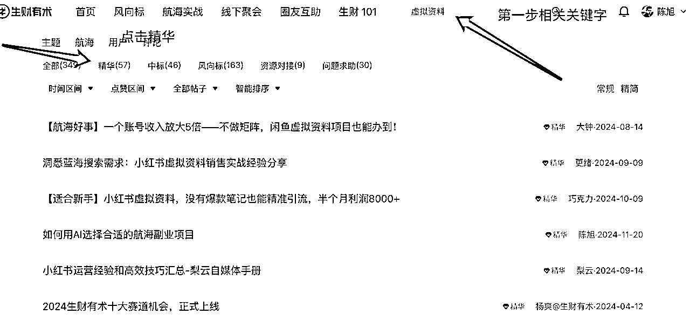
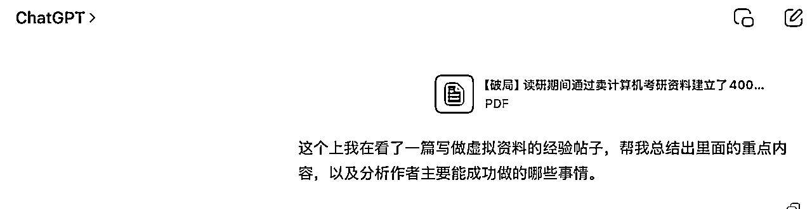

你是不是也遇到过这种情况：航海报名时挺激动，可看完项目路线图就懵了——下一步到底该干什么？别急，我最近刚用AI把这个问题彻底解决了。

前几天我在生财航海里，让AI帮我从一堆项目中挑出了两个方向：AI写作和闲鱼虚拟资料。说实话，这两个确实挺对我的胃口，但光看路线图还是觉得心里没底。想着与其等下个月开船再手忙脚乱，不如现在就用AI把路线抠细一点。于是这两天我跟GPT连续深度聊了几轮，还真拿到了两个项目的可执行路径。如果你也正对着航海图发愁，这篇内容或许能给你一些启发。

我的做法其实就四步：先选项目 → 让GPT读精华帖 → 围绕具体问题深挖 → 形成可落地的计划。

第一步，选项目。直接把十二月的航海项目列表喂给GPT，让它根据我的背景和兴趣帮我筛选。这个上一条帖子聊过，就不重复了。

第二步，让GPT吃透精华帖。我打开生财有术网页版，找到对应项目的精华帖。

精华帖多得能刷一下午，怎么看得过来？我的办法是：挑出跟项目相关度最高的几篇，直接甩给GPT分析。这些帖子可都是拿到过结果的前辈总结的干货，GPT吃透以后，比我还懂这个项目，我再问它什么问题，回答都靠谱多了。

比如它把其中一篇虚拟资料帖的重点提炼得特别清楚：这行成本极低，一部手机加基础编辑工具就能干，没有物流负担；做得好的关键是在细分领域里扎下去，拿考研资料举例，越垂直越容易积累死忠粉。操作上要先定准定位，再去找对标账号模仿，然后用高效工具做内容，在小红书、B站引流到私域，最后通过笔记、社群、课程等多层变现。成功的人基本都是赢在精准定位、多元变现、内容运营和快速迭代上，同时很会用AI和设计工具提效。

第三步，让GPT带着我拆细分领域。我问它虚拟资料现在都有哪些类目，它一口气列了几大类：教育考试、技能提升、生活兴趣、自我成长、行业专属，还有各种小众方向。看着这些我就在琢磨自己适合啥。

我寻思自己更偏向技能方向，但专业度又不够，就想从表格模板、PS素材、视频素材这些入手，还顺便问问电子书行不行。GPT倒是挺客气，说这个方向门槛低、需求也广，但它同时提醒我竞争激烈、有版权风险。我不放心，特意去闲鱼和PDD搜了一圈，好家伙，几块钱就能打包买到全部资料，简直烂大街了。果断放弃。

既然模板素材做不了，我脑子一转，想到了AI相关的资源。于是继续问GPT：AI方向有哪些虚拟资料可以做？它给了一堆思路，从编程工具、数据模型、实战项目，到学习路线、面试题库，再到生成式AI、商业报告，覆盖面很广。可问题是，大部分我根本不会。

我只好直说：我只会简单使用AI，这些都不懂，但特别感兴趣生成式AI，能做吗？GPT的回答让我眼前一亮——完全可以。从提示词模板开始，比如整理一套“100条高效办公ChatGPT提示词”，教别人怎么写邮件、做PPT、生成工作计划；或者做ChatGPT使用教程，按职场、教学、生活场景拆解；再不行就整理MidJourney、Stable Diffusion的图像素材包和提示词教程。这些不用多高深的技术，只要自己会玩、会筛选，就能整理成产品卖。

回头看看整个过程，最关键的其实不是GPT多聪明，而是我得先有自己的思考。如果我只是被动等它给答案，根本问不出这些连续的问题，也就不会从虚拟资料一路转到AI素材，最后找到适合自己的方向。所以，别光收藏不行动，拿AI试一次，你也能把模糊的航海图变成清晰的作战计划。

AI火了两年，很多人却开始心里打鼓：去年还做得风生水起的博主，怎么今年就没了动静？现在才想入场，是不是已经挤不上车？

我的判断是：不晚，但别再用老打法了。

两年前，AI刚破圈。那时候，只要你整理一套提示词、做几页入门教程，就能在闲鱼、小红书卖得不错。用户什么都不懂，什么都要学，低价资源一抓就是流量。

但现在，市场明显变了。

早期那批博主为什么停更？说白了就是三个原因：一是靠流量吃饭的窗口关上了，用户对基础内容开始免疫；二是内容生产难度变大，大家都会用ChatGPT和MidJourney之后，再讲“注册教程”就没人看了；三是商业模式没打通，只靠低价卖资源，赚不到持续的钱。

这些现象不意味着AI副业没机会了，而是说明市场要换一种玩法。

现在的需求已经从“AI是什么”升级成“AI怎么帮我干活”。职场人想用AI写周报、做PPT；电商卖家想用AI做商品图；学生想用AI制定学习计划。你只要在某个具体场景里帮用户解决问题，就有入场的空间。

更关键的是，早期入局者大量退场，细分赛道反而被空出来了。同时，AI工具本身依然易学易用，产出效率极高，市场需求还在快速增长——这些都是虚拟资料副业的底牌。

那新玩家该从哪里切入？

第一，别做“通用教程”，做“行业方案”。
与其讲“ChatGPT入门”，不如讲“ChatGPT如何帮老师出题”“MidJourney如何帮电商做海报”。越具体，越值钱。你甚至可以把一个行业内的用法整理成电子书或小课，比如《ChatGPT高效办公手册》《MidJourney实战创意指南》。

第二，跟紧新工具、新趋势。
AI变化太快，GPT-5、Claude、Runway、AutoGPT这些新东西不断冒出来。抢先做内容，就是捡流量。追热点，永远是AI副业的加速器。

第三，从“卖资源”升级到“卖服务”。
过去一个PDF打包卖9.9元，现在你可以做一对一提示词定制、帮客户生成头像或品牌海报、开小班实战课、做付费社群答疑。用户买的不是一份资料，而是“问题被解决掉”的安心感。

如果你想动手，这里有一份四周起步计划，特别适合新手：

第一周：把ChatGPT、MidJourney至少熟悉一轮。动手生成几样东西：工作总结、海报、学习计划，顺便把好用的提示词记录下来。

第二周：把积累的内容整理成产品。比如做一份PDF版“效率提升提示词合集”，再配几个图片素材包，先丢给身边朋友或小社群看看反应。

第三周：根据反馈调整内容。哪块没讲透就补案例，哪个方向最受欢迎就做深。顺便用Canva把封面、目录、水印和公众号引导做出来，让自己看起来专业。

第四周：找个平台正式上架。闲鱼、淘宝、拼多多都可以试水，定价不用高，9.9元、19.9元都行，关键是跑通流程。同时在小红书、B站分享自己的AI使用心得，把流量引过来。

这里要特别提醒资源包的“包装逻辑”：
- 目标人群要清晰：给职场人、给设计师、给学生，需求完全不一样。
- 内容别贪多，要筛选：200条提示词只留50条有价值的，再加几个真实案例。
- 排版要清爽：用Canva做封面和目录，加轻量水印保护原创，重要的是埋入公众号入口。
- 每个资源包里放一句引导：“想拿更多免费资源，关注公众号XXX”。

长期来看，一个比较稳的变现闭环是：
闲鱼低价卖资源 → 资源里埋公众号入口 → 公众号用干货建立信任 → 再引导进付费知识星球 → 星球里做深度服务（每月更新、一对一答疑、案例拆解）。

这个闭环听起来环节不少，但只要每一步都顺，用户其实不会觉得麻烦。关键是：闲鱼端的资源要有超值感；公众号端的内容要持续有价值；知识星球端要让人看到“付费值得”。记得每周更新一两份新的AI生成内容，不断充实素材库，同时根据用户反馈调整方向。

风险也要提前想清楚。大家都在做同款？那就做垂直，聚焦一种人群或一个行业；版权容易惹纠纷？那就用开源工具，或者只使用授权范围内的素材；用户容易流失？那就靠社群互动、定期更新和轻量级答疑留住人。

总而言之，现在入局AI虚拟资料，不是时间太晚，而是考验变重了。你不需要成为技术专家，只需要在一个小领域里，比大多数人更会“用AI解决实际问题”。

与其反复纠结“还有没有机会”，不如从这周开始，选一个你熟悉的场景，做出第一份作品。机会从来不是等出来的，是做出来的。

切入点一定要先想清楚，做AI内容不是堆工具，而是先找一个能立刻见效的场景。

我最初的思路是把AI资源做成泛泛的合集，后来被拉回现实：先从教育、职场提效或内容创作这三个明显有痛点的赛道进去。比如教育端可以做AI学习计划的设计，职场端可以从PPT制作效率的提升入手。方向定下来，后续的动作才有落点。

起步阶段最忌讳空谈，先做出可触达的小型资源包。把进阶素材整理成一个有使用价值的合集，比如行业化的ChatGPT提示词库，或是MidJourney在设计落地中的高阶案例。打包出来就是第一块敲门砖。

资源有了就去验证。在闲鱼和小红书上小范围投放，看数据反应与评论区反馈，哪些模块被反复问，哪些场景被忽视。根据真实反馈回炉内容，方向才不会走偏。

进入2到3个月的中期，就要开始做内容沉淀与信任积累。公众号作为主阵地，每周保持1到2篇的垂直输出，选定职场AI应用这个窄口持续写。社群用来做沟通与复盘，让用户从点赞到参与，形成稳定的互动关系。

当读者稳定后，可以开启轻定制服务。行业专属的提示词定制、AI在特定岗位的应用方案咨询，都是从免费内容向付费服务过渡的自然路径。先解决一个人的具体问题，再沉淀为可复用的方法论。

三个月之后考虑差异化运营。知识星球是比较合适的承载形态，提供持续更新的资源库、案例库以及在线答疑。定价策略上初期可以走低价破冰，比如99元年费，先聚拢种子用户，再根据内容深度逐步抬升。

这时候也可以打开合作边际。和同圈层的博主、行业专家做联合内容，或参与线上线下的AI主题直播与分享，扩大触达面，把个人品牌从单一输出变成网络节点。

很多人中途掉队，根源在于做的内容太同质、价值感不足。避开这两个坑很关键。把视角从入门级教程转向高价值的进阶场景，满足用户从“会用”到“用好”的需求迁移。

现在入场其实有窗口期。一方面流量竞争相比早期已经收敛，大家更渴望高质量的深度内容；另一方面AI技术迭代快，内容创作的空间依然很大。保持探索与迭代，就能在这个赛道里找到自己的位置。

我一度卡在迷茫期，不知道该聚焦哪个细分。以我的现状来看，刚起步、资源有限、对AI有基础认知，时间相对充裕但技术深度不足。结合市场，我梳理了几个可能的窄赛道。

职场效率提升算是共识型需求。办公文档上可以做ChatGPT写汇报、写PPT、回邮件，Excel公式生成与数据透视。时间管理上用Notion AI做任务清单与目标拆解。会议辅助上做纪要提炼与行动计划生成。门槛低、需求稳定、可以直接在闲鱼打包卖工具包引流。

教育与学习的用户面很广。学生端是复习计划、知识点梳理、写作、解题与文献整理；家长与老师端是早教绘本生成、课堂PPT与题目生成；语言学习端是作文模板、翻译教程、单词卡片的AI制作。内容可横向延展，粘性也高。

内容创作者支持的付费意愿强。短视频创作者需要竖版背景、过场素材、脚本与标题标签；写作者需要大纲打磨、润色与主题提示词；设计师需要风格案例关键词与PS+AI辅助教程。资源好打包，复用率高。

电商与营销支持也属于实用型。商品主图与详情页背景的MidJourney生成，ChatGPT写的促销文案与活动方案，以及AI辅助的LOGO与广告视频。需求明确，在社交平台容易精准投放。

娱乐与生活类偏兴趣驱动。虚拟头像与卡通插画定制，旅行计划、菜谱建议的自动生成，手账素材与节日贺卡、游戏地图与故事背景的创作。趣味性强，制作成本相对低。

专业技能与行业应用属于高门槛高溢价。程序员的代码片段生成与逻辑优化，数据分析的报告模板与可视化自动化，医疗影像、金融投资策略等行业案例。竞争少，但要求专业背书。

综合我的阶段特征，起步资源有限、时间有余、期望做闭环，最合适的切入是职场效率、教育学习、内容创作者支持这三类。最终我选择了职场效率提升，既有经验可迁移，需求也经得起时间考验。

确定方向后，接下来要做的就是把职场AI应用做透，再以点带面。核心内容模块包括工具应用场景、行业实战案例、工具推荐与教程。

场景方面，文档处理是ChatGPT生成汇报与总结模板、Excel公式与数据分析案例；时间管理是Notion AI做任务清单与日程规划；会议效率是AI纪要与行动计划。行业案例可以细化到HR的招聘文案与绩效报告、销售的邮件优化与客户沟通、项目管理的甘特图与任务分解。工具教程则覆盖ChatGPT、Notion AI、Excel插件的基础操作与实战技巧。

增值内容要可直接拿走。复用的职场AI模板，会议纪要格式、工作总结框架，以及按场景分类的高效提示词合集，比如高质量邮件写作提示词包。

落地节奏上，分三段推进。

第一阶段1到2周做资源整理与测试。先在知乎、小红书、B站搜集职场用户的真实痛点，锁定热点话题。产出10到20条聚焦邮件、报告等场景的ChatGPT提示词，配2到3个可复现的AI使用案例，如Excel自动化、会议纪要生成，打包成PDF或工具合集去闲鱼、小红书做小范围测试。

第二阶段3到4周做优化与推广。根据反馈补足使用说明与案例，提示词按行业或功能模块细分。资源内嵌入公众号二维码做导流，同时用朋友圈和社群把闲鱼用户引回私域。

第三阶段1到3个月搭建服务闭环。公众号持续输出职场AI的干货与进阶模板，社群做答疑与案例共创。同步筹备知识星球，提供深度案例拆解与定制化答疑，首批用低价策略获取种子用户。

长期来看，可以在职场场景内部做横向深耕，比如市场、财务等岗位的专属方案，形成完整的学习路径。后期再把方法论迁移到教育、内容创作等邻近领域，保持增长曲线。

这轮深度沟通让我确认，方向比速度重要，细分比泛化重要。把AI当作助理使用，输出需要自己分析、对照自身条件再执行。知道和做到之间始终隔着落地。

希望这段梳理对你有帮助。我们继续做下去，十二月出发。