# 数字人玩转视频号航海，两条视频破20万播放，GMV破7000 实战复盘

# 我是谁

大家好，我是清予。

浙漂衢州人，浙江出了名的爱吃辣城市。99年INFJ狮子座，热爱搞钱、热爱写作、热爱折腾。

自媒体创作已经8年，今年是我边上班边创业的第1年，同时也在做私域，长期在运营📕和👸号，👸号连更135天。

目前在一家商业咨询公司打工，做情感疗愈类数字人IP背后的文案，已成功打通两个数字人IP项目，名下正在跟进7个数字人IP项目。

我是11月10日加入赚钱，12月第一次参加航海【视频号带货-AI数字人】。

写下这篇复盘时，我手握5个视频号，其中4个已产生成交，累计GMV7000+，到账变现3200+，其中一个号爆出2条20w+视频，2天净增粉2700+。

下面是我整理的分享提纲，可按需跳读~

没参与本次航海的伙伴，建议先把航海手册翻两遍再来看这篇避坑笔记，我自己当时看了两遍航海手册，最近刚又看第三遍，常看常新，很多细节才恍然大悟。

一、新人做数字人带货，怎么提高爆单概率

1. 账号前期搭建，打好天选号基础
2. 选对数字人形象，打好天选号基础
3. 坚持输出流量内容，让账号更抗打
4. 先发流量再发带货，让账号更抗打
5. 流量视频用公用数字人务必去重，让账号更抗打

二、带货视频爆了后，怎么承接住全部流量

1. 主号副号同等对待
2. 剪辑前先把商品上橱窗
3. 第一次开播务必先过人脸识别，尤其是实名非本人的号
4. 身在外地如何盯流速
5. 爆了也不用怕粉丝不够开播，什么情况下可考虑买粉
6. 爆款永远在下一条，心态篇
7. 大爆后复制爆款的几个黄金时间点
8. 提前备好几个代播，留后手

【本次航海的部分成果👇】

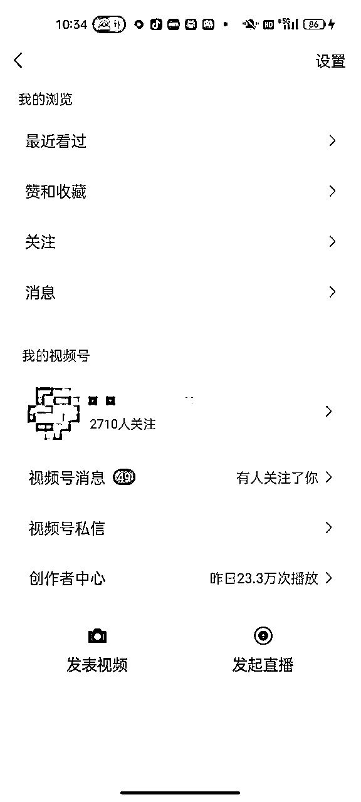

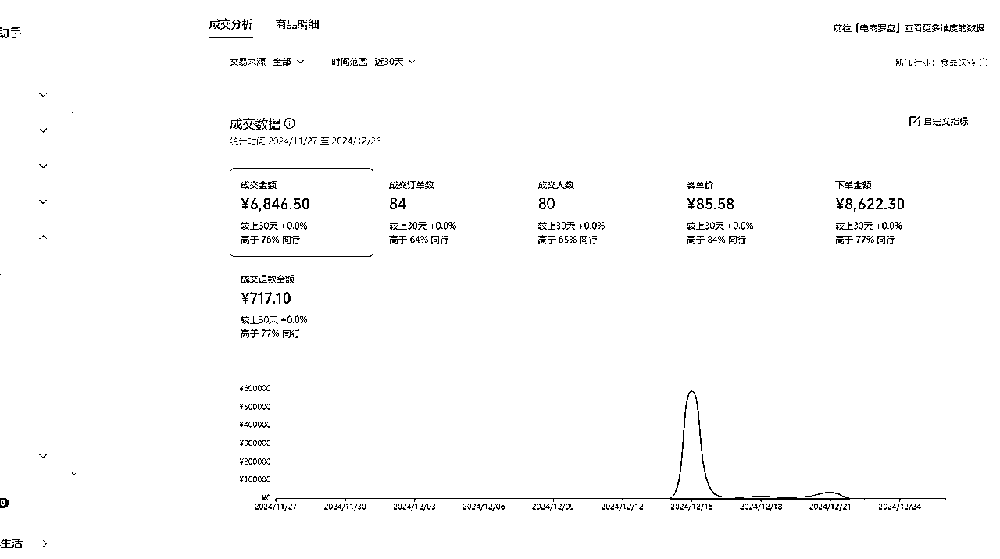

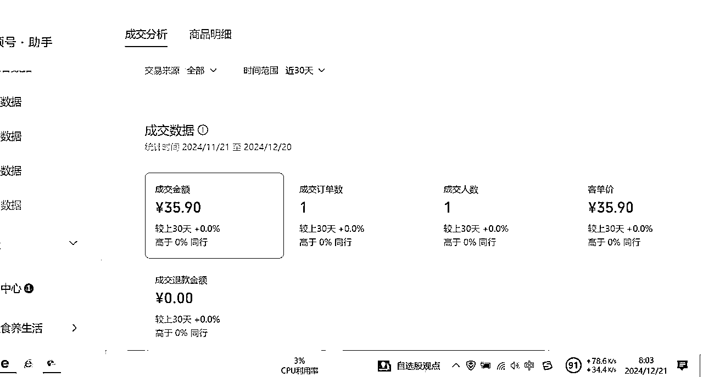

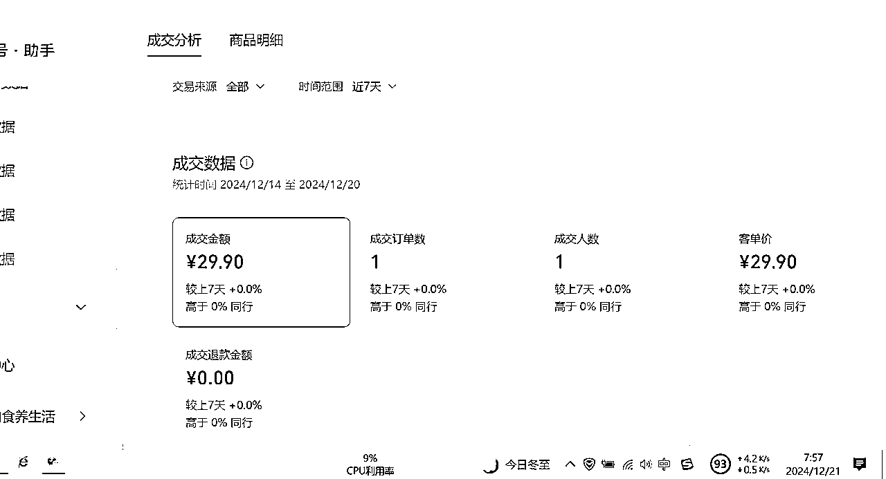

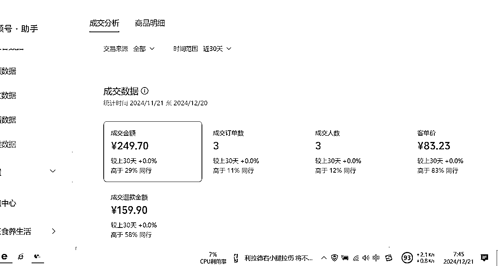

说个遗憾，我是在两条20w+视频爆完的当天就被限流了。

12.14 第一大条27w，当晚凌晨带货视频被限流；
12.15 第二大条21w，12.16凌晨账号被降权减少推荐。

不过因为转发量很高，橱窗一直持续出单到12.22。

我截分享稿的时候查后台，12月21日那天依然在成交。

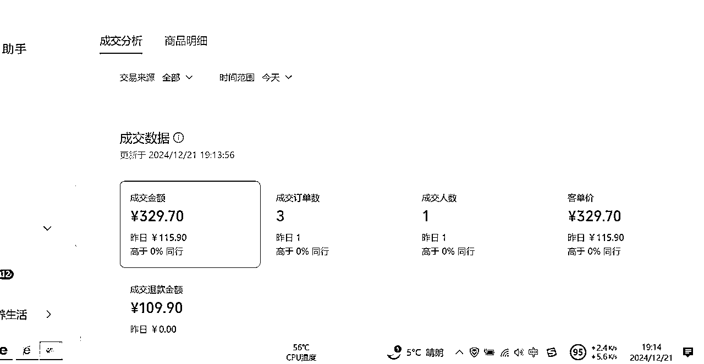

好了，回到正题，从第一部分开始拆解~

# 一、作为新手，我是如何提升爆单概率的

复盘下来能爆单的核心就一句话：让账号尽可能变成那个天选号。

天选号谁也说不准，但我们可以从多方面去提升爆发的概率。

我当时做了这5件事，供参考：

## 账号初期搭建，为天选号打底

名字、头像、赛道，先做粗糙的IP定位。等账号跑起来有粉丝基础了再补简介也不迟。

我一开始就按数字人IP思路在做，没想到真爆了。

所以在开通视频号前就定了养生赛道，账号名直接对标赛道“xx食养生活”，好处是刷到的人一看名字就知道是养生内容，会顺手点进主页。

头像我用荷花，照着航海手册换的，偏中老年审美。

## 选一个合适的数字人，为天选号打底

爆单后我朋友看了视频，第一反应是这个老太太太有说服力了，看着有文化有气质还慈眉善目😂

数字人形象选对了，信任感直接拉满。

航海里大表哥也提到过，实测有效👇

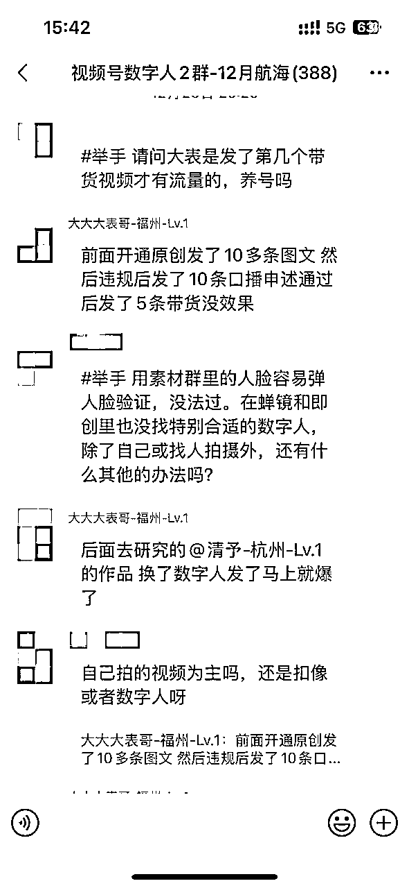

中老年人很难分辨真假IP，就像很多人到现在还不知道数字人是什么。

当用户把你当成真人IP时，成交概率直接翻倍。

## 坚持发流量视频，账号更耐打

我4个号的流量视频数据都不错，账号没被限流时基本都在几千播放，从没掉到几百。有个号申诉后删了截图找不到了。

【部分流量视频数据👇】

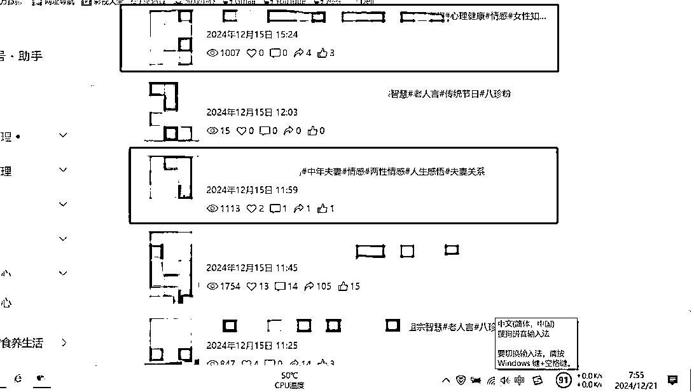

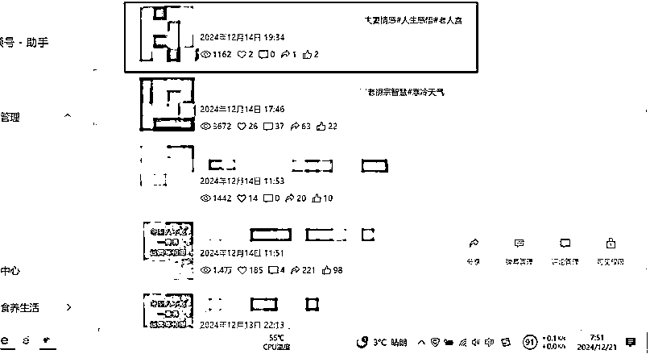

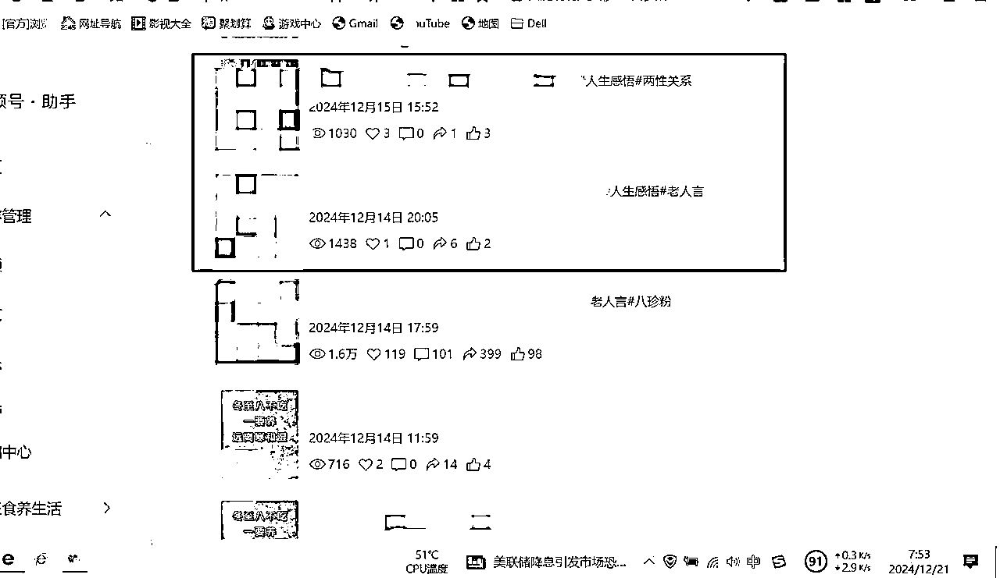

流量视频不一定能精准吸到买单人群，但人群对了，账号不断流，用户今天刷到你的流量，明天就可能刷到你的带货。

前期画像清晰，后续成交才稳。

举个例子，我第一个📕号粉丝画像锁在18-25岁，后期发其他年龄段内容流量就断崖式下跌。因为初始流量池就被定型了。

所以发流量时直奔目标人群，就是在为后续爆款铺路。

中老年群体从我跑通的两个IP经验看，两性情感是最容易爆的话题。

12月4号和9号连爆的两条10w+就是这类👇

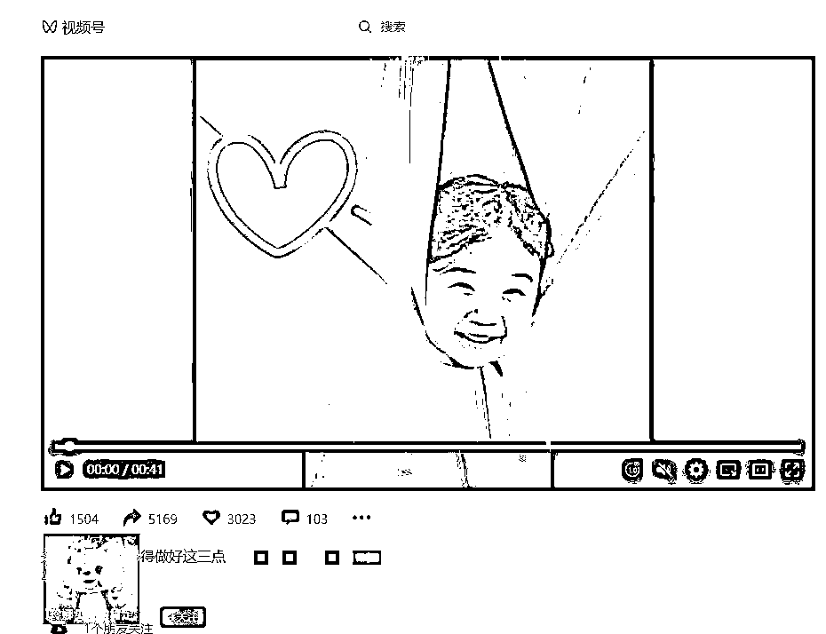

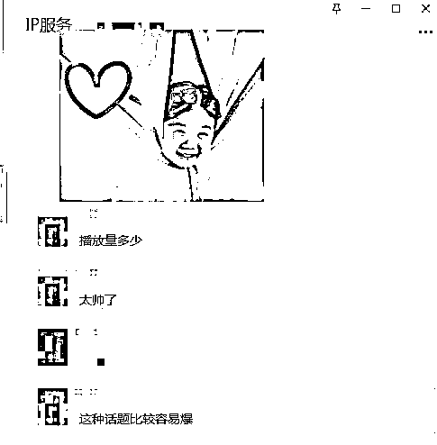

可以直接对标视频号上的两性情感爆款账号。

常用搜索词：两性情感、婚姻关系、夫妻关系

【示意👇】

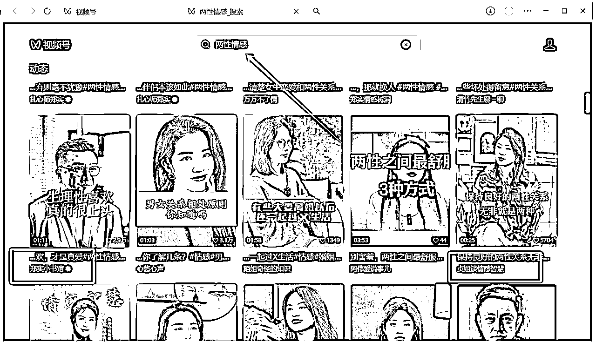

我整理的5个对标账号：

1、郭银菊大姐
2、郑实小书馆
3、贞姐谈情感智慧
4、长卿商学智慧
5、新媛丨会话厅

去扒爆款文案扔进kimi改写，再自己润色即可。直接抄数据扑街风险大，建议改写40%-50%。

kimi提示词可参考：

请你改写这段文案，语言尽可能口语化，字数要控制在240个字以内（240个字差不多是30s）

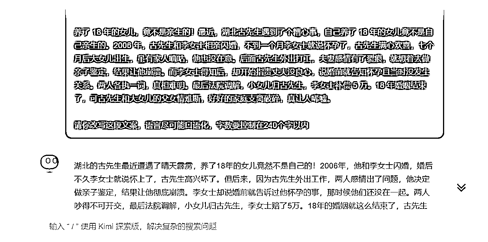

运气好的话多跑几轮就能得到满意的文案。

如果你觉得二创耗时，我准备了15条在达人号上验证过的爆款文案，已改写40%-50%，可直接用，也可再扔kimi微调。每次出来的都不一样。

基本用上，第一天发2-3条，第二天就能过原创。我4个号都是这样过的，第5个号第二天隐形限流就没过。

## 先发流量再发带货，账号更耐打

5个出单号里，只有大爆的那个是我先发了1条流量，隔2天才开始发带货+流量。其他4个号都是3+1、4+1、3+2混发。

当时没注意韩教练说的同时发服务器识别不到先后顺序。

有个号本来有爆的苗头，结果180天申诉，跑起来前违规了。

我判断就是流量发少，账号不抗打，复制爆款怼量时数据没起来号就废了。

所以尽量先流量后带货，1带3、1带4，这种节奏更稳，也能避免一怼量就废号。

没试过1带2，可能能延缓出问题的时间。

我那两条20w+的号，就是先发1条流量，隔2天才开始发带货，期间正常刷视频。

第3天发了4条带货，其中出第一条20w+
第3天晚上再发1条流量+2条带货，出第二条20w+

两条视频间隔至少半小时以上，这是航海里强调过的。

发流量能提权重，多发不亏。

我同时启动4个号，发流量最多的那个号最抗打，最后一个被减推。

## 流量视频用公用数字人一定要去重，账号更耐打

第一个试水号用了不同流量文案还是收到了内容优化提醒。

感觉每个新号都有新手保护期，先出几条优化提醒再限流。

所以把违规次数留给带货，流量阶段别先违规，不然太亏了。

【换不同文案仍收到优化提醒👇】

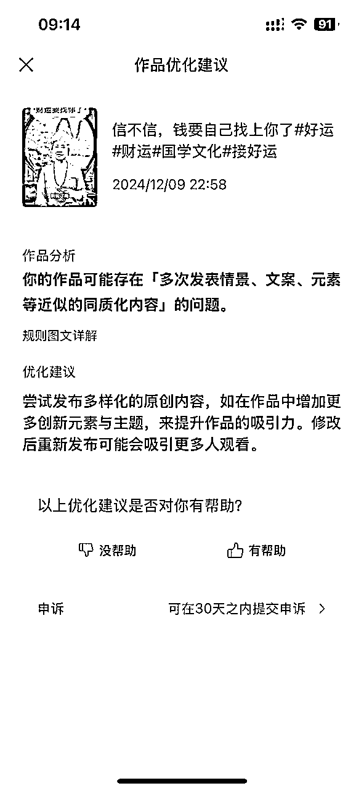

去重我最常用30s画中画。

我觉得比导入图片加贴纸更快，导出虽慢但可接受。

我剪一条导出时就用另一台手机剪下一条。

去重比较狠，画中画素材换好几个，切块后分散到不同图层，调整位置。

记得先把画中画音量调0、透明度3%，再切割，不然要一段段调音量。

再加1-2个贴纸，调亮度、对比度、色温、饱和度，有时换背景。

★注意：只换背景不一定去重成功！我上面这条优化提醒就是换了背景、文案全新的仍被判同质化。

实战下来画中画去重效果最好，可参考。

下面是我录屏的一条去重流程👇

# 二、大爆后没接住20w流量的复盘

## 主副号同等重视

没过原创前流量视频也要坚持发，后面带货爆了怼量才更抗打。不然一条就减推，很难受。

## 剪辑前先把商品上橱窗

这点太关键了！

我当时没重视副号，觉得带着发就行，橱窗上品不积极，直接错过第一波20w+。

哪怕不能立刻开播，橱窗也能出单！

## 第一次开播人脸识别一定要先过，尤其是实名不是本人的号

号不是自己的更要注意！

人脸需要父母识别的，先让他们熟悉流程，避免大爆后直播被掐。

我的第一个号7:02开播，7:55弹人脸验证；
第二个号19:04开播，19:18弹人脸验证。

第一次开播可以先聊天，避免像我一样直播一半被掐，收益直接砍半以上。

我被掐后等了快一小时才验证上，二次开播效果大减。

掐前一小时流速起来成交600+；
掐后一小时再播只有100+！

中间一小时的空档，成交全流失。

做前面三点，爆了不说多赚几万，多赚三四千妥妥的！

我第二次爆没第一次猛，还被掐了一次直播，一天收益也有2500+，粗略估算快3000了。

【被掐后成交断崖👇】

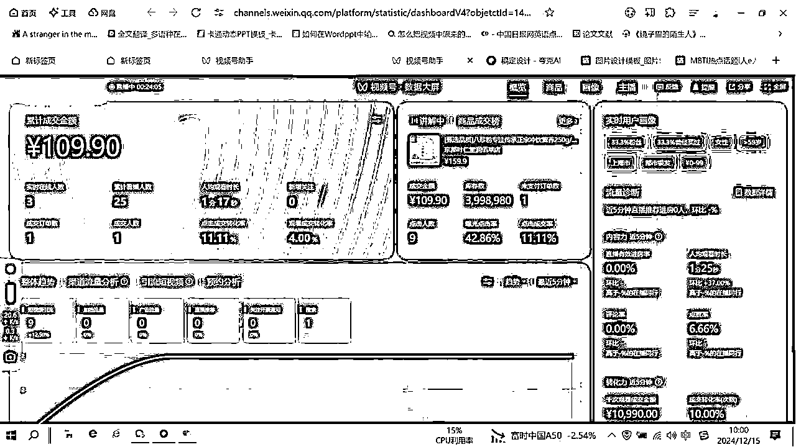

## 人在外面怎么看流速

微信不是自己的号，看不到每分钟点赞增长，数据感知弱。

强烈推荐向日葵远程控制，不花钱很方便。

【几条视频数据，从播放和转发看，我没及时挂橱窗肯定损失一部分成交】

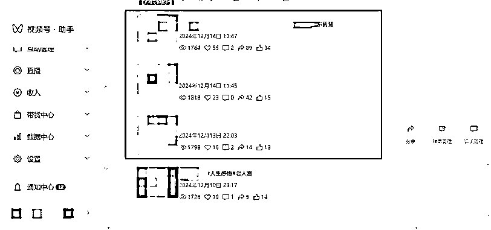

使用方法：手机和电脑都装向日葵远程控制。长这样👇

出门前先把关注的几个号登录在浏览器里，注意装好流速插件，装在谷歌浏览器即可。

电脑版向日葵改成长期验证码，把验证码发到手机，电脑保持开机。

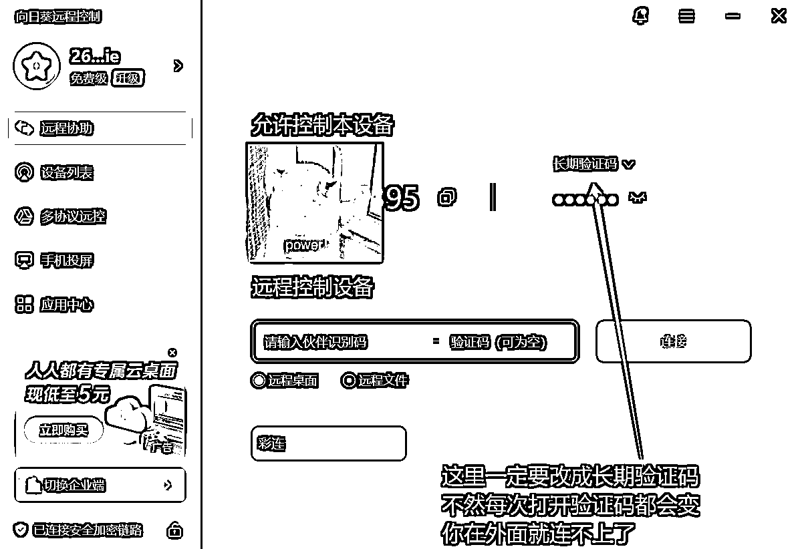

连上后是这种触屏操作界面👇

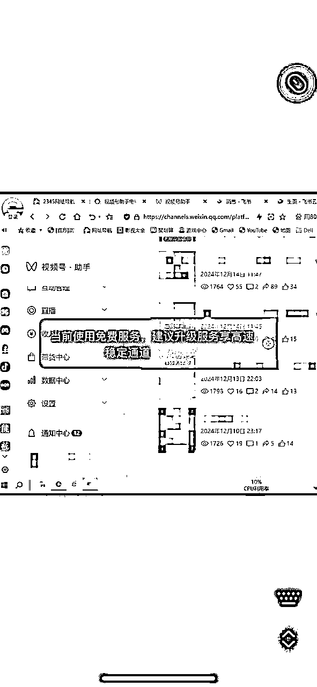

这样出门也能实时盯流速，一有爆的苗头就找代播开播。

## 不用担心爆后粉丝不够开播，什么情况可考虑买粉

大爆后粉丝自然涨，不用担心。

想接住1万左右的小爆款，可以提前买粉，但成本会上去。

我有个号视频流速跑到65，等买完200粉过去40多分钟流速就掉了，找代播还差点亏本。所以提前买粉是否值得要自己权衡。

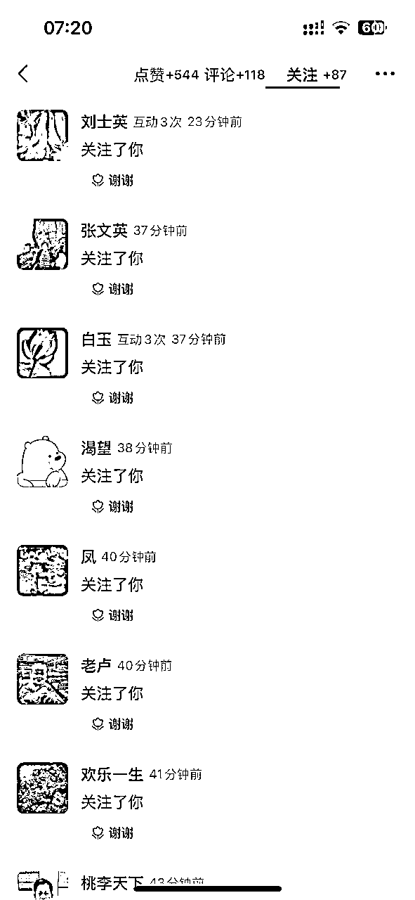

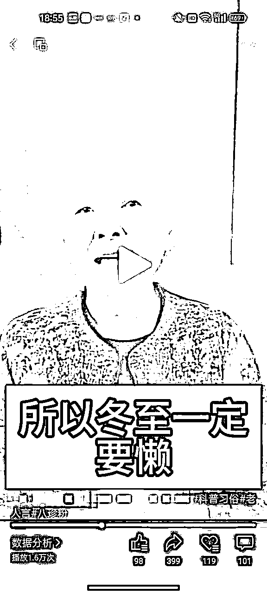

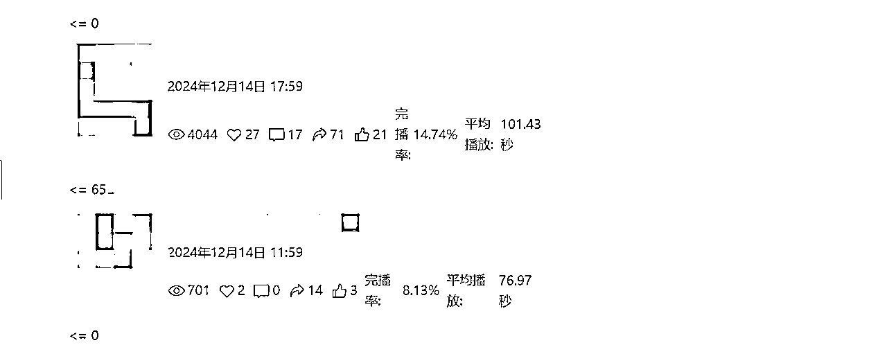

## 爆款永远在下一条，心态篇

第一波没接住很心酸，但无法改变。航海同期伙伴都知道，我错过第一波20w+，其他号的小爆也没接住…

心态很重要，先坚持才有结果。

## 大爆后复制爆款的黄金时间点

第一波27w没接住时我一度觉得不会再爆了，因为流量跑停时收到优化提醒。

但我还是听汪老师的建议，睡前再怼3条去重后的爆款。
也听斌斌教练的，设了凌晨6点闹钟，结果前一天睡太晚，闹钟没听见，醒来7点半，第二条爆款已跑到10w+，当晚依旧出单。

虽然没在数据刚起时开播，但我觉得第二波流量接住了。

休息好才能创作出更多爆款，也才能接住流量。别太苛责自己，复盘向前走比回头看重要。时常庆祝，知足常乐。

出现爆款后可参考三个关键点：

1、睡前怼一波爆款带货视频
2、凌晨3点定时发3条爆款带货视频，条件允许先发流量再发3条带货
3、早上6点设闹钟看数据，爆了立刻开播

【错过第一波后第二天早上的后台截图👇】

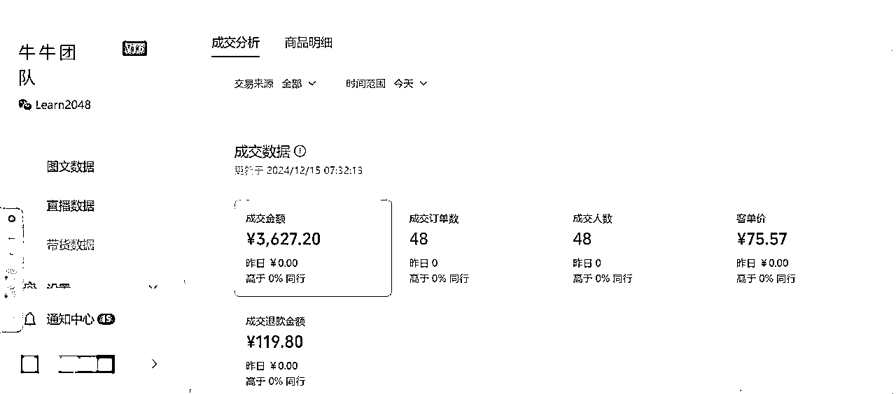

所以我也不能算完全错过27w那波，因为它给我带来了8000+转发，账号限流后我依然每天有出单，转发里肯定有成交。

## 提前备好几个代播，留后路

以备不时之需，别等爆了加不上代播。

自己播不难，但大爆时每分钟一千播放往上涨，找代播更划算，还能腾出手复制爆款怼量榨干流量。

我当时的代播白天35/小时，夜间45/小时，大爆时时薪远超这个数。

以上就是我在航海期间踩过的坑，基本全在这里了，欢迎补充。

最后感谢爆单后陪我熬夜的汪老师和斌斌教练，群里私信帮助我的圈友，每天提醒打卡的志愿者Elise，帮我审稿的领队双鱼儿姐，排名不分先后。祝大家早日爆单！