# 程序员做饭实录：盐和酱油都“失踪”了，这饭还能吃吗？

> 来源：一位湖南前端工程师的出海实战手记

大家好，我是龙哥，湖南人，写前端的那种。自从AI火了以后，GPT基本成了我的编外导师，前端那些东西大多是我边写边问学来的。后来遇上了Cursor，感觉就像厨房里多了个帮厨，虽然偶尔会递错调料，但整体效率确实上来了。这次航海活动跟Cursor搭档“做饭”，想让它帮我批量化剪YouTube短视频，结果在“厨房”里折腾出一段找盐找酱油的辛酸史。今天就把这段经历和其中的教训说给大家听。

故事大概是这样：我想做道菜，盐找不到，酱油也找不着，没办法只能硬着头皮把菜炒成甜的，可我不爱吃甜口啊。最后实在不甘心，翻箱倒柜把盐和酱油都挖出来，才算正经吃上一口饭。这中间踩的坑，都是血泪。

不想看过程的，直接拉到最后看“做饭总结”。

## 一、盐呢？盐呢？moviepy.editor去哪儿了？

做饭嘛，没盐怎么行。

航海任务里有一项，让Cursor批量剪YouTube Shorts。我心里的菜谱很清楚：输入提示词，告诉它要批量剪辑，口味偏好也都交代得明明白白。结果，一来就报错。


```
ModuleNotFoundError: No module named 'moviepy.editor'
```

翻译成人话就是：找不到“moviepy.editor”这个模块。就像做菜做到一半发现盐罐子空了，巧妇难为无米之炊啊。

我赶紧喊：Cursor，我的盐不见了！

Cursor不急不慢地给我开了一份“排查清单”：

- 你确认买过调料吗？（检查moviepy装没装）
- 菜谱是最新版本吗？（Python版本对不对）
- 锅碗瓢盆没问题吧？（看看IDE，重启一下）

我说：装了呀，moviepy 2.1.1，可还是找不到那包盐。

它接着出主意：
- 调料是不是放错柜子了？（检查安装路径）
- 要不重新买份调料？（重装moviepy）
- 菜谱再确认下？（查Python版本）
- 清理一下厨房？（用虚拟环境）
- 食材都备齐了吗？（相关依赖装了吗）
- 先炒个下饭菜试试？（运行简单测试）

我耐着性子全部照做，最后告诉它：大哥，都试过了，盐还是不见。

它回我：哦，那你把上面两步再各来一遍吧。

我：

顺便附上当时的提问截图：

第一次问：


第二次问：


后来我照着参考答案改完，又冒出新的报错。第三次再去问：


可以明显感觉到，第三次的回答跟前两次几乎一个模子刻出来的，翻来覆去就是那几句话，完全没触及真正的问题。

## 二、还是得找谷哥帮忙

没办法，我转头去敲好朋友谷歌的门。谷歌很爽快，一口气甩给我好几页结果。我点开第一条：

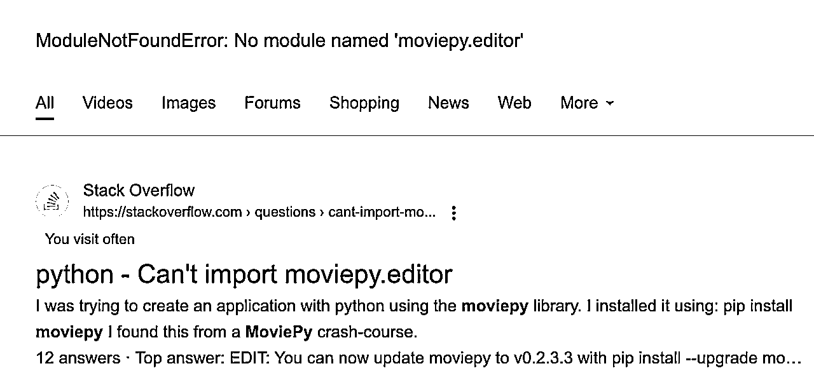

里面讲的正是“换一种方式放盐”——也就是说有其他的引入写法。我看到一条相对较新的回答，照着它改了代码：

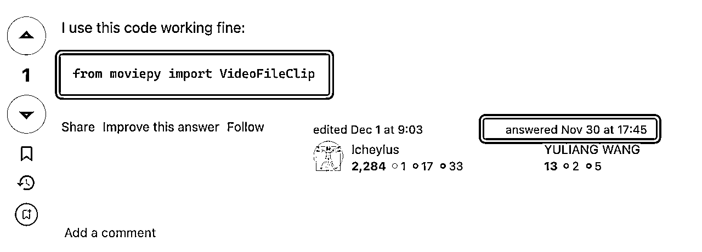

嘿，真不报错了！

不过大家别高兴太早，新错误接踵而至：

## 三、酱油也丢了？


```
AttributeError: 'AudioFileClip' object has no attribute 'subclip'
```

这回报的是找不到subclip了，这不就是酱油不见了吗？

我：大哥，酱油也找不到了！（subclip运行不了）

Cursor一脸认真地告诉我：哦，这很正常，它改名叫生抽了，你把subclip换成set_duration就行。

我换成set_duration，又报错。再问它。

Cursor又说：哦，其实它不叫生抽，还是叫酱油，你换回subclip吧。

我快崩溃了：拜托，酱油和生抽都没了啊！

它依然淡定：那就继续用酱油呗，subclip没问题。

我：

来，看看当时对话记录：

第一次，它让我把subclip改成set_duration：


改完照样报错，第二次问，它又让我改回subclip：


第三次问，我跟它强调subclip和set_duration都不存在，它还是让我用subclip：


## 四、谷哥，这次连酱油也没了

好吧，Cursor这位大哥明显是“失忆”了。我再次召唤谷歌。

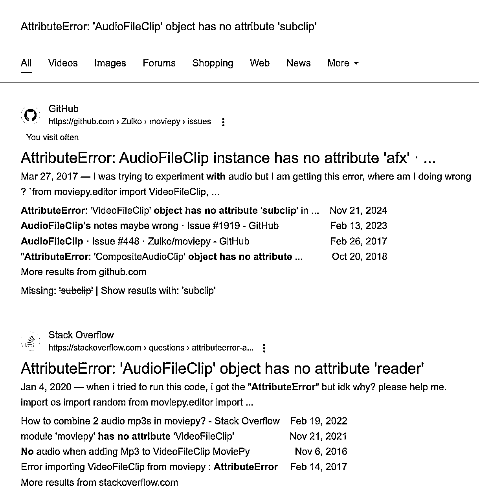

这回没直接精确匹配到subclip的相关结果（不过现在已经有了一条），但是那一页有个重大收获——调料商，也就是moviepy的官方文档。

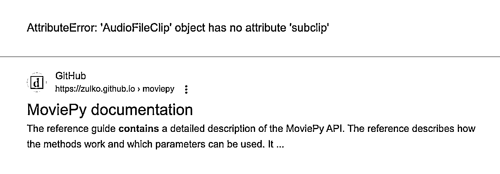

我想官方文档总该有subclip的使用说明吧，于是点开搜索按钮，输入“subclip”。结果没有一条精确命中AudioFileClip.subclip的。

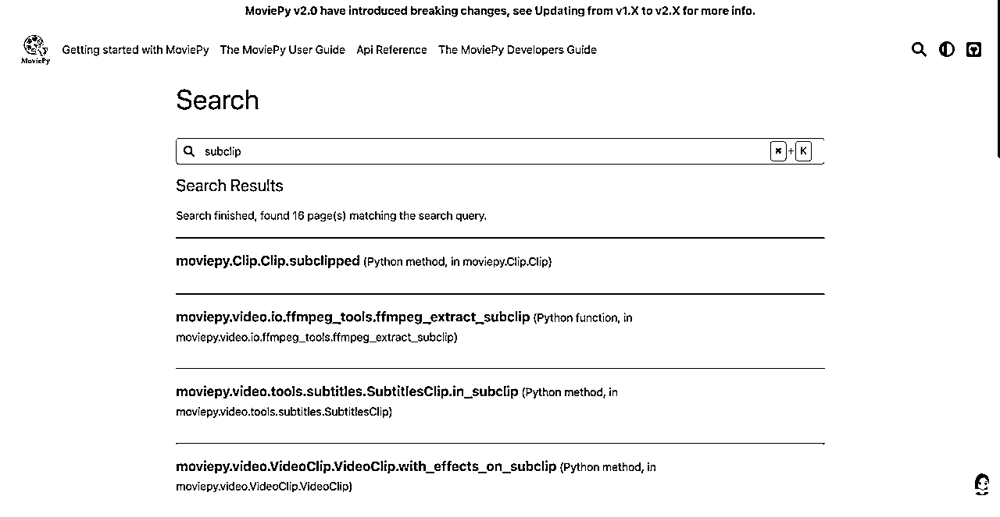

## 五、就不信邪，换个调料行不行？

至此，我已经不想再用moviepy这套“调味品”了。我让Cursor试试别的路子来实现同样的功能：


要是它一把成功，也没后面这些故事了。可现实是，中间依然磕磕绊绊遇到好几个bug，最后做出来的效果也谈不上完美。这时候已经过去将近两个小时，快半夜十二点了。虽然饭还没吃上，但做饭笔记还是得写啊。

写日志的时候，我忍不住回头翻了翻航海手册里教练贴的代码。人家也用了一模一样的盐（moviepy.editor）和一模一样的酱油（subclip），凭什么我的就死活跑不起来？

## 六、盐和酱油其实一直都在，是我眼神不好

还是不死心，我又把调料商的说明书翻了一遍。这回终于看到那个“版本升级”的说明。点进去一看，醍醐灌顶：

新版moviepy里，盐换了摆放位置——不再有moviepy.editor这个模块，官方给出了新的引入方式。酱油也改了名——subclip、set_audio这一系列方法都被重命名了。就这么简单。

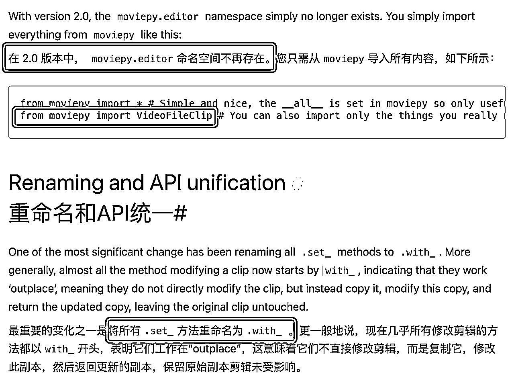

既然根因找到了，解决方案也摆在了桌面上：

方案一：降级。把moviepy换回1.x版本，那里有Cursor大哥熟悉的盐和酱油。

方案二：适配新版。代码写法跟着新版本来，方法更新一下，自己不会改可以让Cursor现学现卖。

第一个方案具体怎么操作，可以直接问AI；第二个方案如果你不会读代码也没关系，让Cursor读一遍文档再动手改就行：


后来我参考官方文档改完，终于能正常跑通了！妈妈，我终于找回了盐和酱油，这顿饭可以吃了！

## 七、复盘一下这顿“饭”

说到底，这次找不到盐和酱油，本质是同一件事：调料商更新了生产配方，老包装上的用法全部作废。而Cursor大哥不知道这个消息，它脑子里装的还是旧版使用手册，所以无论如何逼问，它都只会反复给你旧方案的组合拳——因为它确实不知道新东西长什么样。（moviepy更新版本后做了重构，之前能用的代码在新版里全部失效。可AI模型的知识库更新没那么快，跟不上版本迭代的节奏，我拿着一个它完全没听说过的“新盐罐”去问它，它当然答不上来。）

回看我找盐找酱油的过程，有几个明显的毛病：

### 7.1 不动脑子，只动手

我全程就是条件反射式提问，问Cursor、问谷歌、翻文档，虽然看起来很忙，但全是表面动作。每次只会说“盐不见了”，从不思考“盐为什么会不见”。

如果在Cursor死循环的时候，我换个角度问一句：

“我环境都准备好了，可一直报找不着moviepy.editor，这是为什么？怎么处理？”

```
如果我的环境没有问题，Python版本也正确，相关依赖也都正确安装了，但是仍然报ModuleNotFoundError: No module named 'moviepy.editor'这个错误，可能的原因是什么
```

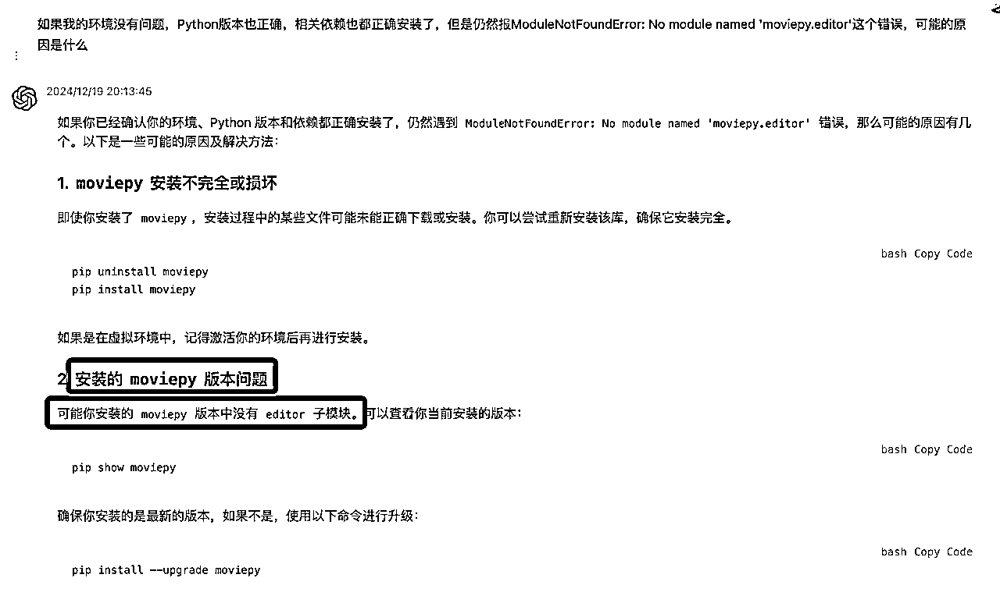

大家看，我截了段GPT3.5的回答。直接甩给它的报错，它一样会原地绕圈。但如果停下来问它“原因是什么”，它给出的理由里就藏着正确答案。

比如，假设moviepy已经正确安装了，那就可以顺着截图里的第二条继续深挖：哪个moviepy版本还带editor？

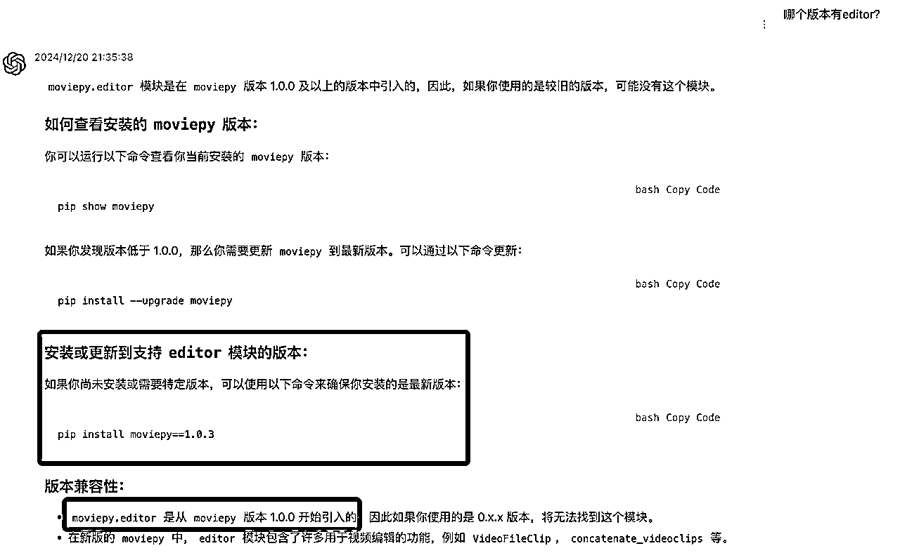

一旦版本对上了，后面subclip找不到的问题也就不会发生了。

### 7.2 阅读不仔细，关键词都从眼前飘过

如果当时我能认真一点，其实好几处早就该看出真相了。

第一次Google“找不到moviepy.editor”的结果里，就明晃晃写着“因为升级，原来的模块不在了”：

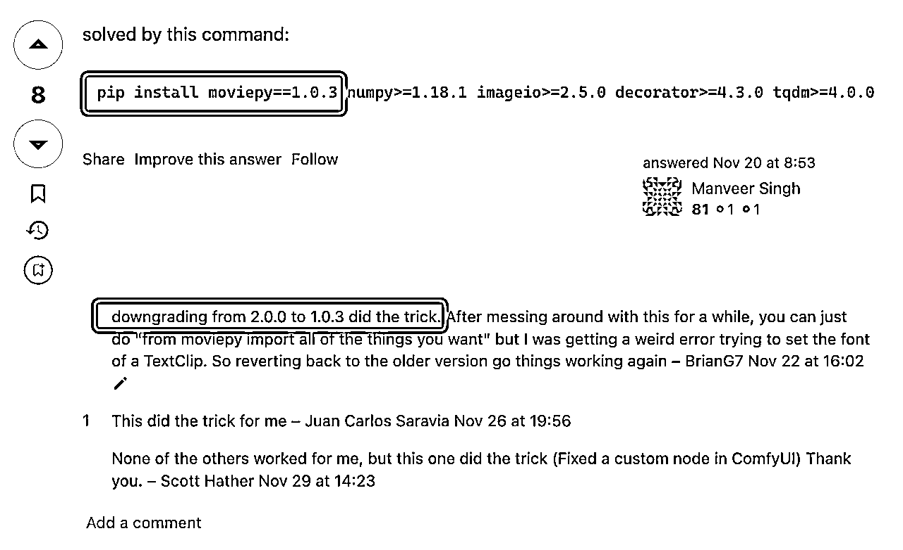

第二次翻官方文档时，只要注意到最上面那一行breaking changes（破坏性变更）的提示，或者点进那个跟subclip长得很像的subclipped页面，就会发现subclipped正是subclip的新名字——酱油改名成了生抽，用法还是一样的：

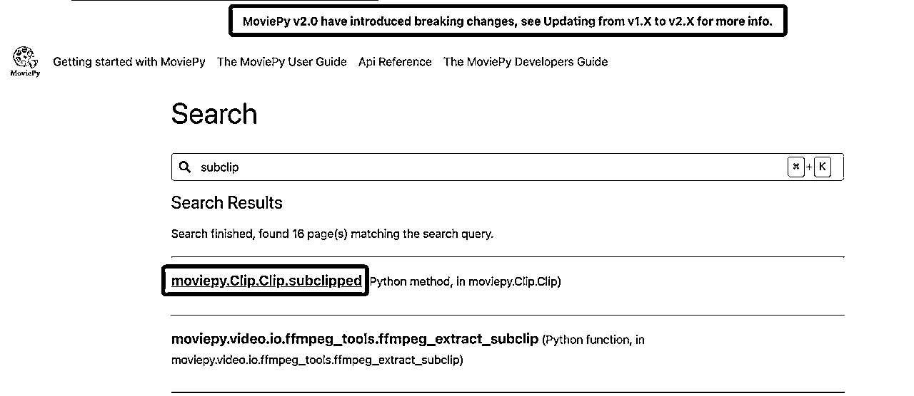

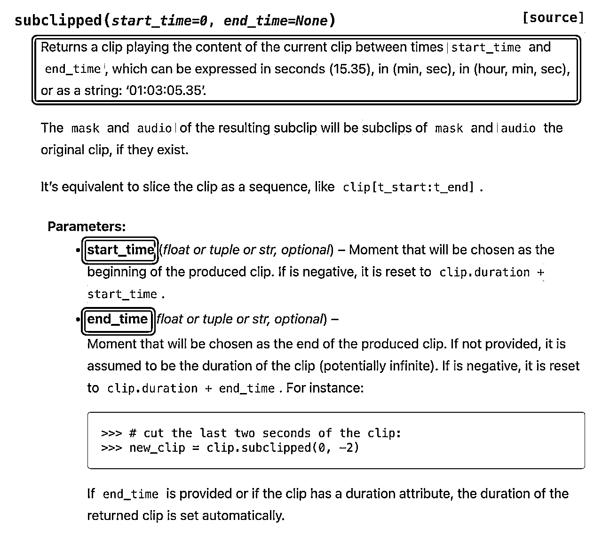

### 7.3 几个Cursor小窍门

顺带给大家安利几个实用功能：

- @Web：让Cursor联网搜索实时信息来解决问题。
- @链接：直接把某个链接丢给它，让它去读对应内容。
- @Docs：可以添加文档库。里面有一些预设的文档，也能自己新增，比如把moviepy的文档加进去，之后直接@MoviePy就能引用。


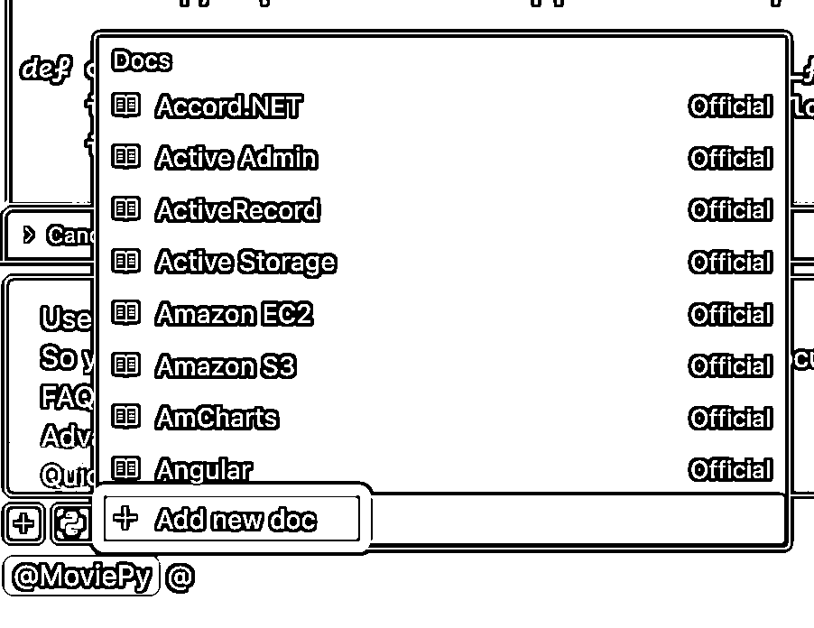


## 八、做饭总结

给同样在跟bug斗智斗勇的朋友们画个重点。遇到那种有明确报错信息的bug，可以让Cursor先上场。如果它开始鬼打墙，不妨停下来试试下面几招：

1. 明确告诉它：“我已经按照你的方案做了某某操作，都正常/成功了，但还是报同样的错，可能是什么原因？怎么解决？”
2. 用@Web让它联网搜索答案。
3. 用@Codebase，如果问题不是单一的，让它结合整个项目上下文来思考。
4. 借助其他GPT、谷歌、官方文档做补充检索。谷歌很值得多用，你的问题大概率前人踩过坑，Stack Overflow和对应GitHub仓库的Issues里很可能就有现成答案。官方文档也别放过，比如这次遇到的editor、subclip，都能在里面找到说明。如果确定某个链接或某篇文档能解决问题，直接让Cursor @链接或通过@Docs把文档加进来学。
5. 让它换一个完全不同的实现方案来达成同样需求。
6. 别忘了咱们航海群里还有一大帮伙伴，去群里提问！当然，提问前先搜关键词，看看是不是已经有人问过、答过了。
7. 实在不行还可以场外求助懂行的朋友，或者在Stack Overflow以及GitHub对应仓库的Issues里发帖，比如moviepy的仓库地址是：https://github.com/Zulko/moviepy/issues

以上就是我这次的分享。谢谢大家！