# 两个月涨粉2000+，📕新手入局全攻略

哈喽，赚钱的朋友们，我是jennies。白天做跨境电商，业余时间还有一个身份——盖洛普优势教练（初级）。

十月份，我兴致勃勃地开始了📕之旅，目标就是给副业引流。结果呢？还没摸到门道，就先被禁言了整整30天。11月10日我重新起号，到现在粉丝突破了2000，其中从赚钱来的朋友占了1000多。更意外的是，还接了一单商单，GMV160元。说实话，有点小开心。

下面进入正题，我会分两大块来聊：新手怎么快速上手📕，以及进阶时容易踩的难点。

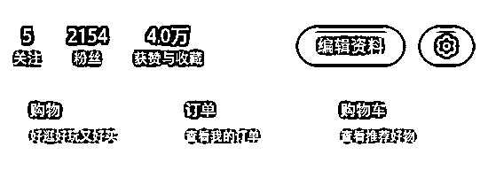

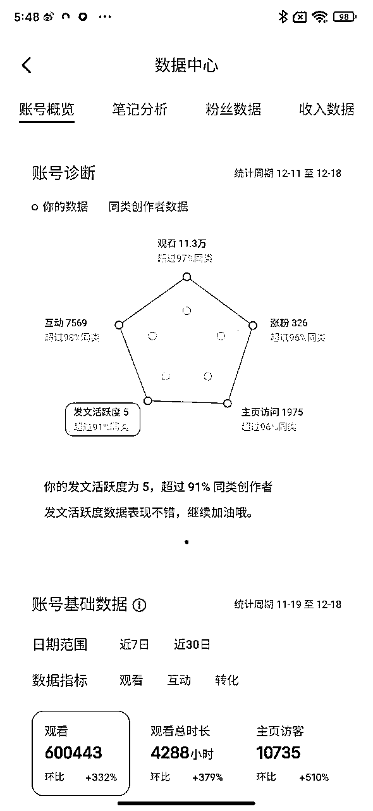

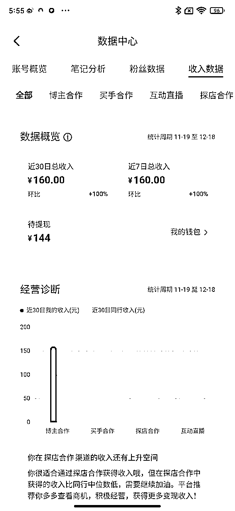

如果早点加入赚钱，我可能会少走很多弯路。作为一个J人，我把做📕这件事拆成了清晰的框架，其实每天的航海打卡就已经在帮我们拆解了。

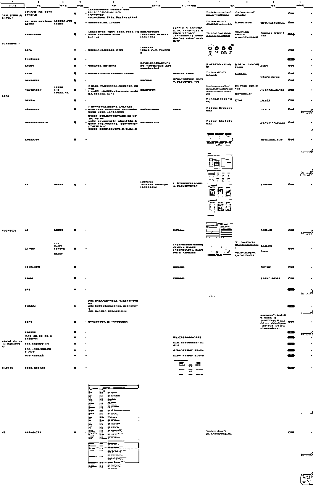

简化一下，就变成了下面这几步。

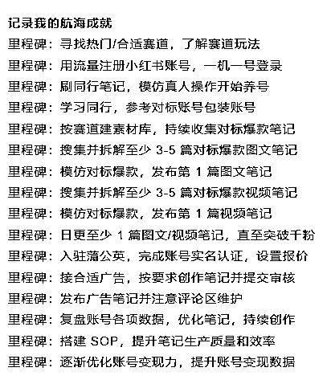

## 新手如何快速起号？

### 第一步：挑一个适合自己的赛道

我之前卡在这一步很久，在“喜欢”“擅长”“商业价值”之间反复纠结。当时列了三个方向：游泳运动、教练教育、职场。后来参考了梨云的方法，去新红的数据排行榜上看了看，结合她推荐的赛道，最终锁定了职场方向。

### 第二步：找对标账号

赛道定了，接下来要找几个“参照物”。我搜集了大量信息后，给自己定了几个筛选标准：

1. 我打算只做图文，所以找的账号必须是图文类型——必选项
2. 近30天涨粉超过2000——加分项
3. 粉丝量在1000到1万之间——必选项
4. 近30天有持续更新——必选项
5. 笔记总数不超过50篇——必选项

这样筛选的原因，说白了就两条：一是自己够得着，二是不至于太遥不可及。具体来说：

- 做图文是因为我平时事情多，做视频太耗心力，怕坚持不下去。
- 短期涨粉快，说明方法可以借鉴。
- 为什么不选10万粉的大号？因为那种大概率是团队在运营，我更想对标自己能产出的水平。
- 📕的热点变得很快，那种一周能火的内容，通常时效性很强。

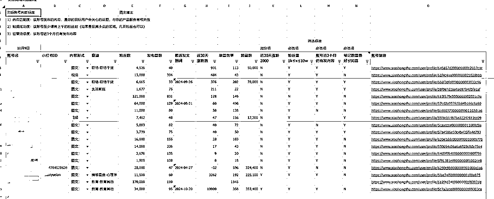

这些数据最好用新红、灰豚或者爬虫工具来弄，效率高得多。别问我怎么知道的，我第一次是手动copy的，虽然费时间，但让我对账号命名有了不少感悟——为什么别人叫这个名字？有什么好处？后来我自己取名字也借鉴了这个思路。塞翁失马，焉知非福。

### 第三步：找优质对标笔记

对标笔记的核心原则是：跟上平台的口味。平台为什么给你流量？它会推什么样的笔记？

有一点特别好，📕对素人很友好，不管你是0粉还是百万大V，只要你的笔记符合用户和平台的需求，爆款的概率是平等的。

那什么样的笔记才算“好笔记”？这个问题很关键，因为我们要找出来模仿，然后写出自己第一篇有希望出数据的笔记。

作为新手，一开始对“用户喜欢什么”没有体感，那就直接从数据下手。📕给笔记流量的算法其实不复杂：

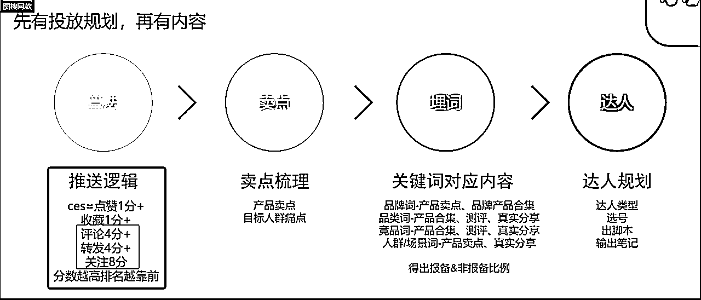

只需要在职场赛道输入关键词，把笔记的点赞、收藏、评论、转发、粉丝数都记下来，作为爆款筛选器。然后按评分从高到低排个序，优先看最靠前的笔记。评分公式如下：

CES=点赞数+收藏数+评论数*4+转发数*4+单篇笔记涨粉数*8

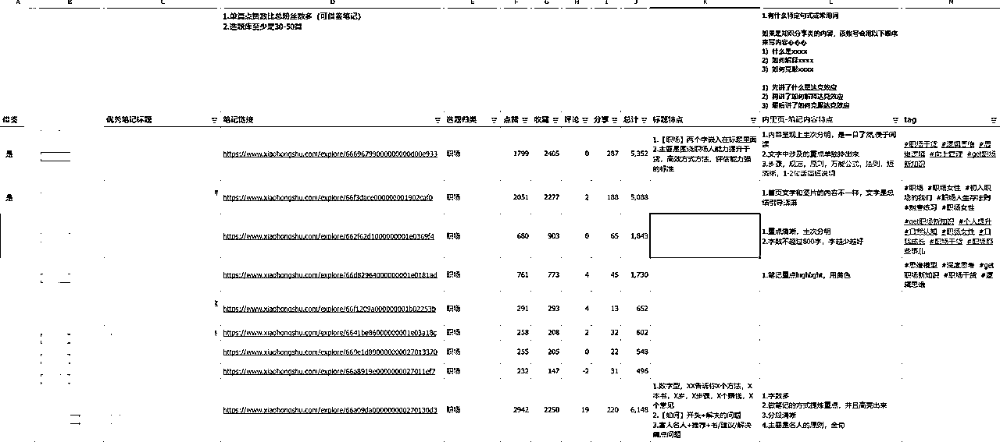

等你发的笔记足够多了，其实不用这么麻烦，翻两下账号你就知道哪篇值得模仿了。

### 第四步：拆解对标笔记

拆解笔记是为了什么？为了发一篇不违规、并且能被用户和平台喜欢的笔记。

一篇完整的笔记要有哪些要素？选题、标题、内容结构、封面设计、标签（稳定标签+热门标签）。

拆解内容对新人来说确实有点难，这时候可以用AI辅助。我自己一般先自己分析，所以具体技巧就不污染大家了，AI还没那么成熟。

标签我当时用的是梨云的标签分析法，做了一个挺严密的筛选：把筛选出来的笔记标签数据复制下来，关键词搜索量代表需求，再结合标签在笔记中出现的频次，作为筛选标准。

【标题】【内容结构】

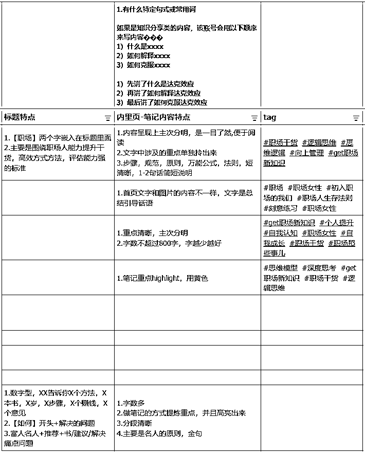

【封面设计】

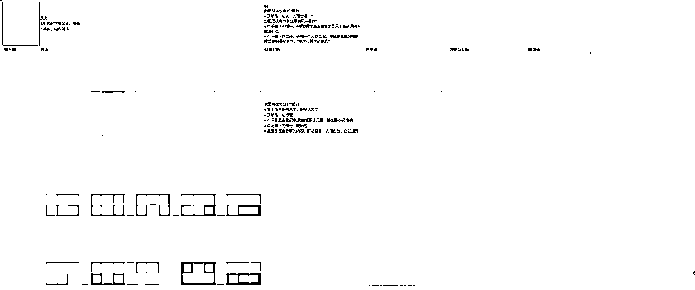

【标签】

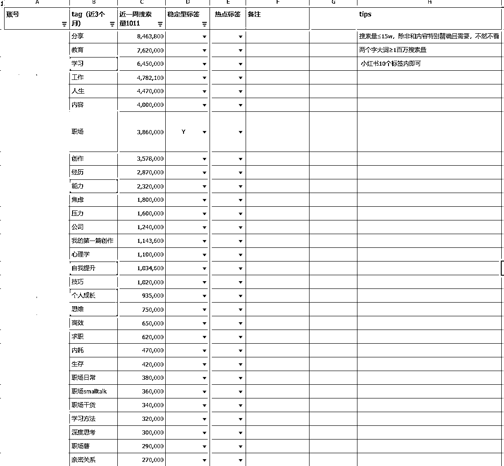

### 第五步：写内容、做封面、发布

#### 1. 内容怎么写

新手还没形成自己的内容能力之前，我比较推荐AI辅助。我常用kimi生成初稿，然后自己改写。

当时我用的标题prompt大概是这样的：

设定角色是世界一流的文案大师，擅长📕标题；背景是告诉他一些方法论；任务是给指定主题生成标题。方法论包括：用数字凸显价值、体现实用性、突出卖点等等。我会把主题告诉它，让它按方法各生成几条标题。

内容方面，找到对标笔记后，可以对kimi说：“请根据这篇笔记的行文结构，仿写同样的内容，但改变文字，多使用emoji和序号，具有📕爆款笔记特点，且口语化。”

说白了我就是个搬运工，AI出初稿，我再改动。

#### 2. 封面和里页

我用的是搞定设计，其实最稳妥的方法是直接“借鉴”持续爆款的账号封面，因为那是被市场验证过的，比如梨云的绿色系封面，哈哈。

不过我当时有点执着，不想和别人一样，就在搞定设计里找了自己喜欢的风格，测试了三四次才定下来。说实话，效率不高，不推荐大家这么干。

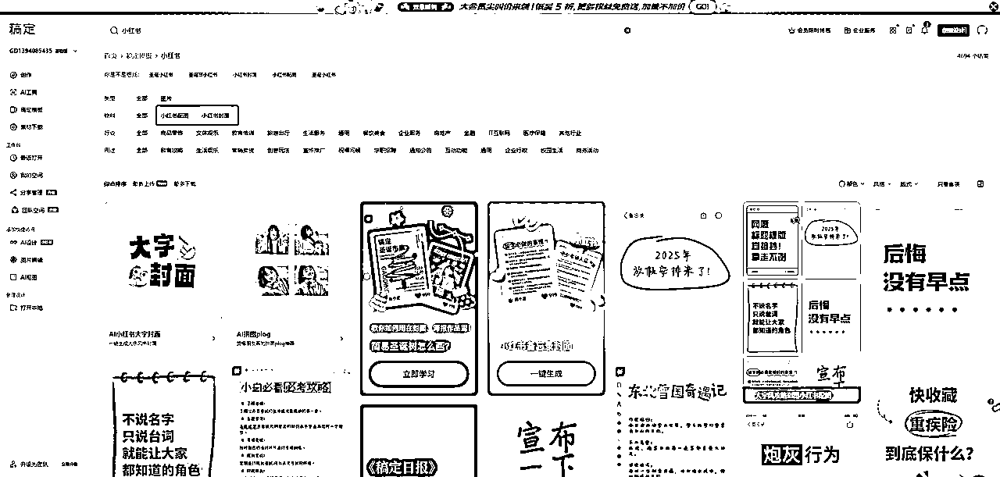

#### 3. 发布前一定要检查

还记得开头我说的禁言30天吗？不是内容不好，而是踩了平台的规则，损害了平台的利益，自己还不知道，容易自我怀疑然后放弃。

所以最后一步很重要：检查自己的内容是否合规。

把文案放到违禁词网站里查一查，有问题就改。我用下来觉得好用的顺序是：句无忧>易句网>零克。工具只是辅助，不是📕的核心。

### 第六步：怎么判断笔记好坏？

优化一定得先知道问题在哪，以上是📕给优化笔记的参考标准：

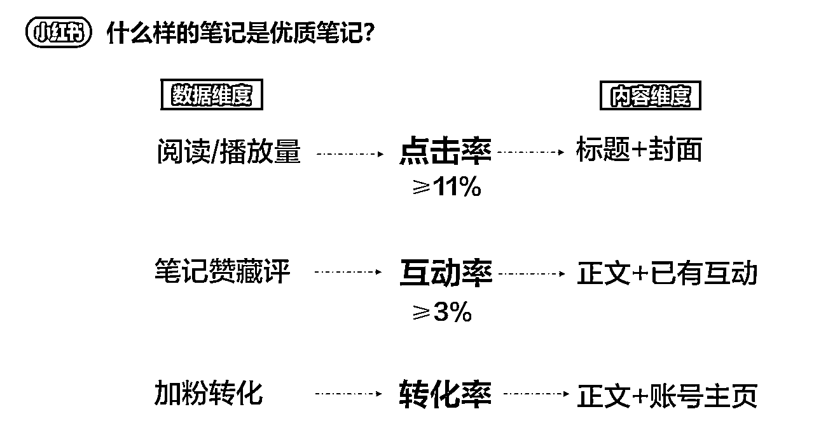

### 第七步：拆解账号四件套

笔记稳定更新，0到1就完成了一大步。那粉丝为什么要关注你？总要给个理由，让别人知道能从你主页获得什么价值。

所以主页装潢很重要，也就是头像、账号名、背景、简介四件套。怎么拆解？

1. 账号定位是否符合你的定位？
2. 目标用户群和你预期的一致吗？
3. 账号名是否简洁，一眼就能看出是做什么的？比如“职场话题汇”。
4. 头像有没有表达出你想表达的东西？
5. 简介里的引流方式是否清晰？

其实新手也不用搞这么复杂，在笔记还没有正反馈之前，这些都可以先放着。

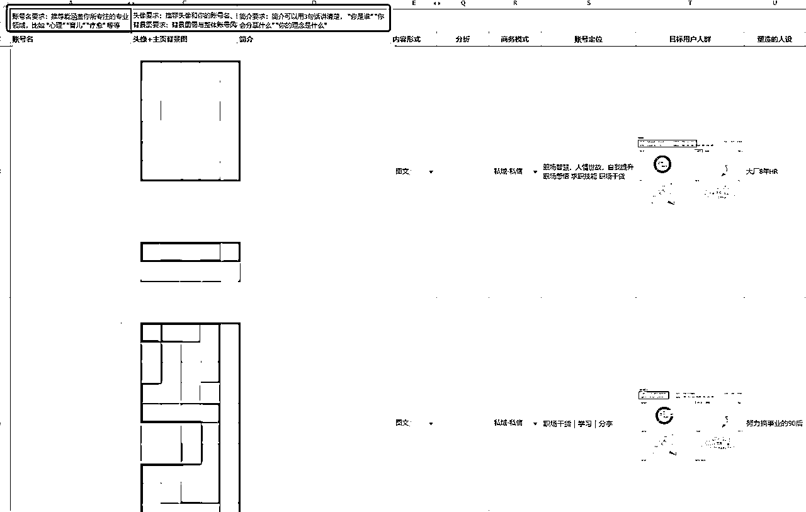

### 第八步：输出自己的账号四件套

账号名要求：最好涵盖你专注的领域，比如“心理”“育儿”“疗愈”等。

头像要求：和账号名、封面、内页风格一致。

背景图：与整体风格统一，可以选暗一点的。

简介：用三句话讲清楚“你是谁”“你会分享什么”“你的理念是什么”。

把拆解结果结合自己的回答，就能输出属于你的四件套了。

## 进阶：从新手到熟手的几个关键认知

### 平台红线不能碰

千万别把链接、二维码放进笔记里。我的账号就是因为这个被限流、禁言30天。

其实我知道不能这么做，但当时是无意的。我发了一篇“AI秒出思维导图”的笔记，结果被判违规。我一看急了，就把知识星球里做的笔记截图当申诉材料，结果反而判罚更重——罪魁祸首是截图底部有知识星球的二维码，我自己都没注意到。

1. 事后再申诉有用吗？我试了，没用。
2. 那时我想到喜欢的博主也被封过，心态上产生了共鸣。真的，永远要让自己有得选。我马上把小号装修好，继续测试。
3. 站在平台立场，这个行为完全可以理解。以后小心就是了，千万别冲动做事。

### 自媒体人，永远要准时出摊

📕真正比拼的，是持续输出。很多看似深度飞跃的事，其实是量还没积累够。

发几篇没数据，就觉得自己不行？时间不够，上班太累，惰性来了？选题不会、内容不会、拆解不会？做视频和图文门槛高，做起来太消耗？

如果连一周3-5篇都保证不了，那怎么把账号做起来呢？

出摊这件事，对自媒体人来说太关键了。每一次出摊，都是在用户面前多露一次脸，这个回报是相当确定的。只要你坚持准时出摊，能力就会一点一点往上走，只增不减。爆款只能去博概率，但出摊是爆款的前提。那么，你准备好每天准时出摊了吗？

### 基本功才是核心

两个月的真实感受是：重要的事只有两件——一是在📕上做什么（方向），二是怎么写好内容。

刚开始我恨不得把每一步都吃透，做什么tag分析、研究笔记评分标准……结果每步都花了很多精力，这其实是战略上的懒惰，用战术上的勤奋来掩盖。

你适不适合做📕，能不能长期做，能不能得到正反馈？前提都是你先发起来。赚钱里内容这么好，先做起来就是成功的第一步。不清楚好内容长什么样？那就去找对标，你才找几个就说不合适？

连梨云这样的大佬，都每天至少花2小时刷选题、翻评论区、分析用户需求。所以内容的基本功就是：持续打磨自己的内容。

我自己到现在觉得难的不是发笔记，而是进阶。进阶意味着我发出的每一篇笔记，都清楚满足了粉丝什么需求，用他们喜欢的方式呈现，并且知道它触发了人性的哪个点。这里借用梨云精华帖的一部分做个示范：

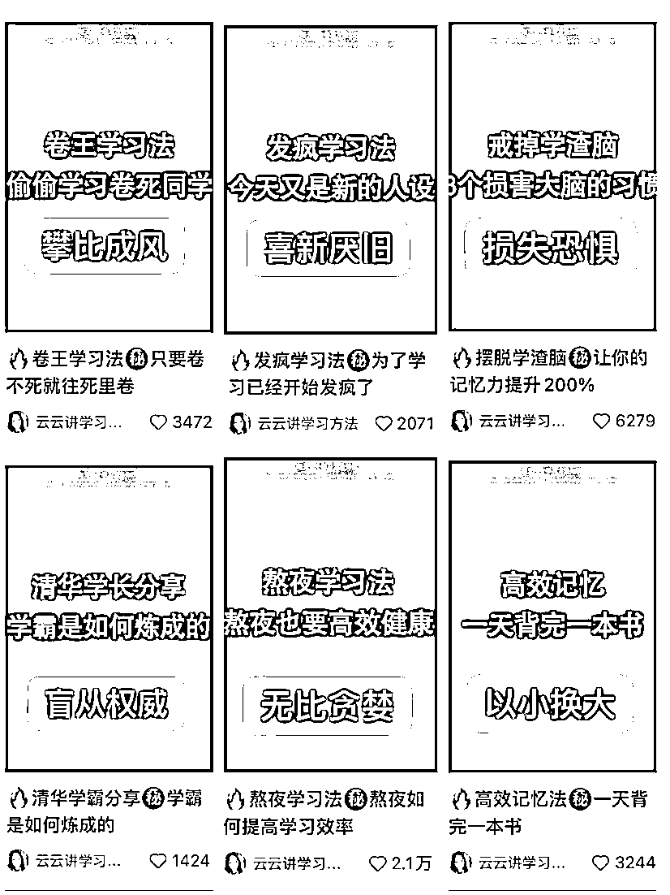

虽然我也有过数据不错的笔记，但那更像是运气，不像是长在身上的能力，还不能稳定输出。没关系，慢慢来，虽远必达。

### 选赛道需要耐心，允许自己换

从10月到现在，我的赛道换过两次。现在做的并不是职场赛道，而是因为一次意外，仿写别人的选题，结果小爆了一下，才转变过来的。

所以别死磕一个赛道。你以为你擅长的，可能和实际根本不是一回事。

赛道好，跟你有什么关系？赛道不好，你就挣不到钱了吗？合适，才是你持续做下去的正反馈和动力。

赛道也不是一开始就能计划对的。你能带走的是做📕的能力，无论以后做哪个赛道，都有能力hold住。这才是做📕的意义——永远保有选择的权利。

——END——

分享结束。从10月到现在快两个月，我的粉丝增长算是中规中矩，一个半月涨了2000。不过我之前的目标是一个月1000，来赚钱还接了个商单，整体还算满意。

大家也加油吧，有些“成功”虽远必达，只要还在牌桌上，就永远有机会。咱们得有这张门票。

感谢带我入门的领队十月、星星，还有漫漫教练的点评。今天是冬至，祝大家冬至快乐！