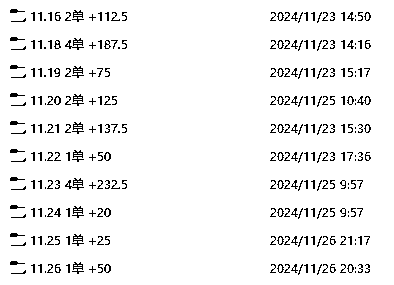
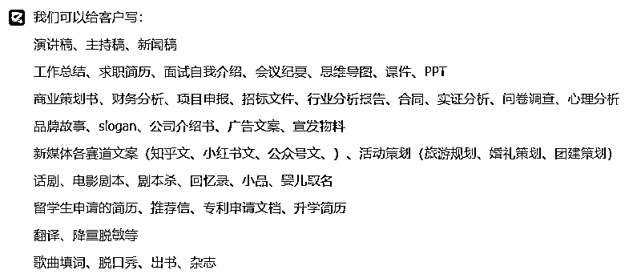
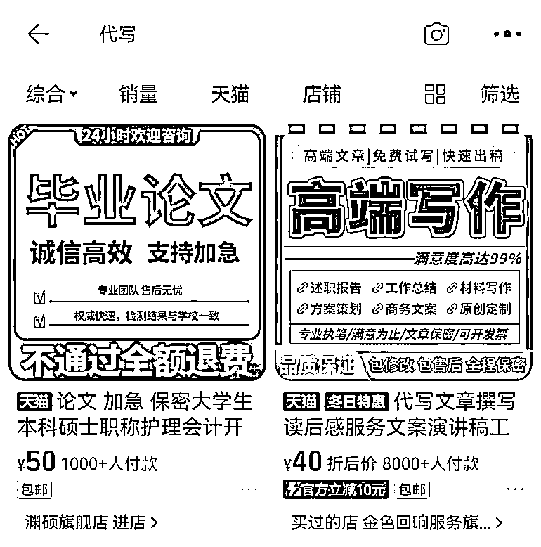
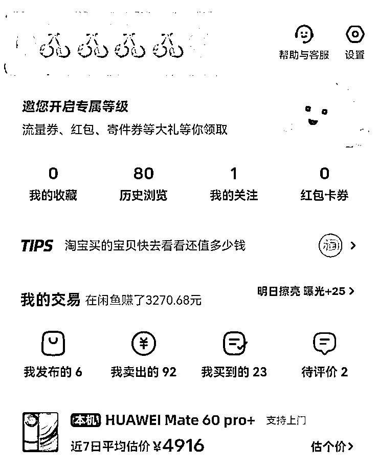
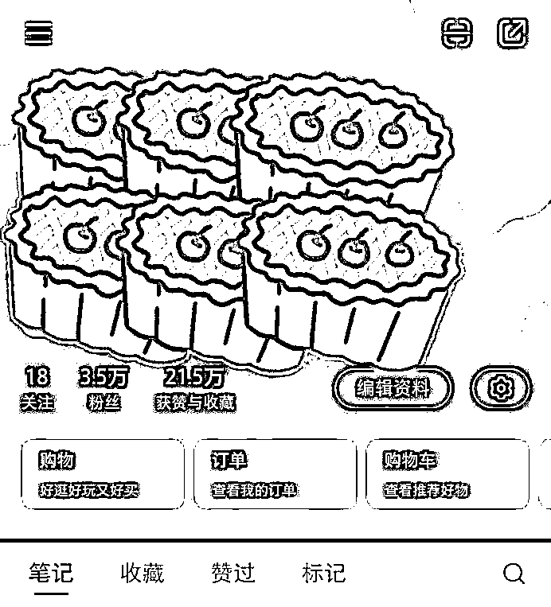

# 【AI写作】普通人上手最快的AI变现路径

# 先说结果，再讲过程

先放一张我自己从零起步做AI代写的实拍收入图，说实话我之前完全没基础。

很多人卡在第一步，不知道怎么开始。今天就把我这段时间的实操流程拆开讲清楚。

# 第一步：先玩熟AI工具，别一上来就接单

想做代写，最基础的就是要会用工具。国内现在可选的AI写作模型很多，比如Kimi、豆包、元宝这些，都不用翻墙就能用，和ChatGPT、Claude比起来更接地气，用着也顺手。

#### Kimi：写小红书笔记、做PPT、整理新闻稿这类内容很在行

#### 豆包：脚本创作、活动方案、商业计划书这类需求适配度高

#### 元宝：思维导图、读后感、行业分析报告处理得不错

工具没有绝对的好坏，看你后续要服务哪类客户。先自己上手练练手，演讲稿、读后感、简历优化、新媒体稿、PPT大纲这些都可以用AI先跑一遍，形成手感。

# 第二步：选对赛道，决定你能赚多少

赛道选错了，再努力也赚不到钱。这个选择直接决定了你的天花板。

如果还没方向，可以先从下面这几个常见赛道试水，找到自己擅长的再深耕，效率会高很多。

#### PPT：客单价区间大概在10到10000+，创业人群需求最大

#### 微课：客单价大概在50到10000+，主要是培训老师在找

#### 论文：客单价大概在200到10000+，学生群体是主力

演讲稿、作业、读后感、思维导图这些也都有稳定需求。

我的建议是避开那种人人都能做的低门槛单，因为竞争太激烈，价格会被压到很低。

# 第三步：选一个能拿到单子的平台

渠道就是你的现金流入口，现在能接单的地方不少。

最常见的是淘宝、闲鱼、小红书，别的像抖音、B站、快手、视频号也完全可以做，前提是会做内容引流。

#### 淘宝：挂靠店铺接单为主

玩法很简单，搜代写关键词，进一家店找客服说想应聘，一般下第一单就会被拉进工作群，单费后面还会退回来。

好处是不用自己拉流量，单子稳定在群里发。缺点是抽成高，通常只剩20%-25%的利润，比如一个300元的PPT，到手大概60-75元，剩下的归店铺。

#### 闲鱼：自己发帖自己接

直接在闲鱼上挂接单信息，模仿同行的标题和图文，定好价放上去等曝光。自己全流程操盘，不用分钱给平台方，但谈单、议价、交付、售后都要自己来，工作量大，利润相对高。只是现在改版后流量没以前好，而且来闲鱼的客户普遍更计较价格。

#### 小红书：靠内容换信任再变现

发一些代写相关的干货、聊天记录截图、转账截图，营造出你写得好的专业感，有需求的人自然会来私信。

优点是做起来后不用分佣，还能招人帮你写，你负责接单和控流，慢慢就能做成工作室。缺点是需要一定的内容运营和涨粉能力。

# 第四步：是做安稳的副业，还是做放大的事业

完成前面三步，你就已经能跑通一个闭环了。接下来要想的是：是就这样稳定做下去，还是把规模做大。

我自己接触AI写作也就半个月，经验有限，下面纯属个人思路。

#### 安稳路线：精细化接单

继续提升写作和AI使用能力，往客单价更高、门槛更高的行业钻。稳定下来月入大几千没问题，认真打磨的话月入过万也并非遥不可及。

#### 放大路线：做团队做流量

把闲鱼或小红书的流量做起来，淘宝模式也能放大。找到持续有代写需求的人群，提供更专业的服务，组建自己的写手团队和引流团队，在细分领域持续深耕。

# 最后一句

AI从爆发到现在也就一年多点的时间，已经孵化出成百上千种变现方式了。虽然不一定最后都会转行做写作，但多了解AI怎么用，绝对能让你在职场和副业上都更有优势。

感谢看到这里，有问题欢迎评论区交流~

想了解更多AI项目，关注公众号【小梦Ai玩家】，回复“3”加我微信，一起聊聊更多玩法。