# 小黄书一夜暴粉？三个号各涨1万粉，公众号还借势吸了1000+粉，我的网易小蜜蜂实操复盘

> 原文来源：https://gvxw3bca93.feishu.cn/docx/UiRfdc3uFoKkoHxEJ4Fc05mPnJf

大家好，我是拓荒，写了七年游戏代码的程序员，目前在深圳某上市游戏公司做高级开发。混迹生财有术快四年，平时没事就刷精华帖、看风向标，总想着给35岁的自己找条后路。结果东搞搞西搞搞，没什么拿得出手的。直到这次刷到小蜜蜂项目，再加上身边有个执行力爆表的朋友推了一把，才终于跑通了一个小项目。

这是我第一次在生财发帖，写得不够清楚的地方，大家多多包涵。

先说下背景。12月初我在风向标里看到网易上线了一款叫“小蜜蜂”的APP，江湖人称“小黄书”。第一眼看到它的界面，从频道标签到个人主页，再到消息中心图标，我差点以为自己打开了小红书——相似度高达95%？不对，应该叫“简直一模一样”。

就是它，网易小蜜蜂，别名小黄书。

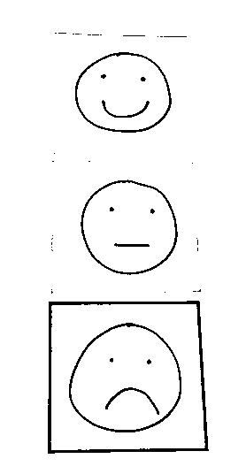

好家伙，小红书上一个小红书，现在又来个小黄书，以后是不是还有小绿书？红绿灯都能凑一桌了。

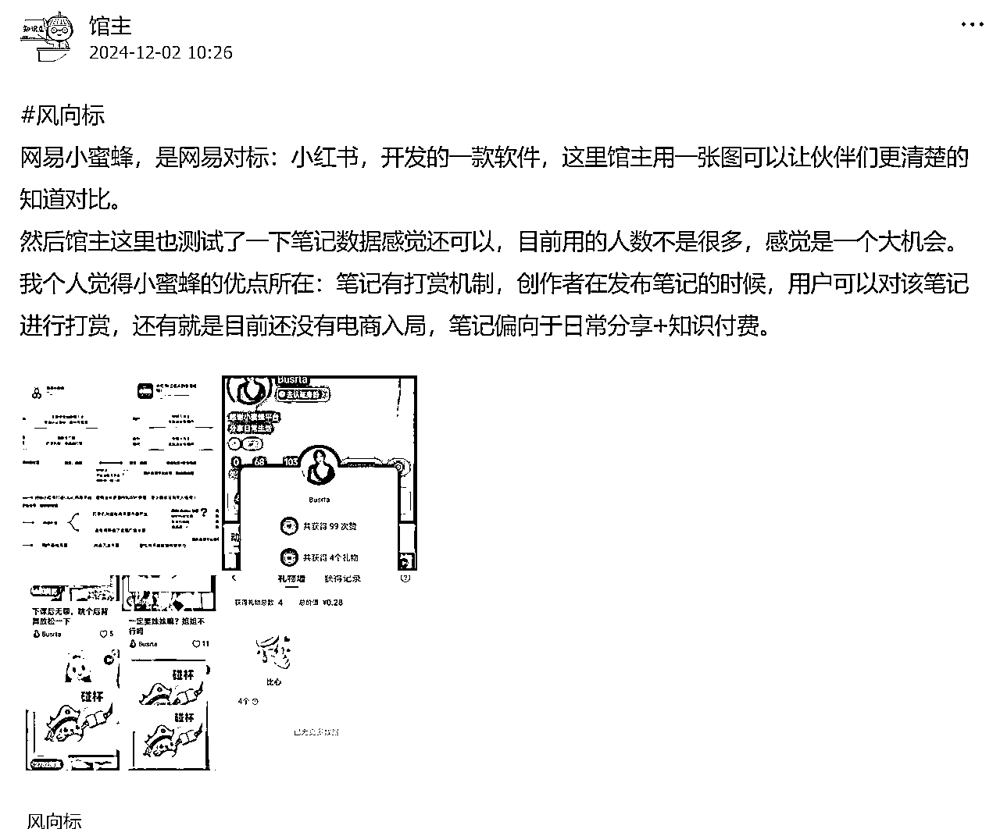

说白了，大厂盯上了小红书的市场，想分一块蛋糕。这种时候，咱们普通人能没点想法吗？

### 重生之我在小黄书当大V

干就完了。

---

## 一、项目经过

查了下，这个APP是11月下旬才上线的。生财里小红书、小绿书都火过一轮了，现在冒出个“小黄书”，按我的经验，新平台通常都有红利期——不，一定会有红利期。新平台要从小红书抢用户，肯定会给早期玩家一些甜头。

12月4日我把这个信息分享给了朋友，还附了一段我在YouTube Shorts航海里做的视频。

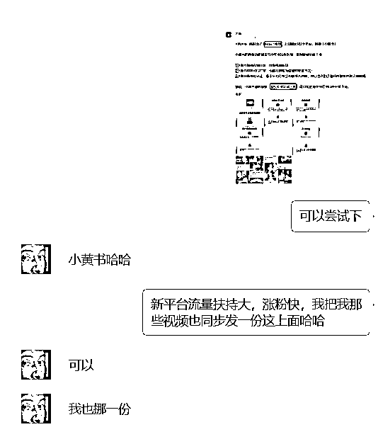

（顺便说一句，截图里那段视频是YouTube Shorts航海时的作品。）

结果呢？分享完我就没放心上，继续折腾我的YouTube Shorts了。差点错过这个风口！幸好我朋友是个善于研究、执行力强得像发了疯的人。

注意，这里距离我给他发消息已经过去了一天。他第二天（12月5日）跑来我家，说是找我玩，结果手机插着充电线，人就站在那儿疯狂点点点，一个劲儿进群、跟人互关，然后手动一个个点关注。

我朋友当天的状态，只能用“癫狂”来形容。

原因很简单：刚起步的小蜜蜂，平台还没什么监管规则，完全是蛮荒时代。涌进来的用户全都疯了似的互相点关注、点赞，就为了攒粉丝、攒流量。多年来在“小红书”里憋的怨气，全在这儿爆发了。

嘭~chua~

小黄书里各种互关互助群满天飞，大家见群就进，见人就关。真是一片勃勃生机、万物竞发的景象啊。

这是他当时发给我的截图，你们感受下：

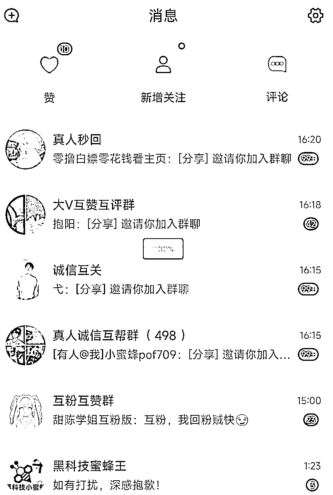

而我呢？还是没当回事。

到了第三天，也就是12月6日，他突然甩给我一张截图：

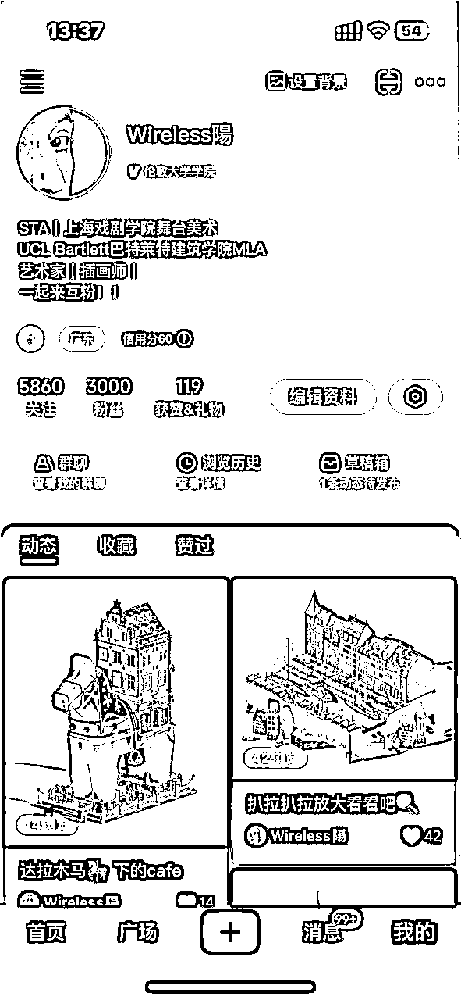

好家伙，3000粉达成！全靠手动互关搞出来的。这下我总算清醒了，于是有了下面这段对话：

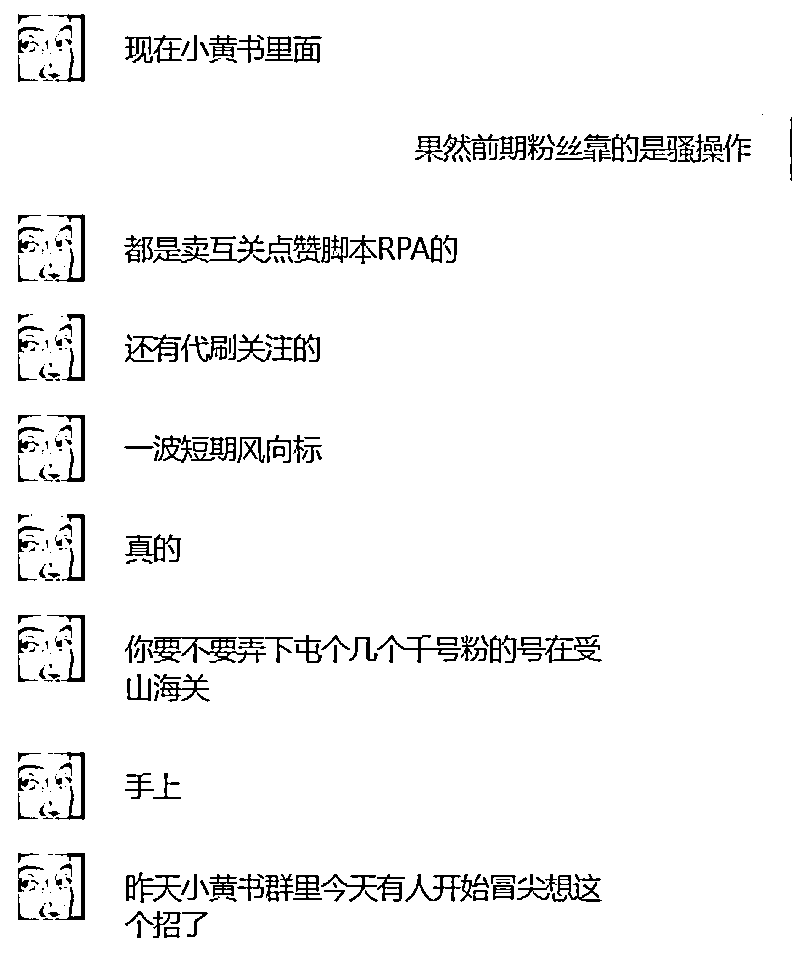

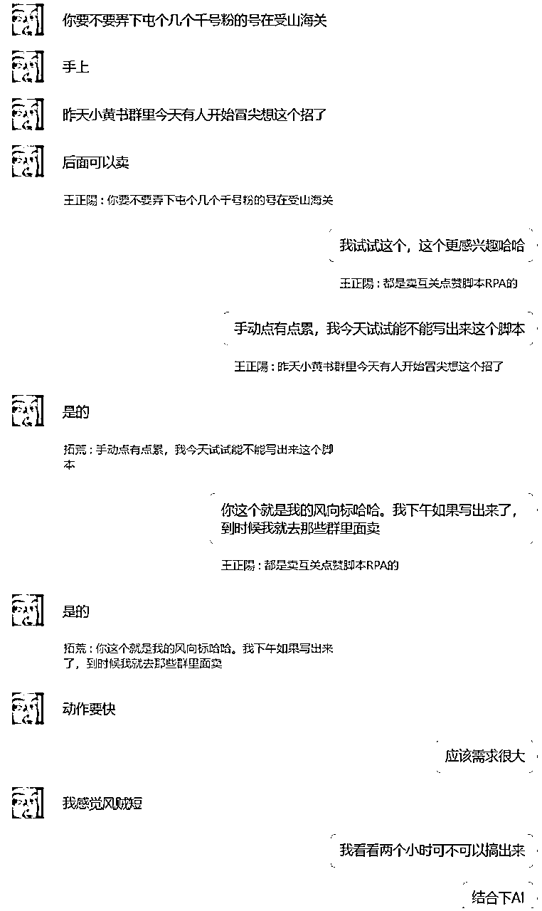

（对了，这次航海我除了YouTube Shorts，还参加了Cursor航海。）

我心想，既然自己会写代码，不如让Cursor给我整个自动点赞关注的脚本。折腾了一阵子，总算搞出来一个能用的，但只能在本地跑，还得连着手机，时不时会卡住，要手动重启。这时候已经过去两小时了！

我想着朋友还在那儿手动点关注，就发消息让他把号给我，我帮他跑脚本，顺便优化。等他回消息的时候，我去微信搜一搜看有没有现成的工具，也看看别人怎么玩的。结果还真让我搜到了不少。

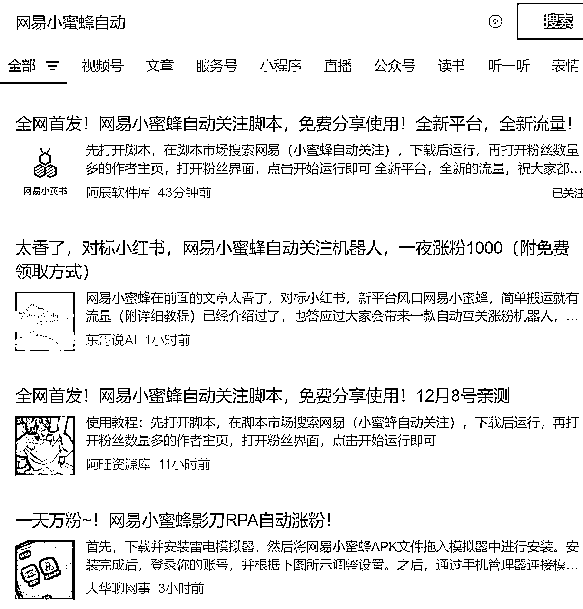

有现成的东西，我还折腾啥？

于是我把每个公众号都关注了一遍，领取并体验了他们的脚本。有用自动精灵做的，也有用RPA技术的，我挨个试了三四个。

结果嘛，要么兼容性差，比如自动精灵那个，不同手机适配不好；要么速度太慢，RPA那个差不多两秒才关注一个，而且个人版一天只能体验十分钟。

嗐，真是便宜没好货。

算了，还是回去继续调我的Cursor脚本吧。又跟Cursor死磕了一个小时（具体的Cursor玩法以后有空再单独写一篇）……

到了下午，我的工具本地已经能稳定跑两小时了。然后就出现了下面这个截图：

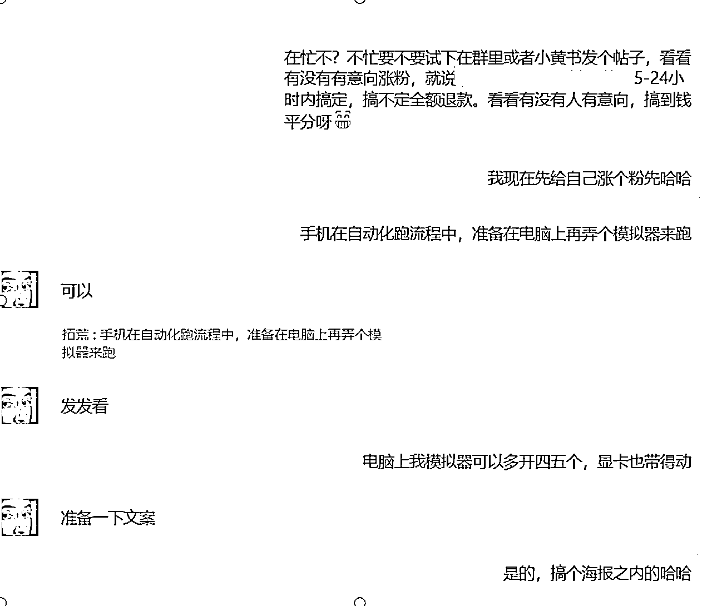

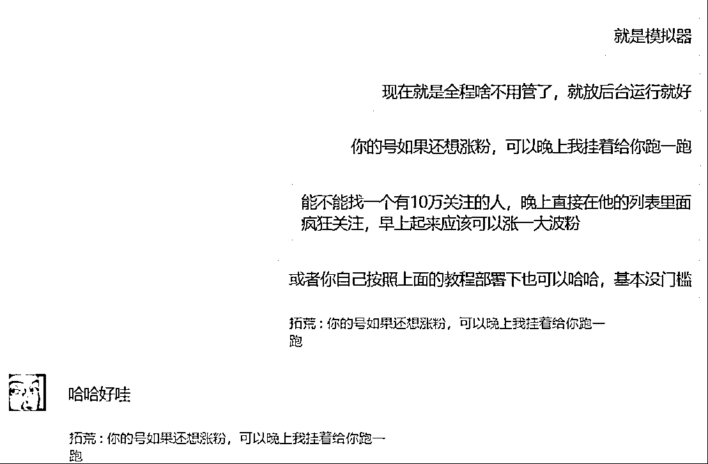

这时候我们的思路是：帮人涨粉，用工具加电脑模拟器多开，朋友还帮我做了个海报宣传：

然后我们疯狂在各大互关群里发海报。与此同时，发现已经有人在做了，下面是两个同行的文案：

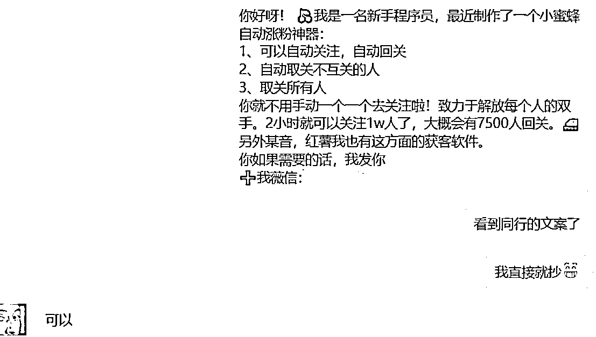

同行就是最好的老师！既然他们的文案有效，我就直接抄！

于是我和朋友抄文案、发海报、往各个群分发，很快就有了正反馈，陆续有人来加好友了。

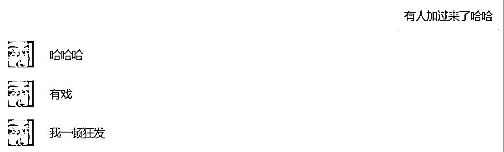

哈哈，贼激动，一切都在变好。

但很快发现一个情况：来加我们的人，都是来求自动关注软件的，而我们原本是想帮人涨粉。需求错位了。

这时候我一边跑自己的插件，一边留意到大V群里有人直接分享软件。

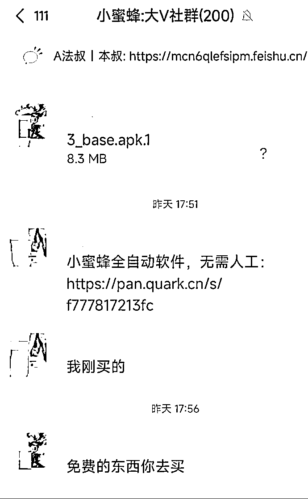

还看到有人是付费买的。我去体验了一下，发现比我用Cursor做的好用多了，已经封装好，自动关注、自动回关、取关未关注的功能都有，速度也快。深度测试几轮后，我跟朋友商量了一下，决定换个打法：

不帮人涨粉了，改成引导加微信，然后再关注公众号，回复关键词送软件安装包。同时自己再多跑几个万粉号备用。

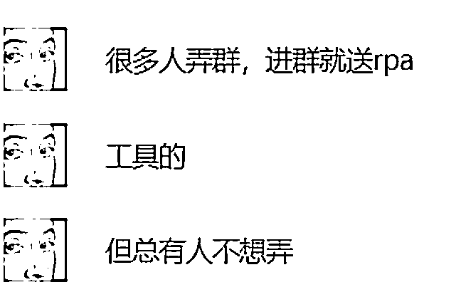

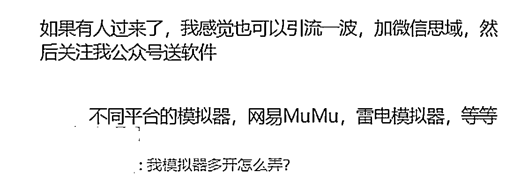

于是，我们的思路变成了：在小蜜蜂互关群里疯狂发海报和文案，吸引有需求的人，先加微信，再引导关注公众号，回复关键词领软件包。

同时，自己的号、家人的号、朋友的号都挂手机或模拟器上跑（苹果手机不支持自动跑，安卓基本三个小时能跑一万关注量，回关至少五千多）。

整体效果还不错。

---

## 二、项目成果

直接上图：

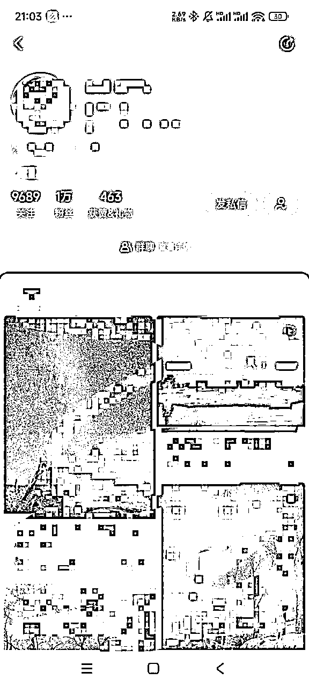

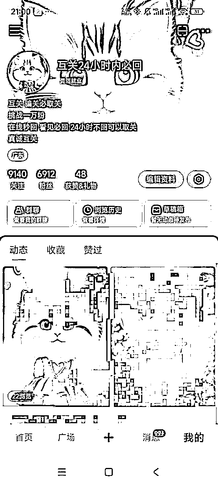

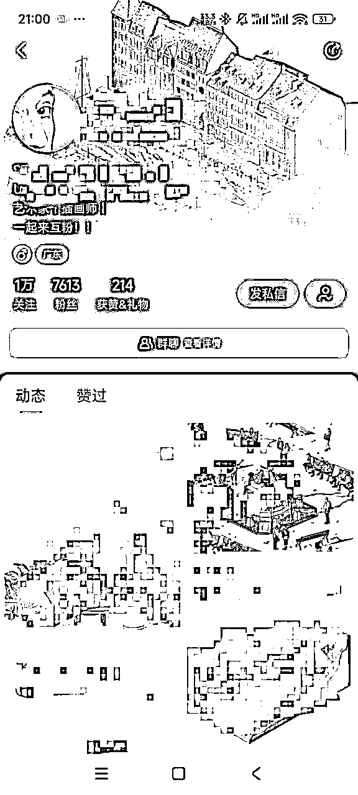

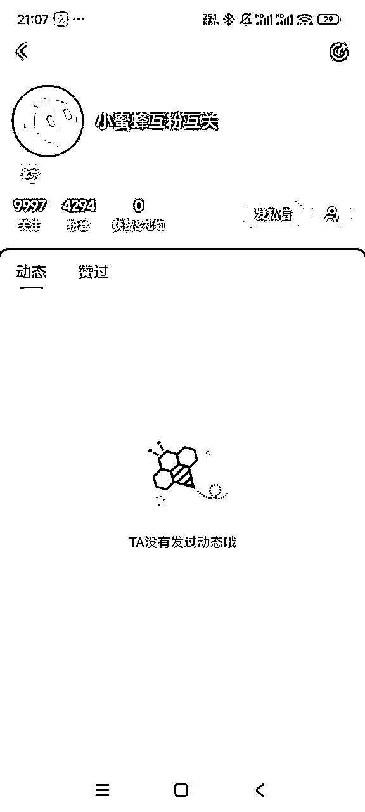

---

## 三、后续风向标思路

到写这篇文章为止，小蜜蜂涨粉还在继续，而且已经出现了付费帮忙涨粉的玩法。下面这张截图是我刚刚（2024年12月8日21:02）刷到的：

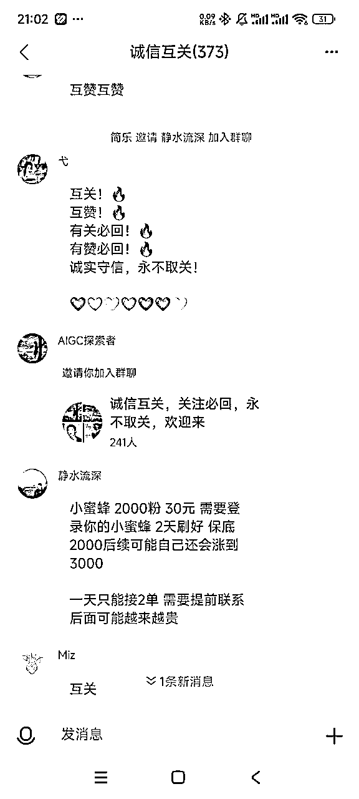

总的来说，小黄书目前还处在初期阶段，大量用户进来还是靠互关、拉群的方式积攒粉丝。有需求就有机会，窗口期还在，但不知道平台什么时候会开始整治。不过，这种几乎零成本的操作，能让自己拿到一个或几个有一定粉丝规模的账号，为将来的生财计划做铺垫，怎么看都不亏。

所以我总结出了三个后续方向：

1. 发帖导流到微信私域，引导关注公众号涨粉；
2. 公众号里放夸克网盘分享软件包，做网盘拉新；
3. 直接操作工具帮人涨粉变现；
4. 剩下的等你补充。

最后，祝大家都能生财有术！

---

## 四、自动关注安装包分享和操作步骤

安卓用户：下载BeeAssist到手机，打开网易小蜜蜂，找一个关注量大的列表，再打开BeeAssist按提示设置就行。具体看视频。

iOS用户：建议电脑上装网易mumu模拟器，然后把小蜜蜂安装包和BeeAssist都装上，操作步骤看视频。

如果有操作问题，直接留言，我来解答。