# 44天涨粉2万+，这份AI自媒体保姆级攻略，我替你整理好了

你好呀，我是云珞。

先汇报一下我的成绩单：第9天，我成了AIP领域的千粉博主；第30天，粉丝破万；第44天，粉丝数超过了两万。

可能你会问，AIP到底是什么？

简单来说，AIP就是“AI自媒体博主”——专门科普AI工具怎么用、能帮你解决什么问题，把AI的效率带给更多人，同时慢慢建立起自己的个人品牌。

做短视频，真的需要一颗“大心脏”。我坚持日更，每一条视频都按爆款的标准去打磨，但最终爆不爆，还是看平台、看观众的脸色。我能做的，就是尽自己最大的努力。运气好时，一条视频能带来几千粉；就算不爆，每天也能稳定涨个几十、几百粉。

目前我已经接了500元和800元两条商单。这一路，要特别感谢林杰、一木、马克三位老师的指点和帮助。

今天，我把自己做AI自媒体的全套心得整理成了一份“喂饭级”教程，希望能给你带来一些启发。

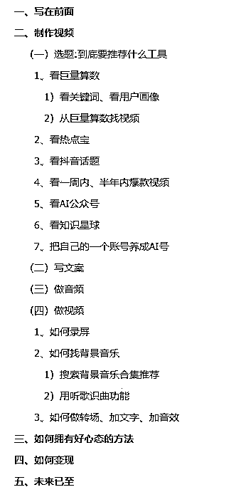

# 一、先聊几句心里话

不管你现在对AIP是感兴趣，还是还没太关注，我都想先说一句：做什么事都急不来，该花的时间一步都不能省。

以前我总听人说“慢慢来，比较快”，但一直没真正做到，心里总想着快点看到结果。直到最近，我才真正体会到了这句话的含义。

刚开始做AI工具视频的时候，我也特别着急。比如做音频时，我没有用自己的声音。

其实我之前学过做游戏解说视频，买了一套两百多块的录音设备，也学过录音，但很快就放弃了。加上后来录过一个短剧教学视频，发现我自己的声音录音时忽大忽小，反复录了好多遍都不理想，最后我直接用了AI克隆声音完成那条视频。

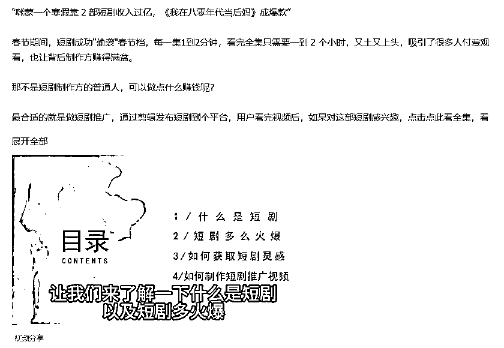

后来我想着，反正短时间内也改不过来，干脆用杰哥推荐的AI声音。

AI生成出来的音频，听起来确实很像真人，但有个问题：需要二次剪辑。

那时候我很赶时间，剪掉停顿的地方时，不看波形，不仔细听，直接找没音波起伏的地方下刀，剪完也不回放检查一下，就这么发出来了。

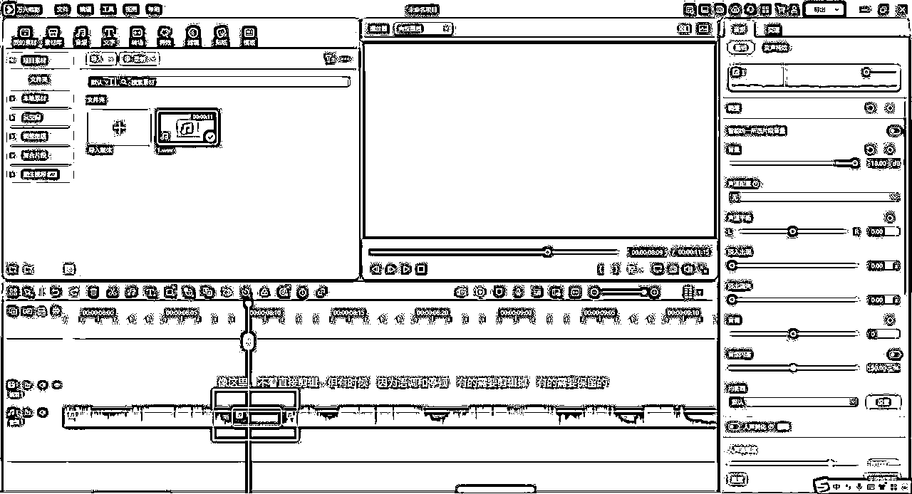

但后来我发现，这样真的不行，成品质量太差了。

现在我剪音频，一定是一边听一边剪，剪完还要从头到尾听一遍。哪里听着不舒服，就重新处理；哪一段实在不行，就重新生成。

有些牺牲，是必须付出的。就像我现在还在上班，早上不想起床，中午也想午休，我真想把日更改成隔日更。但我还是坚持早中晚抽时间剪视频。我把午休时间牺牲了，每天中午赶路去上班都困得不行，但没办法——想有收获，就得花时间换。

我讲这些，是想告诉你：成事从来都不轻松。

最开始，我剪一个1分钟的视频要花7小时，现在4小时就够了。剪30多秒的视频，我只需要1到2小时。速度是真的快了很多。

# 二、一条视频是怎么做出来的

我的流程是这样的：先了解AI工具，再定选题，写文案，做音频，配画面，最后剪成片。

## （一）选题：到底推荐哪个工具？

想做成AI自媒体博主，最难的就是选题。市面上AI工具一大堆，到底该推荐哪个？

我每天会花25分钟到1小时，刷各种AI相关视频，研究最近的爆款，分析他们为什么能火。这样刷着刷着，加上淘到那些好玩又实用的AI工具，选题自然就来了。

刷视频也是有方法的，得有策略。

### 1、用巨量算数

#### 1）看关键词、看用户画像

打开巨量算数（网址：https://trendinsight.oceanengine.com/arithmetic-index），输入AI、AI工具、AI合集、AI排行、AI推荐等关键词。

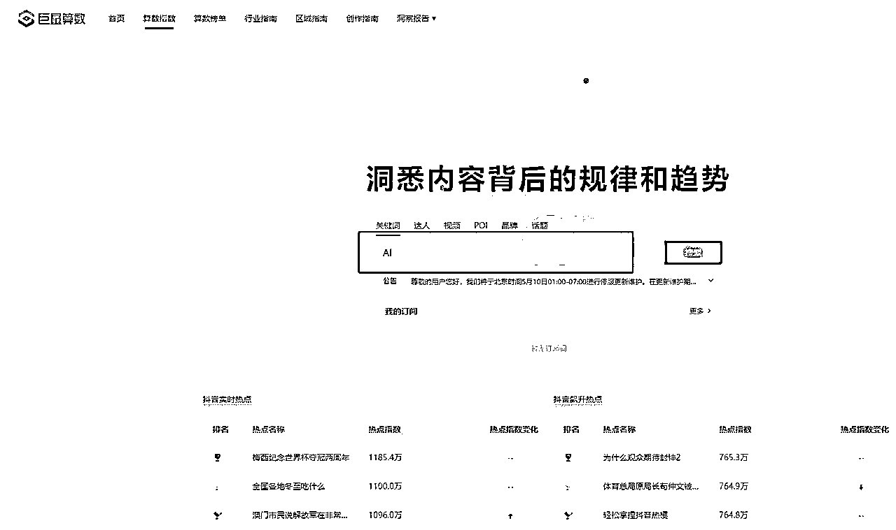

然后看关键词指数、关联分析、人群画像这些板块。

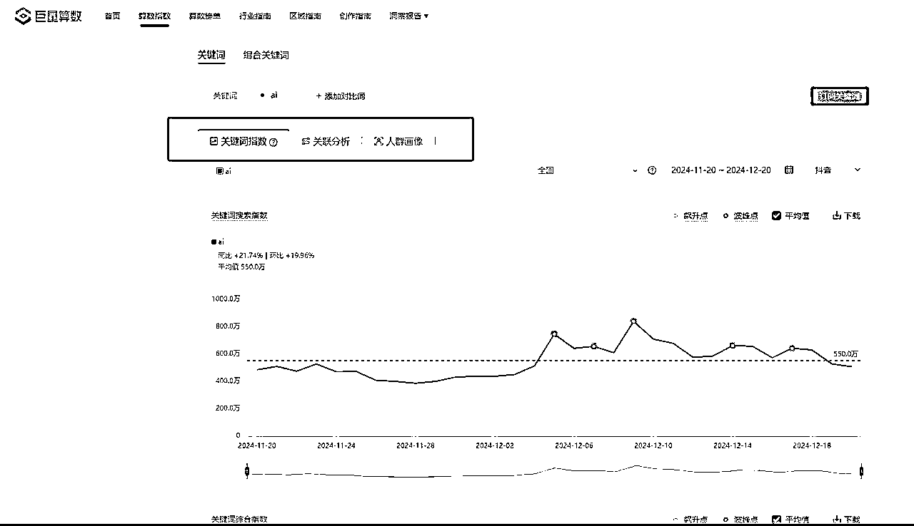

比如关联分析里，有搜索关联词和内容关联词。搜AI的人，也经常搜“rain”，最近“马云”的搜索热度也涨得快。

鼠标放到“马云”的红点上，就能看到很多相关信息，比如“马云：AI带来变革”，就可以去抖音搜索这个内容，了解事情来龙去脉。

点开人群画像，就能看到关心AI的人群集中在哪些区域、年龄和性别分布、他们还有什么兴趣点。有了这些信息，你就可以有针对性地做内容。

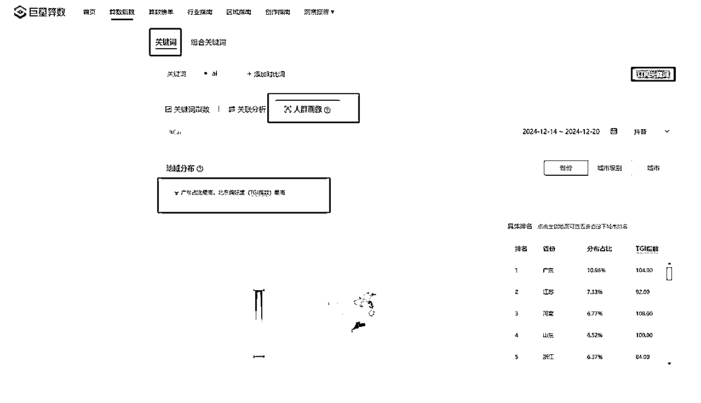

#### 2）从巨量算数找视频

打开巨量算数，点“视频”，输入关键词AI，再点搜索。

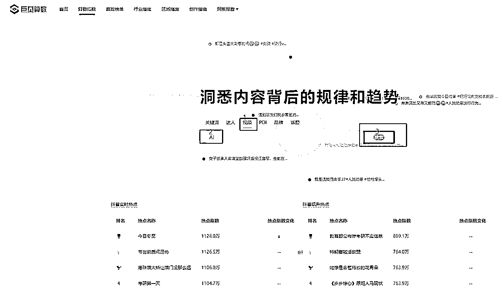

就能看到很多相关视频了。

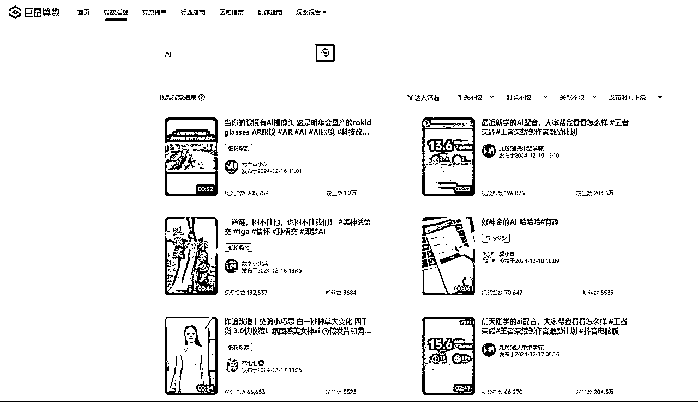

### 2、用热点宝

在抖音搜索“热点宝”，点进去，找到抖音热点——视频，输入AI等关键词搜索，学习素材自然就出来了。

### 3、刷抖音话题

打开抖音搜索AI，点“话题”，再点“立即参与”旁边的空白处，进入话题页面，看看综合、最新、最热、相似话题。

### 4、看爆款视频

在抖音搜AI，点综合，再点那个类似漏斗的图标，选择“最多点赞”和“一周内”，就能看到近期的热门前排。

想看更早的爆款，就把时间改成“半年内”。

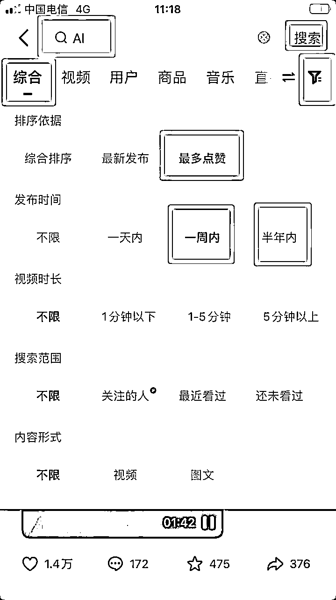

### 5、看AI公众号

在微信搜AI，点“文章”和“最热”，就能看到大量AI相关的好文。喜欢的号主顺手点个关注，以后更新文章你就能第一时间看到。

### 6、看知识星球

如果你加入了付费的AI知识星球，也可以多看看里面的内容。拿龙哥盟举例，网页版（https://scys.com/search?query=zz8LD8ZUnw158c3YZtruXhdFKxvZe1UrHGjKTk964ZoqqbQEpm1N4N2）搜AI，点“精华”和“中标”，就能淘到很多干货。

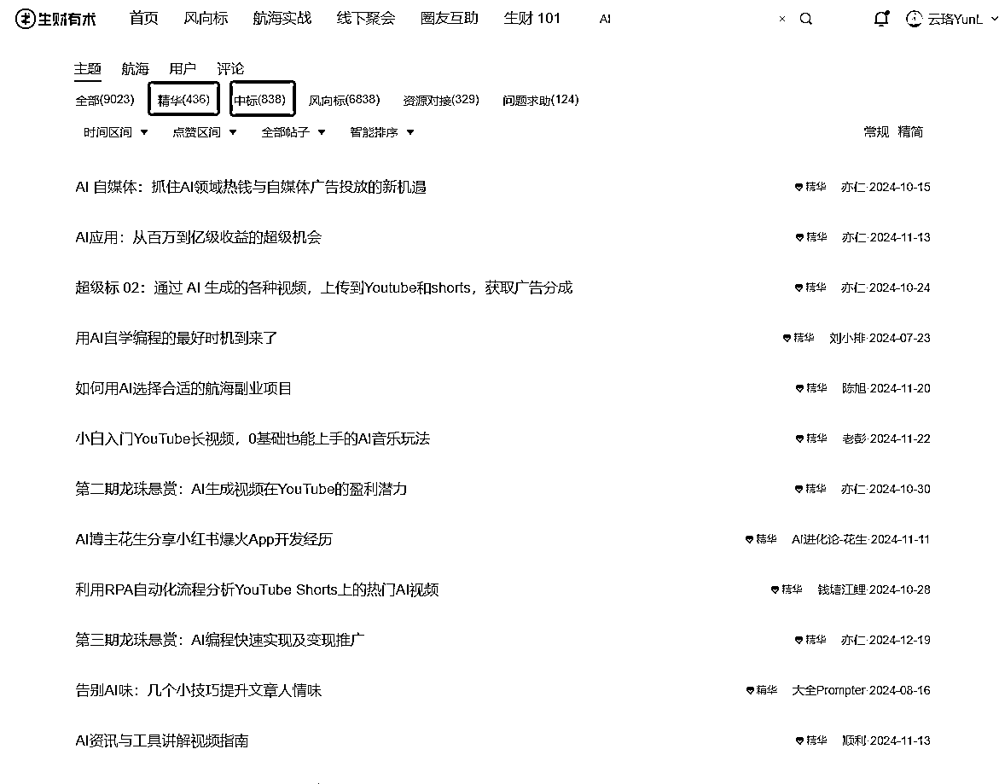

### 7、打造一个“AI号”

你可以专门用一个账号刷AI内容，刷到不相关的视频就长按点“不感兴趣”，这样系统不断优化推荐，你的号就会越刷越“垂直”，刷到的几乎全是AI内容。

## （二）写文案

定了主题之后，写文案是个大工程。早期我一篇稿子要写几千字、改七八遍，才能定下1分多钟的最终稿。

现在熟练了，改个两三遍就行。有时候配完音频后时长缩水，我会再补充内容，重新配一段，凑够1分多钟——因为1分多钟这个赛道的竞争，没有几十秒那么激烈。

当然，我现在也不再死磕时长，有时候不到1分钟也直接发。

具体到内容，我会把要推荐的AI工具从头到尾用一遍，看功能、翻使用手册，亲身体验效果。特别打动我的功能，一定重点讲。

初学时，我会先把所有功能介绍全写下来，再慢慢删减精简。

固定的介绍结构大概是：工具名称+一句话概括亮点+具体介绍1到2个亮点或者怎么用。

如果这个工具是清华等名校出品的，我一定会特意标出来；如果是免费工具，也会在最后顺带说一句。不过如果只是每天有免费额度、用多了要开会员，我就不提“免费”两个字了。

## （三）做音频

AI音频怎么做？我用的是ChatTTS-UI-0.84。

分享文件：ChatTTS-UI-0.84.rar  
链接：https://pan.xunlei.com/s/VOEbJeA_eARqy741Zvg_8D1cA1?pwd=74tz#

下载安装包后打开app，等一会儿就会自动跳出音频生成的浏览器页面。

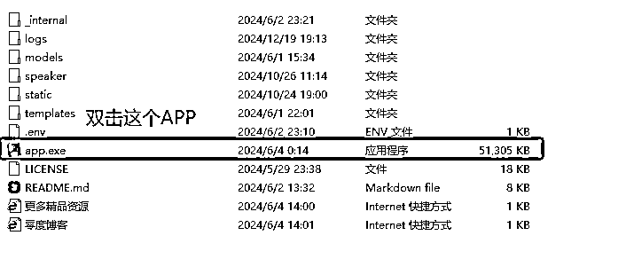

接着选一个你喜欢的音色。

当时为了选出最满意的音色，我生成了一堆音频，花了不少时间。后来发现有个网站可以直接听别人生成的音频，我听了很久很久，才终于敲定了一个。听到最后人都烦躁了——每个声音都好听，差别又不太大，选择困难症都犯了。

选定音色后，每次操作就是输入音色数字、设置参数、输入文字，点“合成声音”。

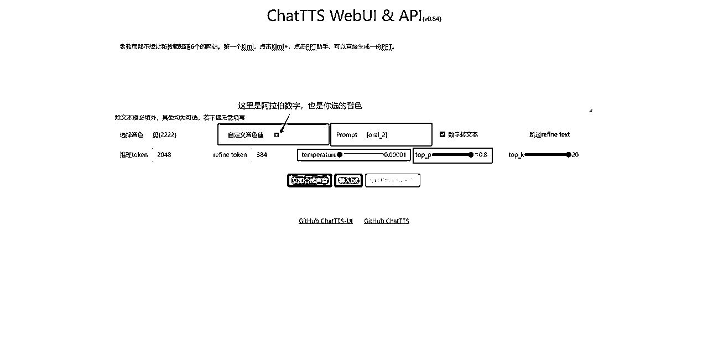

我习惯一次生成50到70个字，再接着做下一句。音频生成后，把没声音的空白段剪掉。

## （四）做视频

音频弄好之后，接下来就是配背景音乐、加录屏画面。画面在写文案的时候就已经构思好了，该转场就加转场，该配文字就配文字，该加音效就加音效。

### 1、怎么录屏

我用的是万兴喵影，开了付费会员。录完屏之后，视频会自动出现在素材库里，非常省事。

分享文件：万兴喵影压缩包.7z  
链接：https://pan.xunlei.com/s/VOEbKMf9t9Ep_CXOFtegokW0A1?pwd=harp#

如果暂时不打算开会员，可以试试Bandicam录屏，我以前用过，挺好用，还能设置自动跟随鼠标录制。

网盘分享：Bandicam录屏.zip  
链接: https://pan.baidu.com/s/1V1h0iGUS7mS26B7y9nS2Mg?pwd=mjei  
提取码: mjei

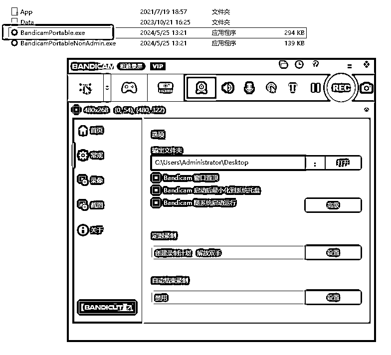

之前我用剪映更多，刚换万兴时不太顺手，但剪多了也就慢慢习惯了。

### 2、怎么找背景音乐

#### 1）搜合集推荐

直接在抖音搜“背景音乐合集推荐”，很多博主会分类整理适合各种场景的BGM。

找到线索后，打开剪映，点“音乐”，搜索歌名，拖到你音频旁边，试听一下整体感觉，看合不合拍。

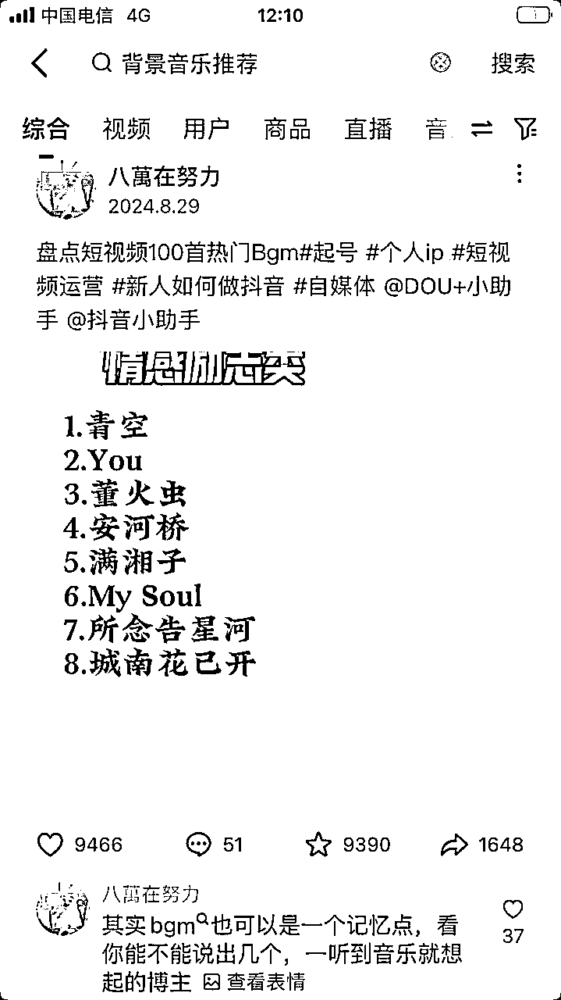

#### 2）用听歌识曲

刷到某条视频的背景音乐特别带感，又不知道歌名，可以用QQ音乐或网易云的“听歌识曲”功能。

以网易云为例：下载网易云App，长按App图标，点击“听歌识曲”，就能直接识别了。

实在识别不出来的，要么放弃，要么直接私信博主问问看。

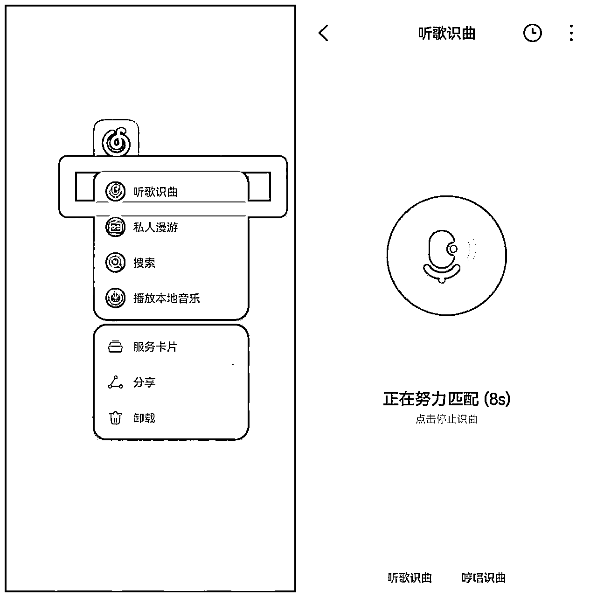

### 3、加转场、文字、音效

打开剪映，点“转场”“文字”“音频-音效”，然后一个个添加进去就行。

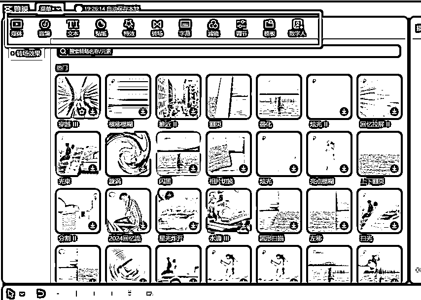

我之前做过一个“短剧去重的20三个方法”的视频，里面就详细讲了怎么操作加转场、文字和音效，你可以参考一下。

# 三、怎么保持好心态？

我做AI自媒体的最重要原因是什么？答案是：这件事没有让我难受的卡点。

做网盘拉新时，号被平台封了让我特别难受。虽然这个项目能赚钱，但那种不封号就能赚大钱、被封了就只能赚点小钱的状态，太折磨人了。或者就是得一直等热点。

做AI代写时，每次都得鼓起勇气主动接单，也让我很难受。

但这两件事，我并不是没做出成绩：网盘拉新我已经8周没弄了，依然每周能进账几百块；AI代写也是，接了两单，交稿第二天钱就到了账。

相比之下，AI自媒体没有任何让我想放弃的点。所以我才能一路坚持更新，每一条视频都按爆款的画质要求自己，发完之后就不再纠结了。

所以，在做AI自媒体之前，你一定想清楚：这件事有没有会让你心理卡壳的地方？如果有，趁早想好对策，别做两天就放弃，最后白白浪费时间。

我目前给自己的要求很简单：一个月能爆一个几万赞的视频就够了。

# 四、怎么变现

当你开始发视频，数据稍微亮眼一点，后台自然就会有广告主来私信，问你要不要接工具推广。这就是最直接的变现方式。

抖音上可以开通星图，小红书能开通蒲公英，视频号也可以开通互选平台，都是正规接广告渠道。

除了接单，还可以做自己的课程，或者帮别人分销产品。

我目前做的是不露脸工具号。当然，如果你有条件真人出镜，我强烈建议你做口播形式的工具号——观众的信任感会强很多，效果也更好，剪辑也会更方便。

拿我接过的一个广告举个实际例子：

我加了商务的微信后，对方特别专业，评估了我两个平台的账号，报了一个500元一口价+合集。我先去体验了他们的产品，试用之后把文案写好发给对方审核，文案通过后，再把剪好的视频发过去。

整个流程非常顺滑，对方要求也不高，视频没有任何修改直接通过，当天发出去后，500块就到账了。

# 五、未来已至

AI能让强者更强，帮我们省下大量时间和精力。哪怕你不打算做AI自媒体博主，多了解一些AI工具，也能实实在在提升工作和生活的效率。

我相当看好AI未来的潜力。这次做AI自媒体，我已经看到了自己未来的希望。希望看到这篇文章的每一个你，也能做起来自己的个人IP，和我一起起飞。

最后，再次感谢林杰、一木、马克三位老师的指导，也感谢读到这里的每一位小伙伴。

大家一起搞钱，冲冲冲！

附上我在龙哥盟的往期作品：

1、手把手教你如何成为小红书小说博主  
https://scys.com/articleDetail/xq_topic/184218548821282

2、我用赚钱教我的方法做短剧  
https://scys.com/articleDetail/xq_topic/584514518515224

往期视频：如何做短剧推广视频  
https://t.zsxq.com/OyV9W