# 四年潜水，写下我的两个千万级K12项目复盘

各位赚钱的朋友大家好，我是十一，目前在深圳做一家教育科技公司，聚焦中小学赛道，公司定位是非学科、非教培，完全不受双减影响。过去几年我们陆续跑出了两个用户量过千万的业务，一个服务的是老师端，一个面向的是家长和学生。

21年入圈到现在快四年了，我基本都在潜水，除了偶尔发点资源对接的帖子。赚钱对我来说就是一个观察新打法的窗口，这里很多前辈的分享对我帮助很大，也结识了几位深度合作的圈友，实打实拿到了成果。

去年我们新开了一条C端业务线，一年多时间从0起步做到千万级用户。玩法丰富，试了分销、知识付费、引流、拉新转付费、社群运营等等，其中一部分已经稳定变现，一部分链路跑通了还没来得及放量。把这些尝试整理一下发出来抛砖引玉，也希望能认识更多有资源、有执行力的伙伴一起把盘子做大。

# 关于公司

我个人是技术出身，所以公司整体风格偏研发：思路清晰、讲究实效、节奏很快。产研能力也得到了多家合作方的认可，年内我们拿下了国家高新技术企业的资质，从官方层面也印证了技术实力。

虽然现在在用户体量和收入上都比起初有了明显提升，但我始终保持创业初期的状态，持续跟圈内圈外的高手交流，寻找新的增长点，绝不闭门造车。很多现在在跑的玩法，都是在赚钱里交流碰撞出来，再落地验证的。

# 关于产品

教师端的产品已经比较成熟，这里就不赘述了，重点聊家长和学生端。前面说了我们有扎实的研发基因，同时为了避开双减的红线，我们从23年初开始切入高效学习工具赛道，面向C端家长陆续上线了6款微信小程序，覆盖语文、数学、英语、学习资料、名师课堂等多个方向。

选择小程序作为主阵地有两点考量：一是使用门槛低，无需下载App，一键打开即可用；二是裂变效率高，小程序天然依附于微信生态，能借助社交关系快速扩散，这也是我们一年内积累上千万用户的核心原因。

🎈产品用户数

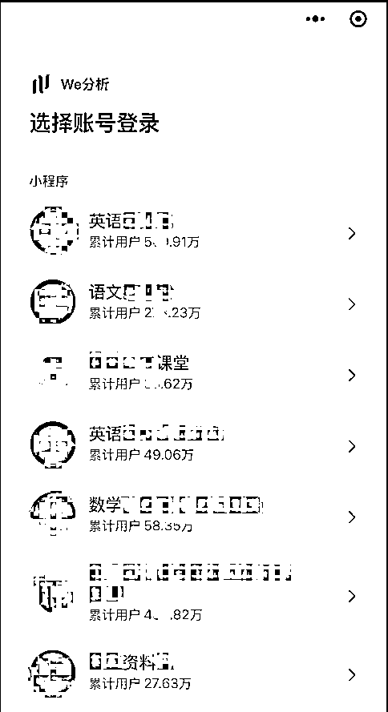

做教育多年，我们一直坚持初心。产品至今没有接入任何第三方广告，也没有开屏广告。身为一个家长，我不希望孩子在学习时被各种无关广告打扰，看到不该看的内容，影响专注和成长。

产品口碑是慢慢打磨出来的很长一段时间内，我们的客服就只有产品总监一个。用户有很多宝贵的反馈，我们持续迭代优化，所以满意度越来越高。

🎈部分用户好评截图

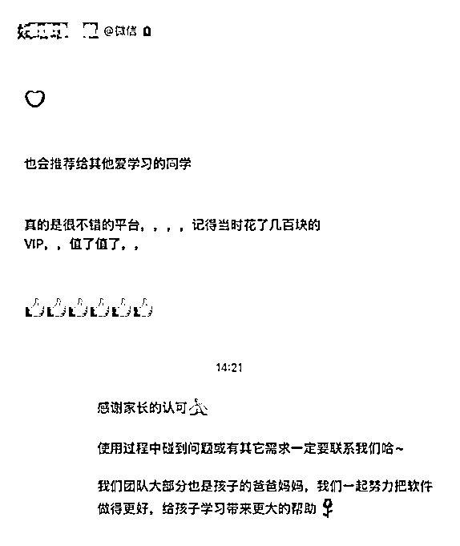

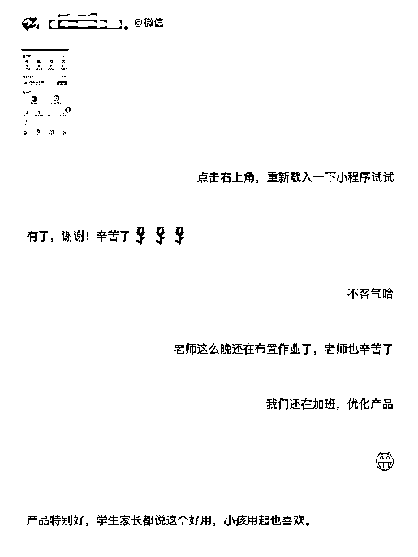

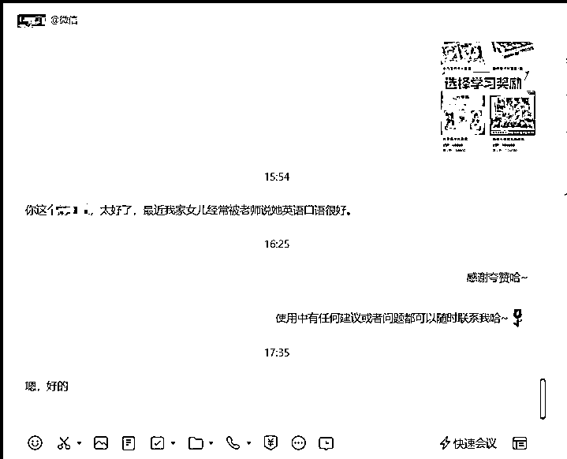

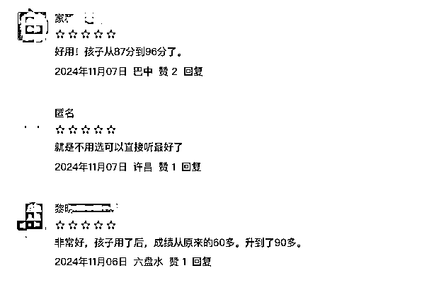

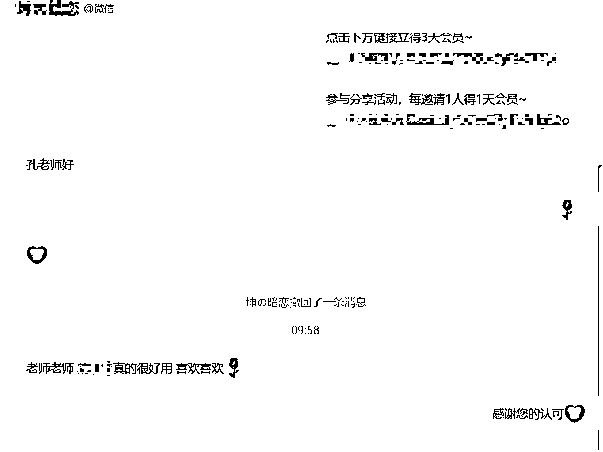

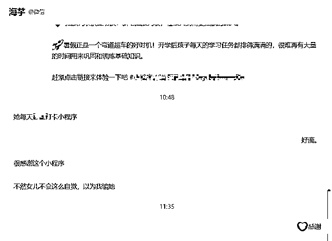

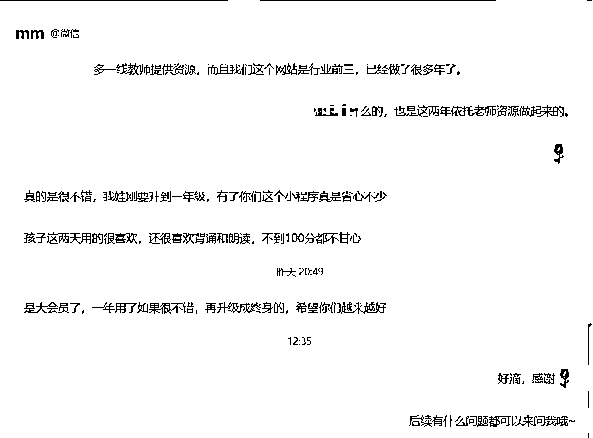

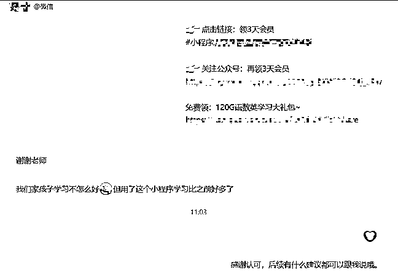

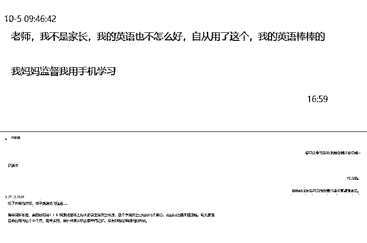

# 关于玩法

产品一上线，我们就自研了一套分销系统，后面提到的所有打法都是在此基础上演化出来的，先把这套系统的底层逻辑说明一下：

一、分销层级：为合规考虑，分销员仅能发展一级下线，下线数量不限。

二、客户归属：分销员开通权限后，可将矩阵中任意小程序的卡片、短链或二维码分享出去，用户点击或扫码进入即自动绑定到该分销员名下。用户在矩阵下任意小程序产生订单，分销员都能拿到佣金。

三、无限裂变：被绑定的客户如果转发给他人，新用户进入同样会绑定到原始分销员名下，层层传递，裂变可以一直延续。我们在分享引导上做了大量优化，目前超过40%的用户有主动分享行为，裂变能力非常强。

## 基础打法

刚开始我们想得很简单，想借助教师端积累的千万老师资源去触达家长，用分销佣金做激励。但实际跑下来效果一般，主要是合规和心态问题：老师职业相对稳定，近年师德监管趋严，大多数不愿冒风险；同时主科老师工作强度大，业余时间有限，能稳定做的老师本就已经有副业，不太愿意尝试新东西。

这条路走不通后，我们直接把门槛拉到最低：素人皆可，无行业限制，无资源要求，有微信就能做。很多人看到这里会问，没流量没资源怎么赚钱？其实每个人都有微信好友，也有加入的群，但这些存量很快就会用完。推荐一款好用的产品给身边的朋友，总不能每天都推吧？发几条朋友圈、群里丢点素材就没了。

这正是我们遇到的第一个瓶颈。团队小伙伴做了各种尝试，后来我从赚钱里找到了方向。

我看到 @华聪 分享的找群渠道文章👉全网精准找群渠道分享，思路一下就打开了。立刻安排测试：半天时间通过微信搜索加了100个群，接下来三天在这些群里分享小程序，不多bb，直接把用户的学习报告发过去，有互动就聊，管理员要删就等两分钟再回，说成是作业发错，被踢就踢了，不被踢隔两天再发一次。观察两周，直客加裂变3000多人，产生3000多笔充值，且后续账号持续裂变持续出单。

于是我们把这套方法沉淀为第一版教程。

🎈初版教程截图

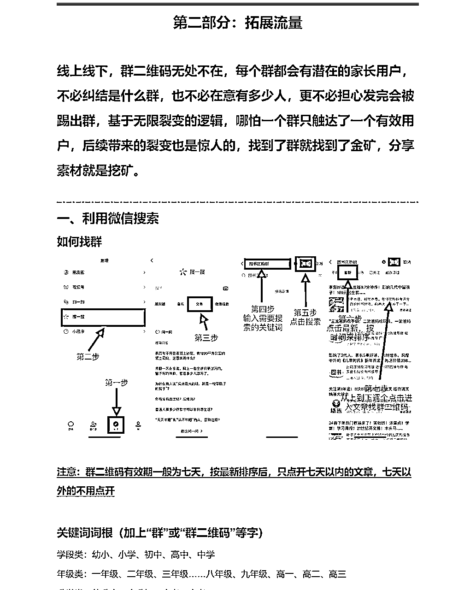

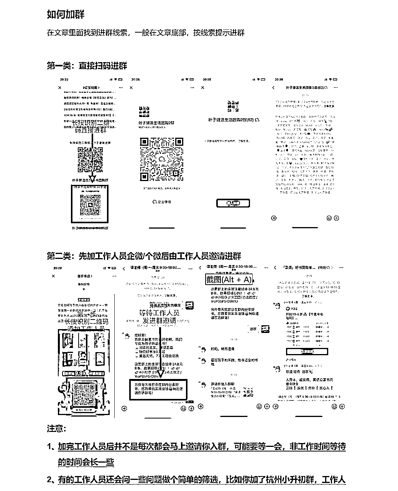

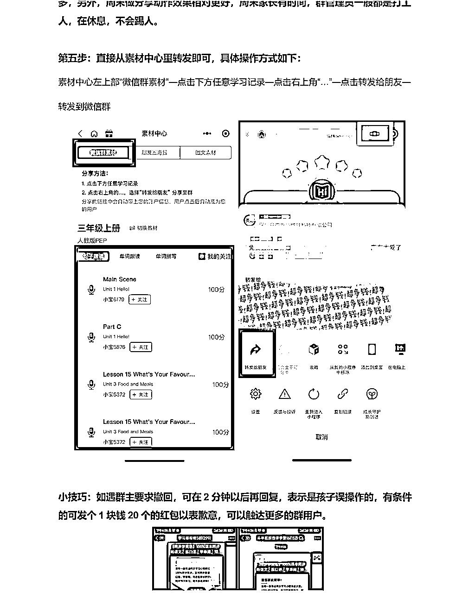

门槛降低后加入的人越来越多，后来有分销员自发摸索出新路子，会反馈给我们，测试后符合低门槛高增量原则就推广给全员。随后又陆续增加了教培机构App加群、小红书找群、抖音找群等来源，流量版图越来越宽。

🎈新版教程截图

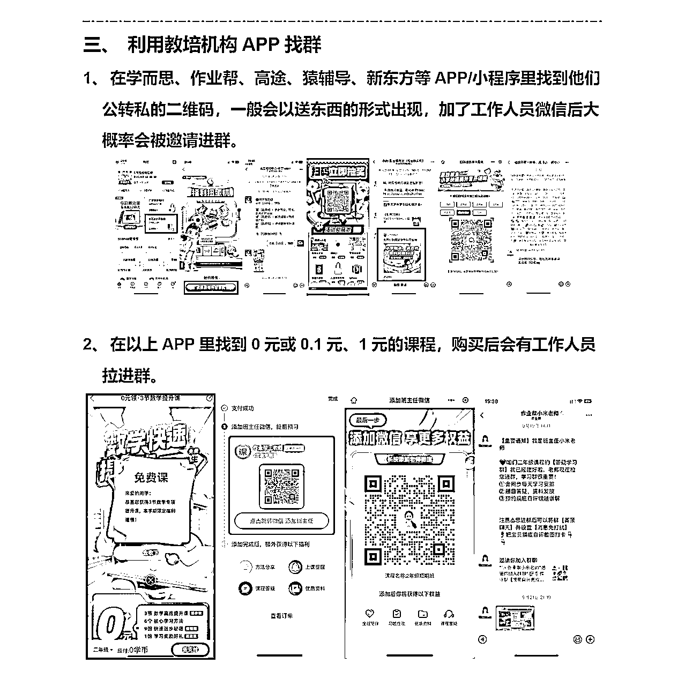

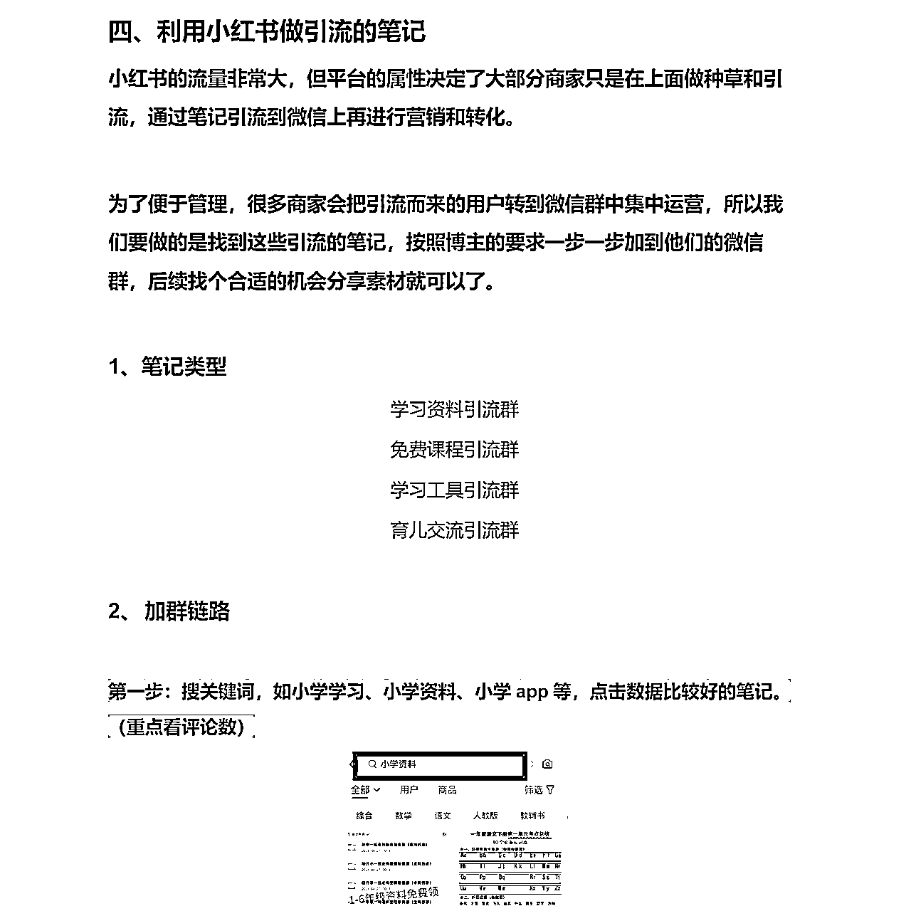

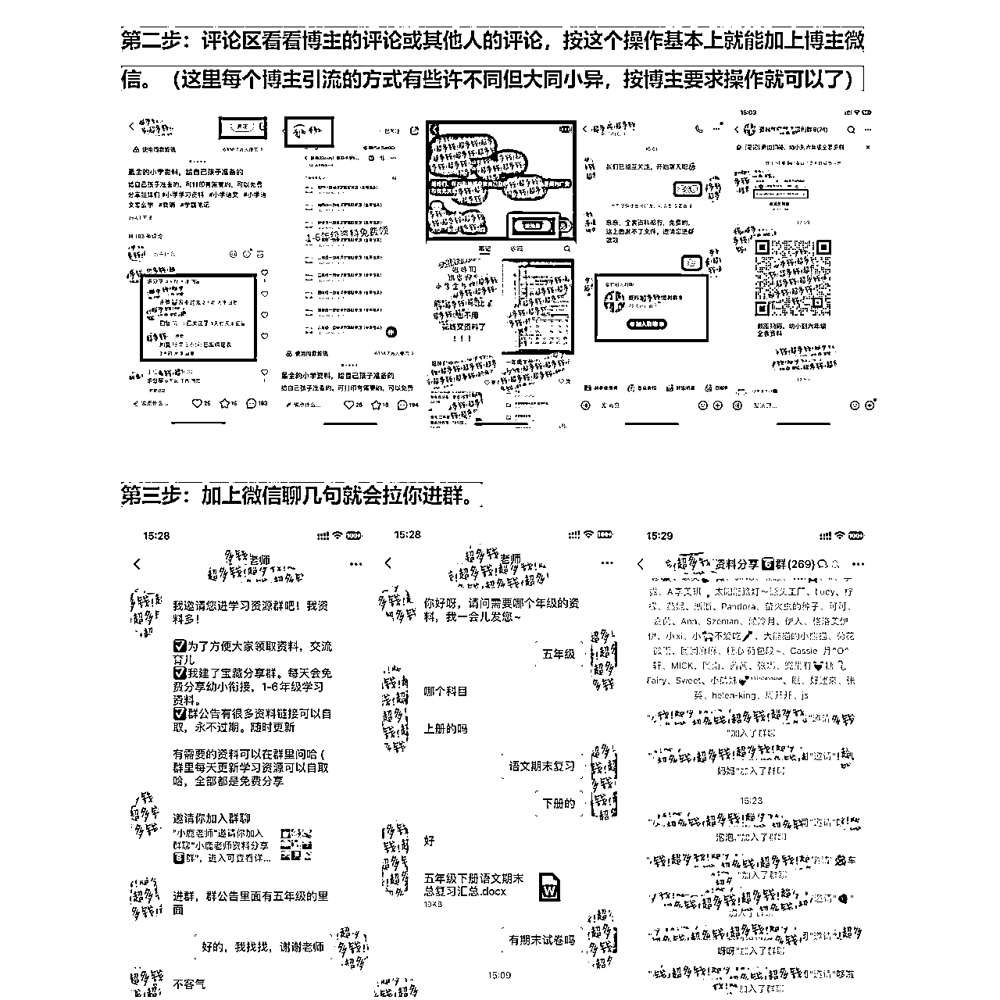

分销团队规模越来越大，人群也五花八门，整体符合二八定律。

能持续拿结果的集中在两类人群：一是宝妈，二是在校大学生。宝妈对教育话题敏感，懂家长需求；大学生时间充裕，思维灵活，做出成绩后还能带动同学朋友一起做，从而拿到二级佣金。

🎈两个典型案例：

📌案例一：两孩宝妈，有全职工作，空闲时就找群，没空就放着不管，一年不到收益1万8。她家住湖南小县城，月薪不到3000，这笔收入相当于半年工资，上个月还特意寄了两箱自家种的橙子来感谢。

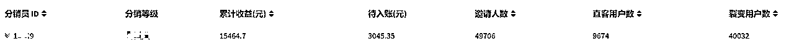

📌案例二：安徽大二学生，暑假开始做，前期还有点怀疑，开学后爆发，4个月佣金近1万，每个月多2000生活费。开学期间每天拉着我聊复盘，十月份又拉了十几个同学加入。

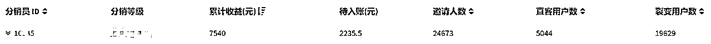

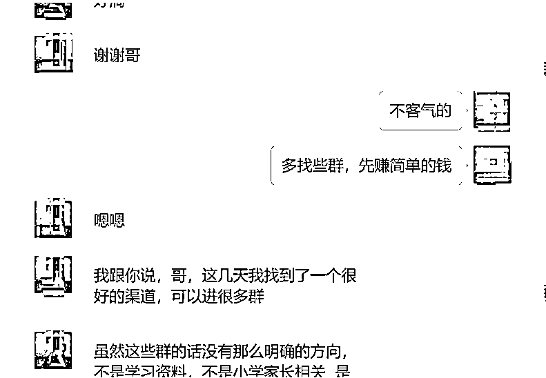

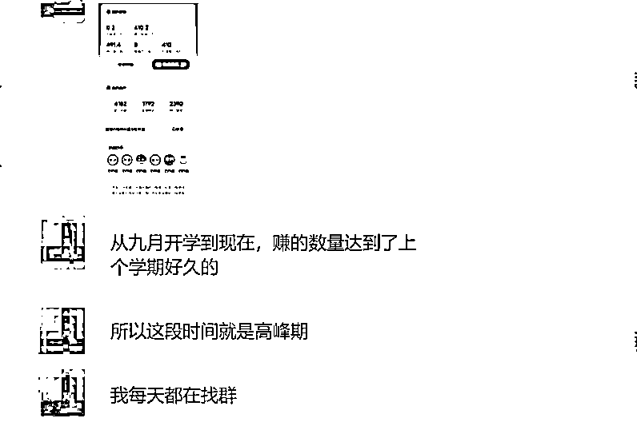

手里自带资源的分销员表现也不错，比如运营教育类公众号的、拥有学校或家长资源的，都能打出不错的成绩。

🎈先看公众号案例：

深圳一位朋友靠疫情红利做了几个大号，变现方式单一，主要靠接广告，现在广告费腰斩。他之前被合作坑过，刚开始接触我们非常谨慎，后来来公司考察了一圈就开始干。他其中一个号的数据就很可观，五个号合计佣金近30万。最近我们还教了他直播和私域玩法，现在正在招人放量。

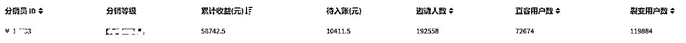

还有一位朋友之前做教育账号矩阵，环境变差后没精力维护了。我建议他挂个菜单和欢迎语先跑着，几乎不花时间。他为人比较高冷，回复消息要两天，语音从不接，但做事很随性，照样赚钱。

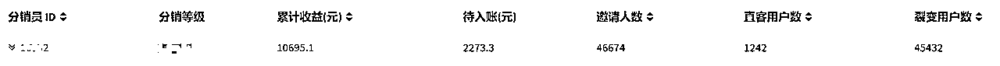

🎈再看其他资源型案例：

双减后不少教培校长和老师压力很大，利用人脉让老师们帮忙分享，不用盯盘也不用硬推，自然就有订单。

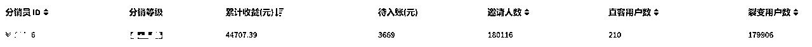

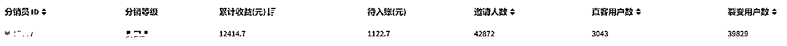

📌小结一下：

1、小程序裂变能力很强，后台数据显示分销员平均直客与裂变客的比例约为1:4，精准家长用户可达1:10，有资源的更高。收益图里都有体现，有兴趣可以往前翻看。

2、平均一个用户带来的佣金约3毛，看似不高是由于存在大量泛流量点击。比如发到小区群里，30人点击可能只有5个是有娃的，只有这5个才可能裂变和转化，后台统计的是30个点击。精准流量下单价可做到0.8-1元。

3、大部分中途放弃的人都是想着赚快钱。我们的产品设计是新用户前三天可免费体验付费功能，无需任何操作，用户完全无感。这是多次测试后的结果，进来就收费流失率和转化率都会暴跌。站在用户角度，第一次听说一个产品，连功能都没体验就付费，大概率会放弃。所以我们的逻辑是先让用户用起来、体验够了再自然转化。这套模式不适合求快的人。我们一直告诉分销员，初期只盯一个指标：邀请人数。量起来了，订单自然来。

4、基础玩法适合素人兼职做，定位是副业而非主业，更谈不上暴富。我们给分销员的画像是每月能稳定赚500-2000的副业人群，三四线城市的宝妈和大学生最符合。

## 进阶玩法

赚钱的朋友大部分都想放大收益，下面讲几种基于分销系统衍生的进阶打法，有部分已验证，部分链路已通还在等待放量。

❗❗❗想放大收益的伙伴重点看，这里更适合有资源有执行力的圈友。

### 获客系统

去年下半年认识了重庆的圈友 @李汉中，96年，操盘过两个6000万+营收的项目，跨行业经验丰富。当时他在做英语赛道的高客单加盟项目，加盟商盈利方式一是直接卖给终端家长，二是招下级加盟商。因为客单价和加盟费都不低，B端和C端量都有限，流量成了制约增长的关键。

我们为他定制了一套获客系统，在原有分销系统上叠加获客功能，把转私域入口开放给购买获客系统的加盟商。

这样加盟商既能获得C端流量，又能利用系统做B端踢单，让没有流量能力的合作伙伴也能低门槛参与。

🎈获客链路

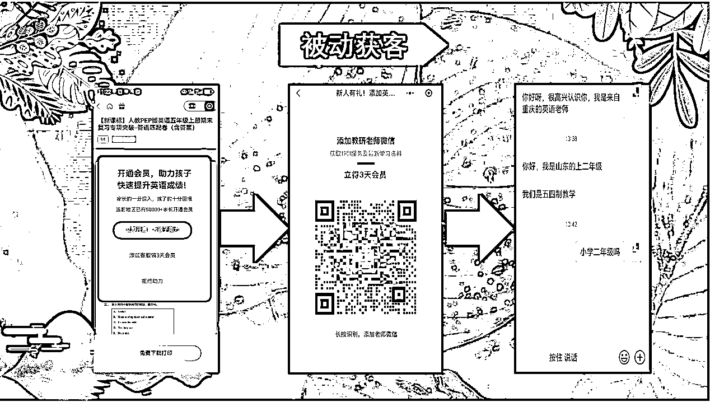

共做了两场发售，覆盖2000多个加盟商，客单价2999，最终成交800多单。

🎈部分订单：

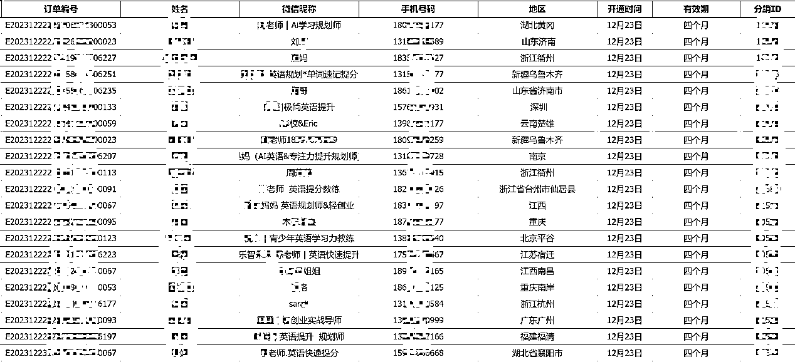

🎈发售会PPT：

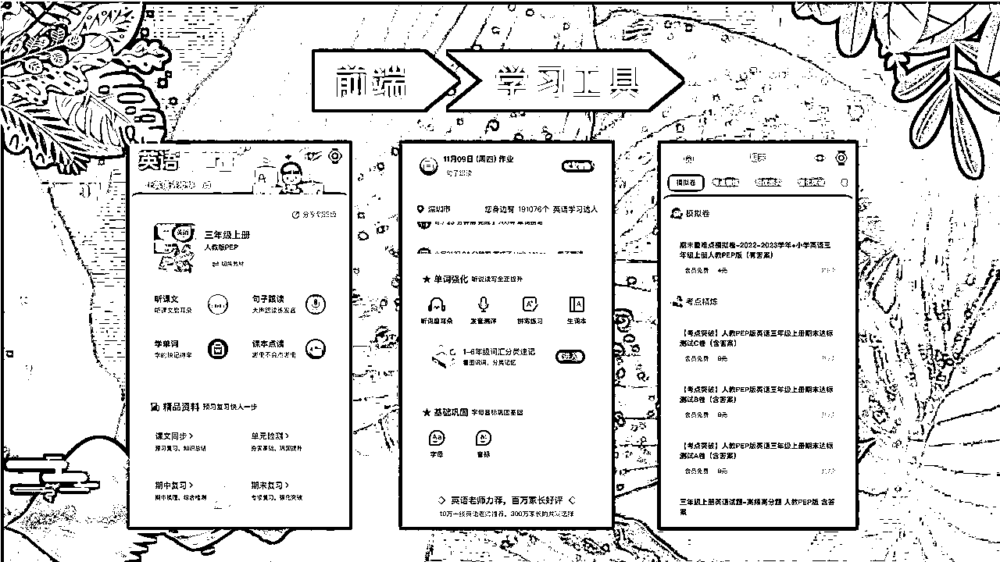

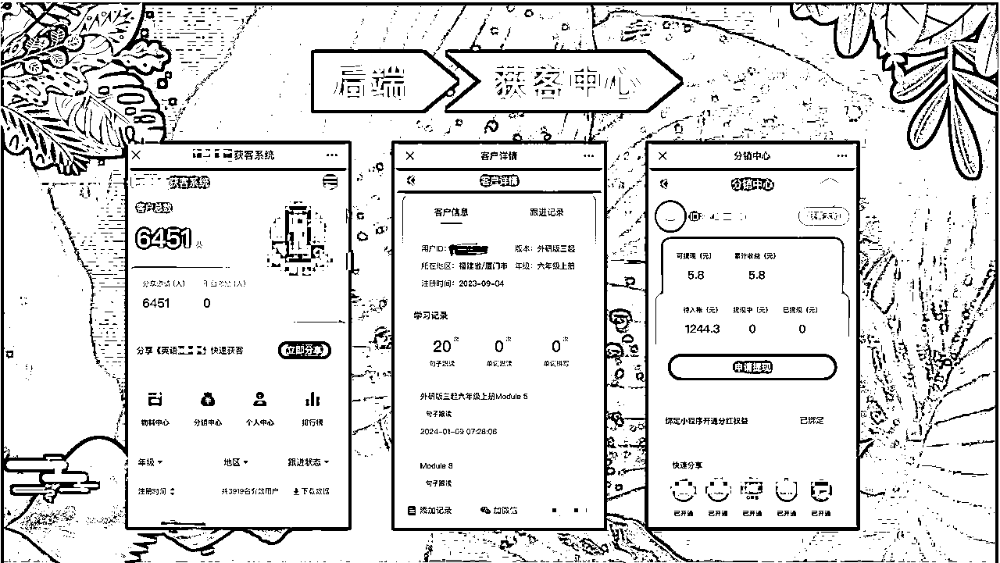

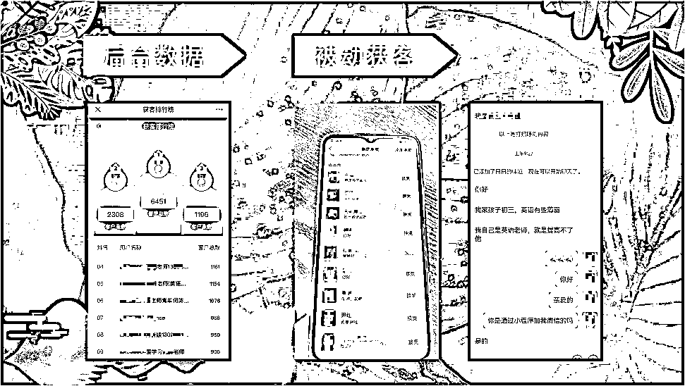

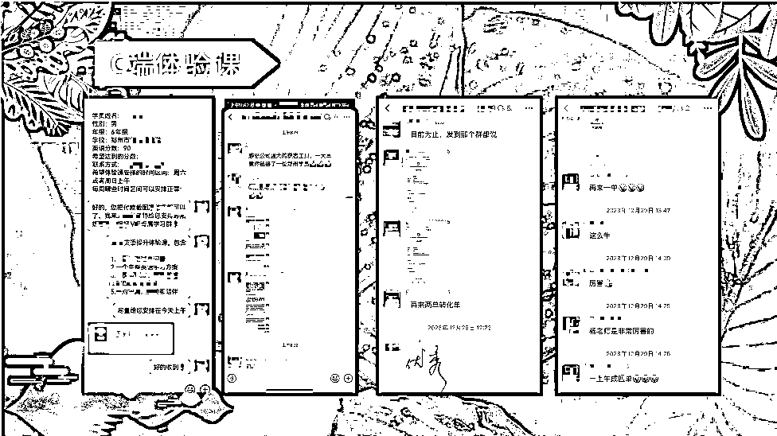

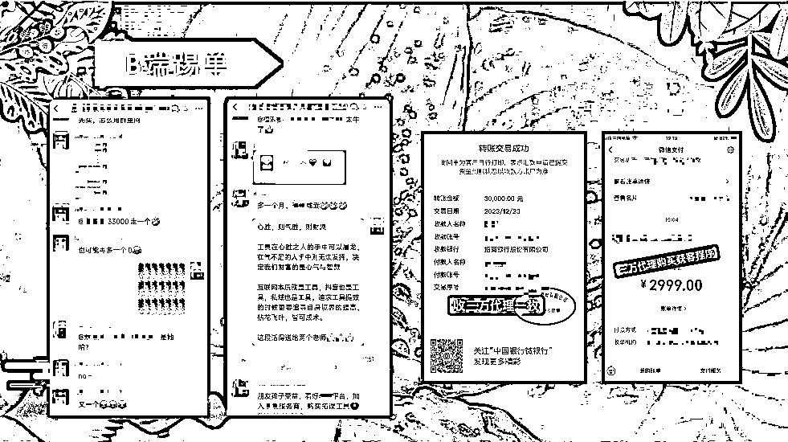

更高级的功能就不展开了，有需要的朋友可以私聊。

### 知识付费

华聪介绍给我一位做中小学学习资料付费社群的朋友，B、C端都在做。他先用分销试水，数据不错，后来就把分销嵌入到B端业务中，加盟费398，短时间内收了近百个下级。

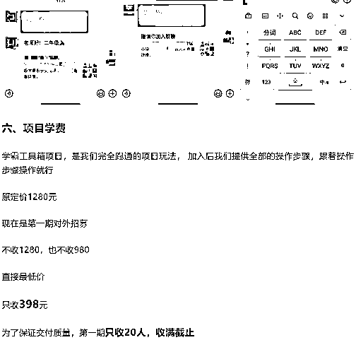

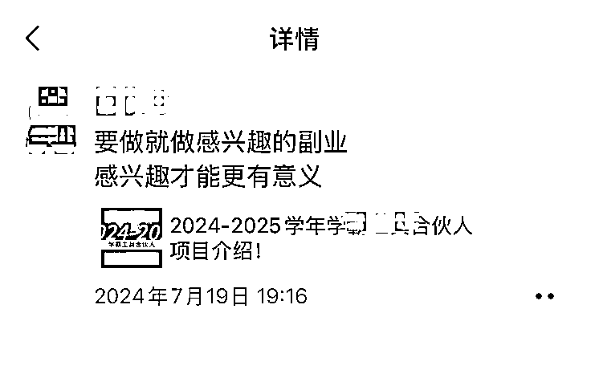

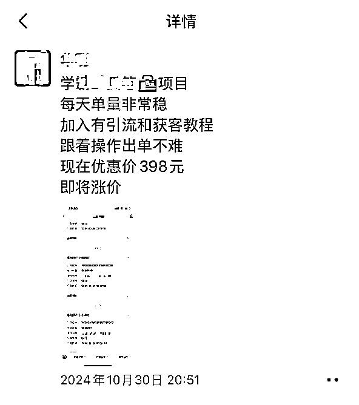

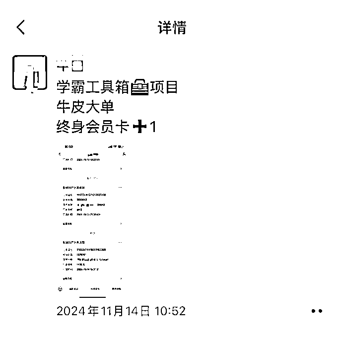

这种模式有两层收益：

1、发展代理/收徒的费用

2、下级分销带来的管道佣金

🎈部分分销收益

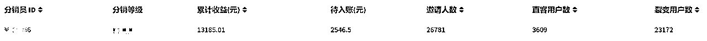

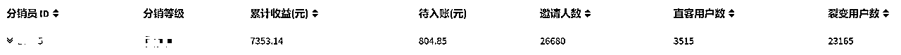

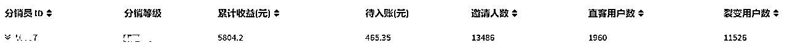

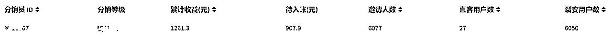

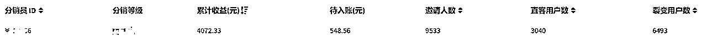

基于这些样本，我们曾设想把这套玩法产品化，做成一套专门指导创业粉做分销的知识付费课程，以他现有的付费社群人群为基础来设计方案。

🎈知识付费方案

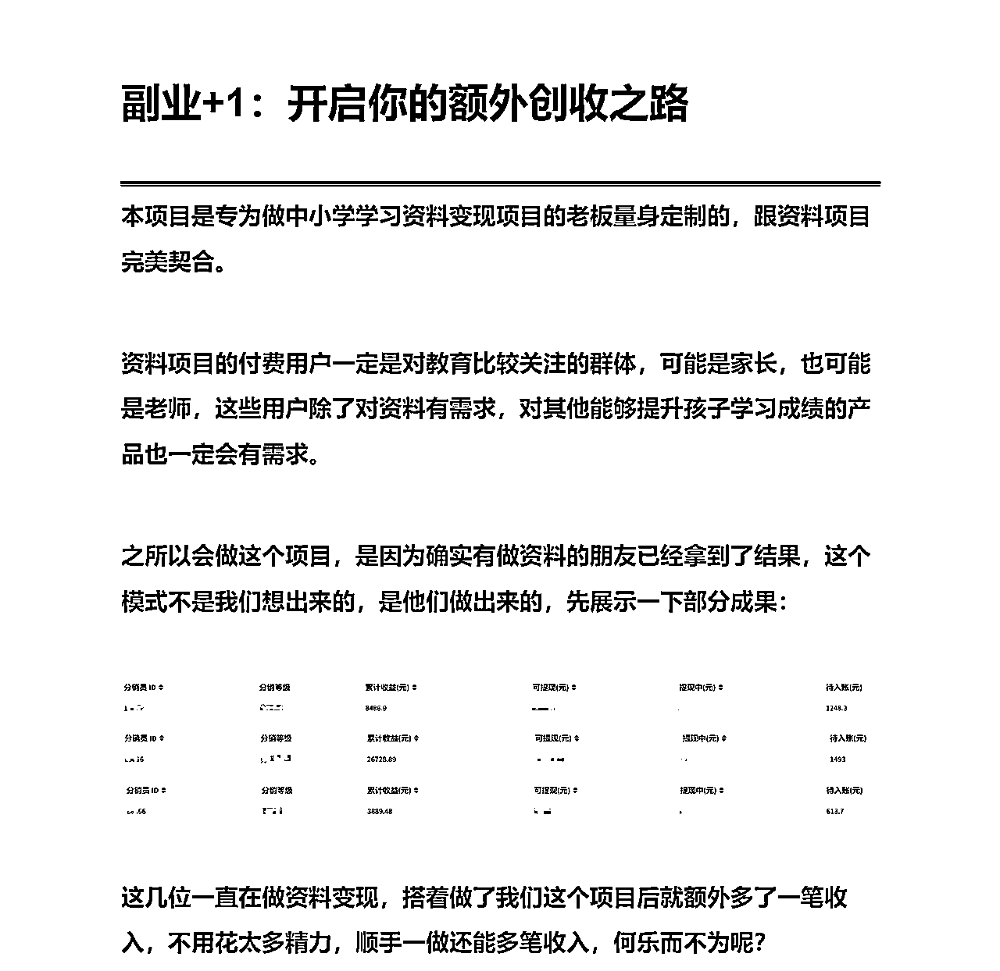

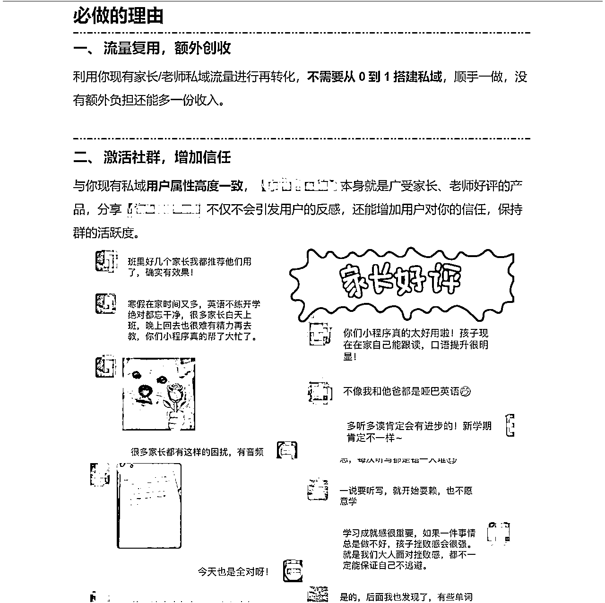

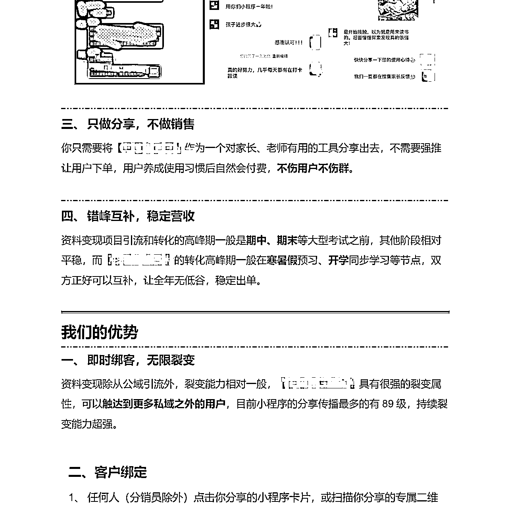

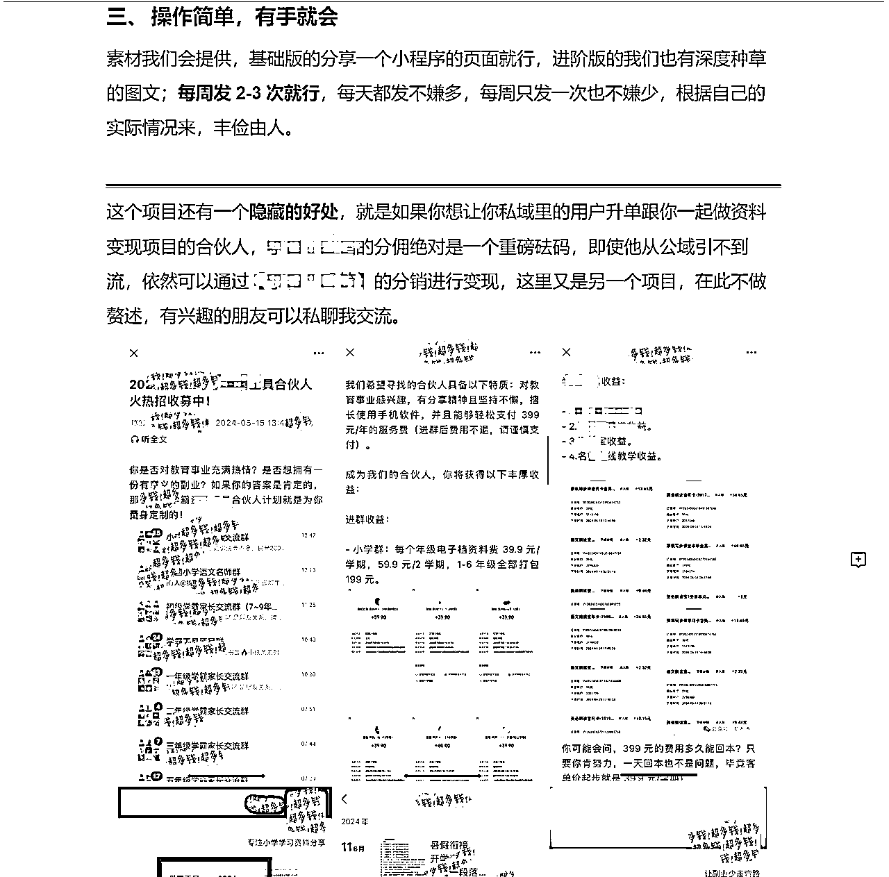

后来因他工作繁忙抽不出时间，加上公司又开新业务线，这个项目暂时搁置。我个人很看好这个方向，也想过找个有经验的伙伴来负责，一直没合适人选。

如果圈里有合适的朋友可以推荐，录用后我会发红包；如果有正在做类似项目且想一起放大的，也欢迎来聊。

另外还有一些分销员自发验证过的玩法，比如用小程序做抖音直播转私域、用小红书发功能笔记引流到私域、用小程序社群打卡营做低转高等，因篇幅限制就不展开了，有兴趣可以私聊交流。

# 最后说两句

写这么多不是为了展示产品多牛、规模多大，而是希望借助赚钱这个平台，连接更多对产品和模式感兴趣、有一定资源、或者能一起共创新玩法的朋友。

钱永远赚不完，创业的路也永远在路上。欢迎大家随时交流，如果在珠三角或者来深圳出差，欢迎来公司坐坐，茶管够，酒也管够！