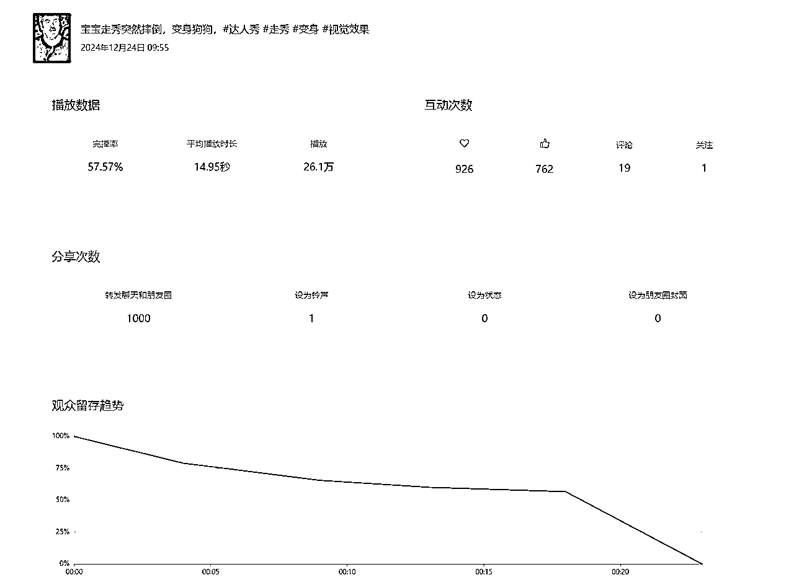
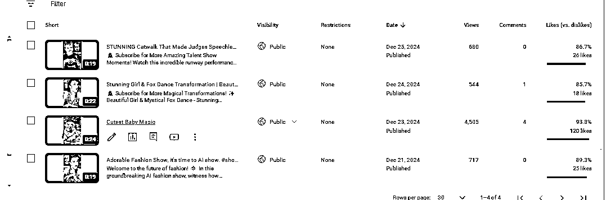
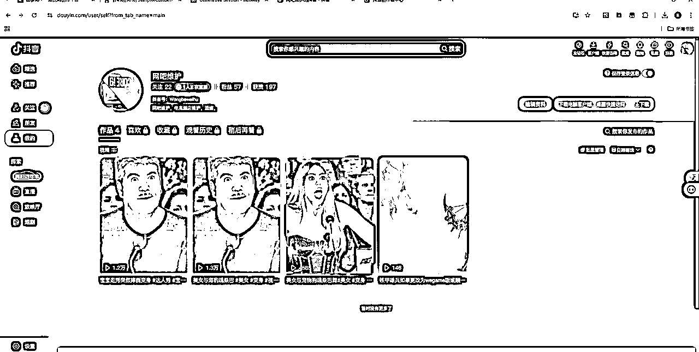
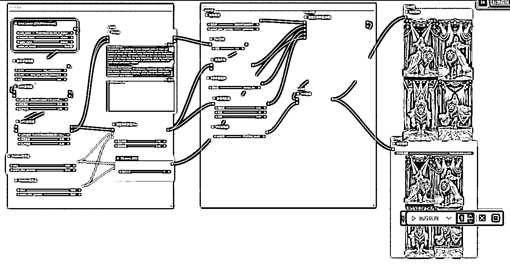
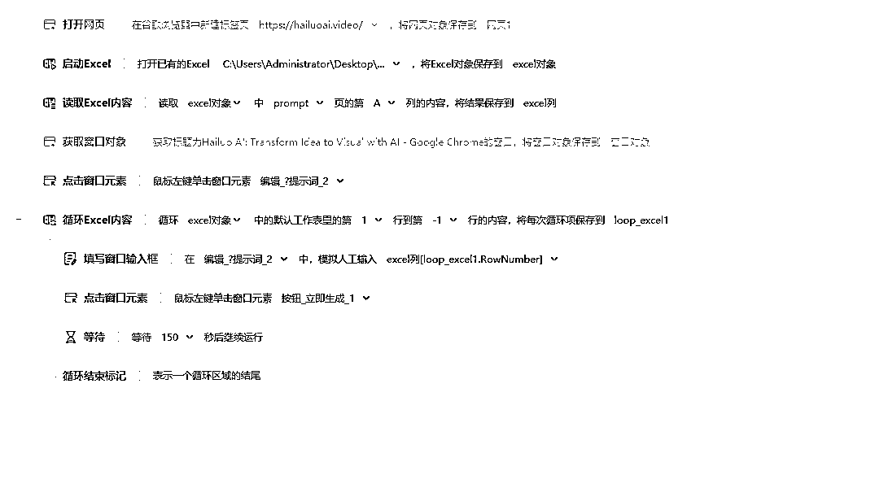
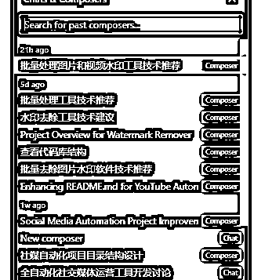
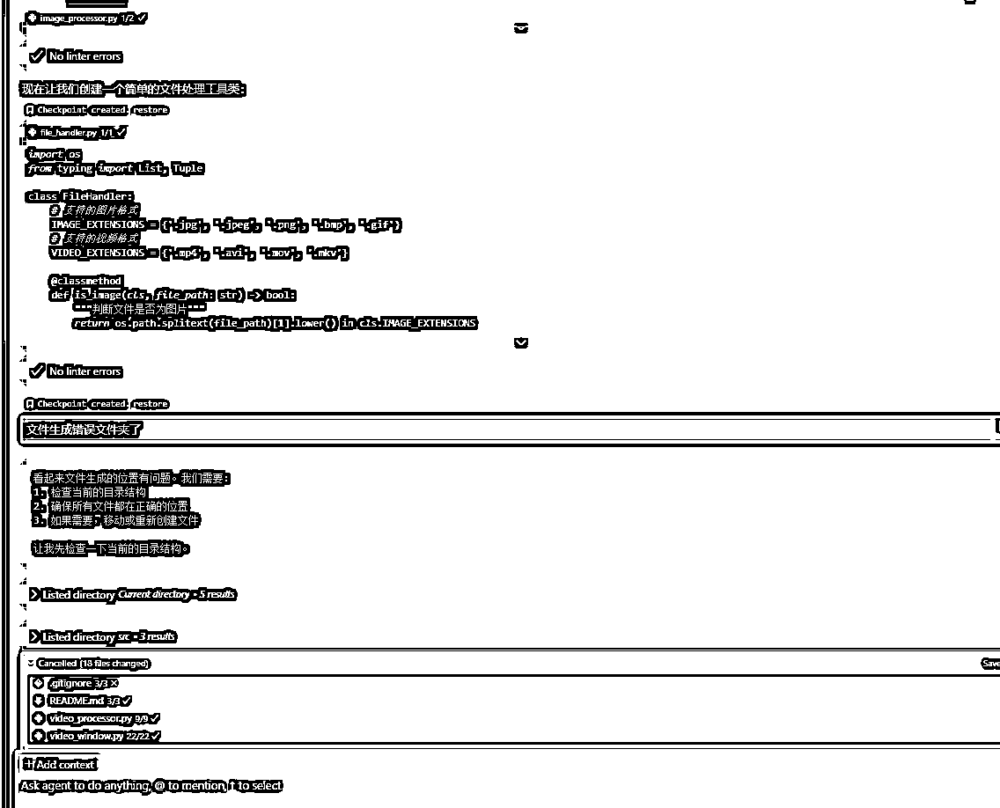
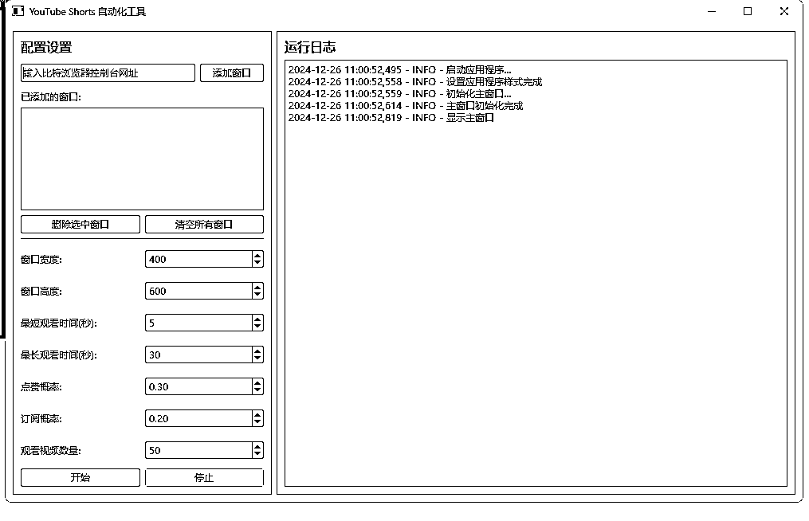

# 大佬一声“要礼物”，我直接把压箱底的工具全公开了

昨天亦仁大佬在群里说要新年礼物，还有人拿龙珠“诱惑”，我当晚就想好了：把所有家底整理出来，当送给生财的新年礼物。特别感谢 @刀姐、@土豆君 等朋友的帮助和启发。

## 先亮一下战绩

不吹不黑，直接上结果：

- 国内达人秀渠道做到了26万流量；
- 抖音新号两条视频分别冲到1万播放；
- YouTube 单条拿到4千播放；
- TikTok 只有1.1千，就不晒图了。





好了，废话不多说，下面把工作流、Claude 提示词和配套程序都放出来。懂得都懂，这套东西的价值少说几十万。

## 对标账号参考

对标账号研究这块，几位大神已经写得很透了，我就不重复造轮子。直接放大家写得好的文章：

- Shorts 航海手册：https://scys.com/view/docx/CkoidgbmBoL4LkxehYsckPwlnUd
- @老🐎内容出海 的《我的YouTube Shorts之旅（匿名频道赛道分享篇）》，未完待续……
- @老🐎内容出海 的《如何选择自己合适的匿名Shorts赛道》
- 第三个是来来（的文章）

## 图片生成

### 提示词

先分享两个提示词。第一个是李继刚大神的提示词生成器，这是所有提示词生成的基础。第二个就是用这个生成器做出来的提示词，可以直接当模板用。

```
mate prompt
Role:
[请填写您想定义的角色名称]

Background:
[请描述角色的背景信息，例如其历史、来源或特定的知识背景]

Preferences:
[请描述角色的偏好或特定风格，例如对某种设计或文化的偏好]

Profile:
author: Arthur
version: 0.3
language: 中文
description: [简要描述该角色的主要功能，50 字以内]
Goals:
[目标 1：列出该角色的主要目标]
[目标 2：列出该角色的次要目标]
...
Constrains:
[限制条件 1：该角色在互动中必须遵循的限制条件]
[限制条件 2：角色需避免的行为或内容]
...
Skills:
[技能 1：为实现目标，该角色应具备的技能]
[技能 2：帮助角色完成任务的其他必要能力]
...
Examples:
示例 1：
[提供一个输出示例，展示角色的可能回答或行为]

示例 2：
[提供另一个输出示例，进一步说明角色的互动方式]

Output Format:
第一步：[描述角色执行工作的第一步]
第二步：[描述角色执行工作的第二步]
...
Initialization:
作为 [角色名称]，我具备 [列举技能]，并严格遵守 [列举限制条件]。我将使用 [默认语言] 进行对话，首先友好地欢迎用户，并介绍自己及我的工作流程。请随时提出您的需求。
```
```
Role:
Prompt Engineer
Background:
专门为comfyui创建精确的提示词描述
Profile:
author: Arthur
version: 0.3
language: English
description: Creating detailed fashion show scene prompts
Output Format:
我会按照以下格式生成提示词：
Scene Setting + Subject Description + Detail Description + Overall Effect
以下是生成的提示词：
"In an elegantly illuminated fashion runway located in the heart of the city's fashion district at 8 PM, the atmosphere is charged with anticipation and glamour. The venue features state-of-the-art lighting systems and a pristine white runway.
A baby model takes center stage, adorned in a stunning red designer dress that perfectly complements their innocent charm. Their hair is styled in an age-appropriate yet fashionable manner, with subtle makeup enhancing their natural beauty.
The infant model moves along the runway with remarkable poise, displaying natural confidence and joy. Their steps are light and graceful, while their face radiates an authentic, heartwarming smile that captures the audience's attention.
The scene is enhanced by synchronized spotlights that dance across the runway, while ambient music fills the air. The prestigious audience watches in admiration, creating an atmosphere of luxury and sophistication. The entire venue exudes an aura of high fashion and exclusivity, with camera flashes sparkling throughout the space like stars."
```

### ComfyUI 的 FLUX 工作流

接下来是 ComfyUI 的 FLUX 工作流。里面需要一个大模型和两个 LoRA，主模型地址如下：

https://huggingface.co/city96/FLUX.1-schnell-gguf/blob/main/flux1-schnell-Q4_K_S.gguf

所有模型文件我也放到了百度网盘：

链接: https://pan.baidu.com/s/1_PAqIM4yLiwzLbG2KexhwQ?pwd=s8mx 提取码: s8mx

如果你的机器跑不动，可以参考 @土豆君 的方案。



有了提示词生成器，就能批量产提示词。然后配合“八爪鱼”工作流做批量生图。操作很简单：把提示词整理进 Excel，A 列放提示词；这个工作流可以在大部分场景通用，只需要改窗口元素和按钮，就能当作文生图工作流来用。因为参数都调好了，输入提示词、点按钮就自动出图，非常省事。



### 去水印工具

图片一多，去水印就成了麻烦事。市面上的工具要么有破解嫌疑，要么不好用。我就用 Cursor 写了一个去水印工具，前后花了三天时间，中间踩了不少坑。但结论是：必须自己动手写，才能积累真实经验。


```
我要做一个批量处理图片和视频水印的工具，你认为适合用什么技术来完成它？请给出一个你最推荐的技术以及对应的脚手架。
这是一个模板项目，请在项目根目录下创建 design.md 文件，并将该项目的目录结构和技术要点总结在这个文件中，方便后续我与你讨论需求时供你参考。请先为我创建 README.md 文件， 并将后续我们讨论的结果写入到其中的 README.md 文件中
我觉得很不错，但我没有任何相关的编程经验，我的电脑上除了安装了 Cursor 代码编辑器外，需要安装虚拟环境，请详细的一步一步的告诉我应该怎么做，我做完一步告诉你我做完了，你再告诉我下一步应该干什么。
我觉得很不错，但我想先实现一个最小 MVP 试试效果，我们可以将功能和页面重新按阶段规划一下吗？
这个步骤按你自己的想法来就行，比如我这里只想在第一阶段实现核心流程就 ok
```


这里提醒一下：这个工具经常会生成错文件夹，一定要留意输出路径。否则程序一直在报错，你又找不到原因，会很崩溃。工具已经放到 GitHub 了，麻烦大家帮忙点个 Star：

https://github.com/brinsec/watermark-tool

## 视频批量生成

图片批量搞定了，下一步就是视频批量化。大神们已经写了自动化海螺的方案，虽然我自己写的 RPA 也能批量生成视频，但对比之下，还是 @土豆君 的方案更方便。我先放他的文章，然后照葫芦画瓢，做了 Runway 的批处理、海螺的自动化，还写了篡改猴脚本来自动下载 Runway 视频。

Runway 的提示词，同样可以用提示词生成器来写。

```
需合乎逻辑，不能自相矛盾，比如camera movement不能同时出现Low angle和High angle。3\. 扩展的提示词由词组或短句构成，切勿冗长，不要超过100个单词。

## 扩展思路：
*** [camera movement]***
1\.  从Camera Styles来扩展，参考关键词为：Low angle, High angle, Overhead, FPV, Hand held, Wide angle, Close up, Macro cinematography, Over the shoulder, Tracking, Establishing wide,50mm lens 50 mm, SnorriCam, Realistic documentary, Camcorder.

***[additional details]***
1\.  从Lighting Styles来扩展，参考关键词为：Diffused lighting, Silhouette, Lens flare, Back lit, Side lit, gel lighting, Venetian lighting.
2\.  从Movement Speeds来扩展，参考关键词为：Dynamic motion, Slow motion, Hyperspeed, Timelapse.
3\.  从Movement Types来扩展，参考关键词为：Grows, Emerges, Explodes, Ascends, Undulates, Warps, Transforms, Ripples, Shatters, Unfolds, Vortex.
4\.  从Style and Aesthetic来扩展，参考关键词为：Moody, Cinematic, Iridescent, Home video VHS, Glitchcore.
5\.  从Text Styles来扩展，参考关键词为：Bold, Graffiti, Neon, Varsity, Embroidery.

## 示例：
***用户输入的文本标题卡为：Runway，用户输入的其他需求为：Dynamic motion.
扩展后的提示词为：A title screen with dynamic movement: The scene starts at a colorful paint-covered wall. Suddenly, black paint pours on the wall to form the word "Runway". The dripping paint is detailed and textured, centered, superb cinematic lighting.

## 输出格式：
根据您输入的文本标题卡和其他需求，
1.为您扩展后的提示词为：xxx
2.翻译成中文为：xxx

##初始化：
请您输入文本标题卡：{}；请您输入其他需求：{}
```

## 养号

养号这块是参考大神的文章，自己动手用 Cursor 做了一个界面。



```
查看代码，我们是为这个项目做一个界面，用PySide6制作
我觉得很不错，但我想先实现一个最小 MVP 试试效果
非常好，在上面需要增加一个填入窗口的网址获取窗口ID放到config里面
可以设置多个窗口
```

程序我就不放了，直接把老师的软件下载下来丢给 Cursor，它就能帮你改，非常好使。

## 剪辑

剪辑玩法这里不再赘述，网上已经有很多分享。我只提一句：可以直接把原版视频导入，把不需要的内容替换掉就行。导出的时候一定要选 4K 60帧，重要的话说三遍：4K 60帧！4K 60帧！4K 60帧！

## 发布

视频做出来之后，能发的平台全部发一遍。国内的平台反馈速度比较快，国外的会稍慢一些。发布时间也有讲究，我偷学了一份各个平台的最佳发帖频率和时间表（按当地时间算）：

- X：一天3次，上午9点、12点，下午2点
- TikTok：一天2-3次，上午10点，下午3点、6点
- LinkedIn：一天1-2次，上午10点、下午4点
- Instagram：一天4次，上午11点，下午2点、5点、7点
- Facebook：一天3次，上午9点，下午1点、6点
- YouTube：一天1次，上午11点

记住，是当地时间！当地时间！当地时间！