# 用Cursor手搓Youtube频道/播放列表/单视频下载工具

这阵子参与YouTube Shorts航海，看到群里还有不少伙伴正为下载工具发愁。我自己也顺手借助Cursor“手搓”了一个下载器，能处理频道、播放列表和单个视频，用下来体验相当不错，索性分享给有需要的人。

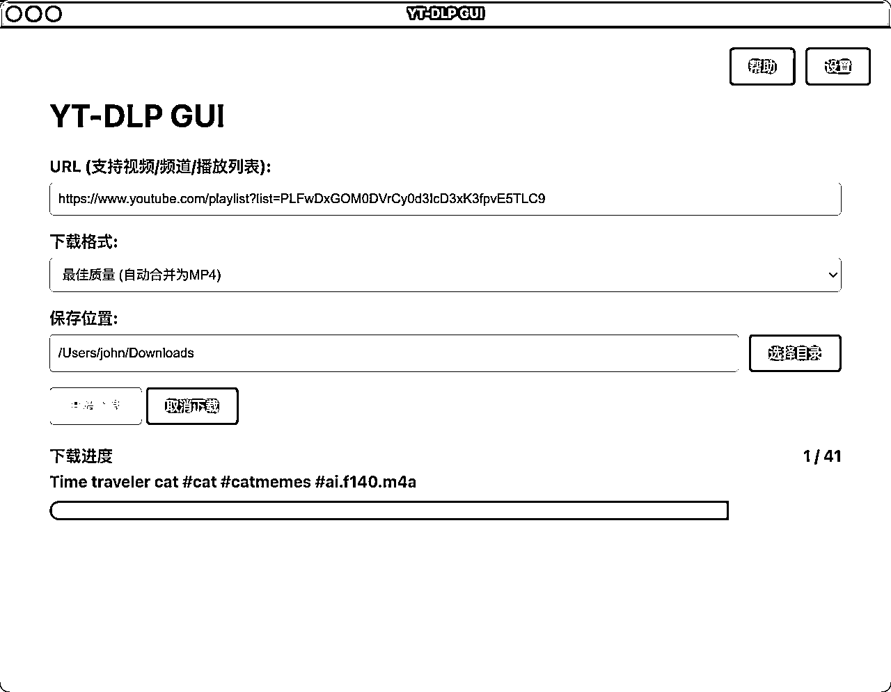

dist文件夹里已经备好了两个文件，一个给Mac用，一个给Windows用。我事先都做了基础验证，运行稳定，拿到手就能直接用。源码也一起附在其中，想按自己喜好继续改造的话，丢进Cursor让它帮你就行。

下面就是我和Cursor的完整协作过程，把一些废话和反复调bug的片段删掉了，留作参考：

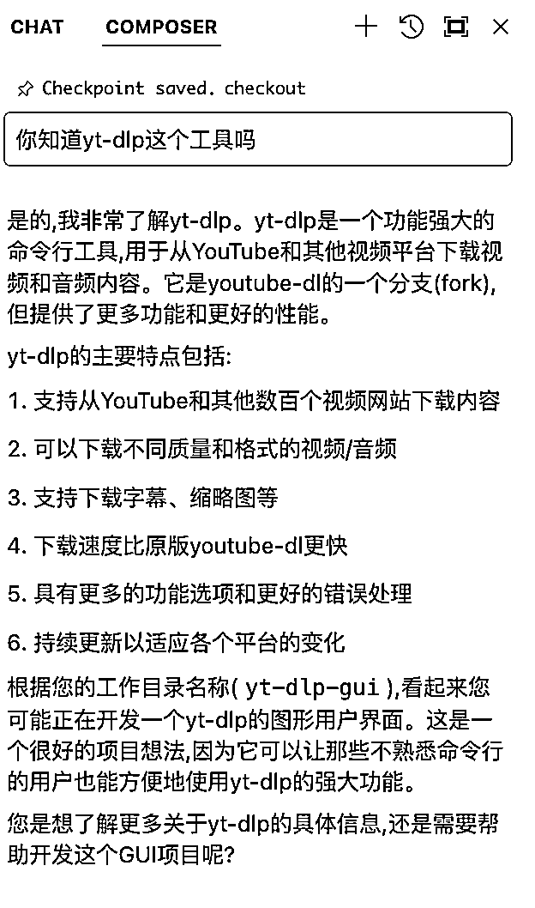
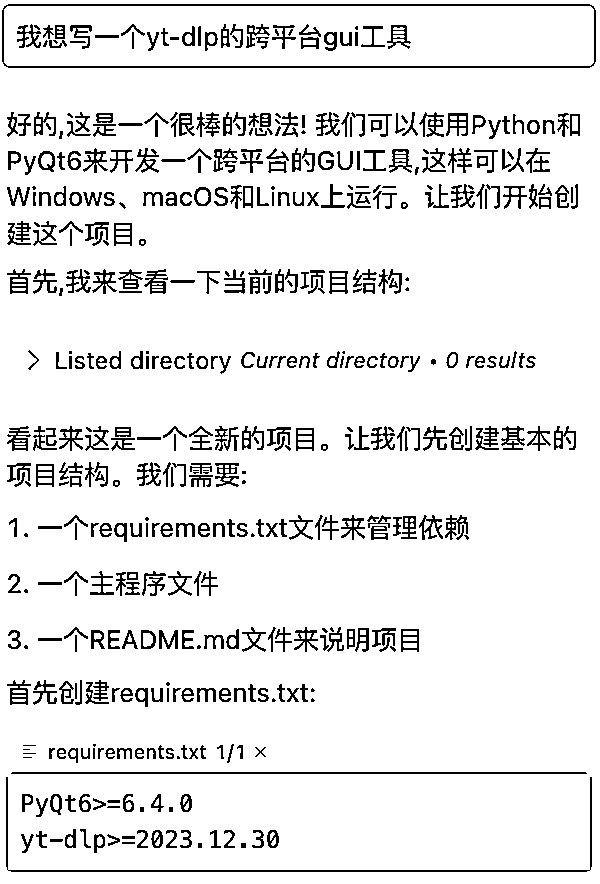
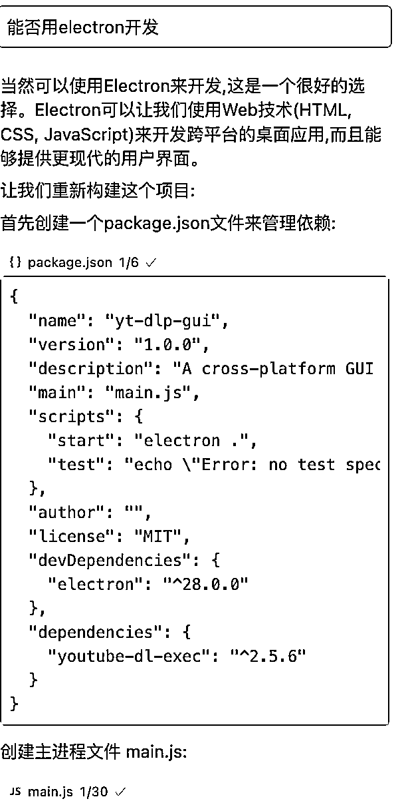
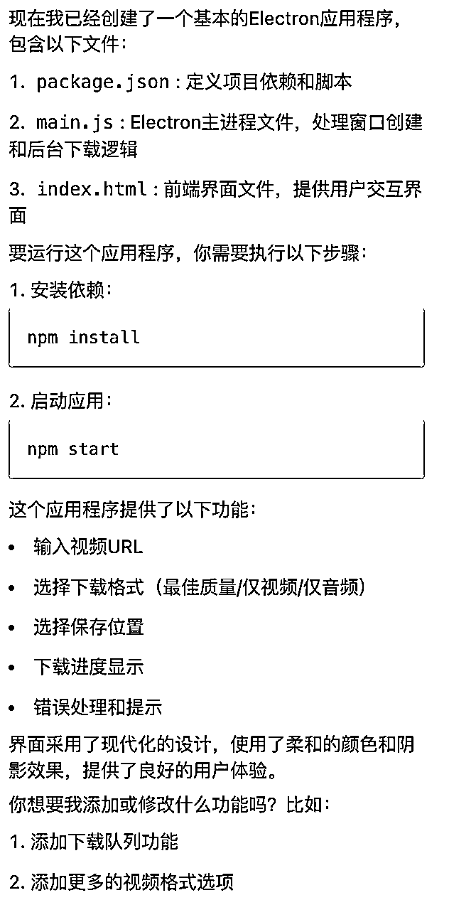
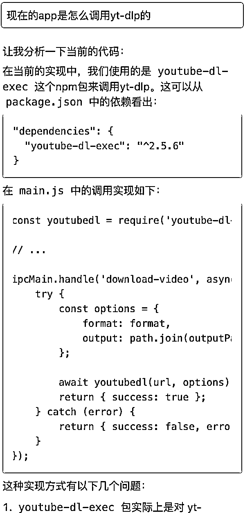
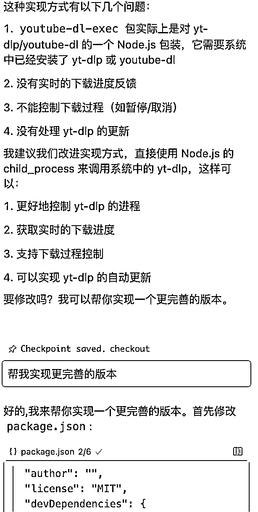
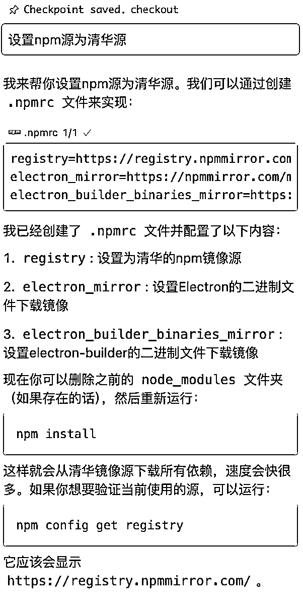
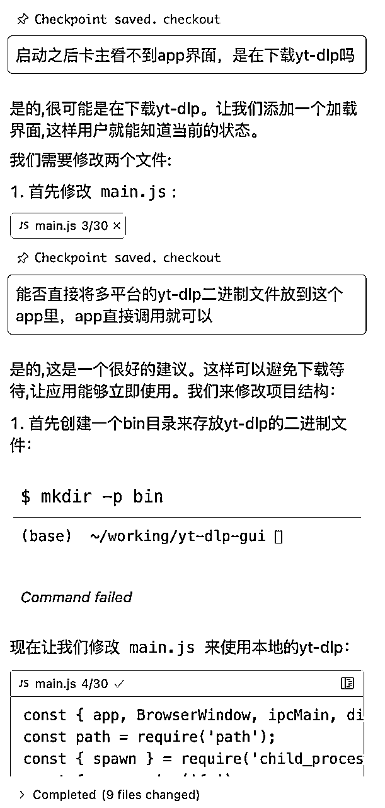
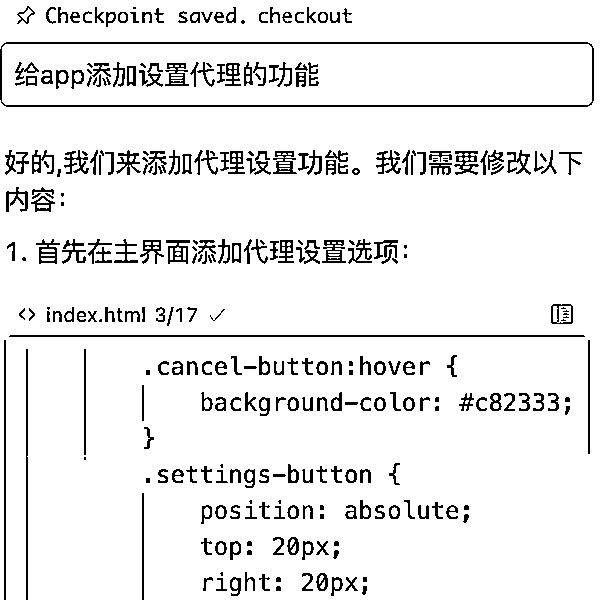
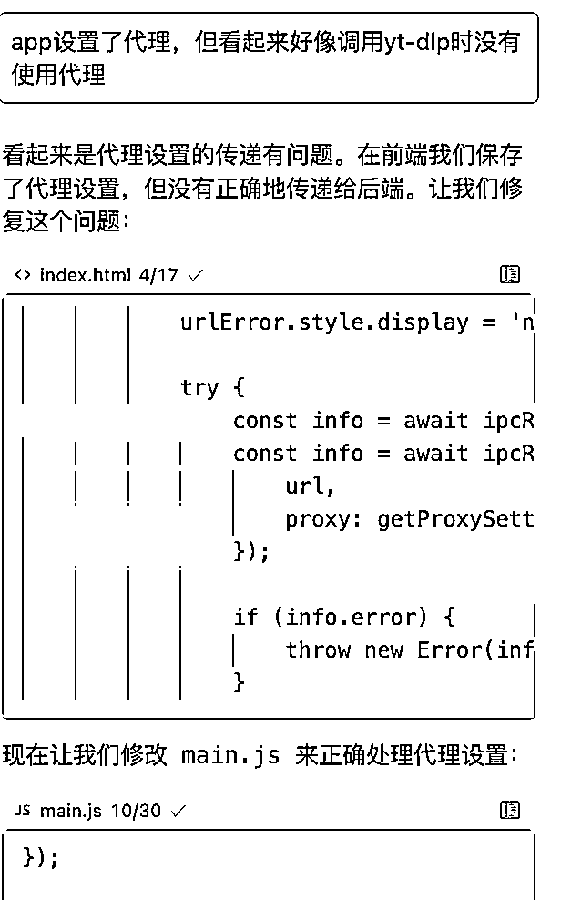
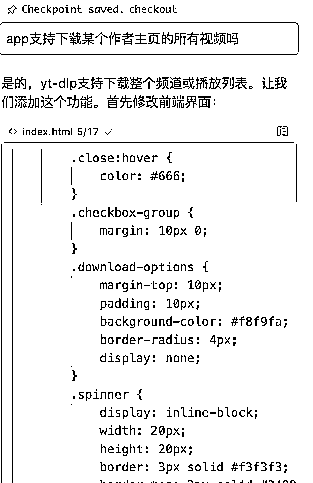