先别急着怀疑，我要说的事，我亲自验证过了。

我是个在厂里写了五年代码的“伪全栈”，叫赤木。最近用Cursor折腾了一个古钱币知识问答小程序，三天搞定，其中99%的代码都是AI一键生成的。听起来像标题党？但这回真没夸张。

先看成品效果：

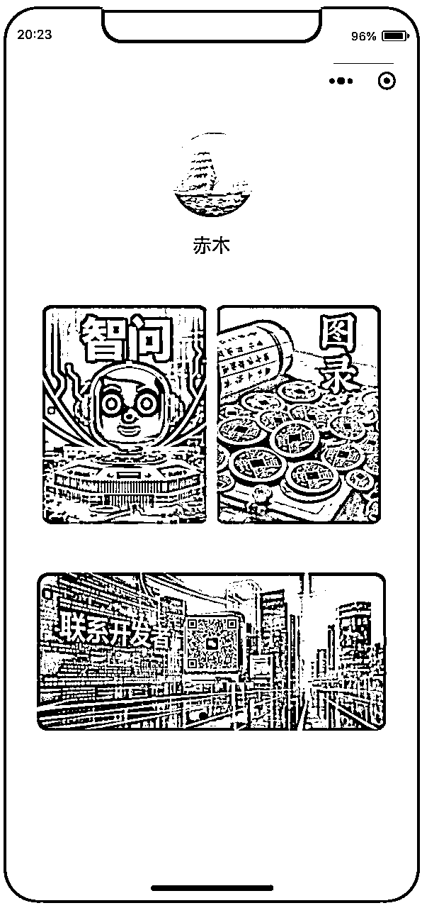

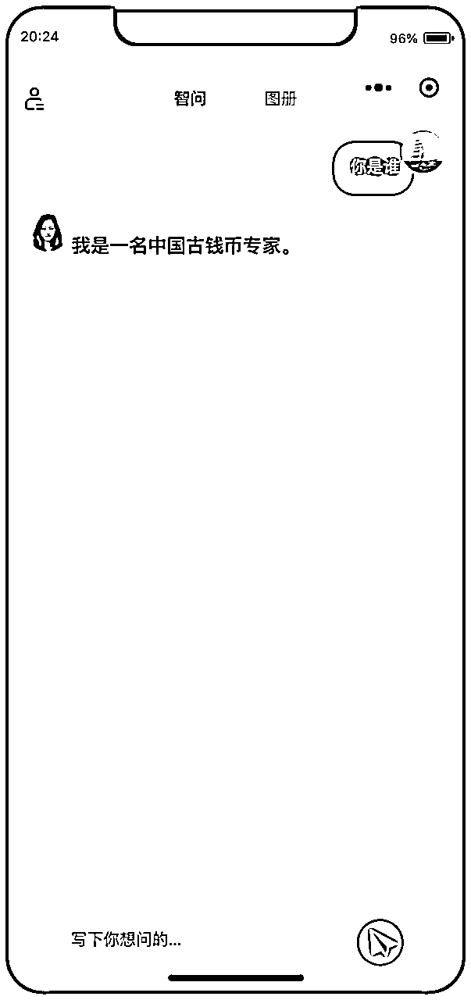

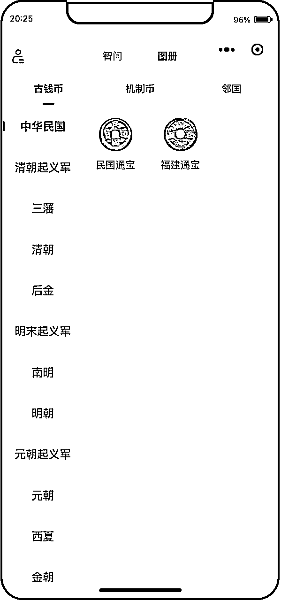

这篇文章，我就把整个从0到1的过程拆给你看，感兴趣的朋友完全可以照着复制一个属于自己的小程序。

一、把这些东西先准备好

搭建环境的部分，新手按官方指引装就行，老手可以直接往后翻。由于这个小程序要处理数据，我采用了前后端分离的架构。

1. 前端需要三样

微信小程序：到公众平台注册一个。如果只是玩票不发布，直接拿测试号也行，后面不用认证。

Cursor：下载地址 https://www.cursor.com/。它是我用来生成代码的主力。使用技巧是别把需求抛得太笼统，要尽可能拆细。比如你想做必应搜索页，不要只说“做一个必应搜索页”，而是把结构、位置、样式全部描述出来：

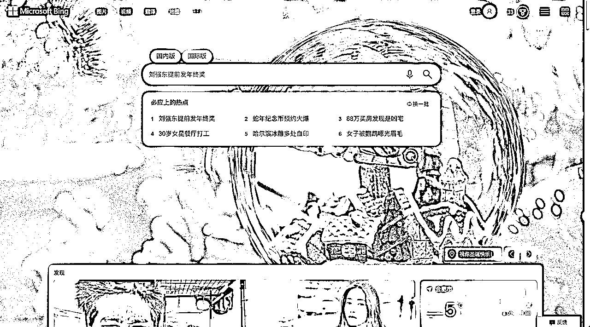

“我现在要基于vue做一个前端页面：
1、顶部工具条：最左侧放Microsoft Bing的logo，它的右边依次是图片、视频、翻译、地图、更多四个按钮；最右侧是登录入口和一个隐藏标签的圆形头像。
2、页面正中间放一个长条搜索框，框内最右侧是麦克风图标和放大镜图标；搜索框上方紧贴着两个标签“国内版”和“国际版”；搜索框下面放一个半透明容器，里面文字排成两行三列。
3、页面最底部是一个容器，里面放三张图片。
4、整个页面的背景用一张图片。”

这样生成出来的代码就靠谱得多。我也试过直接把网页链接或截图甩给它，让它“抄作业”，但效果反而不理想。

微信开发者工具：下载地址在官方文档里。作用在于实时看到代码改动后的页面长什么样。

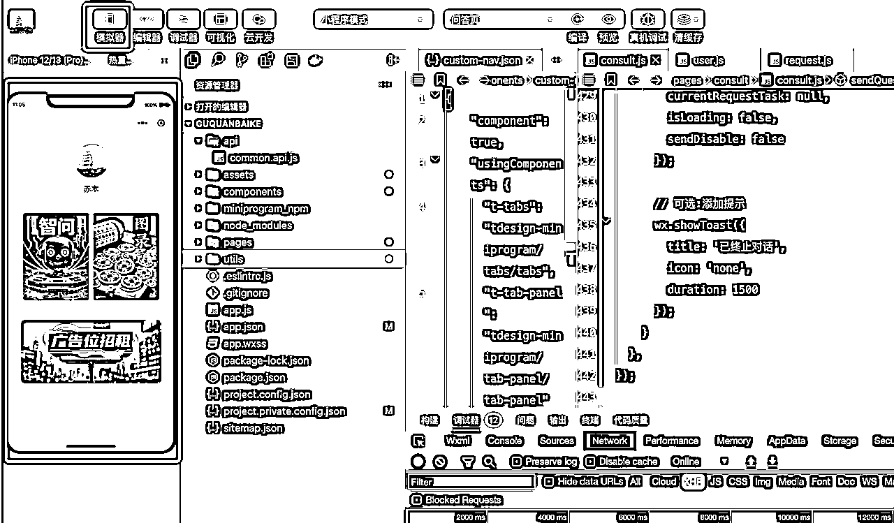

2. 后端准备

阿里云服务器：我买的是99元一年的入门款，在上面部署了MySQL和Nginx，再用Python写了个简单的查询接口。如果你不想碰服务器，可以用小程序云开发，但云开发按项目收费，而且一个项目一个环境；服务器虽然也花钱，却能同时干很多别的事。

域名：小程序上线强制要求HTTPS域名，IP直连线上环境是不行的。只是本地模拟测试就不用买。注意域名买完要备案，周期接近一个月，想发布就早点下手。

Navicat：管理数据库表很方便，网上能找到免费渠道，不必非得买正版。

二、正式开工：从新建项目到AI写码

1. 创建小程序项目

打开微信开发者工具，选“小程序”，填配置信息，然后创建：

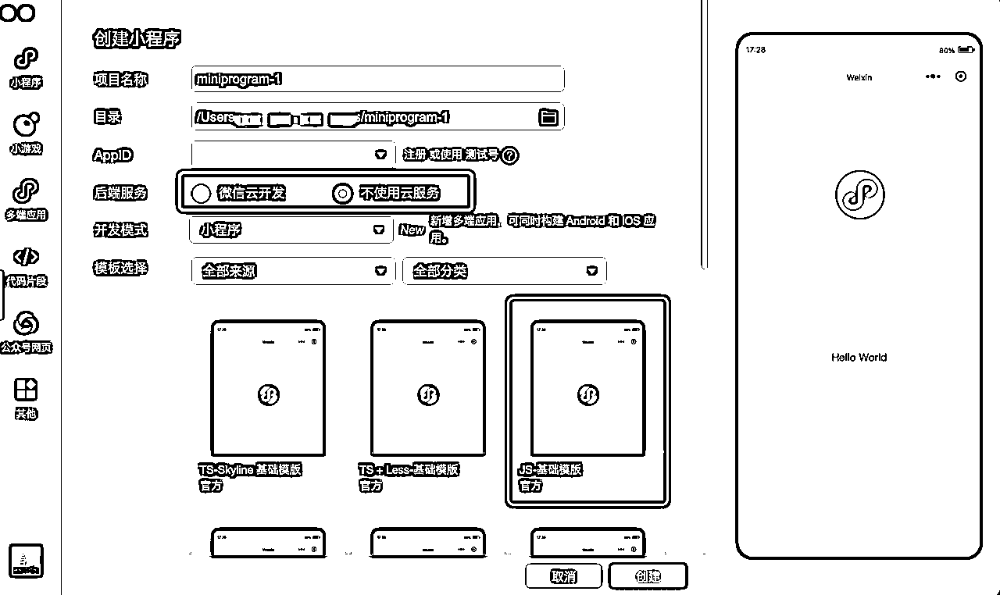

注意三点：
- 有服务器就选不使用云开发，没服务器则选云开发（每月19元）。
- AppID如果有就选自己的，没有就选测试号。
- 模板建议选“JS基础模板”或“TS基础模板”，后续给AI省事。

2. 新建页面

项目建好后，右键pages文件夹，新建一个文件夹，名字可以叫“atlas”（根据页面功能起名）。接着右键atlas，选“新建Page”，它会自动生成js、json、wxml、wxss四个文件。js管交互，json管组件和插件，wxml管结构，wxss管样式。了解完这些，接下来的事基本就交给AI了。

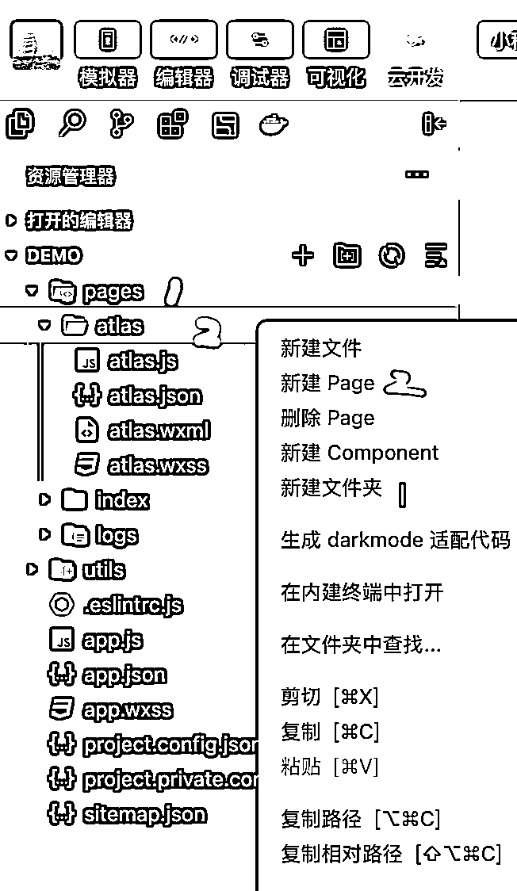

3. 为什么用Cursor

它和其他AI编码工具最大的区别是：不用上传代码片段，它能直接读整个项目工程，然后基于现状给出修改。这对小程序这种多文件工程特别友好。

打开Cursor，点“Open a folder”，选中刚才的项目根目录：

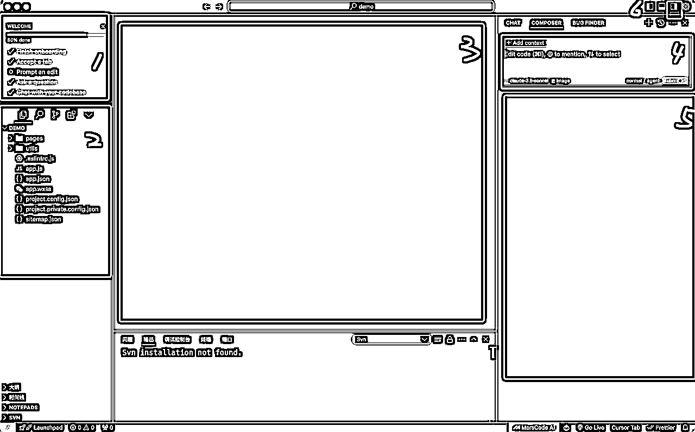

界面功能区大致是：左侧是文件树和编码区，右侧是对话区。对话区输入框左上角的“+”可以指定读取哪些文件。AI生成的代码，你复制到左侧对应文件里就行。有些项目支持一键导入，小程序似乎要手动复制。

免费额度用完后有小技巧：去官网注销账号，再重新注册，额度会清零。

4. 用自然语言生成聊天页面

我在Cursor里输入了这样的需求：

“请用微信小程序原生语言，在atlas页面生成一个类似微信的聊天界面：
1、主体是对话框，机器人消息居左，机器人头像在消息左侧；用户消息居右，用户头像在消息右侧。
2、底部有输入框和发送按钮，用户输入文字点发送，内容显示在右侧。
3、对话数据保存在数组中，格式如下：
talkList: [
{"id": null, "role": "user", "content": "你好"},
{"id": "as-udskdkmh85", "role": "assistant", "content": "我是机器人，请问有什么可以帮您？"}
]”

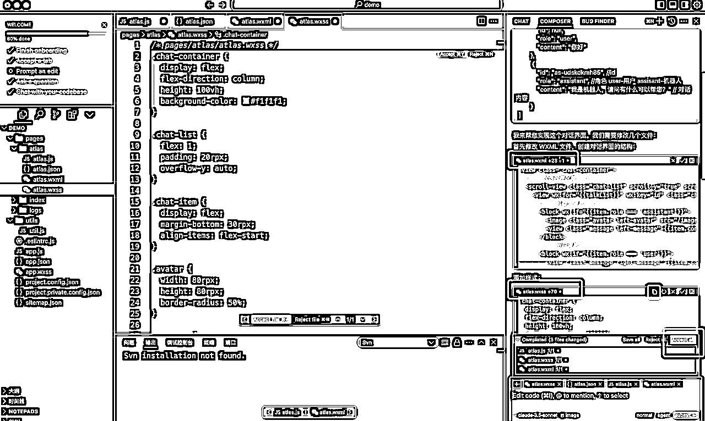

AI很快给出代码，我选择了“Accept all”一键接受所有修改。然后回到微信开发者工具，打开模拟器，点编译：

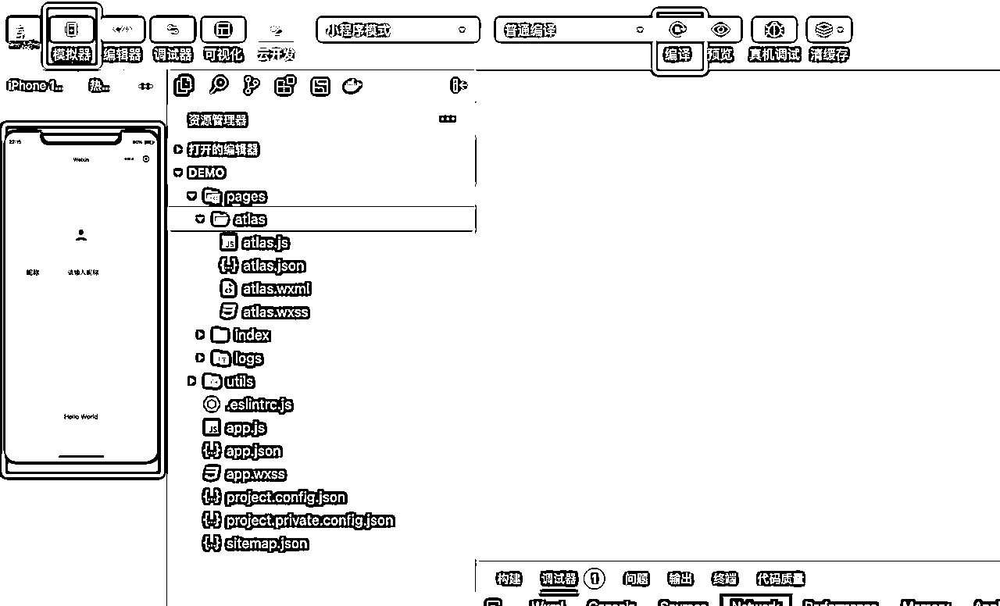

页面没立刻显示正常，需要设置编译路径。我按“添加编译模式”把启动页面改成atlas的路径，再编译：

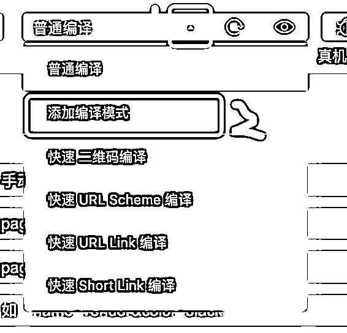

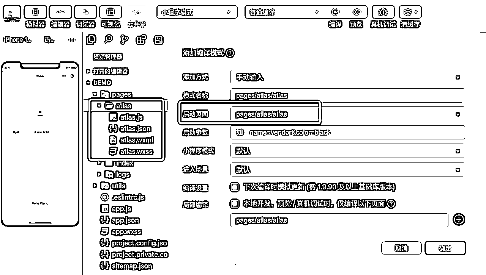

这次模拟器里能看到聊天界面了，但Console里有一行红字报错。我也不懂，就整个复制给了Cursor：

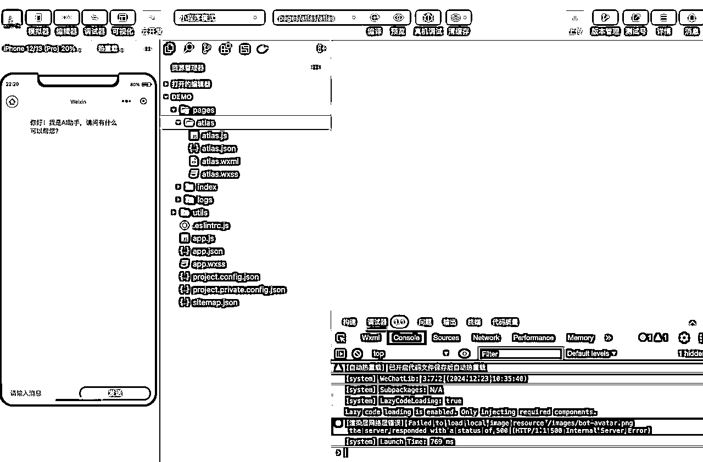

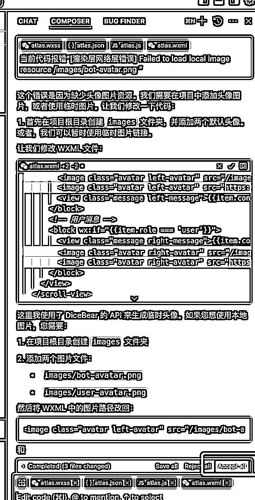

它很快定位到问题：代码里引用了一张本地图片，但images文件夹里并没有这个文件。于是它自动改成网络图片，我继续点“Accept all”。回微信开发者工具再编译，报错消失，机器人头像也正常显示了。

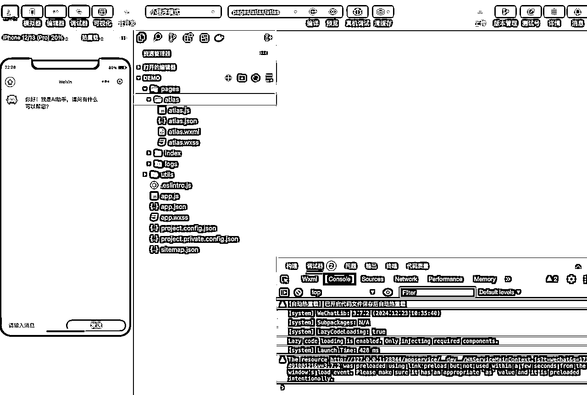

页面跑通后，我开始提优化需求。比如发送按钮太丑，想塞进输入框里，就跟Cursor说：“把页面最下方的发送按钮移到输入框内部最右侧，用图标展示。”它改完，我确认，再编译，完美。

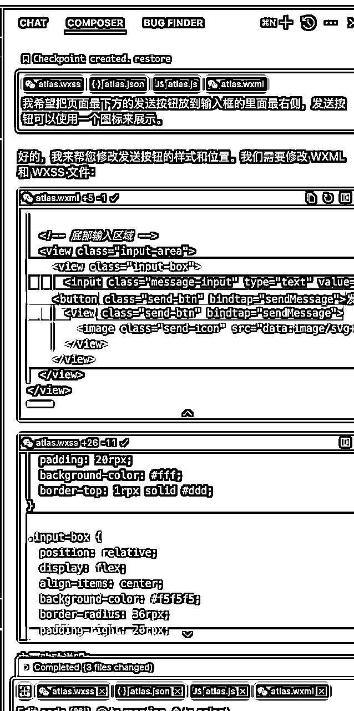

我在输入框里敲了一句“你好，我是用户”，机器人马上回了一条消息：

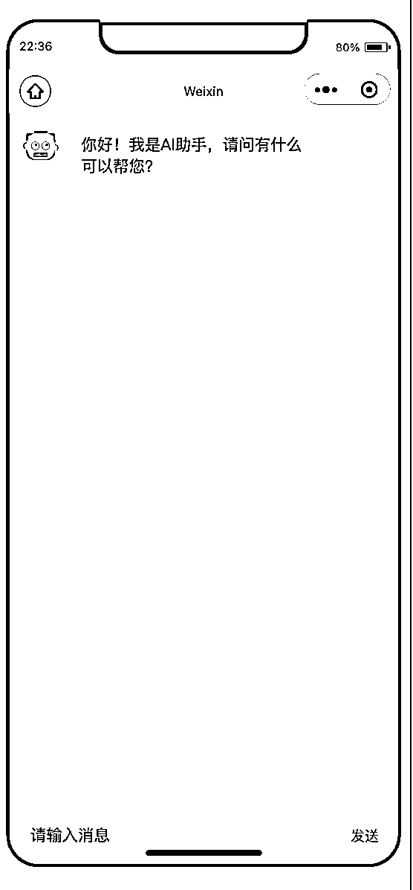

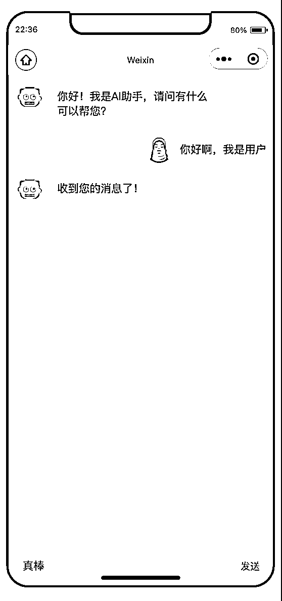

然后我又发现头像位置不对、背景太单调……解决方式都一样：把问题一句一句发给Cursor，点接受，去模拟器看效果，不行就再来一轮。就这么反复磨，页面和功能一点点完善起来。

5. 给机器人接上大模型

想让对话更智能，必须接大模型API。市面上可选的主流平台有：
- 百度千帆：https://cloud.baidu.com/doc/WENXINWORKSHOP/s/Fm2vrveyu
- 讯飞星火：https://xinghuo.xfyun.cn/sparkapi?ch=bytg-api01&msclkid=ed5007893cd6168c7bac60e26b7874c0
- 阿里通义：https://help.aliyun.com/zh/model-studio/developer-reference/use-qwen-by-calling-api
- Kimi：https://platform.moonshot.cn/docs/guide/start-using-kimi-api

我选的是百度千帆，注册后能领免费试用额度，开发期基本够用。拿到key后，在Cursor里说：“帮我研究一下这个文档里的API调用规则：https://cloud.baidu.com/doc/WENXINWORKSHOP/s/Fm2vrveyu ，然后按它改造现在的代码。”它就会自动读文档、生成调用代码，并在需要填Key的位置留下注释，你把自己的API Key和Secret Key粘进去就行。

这套流程走完，古钱币问答小程序的雏形就已经能跑通了。

6. 不断重复

后续就是拼想象力的时候了。哪里不满意，就用自然语言描述出来，让AI改，然后重复“确认-编译-看效果”的循环。

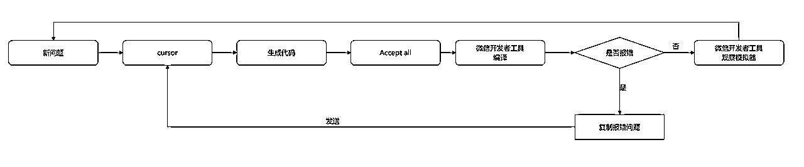

7. 踩坑提醒

- 如果你访问的是IP地址而非域名，要在微信开发者工具的“详情”里勾选“不校验合法域名、web-view(业务域名)、TLS版本以及HTTPS证书”。

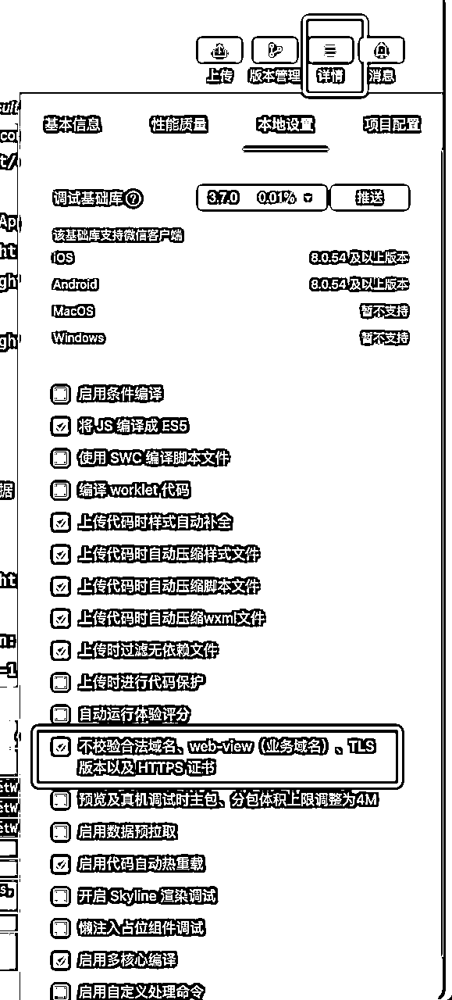

- 如果接口要访问域名，记得在小程序后台“开发管理-开发设置-服务器域名”里先配置好。

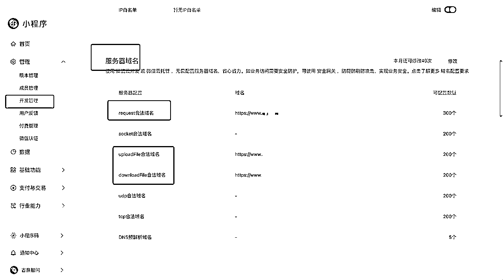

- 想用手机真机调试，点开发者工具里的“预览/真机调试”，生成二维码后扫码即可。

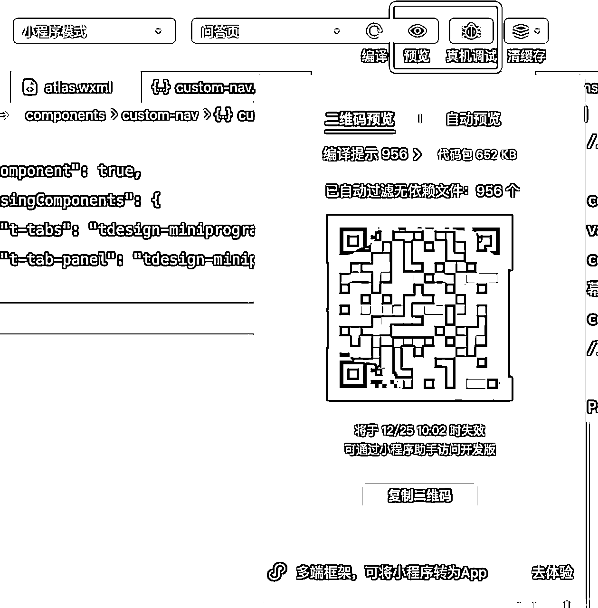

三、部署发布流程

1. 上传代码

全部改完后，在开发者工具点“上传”，填版本号和备注，上传成功后就到了小程序后台的“版本管理”。这里能看到“提交审核”和“选为体验版”两个入口。

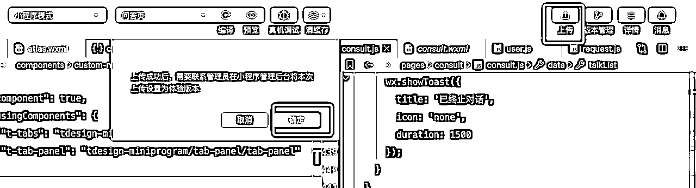

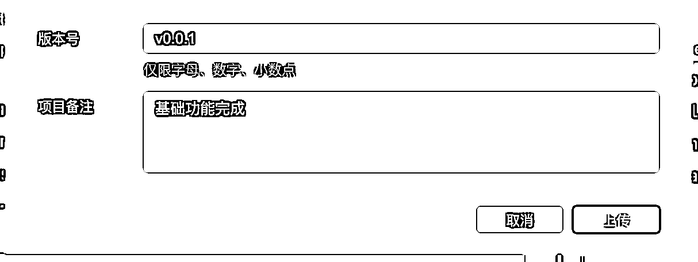

2. 发布体验版（私域）

“选为体验版”相当于发一个预览版本，只有拿到体验版二维码的人才能打开。想给非开发者体验，需要在后台“成员管理”里配好权限。

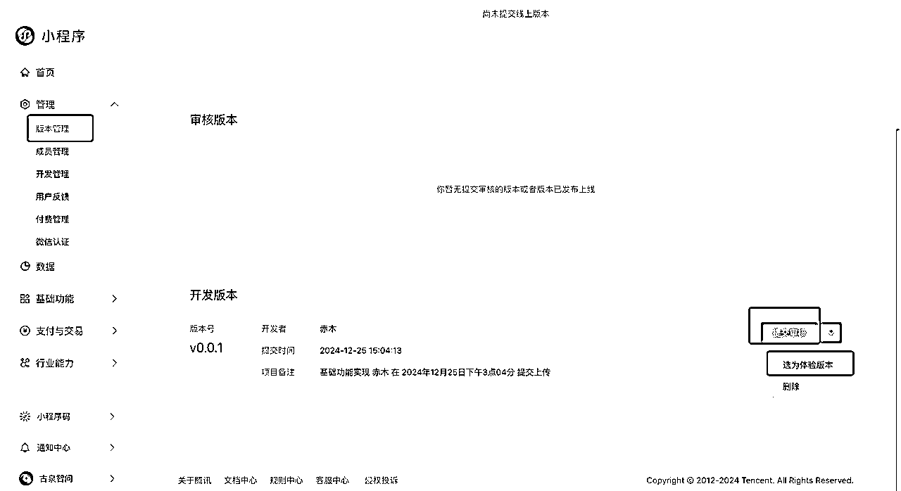

3. 发布线上（公域）

“提交审核”是让腾讯检查你的小程序有没有违规内容，审核通过后才允许正式发布。点下去，坐等结果就行。

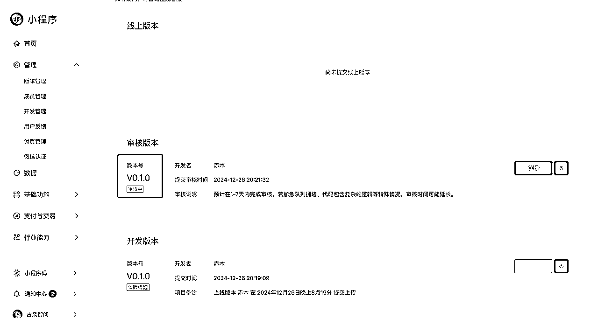

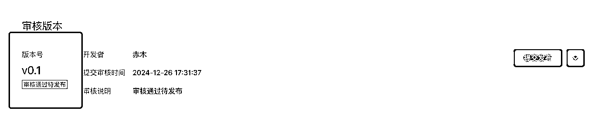

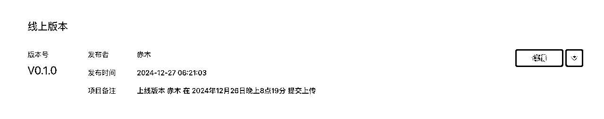

四、当前状态：引流为主

做这个小程序的初衷，是看到亦仁大大发的龙珠悬赏，恰好我最近在玩Cursor，就顺手把过程记录下来了。现在项目还处于引流期，只有独立访客超过500个UV才能开通流量主，靠广告赚点击，金额不大。后续成熟的变现方式，我暂时还在摸索。

五、最后说几点补充

1. 自然语言编程真的让我惊讶。哪怕你完全没有技术背景，也能靠描述需求快速写出一套程序。AI生成的代码未必是最优的，但功能基本都能实现。
2. 我习惯一个页面一个页面地让Cursor改。想再快，可以用它的Composer功能：

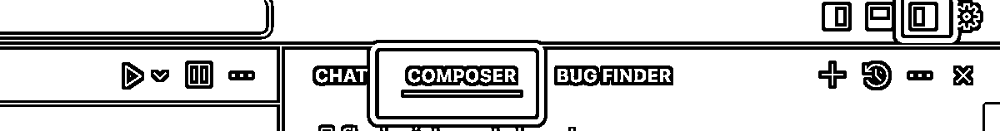

它在多文件协作时更好用，比如可以这样提问：“你现在是微信小程序UI研发专家，熟练掌握小程序各种UI设计。请根据经验设计整体风格。你现在在项目根目录。你要设计一个页面，页面里有一个日历，用户可以自由按年、月、日切换查看。”

3. 开发中遇到报错太正常了，我有个小错误让它来回改了五六次才通过，心态别崩，它总会改对的。
4. 用微信小程序的某些能力前，记得去“小程序后台→账号设置→服务内容声明→用户隐私保护指引”里完善配置，否则功能会被卡住。
5. 我陆陆续续做了三天。如果你连续做，估计一天就够。真正花时间的是各种认证：服务器认证和域名备案大约7-22天，小程序认证一周左右（运气好当天就能过），代码审核通常几小时，最长一周内。
6. 实操中卡住了，或者你有更好的变现点子，欢迎加我微信【H452555338】交流（请注明来意）。