# 我在夜市用AI赚钱，结果被现实狠狠教育了一顿
作者：龙哥

三年前，我把公司的业务逻辑彻底摸透之后，仗着自己技术还不错，拉上同事一起出来创业。我管研发，他管流量。一路闷头开发，短剧、社交、工具类，前前后后做了十几款APP，都成功上了应用市场，还真等到了流量爆发，后台用户数蹭蹭往上涨。

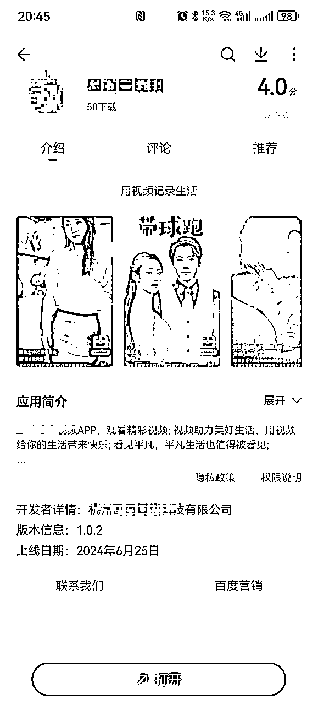

那段时间我每天只睡四个小时，剩下的时间全在写代码。后来业务稳了，增长也卡住了，就想换个赛道折腾点新东西。

AI是我一直盯着的一个方向。早先GPT刚出来那会儿，我还靠帮人注册账号蹭过一波流量，算是跟AI有点缘分。后来看到一些👸号分享AI线下的成功案例，手头正好有空档，就动了心思，打算亲自下场试一试。

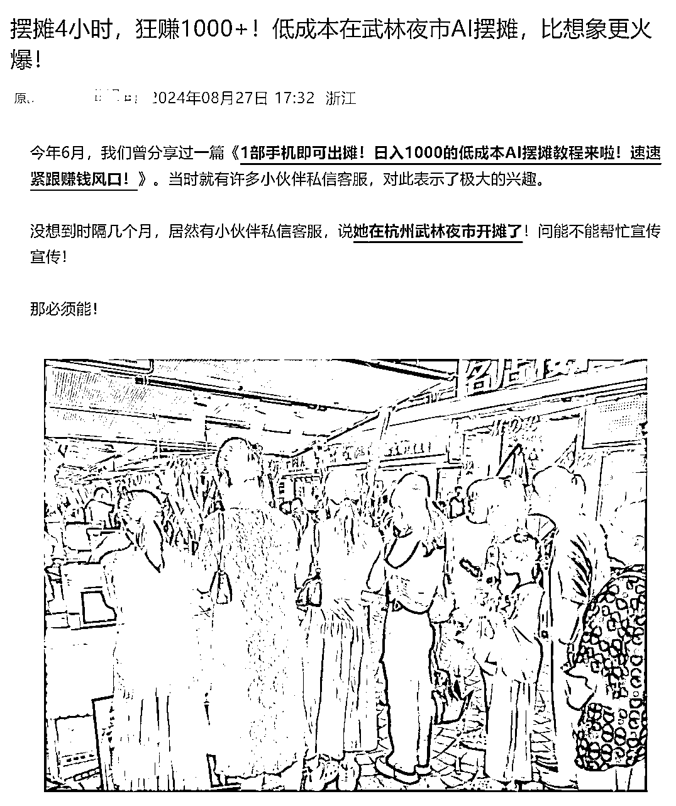

## 第一仗，败得灰头土脸

我考察了杭州几个夜市，最后选了武林夜市——离我住得近，又是杭州最大的夜市。谈好合作，拿下了一个点位。

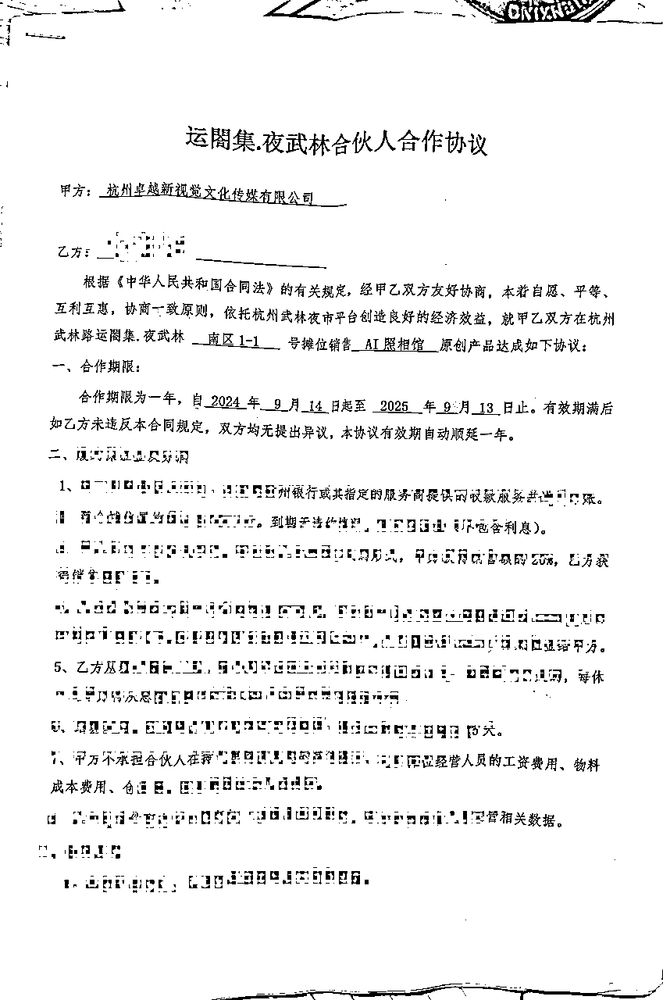

当时我其实对AI落地一知半解，用的是第三方软件做人像写真。流程很简单：现场拍张照，AI生成一张“美照”。我准备了打印机和相框，定价19.9元一张6寸照片，还送相框。

理想很丰满，现实很骨感。围观的人很多，体验的人也不少，但一说到掏钱，全跑了。

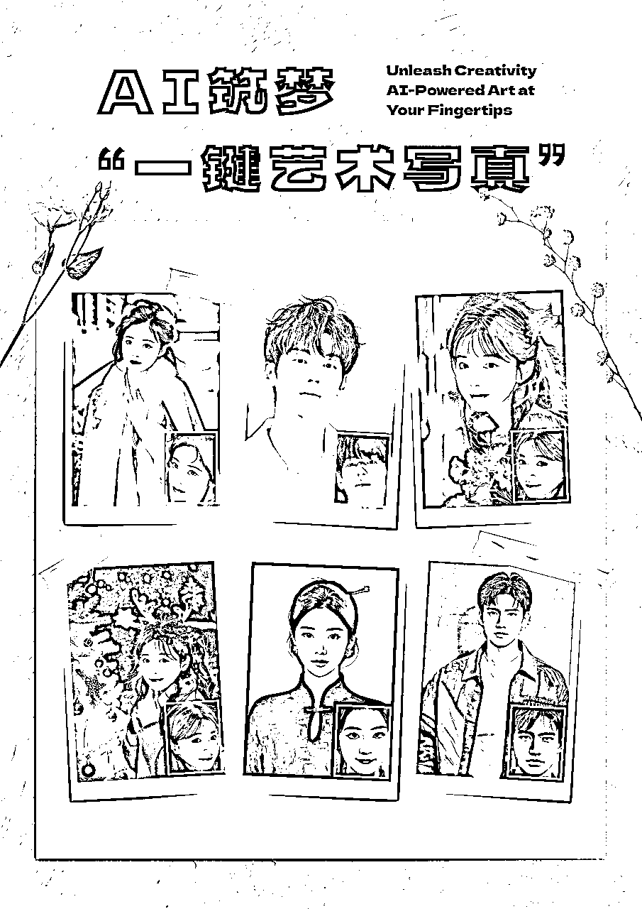

我这才明白，线上聊AI是一回事，线下让人掏钱完全是另一回事。哪怕只要19.9还送相框，照样没人买单。好多人凑过来看一眼，说“抖音上也能做，凭啥花钱”；也有少数人试了，丢下一句“不像”“不好看”转身就走。软件费花了不少，收入却少得可怜，跟我原本设想的“AI引爆全场”差了十万八千里。

后来发现，真正愿意付费的并不是年轻女生，而是一群上了年纪的阿姨。她们愿意尝鲜，觉得好看就掏钱。年轻人反而一看到“AI”两个字就掉头走，这跟短视频上铺天盖地的宣传完全是两码事。市场给出的真实反馈，就是这么直接。

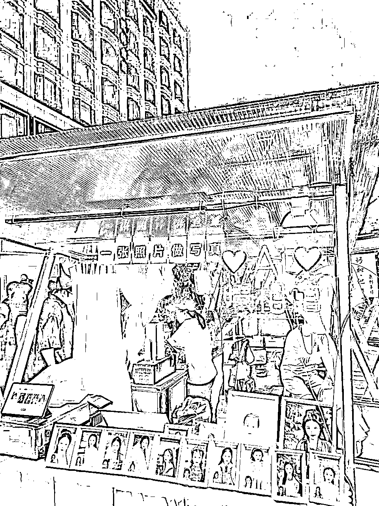

## 我开始怀疑AI是不是割韭菜

线上热火朝天，线下却是一片冷淡，甚至“AI”都成了负面词。路过的人经常嘀咕：“这里怎么还有AI啊，抖音快手也能做。”看到招牌上有AI，他们连看都不愿意多看一眼。后来我干脆把“AI”两个字遮住，反而有人好奇凑过来看看是干什么的。

那一刻我想明白了一件事：路人其实没人在意你用的什么技术，他们只关心你能交付什么样的结果。

武林夜市每天人流量上万，但人流量大不代表什么都能卖出去。那边有句口头禅叫“有人流，不停留”，一开始我不懂，后来跟周边摊主混熟了才明白：今年生意是真不好，经济大环境摆在那里，大家花钱都谨慎，文创类连续几天不开单是常事。有个大哥跟我说，去年一个月能卖三万，今年半个月了才六千。最搞笑的是，我有天营业额连100都不到，居然成了附近的销冠。除了做吃的，文创摊位一直在换人，这个市场并没有看上去那么好混。

我是做线上出身的人，完全没想到线下实体经济已经卷成这个样子。以前只顾着埋头写代码，对市场的感知确实太想当然了。

为了搞AI，我交了不少学费，SD、Comfyui都学了一圈。课确实教了点东西，但要说“搭个工作流就能躺赚”，我第一个不同意。我之所以能撑下来，是因为我拿这些知识结合自己的开发能力，把出图效率和成本优化到了极致。如果只会用别人的软件和工作流，别说什么使用费了，光前期手动处理图片就能把你累到怀疑人生，所谓的自动出图根本不存在——我是后来自己写了软件才做到全自动的。刚开始我用工作流在几个服务器之间来回切换出图，眼睛都快看瞎了。用户的原始图片很多根本没法直接丢给AI，得人工预处理，出图后还得用PS精修。放在线下这种需要快速交付的场合，这流程本身就是不合理的。

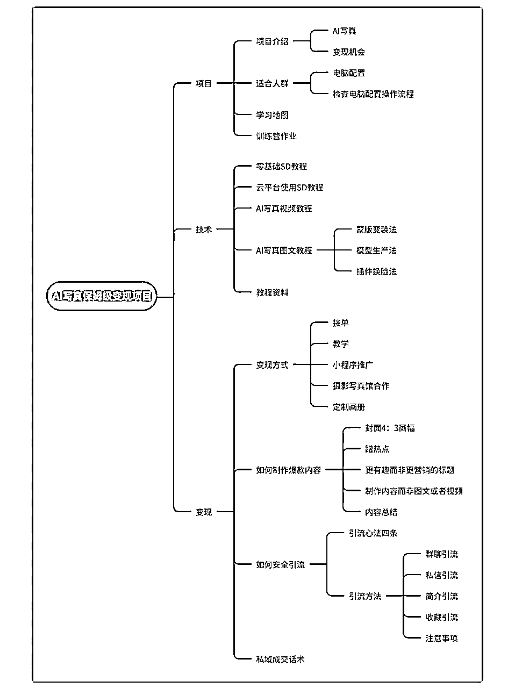

## 不行，得改

这种状态大概撑了三天，我决定不再死磕，换个方向试试。先上了儿童AI写真、宠物守护神、宠物肖像这几个新项目。

儿童AI写真：有家长过来问，也试了，但反馈不像孩子，要么就是表情僵硬，效果一般，市场不认。而且家长是掏钱的人，孩子脸上少一颗痣都会被说“不像”，最后基本是试了但不下单。

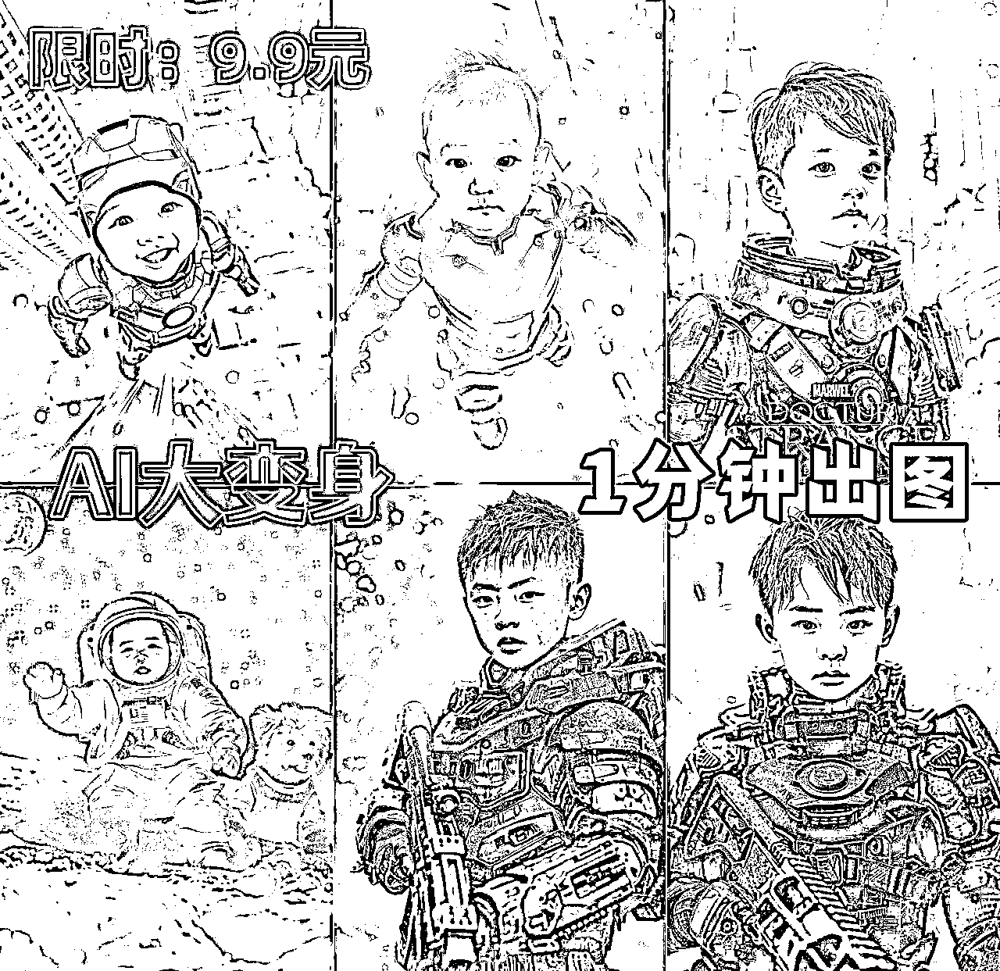

宠物守护神：噱头是够的，能吸引眼球，但实际没做几单。这玩意儿对照片要求特别高，人和宠物得有一定互动，合成的效果才好。很多客户手机里根本没有合适的照片，就算有，处理起来也特别费时间——人和宠物都要抠图，再用Comfyui跑工作流，要跑到客户满意，得反复来好几遍，成交时间被无限拉长。线下这种有时间限制的地方，根本玩不转。我也终于明白，Comfyui跑图有随机性，想短时间内出满意的图基本靠运气，网上说的“躺赚”纯属坑小白。

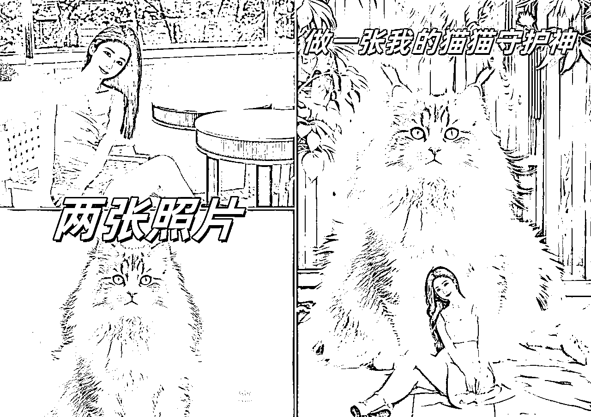

宠物肖像反而成了黑马。这个项目我之前最不看好，因为技术含量低，效果也一般。结果反馈是最好的。说白了，我也是犯了技术人的老毛病，一门心思扑在牛逼的技术和惊艳的效果上，却完全没搞懂市场到底想要什么。技术门槛低，换来的却是效率高，短时间内就能丢出好几张图让用户自己挑，只要其中一张能打动他，这单就成了，成交周期被压缩到很短。

于是决定All in这个赛道。我开始准备宣传物料，顺手把相关软件也开发了。后期用自研程序，后台配置5台算力服务器，不需要在服务器之间切换工作流，1分钟就能出10张图。

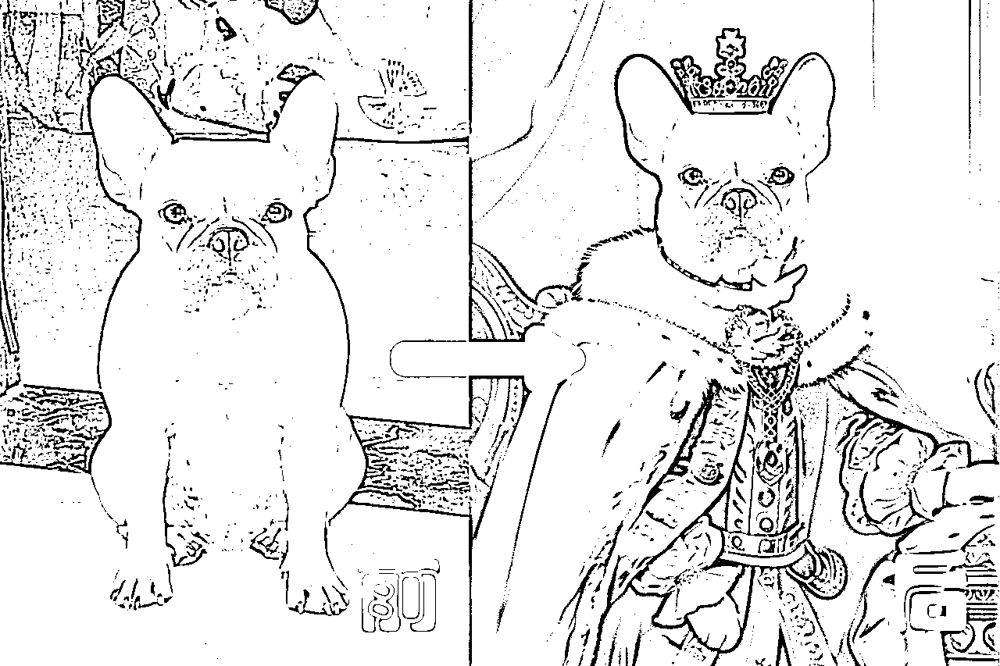

有了软件加持，出图效率直线上升，营业额也终于有了突破。但再往上就撞到天花板了——线下时间有限，每天能做图的数量有上限。我开始琢磨：能不能把这个流程完全程序化、自动化？做小程序的想法就这么冒出来了。

为什么是小程序，而不是我本来更擅长的安卓APP？首先这个功能不复杂；其次，多年的安卓开发让我清楚一个道理：开发容易传播难。用户下载安装APP的成本太高，转发也不方便。再说做了安卓，苹果用户怎么办？总不能重新再开发一个吧。🛰️小程序打开就用，转发也简单。宠物主都有群，只要他们满意，群里一转就传开了。

重新设计宣传物料。

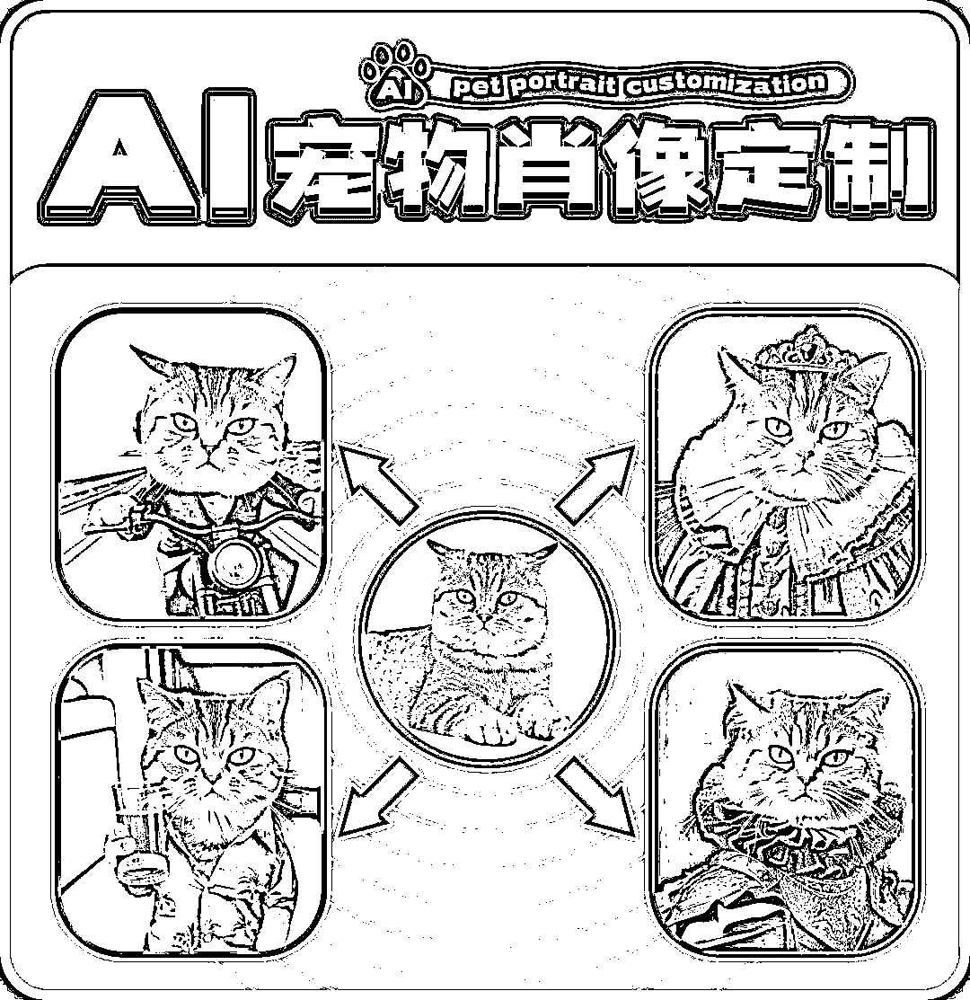
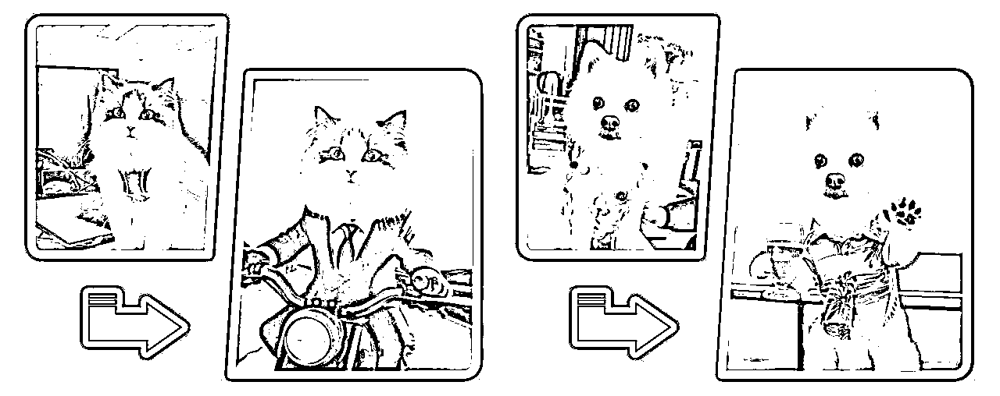
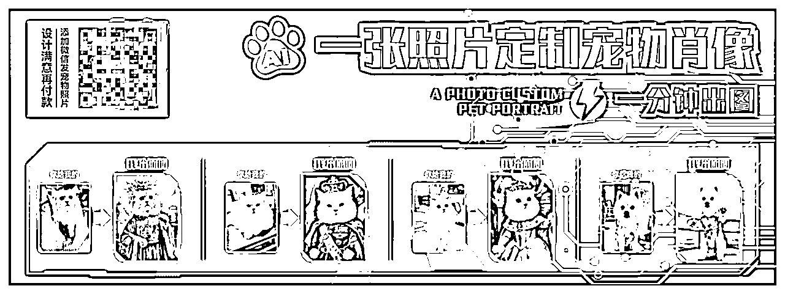

这过程中，夜市负责人觉得AI这个品类挺新鲜，还给我调了个位置，就在武林夜市打卡点旁边，妥妥的C位。

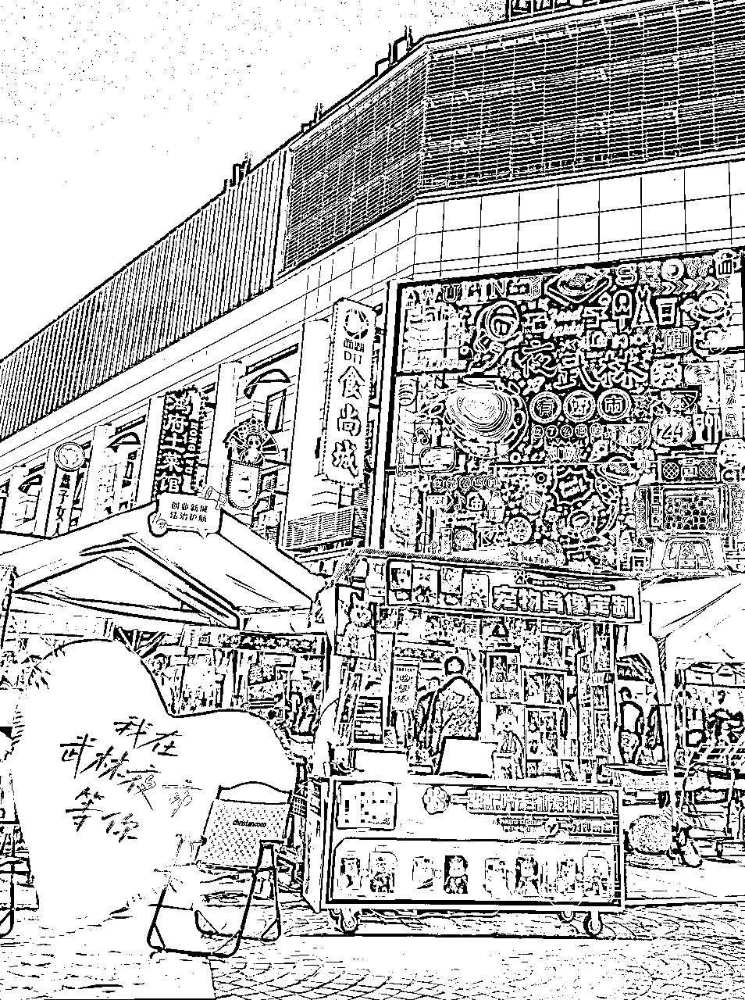

第一步，先开发一款专门给夜市用的软件。核心要求就一个：百分百贴合夜市场景，步骤最简单，出图最快，界面美不美观完全无所谓。

这是软件跑起来的样子。

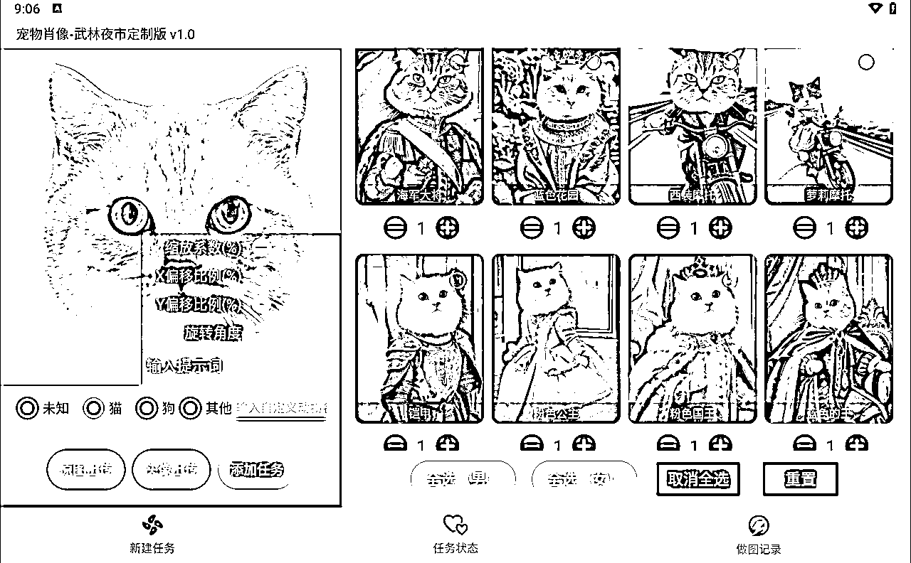
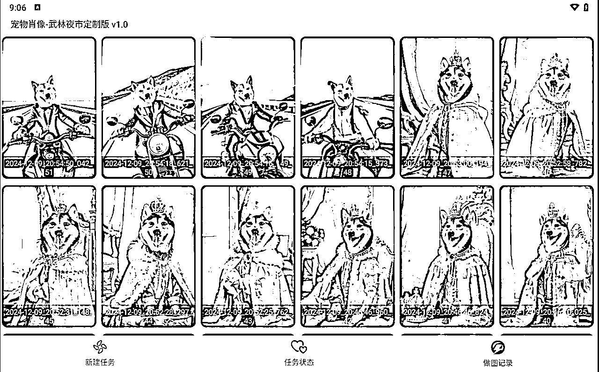

现场用起来长这样。

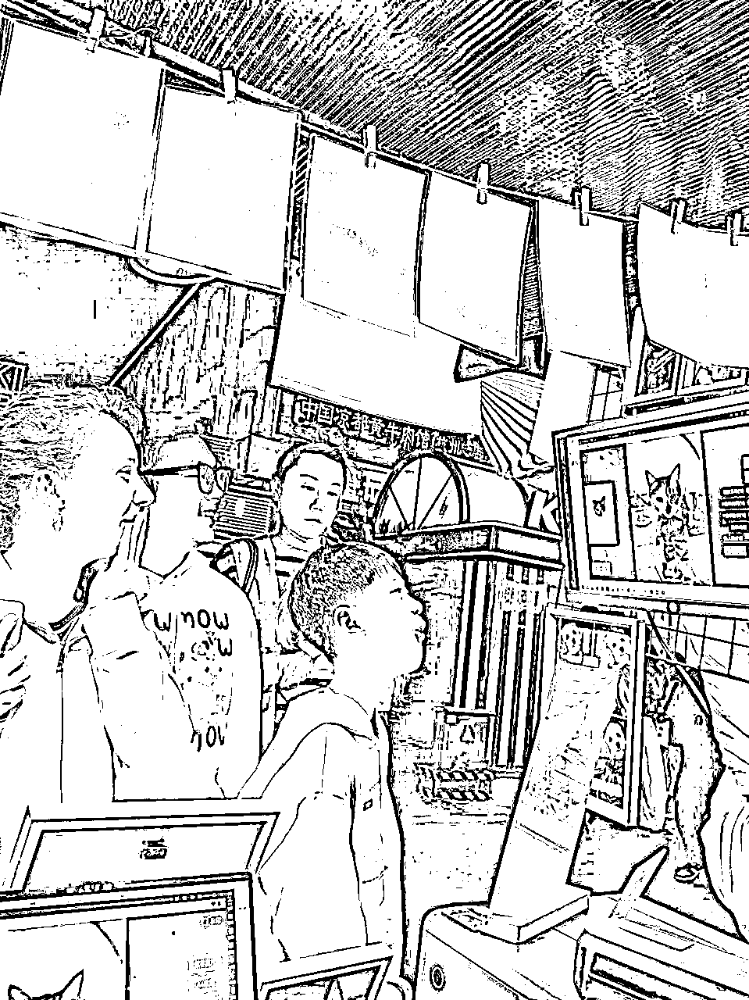
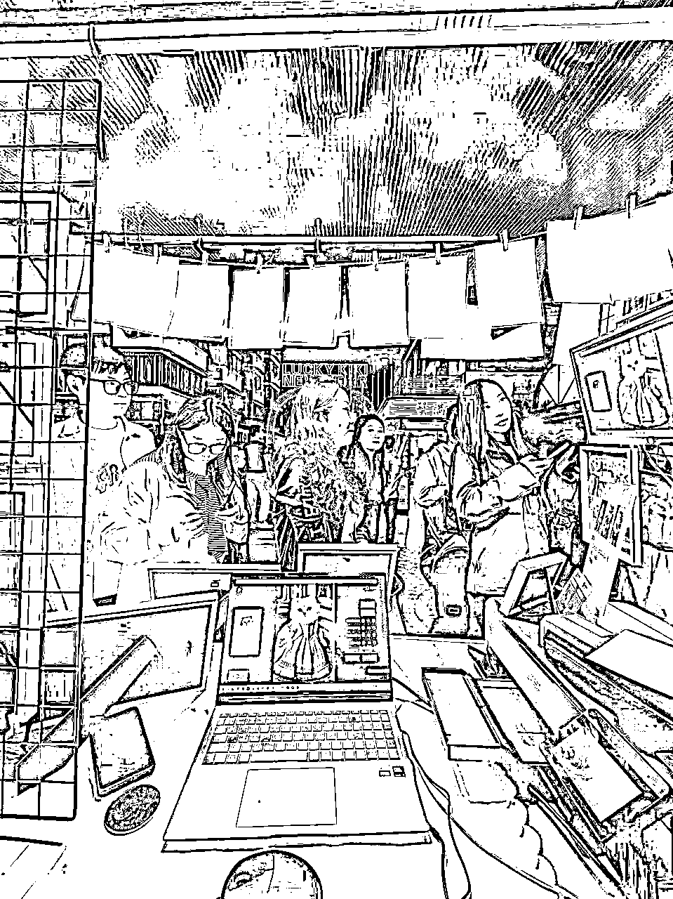

第二步，开发小程序。技术上验证没问题之后，就做普通用户版。不能只困在夜市里，所以开始画原型图，找之前的UI设计师出效果图。

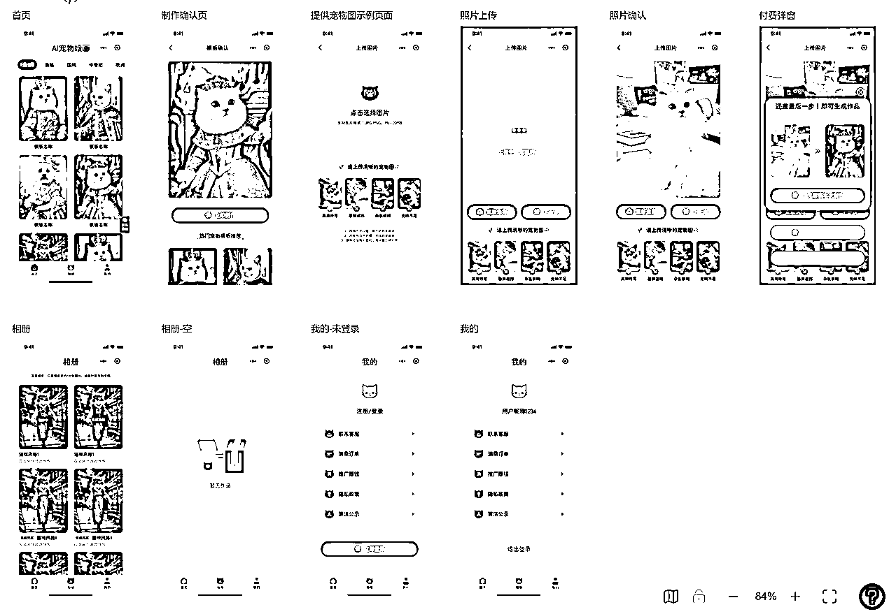

第三步，开发一体机。这东西没什么技术难度，说白了就是个大号的安卓手机，反而更简单，正好是我强项。现在市面上随便一台AI拍照机都要大几万，实际硬件成本才几千块。这要是能卖出去，也是一笔不小的收入。一体机设计很快就做完了。

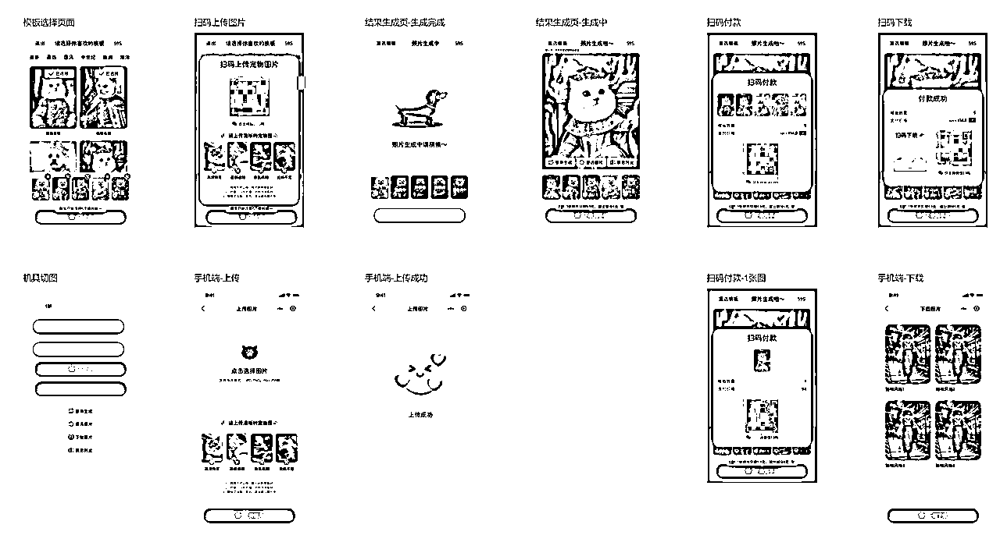
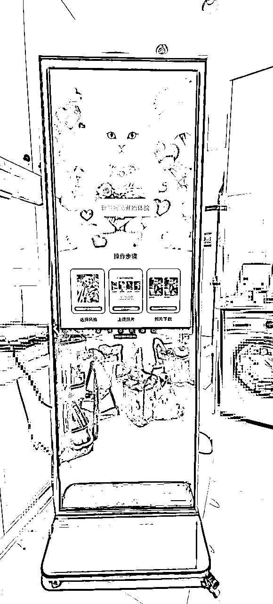
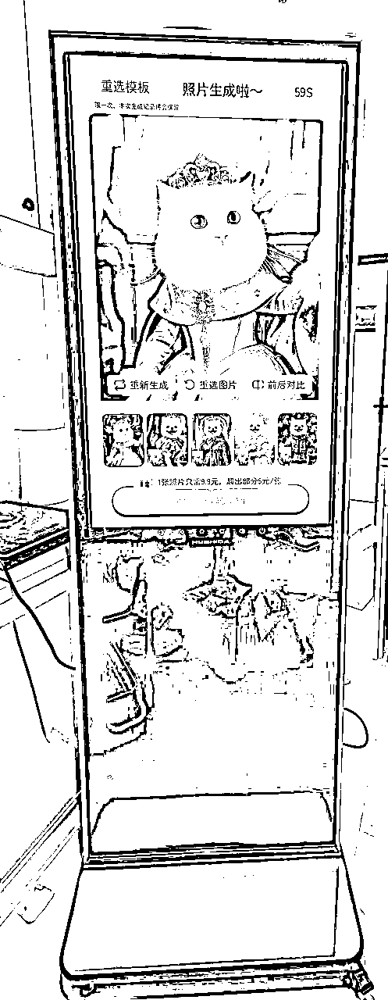

## 小程序开发，绕不开的五道坎

1. 我没做过小程序。我是安卓程序员出身，对🛰️小程序代码不熟悉。一开始看官方文档、官方课堂，知识点散得不行，好几天都找不到门道。最后还是花钱买了课，系统学了一遍才算入门。后面边做边问AI，开发里的问题也就一个个啃下来了。

2. 后台开发怎么搞？这个其实好办。以前独立做过好几个项目，服务器接口、数据库、对象存储都有成熟方案。唯一麻烦的是🛰️小程序要求接口全部走https，折腾了一阵，最后在淘宝买了个证书搞定。

3. 最大的问题：算力服务器怎么分配？我选的是仙宫云。一个人用的时候，随时开关无所谓。但用户一多，高峰期一台根本不够；半夜人少了还全开着，又纯属浪费。市面上找了一圈，也没有能提供动态算力的服务商。最后干脆自己写了一套负载均衡算法：如果一台机器十分钟没人用，就先关掉；一旦有人触发任务，再把它叫醒。高峰期自动多开几台，低谷期按需关闭，动态分配算力，最大限度省成本。

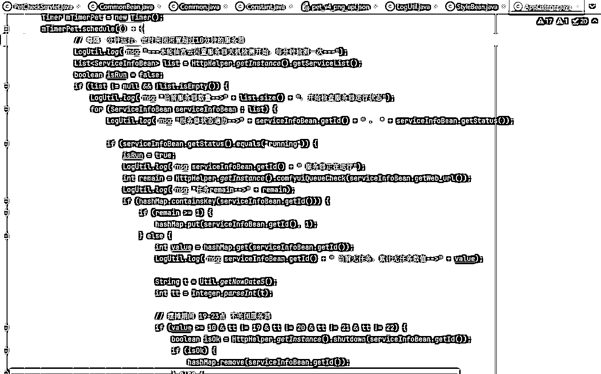
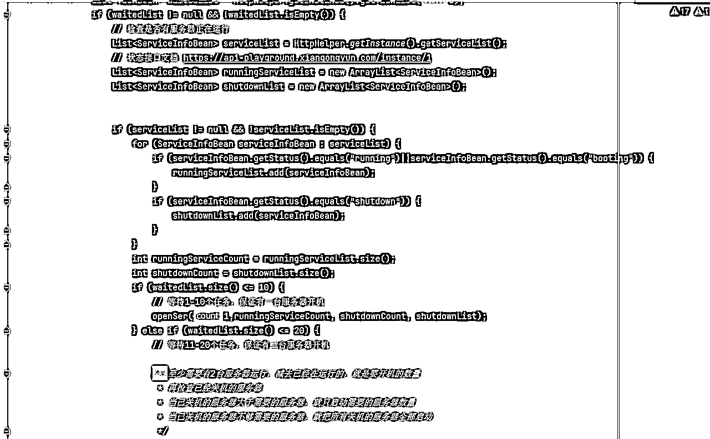

4. 怎么识别宠物面部？宠物头像的底层逻辑，是从原图里把宠物脸抠出来，再让AI融合到合适场景。以前摆摊是我自己用PS抠，做成软件就得自动处理。这里倒真用上了AI的图像识别，我训练了个模型，写了一套算法，把问题解决了。

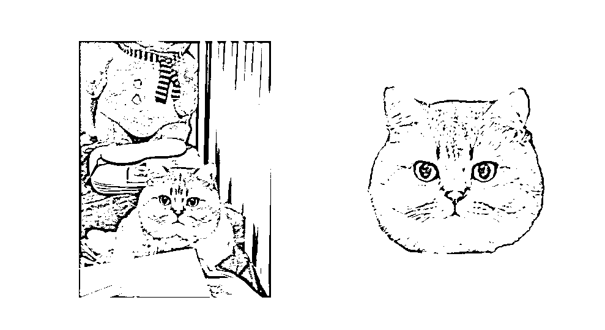

5. 小程序上架问题。上架时碰到AI算法需要备案。自己去做，好几万块钱不说，还得搭上几个月时间。后来在赚钱上找到了路子，直接用百度的AI算法去提测，顺利通过审核，小程序“AI宠物头像”正式上架。

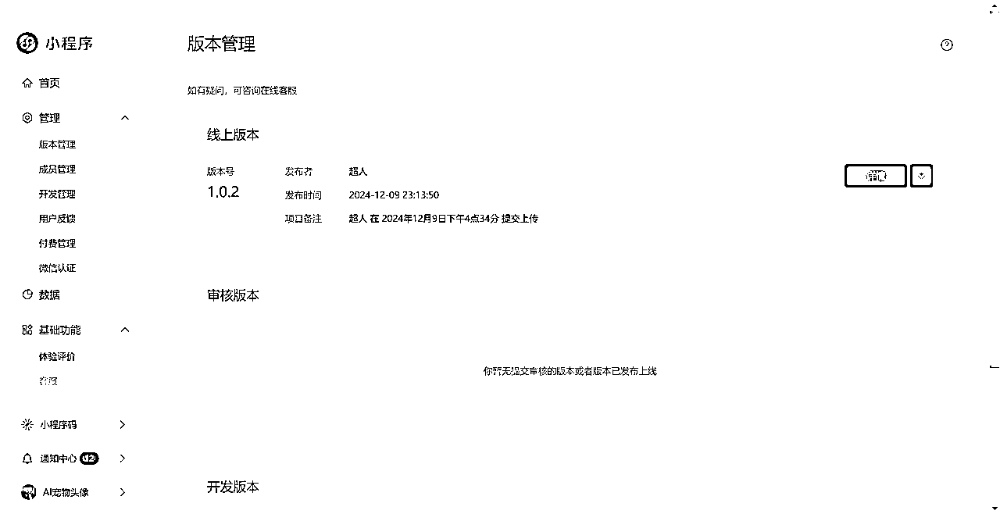

以上就是最大五个坑。至于其他细节小问题，每天层出不穷，不过我也不是第一天创业了，早习惯了。整体来说，比安卓开发遇到的麻烦还少点——毕竟现在安卓APP上架门槛越来越高。小程序从开发到上架一共花了20天，顺带把小程序技术学了，有了这次代码积累，以后再开发只会更快。

## 复盘：AI到底能不能落地？

回头想，几个结论很清晰：

- 只靠AI课程那点东西，很难直接变成钱。
- AI想创造价值，必须结合你自己或你团队的独特优势。
- 摆摊期间遇到一些客户，问我能不能用AI解决电商模特图的问题。
- AI技术确实充满想象空间，但要说当下最稳的赚钱路子，可能还是教别人怎么用AI。
- 小程序目前主要面向国内用户。下一步想把抖音上流行的动物唱歌模板整合进来，试着用分成制度推广。
- 海外也有机会。成交客户主要集中在广东、上海，以及新加坡、马来西亚这些地方，那边的人对宠物特别上心。后面我打算研究一下TikTok和Etsy这些海外平台。
- 同时想把软件集成到一体机里，找实体店合作，把盘子做起来。
- 再次验证了：掌握核心技术太重要了，依赖别人的软件和工作流，不可控因素太多。

反思自己：老业务增长停滞的时候，我确实急着找新路。虽然也走了好几个渠道去验证项目，但给你信息的人有自己的立场，很难拿到真实反馈。前期调研没做到位，加上自己过于自信，栽跟头是迟早的。以后还是得放低姿态，多跟拿到结果的人请教，先把成熟模式跑通，再想着超越。

不过，这次线下和客户面对面交流，收获也很大。零距离体验了完整的成交过程，跟以前做APP时盯着下载量、启动次数、付费转化率这些冷冰冰的数字完全不是一回事。我更能理解用户在付费那一刻的真实心理了，这为后面线上项目开发打下基础。接下来我准备全面转回线上，结合自己的技术优势，用软件继续放大收益。

摆摊遇见的趣事也不少：有人想跟我合作做一体写真机，有网红在现场撒钱，还有同行线上宣传做得飞起，我去线下考察发现摊位空无一人……篇幅有限就不啰嗦了，感兴趣的朋友可以私聊。