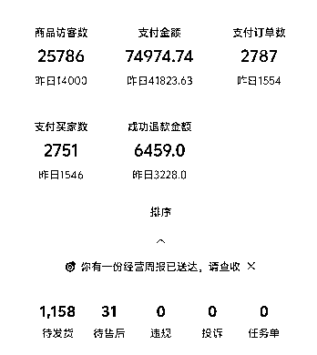
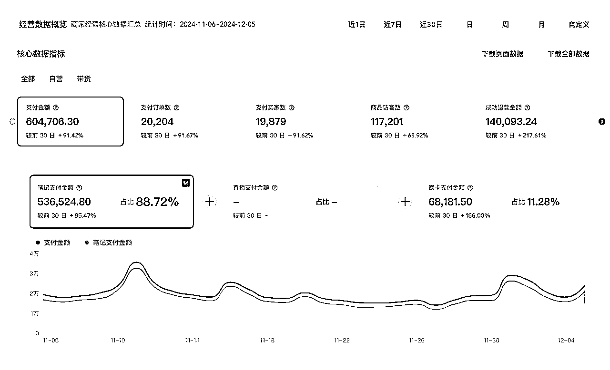
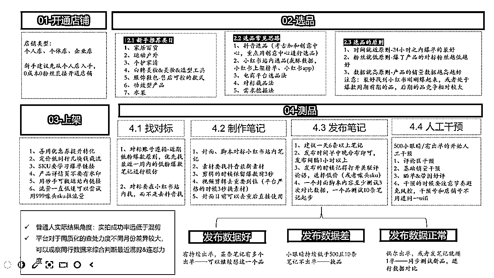
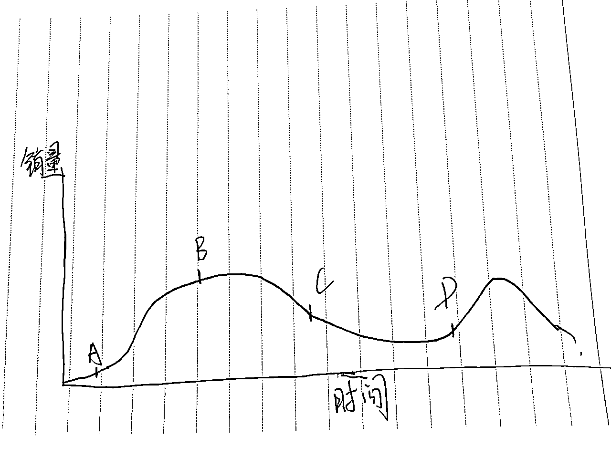
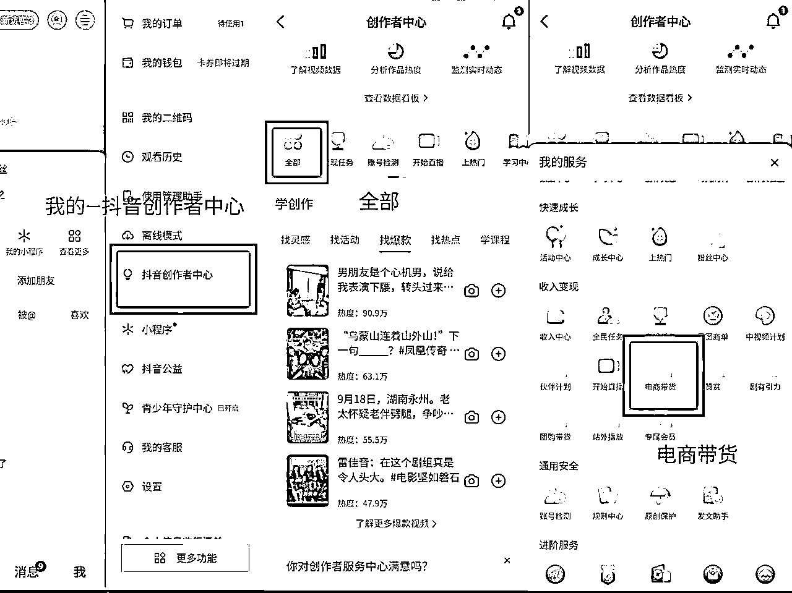
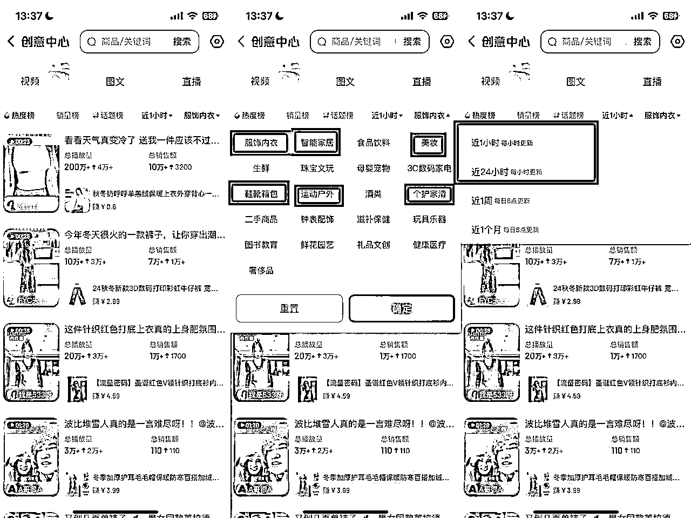
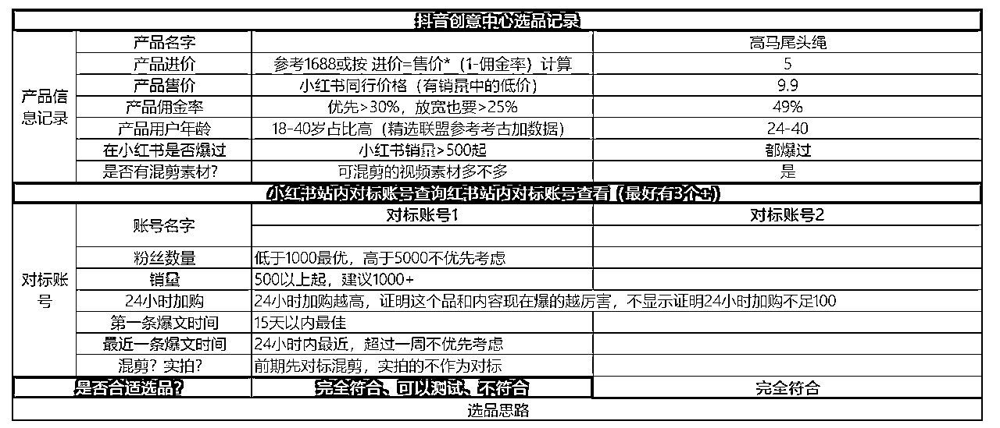

# 📕电商全流程解析

我是小刀，去年五月通过赚钱航海开始做📕电商，到现在正好一年半。这段时间一直专注在这个项目上，先后操盘了多家店铺，总GMV突破百万，涉及的类目包括百货、美妆工具、运动用品、功效养生产品等。十月份平台进入流量低谷，大家普遍觉得难熬，十一月数据慢慢回暖，我用一个新号单天跑出了近8万GMV。单店铺单月最高做到60万+，而且是用混剪方式跑出来的。

不少人问我：📕电商已经火了差不多两年，现在进场还有机会吗？无货源还能不能玩？混剪是不是行不通了？客观讲，难度确实比去年上半年上了一个台阶，入场的人多、竞争卷，正反馈的时间也被拉长了。双十一前平台还调过一轮流量，很多人的数据都跌进谷底，但现在基本恢复了。就我们实际测试来说，新手依然能爆单，核心还是选品，选到真正的爆品，起号速度依旧在线；混剪也依然能打，平台确实出过严打同质化的规则，但这不是只针对混剪，实拍同样要注意，而且最近的查处力度其实很低。

那到底是实拍还是混剪？不结合自身能力和产品，直接谈形式就是耍流氓。从能力维度看，大多数产品实拍比混剪难得多，实拍需要拍摄技术和网感，这种能力很难短期速成；混剪的优势是剪辑可以快速上手，让素材不成为你的短板。如果你本来就有实拍能力，当然可以选适合实拍的产品走长期路线；但纯小白建议先从混剪进场，用最快的速度行动起来。

从选品角度看，如果产品笔记以视频素材为主，还涉及多场景拍摄或需要露脸展示，混剪会更务实。比如魔法拖把这类家居百货，实拍要搭场景、耗时间，成本高到离谱，但抖音上现成素材一大堆，只要拿捏好剪辑尺度，违规率非常低；而卷发棒、睫毛夹这类产品需要露脸展示效果，对模特和场景要求也高，混剪能大大降低门槛。反过来，如果是图文、实况或单场景视频就能讲清楚的产品，对拍摄审美要求不高，那可以试试二创和实拍结合起号，像夏天爆火的冰敷小风扇，桌面拍摄难度低，实拍结合就很顺。

混剪建议优先做这些类目：家居百货、个护家清、美妆造型工具、白牌美妆、服饰鞋包、运动用品；实拍建议做功效产品、养生工具、低客单价不挑身材的女装、不严格挑码的女鞋、白牌美妆、水果、大学生宿舍场景的3C产品。另外别把实拍和混剪对立起来，抓到一个爆品先干起来，适合混剪就混剪；等品爆单了素材不够，再补一些实拍提升原创度。就算你笃定走实拍路线，遇到好的二创素材一样可以拿来起号。形式没那么重要，重要的是结合自己的能力选对品，用最快速度拿到结果，才更容易坚持。

为了让0基础的朋友也能看懂全流程，我先把思路理一遍今天重点讲选品和测品这两个关键环节。接下来聊选品，这是所有📕电商玩家绕不过去的关口，选品能力需要慢慢练，核心目标是精准识别还在爆款周期内的产品。

一个品的生命周期大体分四个阶段：A点是有人做但还没真正爆起来，竞争少、先发笔记能占先机，但这个阶段非常考验你的判断力，同时没有爆款对标可以抄，封面和内容都要自己摸索；B点是已经爆起来了，对标销量不少，竞争压力上来了，但爆款素材也大量涌现，只要执行到位、跟上最新素材和封面，后续还能持续爆一段时间；C点是爆款笔记都停留在一到两周前，最近一周几乎没有新爆文，这时候入局的人最多，市场空间缩小、内容同质化严重；D点是品还有销量，但近期已经没什么爆款笔记了，除非出现新的素材和封面，否则很难重新激活。

怎么判断一个品处在什么位置？就看这个品在📕上的最新爆文时间：如果一周内有新号做这个品出了爆款，大概率还在B点附近；如果一周内没有新爆文，只有老号偶尔出几条，基本到了C点；如果搜出来的爆文都是半个月以前的，那基本就是D点了。爆款周期能撑多久，取决于市场需求和素材供给。比如风塑梳爆了不到一个月，八字拉力器爆了三个月，滴眼液火了小半年。所以各种选品方法，本质上都是帮你判断目标品处在A点还是B点。

给新手三条红线：第一，销量不到500的品不卖，近一周突然从0冲到500的新爆品除外；第二，近一周没有爆款笔记的品不卖；第三，对标爆款笔记模仿难度太高的品不卖，比如需要实拍、没有混剪素材的。不是说这类品一定做不起来，而是对新手来说，这三条能保证你尽量命中B点附近的爆品。等能力进阶了，再挑战A点识别爆品、在没有对标的情况下自制爆款封面。

新手最该掌握的选品方法，是抖音精选联盟的创意中心，开通教程和使用指南放在这里：主要看24小时和1小时的热度榜、销量榜，类目重点看家居百货、美妆、个护家清、服饰鞋包、运动用品。另外我整理了一个选品表，选完品按表格填写，再对照三不卖原则，90%的品都能判断得比较准。

进阶选手在盯紧榜单的同时，要懂得避开高峰竞争。除了常规选品，还可以根据榜单上的品去截品、延伸需求，尽量在A点提前识别爆品。截品的逻辑是找到优秀的同类目对标账号，参考他们的测试结果，📕和抖音都要找到合适的对标；需求选品则是从爆款背后挖需求，比如叶黄素滴眼液火了之后，一看到润目贴，就能判断这是同一个眼疲劳需求点，需求空间和市场都在，爆单概率自然不小。

再说测品。很多新手最大的心态误区，是希望找到一个完美的选品方法、选出一个完美产品，发笔记就出单、更新两天就爆单。但现实是，选品只能提高概率，产品在爆款周期内被选中，加上你能做出有效的爆款笔记、有足够的数量，再叠加大数据下的概率，多个因素凑齐才能爆。同一个品、同一个操盘手，在A账号和B账号上的表现都可能天差地别。所以测品是必须的：用对方法选到一个品之后，测试在当前阶段、在你的账号上、以你的笔记制作能力能不能做起来。

我们实测下来，大多数能爆的产品，前10条笔记就能看出趋势，要么小眼睛数量明显比其他产品高，要么有某条笔记能连续出单。混剪类建议先发10条左右来测，根据具体出单情况决定要不要继续做。

怎么找对标？对于混剪来说，对标笔记比对标账号更重要。不要只盯着几个账号，要随时打开雷达，不放过任何一条爆款。具体可以这样做：第一，搜索商品关键词，按最新、最热、综合排序，把点赞100以上的笔记都收藏；第二，从爆款笔记点进账号，看看最近一个月内的其他内容，数据好的也顺手收藏；第三，搜索商品名按销量排序，点进销量100以上的店铺，把主页的爆款笔记都收藏起来。制作笔记时会发现同一个品有很多封面和脚本，这时候牢记一个原则：优先选近期的爆款。

混剪笔记的具体要点：封面可以直接下载📕爆款视频封面，去重后使用，平台对封面查得不严；视频脚本优先对标📕站内爆款，有些产品站内火的脚本和抖音并不同，剪辑时保留爆款脚本前3秒镜头；素材尽量去抖音找最新的，越新被用得越少，越不容易撞同质化。标题和正文在爆款基础上增删几个字、调整语句顺序、再加点表情，目前平台管得不严。更新节奏上，实拍每天可以拉到10条以上，混剪建议6条左右。

人工干预同样不能忽视。笔记发出去后，如果数据不错，一定要及时布局评论区。当自然流小眼睛超过500或者有自然出单，就要第一时间干预，别等到流量停了再做，那时候平台不再推流，做什么都没意义。第一波安排5个数据，找5个朋友用小号操作，同时错开时间、切换进入方式。评论内容怎么安排？第一条放蹲反馈类的互动型评论，比如“买了，姐妹们蹲我反馈”“质量不好我回来骂你”，目的是带动用户跟评；第二条搬运一条同行点赞高的评论，容易引发共鸣；第三条放晒图好评，去拼多多或别处找一张买家秀，配上种草文案放评论区。每条评论间隔至少十分钟以上。

人工干预不只是刷评论区。小号要经常刷大号相关类目，把账号标签养到和目标用户一致；干预时要模拟真实用户看完笔记、点赞、进详情页、加购物车、咨询客服、评论的完整链路；同时要错开时间段，用不同方式进入笔记，比如搜索关键词、分享链接、账号名搜索、关注页进入等。自己的小号也需要养号，网络尽量和主账号隔离，平时也去评论别人的作品，模拟真实用户行为。另外如果同一天有多篇笔记数据都很好，优先重点干预最好的两篇，别贪多，干预太多容易违规。

商品有自然出单后，还要有意识做好评和晒单笔记。用小号模拟真实用户下单路径：先搜索关键词浏览同类产品，找到自己的笔记，看完笔记看评论区，再进详情页看评价和销量，停留一会儿再下单。下单数量填10，实际发货1单，货到后第一时间做晒单笔记和好评，进一步拉转化。

最后一条避坑建议：降低对结果的正反馈预期。现在竞争环境变了，别指望发两条笔记就爆单。把心态放平，给测量和反馈留足周期，在低谷期稳住，才有机会等来爆单的时候。先干起来，答案都在行动里。

说起📕电商，不少人还停留在“随手发几条就能爆单”的想象里。但说实话，这个赛道的反馈周期比大家预想的要长不少。倒不是说一单都出不了，而是以目前的竞争烈度来看，想要真正迎来爆发，等待的时间线会被明显拉长。

先聊聊笔记量。做精细化混剪的话，一百条有效笔记只能算入门基准线。新手朋友由于剪辑手感和拆解对标的能力都还在爬坡期，前期很难一步到位，所以不妨把内心的预期直接调高到两百条。

听到两百条先别打退堂鼓，这笔账其实很好算：剪熟了以后，十分钟就能搞定一条视频。哪怕按二十分钟一条来算，两百条也就四千分钟，折合六十六个小时。咱们平时上班一天少说十个小时，这不就相当于多上了一周的班？用一周的力气换来一个认真试错的机会，成本真的相当友好了。

另外有个建议特别想给到大家：别一上来就搭团队。📕混剪带货我也见过不少人，自己还没跑通就要招人扩张。这个项目本身的壁垒其实不高，真正的关键点就落在选品和测品上。前期一定要亲力亲为走完全流程，才能把核心环节拿捏住。

等自己跑通了、想靠矩阵把收益放大，这时候再考虑分工也不迟：可以优先找兼职剪辑，把重复性的剪辑活儿外包出去，给自己腾出精力；再往后，可以招运营来负责封面、标题、内容，顺便打理客服和私信。对小型工作室而言，实习生加兼职的组合就完全够用了。

说到底，📕电商真没什么黑科技，不过是选对品、发好笔记、然后坚持更新。下一篇我准备细聊【美妆工具】赛道的具体打法，感兴趣的朋友可以蹲一波。

希望还在24年尾巴上入局的小伙伴，都能挖到属于自己的金子(＾－＾)V