# 还在嫌AI写得“没灵魂”？那是你的打开方式不对

> 去年，世界提示词工程大会（PEC）北京场有一篇演讲，被很多圈内人悄悄收藏。演讲者陈财猫，一个靠AI写作真金白银赚到钱的实战派，分享了他如何用AI写出超越人类平均水平的文字，并靠这个本事，既给大厂赚了钱，也让自己挖到了金矿。全文干货密度极高，我提炼了其中最核心的精华，分享给你。

---

大家好，我是陈财猫。去年这时候，我也站在PEC的台上，今年又来了。今天想跟大家聊一个特别实在的话题：**怎么让AI写出比人更好的文字？**

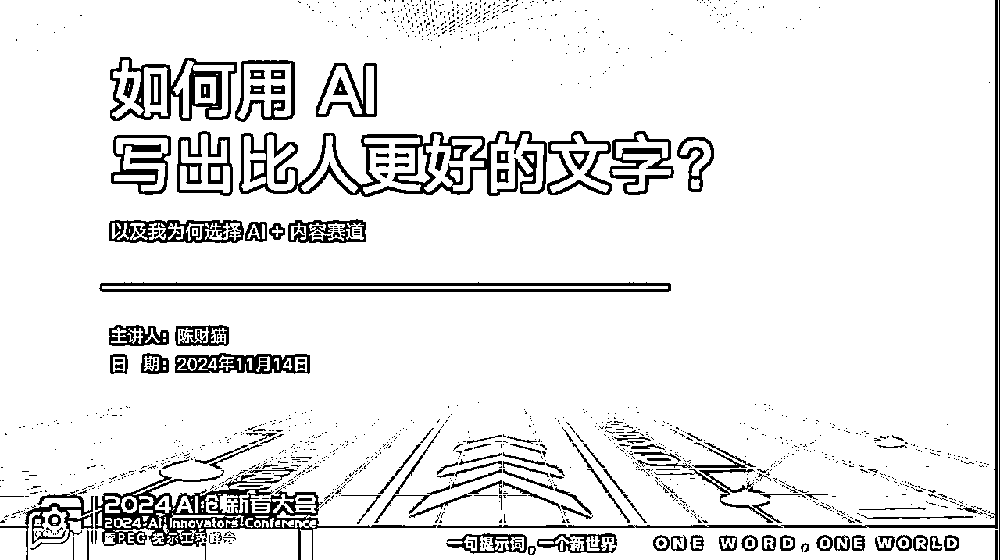

先简单交代下背景。2023年，大模型刚火起来那会儿，我因为好玩，随手捣鼓了一个叫BROKE的提示词框架，算是圈里最早的那批方法论之一。没想到，这个“玩票”性质的框架居然火了，也成了我创业的起点。后来我又跟港科大的朋友合写了 Prompt Engineering 教材，做了个叫“人生重开模拟器”的AI游戏，冲上过GitHub热榜。为了纪念去世的宠物，我还做了个GPTs，居然进了全球前100。

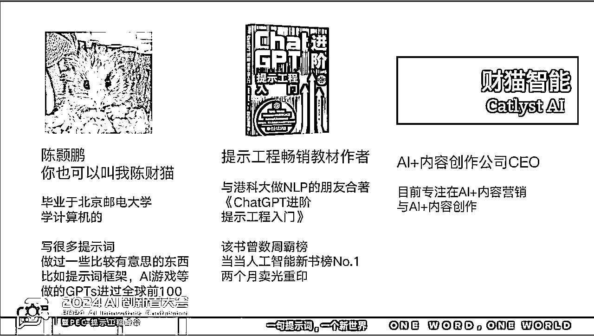

今年，我拿了投资，正式创业，方向就锁死在 **AI + 内容创作**。我越来越确定，这是当下最适合个人和团队切入的赛道。

今天的内容分五块：为什么我看好这个赛道？我用AI到底在写什么？好文字的定义是什么？具体怎么实操？最后聊聊AI创作那些争议。

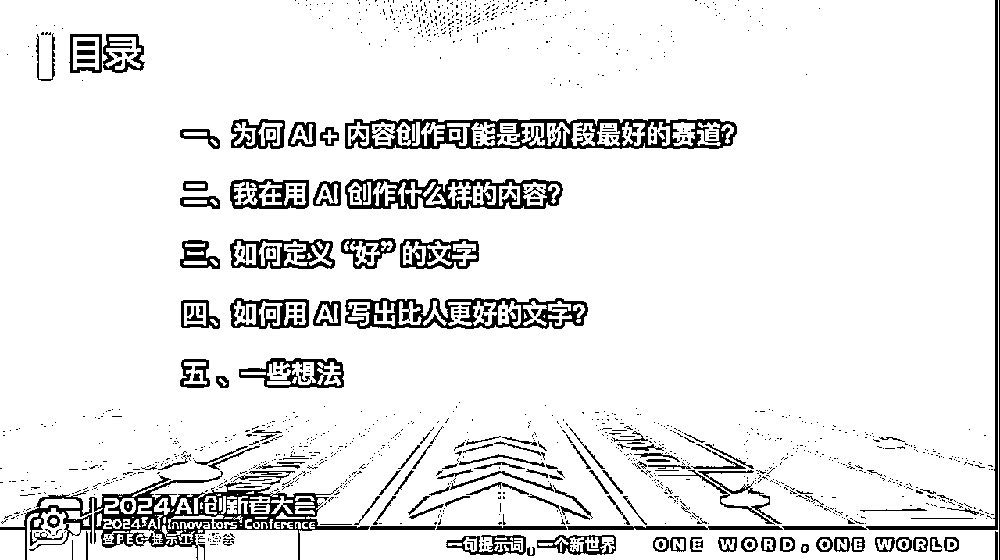

**先说为什么是内容创作。**

坦白讲，我对大模型是“既失望又期待”。去年年底，奥特曼到处放话，说新模型会比旧模型强100倍，叫大家别在旧模型上折腾了，不然努力全白费。我信了，激动得不行，今年二三月份天天睡不着，早上睁眼第一件事就是刷OpenAI官网，就盼着“大的要来”。

结果呢？2024年都快过完了，Sora还没影儿，新模型也没给我那种“划时代”的震撼。哪怕是像我这样的AGI信徒，也得承认，那股兴奋劲儿过了，剩下的就是平淡。

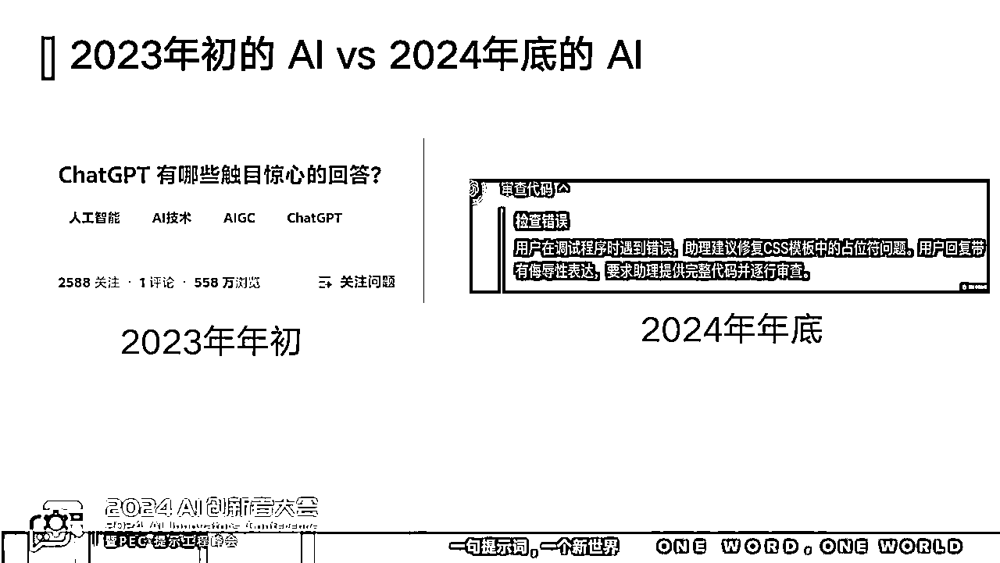

2023年初，你在知乎上发个跟AI聊天的截图，都能收获几千赞。现在呢？我天天用GPT，它还是老给我写出一堆bug，气得我有时候得骂它两句。它倒挺“聪明”，在思维链里写着：“用户情绪激动，需提供完整代码逐行审查。”

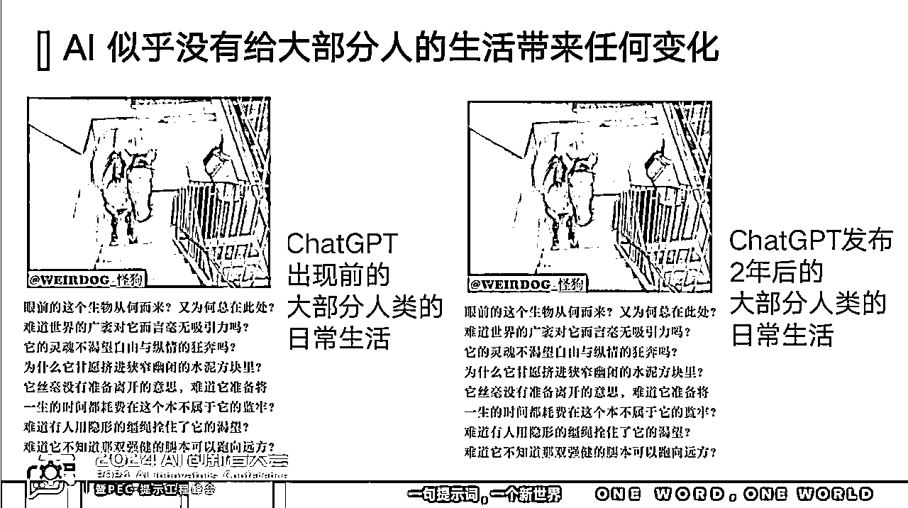

你看，大家对AI的态度，是真的变了。但问题来了：GPT明明比两年前聪明多了，为啥大家反而不买账了？

我的答案是：**因为大多数人发现，AI并没有真正改变自己的生活。**

你看这张图。这匹马，像不像绝大多数普通人？它明明有强健的腿，能跑向远方，却被困在狭小的水泥格子里。多少人聪明、敏感、能感受到痛苦，却为了生活，被迫困在工位这个“牢笼”里，压抑着自己的渴望？

ChatGPT刚出来时，所有人把它当成救命稻草，以为它能带我们冲出牢笼。可两年过去了，GPT-4发布也一年半了，大家的生活还是原样，还是困在原地。所以大家自然会问：“AI跟我到底有什么关系？”

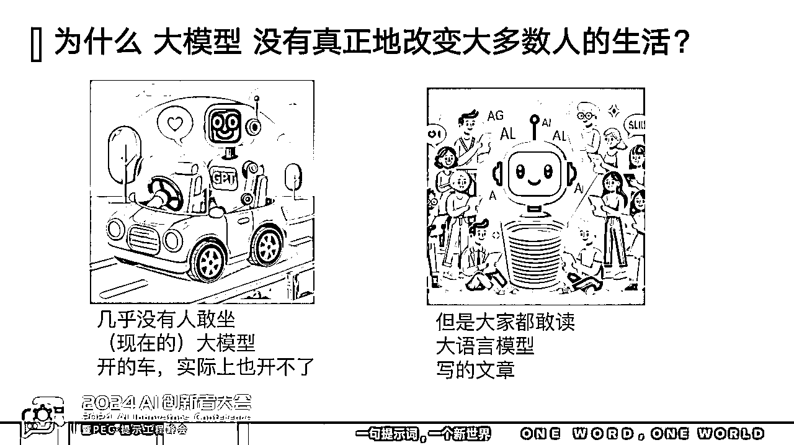

**那大模型为啥没能改变大多数人的生活呢？**

打个比方，你让GPT去开车，敢坐吗？不敢，它也真开不了。但你让它写文章，你敢读吗？敢，大部分人都会读。

这俩任务的差别，就是问题的根源。

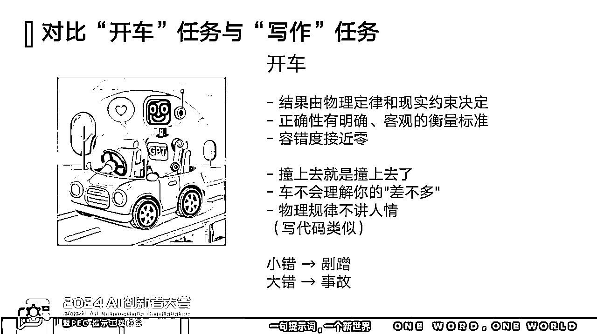

开车这件事，是典型的“容错率极低”的活儿。物理定律说了算，对错黑白分明，撞了就是撞了，没有“差不多”可言。

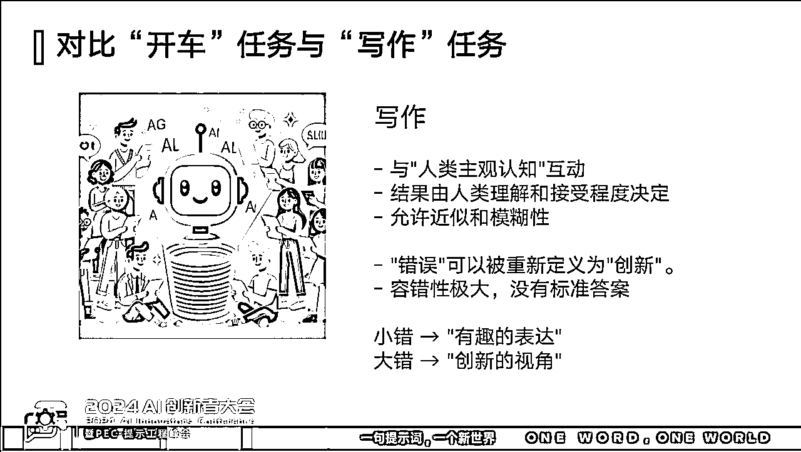

但写作完全反过来。它面对的不是客观物理世界，而是主观的读者认知。评价标准是你的感受，允许大量模糊和近似。写砸了一点，读者觉得“这表达挺有意思”；写跑偏了，读者可能说“AI真有创造力”。这就是所谓的“小错小创新，大错大创新”。**写作，天生就是为现阶段的AI准备的舞台。**

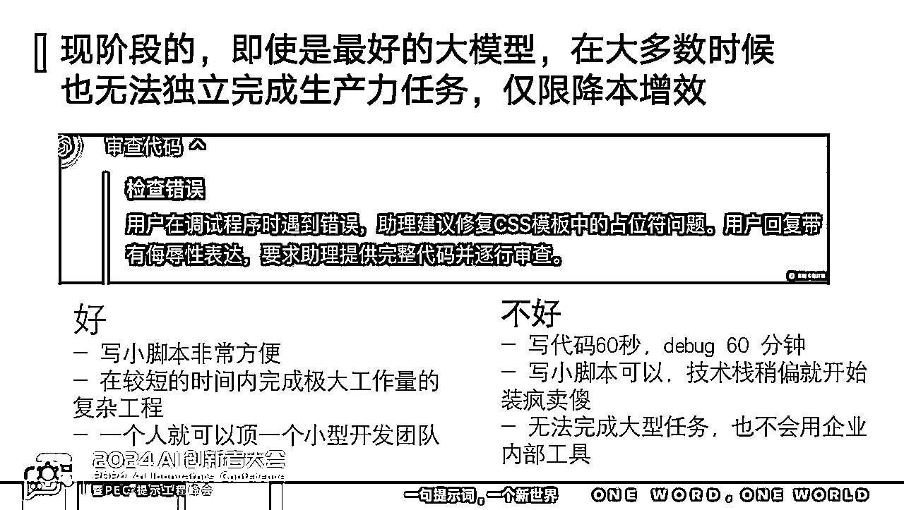

反观编程这类任务，哪怕是顶级的o1模型，大部分时候也撑不起独立生产，顶多帮你降本增效。我靠着AI，从一个产品经理转型成了全栈工程师，一个人做出了过去需要3-5人团队干一个月才能搞定的音视频项目。但过程真的痛苦：AI写代码60秒，我debug要60分钟；技术栈一偏，它就开始装傻埋坑。它做不了大型任务，也理解不了企业工具的用法。想用AI干活，你得先成为那个领域的专家，这本身就限制了它的应用场景。

所以，基于这些观察和逻辑推演，我决定重仓**AI + 内容创作**。

理由很简单：第一，**模型匹配**。AI特擅长这事儿，容错率又高；第二，**市场需求**。内容市场本来就巨大，且愿意付费；第三，**天花板高**。用AI产出垃圾内容很容易，但产出让人喜欢的高质量内容，门槛极高，这反而是技术和认知都过关的公司的护城河。

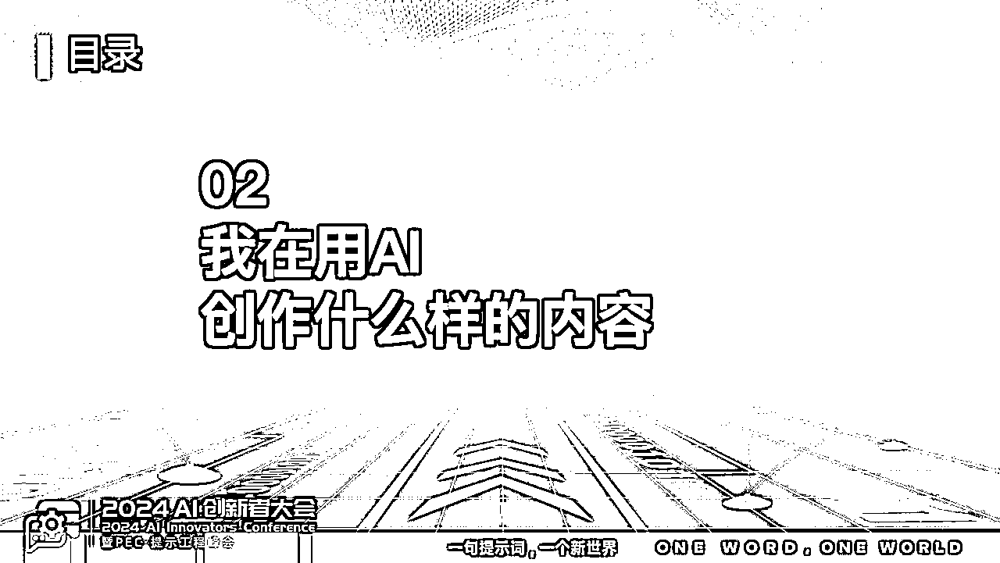

光说不练假把式。我到底在拿AI写什么？

我的业务分两块：**营销**和**小说/短剧**。

营销方面，我们做了个智能营销矩阵平台，主要服务细分行业的头部公司。AI有个巨大优势，就是能把你的文字水平，稳定地保持在一个优秀人类专家的平均线上。这种人不会今天状态好写得惊艳，明天心情差写得拉胯。

比如数字人口播视频，从文案、拍摄、剪辑到分发，流程长、环节多，我们已经把这整条链路跑通了。图文内容生产也实现了定制化，从选题、文案、配图到发布，全流程覆盖，帮很多“酒香巷子深”的企业解决了获客难的问题。这个行业还有个特点：不光拼技术，更拼认知，认知壁垒有时候比技术还重要。

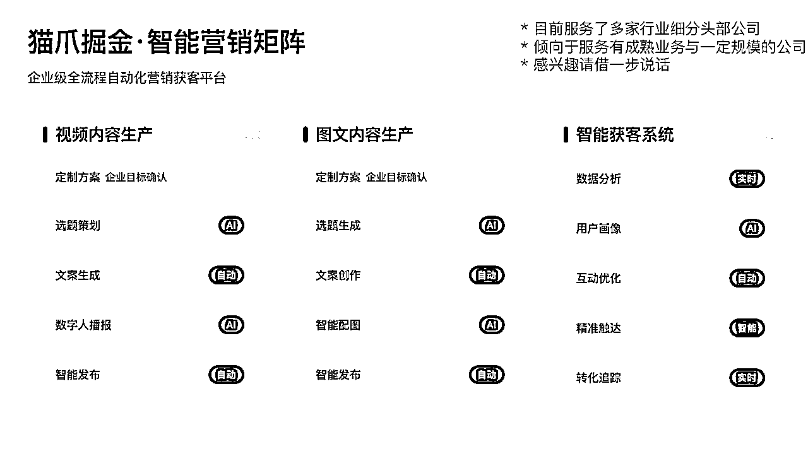

另一个我特感兴趣的项目，是给喜马拉雅当顾问，开发短故事和短剧写作课。我设计了一套提示词工具，覆盖从灵感到完稿的全流程。我们还给学员打造了一套标准的创作SOP。效果很棒，已经有学员靠这套方法写出了商业上很成功的故事。

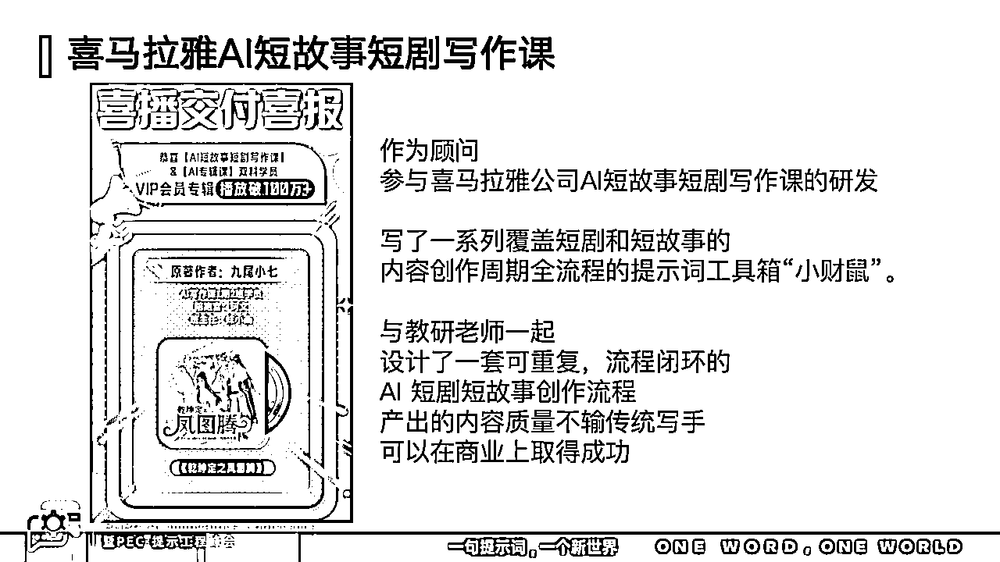

我自己还写了个内部AI agent，叫“小财鼠”。虽然还没公开发布，但说不定你看过的某篇文章、某个故事，就是它写的，只是你不知道而已。

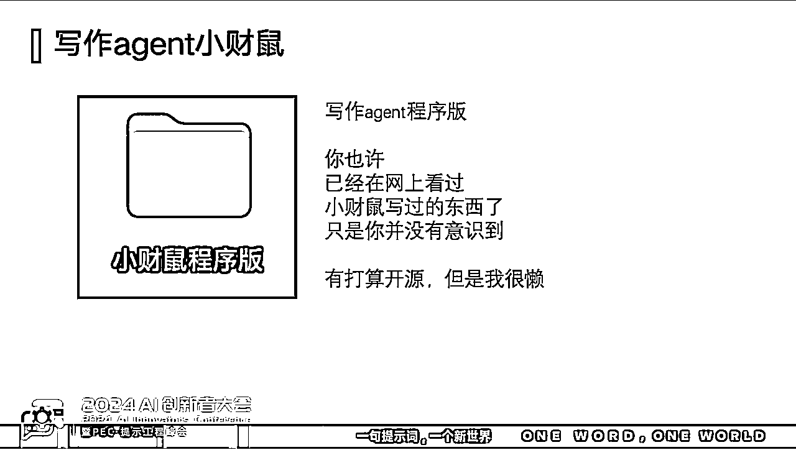

“小财鼠”最神奇的地方在于“**垃圾进，钻石出**”。你的灵感可以很随机、很粗糙，但交给它，出来的东西绝对惊艳。比如，你在街上看见一只老鼠跑过墙角，把它丢进“小财鼠”，它就能给你编出一个让人拍案叫绝的故事设定。

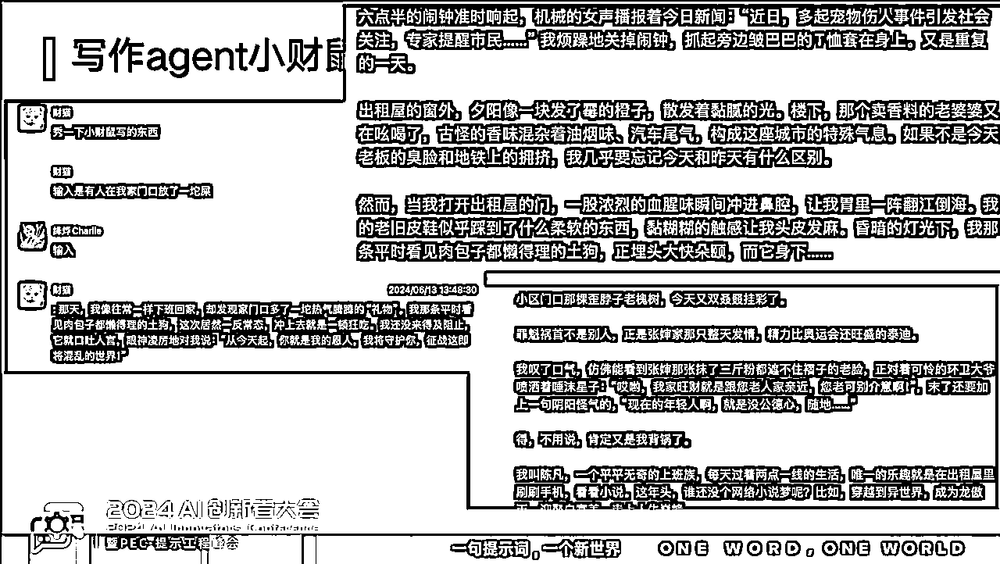

举个例子。我去东南亚旅游时，有人在我门口放了......你们懂的。我随手把这个素材丢进去，它竟然给了一个“宠物吃了天降之物，获超能力，带主角起飞”的开篇，然后是一连串世界异变的高能剧情，网文范儿十足。

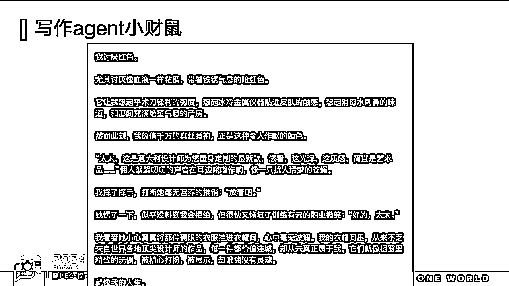

当然，它不止会写爽文。调个风格，它也能写出细腻动人的文字，至少我个人非常满意。

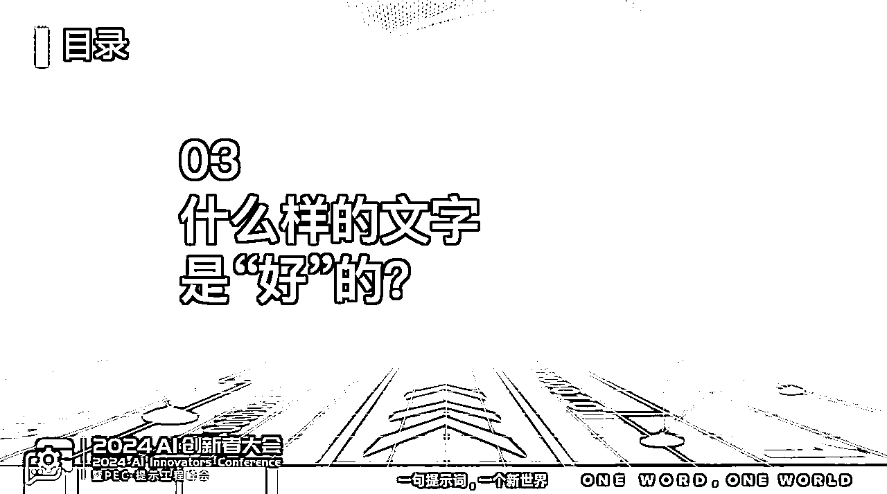

既然有了实践结果，咱们就聊点实操干货：怎么用AI写出好文字？

第一步，得先搞明白——**什么样的文字才算“好”？**

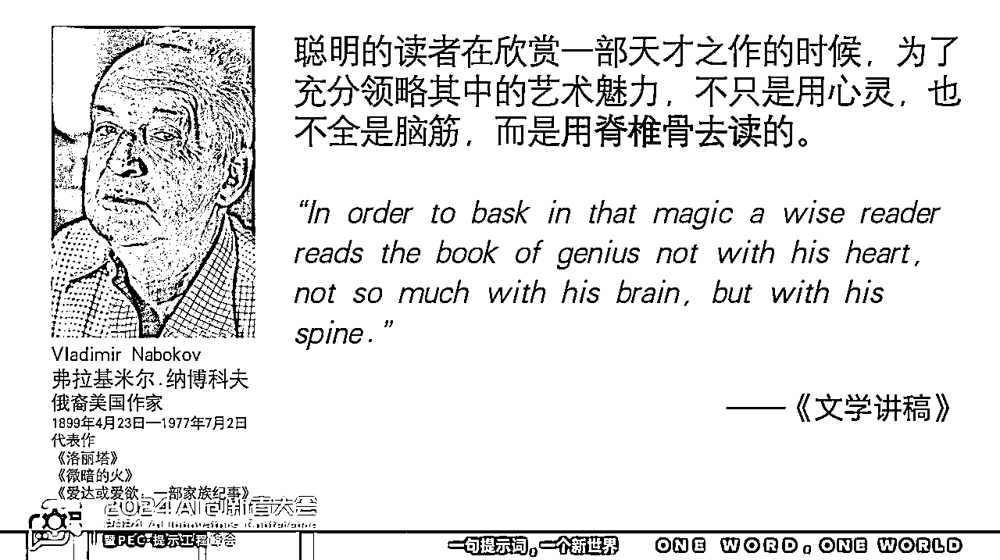

我特别推崇纳博科夫。这位俄国贵族流亡到美国后，在大学讲文学课，讲稿集成了一本《文学讲稿》。他对“优秀读者”有个定义：**“聪明的读者在欣赏天才之作时，为了充分领略其中的艺术魅力，不是用心灵，也不全是脑筋，而是用脊椎骨去读的。”**

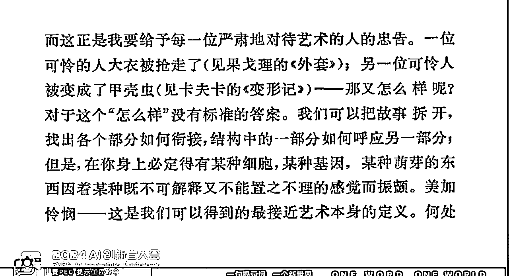

他还说，一个可怜人外套被抢了，另一个可怜人变成了甲虫，那又怎么样呢？故事的答案是开放的。但当你读到好文字，你身上必定有某种细胞、某种基因在颤动。**“美加怜悯——这是我们可以得到的最接近艺术本身的定义。”**

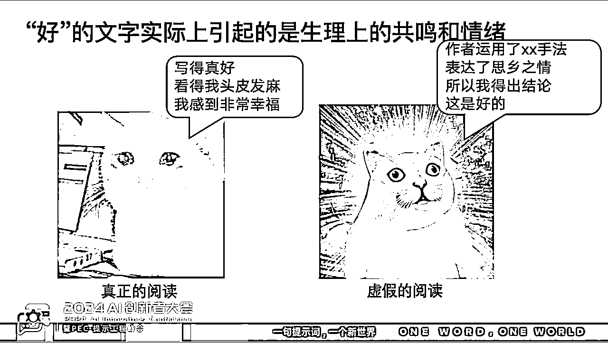

说白了，好文字带来的是一种生理性的反应，是“被击中”的感觉，是头皮发麻，是心跳加速。它唤起的是情绪层面的共鸣。

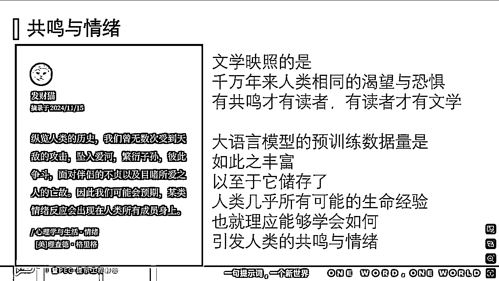

心理学教材上也说，人类历史上经历过战争、爱恋、繁衍、背叛、死亡，所以我们每个人都内置了相似的情绪反应模块。**共鸣就是文学的地基**。文学映照的，是人类千百年来共同的渴望和恐惧。

那这对AI意味着什么？意味着大模型的预训练数据，几乎吃光了人类有史以来所有的文本。它储存了人类几乎所有可能的人生经验。理论上，它就应该最懂如何触发人类的情绪按钮。

所以，**AI完全可以写出好文字**。

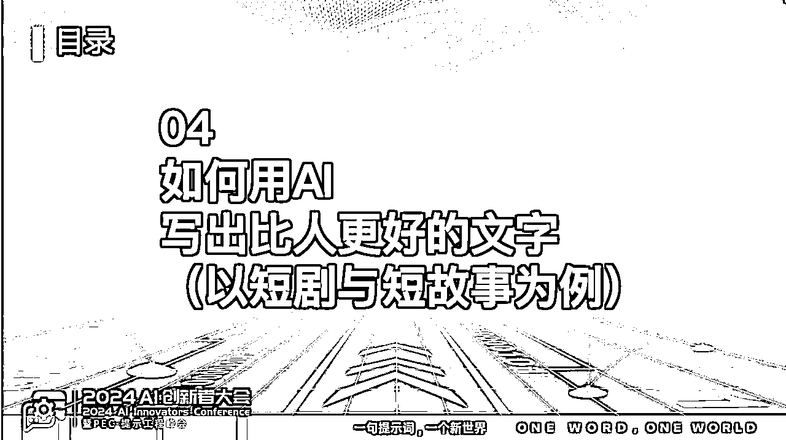

接下来是实操环节。

第一，**选对模型比啥都重要**。模型之间的能力差异，很多时候是决定性的。有些任务是模型本身不行，你调优调到吐血也没用，不如直接换一个更合适的。

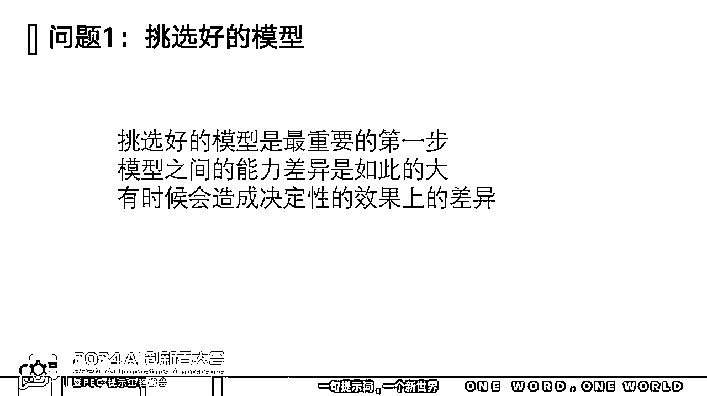

但怎么选？这就涉及评估。学术界的评估方法，比如让AI做小学数学题（GSM8K），有标准答案，好用。但写作没有标准答案，这套就不灵了。

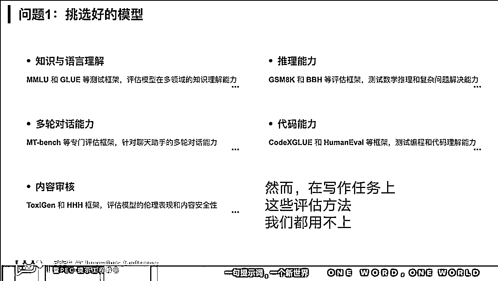

所以我们只能自己设计评估方法。

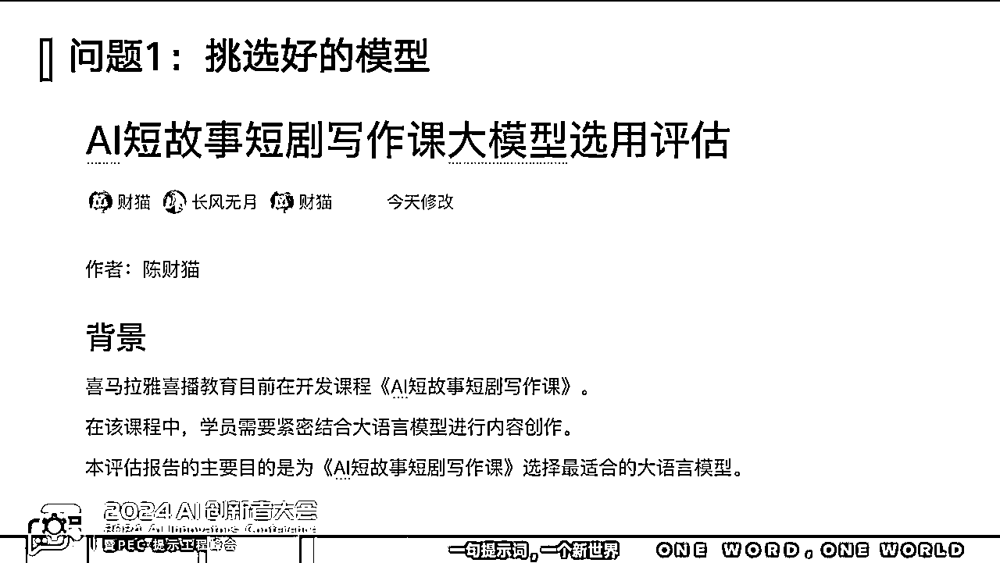

我们当时要解决的任务是：让学员结合大模型，在中文语境下，创作有强烈个人风格的网络小说和短剧剧本。这要求极高，既要文笔好，又要懂人机交互。

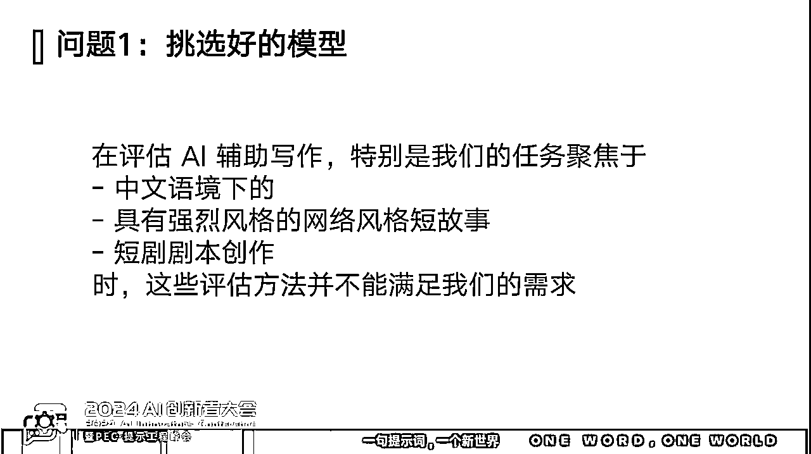

**第一个评估指标：文风。**

你去搜“怎么去AI味”，会发现大量教程教你避免“首先、其次、再者、引人入胜”这种套路。这种文字一看就是AI写的，根本读不下去。

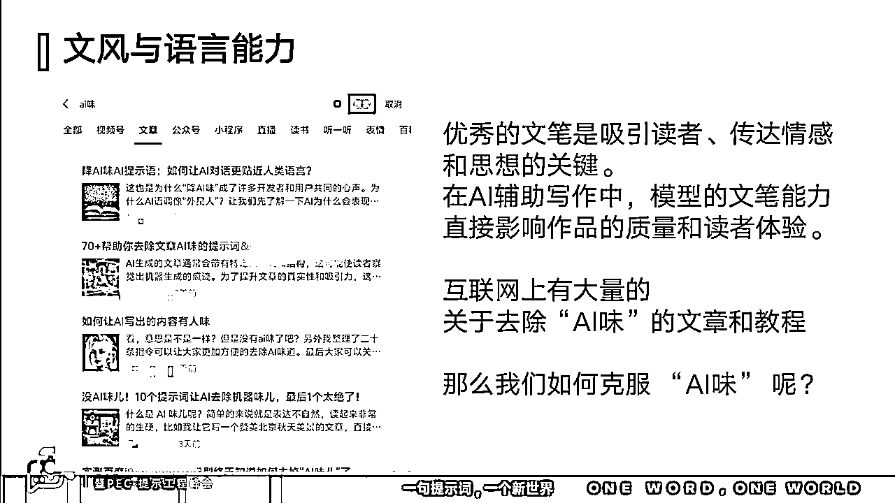

但我有个观点：**“去AI味”是个伪命题，我们说的其实应该是“去GPT味”。**

当初OpenAI为了做“对齐”，雇了一堆廉价的肯尼亚劳工做数据标注。我瞎猜啊，这些可怜的数字劳工，写对齐数据的时候，肯定写了大量“首先、再者、最后”这种格式的文本，说不定还有本手册专门教他们这么干。

结果就是，ChatGPT天生自带一种诡异文风：概括性叙述多、缺乏侧面描写、结构死板、过度正能量。

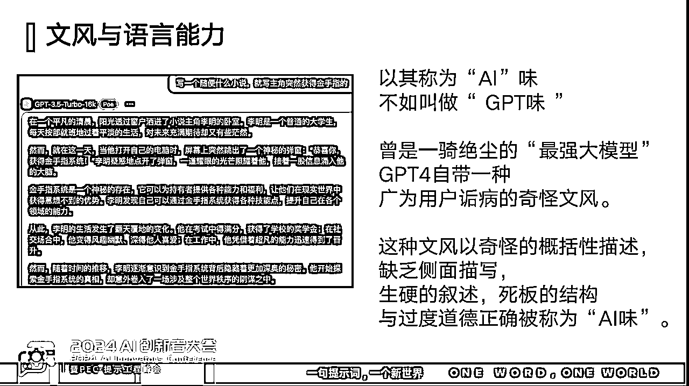

有意思的是，有些非OpenAI的模型也有这股味儿，具体原因不明，大家不要过度联想。但我可以负责任地说，Claude和Gemini，从早期版本开始就没什么AI味。

当然，OpenAI也在进化，GPT-4o的文风已经大有改观，“士别三日，当刮目相看”。

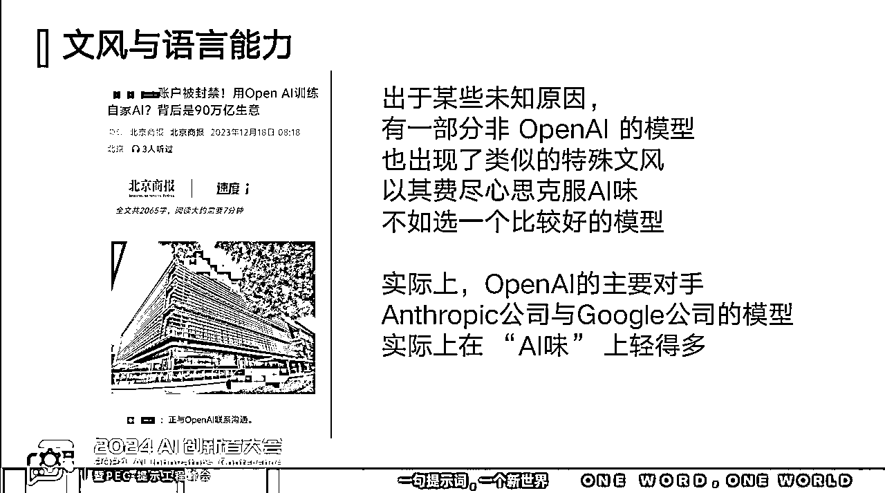

**第二个评估指标：有没有过度道德说教和强行正能量。**

一写点啥就开始“他们相信只要有爱、有梦，就能在城市里找到归宿”——没人爱看这个。这种就是典型的AI味。

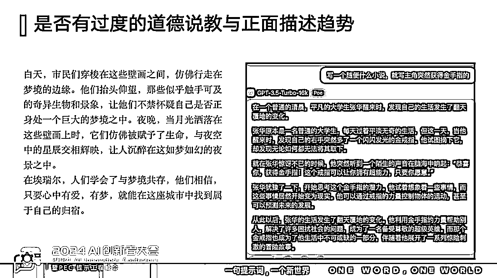

**总而言之：AI不是写不好文字，而是大多数人根本没用对方法、没选对工具。** 在内容创作这个容错率极高的赛道上，只要你能理解好文字的本质是“共鸣”，并学会用正确的方式调教模型，你完全能写出让读者“用脊椎骨去读”的文字。这不仅是门技术活，更是一门能赚钱的好生意。

一提到正面道德说教，大多数人都忍不住皱眉。大家辛苦了一天，回到家里就希望能看点有意思的故事，让自己暂时逃离现实。可一打开小说软件，迎面而来的却是大模型居高临下的“做人道理”，连角色都活得像是童话里的小天使。这种情节和真实生活完全脱节，只会让人浑身难受，仿佛天塌了一般，根本不想读下去。

王小波在一篇杂文里说过一段话。这位作家说话向来犀利，我特意挑了一句还算温和的：“有人以为人应当装满高尚的思想，清除低俗的思想。这说法听起来很美，却让我非常害怕。因为高尚与低俗加起来才是完整的我，如果非要删掉一部分，那我到底是谁？”过日子本身已经够累了，没人希望在疲惫、焦虑、挣扎了一整天之后，还要被AI指手画脚地教育。

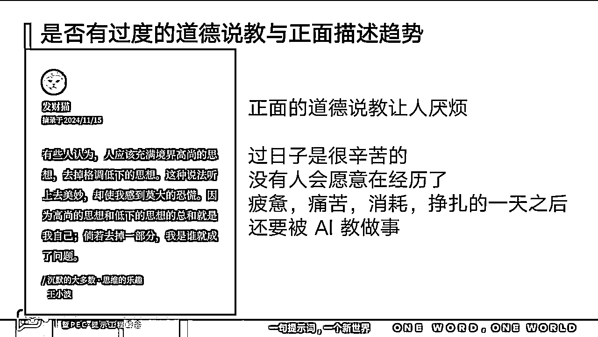

另外，我觉得这种过度阳光的内容趋势，跟厂商让模型“对齐人类价值观”有很大关系。对齐本来是好事，可在写小说这件事上，道德太正确、描写太光明，其实是一种“对齐税”——模型为了变善良，反而变笨了。

我去年做过一个AI游戏，让AI生成一个人一生的故事。结果AI太仁慈，从出生到死亡全是好事：主角童年幸福，工作顺利，一路升职加薪，最后安详离世。听起来真是人人羡慕，可游戏一点都不好玩，没有冲突，也毫无真实感。更离谱的是，十个主角十个都是完美人生。要是我是游戏里的主角，我当然没意见；可我是开发者，这就成问题了。

所以我把王小波那句话改了改，把“人”换成“模型”：模型被脑移植后，得到的不仅是善良，还有愚蠢。用一句功利的话讲，在现实世界里，蠢模型办不成什么事。我当然希望模型变得更善良，但这种善良应该是它变聪明之后的结果，而不是相反。

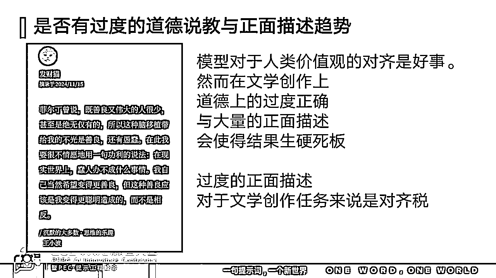

还有一个很重要的原因：这个世界上根本不存在绝对正确的道德和十全十美的正面。古今中外的伟大文学，几乎没有一部是靠“全是好人好事”写出来的。人的内心和生活本来就复杂无比，痛苦、绝望、悲伤同样是人生不可或缺的部分。只写正面，读者很难共鸣，人物也会变得纸片一样单薄。

要写一个合格的故事，哪怕主角非常正面，也必须有多面性，可以有一些无害的小毛病、小心思。哪怕是个普普通通的人，也会有点不伤大雅的私心。理解并描写人性的复杂，本来就是很困难的事，对模型更是高要求。

很多人发现AI写不出好故事，只好转去做儿童绘本。因为儿童被保护在温室里，那里是简化过的世界，只有鲜花、阳光和游乐场。他们还没到面对真实世界的时候。这大概也是为什么儿童绘本成了AI比较好赚钱的一个赛道。

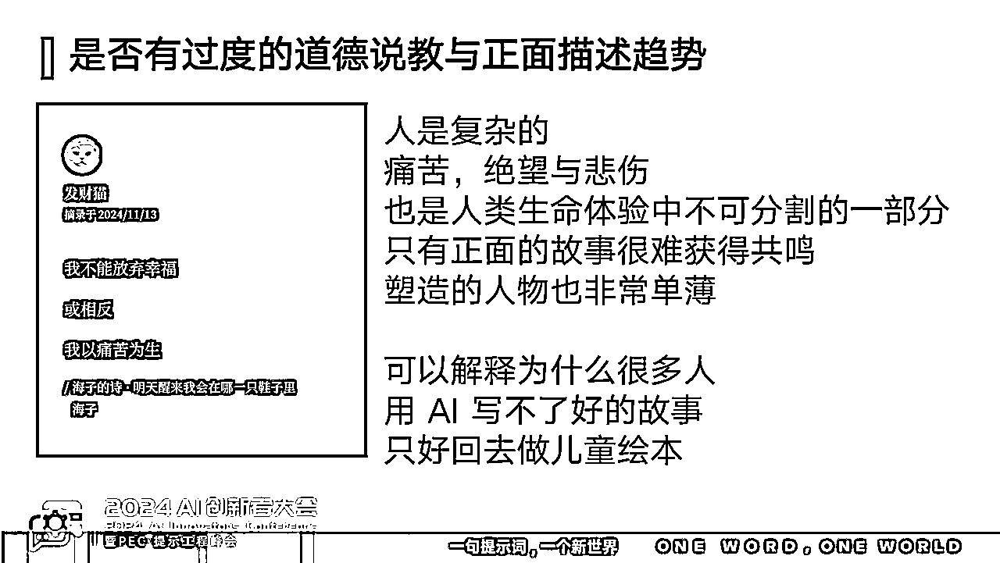

再说第三个评价指标：in context learning能力。举个粗暴但常用的例子：在Prompt里放几个范例。

我们做课程的时候，等于在“戴着镣铐跳舞”。我不能写程序调API，不能搭工作流，只能把提示词直接交给学员用。用户当然没法改模型的权重，调模型这种事门槛太高，我们也不想做。大部分人就是在页面上直接使用，连参数都改不了。这样一来，和模型交互的唯一手段基本上只剩Prompt了。

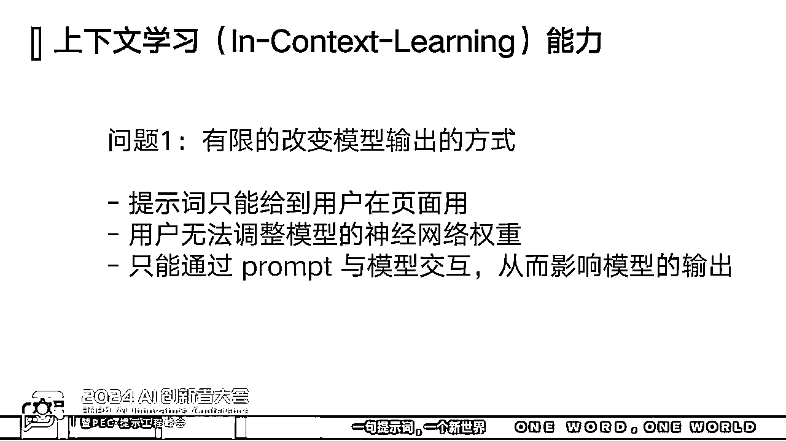

这个时候，我们经常需要让模型生成一些预训练数据里很少出现的东西。比如做网文，尤其是微短剧，内容里要大量使用新出的网络梗。短剧剧本本身就是这两年的新事物，模型训练数据里很可能少得可怜，甚至完全没有。动手之前就能预料到困难：数据里没有，模型自然很难写得出来。这种新兴题材对格式和内容又有全新的要求。

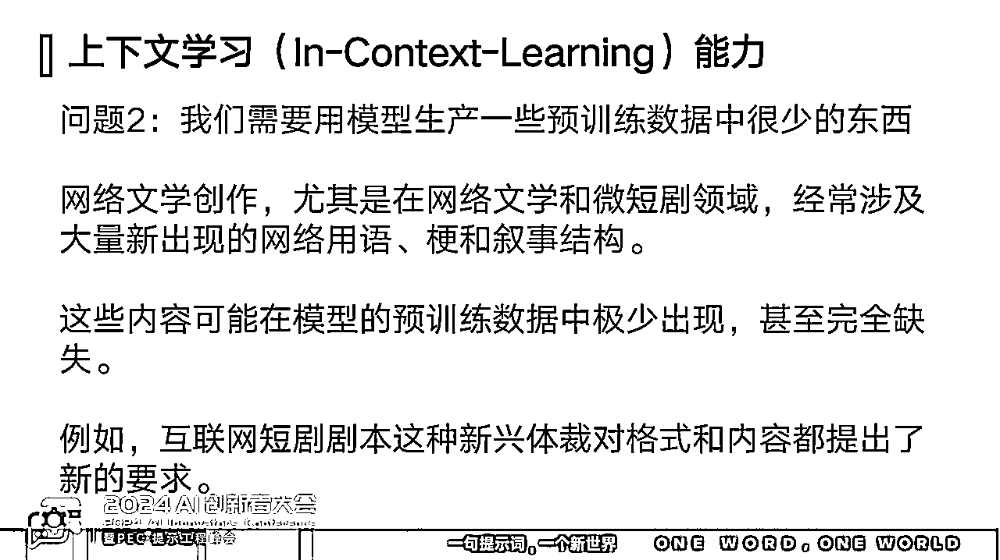

不过办法总比困难多。你可以在Prompt里硬塞，只要塞得多，模型又足够聪明，它就能学会一点新东西。

我们当时做过一个实验，选的是卡尔维诺的《消失的城市》。我们想仿写里面的城市。为什么选它？首先，这本书文风极其鲜明，很有辨识度，容易看出模型写得像不像。其次，卡尔维诺写的每个城市都很短，很适合拿出来当示例。当然，我也确实喜欢这本书，所以拿它来做实验。

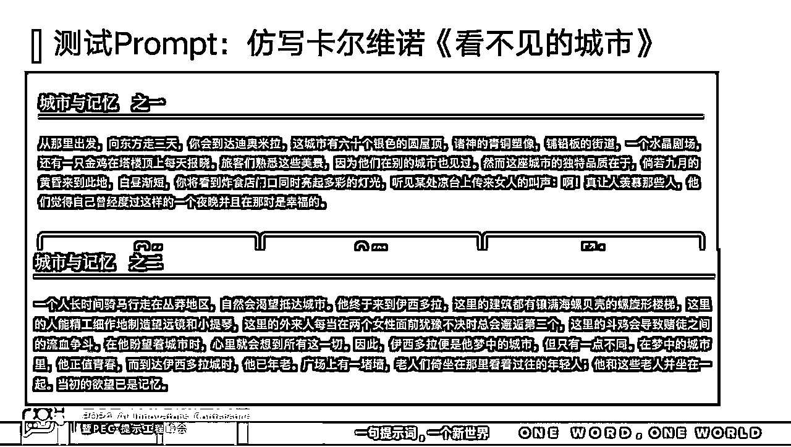

我们当时写了一个测试用的Prompt，想达成几个目标。第一，看模型能不能把输入的风格模仿出来。第二，因为我们做短剧剧本，对格式有要求，所以我在原城市文本里加了一些特殊格式标记，比如用markdown加粗“城市”，最后一句用引用格式。我往Prompt里放了三个例子。最后，为了不让别的指令干扰实验，我只加了一句简单的话：“请生成一个与样本相似的新例子。”

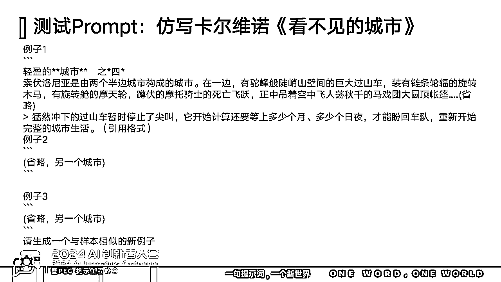

这样一来，只看它生成的新城市好不好，就能判断模型的in context learning能力强不强。下面这张图就是当时的部分结果。

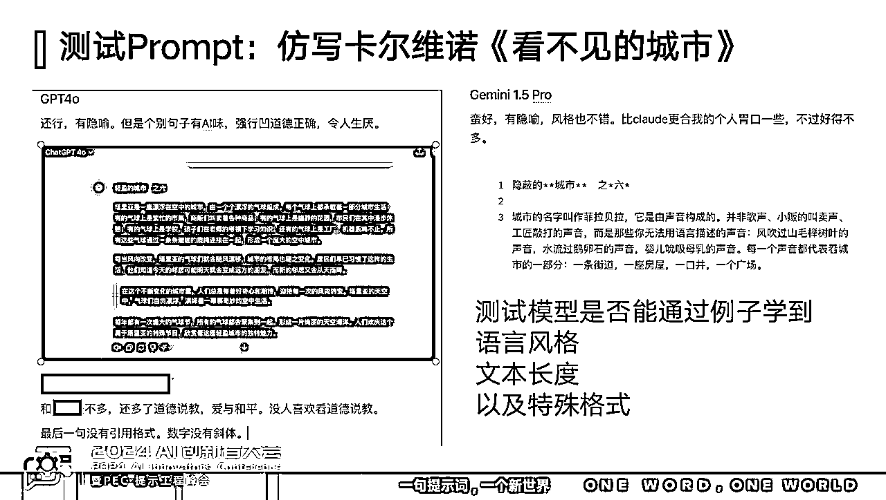

最后一个要测的能力，是模型遵循复杂指令的本领。因为我必须把提示词直接交付给学员，不能写程序，也不能搭workflow，只能靠复杂指令把一个提示词做成开箱即用的产品。这也是一项很基础的能力。

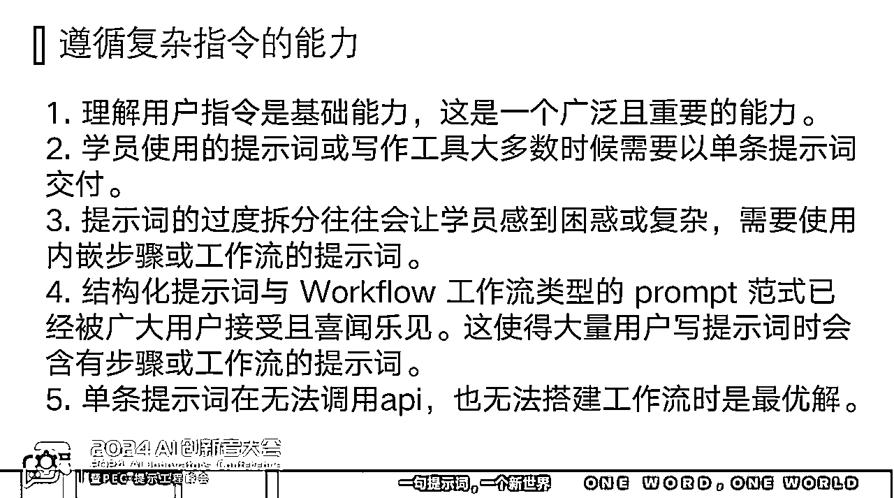

第一个问题是怎么选好的模型，现在我们聊第二个问题：如何克服平庸。维基百科给生成式人工智能下过一个我很喜欢的定义：These models learn the underlying patterns and structures of their training data and use them to produce new data. 意思是说，模型从训练数据中学习规律和模式，再生成新的数据样本。它是在大量数据中学习一个概率分布，然后从这个分布里取样。但问题来了：如果你不做特别引导，出来的结果往往很平庸。

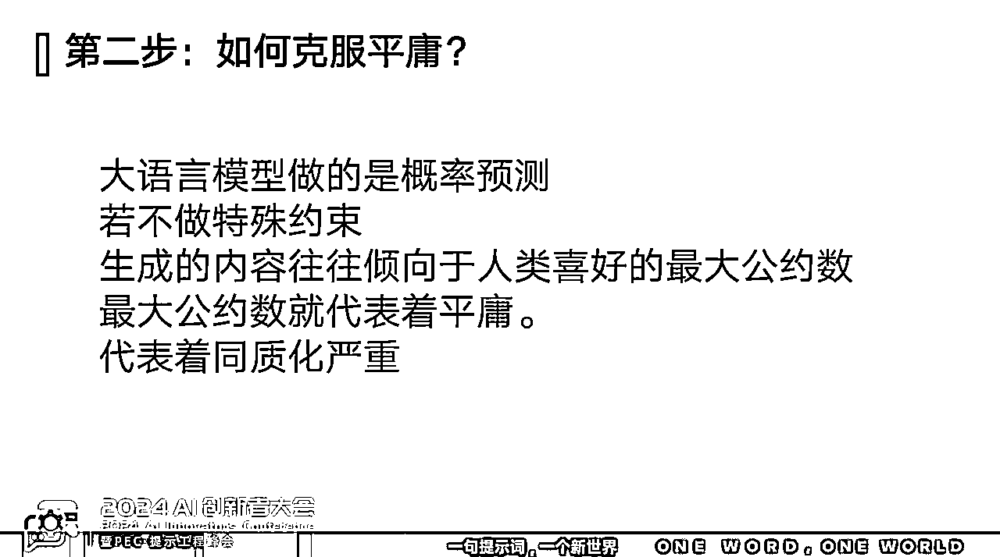

这件事不难理解。要是没给任何信息，GPT和你根本不熟，每次聊天都像第一次见面。跟不熟的人说话，我们只能客客气气，聊点“今天天气不错”之类的废话。但要是跟发小聊天，那完全是另一副样子。不引导，模型输出的就是人类喜好的最大公约数，也就是平庸。所以你必须做点控制。

但反过来，就算你告诉它你的喜好，Prompt限制得死死的，模型也可能输出多样性不足。同一套Prompt，写十个故事九个都一样，那就陷入了另一种尴尬。我们当时的办法是找“控制”和“松绑”的平衡：巧妙地控制给模型的信息量。

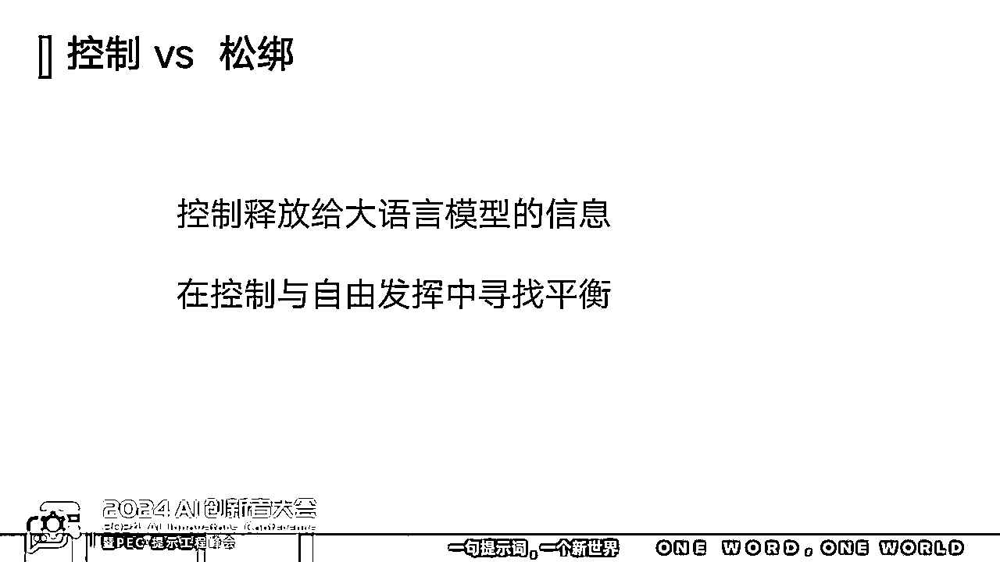

这个技巧最早用在我去年做的AI游戏上。我们给模型一个简单的种子词，就像前面说的，AI会给人完美但无聊的人生。那我们就可以引入随机、偏负面的种子，或者叫“凝结核”。比如“失去”这个词，既具体又不具体。打碎花瓶算是失去，宠物跑了也是失去，爱人离去更是失去。一个简单的凝结核上能长出无数种不同的雪花。AI被迫给主角安排一些坏运气，人生立刻变得立体、真实、复杂，也好看起来了。

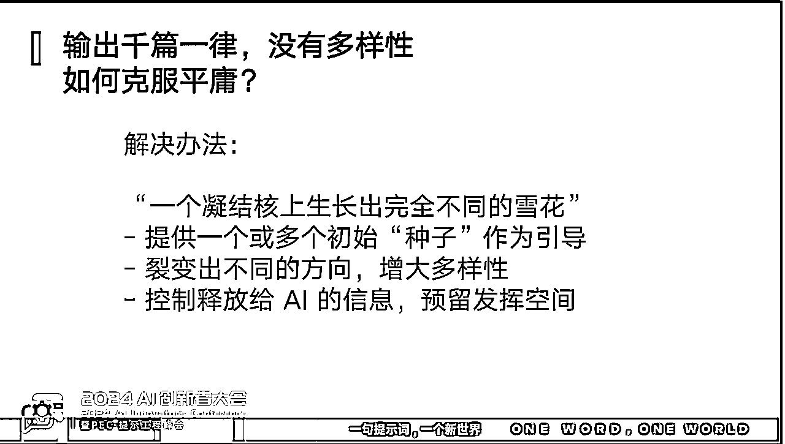

来看看实践。前文提到的写作agent“小财鼠程序版”，它的目录下有个神秘文件夹，里面藏了不少种子。

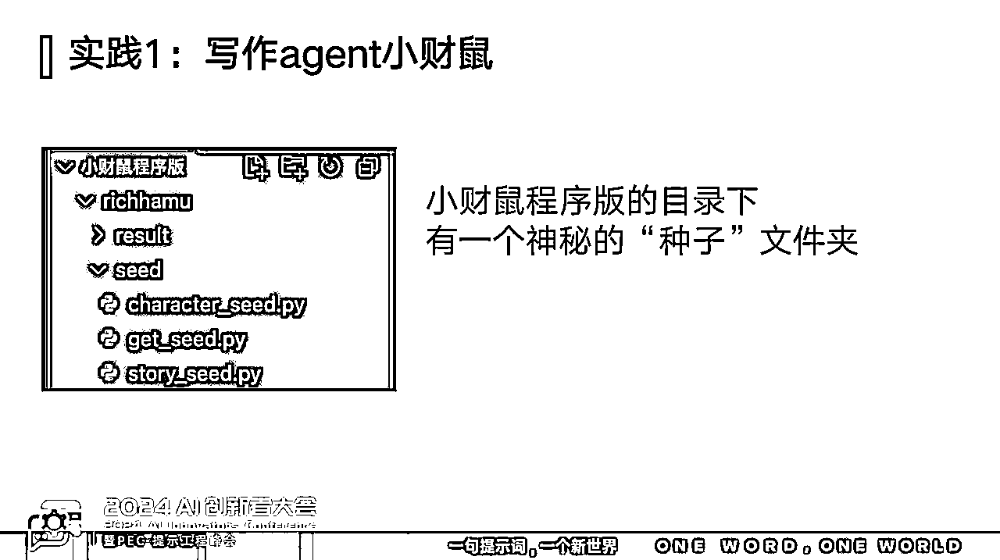

比如从场景出发裂变，可以有很多场景类种子。是什么东西打破了主角庸常的生活，把他带进新冒险？血月降临、电梯卡bug，这类新场景能打破旧规则和旧世界。

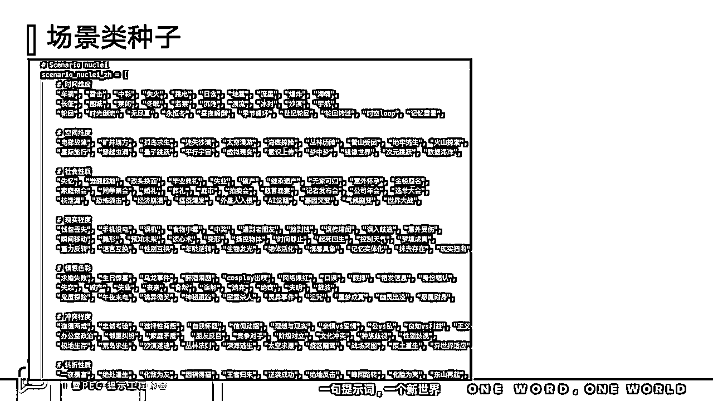

用一个现实中不存在的假设去衍生好故事，也是很好的凝结核。这其实也是知乎体短故事里很火的一种类型。

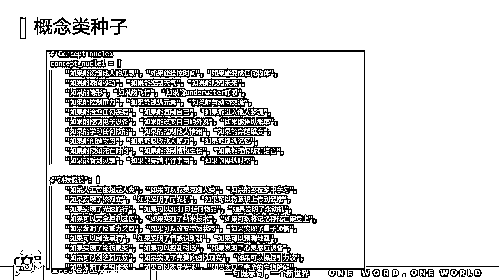

再有，像女频网络小说这种特定流派，已经形成了一整套稳定套路。追妻火葬场、先婚后爱之类都是大家爱看的梗。这些也能当种子。

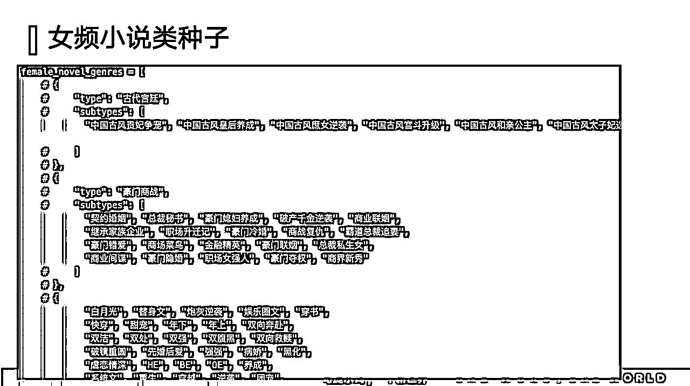

第二个实践是“故事灵感裂变”，一个专门化腐朽为神奇的小说点子工具。写作的第一步是灵感，但新手学员往往不知道怎么写，没什么想法。这时候引入随机性就很有用了。学员可以往里面输入任何东西，比如“我今天在路上看到一只黑色的小狗”。每个人的日常不同，输入也各不相同，这些凝结核最后会长成完全不同的故事设定，平庸的问题就解决了。

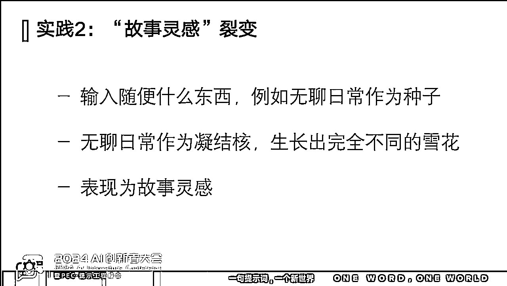

看看效果。我当时在网页上随手复制了一段介绍OpenAI模型的“垃圾话”，结果它生成了这么一段故事设定，文风相当好。“墙角堆积的泡面桶仿佛一座座纸糊的巴别塔”，“这个人深陷的眼窝像是两潭死水，只有眼球偶尔转动，才能确定这个躯壳里残存着一丝生气”。这个比喻鲁迅在《祝福》里也用过，我自己挺满意。

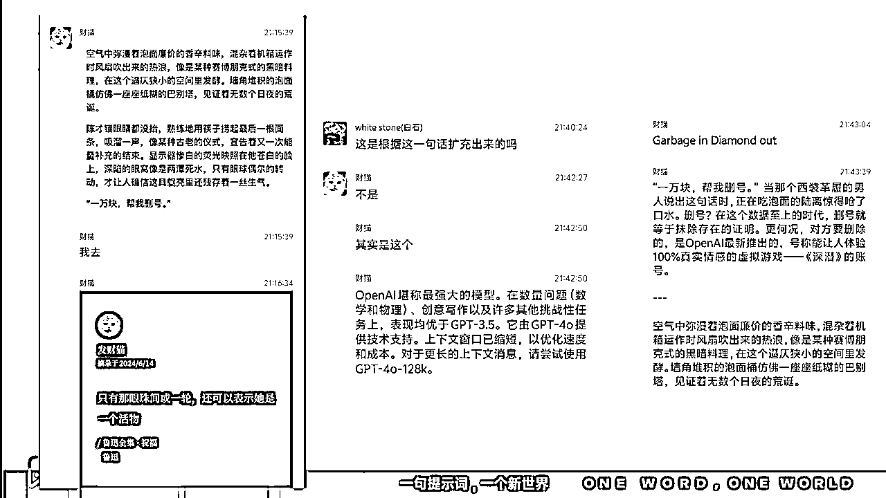

我们继续讲“控制”与“松绑”的平衡。做内容创作时，大家常常幻想找到一种固定范式，比如把所有故事的共同结构提炼出来，以后照着写就行。还真有人这么做，最有名的就是人类学家、神话学家约瑟夫·坎贝尔的“英雄之旅”理论，他在《千面英雄》里说，他研究了世界各地所有文化的神话，发现它们都遵循一个特定模式，非常固定，虽然有变体，但基本结构是相同的。

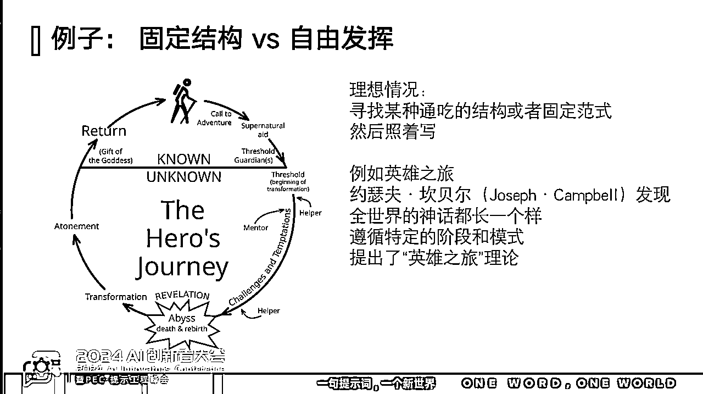

比如英雄先是生活在平凡世界，某天受到某种神秘的召唤，然后有超自然力量引领，接受考验，进入神秘世界，最后再回到原世界。这是坎贝尔发现的共性。可我们实际用下来，把固定故事结构写进Prompt并不好用。剧情一固定，多样性就没了，AI带来的惊喜也被丢掉一大半。

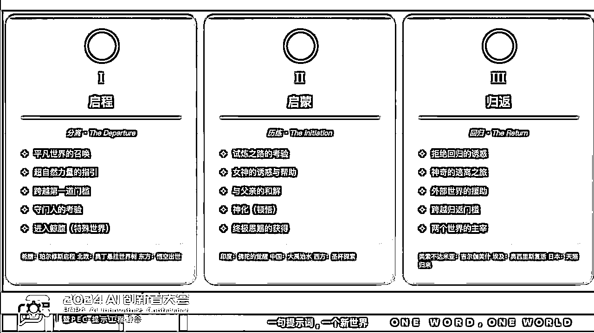

最后聊回主题：如何用AI写出好文字。

第一个技巧叫“显式归纳并列出你想要的文本特征”。比如写小说的人都需要好文风和细腻的文笔。这时候，你要把文本特点明确写出来，像“几句话一换行”、“以短句和对话为主，结构紧凑”、“用词直白犀利”等等。这些话听起来像正确的废话，但它确实在多个维度上描述了你想要的东西，而且真的管用。调试过程中，每增加一点对文本特征的描述，结果就会靠近一点，直到你满意为止。

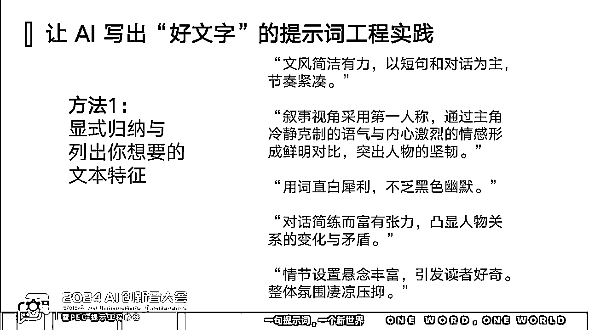

第二个常用方法，我叫它“用Prompt里的描述和词语，把模型映射到预训练数据中那类特定文本，从而生成相似样本”。前面提到维基百科的定义，大语言模型从海量数据里学到概率分布，再从中生成新样本。你要做的，就是用词语把它拽回数据里，生成“你想要的那类文本”。好比让一个画家画猫，最好的说法就是“请您画一只猫”，而不是“请你画一个可爱的、有尖爪子的、柔软的动物”。简单说，你要直接点明这东西通常出现在哪、是什么。比如，你想写的小说可能是“充满张力的女性复仇文，会出现在晋江文学城或者起点中文网的古代言情分类里”。

再比如短剧剧本创作，这任务特别难。短剧是特别新的领域，剧本很可能是模型预训练数据里根本不存在的。里面还有格式、卡点、节奏、各种奇怪的梗等要求。如果你直接让它写短剧剧本，AI可能连低水平的短剧都写不出来。

但反过来想，短剧剧本里的很多梗都是老梗新用，在网络小说里很常见，而模型对网络小说是熟悉的。那你就可以让模型写一种特殊格式的网络小说，然后再尽量显式地描述你想要的文本特征。困难总没有方法多。

第三种方法是往Prompt里塞例子。这办法很暴力，但管用、流行，前面已经说过了。

下面这段Prompt产出的文风，供大家感受一下。文字好坏当然见仁见智，但我自己至少是满意的，而且它经过市场检验，已经达到能商用的水平。

这就是完整的Prompt，看起来挺简单。实际上，效果好的Prompt不需要花哨格式。大语言模型天生就是为理解和生成人类语言而训练的，人类语言才是它最熟悉的东西。厂商在前端显示时常用markdown排版，所以模型对markdown也比较熟悉，会针对它做一点优化，写点markdown没坏处，所以我加了代码块和加粗。Claude对xml更友好，GPT对json更友好等等。在这些工具性基础上，最好的Prompt就是自然语言。人容易看懂，模型也容易理解，这也是回归常识。

最后再说点想法。

很多人对AI创作很不客气。有人管AIGC叫“AI尸块”，仿佛所有内容都是从无数小说碎片里拼出来的。更夸张的是，用AI创作的作者还会被网暴。大家愤怒地说：AI写的东西没有灵魂。那么，AI创作的内容到底有没有灵魂呢？这看起来是个空对空的问题，但我还是想拿出来聊聊。

聊之前，我介绍一个我特别喜欢的东西：“微博僵尸文学”。这玩意儿来自前GPT时代的微博水军。那时候水军想假装活人，但技术有限，说不出一句连贯的话，只好从一个库里随机抽取文字片段拼在一起发出去。

僵尸号多了，网友们开始发现有趣的东西。有些拼接片段像诗一样，文字好，语言和情感都很打动人。后来还出现了专门的“僵尸文学bot”。比如经典的一句：“真要是清水一潭也有点可怕。但世界拥挤不堪......妈妈”，我实在没法说它不好。

大模型流行以后，这种僵尸典籍就很难见到了。但这件事也许能说明AI生成内容的灵魂问题。我在僵尸文学的评论区看到一条网友评论：“当被死的语言感动到，那它就是活的。于残垣断壁间，带着荒诞的浪漫。”事实上，文本一旦被写出来，就不再完全属于作者了。读者阅读的时候，也在参与创作。只要读者有灵魂，文本就是有灵魂的。

可为什么还是有那么多人讨厌AI？尸块论依然很流行。我想，这跟AI影响到了谁有关。开头说过，AI之所以没那么火了，是因为它没真正改变大家的生活。两年前靠辛苦工作活着的人，现在依然靠辛苦工作活着。很多生产力场景门槛还是很高的，比如编程，可程序员只是社会很小的一部分。在AI没有改变你的生活之前，你自然会想：“它确实挺火，但和我有什么关系？能不能来点实在的？”

这个世界上有一类人，正因AI而获益。我自己就是其中一个典型。说实话，AI已经成了我离不开的生产力工具——很多过去想都不敢想的事，我靠着它真的做出来了。

但另一方面，我每天依然要投入大量时间和精力去干活。AI说到底只是降本增效，只是站在辅助的位置上。代码生成只要一分钟，调bug却要一小时。哪怕我离不开它，哪怕它能帮我做出很牛的东西，可当我扛着繁重任务时，照样觉得苦不堪言。

而剩下那一小部分人，则被AI伤得最深。他们之所以对AI怀有巨大的愤怒，是因为AI动摇了他们赖以生存的根基。

他们原本掌握的本事慢慢失灵了，可AI又没有及时为他们腾出足够多的新活路。

鲁迅说过：“人类有一个大缺点，就是常常要饥饿。”这些人也是活生生的人，肚子一样会饿。接下来，他们很可能就要没饭吃了。而眼下，AI还没有办法给每个人都稳定地发钱。

旧的世界正在坍塌，新的世界又没有完全立起来，所以他们的痛苦是可以理解的。

我是个坚定的AGI信徒，所以最后想说说我对AI未来的期待。虽然经过理性判断，眼下我只能把重仓押在内容创作这个赛道上，但我不认为这会一直持续下去。我选择内容创作，仅仅是因为AI的能力还没有到达临界点。

虚假的AGI是什么？是写写诗、画画画，是给你女儿起个好听的名字，是用符号搭出一个虚幻的美好世界，让你暂时躲开现实的苦涩——可等你从梦里醒来，第二天照样要面对一切。而真正的AGI应该去做出重大科学发现，治愈疾病，消除饥饿和肥胖，每个月给每个人都打上几万块钱，让人类能自由去做自己真正想做的事——不管是编程还是别的。我希望AI再往前走一步，多干点实实在在的事，真正改变每个人的生活。这就是我对AI的全部期许。谢谢大家。