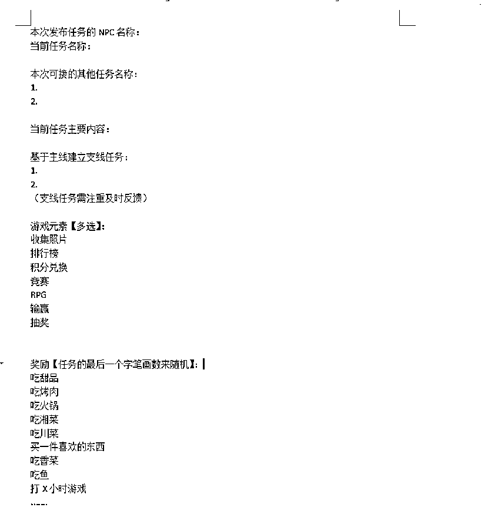
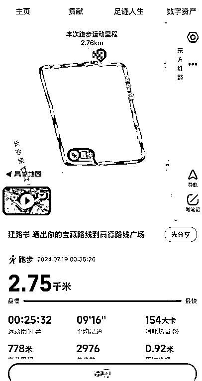
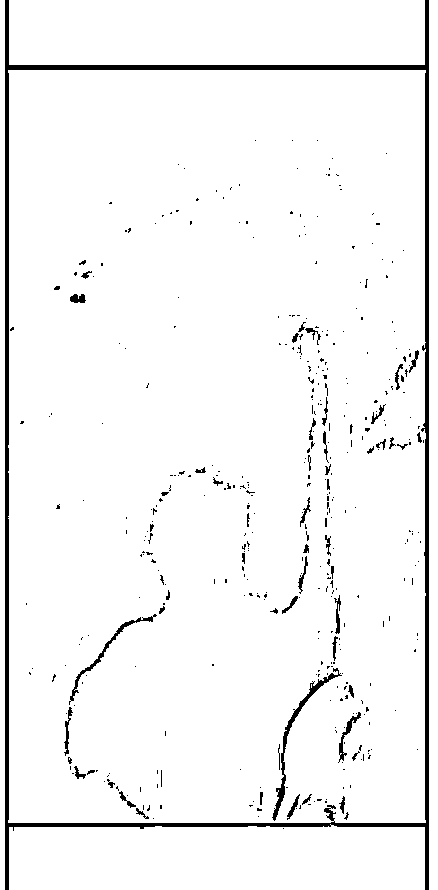
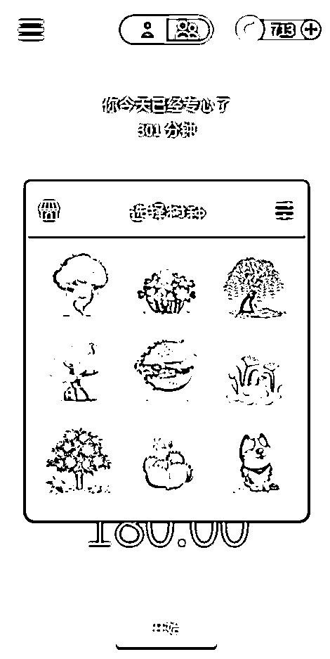
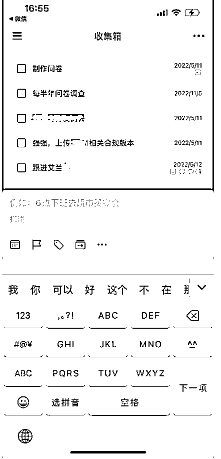
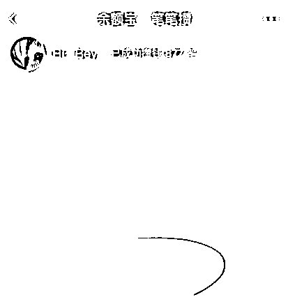

# 《把生活过成一场自己的游戏：快乐的人生设计手册》

> 来源：[https://shengcaiyoushu01.feishu.cn/docx/ZatSdqHCGoLqp4xQjNJcBwpJngf](https://shengcaiyoushu01.feishu.cn/docx/ZatSdqHCGoLqp4xQjNJcBwpJngf)

大家好，我是正义蟹不肉。

可以叫我老蟹。INFP 的人大概都爱折腾。两年前我在鹅厂做产品，之后出来创业，先碰过国内联盟链，也做过 Crypto 的 CW404 项目。

今天不聊履历，不聊工作，只聊我想和你分享的一个人生课题。

————用游戏化的方式活

# 一、我是怎么开始把生活当游戏玩的？

## 1、毕业后那段让人窒息的日常

大概是毕业以后。学校不够顶尖，毕业即失业几乎成了常态。

家里安排我进了一家建筑央企的办公室。每天早会、散会、吃早饭、对着电脑刷剧、给领导复印文件，或者等领导吩咐。

这日子一眼望到头，部门里的老人似乎就是我的未来版本，聊天里全是对生活、对同事、对邻居、对家人的抱怨。

——人是相对的动物，你一直盯着暗处，眼里就只剩下暗处。

办公室很闲，几乎没啥硬指标，工作围绕着等、靠、托打转。你总觉得有事在那儿，但一认真想把它做完，就会发现自己格格不入，因为别人嘴里的事永远更急，你总会撞上更急的事。

——对，越努力越辛酸。

既衣食无忧，又没什么压力，好像年少那把悬剑就一直挂在头顶三寸。

就像穿了很久的臭袜子再套一双 AJ1，只要不脱鞋谁都闻不到，但你自己心里门儿清，一旦旁边人抽一下鼻子，你都得赶紧收脚。

## 2、游戏给我的一直在响的反馈

我接触互联网很早，五岁就被爸妈带去网吧。上网有意识后，最早记住的游戏乐趣是老爸打不赢 CS，我“替父从军”后赢了，就能接着开一台机器随便玩。于是打开了游戏的大门：征途、传奇、天龙八部、红警、流星蝴蝶剑、War3、WOW，一代又一代游戏跟着我长大。

在那些游戏里，主角都被精心设计过，我们跟着他闯关、爬峰，清楚知道难关一定能破。明明很痛苦，却会上瘾地沉浸在一个个挑战里。

那现实里，我们为什么要把自己弄得麻木、浑噩呢？

慢慢失去参与感，失去动力，被自己默认剥夺了权利，被切断本该有的连接，这真的是我们和生活的样子吗？还要这样一直持续下去吗？

慢慢地我开始接受一个想法：我才是自己的主角，我也是自己生活的游戏设计师。

这是第一人称到第三人称的抽离。当你第一次用旁观者的视角看自己，生活不再同质化，你的烦恼和想法会变成需要推敲的任务。

你从纯粹的情绪里抽离出来，去撞见一个理性的自己。在游戏设计师眼里，主角要去达成目标，而你就是那个操控自己的骑象人。

# 二、游戏化到底能带来什么？

乐趣能带来很多事。

几千年前人类就造出了“游戏”这个东西，它能挖掘乐趣背后巨大的精神力量。每一款设计好的游戏都能点燃我们内在潜能的导火索，并带来强劲动力。把这些经验巧妙用在自己身上，幸福感会大幅提升。

游戏化思维的魅力在于调动乐趣。无论是日常、交友、做事、定目标、工作中，都会被大改写，而且大多是正向的。

这里说的乐趣不是短暂的刺激，而是深度乐趣，是专注和互动带来的愉快感。

尤其在当下越来越同质化的时代，一个有趣的人，比一个很厉害的人，对我来说更有吸引力。

游戏化是一门很有意思的学问，能用到商业、产品、运营、营销里，而且我觉得游戏设计非常难。

所以我想讲的是——生活游戏化

就一个目的：

帮我们从不得不做的事里找到乐趣，让流程变得好玩，自己因此快乐。

# 三、生活游戏化的实战拆解

## 1、一个真实案例

先拿一个我最近在做的事来体验：跑步游戏。

抽象一下场景：

——角色：我
——当下心情：乐观、懒、又想动起来，很矛盾
——目标：
主线：跑三圈
支线：待定
——地点：附近的产业园
——时间：大晚上

抽象完后，我把跑圈设计成了 QQ 飞车、跑跑卡丁车那样的竞速游戏。但我很懒，需要支线任务来托住主线，不然跑一圈就想撤。

于是我买了一瓶东方树叶，放在起跑点当路标。

觉得还不够，又加了一个监管机制：开手机录视频，定规则，每跑一圈喝一口，差不多三圈喝完。

跑完后剪辑发到社交平台，塑造阳光运动的人设。

事后复盘觉得可以更好，比如放两瓶水在对角，反馈会更及时，一圈太长了。

## 2、流程可以这样拆

把上面的动作提炼出来：

1. 建面板定主线：基于场景给自己建人物面板，明确主线任务要达成什么。
2. 补支线任务：主线会不会无聊？加支线来托住主线。支线要可量化、不违背主线初衷。比如跑一圈喝一口，水量刚好。核心是让主线进行中情绪始终是正向的，支线完成时有即时快乐。
3. 监管机制：需要外部承诺吗？可以发朋友圈、发视频、跟朋友打招呼“跑完来找我玩”。本质是向第三方公开承诺。看场景用。
4. 实践并迭代：先做起来，过程中不断加支线，让游戏更有趣。好的游戏都不可能一次完美，厉害的设计师也需要迭代。

我在跑步游戏里加了不少小 DLC：
1. 有个路灯下有棵树，角度好，影子被拉得很长像怪物，我路过时会故意放慢拍照。

2. 有个地方特别臭，我会和自己比憋气时间，上次 12 秒，这次好像更久了……因为 12 秒时味道还在。

candy：这条是补丁，这里想说，支线任务的反馈必须是即时的，不能是“现在跑完一圈，明天吃蛋糕”，那不行！要立刻马上就有快乐！重视即时反馈。

# 四、具体做法

本来编辑让我写工作游戏化，我觉得工作只是生命很小的一部分，服务于生活，所以我换成了生活游戏化。

## 1、把生活拆成副本挑战

生活就像 RPG，每个阶段有不同目标和挑战。用“副本”思维把琐事变成冒险。

每个副本有明确目标和奖励，可能是钱，也可能是认知、见识、一段好关系。完成它有成就感，偶尔失败也只是成长插曲，甚至是“剧情杀”。

生活管理的游戏化工具

时间管理：用番茄闹钟记录当下。用 15 分钟只做一件事，完成就得番茄币，兑换漂亮的倒计时皮肤，多次完成解锁成就，像通关一样推进目标；
（我用过 Forest，截图是网上找的）

任务管理：在滴答清单里给前一天的任务分配经验值，完成就兑换奖励，比如一杯奶茶、一顿大餐、一场电影、一个英雄皮肤。奖励自定，只对自己负责。

财务管理：支付宝的笔笔攒就是例子，用理财工具设计财务任务，比如攒旅行基金、还清小额贷款，或奖励父母一场旅行。

和人一起玩更爽

和朋友搞“烧烤大作战”，分工、设倒计时、定目标，先完成的队伍可以吃掉后排的秘制烤串。不在乎是惩罚还是奖励，骄傲地啃下时新游戏已经开始了。

和伙伴约健身，用跑步机排行榜追踪，每次打卡看到他在我下面，就截图转发，见面少不了一顿battle，下次莫名就多跑了几公里。你说我在内卷？嗯，但我今天在他上面。

虽然不想谈工作，但编辑硬要我提。我们的协作机制是：一个里程碑节点，不管成败都一起搓一顿。成功分喜悦，失败分经验教训，前提是目标一致且彼此信任。

## 2、让枯燥和高压变得可玩

总有枯燥高压的时刻，先判断它是客观存在的还是自己给的压力。客观存在的，承认它，找解法；情绪带来的无聊或焦虑，用游戏化包装，让瞬间更有趣、更值得回味。

无聊生活的包装

把家务变成寻宝游戏，和朋友分工，在对方房间藏奖励，彻底打扫干净才能找到，谁先完成谁拿奖励，比如零食。

学新技能设角色升级机制，定掌握节点，列学习计划，记录每次进步，比如背一个新单词，新技能，达标就给自己奖励，可以是不学一天、看场电影、吃顿美食，像攒技能点一样提升自己。

压力的游戏化处理

把压力当成游戏里的 Boss，用战术技术解决。

冥想或深呼吸给自己回 HP，记录每天平静时长、深呼吸次数，看状态回升，锻炼抗压。

彻底摆烂法：把压力异化成极限挑战，想象自己被包围，无路可退，只能靠一腔破釜沉舟的孤勇。正视所有紧张和压力，放下包袱告诉自己“最差也不过如此”，与其跪着输，不如站着死。内心被勇气填满，反而更平静，更好应对。

# 五、最容易踩的坑

## 常见误区

系统太复杂。很多人一上来就想建庞大体系，或照搬网上成熟模板，把一天拆成无数节点，规则和奖励一堆。结果维护费力，几天就弃坑。放松点，这是你的游戏，不用和任何人比，在你的世界里你就是唯一的坐标系，你就是直角坐标系懂吗？

这很常见，可以读《微习惯》。想保持健身习惯，今天就站起来做一个俯卧撑，这就够了，但必须每天做。

如果连这都完不成？Oh man？what can i say？

奖励机制不合理。我只提奖励，不提惩罚。罚？我的游戏，我还罚我自己？开玩笑，在我的游戏里，我就是 GM，就是上帝。

奖励设计很重要，要和任务难度挂钩。难度是非标的，你是健身大佬，跑 5 公里像玩儿，奖励一顿大餐不合适；你是新手，跑 5 公里坚持好几天，第一天吃力第二天跑 1 公里也行，只要坚持，就对自己好点，去吃顿好的。

奖励/任务>1，成就感不会廉价；奖励/任务<1，太难达成会挫败。最终失去吸引力，违背游戏化的初心：

唯一目的：帮助我们从必须做的事情发现乐趣，通过让流程有趣，而让自己获得快乐。

坚持不下去怎么办？无论设计多有趣，重复和失败都会让人倦怠，动力足却中途放弃。这就是设计师需要进化的时刻。你是自己的领导，为了和自己和解、获得幸福，去接触不同类型的游戏，找到兴趣点，平衡数值，理解机制，当好导演，保护好内心的自己。

但相信我，当你不断成长为自己的游戏设计师时，回头看。

你，对，就是你，已经无比强大了。

这是你设计的游戏，而你就是游戏里你选的主角，相信我，你很强大。