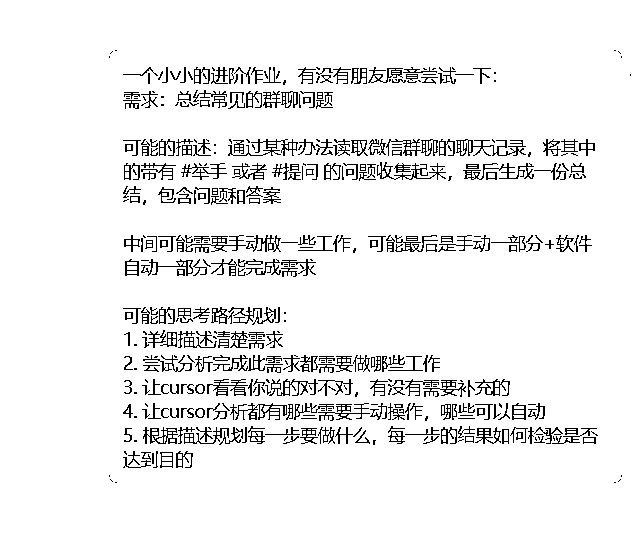
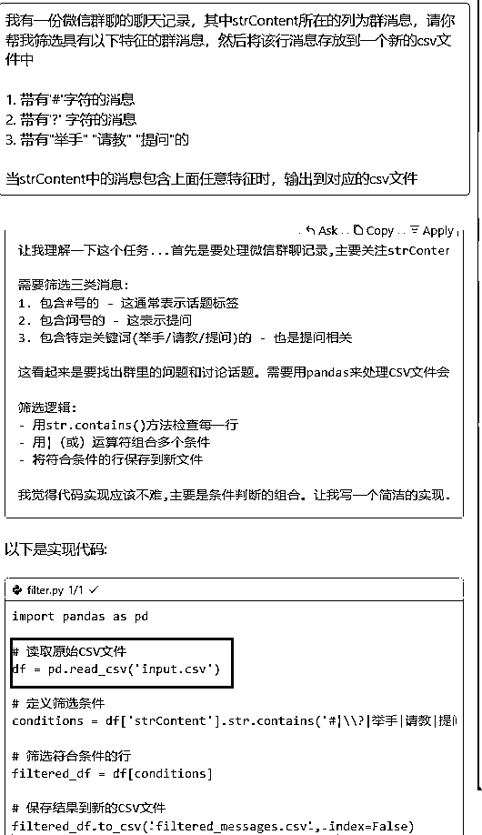
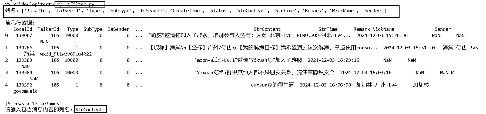
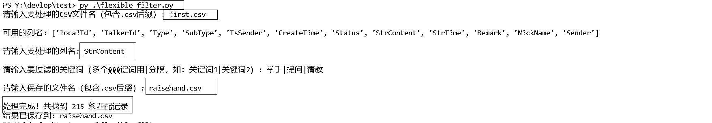
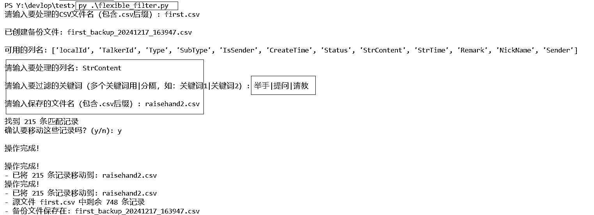
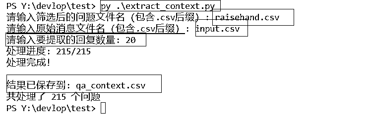

# 用 Cursor 把群聊问答变成可复用知识库：零基础做一次自动化总结

> 原文：[`www.yuque.com/for_lazy/zhoubao/ghgyivrovrebq82r`](https://www.yuque.com/for_lazy/zhoubao/ghgyivrovrebq82r)

## (精华帖)(32 赞)零基础做软件应用：用 Cursor 总结群聊问题的实践与思考

作者： 彩笺

日期：2024-12-17

大家好，我是 Cursor-零基础做软件应用的教练彩笺。前一阵子我在航海群里随手布置了一个小作业，截图就放在下面了。

起因很简单，航海里很多问题反复被问，翻记录费时间，我一个个回也累。于是灵机一动，试试能不能让 Cursor 帮忙把群里常问的问题做个归纳总结，省点人力。

今天把这个尝试自己跑了一遍，比想象中顺利。把思路和踩坑过程整理出来，供有同样需求的朋友参考。



**观前提示：** 提问的表达方式千奇百怪，覆盖面不可能百分百；本项目的目标是**汇总群聊里高频的提问**，所以少量遗漏对整体结果影响不大。

## 总体思路是怎么定的

我给自己画的大致路线是：

先找办法把群聊记录导出来，不去折腾微信监听这些复杂方案

对导出的记录做特征判断，为后面用 Cursor 编程提取做准备

实践中遇到问题就地解决

想办法把问题和对应的回答尽量配对

大致的落地方式：

导出记录可以用骄阳教练推荐的工具 **留痕**。我电脑基本常驻微信登录，数据基本齐全，工具也能把手机端的记录同步到电脑上，所以不用担心记录不全的问题。

群里提问通常有明显标记，比如带 **#**、带 **提问**、**请教**、**举手**、带 **？** 等。

实践中发现，问题后一般若干条回复里就会有解答，或者从问题开始到教练第一次回复之间的内容基本就是答案，少量遗漏人工补就行。

## 全流程实操记录

### 第一步

记录已经导出，接下来按特征先筛一遍问题。

textjavascripttypescriptcsshtmlbashjsonmarkdownpythonjavaccpprubygorustphpsqlyaml

Copy

```
我有一份微信群聊的聊天记录，其中 strContent 所在的列为群消息，请你帮我筛选具有以下特征的群消息，然后将该行消息存放到一个新的 csv 文件中

1\. 带有'#'字符的消息
2\. 带有'?' 字符的消息
3\. 带有"举手" "请教" "提问"的

当 strContent 中的消息包含上面任意特征时，输出到对应的 csv 文件

```



可以看到，代码读取的原始 csv 是 input.csv，**这里可以在描述问题时说明你的 csv 名称，这里我没有告诉他叫什么名字，所以他用了 input 这个文件名。**

我直接跑，结果报错 xxxx，把报错信息原样丢给 Cursor，它提示如下：

textjavascripttypescriptcsshtmlbashjsonmarkdownpythonjavaccpprubygorustphpsqlyaml

Copy

```
啊,看来是列名的问题导致的错误。KeyError: 'strContent' 说明在 DataFrame 中找不到'strContent'这个列名。
​
可能的原因:
1\. CSV 文件中的列名可能和代码中假设的不一致
2\. 需要先查看一下 CSV 文件的实际结构
​
解决方案:
1\. 先打印 df.columns 看看实际的列名
2\. 或者读取 CSV 时先显示几行内容确认结构
3\. 然后根据实际的列名修改代码

```

按提示改完后，代码会先打印所有列名和部分数据，让我手动确认要用的列。

操作结果：



**回头看最初的代码，问题是我自己弄的**，我告诉它列名是 `strContent`，实际文件里是 `StrContent`。

改完后打开初步筛选文件，发现中文乱码，再追问 Cursor。

textjavascripttypescriptcsshtmlbashjsonmarkdownpythonjavaccpprubygorustphpsqlyaml

Copy

```
# 我的描述
有一个问题，输出到当前目录中的 filtered_messages.csv 的中文，是乱码显示的

# Cursor 回答
啊,这是中文编码的问题。CSV 文件的中文乱码通常有两个解决方案:

1\. 在写入 CSV 时指定编码为 utf-8-sig (带 BOM 的 UTF-8)
   - 这样 Excel 打开时能自动识别中文
   - utf-8-sig 会在文件开头添加 BOM 标记

2\. 或者使用 gb18030 编码
   - 这是中国国标编码
   - Excel 默认用这个编码读取中文

我觉得用 utf-8-sig 是更好的选择，因为:
- 更通用的编码方式
- 兼容性更好
- 是国际标准

```

这一轮调整后，导出的 csv 能正常显示中文了。

人工打开一看，发现很多不相关的消息也被筛进来，比如带 # 的破冰消息。这时我的策略是：

**多层过滤，先粗筛再精筛，最后剩少量人工处理。**

具体做法是写一个新脚本，从源文件按条件筛选，结果写入新文件，同时把已筛选的部分从源文件剔除，避免重复。

### 第二步

已经拿到初筛文件，开始精细化筛选。

textjavascripttypescriptcsshtmlbashjsonmarkdownpythonjavaccpprubygorustphpsqlyaml

Copy

```
# 我的描述
通过初步的过滤，我得到了一个新的 csv 文件，我现在期望能实现一个新的功能，即程序运行后提示我输入 csv 文件名，以及要过滤的字符串，最后提示我要保存到的 csv 文件名

我期望可以通过此功能来自定义过滤信息

# Cursor 回答
明白了，用户想要一个更灵活的过滤工具。需要实现：
1\. 输入源文件名
2\. 输入过滤关键词
3\. 输入目标文件名

需要考虑的点：
- 文件存在性检查
- 输入验证
- 错误处理
- 用户体验（清晰的提示信息）

可以用 input()函数来获取用户输入
要处理可能的异常情况，比如：
- 文件不存在
- 文件格式错误
- 输入为空

让我写一个更灵活的版本...

# 用法
这个新版本的特点：
交互性更强：
提示输入源文件名
显示可用的列名
提示输入要处理的列名
提示输入过滤关键词
提示输入目标文件名
增加了错误处理：
检查文件是否存在
验证文件格式
验证列名是否存在
确保输入不为空
使用说明：
文件名需要包含.csv 后缀
多个关键词可以用|分隔
最后会显示处理结果统计
保留了中文编码支持（utf-8-sig）
你可以这样使用：
1\. 运行程序
输入源 CSV 文件名
从显示的列名中选择要处理的列
输入要过滤的关键词
输入保存的文件名
需要我解释任何部分吗？

```

生成了 `flexible_filter.py`。用它对上一步的 `first.csv` 进一步过滤，运行过程：



继续让 Cursor 实现“一直过滤到只剩少量再人工处理”的需求。

textjavascripttypescriptcsshtmlbashjsonmarkdownpythonjavaccpprubygorustphpsqlyaml

Copy

```
# 我的描述
现在我想优化一下，此过程是从源文件过滤并输出的，我可能会对源文件进行多次过滤，为了方便去重，我期望每次执行程序的时候，在源文件中删除掉对应的行，这样相当于我把符合条件的内容，从源文件移动到了目标文件

# 回答

明白了，用户想要实现"剪切"而不是"复制"的功能。

需要考虑的点：
1\. 先保存符合条件的行到新文件
2\. 然后从源文件中删除这些行
3\. 用新内容覆盖源文件
4\. 需要确保操作安全，避免数据丢失

可能的风险：
- 程序中断可能导致数据丢失
- 文件写入失败
- 权限问题

解决方案：
1\. 先创建备份
2\. 使用安全的文件操作
3\. 添加确认步骤
4\. 提供操作结果反馈

# 此处省略 cursor 回我的一堆改进描述，直接运行程序感受

```

**程序运行过程：**



人工核对后发现，源文件里的记录正常迁移到了新文件，但还混着表情包、合并消息等内容，它们在文件里以代码形式存在。

特征分别是包含 **xml** 和 **msg**。再次运行程序，把这两类导出到 giveup.csv，相当于丢弃，同时从源文件剔除。

### 阶段小结

到这里做的事和得到的结果：

先用 `filter.py` 对全部聊天记录按 **# ？ 举手 提问 请教** 粗筛，得到 first.csv

再用 `flexible_filter.py` 对 **举手 提问 请教** 精筛，得到 `raisehand.csv`

表情包等代码形式的记录按 xml 特征过滤掉

这时 first.csv 还剩 111 条

再把以 msg 开头的合并转发消息筛掉

剩下 36 条，人工检查后发现只漏了 3 个问题

而 **举手 提问 请教** 的筛选结果，截至我电脑上的记录有 **215 条**

原本担心自动化筛选会漏不少，结果出乎意料地干净，漏掉的提问非常少。

**大家的规范提问帮了大忙！**

## 怎么把问题配上答案

下一步是为提取出的问题找到对应的回答。**考虑到 AI 在这种场景的准确率，以及本航海本身就是 Cursor 主题，用程序先缩小范围再人工确认是最稳妥的。**

我能想到的路径是：

在 `raisehand.csv` 这 215 条记录里逐一轮询

定位到源文件中的位置，抓取问题之后 n 条回复

可能遇到的问题：

图片类提问。测试了 csv、markdown、html 三种导出格式，只有 html 能保留图片

有些提问只有 “#提问”，具体内容在下一条消息里

检索问题后 n 条记录基本能覆盖上述情况，可以继续推进。

### 第三步

回答筛选的关键点：

*   问题在源文件里的定位。聊天记录里有 `CreateTime` 这类时间戳字段，可靠。

*   n 取多少。先定 20 条回复试效果，不行再改成 “从问题到教练首次回复为止”。

*   问题和答案范围的存储格式，要便于人工查看。

textjavascripttypescriptcsshtmlbashjsonmarkdownpythonjavaccpprubygorustphpsqlyaml

Copy

```
# 我的描述
我现在想要一个新的功能，我通过之前的程序，做出了特定的筛选，我想针对每个筛选出来的问题，找出他在原消息文件中后面的 n 条回复，详细描述如下：
1.过程涉及到两个文件，提示我输入筛选后的文件（csv)和原始文件(csv)，还有 n。
2.遍历筛选后的文件，每一行都会存有一个列名为 CreatTime 的值，可以通过该值去匹配原始文件中该问题位于哪一行
3.遍历原始文件中目标问题后面的 n 条消息
4.将目标问题和后面的 n 条消息保存到文件，可以是 csv，要求是尽可能的方便查看

# 回答
这是一个上下文提取的任务，需要处理的关键点：

1\. 文件处理：
- 需要同时处理两个 CSV 文件
- 通过 CreateTime 匹配位置
- 需要考虑时间格式的一致性

2\. 数据提取：
- 找到问题所在行
- 获取后续 n 条消息
- 需要处理边界情况（如果问题在文件末尾）

3\. 输出格式：
- 要清晰展示问题和回复的关系
- 便于阅读的格式
- 可以考虑添加分隔符或标记

4\. 可能的问题：
- 时间戳可能重复
- 文件大小问题
- 性能优化需求

让我设计一个解决方案...

```

拿到代码后，**运行过程：**



打开结果表，ID 是问题序号，时间是时间戳，后面是内容及之后的 n 条消息。

| ID | 类型 | 时间 | 内容 |

| 1 | 问题 | 1733216434 | #举手 如果要买会员，是自己充值比较好，还是找淘宝，我看淘宝有独享才 70 多靠谱吗？ |

| 1 | 回复 1 | 1733216500 | 建议淘宝购买，我记得自己充值是 20 刀，比较贵，淘宝有独享和共享，按需选择 或者自己拿邮箱新建账号，有免费的额度 |

| 1 | 回复 2 | 1733216528 | 感谢🙏 |

粗略看，人工归纳很轻松，20 条内基本都有答案。有一种带图提问的特殊情况：

| 9 | 问题 | 1733303315 | #提问 打开网页去登录直接提醒这个，啥意思？ |

| 9 | 回复 1 | 1733303315 | 省略图片代码 xxxxxxxx |

| 9 | 回复 2 | 1733303342 | 刷新试试？一般是网络问题，或者等等 |

| 9 | 回复 3 | 1733303370 | 返回登录界面登录就好 |

这种可以直接复制问题去 html 导出的聊天记录里查找，就能看到原图了。


## 最后的一些体会

整体流程里，自动化能做的大部分都做了，问题与答案的最终对齐还是需要人工把关。另外如果想收集得更全，可以在群里引导更多规范的提问方式，并在不同场景下补充更多特征词。

后续还能玩的花样很多，比如领队的精华点评归纳、教练答疑合集、航海里的其他专题整理等，欢迎大家自己去尝试。

* * *

评论区：

彬 : 教练威武

Rand0mWalk : 我記得以前有幾期的航海是有百問百答欄目的，誌願者人工整理群裡有價值的提問回答，後來就沒有這個欄目了。現在結合自動化可以節省很多人力，個人一直感覺百問百答欄目很有用。

彩笺 : 第一次知道還有百問百答

龙哥 : 有具體篩選過後的 excel 文檔嗎，我想看看最終效果怎麼樣

彩笺 : [`gcnig3i8358l.feishu.cn/wiki/DqdBwmVhJiwIy0kFlugcvvVfnFd`](https://gcnig3i8358l.feishu.cn/wiki/DqdBwmVhJiwIy0kFlugcvvVfnFd)

俠狼 : 啊，我理解錯需求了😂我以為是要實時導出，且不能有誤。

彩笺 : hh，我也經常跑偏