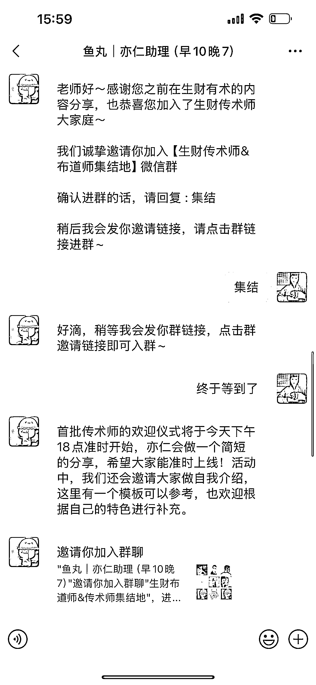
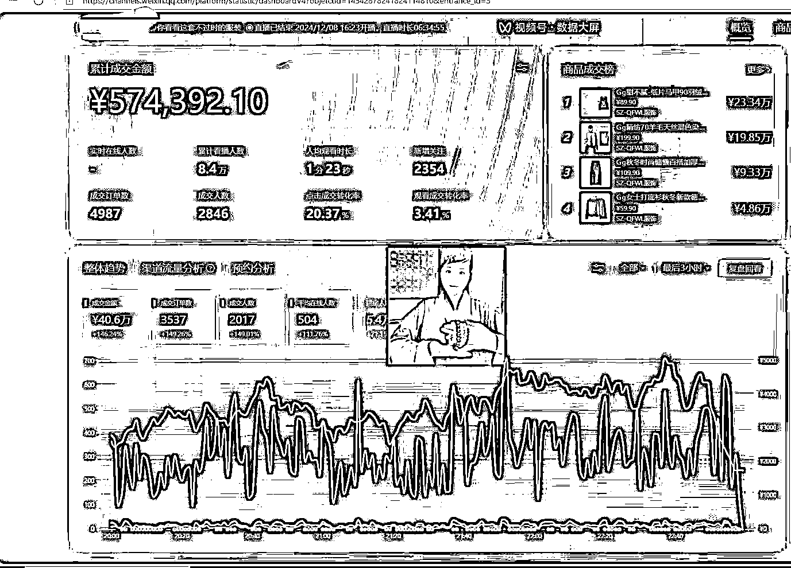
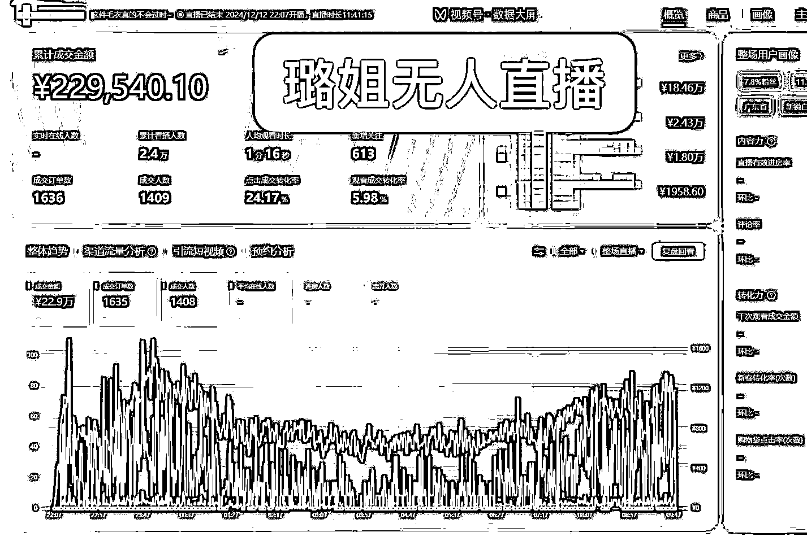

# 干了4年无人直播电商，我才后知后觉：视频号才是真正的宝藏！附完整实操思维导图

说起无人直播这行，我真的算是“老炮儿”了。整整4年时间，从义乌的一间小单间，一路干到了现在杭州500平方米的公司。中间在快手和抖音这两个平台之间反复折腾，起起落落都经历过，却始终没跳出原有的思路。

直到今年9月，一个做同行的朋友突然问我：“你接触视频号无人直播了吗？”那句话一下子点醒了我——对啊！怎么之前没想到把战场拓展到视频号上？

前几天，我很幸运地成了赚钱有术的传术师，内心真的挺激动。看了那么多大神的精华分享，心里也暗暗觉得自己该把看家本领拿出来亮一亮。于是特意抽出时间写了这篇文章，希望能给各位圈友带来一点启发。记得看到最后，有惊喜——我整理了一份无人直播电商实操思维导图，等着大家来拿！

先聊聊视频号无人直播的实战成绩吧。我花了大半个月深入研究，目前已经对接好了长期稳定合作的视频号供应链和号商，有需要的朋友我也可以分享给你。下面这些数据，全是我们操盘手最近打出来的真实成绩，100%货真价实。而且重点来了——号不会废！真的不会废！

看完这些，我只想说：后悔了！后悔没早一点杀进视频号无人直播赛道！

所以，别再追着我问“无人直播还能不能做”了。如果这行真做不了，我又怎么可能在广州买下2套房、开上奔驰和宾利？与其花时间质疑，不如静下心来，好好琢磨一下无人直播背后的逻辑和具体玩法——这才是真正有价值的事。

更详细的实操拆解，我已经整理好了一份飞书文档，点击下面的链接就能直接查看：

https://r7weuqivm5.feishu.cn/docx/Oyk3dl0DVoeoU8xcr1acLprvn5f?from=from_copylink