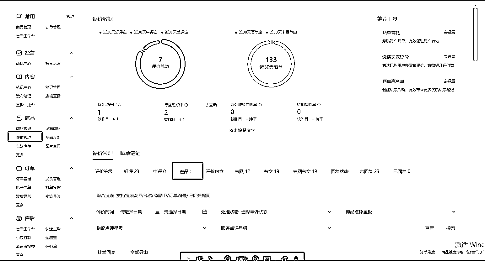
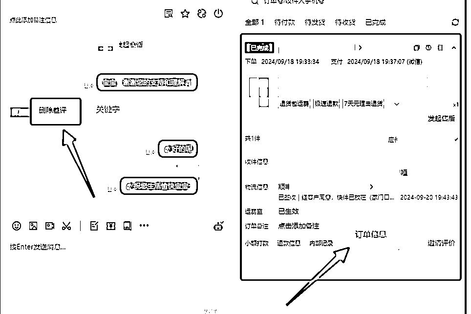
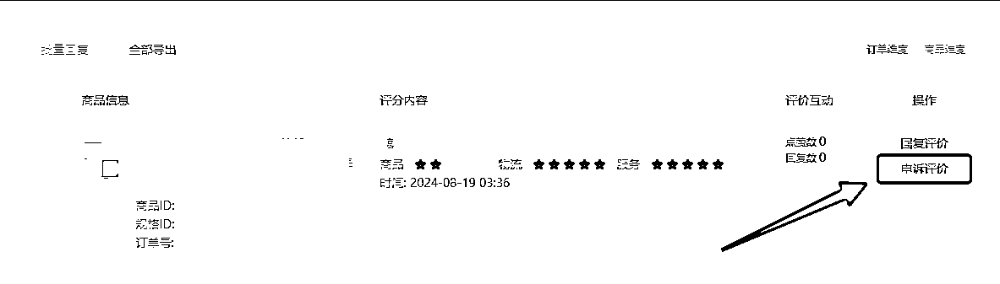
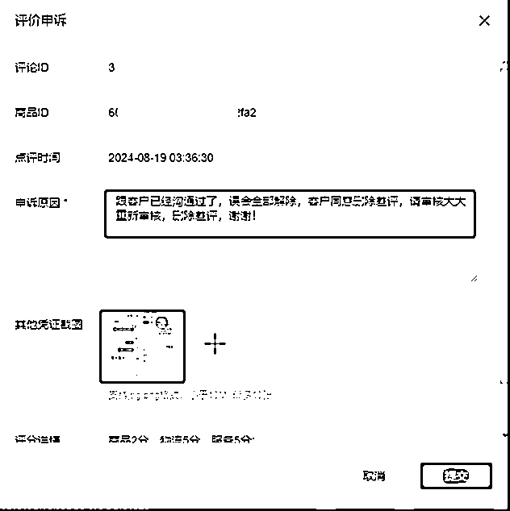
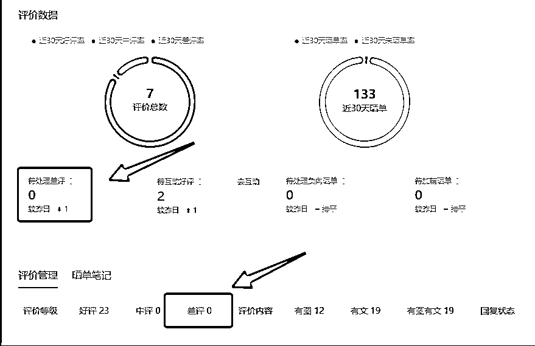

# ('小红书商品购后差评处理办法 SOP 以及爆单的小 tips', (2, 31))

小红书上，很多店铺商家在“爆单”路上栽跟头，往往不是因为选品、投放，而是败给了几个不起眼的差评。作为小红书店铺航海教练，杭州龙珠圈友书豪总结了一套客户差评的应对SOP，外加几个冲刺销量的实用建议，今天一并分享给大家。

先明确一件事：差评不是小事。它不仅会拉低单品权重，还会殃及整个店铺的综合评分。尤其是正在起量的爆款，一条差评很可能让转化率急转直下；轻则店铺扣分，重则被系统判定为负反馈，直接限流。所以，一旦出现中差评（三星及以下都算），一定要立刻处理，第一时间申诉、干预。

一、差评从哪儿查？
直接在平台后台操作：进入千帆后台，找到“评价管理”，把评价等级切换为“差评”，就能把所有负面反馈筛出来。

二、删差评的标准流程

第一步：打电话给客户，一定要电话沟通，不要只用文字。

话术可以参考这样走：

先礼貌确认身份：“您好，是XX女士/先生吗？我是XX店铺的店主，您前几天在我们店里买了XX。看到您留下了一条差评，我们非常抱歉没能让您满意。我今天特意打电话来，是想听听您的真实想法，看看我们哪里做得不好，也方便以后改进。”

接着表达歉意和谢意：“为了表示歉意，也为了感谢您的意见，我给您发个10元小红包，就当交个朋友，您看行吗？”

最后请对方配合：“另外还想麻烦您一件事，我会在平台给您发条消息，您帮我回复一下‘删除差评’这几个字就行。”

注意：沟通时千万不要出现“好评返现”之类的字眼，就用正常聊天的方式，真诚沟通就好。

第二步：提交申诉。

需要准备的申诉材料包括：与客户真实的聊天记录（截图里必须包含“删除差评”字样和订单信息），再加上一段申诉话术。

申诉话术可以这样写：“已与客户沟通清楚，误会全部解除，客户本人同意删除该条差评。请审核老师重新审核并删除，非常感谢！”

三、申诉通过后，差评会在后台隐藏，不会出现在商品评论区，店铺评分也能重新回到5.0。

四、小红书爆单的几个小技巧

1. 人工干预要做对重点。优先维护那些“小眼睛”还在增长、有爆款潜质的笔记评论区，可以多去同行的高赞评论区逛逛，找找灵感；朋友活跃的号或者渠道商资源，也都可以拿来辅助发力。

2. 封面测试不能省。把你这个品类里点赞过10的封面全部找出来，一批一批去测，最后留下表现最好的那一张。

3. 紧跟爆款风向。持续关注该商品最新的爆款选题和笔记模板，第一时间跟进模仿。

4. 差评处理要当回事。别让辛辛苦苦做起来的店，倒在黎明来临前的差评上。

5. 功效类产品要大量铺设关键词。小红书的搜索流量相当可观，值得用心经营。

另外，圈友也在评论区分享了一些野路子：有人表示直接引导用户主动删除差评同样可行；还有人说申诉时偶尔用点“技术手段”（比如P图），实测能有八成通过率——当然，这个大家听听就好，风险自己把握。

年前这波带货流量已经来了，大家一起抢，一起龙哥盟！