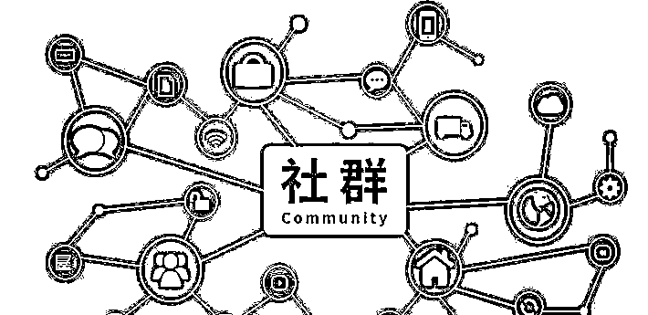
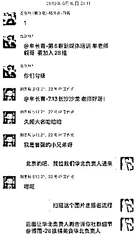

# 做了7年社群后，我掏心窝聊聊赚钱、群响和山顶会

前几天写周鸿祎那篇时提到过，受他影响，我做新项目总爱先研究同行，再琢磨着优化。28推从成立起就一直做社群，所以我研究同行的重点也都在社群上。今天这篇，算是把我这几年观察赚钱、群响、山顶会的心得，以及一些小八卦，一次说清楚。

先声明，这三家都是圈子里名气响的，我也都是深度参与者——赚钱多年的会员加私董，山顶会待了三年，群响也前后换过合作。网上点评这三家的人不少，但我敢说，没几个比我更有资格写。这篇我写了6小时，12000字，你有耐心的话，慢慢看。

## 一、赚钱有术：把“副业”做成大生意

赚钱最出圈的是知识星球那个圈子，尤其前几年418大促，朋友圈全是他们海报。当时那个涨价节奏，确实把饥饿营销玩明白了。我也去星球里搜过不少28推圈子里的老板ID，但这些人基本都不发言，很多连app都不打开了。

原因在于赚钱的定位：它主要服务的是想找副业的普通人。这个人群基数太大了，所以赚钱能做到6万多付费会员。门槛不能太高，天花板就有限，真正赚到钱的大佬在里面待不久。但这恰恰是赚钱的优势，现在大环境不好，失业率高，花3000多块进赚钱，对很多普通人来说真能改变处境，我觉得挺值的。

对比之下，28推服务的是已经很懂行的老板。这些人要么觉得自己不用学了，要么觉得人脉够了，只有业务遇到瓶颈时才想起我们。当年28推论坛和赚钱很像，也是分享赚钱经验，但那个年代没人谈知识付费，我们做了几十万会员却赚不到钱。后来我就走到了另一个极端：只做老板的生意。

赚钱的推广主要靠口碑加分销机制，这招确实高明。早年28推论坛也搞过类似推荐，但免费论坛只能给虚拟积分，比不上现金动力强。现在我做资源对接型社群，不敢做分销——人来了质量把控不住，风险太大。也尝试过做知识星球，后来发现不适合28推的人群，果断放弃。结论就一个：什么人用什么产品，不能硬套。

### 龙哥这个人，和赚钱的隐痛

三个创始人里，我和龙哥接触最多，性格上也最像：都是做产品出身的，不爱拍视频直播，偶尔写写文章，线下社交能躲就躲。不过龙哥比我更佛系——他加了不少私董会，但印象里几乎不参加别人的线下活动，唯一一次是杭州一个私董会的游学。

其实这样容易错失真东西。拿28推来说，你只看线上会觉得平平无奇，但我们的精华全在线下。龙哥早年也加过28推，但一直潜水，从不参加活动。私董会本质是重线下的产品，网上看看是体会不到的。

不能说龙哥不是好产品经理，赚钱这个产品就是证明。他自己早年做过不少网赚项目，所以有底子。跟他最深的一次交流是在西双版纳闭门会，当时大巴上坐一起，问他对私董会的规划，他说要转型，后来就有了“赚钱航海家”。但线下终究不是赚钱的强项，航海家做得不温不火。

### 赚钱私董会，名存实亡

因为龙哥内敛不爱社交，赚钱私董会很难撑起来。当时负责的光合也是内敛型，要是换成山顶会田园那种人来操盘，说不定赚钱私董会还活着。

赚钱私董会刚做时定位很高，收费6-7万，服务也真不少。2021年我做私董会就是照抄赚钱的，收了4-5万，结果做了一年就撑不下去。后来我进了赚钱私董会，才知道自己抄错了对象——很多服务只是一厢情愿，私董们根本用不上。我和龙哥都属于脸皮薄、有责任感的，招了100多人后，赚钱就暂停纳新了。

总结：赚钱的线上社群能力很强，但线下这块，创始人性格加上没有合适的合伙人操盘，偏线下的私董会自然做不动。

### 我在赚钱最大的收获

最大收获是认识了盗坤。当时赚钱私董会100多人，就他一个在重庆创业的。加了两天，他就来28推拜访，报名了私董会。后来发现他实战强、口才也好，我请他做分享嘉宾，他还帮我推荐了十几个朋友进私享会。你说神奇不神奇——我俩办公室相距不到1公里，硬是生生不认识，因为赚钱才相识。这也让盗坤在重庆有了互联网老板圈子，对他后来发展帮助不小。

赚钱私董里做个人IP、知识付费的偏多，这类人和赚钱人群天然契合，所以铁粉多。我参加过三次赚钱活动，一次闭门会，两次龙珠大会。闭门会几十人质量很高，毕竟6-7万门槛在那，认识了狗哥、当下、妖怪、郭拽拽等好几个，后来都进了28推私享会。龙珠大会对我没什么用，人群太泛、公司规模小。第二次我还专门在VIP嘉宾群组织小房间交流，几十个人自我介绍完我就绝望了——行业不对口，规模不匹配，后面哪怕送门票送住宿我也不想去了。

## 二、群响：刘思毅一个人的狂欢

群响就绕不开刘思毅。跟龙哥完全两个极端，很多人是先认识刘思毅才知道群响的。北大传媒出身，营销天赋确实强，年轻、鸡血、像永不停歇的小马达。够拼、敢说，有现在的成绩不意外。

但说实话，群响在我眼里不像社群，更像一个知识付费产品，尤其这两年。每回搞一天大直播都能卖大几百份会员，现在对外说会员过万。交付主要是线上课程加线下会议，这在本质上就是知识付费。社群应该偏重会员之间的链接，可群响这个会员量，要真做链接，工作人员根本忙不过来。

以前群响口号是“找流量来群响”，面向新电商人群。后来刘思毅个人IP破圈，好处是会员规模上去了，坏处是人群泛了。但普通会员收费不算贵，性价比挺高，想入门新媒体的话挺值得，刘思毅做得也算用心。

### 群响私董会，夹缝中求存

群响私董会第一年49800，续费政策我问了好几个人，数字都不一样，到现在也没搞清楚。刘思毅日更文章、一天十几条朋友圈，但你发现提私董会的越来越少。赚钱私董会果断暂停，28推转型私享会，山顶会死磕私董会，群响私董会就卡在中间，尴尬。

不过我不觉得群响私董会服务不行。有对比才有伤害——杭州有家收费差不多的私董会更差，问过十几个朋友，9.9个说不续费。群响至少组织了不少小规模交流、国外游学、国内闭门会，交付是认真的。我问了至少10个群响私董，愿意续费的也就三成，但考虑到客单价，这成绩真不差。山顶会续费高是因为续费价只有首年的五分之一。

去年在28推南澳岛闭门会上，有老板吐槽：冲着刘思毅IP进来的人越来越多，人群泛了，做品牌电商的私董没了续费动力。刘思毅自己也清楚，最早想做到1000人，后来改口说专心运营好500人。他也知道私董会整体走下坡路，所以现在业务主推两年期会员和线下培训，还准备让合伙人做IP服务。

总体说，群响今年发展不错，因为刘思毅够拼也够聪明，总能找到新增长点。

### 八卦：赚钱、28推和群响的恩怨

刚进赚钱私董会时，有个铁粉每次聊群响就咬牙切齿说快倒闭了，结果群响越活越好。早年赚钱和群响同在杭州，完全不往来。问过内部人，说刘思毅做群响时赚钱没少帮忙，后来群响做起来反倒把赚钱当假想敌。不过前阵子刘思毅去拜访龙哥还发了采访视频，这事应该翻篇了。

我第一次听说群响是2019年，钱钰推荐的。没多久刘思毅就通过成都一个会员引荐，报名了28推精英会，一口气报了3年——那会儿他公司还在北京。

后来我也安排助理报名群响，想着互相学习。结果有次同事把一篇28推访谈老板的文章分享到群响会员群，直接被工作人员踢了。当时挺生气，但我没去问刘思毅，到现在也不知道是他授意还是下面人操作。反正记心里了。换位思考，就算有会员在28推群里发广告，我们顶多警告、关小黑屋，不会直接踢人。也许当时28推正红火，群响也把我们当竞品？再后来群响合伙人Allen报名我们的戈壁徒步，我们同事就以当年这事为由拒了，宁愿不赚这钱。

现在回头看都是小事。去年两家还做了资源互换，互相送了普通会员名额。我跟赚钱私董会也这么操作过。

### 刘思毅这个人

网上关于他的争议不少，粗口、未婚生子、恋爱取向这些。后两个我觉得是私事，现在社会了，没必要保守。我是真佩服他的拼劲，日更文章、十几条朋友圈、短视频、直播一整天，这些我都做不到。

唯一不喜欢的是他爱夸大其词。龚文祥解读过刘思毅一个老视频，说他喜欢放大10倍说话，千人会议说成万人。我觉得放大10倍夸张了，但放大2倍我都觉得不道德。以前没公开说过，但龚文祥都发视频了，刘思毅应该也不在意。

说两件我亲眼见的。2020年，我们刚在杭州搞完峰会，第二天正好赶上群响号称5000人的大会。我去别人会议有个习惯——先数座椅。现场座椅满打满算一千，还没坐满。会后刘思毅一本正经在朋友圈复盘：“这次有5000多人报名，来了现场的也有5000人。”还有一次是我们广州大会结束，第二天群响广州会议，号称千人规模，但只针对会员。我想着哪怕免费，会员能来千人不太可能，就叫两个合伙人去看了下——她们正好是会员。结果现场就200人。刘思毅照样在朋友圈说来了1000人。

为什么我说这不道德？群响会议大部分免费，收益主要靠赞助商和后续转化。真实规模直接关系到赞助商效果，虚报就是对赞助商不负责。当然可能我想多了，人家赞助商根本不在意。我们自己搞了7年活动从不虚报，去年短剧大会预计300人来了千人，还是按300人收赞助费。

从营销角度，夸大其词确实有效，但我和龙哥这种脸皮薄的人永远做不出来。当然这只是我的看法，别人可能不觉得是缺点。还有一点不喜欢的是看人下菜，案例太敏感就不公开说了。

再说龚文祥。以前对他没什么负面印象，加了微信后经常看他为营销说一堆误导言论，好多次想骂人，想想算了。他自己夸大就算了，还给刚入行的会员背书，说人家是某某领域第一，误导更多人。做人高调没问题，但不能为了目的乱说。28推会员找我录视频背书，我基本都拒绝——不了解真实情况，不想误导别人。

## 三、山顶会：团队作战的私董会范本

山顶会是这三家里唯一专注做私董会的，也是做得最成功的。关键在团队——没有短板。创始人李波做IP和推广，合伙人田园做社群运营，另一位合伙人江洋做营销转化，三块都做到极致。山顶会公司规模也是最大的，听说销售最多时有两三百人。赚钱、群响、28推团队最多也就几十人，而且都没全职销售。

山顶会为什么续费高？因为续费价只有首年的五分之一，加上交付确实扎实，形成了良性循环。28推里很多同时在山顶会的私董都跟我说，山顶会牛就牛在没短板。

## 最后说几句

三家看下来：赚钱强在线上产品，私董会是短板；群响本质是知识付费，靠创始人IP驱动；山顶会专注私董会，团队作战。28推和它们都不一样——我们服务的是已经赚到钱的老板，只做资源对接和线下链接。影响什么人群，就做适合他们的产品，这是我最深的体会。别看这三家表面风光，各有各的难处，也各有各的活法。圈子里没有完美模式，只有匹配不匹配。

写这篇不是想踩谁捧谁，就是把我看到的真实情况说出来。你在圈子里听过什么不一样的故事？欢迎聊聊。

做社群这些年，经常被人问到同一个问题：山顶会凭什么能做起来？

这个问题我其实早就想聊。只是总觉得时机没到，话没想透，写出来怕被人说是酸或者眼红。今天干脆摊开来写，能说的、不能说的，都说点。先说好，这不算什么行业分析，就是个人视角的观察，保证真实，但不保证客观。

先聊聊我对山顶会商业模式的还原。

这家社群说到底做的就是一条转化路径：李波在台前持续输出，把个人品牌立起来，吸引那些想转型新媒体、又不太懂怎么下手的传统生意人。这些人来了之后，第一步不是直接进高端圈子，而是先花一笔小钱参加线下培训课，在课堂里感受氛围、建立信任；等到一批人学完了，再从里面筛出意愿更强、条件更好的，推荐他们升级成价格高出一个量级的私董会员。

听说培训的时候，现场会分成若干个小组。每个小组除了新来的学员，还会安排两位对山顶会高度认可的老会员一起参与，作用就是用自己的真实体验做口碑铺垫，时不时的帮山顶会说两句好话。组里还会配一个全职销售，专门盯着流程推进。这套打法我听山顶会的会员转述过，自己没去过现场，如果细节有出入，权当听过就算。

再来说说山顶会的运营。

必须承认，田园是个很优秀的运营负责人。以前我还专门让团队的人去研究她发朋友圈的逻辑，后来跟其他私董会的创始人聊天，发现他们也有类似的举动。

田园最厉害的是记性。很多会员的名字、从事的行业，她基本能记得清清楚楚，聊天的时候让对方明显感觉到自己被记住、被重视。这种能力背后，估计是私下做了不少功课。她还会主动帮会员之间牵线搭桥，让人感觉到一种家人式的照顾。山顶会早期的“家人文化”，很大程度上是她用这种情绪价值一点点堆出来的。

我曾经问过不少同时是28推私享会和山顶会会员的朋友，两边感受最大的差异是什么。印象最深的是成都的私董可期，他的说法很精辟：从业务角度讲，28推的私享会对他的帮助更大；但从情感体验上说，山顶会让他更有归属感。

其实私董会这种圈子，人们愿意长期留在里面，无非图两样：要么是业务上能直接带来价值，要么是待着舒服、有情绪回报。拿28推来说，有不少会员其实并不指望在圈子里谈成生意，但就是喜欢参加我们的活动，觉得每次来都开心，这也是一种很实在的续费理由。

由于我本人的背景，加上我们常年搞戈壁徒步，28推的文化更接近一种江湖兄弟的感觉。山顶会的大鹏也是28推的V4会员，他总结过一个很有趣的区别：山顶会的饭局上基本没人主动张罗喝酒，而28推的大小聚会几乎顿顿都有酒；不过他也说了，不能喝的人没人会硬劝，喝多喝少全看个人。

活动形式方面，两家也走出了完全不同的路子。山顶会为了照顾更多会员的学习需求，经常组织小范围的线下交流，同时还把内容搬到线上做直播，让更多人能同步参与。之所以能这么操作，是因为山顶会的底色是一个学习型社群。

比如同样叫茶话会，我们两家的逻辑完全不同。山顶会通常找一位会员做PPT分享，内容通过腾讯直播开放给所有会员在线收看，两个小时左右就结束了。而28推的茶话会，一般只有八到十个人参加，关起门来深度交流八个小时。为了让到场的人都能放下顾虑聊干货，我们从来不做直播——只要镜头一开，很多掏心窝的话就说不出来了。

山顶会那种模式轻巧、覆盖面广，适合大量爱学习的人；我们这种模式更重，但真正参与进去的人，收获往往更大。这两年山顶会新增的私董里差不多七成是传统行业的老板，他们进来的首要目标是学习。如果他们来参加28推这种八小时深度交流的茶话会，大家各自的诉求都不一样，根本聊不下去。反过来，28推的会员里，能像模像样做PPT分享的老板也找不出几位。所以说到底，不是谁的模式更高级，只是各自适配的人群不同。我一直相信，真正的干货往往产生于私下的交流之中。

当然，这不代表我对山顶会没有意见。

接下来说点个人的感受，纯粹是我自己心理上的坎，未必代表人家做得不对。

入会第一年，山顶会在广州办年会。我本来打算去的，但一问，参加年会还要自己再掏1300块钱，而且只包含一顿晚饭。当时心里就凉了半截。毕竟我进会的时候已经实打实交了两万块会费，在我的习惯认知里，这种内部聚会不说安排食宿吧，起码不应该再另外收钱。那时候市面上同类私董会的内部活动，大多还是提供食宿的。尤其是我自己刚做私享会那会儿，收费5980元，每年还会给会员安排两场三天两夜、包吃包住的闭门会。两相对比，我就有点说服不了自己。

说句公道话，我倒不是花不起那1300块，单纯是心理上难以接受。我当时还专门给田园打了个电话聊这件事。她的解释是搞会议成本太高。这个理由没能打动我——因为我自己这些年办过几十场大型会议，很清楚这里的账。后来那年我就没去山顶会的年会，转头去了杭州参加赚钱的龙珠聚会。那边至少会为私董安排一晚住宿，我还记得那晚跟盗坤住了一间标间。也正是那次机会，盗坤引荐我认识了孤狼，孤狼又邀请我参加他们的闭门会议。由于两场活动中间隔了七天，我干脆留在杭州，一共待了九天。

最近山顶会在广州又办了场内部分享会，同样需要单独缴纳报名费。不过这次我不去，倒真不是钱的问题。主要是眼看着山顶会里传统老板的比例越来越高，能聊到一起的人恐怕越来越少了，去了现场也怕找不到几个同频的。

聊完这些主观感受，也说说我在山顶会里的实际收获。

第一年会员到期的时候，田园主动给我打了电话，问我要不要续费。要知道，那整整一年时间里，山顶会的线下活动我一场没参加，线上分享也一次都没听过。换成我的团队，面对这样的会员恐怕连提续费都不好意思开口，更别说直接打电话去问了。这一点我确实佩服田园，同时也希望我公司负责私享会的合伙人，脸皮能再厚一点。

但后来我还是续了。原因是在那年里，我通过山顶会认识了一位重庆的私董苏海明。再后来他直接给28推私享会续了十年费，成了我们唯一的V10会员。就冲这个缘分，我也愿意再续一年。

前几天我还跟苏海明吃饭，聊起这件事。他说当时最早是听小黑哥提到28推的，只是加我微信的那个契机，恰好是在山顶会的局上。所以说到底，圈子之间的连接常常就是这么奇妙。

第二年我派了团队的米峰进去。起初的想法很简单——山顶会女会员比较多，米峰又爱健身又会弹吉他，这种小帅哥应该容易跟大家打成一片。后来发现，姐姐们比我想象中清醒得多，压根不吃这一套。当然也可能是米峰在山顶会里不够活跃，没能引起注意。第二年山顶会那场付费年会我也让米峰去了，结果同样没什么水花。于是第三年我又换回自己继续待着——怎么说呢，也许成熟一点、有点内容的创业者，反而更招人待见吧。

抛开这些小插曲，通过山顶会认识、最终加入28推的会员，保守估计十个以上二十个以下，这个成绩并不差。但要说第四年还续不续，我大概率不会了。原因还是那句话：山顶会里的传统老板比例越来越高，跟我平时服务的对象差异越来越大。我又不参加线下活动，情感上的连接本来就弱，只能从纯业务回报的角度去算这笔账。

这里顺便说一句，我置换进入的另一个社群，里面大多是做电商的老板，转化效果比山顶会好太多了。从那边转过来的私董，少说也有四十个。但我从来不会跑到别人的社群里赤裸裸地推荐自家业务，通常是加个好友、做个自我介绍，然后顺其自然。很多人加完好友一年、两年都不说话，某一天突然跑过来说想加入28推——多半是有了需求，又找身边认识我们的人打听过一圈，而我们的口碑经得起打听，转化自然就发生了。

接下来，聊聊山顶会续费率高的核心逻辑。

田园的运营能力确实强，服务也确实细腻，活动组织得也算勤快，会员之间经常有种家人的感觉。但这些在我看来都只是基本功。山顶会最聪明的地方在于定价设计，这一招很多同行学不来，也没法学。

首单收49800，第二年续费只要10000，享受的服务一分不少。你想，一个已经真金白银掏了将近五万的人，到了第二年面对一万块的续费账单，心里会怎么想？五万都花了，不续那不是更亏？这种心理博弈，实在高明。

因为我入会早，第一年只花了两万。如果我也是按49800进来的，恐怕也会心甘情愿地一年接着一年续下去。

山顶会还有一点很精明——不搞免费食宿，年会等所有线下活动单独收费。这样一来，虽然续费价格降到首单的五分之一，成本端却不会同步膨胀。这个利润结构设计得非常巧妙。

当然，我也并不觉得49800对真正有需要的人算贵。就像我们现在收9980，我也没觉得定价有多便宜，只是同行普遍从29800起步，比着比着，28推就显得亲民了。

山顶会养着那么大的团队，还有推广投放的成本，首单不收49800，公司大概率撑不住。但第二年开始只收一万，因为不再产生获客和销售费用，这个价格依然能覆盖服务支出。这套账，里里外外都是算过的。

我也试过学习山顶会的续费模式，努力把私享会从原来的5980涨到9980，续费价格定到7980，一次性续费三年则降到6980，还额外增加了服务内容。但跟山顶会那种“续费只有首单五分之一”的力度相比，我们的刺激还是太温和了。不过这个策略确实奏效，靠着它，成功让两百位会员提前把未来四年的费都续了。

至于群响为什么不能学山顶会的模式？因为它跟28推一样，提供的活动里包含了包吃包住的闭门会。如果续费价格定得太低，整个盘子就要亏钱。举个最直观的例子：我们每办一场闭门会，人均成本就是2000块，这还不算员工的工资。假如我此刻宣布续费一律降到2980，续费比例肯定会飙升，但收上来的钱连成本都兜不住，公司马上就会出问题。

这事儿说白了已经不是价格高低的问题，而是对人性的拿捏。山顶会续费收一万，也就比我们首单的9980贵了20块钱，但因为它相对首单打了极大的折扣，会员会觉得不续就亏了。其实这本质上还是产品结构决定的。

也许有人要问：那你们为什么不把首单定价抬高一点？不是我觉得28推的会员不值更多钱。恰恰相反，我始终认为，现在28推私享会交付的价值，并不比当年那些收49800的私董会差——虽然砍掉了一些华而不实的服务，但留下来的东西更接地气、更能落地。但我们确实没有山顶会的综合实力。我的个人IP影响力比不上李波，运营团队几个合伙人加起来比不上田园，销售端更是一片空白。强行做五万块的高客单，恐怕公司撑不到第二年。

反过来，走低客单路线，我们不需要铺天盖地做推广，就能靠口碑吸引一千多人报名。私董会本身不赚什么钱，但人多就有了基本盘，每个月再靠峰会创造一点微薄利润，公司就能活下来，细水长流。所以结论是：定价策略没有统一答案，完全取决于团队实力、产品结构和自身节奏，盲目模仿只会把自己带进坑里。

文章写到这里，顺便聊聊我和李波本人这些年来的交集。

我加李波微信的时间很早。2016年他就报名参加了28推的首届大会——当时所有报名的人都要先加我微信转报名费。第二年，他又报名了28推的第四期培训。这两件事我记得很清楚，原因是我习惯给重要活动群里的联系人打标签，多年过去，谁参加过我们哪场活动，在我这儿都是清清楚楚的。

后来李波到广州重新创业，早期走得并不顺利。那时候他做了一个叫“波波来了”的知识付费产品，经常采访行业大咖。当时他也来约我做访谈。考虑到他跑一趟重庆成本太高，后来我出差到深圳，他和田园找了一个朋友的办公室完成了这次采访。我们整整聊了四个小时，我把怎么运营社群、怎么做线下活动的经验，基本倾囊相授。事后他把这段采访整理成文章和视频，逻辑之清晰、表达之准确，比我自己给自己写介绍还到位。那一次我就很佩服他的总结能力。

再后来李波在广州办创业者大会，邀请我去做分享嘉宾。去之前他跟我说是千人规模，到了现场一看，目测大概三百人。那时候他公司据说一直处于亏损状态——波波来了这个产品收费才三百多，会议门票收入有限，场地规模也撑不起来。

转机出现在疫情期间。李波靠着日复一日在视频号上直播分享，突然一下子破圈了，直播间每天都有上千人在线。也是在那段时间，我邀请他在我们广州大会上做了一次分享，主题正是他怎么把视频号直播做起来的。个人品牌立住之后，他的事业明显顺畅起来，先是做创始人IP培训，再后面就有了大家现在看到的山顶会。

抛开商业上的种种，我对李波这个人是真心佩服的。身为连续创业者，拖家带口从北方来到广州从头打拼，能吃得了这份苦，本身就值得尊重。今天山顶会能走到这个高度，我是由衷地替他开心。这个世界说到底还是天道酬勤，你付出的每一分努力，早晚都会以某种方式回到你身上。

这篇文字写到现在，比预想的要长不少。本来每个社群单独写一篇会更清爽，但内容既然已经铺开了，再拆成三篇也不符合我的性格。

今天说了很多以前不太方便公开讲的感受。夸的也好，抱怨的也好，都是我的真实想法。我们就主打一个真诚。

做社群这些年，越来越清楚地感受到，每家的圈层和会员画像都在分化，早就谈不上谁抢谁的生意。从心底讲，这三家社群做得越大，我反而越高兴——因为大家是在一起把市场做热，把用户教育好。说不定哪一天，他们社群里的会员想要一些更有差异化的深度连接，也会在第一时间想到28推。所以他们的规模越大，对28推来说，就越是好事。

原创不易，如果这篇文章对你有启发，欢迎转发支持。