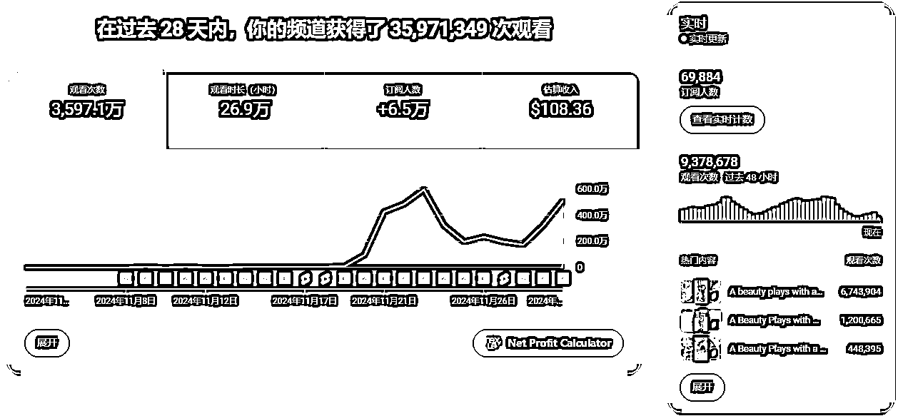

# ('人工智能与未来社会：机遇与挑战', (2, 17))

标题：离职后我用AI做“达人秀变身”视频，24天涨粉7万、播放破3600万：完整拆解

三个月前我还在国企带大数据团队，一年把盘子从两百万做到五千万；三个月后我成了AI短视频赛道的“赌徒”。产品岗三年、解决方案岗两年的底子，加上一直折腾些小项目都没折腾出水花，这次索性all in AI内容。看到龙哥的超级标，又正好在离职空窗期，没多想直接冲了。头一回在赚钱发帖，写得不够利索的地方大家多多担待。

最近几个月，“达人秀变身”这类视频在YouTube和国内平台都刷屏了，圈里不少帖子也聊过，我简单带一嘴：本质上它就是靠文生图+图生视频技术堆出来的一种AI短视频“快消品”，套路很直白——人物+动物变身+美国达人秀评委表情包三件套混剪。

这玩意儿在AI内容满地跑的当下，胜在门槛极低，翻拍爆款几乎零成本，而且平台流量还在持续给。亲测视频号和快手至少有量，我甚至还玩出了几个变种：肌肉男变身、赛博科技变身，还有我自己改良的真实场景变身。一个月不到，第一版的基础上已经裂变出好几套玩法。

直接晒战绩（11月8日发第一条，数据截止12月2日）：

1.  YouTube：24天拿下7万订阅，累计播放超3600万，开通变现第4天就进账108刀。
2.  微信视频号：20天涨粉2万，播放量破2500万，收益300块。说句实话，变身类内容在视频号想靠广告赚钱挺难的。
3.  快手：20天做到1万粉、1300万播放，收益还是0，广告刚开通（快手叫磁力万合，粉到1万才能开）。

文档里塞了不少截图和视频演示，建议直接去飞书看完整版：https://ncnmu5q1eqm9.feishu.cn/wiki/V71Iw4oQNimYN9kWpWNcIWg7njc

评论区里有朋友问Shorts怎么快速起量，我顺手答一波：别拍脑袋，拿自己的完播率曲线去对标头部账号，一帧一帧拆他们的内容结构。我自己前半个月每天至少剪三个视频，边发边调，慢慢就有了手感。完播率这个指标，可能是你最该盯的核心数据。

说到底，这种项目拼的不是灵感，是执行密度。