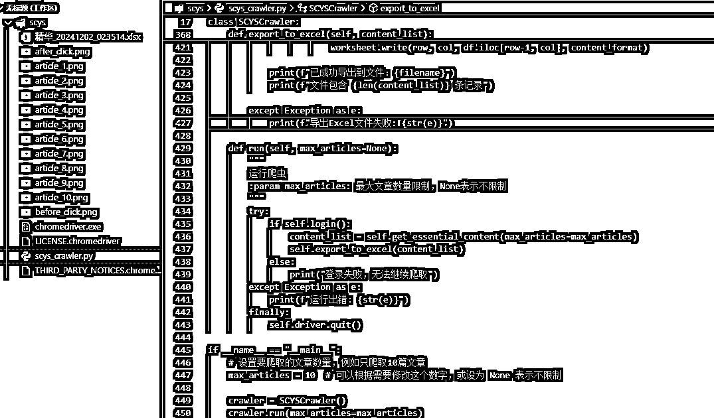
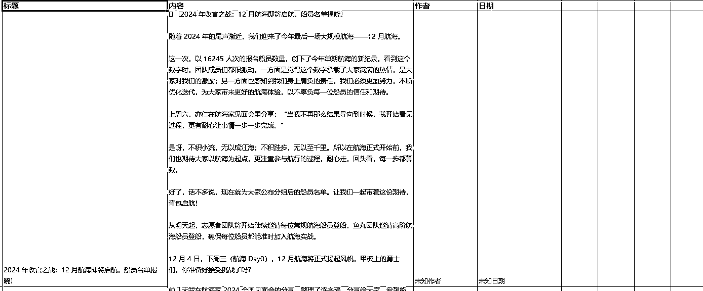
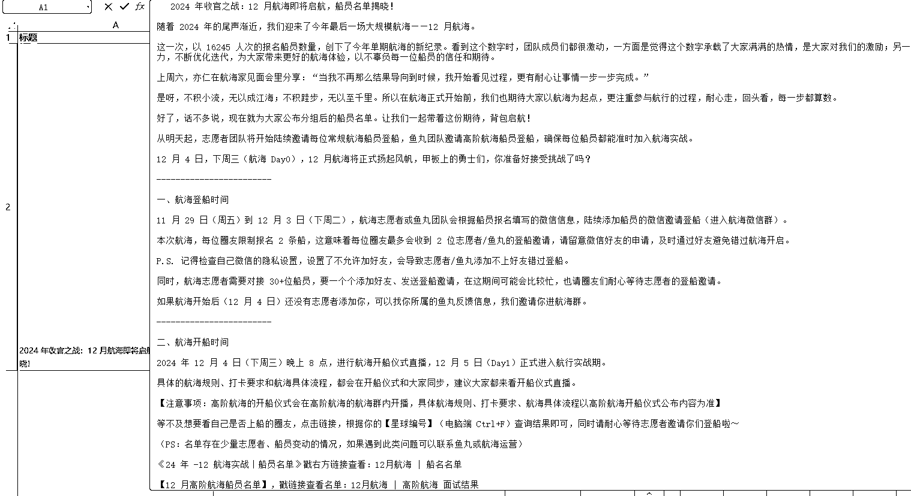
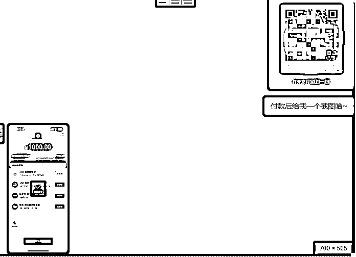

# 半天上手 Cursor，我用爬虫把赚钱有术的精华帖导出来了

> 原文：[`www.yuque.com/for_lazy/zhoubao/bscyhxirb5dd9eu0`](https://www.yuque.com/for_lazy/zhoubao/bscyhxirb5dd9eu0)

## (21 赞)重生之我想当程序员，用半天时间学会使用 Cursor 爬了赚钱有术

作者： 柒霖

日期：2024-12-02

重生之我想当程序员，用半天时间学会使用 Cursor 爬了赚钱有术

这篇可能逻辑有点跳，也没啥标准的标题，主要是想把我零基础做 python 爬虫的思路分享出来。

顺带一提，正是这个 Cursor 帮我拿到了技术圈的第一个收入~

我第一次知道 Cursor，还是刷到 @阿紫 发的动态，问你问我吴佳文学会了吗？

看完我就去下了 Curos，按着码叔编程入门的教程把环境配好，这也是我电脑上装的第一个编程工具。

我寻思着，我是在赚钱混的，那当然要反哺赚钱，于是就想试试能不能搞个爬虫。 

**龙哥哥点名**

打开 Cursor 按下 Ctrl+I，弹出我自己的对话窗口，开始把想法倒出来。

我的需求是想做一个爬虫去抓 `scys.com`，可一打开就被跳转到 `https://scys.com/conn/web/login` 要求扫码登录，需要给用户 30 秒扫码时间，判断是否扫码成功，提示出扫码成功 已确认 后进入 `scys.com` 页面，然后把精华分享的内容抓下来，导出成 xlsx 表格，文件名叫 精华_时间。

这就是我最开始写的第一版提示词，后面还会陆续拆开讲，对完全没有基础的人来说，这其实就是一个很直观的流程图。

最终页面我没保存下来。

后面我换了个思路重新梳理：

1. 先确认目标站点
2. 站点是否需要登录
3. 登录之后怎么判断登录成功
4. 登录成功后定位到目标板块
5. 定位到标题区，比如登录成功后判断出精华分享，点击进入，再遍历当前页所有文章标题，判断文章数，点开一个采集一个，采完一页切下一页继续数、继续采，直到翻不动为止

用 F12 看 span、看 html 结构来找定位，可是还是抓不到想要的东西。

我又去改提示词。

还是找不到精华分享，能不能用这个 selector 来判断点击 #app > div.content-mt > div > div > div > main > div.leftContainer > div.mixFilter > div > div > div.select.wrap > div.button.active > span

这样就精准锁定了标题栏，精华分享算是抓住了。

接着又出现了新的问题，文章正文抓不下来。

我补充提示词：文章点击后等待页面加载完成，再去取 selector，标题是 #app > div.content-mt > div > main > header > div.title，内容区是 #app > div.content-mt > div > main > div.content.ql-editor

看到这个结果我就知道方向对了，能区分标题和内容了。

新的选择器如下：

标题：#app > div.content-mt > div > main > header > div.title

内容：#app > div.content-mt > div > main > div.content.ql-editor

可赚钱的精华帖实在太多，大半夜等不起全量抓。

于是我又加需求：能不能让我自己设定抓取数量。

主要改动点：

增加参数控制抓取条数

在处理循环时加入数量上限检查

加上文章计数和进度提示

改写主程序入口，支持传入数量

我最后只设了 10 条试试。

最终效果

多亏了 Cursor，我才有了技术圈的第一笔钱。

 ux61Iokx4i)

说实话是亏的，因为第一次接单，没搞清楚报价规则，不是按关键词收费的吗？我只收了一个关键词的钱，结果人家给了 5 个关键词。

* * *

评论区：

柒霖 : 第一次发文的小透明，求轻喷，我尽量用文字说清楚了

龙哥 : 别乱爬赚钱有术，已经一堆老哥被封号了，而且不解封。

柒霖 : [生病]第一次被看见居然是被龙哥大哥怼，懂了懂了，我不会乱来，仅供测试，测完就删[流泪]

蓝弈 : 文章里的二维码记得马一下

柒霖 : 还能改吗[尴尬]

蓝弈 : 右上角可以编辑

柒霖 : 改好了改好了

佳文 : 爬虫风险很高，不光是封号的问题，有些情况还可能触法，建议别高调操作。[`mp.weixin.qq.com/s/Te_bfk_qrgQVzB-

RHL8wiA`](https://mp.weixin.qq.com/s/Te_bfk_qrgQVzB-RHL8wiA)