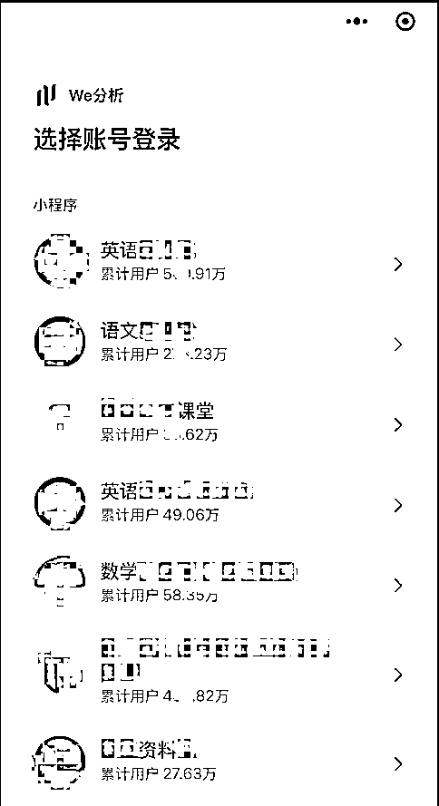

# ('教育科技公司创始人分享千万级用户项目经验', (2, 22))

大家好，我是十一，坐标深圳。我创办了一家教育科技公司，主要深耕中小学教育领域——这里特别说明一下，我们不是教培机构，所以完全不受“双减”政策的影响。目前公司旗下有两个项目已经触达了千万级用户，一个面向中小学老师，另一个则服务家长和学生群体。

我是2021年加入赚钱的，到现在差不多四年了。说实话，之前我基本都是潜水状态，除了偶尔发过几条资源对接的帖子，更多时候是在默默围观。但赚钱对我来说，就像一个获取新鲜玩法的雷达站，上面很多大神的分享都让我开阔了不少眼界，也实打实地学到了一些东西。中间我还和不少圈友有过深浅不一的合作，也拿到了一些成果。

再说说公司这边，去年我们启动了一条新业务线，用了一年左右的时间，用户数同样做到了千万级别。

这个方向的延展性和想象空间都挺大的，这一年我们陆续试了不少打法：像分销、做知识付费、给公众号或私域引流、低客单价转高客单价、搭建社群等等。坦白讲，有些玩法跑出了预期效果，也拿到不错的回报；有些只是验证了链路可行，但目前团队精力有限，还没来得及规模化去做。我把这些尝试和复盘整理了一下，算是给大家做个抛砖引玉的参考。如果圈友里有资源、有想法、想一起把盘子做大的，非常欢迎来找我聊，咱们可以再多碰撞碰撞。

详细的拆解和心得，我放在飞书文档里了，感兴趣的朋友可以直接点开看： [`yxlg5m8r086.feishu.cn/docx/WSz3dKv2nodwOOxELAkcFaYVnJg?from=from_copylink`](https://yxlg5m8r086.feishu.cn/docx/WSz3dKv2nodwOOxELAkcFaYVnJg?from=from_copylink)