# 用标准撬动十倍增长：一个被低估的增长杠杆

> 来源：[https://vy7zcdp134.feishu.cn/docx/GpxMdblYAoPONMxED3Xc4trinNn](https://vy7zcdp134.feishu.cn/docx/GpxMdblYAoPONMxED3Xc4trinNn)

大家好，我是阿黎。本职工作就是做行业标准，广西标准化协会2020年建库时首批入库的专家，参与并主导过11项标准落地实施，对这件事有比较深的体感。

2024年我跟着赚钱共读了《10X is easier than 2X》，11月又参加了龙哥《10X比2X更容易》的夜话，关于十倍增长的讨论让我很有共鸣。这次想把自己在标准化领域的观察和10X的思路结合起来，给到大家一些可用的启发。

马上就要做新一年的规划了。

在赚钱圈里，想在新一年抓住十倍增长的抓手很多，标准化就是我认为非常关键又常被忽略的一个。

坦白说，企业靠标准化做增长，是一个极其细的议题。

这篇文我改了好多版，最后收敛到只给一个线索：怎么用标准化去找十倍增长的可能。主要讲清楚：标准化到底是什么，能起什么作用，以及一些真实的增长案例。

全文偏企业视角，但对个人业务同样适用。

之前和条形马、郑发山老师聊标准化，收获很多，这次分享的起点也来自那几次对话，特别感谢。

文章篇幅不短，我放了个简要目录，方便跳读：

第1章  先建立一个清晰的概念，标准化是什么；
第2章  讲2家同业车企的标准化破局案例，福特与特斯拉，在不同时代如何用标准拿到十倍；
第3章  拆解标准化能给企业带来的8个增长助益；
第4章  按初创、腰部、头部三个阶段，说明如何切入；
第5章  怎么查标准、获取标准文件，以及标准与专利的关系。

标准化其实离我们很近，它就藏在日常生活的方方面面，只是我们没注意。

所以我挑了些和吃喝赚钱强相关的案例，避免太专业的行业叙事。包括：

*   因为没有统一标准，豆腐脑的甜咸之争两次点燃全网；
*   福特与特斯拉，两家车企在不同历史阶段，均靠标准化实现十倍增长的对比；
*   一张纸，执行标准不同就命不同，餐巾纸能擦嘴、卫生纸只能擦PP；
*   淀粉肠翻车反转后，风险依然没解除；
*   柘城钻石产业，从小作坊到钻石之都，标准化带来的十倍蜕变；
*   越汇食品靠输出好标准破圈，强化上下游话语权；
*   两家食品出海的案例，卫龙因忽视国际标准受阻，五芳斋用7年拿到国际标准通行证；
*   两家芍药企业面对“靠天吃饭、谷贱伤农”的困局，各自用标准化解题。

* * *

# 1、标准化到底指什么？

在谈定义前，我先问一句：你家豆腐脑，是甜口还是咸口？

这个问题在微博上曾掀起过南北大战。

2011年6月8日，博友“桥东里”转发王轶庶的一句话：“在豆腐脑咸甜这件事上，最能看出南北差异，彼此看着对方都想吐”。这条百来字的微博点燃了早期的互联网，短短两天“豆腐脑甜咸之争”话题量破16万条，热度超过锋芝离婚。

爆款总会轮回。过了13年，2024年哈尔滨的“小土豆”事件再次引爆。南方女生在哈尔滨早点摊点甜豆腐脑，获得一碗加满白糖的豆腐脑，视频爆火后评论区再次战火重燃。

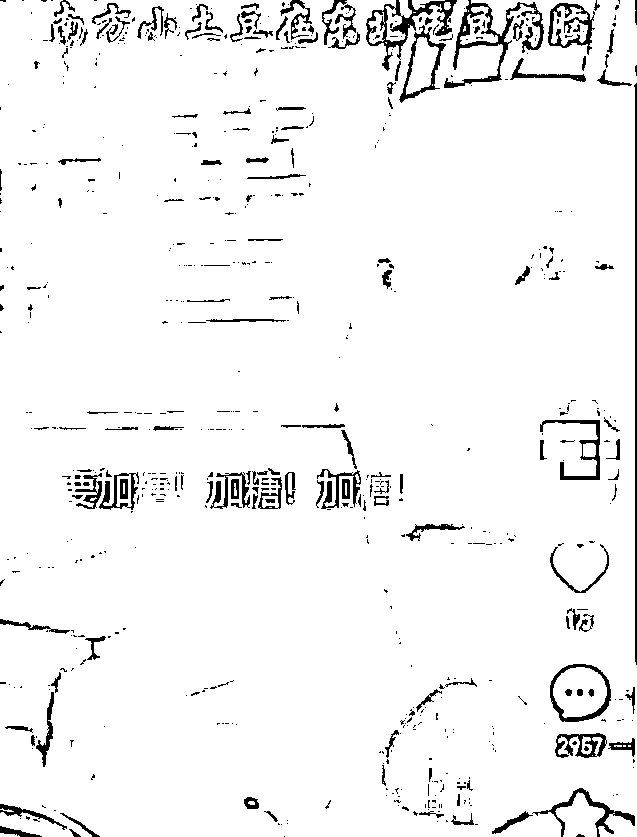

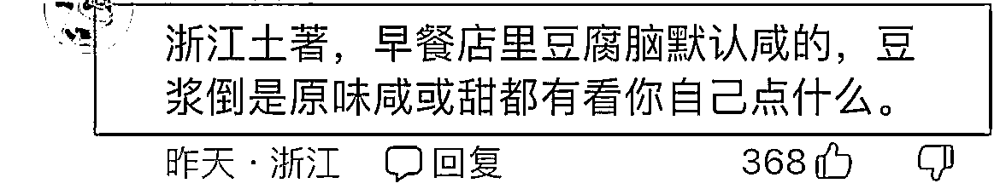

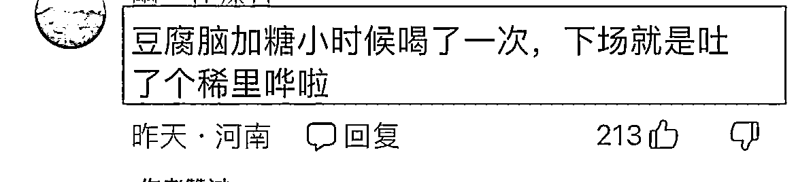

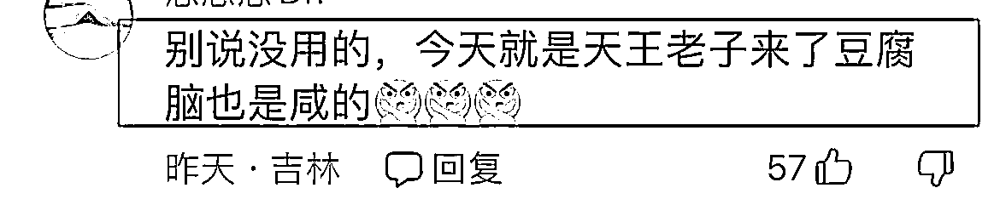

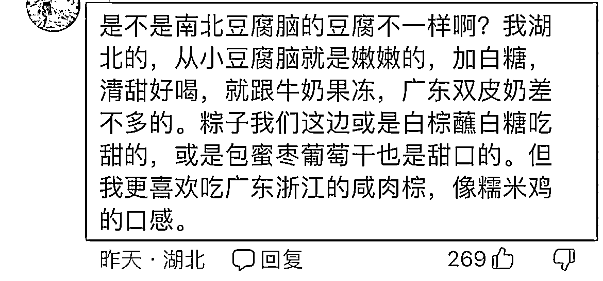

你看，连豆腐脑该甜还是该咸这种小事，都因为没有统一标准而争不完。

正是为了化解这类分歧，人类才会在社会活动中制定规范、统一认知，这就是标准化的本意。

标准化可以追溯到石器时代，象形文字的统一、图腾和工具的通用、兵器礼器的规范，都是早期的雏形。不以规矩，不成方圆，说的就是这个道理。

规范的定义

标准化，是指在特定范围内为实现最佳秩序，促进共同利益，对现实或潜在问题制定共同使用、重复使用的条款，并编制、发布、应用文件的活动。

标准，是为在一定范围内获得最佳秩序，经协商一致制定并由公认机构批准，共同使用和重复使用的规范性文件。

*本文所指的公开标准文件，是指公开发布的国际标准，或中国各级市场监管部门批准的国标、行标、地标、团标。

通俗讲，标准化是一种规范化的活动，标准是一种规范化的文件。

*   在国家层面
通过制定国标、行标来规范和监管，就是标准化活动；国标、行标本身就是标准文件。

*   在企业层面
公司建立SOP、制度、文化并推动执行，这就是标准化活动；SOP、制度文件就是标准文件。

多说一句，标准化是有边界的。一个标准的使用必须有前提。

比如“大航海”在赚钱圈有特定含义，对圈外人就是字面意思。用标准时，先划清适用范围的意识很重要。

标准化在促进协作、国家统一、社会稳定和经济发展上作用巨大。

中国古代的书同文、车同轨、统一度量衡就是最早的国家级标准化。全球化今天，统一时间标准让跨国赛事可以准点收看，统一货币体系让贸易金融有序运行。更进一步，一些国家把标准化当成国家战略，把本国标准推成国际标准，以此掌握话语权和贸易壁垒，比如5G标准之争就是典型。

小结：标准化在宏观层面让人协作有序，在微观层面提升竞争力。企业要想实现十倍增长，标准化是值得认真考虑的路径。

# 2、两家车企的标准化十倍增长案例

标准化既是企业的攻城锤，也是护城河。

## 2.1 福特：用标准化生产实现十倍增长

第一次工业革命，蒸汽机带来机械化大生产，分工更细、协同更复杂。工业标准化让通用化、规模化成为可能，生产力暴涨，人工成本骤降。

福特就是典型。采用标准化工法后，年产量从1909年的10007辆涨到1914年的248000辆，单车成本从950美元降到260美元，实现了十倍增长。

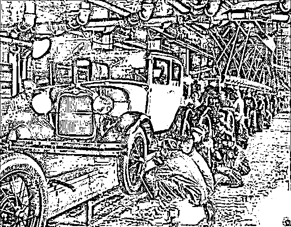

这个故事并未结束。历史会重演，只是换了一个主角。

这一次拿到十倍的是特斯拉。

## 2.2 特斯拉：把充电标准从企业标准升级为北美标准

特斯拉在制造端用标准化降本提效是众所周知的。但更关键的一招是：他们把充电接口从自家标准做成了北美标准。

在动手前，先想想特斯拉的核心技术资产是什么。百米加速？安全？还是舒适配置？这盘棋，特斯拉打的是充电技术。

这是个典型的逆风翻盘：

1、全球电动车主要存在5种充电标准；
2、北美主流是CCS1，拜登政府一度想推成国家标准，特斯拉的NACS起初只是自用；
3、2014-2023年，特斯拉持续投入优化，2023年凭借“多快好省”反超CCS1，成为北美通用标准。

具体时间线：

2011年 北美CCS1诞生。欧洲汽车制造商协会为统一标准推出CCS1，主要在北美使用。

2012年 特斯拉前身标准诞生。特斯拉推出Model S，未采用CCS1，自建Tesla Charging Connector，野心初现。

2012-2022年 十年混战。通用、沃尔沃、大众、现代等陆续采用CCS1，成为北美业界主流。同一时期特斯拉持续铺设充电桩并迭代标准，2022年更名为North American Charging Standard，命名即宣示意图。

2023年 NACS逆转。CCS1看似已成定局，但NACS的充电速度是CCS1的2倍，接口更小更轻，集成交流直流。截至2023年6月，美国NACS充电桩19463根，远超CCS1的10471根。

2023年特斯拉开放NACS，被SAE和美国能源交通联合办公室认可。福特、通用、Rivian相继接入，沃尔沃成为欧洲首家支持者。6月28日，SAE宣布推动其成为行业标准。至此，NACS不仅在商业上击败CCS1，更在行业层面压倒政府主推标准，成为事实上的北美国家标准。

十倍意义：

个体层面，摩根士丹利估算，2030年若电动车渗透率30%、特斯拉充电市占80%、利润率70%，充电业务估值可超千亿美元。

行业层面，美国电动车产业链加速升级，充电体验提升推动替代燃油车，也增强国际竞争力。

2024年，特斯拉更宣布在人形机器人上采用标准化充电接口，以进一步降本。黄仁勋所说的物理AI时代，很可能再诞生一批靠标准化实现十倍的企业。

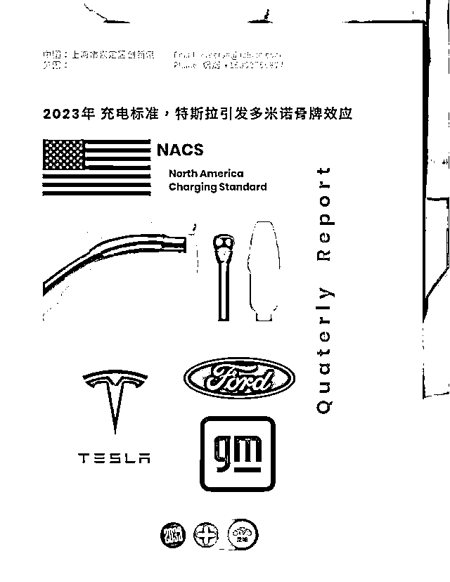

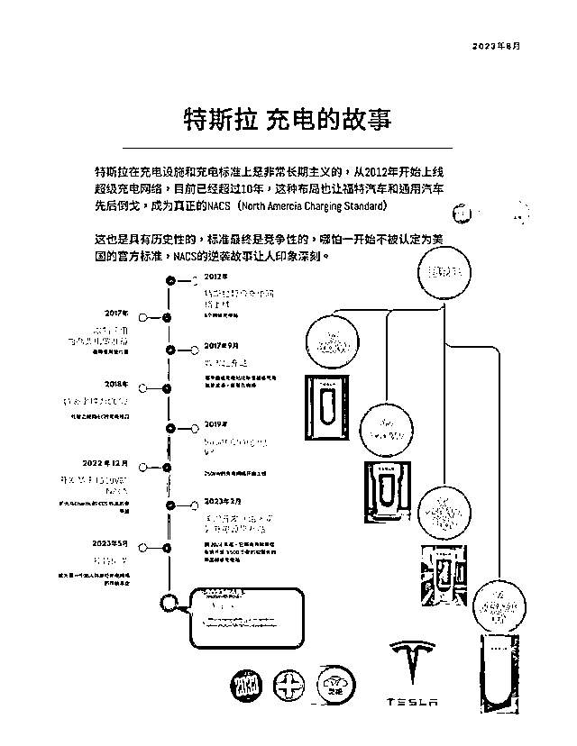

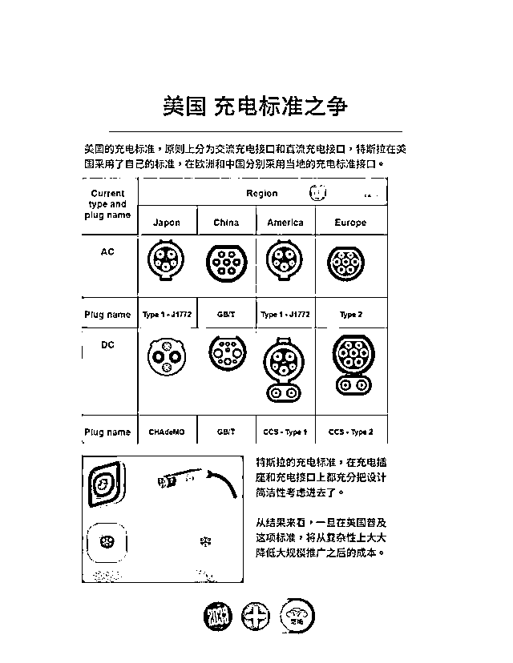

# 3、标准化给企业增长的8个助益

业内有句话：一流企业定标准，二流企业做品牌，三流企业做产品。

看完福特与特斯拉，标准化的价值应该更清晰了。归纳起来，标准化对增长的帮助主要在以下8个方向。

## 3.1 降本提效

建立标准流程和管理体系，能更高效使用资源，降低生产运营成本，提升效率。

实体行业里，麦当劳的出餐效率、连锁门店的扩张都靠标准化。小马宋曾详细观察过麦当劳如何通过标准动作实现高效率。

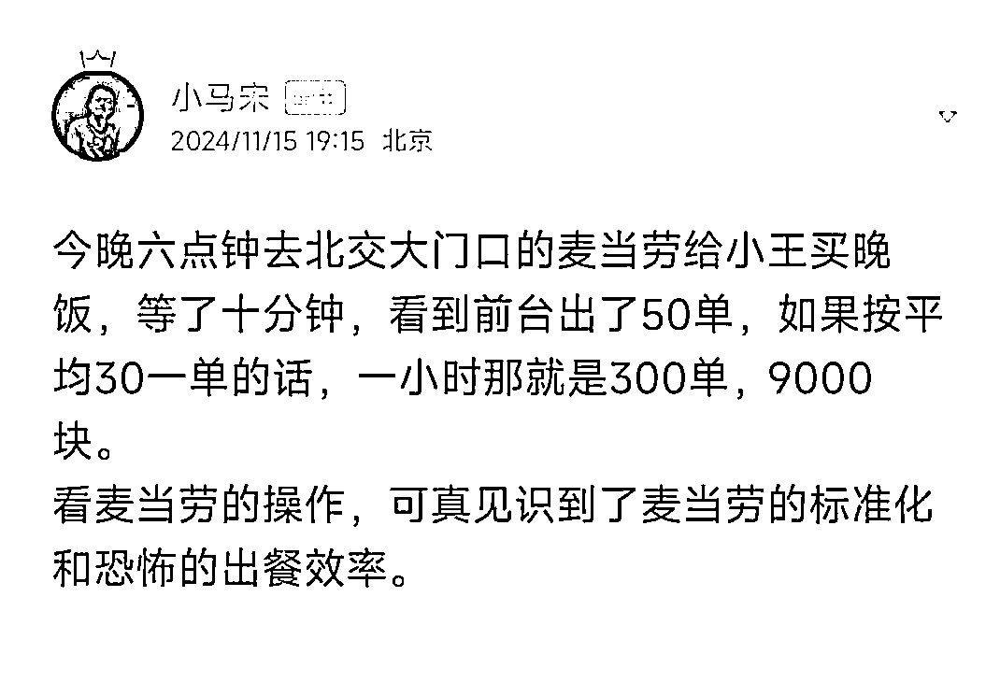

在自媒体和线上业务里，优秀的SOP和团队规范同样能提效。赚钱的大航海，本质上就是一次项目标准化训练。大家用同一套手册快速建立认知、流程、工具，拿到反馈后优化迭代、矩阵复制。找对标，抄好标准，是个体与企业都要做的事。

## 3.2 控品质，立形象，降风险

人员多、流程复杂的企业，缺乏质量控制很容易出问题。标准化能统一管理、产品、价格、服务，保持一致体验，降低纠纷风险。

正面例子是肯德基的门店一致性体验；反面例子是生产流程不规范导致质量事故引发消费纠纷。

没有规矩的买卖，常常连证明自己清白都做不到。

很多生意不是输在没有客人，而是输在缺一套清晰的规矩。

比如卖保险的，业务员在签单时没有按流程做风险告知，为了业绩随便夸口，等客户发现自己被误导，投诉、扯皮、赔偿随之而来，最后吞下苦果的还是所在机构。做内容也一样：更新速度飞快，但生产流程从没迭代，几次踩线就触发平台处罚，账号权重跌下去，整个矩阵还可能被一锅端。

可见，规则不只是包装角落的一行字，它是生意的安全绳、竞争力，甚至是一个产业向上走的阶梯。

先说“立形象”。产品如果按更高规格去制造，本身就是一种说服力。很多商品页会特意写“我们参与了某项国家/行业规范制定”“某项参数比国标还高”，其实就是在喊话：我的东西更靠谱。

这里有个反常识的点：推荐性的国标，因为要兼顾全国不同地区的条件，部分技术参数反而可能比地方、企业自己定的更松（涉及安全的强制国标除外）。这种情况下，国家鼓励企业用更严的尺度。就像体育老师规定引体向上做8个就满分，但有人力气大，做了12个，多出来的4个，就是他的“超纲”优势。

如果企业参与过国家、行业、地方规范的起草，或者采用更严的生产规范，完全可以写进宣传里。这不是自夸，是在消费者心里提前占一个“高配”的位置。

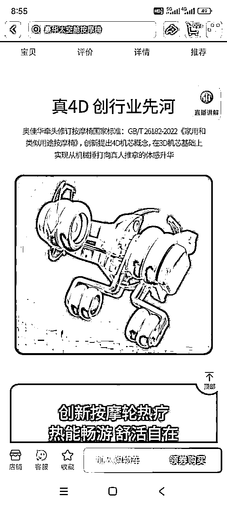
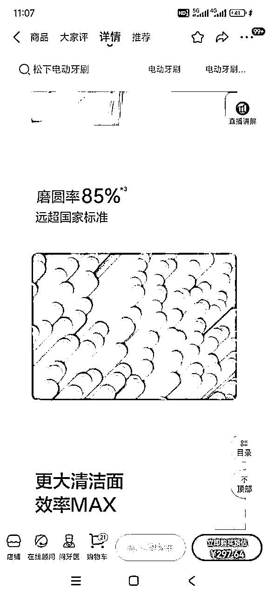
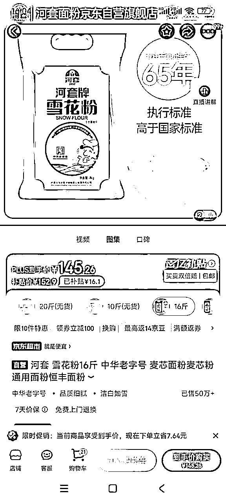

再讲“排风险”。社会环境和技术变化快，国家对规范化的引导和检查也越来越严，行业文件更新速度非常快。特别是强制性的规范，假如企业没留意，包装和宣传还是旧版，等监管上门，下架、罚款、掉资质都是可能发生的。

更麻烦的是，新规发布通常有公告，但不一定有专人电话通知你。想不掉队，只能主动盯着市场监督管理局和相关协会的网站。

几个例子特别典型：
口罩最紧俏的时候，买家只认“YY 0469-2011 医用外科口罩”。工厂或囤货者手里若是不合规口罩，卖不掉；要是卖掉了，监管罚单也会找上门。
2023年7月，GB 811—2022（摩托车、电动自行车乘员头盔）开始实施，这是电动车头盔领域第一个强制国标。交管部门一边宣传，一边用罚单教人认规范。有人提前按新规备货，吃到了红利；有人压着旧存货，只能亏。
2024年9月，GB 31608—2023（食品安全国家标准 茶叶）正式实施，这是我国第一部茶叶强制国标，原料、感官、污染物、农残限量都有硬要求。做茶的朋友要赶紧看看自己的产品要不要调整。
还有火电行业，环保新规一出，电站只有两条路：买昂贵的设备达标，或者关门整改。一些买不起设备的小电站，只能被大电站合并。规则淘汰起来，毫不留情。

再说“拿名份”。工业化商品的包装上，基本都会印一行执行编号。这个编号是国家规定必须遵守或推荐使用的，它代表产品的质量特征和技术要求，也用于生产、检验、仲裁。

对货品来说，它是户口；对厂商来说，它是承诺；对顾客来说，它是挑选和维权的凭据。

同样是纸，纸巾纸和卫生纸的卫生要求完全不同，“擦屁股的纸别擦嘴”的说法，根源就是这个。

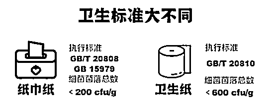

没有公认户口的产品，最怕出事。淀粉肠就是一个例子。

2024年“3·15”期间，有媒体曝光淀粉肠没有照火腿肠国标来做，还用了鸡骨泥，骨泥厂商说“不建议人吃”，一下子把淀粉肠推到风口浪尖。之后品牌和主播拼命救火，晒报告、直播吃肠。有报道说375万人涌进直播间，销量涨了5倍。

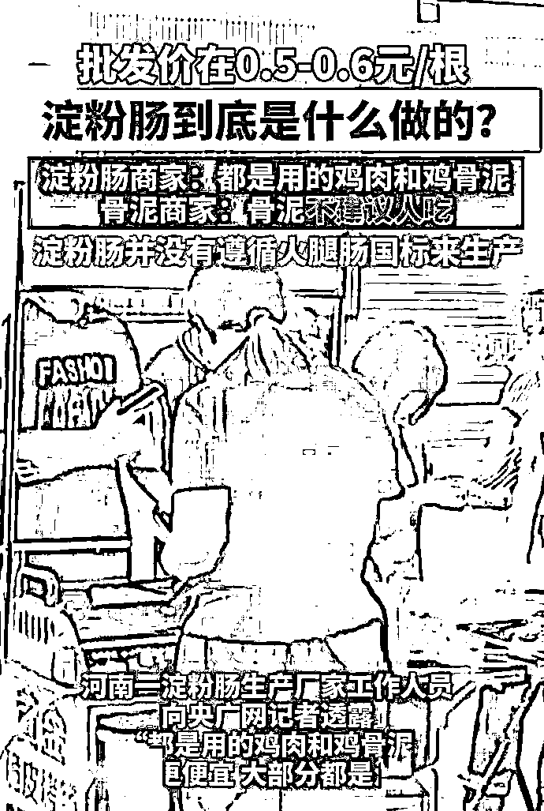
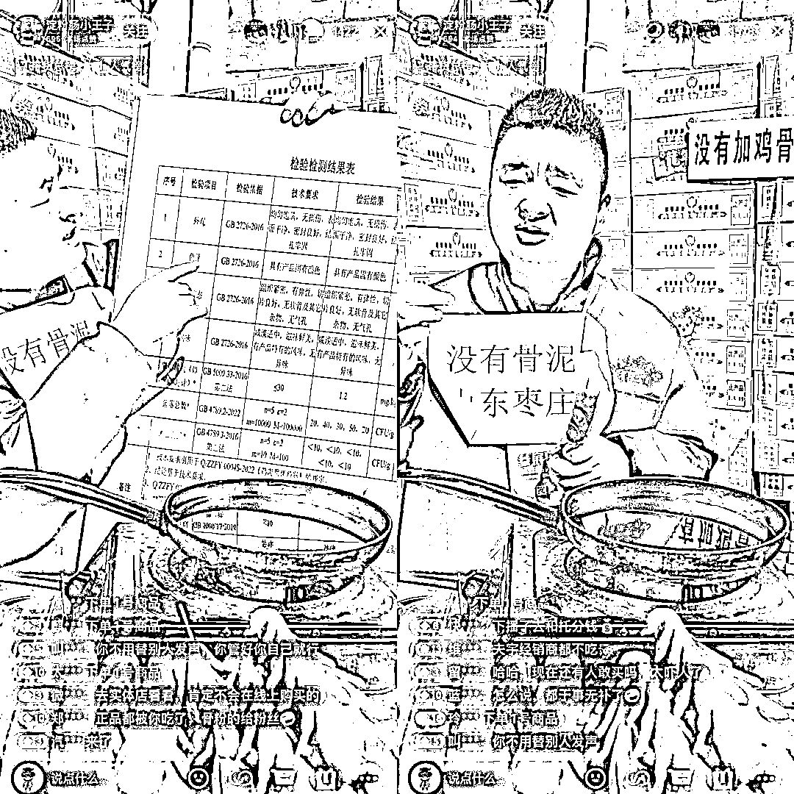
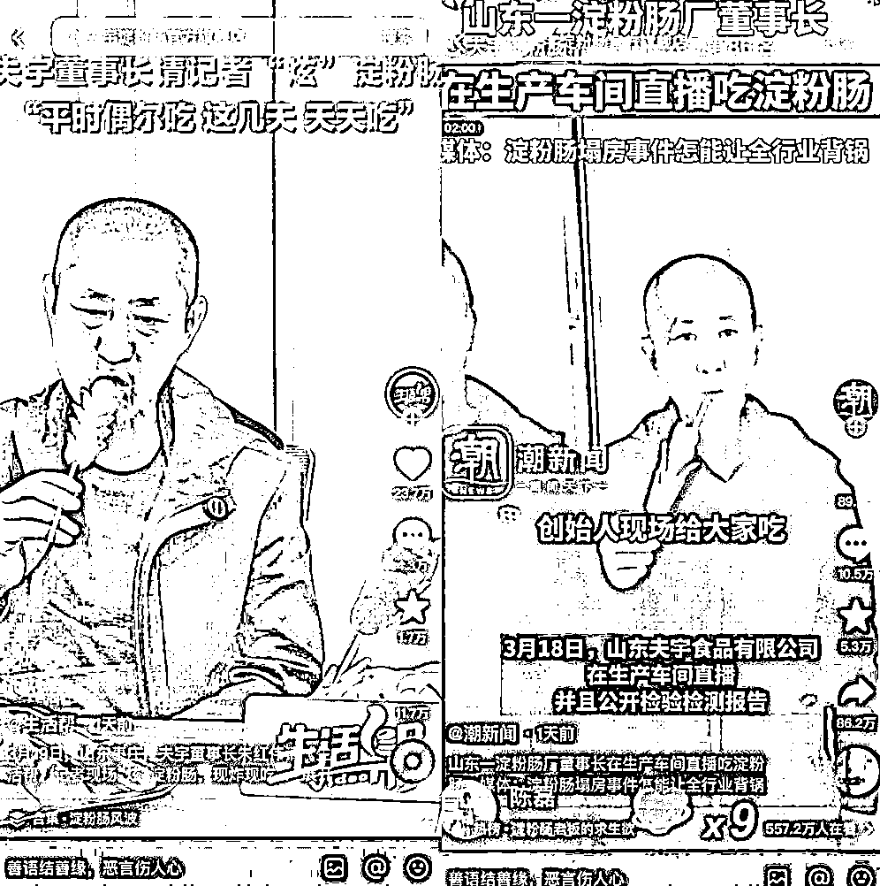

然而，舆论反转，问题并没有消失。有记者指出，淀粉肠缺一个统一的国家规范，厂家送检时各自使用自己的企标，检测口径完全不同。即使是在“口碑逆转”中获益最多的夫宇，也没能让所有人都信服。

夫宇的企标是 Q / ZZFY 0004S-2022（鸡肉熏烤粉肠）；
河南开开的企标是 Q / SKS 0001S-2023（蒸煮淀粉肉肠）；
河南双润的企标是 Q / HSS 0001S-2023（风味烤肉粉肠）。

三家三个编号，消费者凭什么完全相信？说白了，没有统一的官方承认，产品就是空有名头。若再经历一次类似风波，“卖惨”还能救回来吗？

如果把团标或更高级别的规范比作监护人，产品就是被监护人。有妈的孩子是个宝，没妈的孩子像根草。做新兴品类的企业，一定要尽早去执行或建立官方认可的规范，让市场和监管认你。

反过来，规范一旦到位，路就宽了。广东新会陈皮2018年出台地方规范后，产值几年间涨到一百多亿。广西金花茶等特色原料，原本只能在农贸市场当初级农产品卖，想深加工成包装食品，也必须先有合规依据。这些，都是“名份”的含金量。

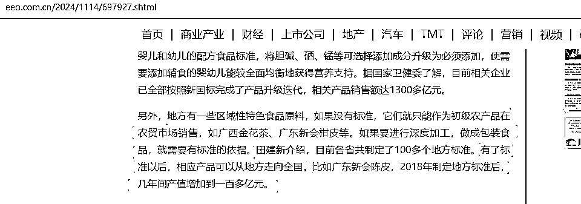

看完“名份”再看“产业”。标准这种东西，不只是给单个产品发户口，更能驱动一个产业升级。柘城人造钻石的路，很能说明问题。

天然钻石贵，是因为形成不可控、开采难，又被国外垄断。人造钻石是实验室长大的宝石级晶体，价格只有天然钻石的十分之一左右，合成可控、便于量产。柘城就是靠这个品类，实现了自主创新和产业升级，完成从0到1、从1到10的跳跃。

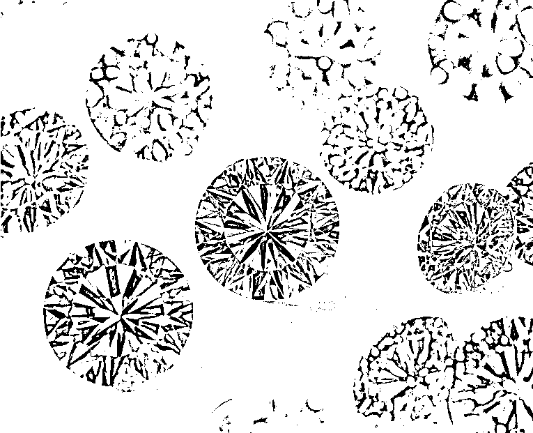

这条路大致经历了几个关键阶段。

第一阶段，用流程化培训复制人才。
金刚石是自然界的硬度之王，从割玻璃到机床切削都要用它，所以叫“工业牙齿”。但天然金刚石少而贵，难以大规模使用。1954年，第一颗人造金刚石合成成功，逐步进入工业领域。可西方搞技术封锁，差点掐断中国的来源。

为破局，原第一机械工业部设了一个代号“121”的攻关任务，交给郑州磨料磨具磨削研究所等机构。1963年，这家后来被称为“黄埔军校”的研究所，研制出中国第一颗人造金刚石。1980年，工程师冯金章响应技术回乡的号召，在柘城办了邵园金刚石厂，用标准化培训带出当地第一批骨干。80年代中期改制后，家庭作坊越开越多；到90年代末，全县已有100多家企业，年加工金刚石微粉20亿克拉，成了国内重要基地。但也留下“小、散、乱”的隐患：大家各自卷价格，没有统一管理，产业瓶颈已经出现。

第二阶段，用统一管理把散兵游勇变成集群。
2006年，柘城建起工业园区，把相关企业集中起来统一管理，水电路网等设施共用，企业开始抱团。2009年，园区升格为产业集聚区，政府加大招商，完善基础设施，给政策，把上下游拉进同一盘棋。2012年，基地进一步升级，年产微粉突破45亿克拉，形成从原辅材料到人造金刚石、微粉加工、再到金刚石制品的完整链条，成为全国同类行业中集聚度最高、链条最完整的基地。2013年，基地又被科技部认定为高新技术产业化基地，并用“生产换线、机器换人、设备换芯”推动延链补链强链。一些企业还打通了采购、生产、仓储、销售、发货、结算的数字化系统，智能无人工厂里，几百台自动分选机和冷冻离心机日夜运转。

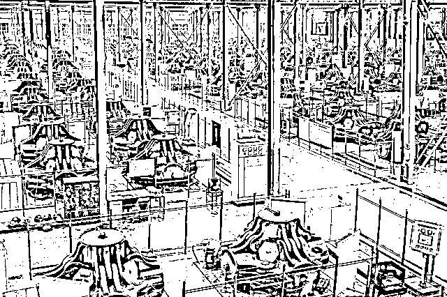

第三阶段，用团体规范收拾乱局。
人造金刚石的产业链成型后，更难的是做宝石级产品。2019-2020年间，中国宝石级人造钻石产量已经超过全球一半，成为重要的出口品种。但供给端没有统一的品质鉴定，容易走向低质低价；需求端叫法混乱，有人工钻石、实验室钻石、合成钻石等各种说法，经销商和消费者都很迷茫。

2020年10月，中国机床工具工业协会发布了一份《培育钻石》团体标准，填补了国内空白。它第一次把术语、鉴定、质量表达、颜色分级、净度分级、切工分级和分级证书等统一起来，行业终于有了可依的规矩。

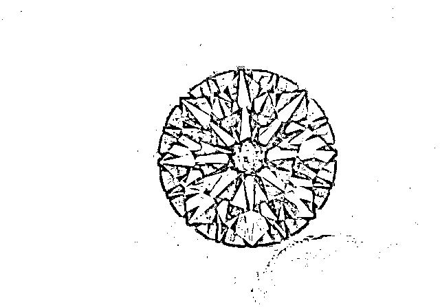

规矩立下后，产业开始爆发。2021年，全球人造钻石产量900万克拉，柘城占400万克拉，成为全球基地。同一年，力量钻石在深交所上市，惠丰钻石随后也上市。力量钻石做出的特种异型八面体金刚石，可用于IC芯片超精加工，打破国外垄断；惠丰钻石的人造单晶金刚石微粉，用在航空航天、光学仪器、精密陶瓷、医疗器械等领域，2021年12月被工信部认定为制造业单项冠军产品。

到2023年，柘城一年产金刚石单晶60亿克拉、微粉100亿克拉、制品3000万件套、人造钻石毛坯及加工销售600万克拉，其中微粉产量和出口量分别占全国70%和50%。美国拉斯维加斯珠宝博览会上，力量钻石拿出一粒50克拉的大钻，震撼全场，成了河南制造出海的名片。从“中国微粉之乡”到“中国钻石之都”，柘城完成了质的蜕变。

第四阶段，从团体规范走向国家规范。
一份团标还不够，后来又有多个协会发布不同侧重的团标。但没有国家级户口，行业始终缺一个正式名分。珠宝玉石领域的全国性技术委员会（SAC/TC298）从2023年开始推进相关国家规范的修订和制定，到2024年10月仍处于修改阶段。2023年6月，委员会就《珠宝玉石 名称》《钻石分级》两项国标征求意见；其中《珠宝玉石 名称》的修订意见早在2021年就提出过，还遭到海外珠宝协会反对，此后反复修改，直到2023年再次征求意见——国标牵涉太广，不能不小心。2023年12月，《钻石 鉴定与分类》也开始征求意见。2024年7月，委员会组织审查研讨，继续讨论这两项名称和分级标准。

一旦国家规范落地，检测标准不统一、证书公信力弱、检测机构少且出证慢、鉴定需求没人接、监管和培训没有依据这些老毛病，才有望真正解决。

第五阶段，从国家规范走向国际规范。
人造钻石是全世界都在抢的赛道。海外有戴比尔斯旗下Lightbox Jewelry、美国Signet旗下品牌、施华洛世奇、Prada、Pandora等；国内有翠绿、豫园（老庙）、曼卡龙、周生生、潮宏基、CAMA（据说隶属周大福集团）等。谁赢了国际规则，谁就赢下国际市场，但国际层面的统一规范还没有出现。

早在2021年7月，全国珠宝玉石标准化技术委员会修订《珠宝玉石 名称》时，曾建议在“合成宝石”条款里注明：“合成钻石”又称“培育钻石”；同时在附录中给“Synthetic Diamond”加上“Laboratory-grown Diamond”这个英文名。

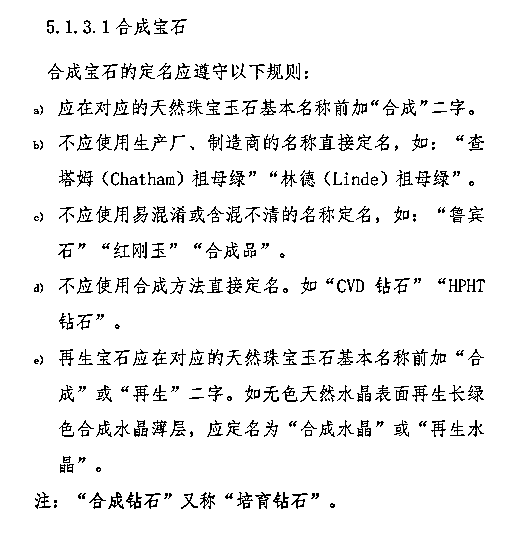
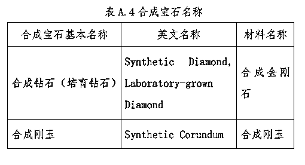

这个建议引来了六家海外珠宝机构联合反对，理由是会在中外消费者中造成概念混乱。这六家包括负责任珠宝理事会、美国珠宝商协会、珠宝商警戒委员会、国际钻石制造商协会（IDMA）、世界钻石理事会、世界钻石交易所联合会（WFDB）。

业内人士的回应很直接：逼中国在命名里保留“实验室”，属于干涉内政。更何况，“实验室”这个词早已不符合实际——中国的人造钻石已经进入工厂化、规模化阶段，河南更形成了产业集群。很多企业不愿叫“合成钻石”，尤其做CVD的，因为那不是在合成，而是让钻石在化学气相沉积中一点点“长”出来。

说回开头：规范到底重不重要？对产品，它是户口；对企业，它是护城河；对产业，它是升级的阶梯。下一次你在货架上看到商品包装上的执行编号，不妨多看一眼——那一串字符背后，可能藏着一家企业的生死，甚至一个行业的起落。

很多人把标准当成条条框框，实则它是一条隐形的增长杠杆。高手会用它来参与产业博弈，也会用来为自身业务提速。下面就拆开来说，标准到底怎么做到十倍级别的增益。

先看培育钻石这个正在上演的案例。中国没有天然钻石的资源负担，却在合成领域具备后来居上的条件。化学组成上，培育钻石与天然钻石完全一致，相当于家用冰箱里结的冰和江河里形成的冰没有本质差异。市场定位上，它正好卡在高端天然与低价仿制品之间，而价格通常只有天然的十分之一。中国长期依赖进口满足消费需求，是全球第二大消费市场；但在合成钻产业链上，中国的产量贡献已接近全球一半，产业扩张必然对天然钻的份额形成挤压。于是当国内准备修订 GB/T 16552-2017《珠宝玉石 名称》，给培育钻石正名时，海外机构集体发声反对。这已经不是技术分歧，而是产业话语权的争夺。从 2023 年 6 月再次公开征求意见，到后续反复打磨国标，既要兼顾国内产业的健康发展和监管秩序，也要考虑与国际体系的对接博弈。一旦标准从国内上升到国际层面，整个赛道会进入指数式扩容。

说到这里必须点破一个规律：公司命运与行业命运共振。主动参与标准制修订的企业，往往能提前卡位，搭上上升通道，收割行业红利。比如河南柘城就有两家上市培育钻企深度参与标准工作。力量钻石牵头或参与了 T/GAC 18—2024《合成钻石（培育钻石）》团体标准、GB/T 43131-2023《人造金刚石磁化率测定方法》国家标准、T/HIS 017—2023《自动化切磨培育钻石的重量与尺寸规范》等；惠丰钻石及旗下公司参与了 T/GAC 18—2024 与 GB/T 35477-2017《超硬磨料 人造金刚石微粉》国家标准。这种躬身入局的姿态，正是红利来源。

标准的直接回报体现在三类资源上：政策扶持、资金倾斜与专属授权。地方主管部门会为标准化成绩突出的主体给予专项补助、财政奖励。所谓成绩，既指主导或参与对国家、行业、地方有重大价值的标准文本，也指严格执行标准并取得可验证效益的做法。这类信息多分布在政府门户、市监局、财政局、行业协会或同业内部。譬如浙江曾发布《浙江省技术标准战略专项资金管理办法》浙财政字〔2008〕84号，以及市场监管和知识产权专项资金标准化分配细则，并每年组织专项申报。这就是实打实的真金白银。

再说特许授权带来的护城河。产品按先进标准制造并获官方背书，就可能拿到行业内的特殊准入资格，例如某类评审指定用具、赛事官方指定用品等。考试涂卡铅笔为何老师反复指定品牌？因为有国标 GB/T 26698-2022《考试用铅笔和涂卡专用笔》在约束市场。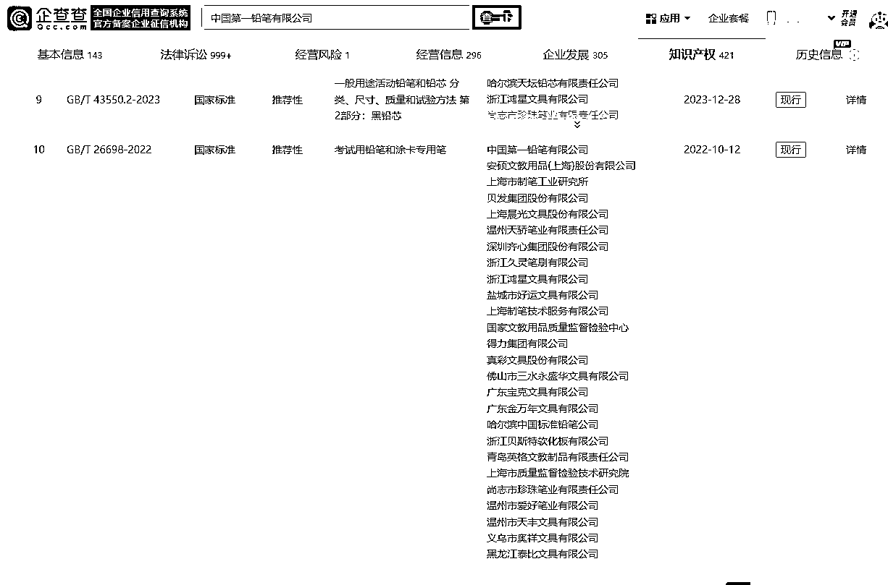

更深层次看，公开实施的标准体系本身就是一座免费智库，也是一棵可自学的技能树。国际、国家、行业、地方、团体标准都经过广泛征求意见和主管部门审定，代表该领域的前沿实践与主流共识。企业借此可以对标学习、快速补位。比如一家做绿茶的企业，查阅绿茶系列标准就能明白品类基本要求，大叶种、珠茶、眉茶等细分规范分别是什么，从而判断自身位置与优势。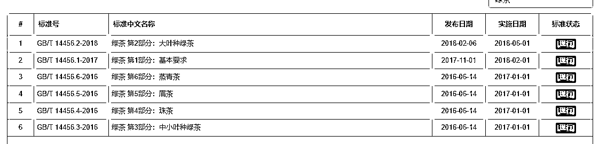

互联网领域同样如此。短视频从业者常被“黄金三秒”“完播率”等说法困扰，甚至相信各种玄学。实际上 2024 年国家广播电视总局已出台行业标准《网络视听收视指标及计算方法》，对收视指标的定义、分类、统计要求和计算方式做了明确。有效播放行为被界定为播放速率小于 3 倍且收视时长超过 3 秒。为什么是这个阈值而不是 2 倍、4 倍或 2 秒、5 秒？这背后是统计口径的行业共识。平台算法会变，但底层指标不会偏离标准。与其听野路子，不如研究标准文本。2024 年值得关注的还有《网络视听收视指标及计算方法（报批稿）》、GY/T 411-2024《数字虚拟人技术要求》11 月 26 日实施、SB/T 11240—2023《直播电子商务平台管理与服务规范》6 月 1 日实施。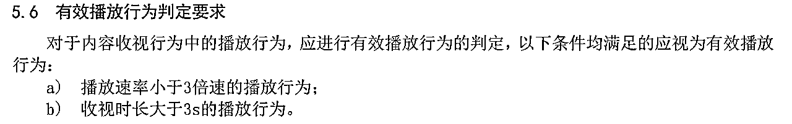

标准还能强化行业话语权，主要有三种做法。

第一种是利他输出。罗振宇在 2024 年《时间的朋友》里讲了越汇食品的案例。销售到下游批发商不是先推销，而是先帮客户打扫冷库。南昌一家客户冷库多达 27 个，旺季还要租 10 个。越汇销售现场整理后发现实际需求远低，客户全年因此节省 15 万元。这样的伙伴，客户自然重视。销售“阿聪”去客户处，客户老板会直接让团队停手听他安排。还有批发商货品陈列浪费空间，销售会指导用最少数量堆出最大视觉冲击，再用 A3 纸手写卖点并画红框，销量立竿见影。这些本是零售常识，却因有人落地而产生差异。越汇的团队还能帮助客户优化动线、清洁维护。如果你是采购方，听完这些会不会优先考虑越汇？这就是用标准输出换取影响力的典型。

第二种是借标准拿项目。标准制定要经历立项、征求意见、专家评审等多轮考验，每一条都有公开质询背书，因此公信力极强。能牵头或参与制定的企业，在市场中获得信任背书，更易拿到 G 端、B 端客户及重大项目机会。很多资质评审、奖励评定都直接援引标准文件。部分仪器设备厂商会与主管部门一起制定某项资质评价标准，后续需要该资质的主体往往会采购其设备以提高通过率。这与特许经营类似，只是更隐性。

第三种是用标准定规则。制定者即规则制定者，可以把有利条款写进标准，其他玩家只能遵守。不合规的业务要么被市场否定，要么被淘汰。比如王老吉、加多宝参与制定的 QB/T 5206-2019《植物饮料 凉茶》，对凉茶做了排他性定义并限定核心原料，后来者若想进入该品类，只能按此原料体系命名，否则不能称凉茶。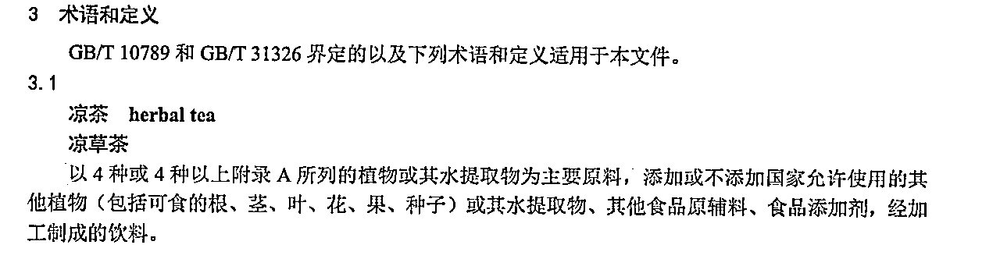

谈到出海，标准就是通行证。先看反例：2024 年卫龙亲嘴烧在日本被召回，因两国标准不一致。中国农业大学食品学院副教授朱毅指出，进出口连对方标准都不了解，是专业性的缺失。这与 2022 年海天味业的双标舆情相似，引发股价波动，并强化不良认知，让竞争对手得利。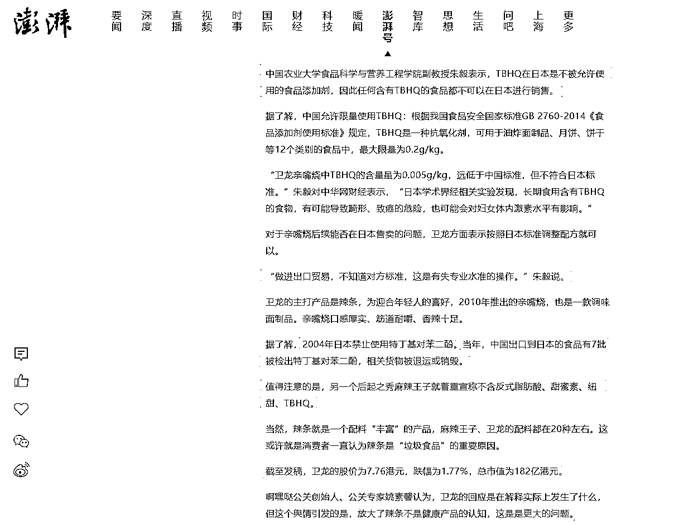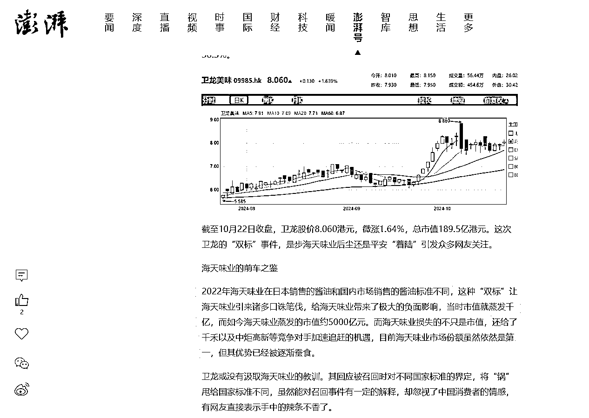

再看正例：华为在 5G 国际标准竞争中杀出重围。五芳斋的粽子国际化路径同样精彩。粽子在亚洲多国存在形态相似但名称不同的产品，日本称为茅卷，缺乏统一国际标准导致出口受阻。五芳斋虽为龙头，2018-2021 年境外收入均未破千万。2016 年起，中国商业联合会牵头，五芳斋作为起草方之一在国际食品法典亚洲协调委员会第 20 届会议上首次提出粽子亚洲区域标准提案，未果后改为深化论证并进行跨国沟通。2019 年第 21 届会议再次提交，遭遇日本、泰国、新加坡、韩国反对。最后代表团将产品描述为“以植物叶子包裹的熟米”，并强调“全包裹”以排除饭团，同时在草案第 8.1 节以注释明确“本产品在中国叫粽子”。这一妥协获得通过，立项成功。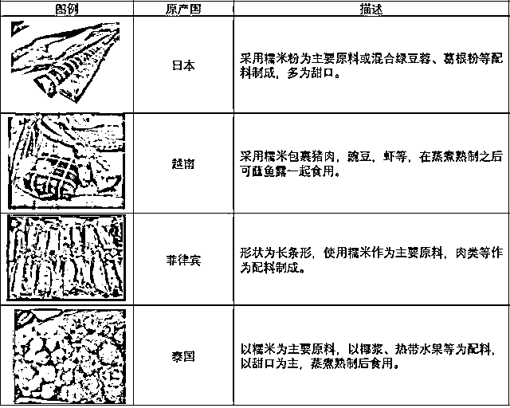 历经七年博弈，2023 年 12 月粽子国际标准在国际食品法典委员会第 46 届会议发布，代号 CXS 355R-2023。发布后，五芳斋 2023 年营收 26.35 亿元，同比增长 7.04%，境外收入 1429.47 万元，同比增长 3.06%。2024 年 1-5 月浙江嘉兴辖区出口粽子 84 批，货值 552.4 万元，同比增长 12.36%，覆盖北美、澳洲等十余国。

美的与格力也是典范。美的把新冷媒技术转化为 IEC 国际标准 IEC 60335-2-40《家用和类似用途电器安全 第 2-40 部分：电热泵、空调和除湿机特殊要求》，带动空调销量增长十倍以上，产销量超 620 万台套。格力参与 UL/STP60335-2-40、UL/STP0484 工作组，推动美国和加拿大空调电气安全国家标准的修订，为北美市场铺路。

由此可见，国际贸易中标准梳理本身就是一门信息差生意。标准条目庞杂，企业需要专业解读。若能为出海企业提供国际标准的汇编与解读服务，就是高价值需求。中国茶叶出口资质参考即是典型案例。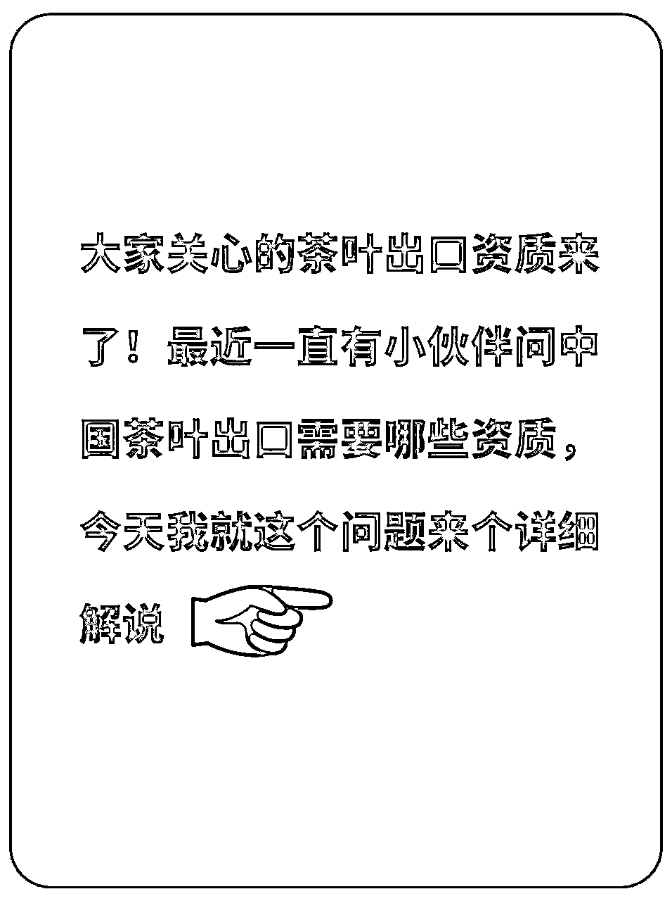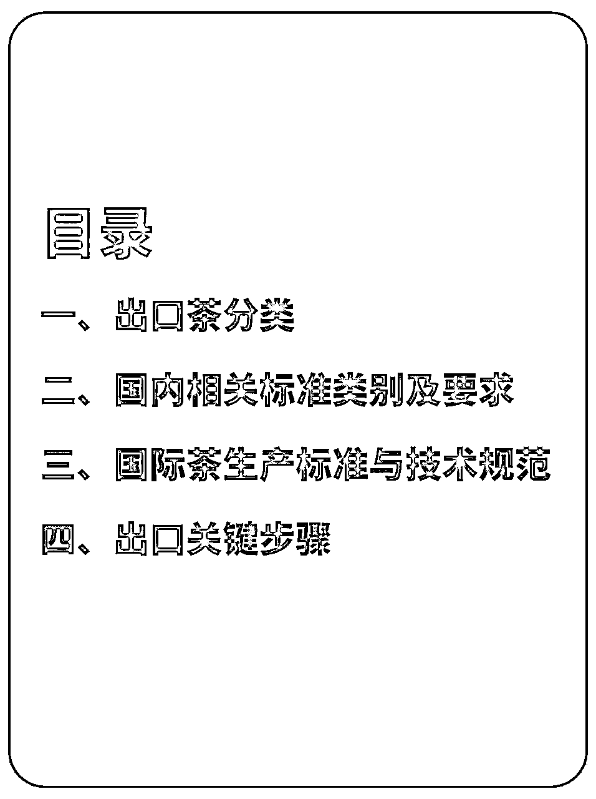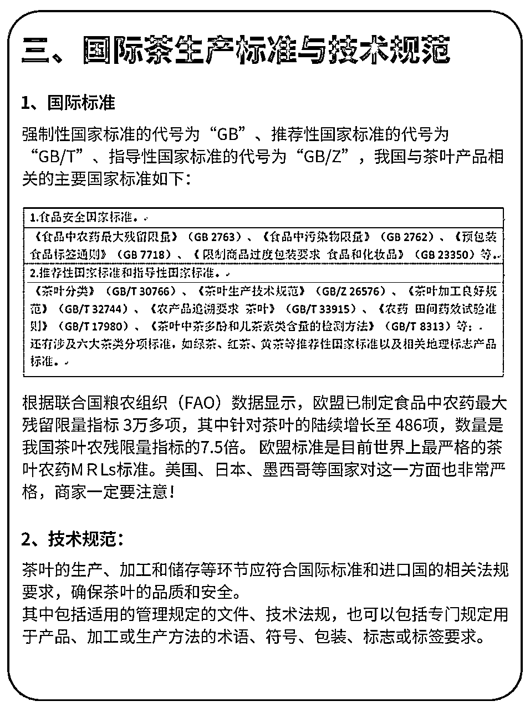

国际标准由 ISO、IEC、ITU 及其他国际组织制定，在全球通用。目前 ISO、IEC、ITU 三大组织制定了约 85% 的国际标准，其余由 WHO、ICAO、WIPO 等数十个机构制定。

回到项目实践。不同阶段对标准的应用重心不同。

初创期充满不确定性。这时需要建立统一认知与操作规范，用确定性对冲风险。相当于游戏新手村的攻略手册，告诉你该做什么、怎么做。赚钱大航海的航海手册即是此意：共用决策框架与成长准则，决策准则解决方向判断，成长准则解决执行方法，通过对标与刻意练习实现先模仿后超越。

一句话，标准不是枷锁，而是杠杆。掌握标准的人，掌握定义市场的权力。无论做产品、做内容还是做出海，越早把标准纳入战略，越能领跑赛道。

### 4.1.1 先把评判尺子定下来

项目刚起步，对业务的认知往往是碎片化、浅层的。

越早把一套判断尺子搭好，行动就越清晰。机会和风险才会分得开，增长也更有方向感。

就像点外卖时脑子里一片空白，东看西看全都想吃又全都不想吃，浪费大量时间。创业初期也差不多，多个赛道看起来都行，却挑不出一个来下手。

这时候需要一个过滤器来做取舍。

拿减脂举例，目标一旦锁定为低负担、高营养，选择立刻变窄。高油高糖的选项自然被筛掉，决策时间大幅缩短。

一套可用的判断尺子的价值，不在保证选到完美，而在把不合适的快速排除，把精力留给高性价比的选项。

怎么搭？两步走。

第一步，盘点你独有的10倍优势，也就是你能持续提供高价值、高复利的能力。基于这个优势，提炼出可操作的评价指标，作为初期的判断依据。

第二步，用做来校准。先小规模试，再根据结果迭代。尺子不是空想出来的，是在试错中磨出来的。

例如想在小红书启动。平台能做的事太多：带货、内容付费、记录生活……怎么选？看你现在能发挥的强项。你对供应链、选品有感觉，那带货的路径就更顺。与其泛泛去做，不如把标准定为“这个动作能否放大我的选品和货源优势”。

资本市场也有类似逻辑。段永平的名词Stop Doing List，核心就是先划清不做的边界，再谈怎么做。

### 4.1.2 成长尺子，决定怎么做

判断尺子解决要不要做，成长尺子解决具体怎么把事做成。

尺子从来不是单点的，它是一整套坐标系。只抄一个片段，很难放大你的10倍优势。像大航海手册，都是成体系的规范，而不是零散技巧。

以茶行业为参照，从种植、制茶、包装到销售话术，全环节都有可对照的行业水位。新人对照这套坐标，能立刻定位自己在及格线以上还是以下，哪些环节是风险点，哪些环节有提升空间。

成长尺子怎么建？围绕你的核心优势，在运营、生产、管理、培训等维度，沉淀成可复用的文件。细分赛道里，这套体系能把资源更高效地转化为价值，竞争力自然出来。

鲜花种植有两个典型。

先看背景。种花看天，丰收反而可能“谷贱伤农”。芍药从种到收最快三年，前期投入大。市场口味变化快，选对品种一年翻身，选错品种花期遇冷直接烂仓烂地。

两家企业用标准化走出了不同答案。

1. 规模端和运营端一起规范，提升品控与交付效率

过去芍药种植采切较为粗放，前后端衔接松散。菏泽作为全国产量集中地，出现丰收卖不出价、经销商下单后收不到稳定品质的问题。种植端不敢扩，渠道不敢收，项目卡在起步。

2022年，菏泽的百艺牡丹园艺有限公司与盒马鲜生启动标准化协同。

*   百艺端：种植、采切、物流全流程标准化，用规模与品质稳定的供给，实现批量交付；
*   盒马端：用标准化销售体系收集用户数据，提炼出消费者偏好要素，如品种、花茎长度、花苞大小、区域需求量等，反馈给产地；
*   联合端：品种选育、种植、采收、运输、销售售后全链路统一管理，形成订单农业。

过去同一块地开花度参差不齐，难以批量供应。

*   百艺经验显示，经过标准化管理，同一地块的开放度趋于一致，品质可控。

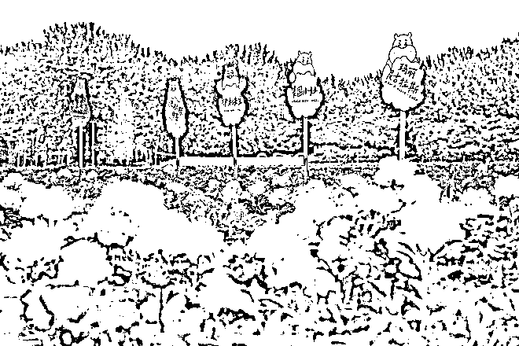

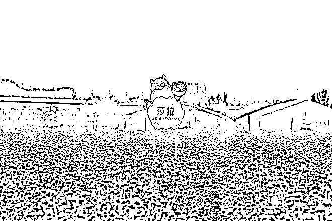

成熟后，花农会依据花苞大小、花枝长度、开放度、花色渐变度等细分指标统一挑选，用工具丈量后切下等长花苞，并在20分钟内送入预冷车间降温。

4小时后进入分级分拣，清洗花蜜后置入阻断乙烯的预处理液。

随后成品包装，通过空运或冷链发往全国。经标准化处理，鲜切花在低温下可保鲜约一个月，消费者到手醒花后约有一周观赏期。

百艺种植规模从200余亩扩张到1500亩，负责人表示目标指向2000亩，再次体现10倍思维。

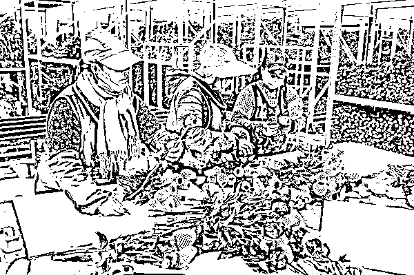

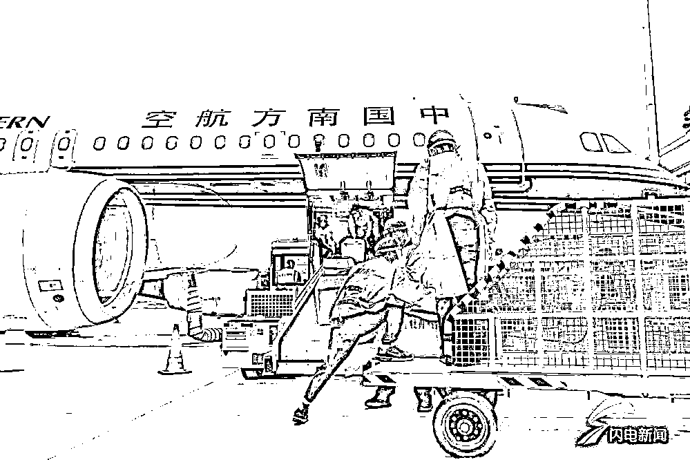

*   盒马经验：在落地中通过测试沉淀大量细节。
花材接受度上，以莎拉为例，要求产地分拣时花头以下叶片长度不超过20厘米。
包装上，从四千枝大箱改为200-300枝小箱，损耗降低，分拣运输加速。
通过直采基地与鲜花大仓，打通产地仓-销地仓-门店-盒区房全链路，实现买得到。
在物流链上，前置包装从产地直发上海、北京、杭州、南京等大区，供应链缩短2-3天。
标准化提升品质的同时也降本，以落日珊瑚为例，北上广零售端售价从100元/5支降至79.9元，形成降维优势。

资料来源
首个“鲜花盒马村”扎根菏泽：种花标准化 直供20城
一朵芍药，激活一条产业带 |广州日报 2024-05-14

2. 引进高阶标准，用差异化占据高端

北京彼由尼原本深耕观赏菊，在花卉培育上具备技术积累。

企业发展受制于技术工人稀缺，转而选择多年生花卉。芍药一次种植可维持十年，减少重复劳动力投入。同时高投入长回本特性，也筛掉了投机者。

彼由尼还利用芍药冬季休眠特性突破地理限制，错开山东主产区花期，实现错峰上市。

投入切花生产后，5年回本，第6年起进入低风险运营，可连续收益10-12年。

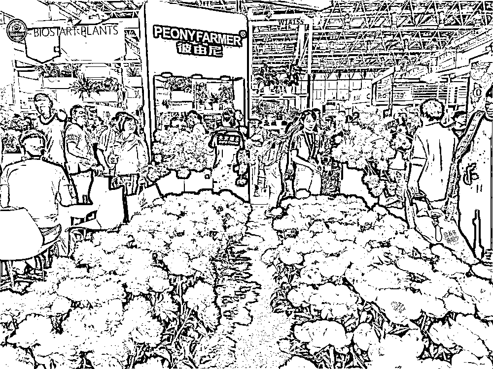

彼由尼开局定位高端，引入欧洲种植标准，并严格执行荷兰阿斯米尔入市规则。

市场上切花枝长多在55厘米，彼由尼做到70厘米；花蕾直径普遍3.7厘米时，彼由尼提升至4厘米以上。

客户收货后常在社交平台分享，花盘直径可达22厘米以上，叶片洁净度远超超市净菜，视觉冲击强烈。

图示显示6月中旬仍能供应芍药，当山东、四川产区已下市。

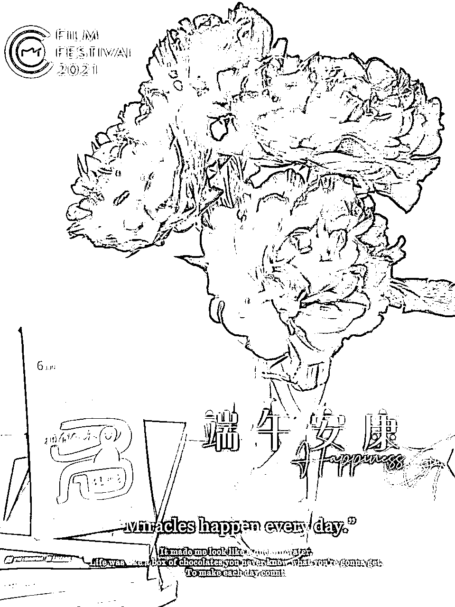

彼由尼董事长陈汝方表示，疫情三年芍药销量不降反升，基本不为销售发愁。多数种植户销量翻倍，供不应求。目前拥有63个进口品种，并掌握大部分品种的定价权。

资料来源 这种鲜切花每亩利润超10万元，未来3到6年发展仍将持续向好

### 4.1.3 小结

初创期要结合自身10倍优势，尽快建立判断尺子和成长尺子，目的在于：

其一，高效把资源转为价值，放大优势；
其二，把重复动作固化，稳住基本盘；
其三，借鉴成熟体系补短板，系统性提升。

难点有两处。

第一，贯彻执行。标准发布后需要全员宣贯，让各环节严格遵循。初创期经验少，借鉴外界标准时更要先完整跑通，再谈优化。先拿到结果，再融会贯通。

第二，结合自身迭代。优秀标准很多，适配性更重要。盲目照搬容易迷茫。像小马过河，实践才知深浅。多做多看，才能把别人的尺子变成自己的尺子。

罗振宇曾说，“标准答案上天堂，参考答案走四方”。

## 4.2 项目进入腰部阶段，用尺子扩大影响

项目到腰部，尺子更多是穿透层级的工具，撬动影响力的路径主要有三。

### 4.2.1 向同行与上下游输出标准，利他中利己

每个组织都有擅长的工艺与流程。把它们整理成文件并对外输出，既能解决行业痛点，也能把自身优势放大成影响力。

越汇食品的冷库管理标准、零售码堆与卖场优化标准就是例子，通过输出帮助客户降本增效，从而成为首选供应商。赚钱精华帖作者、线下分享嘉宾也多在做这件事：用标准和思维换信任和合作。

腰部阶段输出标准，更利于聚拢资金、技术与人才。

### 4.2.2 面向管理机构参与规则制定，占据生态位

项目腰部后对行业理解加深，更容易捕捉新技术与新需求带来的机会。行业越活跃，规则空白期越短，管理部门会推动规范。

有条件的团队应主动与行业协会、监管部门沟通，把自己的经验嵌入规则设计。让优势在新框架里被放大，后续竞争中更容易获得资源倾斜，甚至重塑格局。

如《网络视听收视指标及计算方法》报批稿在规范空白期，优酷、爱奇艺、B站、快手等参与制定，从而确立话语权优势。

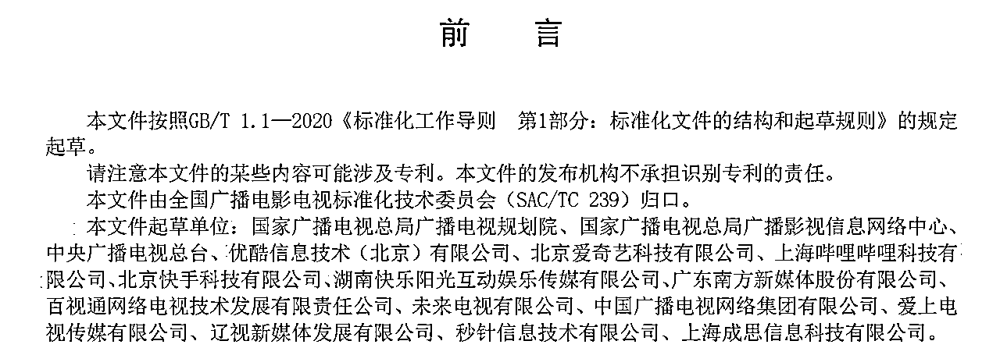

在无人自习室、民宿、养老等新兴赛道，也可关注并参与标准研究，建立政企关系与行业影响力。

### 4.2.3 面向头部与平台参与新标准应用，抢占先发

头部平台在推出新标准时常会小范围测试，或寻找种子用户。提前参与测试，能第一时间了解规则、验证玩法，正式发布时已完成布局，形成先发优势。

以抖音为例，腰部账号运营者若争取内测资格，可提前试水新规则，等普发时别人还在摸索，自己已稳步推进。平台也需要反馈来迭代规则，优质反馈者往往能成为下一轮优先合作对象。

## 4.3 成为头部，用尺子建壁垒与生态

头部阶段，行业越有序，最大收益者越稳。

怎么做？两件事。

### 4.3.1 设定高门槛，聚焦高价值，建立护城河

10倍增长核心是聚焦20%高价值要素，舍弃80%低价值事务。

高标准一方面用来过滤，集中资源在高潜力领域和关键合作方；另一方面用来建壁垒。

头部把技术与资源整合后形成标准，一旦成为行业参照，上下游都会对标。而标准不仅是公开文件，也包括隐性规则，如瑞幸9.9咖啡、麦当劳出餐效率、电商平台包邮。这些隐性标准往往闪电式改变格局，跟不上则被淘汰。

### 4.3.2 系统搭建标准体系，推动共赢，完善生态

头部系统化搭建标准体系有两个目的。

其一，围绕核心标准拓展相关标准，形成合力，占据更广的话语权，实现相对垄断。

百艺与盒马的案例最初聚焦种植，后逐步延伸到花材处理、包装运输、运营销售、市场调研、新品种选育，把芍药从初级农产品变为时尚消费品，从初创成长为头部。

其二，利用行业洞察与影响力，构建价值链生态，实现多方共赢。

当上下游参与你的生态，它们成长的同时也在为生态提供养分，头部地位得以巩固并拓展。

例如阿里牵头/参与制定的电子支付信息安全相关标准，形成体系化规范并持续受益。

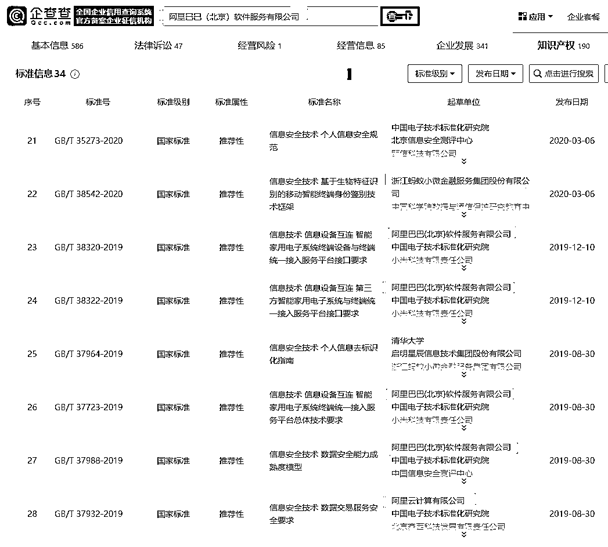

苹果围绕iOS构建的全流程标准体系，从开发者文档、设计指南、人机界面规范、品牌营销指南到App审核指南，相互支撑，不仅繁荣生态，也构筑了难以逾越的竞争壁垒。

从初创时用尺子做取舍，到腰部用尺子聚资源，再到头部用尺子定格局，标准化是贯穿成长的底层能力。

你的项目现在处于哪个阶段？是该定尺子，还是该输出尺子？欢迎交流。

在赚钱有术的演进路径里，你能清晰看到一套完整的标准建设逻辑正在持续打磨和升级。包括星球内容创作者的成长体系、风向标创作者成长机制与风向标本身的迭代、志愿者成长路径、大航海计划的优化、航海家社群的进化形态、赚钱孵化器、社群公约与千分之一劝退机制、鱼丸的服务体系、公众号与视频号的专题内容输出等等。

这些动作看起来分散，实则环环相扣。它们从最初的信息共享，逐步沉淀为可复用的方法，再演化为可落地的项目实践与持续迭代，最终连通资源整合与资源创造。整个过程在社群内部塑造出既有秩序又有活力的生态，让成员既能便捷地获取所需资源与支持，又能反过来贡献力量推动社群自身的成长与进化。

#### 4.3.2.2 领头玩家做标准体系建设，往往聚焦三大方向

当行业头部开始系统化构建标准时，其角色就从规则的执行者转变为规则的制定者。这种转变开启了整合资源、促成多方共赢、引领产业升级的全新阶段，也是迈向10倍增长的关键路径。

从更宏观的角度看，搭建标准体系正是行业头部践行企业使命的一种方式。就像前文提到特斯拉把自有充电标准推成北美主流标准，以及钻石企业用人工金刚石标准体系带动产业升级那样。

在这个阶段，头部玩家在思考时通常会抓住三个着力点。

（1）面向监管侧，参与行业规范与引导

通过深度参与标准制定，与主管部门建立长期且高效的协同关系。依托自身在行业内沉淀的洞察与实践经验，协助监管部门形成科学、可操作性强的行业规范与政策法规，助力行业实现健康有序发展。

（2）面向上下游及同业，提供赋能与成长路径

把经市场验证的技术、方法论与运营经验提炼成标准体系对外输出，帮助上下游企业与同行提升生产效率、优化管理流程、增强创新能力，为其提供可复制的赋能路径，并由此带动行业整体水平提升。

（3）面向产业，推动繁荣与升级

以标准体系为抓手，挖掘产业与区域的特色优势，培育集群效应，提升上下游企业间的协同与资源共享。很多成熟的产业带，本质上就是这样逐步聚拢而成。

如此一来，资源调配会更科学合理，产业链分工会更精细协同，交易成本会随之下降，产业附加值也会被拉高。行业整体竞争力、活力和韧性因此增强。而作为标准体系的构建者，头部企业自然会获得更强的议价力与资源掌控力，实现自身的10倍级增长。

# 5、FAQ

## 5.1如何查询和获取标准化文件

市面上能查标准的文件网站不少，相对权威全面，我建议优先使用国家市场监督管理总局 国家标准化管理委员会主管的两大平台，均可免费使用。

国家标准全文公开系统，可查阅现行【国家标准的全文】。

全国标准信息公共服务平台，可查询国家标准、行业标准、地方标准、团体标准、企业标准、国际标准及国外标准的【简要信息】；也能看到正在制修订或拟立项的标准动态。

结合全国标准信息公共服务平台 ，分享几个快速查找标准的方法。

（1）若已知标准编号或标准名称，可直接在网页【检索栏】中搜索

其中，检索栏下拉的国家标准计划，指已立项、正在起草或征求意见、尚未正式发布的标准文件。这一类信息往往反映了国家在相关领域监管导向与发展重点，能帮助企业提前判断业务是否需要调整；建议重点关注征求意见期的标准，查看“征求意见稿”、“编制说明”，做到提前布局。

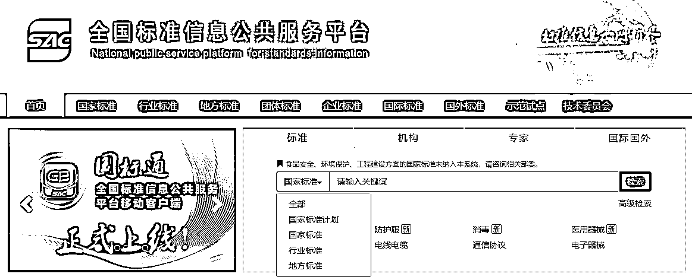

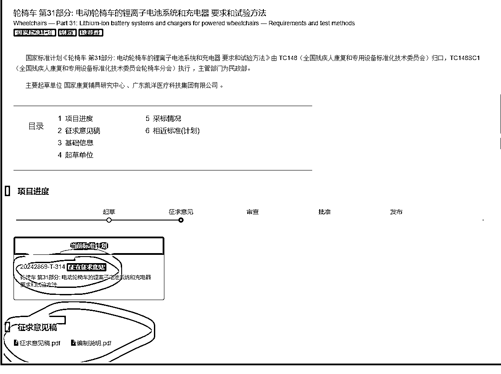

（2）若不确定具体编号，或想全面了解某一行业的标准，可进入对应【行业标准化】板块，按行业分类浏览

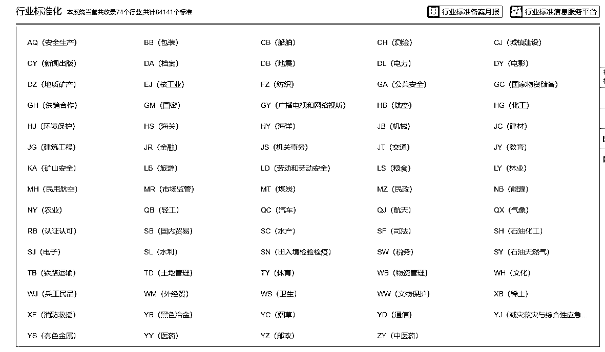

（3）业务具有较强地域属性的企业，更适合在地方标准中检索。以西湖龙井茶相关标准为例，在浙江省地方标准中查找会更高效全面。

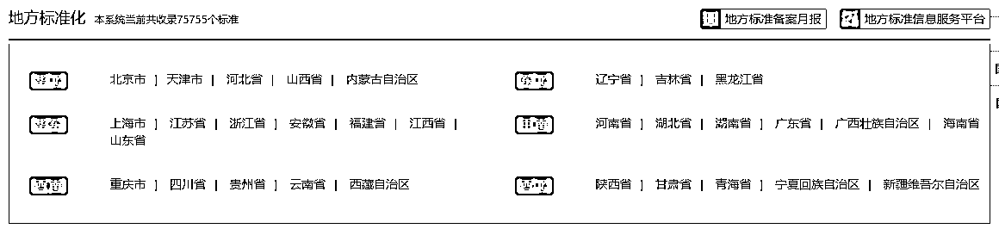

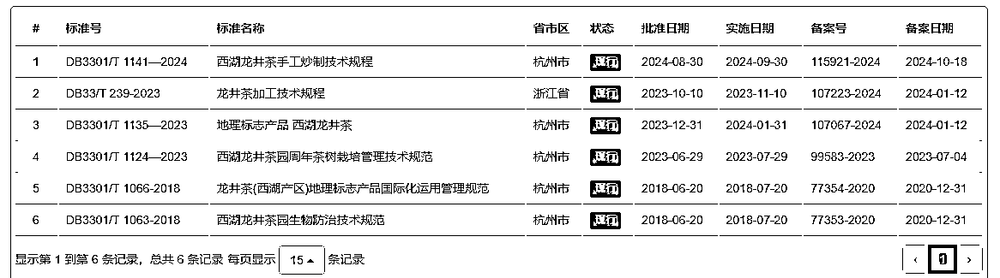

（4）做跨境业务的从业者，可在国际标准化板块了解国际标准的相关资讯。

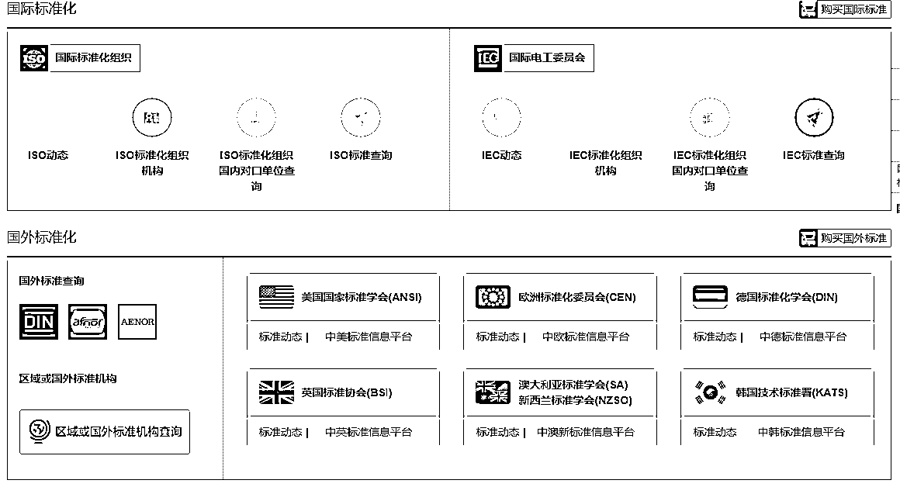

## 5.2标准和专利的关系

标准与专利都是技术进步与创新中不可或缺的要素，二者相互配合、相得益彰。

*   标准是在一定范围内为实现最佳秩序，经协商一致制定并由公认机构批准的规范性文件，供共同使用和重复使用；专利则是经专利行政部门审核认定为符合专利条件的技术方案所享有的独占权。

*   在定位上，标准更强调公共利益与统一性，目的在于保障产品和服务质量安全，推动生产与贸易规模化；专利则更强调对创新成果的保护，防止未授权使用。

*   在个体作用上，标准偏向成熟技术的推广应用，助力提升效率、降低成本、增强市场竞争力；专利偏向新兴发明的权益保护，鼓励技术创新。

*   在监管属性上，标准强调公益性，服务于公共利益和一致性；专利强调专有性，服务于个人或企业的创新权益保护。

# 6、写在最后

1.  本文案例多用于建立标准化初印象，主要引用主流媒体报道。若引用信息存在偏差，欢迎指正，我会及时修正。同时这些解读带有个人视角，难免有所局限，敬请批评指正。

1.  无论是项目推进还是企业增长，都不可能完全依赖标准化来实现。

标准化只是实现10倍增长的一种路径，并非万能解药。

我很认同小马宋老师的观点：营销不是一蹴而就的大动作，而是把一系列小事都做对。

在项目管理与企业经营中，有意识地用标准化思维把这些“小事”做扎实，增长自然会更稳健。

1.  标准化是一个庞大的议题，一篇文章无法穷尽。后续有任何疑问，欢迎在评论区留言交流，我们一起学习。