# 小报童首发 9 天破 1500 订阅：一个中小 IP 的实操复盘

> 来源：[https://viy7tklh1i.feishu.cn/docx/IfyQdYk46ofRbnxEnM3c9IOunad](https://viy7tklh1i.feishu.cn/docx/IfyQdYk46ofRbnxEnM3c9IOunad)

大家好，我是小六六，赚钱 2 期学员，白天在上海做程序媛，晚上做自媒体已经两年半了。

12 月上旬我操盘了自己第一场小报童发售，搭档是圈友阿铭。没有头部大 IP 站台，完全靠一群腰部及以下的中小创作者分销，9 天卖出 1500+ 份订阅。

放在这个配置下，我对结果很满意。下面把从立项到收官的全过程拆开讲，希望对正准备上架小报童的朋友有参考价值。

本篇大致分这几块：

*   专栏搭建与内容准备

*   内测打磨与迭代

*   发售前的各项准备

*   发售中的动态调整

*   发售收尾与复盘

*   三点个人思考

# 一、专栏搭建与内容准备

说到这个专栏，就绕不开我的贵人小林。9 月底他来沪，我们吃饭时聊到我的副业路径，他结合当下风口给我指了方向，明确说我该出个小报童了。

方向清晰了，接下来是选题和定位怎么落。

我做副业两年半，踩过不少坑也拿过结果，公域私域都玩过，最后想做的还是做个人 IP。最顺手的切口就是把自己的实战经历体系化输出，别人能直接用。

小林第二天晚上直接帮我把内容骨架搭好。

最初的框架是：视频号篇、公众号篇、私域篇、社交篇、实操篇、问答篇，每篇 8-10 讲，先攒够 50 讲。

时间表也定了：国庆前写完，国庆后内测，10 月中下旬发售。

理想很丰满，现实很骨感，拖延症发作，最后 10 月下旬才开写，11 月初才把 50 篇全部写完。

内容骨架理顺后，第二个难题是名字。

结合我的真实情况：全职工作之余做副业，两年半变现 30 万，由小林定名《8 小时外 0-30 万变现指南》，很贴合我的现状。

很多人问：50 篇体系化内容怎么啃下来的？

其实就是按 6 大模块在飞书里先列小标题，凑够 50 个标题，再逐个把内容填满，就成 50 篇了。

为什么要先囤 50 篇？现在小报童太卷了，不先拿出足够体量的干货，读者没安全感，也很难转化。

写完初稿后，我把 50 篇一次性全量上架小报童，并整理好目录。

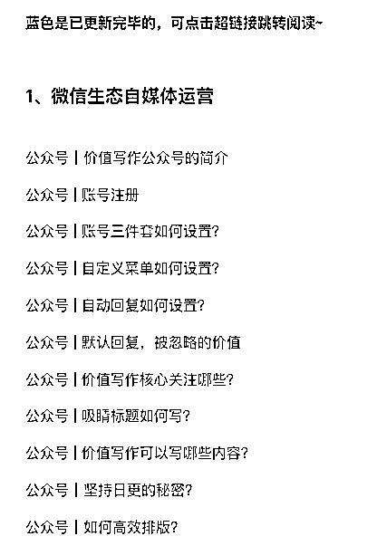

内容和名字确定后，开始做平台基础设置。

一）logo
纯色底+文字，简洁为主，如下：

二）专栏简介初版
分四块：作者介绍、专栏包含模块、价格说明、订阅后加微信领资料。

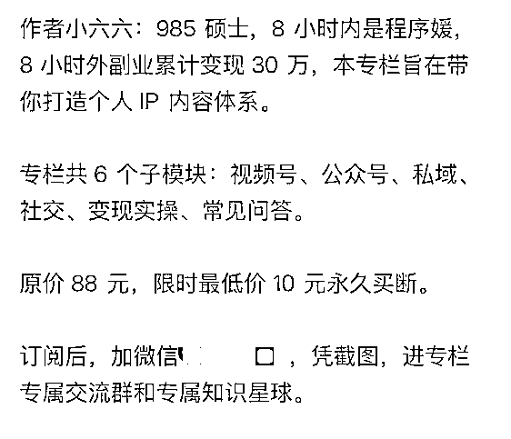

三）置顶帖
小报童只能置顶一篇，我就把总目录放上去，引导新读者订阅后先看这里。置顶标题我写的是：【收藏必看】｜目录汇总

内容结构：
*   开头放读者群二维码，说明进群能领什么见面礼；
*   中间告知已开启分销，并附分销说明位置；
*   结尾是完整目录，方便跳转阅读。

有人用个人微信接人，我选了读者群。因为一人带发售还得上班，个人微信根本忙不过来。建议大家根据自身精力权衡。如果像我一样用群，记得二维码 7 天就失效，要及时换。

置顶标题要写清楚“看这里能得到什么”，才能提升打开率。

四）免费试读帖
小报童最多可设 3 篇免费预览，本质是让用户先验货。

我选了《用 AI 绘画实现变现的完整实操》作为试读。整篇覆盖公域做内容、引流私域、私域成交、交付交付、带团队放大，流量到变现一站式拆解，复制性强。

另外把这篇放到列表最后，它会一直顶在最上面，用户扫码第一眼就能看到。

前期准备就绪，进入内测阶段。

# 二、内测打磨与迭代

内测渠道是我自己的社群、朋友圈、公众号、星球。

先在社群内测，给了社群一份最低折扣券作为答谢，有限时。券的有效期要控住，不然没紧迫感。

首批放 100 张，我以为会剩，结果半小时清空，又补了一批。

随后在公众号、星球、朋友圈同步官宣自己首个小报童产品。

24 小时内靠这几个私域渠道就来了 200 多订阅，有点意外，既说明内容过关，也说明我积累了一定影响力。

随后一周边宣传边补课，又加了 20 篇内容，订阅累计到 367。

内测必须做，原因有二：

一）检验市场是否买单
内测不买单，发售大概率也不行，能早发现问题早改。

二）保留优化空间
原计划内测结束破 400，实际没达标。宣传中我也察觉两点：朋友圈文案提炼卖点不顺畅；内测后期转化断层。

我自己也感觉专栏哪里不对，但说不清。11 月 22 日在沪再见小林后，他指出“8 小时外”等于副业，盘子太大不够聚焦，名字需要改。

同时根据已更新内容，我做了合并调整：

*   视频号篇+公众号篇 → 微信生态自媒体运营
*   私域篇+社交篇 → 私域运营与社交礼仪
*   实操篇+问答篇 → 项目实操与常见问题

调整后脉络更清晰：围绕微信生态，做公域引流、私域成交、商业化闭环。现在风口也是公域导流私域，私域终点在微信。

因此名字改为《微信生态 0-30 万变现指南》。

卖点也重新提炼：

1）两年多在微信生态的实战心法全分享，视频号、公众号、朋友圈、社群、星球、社交全链路。
2）不用多平台堆量，把一个生态做透就够吃，微信就是主战场。

名字和目录调整后，配套物料全部刷新：logo、简介、置顶、试读。

1、logo 图
原橙色底，改成公众号绿色，并加上“微信”关键词：

2、专栏简介
内测发现价值描述太浅，且读者群进群率不高，可能是引导信息太靠下。于是把价值介绍补足，解释了为什么选微信生态，并把联系方式提前。

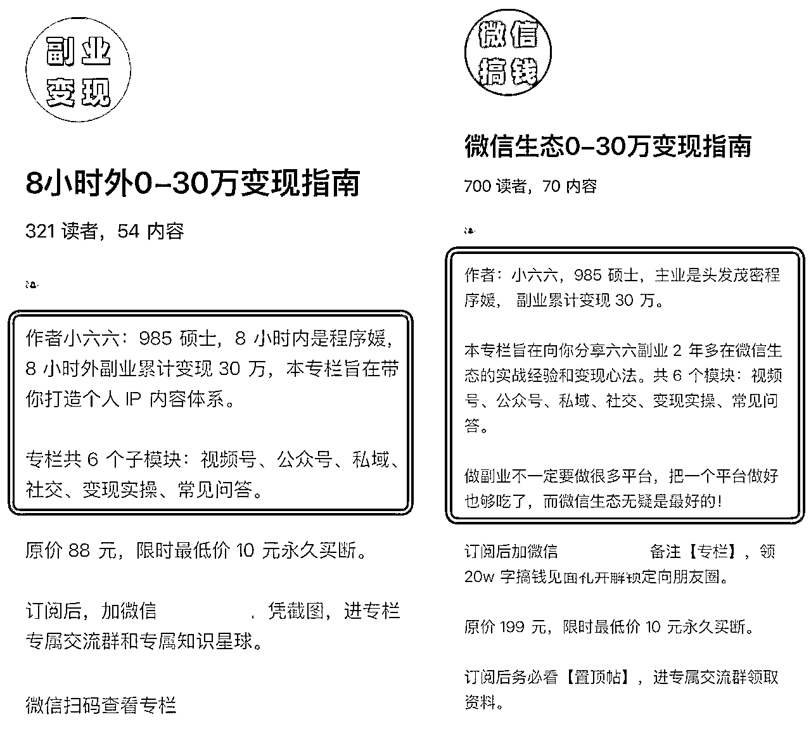

发售期间我又微调了一次。虽然简介可写 260 字，但分销海报文案太长二维码会超出屏，影响转化。最终海报只留“加微信领资料”，群二维码放置顶，效果更好：

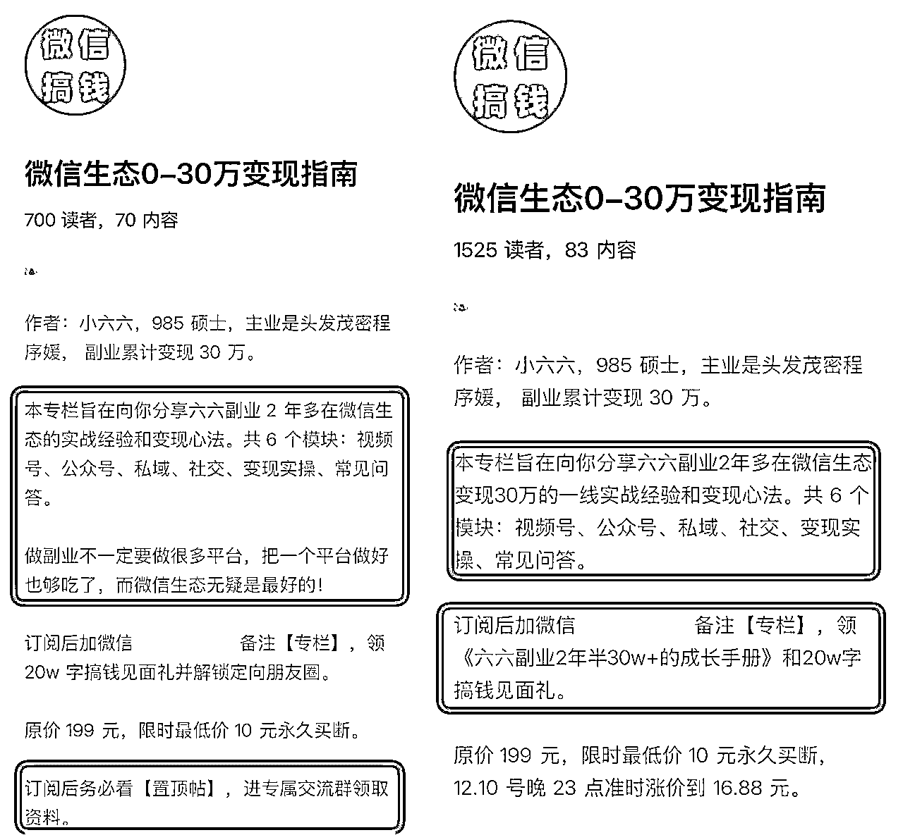

3、置顶帖
为提升打开率做了三点优化：
1）标题改为【必看这里】内容目录｜进专属交流群领搞钱见面礼！！
2）开头加自我介绍和专栏价值说明，增加信任感。

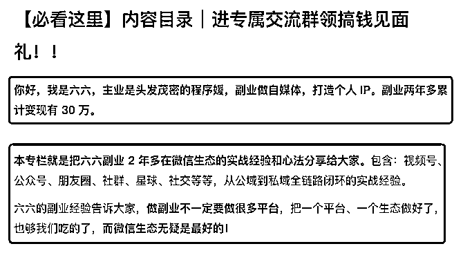

注意：置顶帖里放了群二维码，不要设成免费预览，否则会被白嫖进来。我发售时就遇到过恶意拉人，后来直接拉黑。

三）收集反馈为发售蓄水
内测的付费用户名单就在后台，看到意料之外的人就主动聊聊，很快就能收集到真实反馈素材。

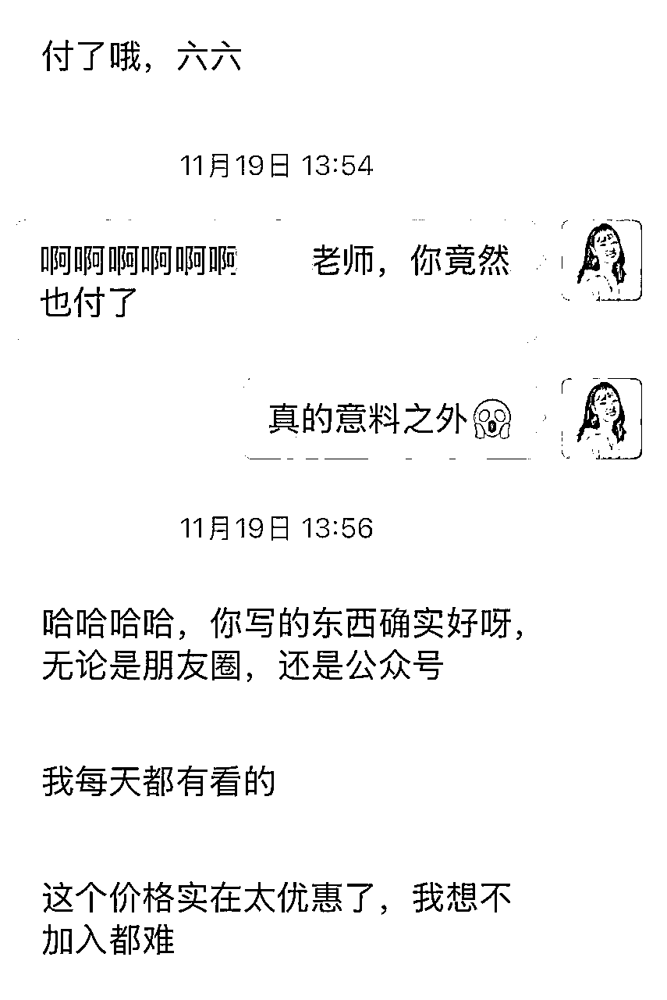

# 三、发售准备，各方到位

迭代完后，我开始写发售方案。原定 11 月底发，小林提醒我档期撞车，建议延后。当时有点懵，后来想明白：什么时候发都会撞，还是先干。

于是把时间定在 12 月 2 日-10 日，为期 9 天。

发售前 5 天是筹备期，主要做三件事：

一）邀约分销 KOL，目标 50+
在社群、朋友圈、公众号、星球公开招募，意向者联系我拉群。群二维码不直接放，是为了筛掉只围观不行动的人。
同时私信一批熟人创作者定向邀请。邀约时一定要提前告知发售时间，方便对方排期。

二）完善分销奖励
朋友无岸基于他的冲榜经验给我很多建议，比如增加实物福利、发售期短就做日榜激励。奖励没有唯一标准，看你要冲量还是稳收益。

三）优化发售方案
方案包含以下模块：

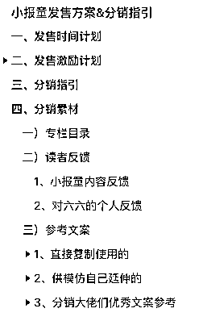

重点说明四点：

1、分销操作步骤
看起来简单，新人第一次参与还是会懵。我做了图示教程，每次有人问就发图，省时间。

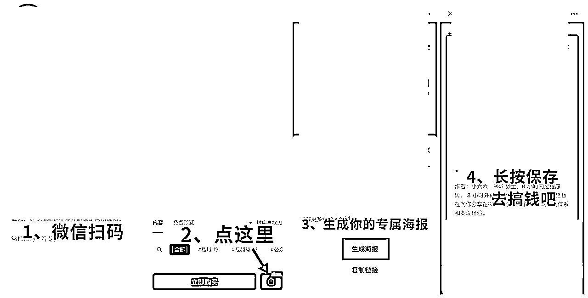

2、内容目录图
置顶的文字目录太长，滑动成本高。我做了两张图：

A. 拼图版目录，一屏展示全部章节，视觉冲击强，出单效果好。

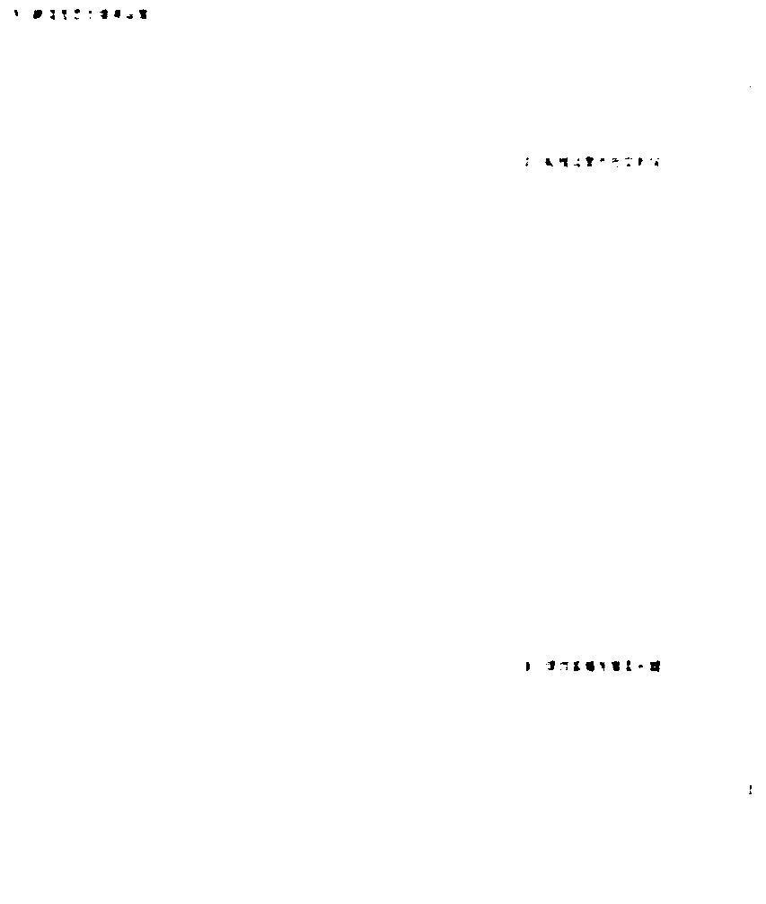

B. 思维导图版，快速建立内容全貌。

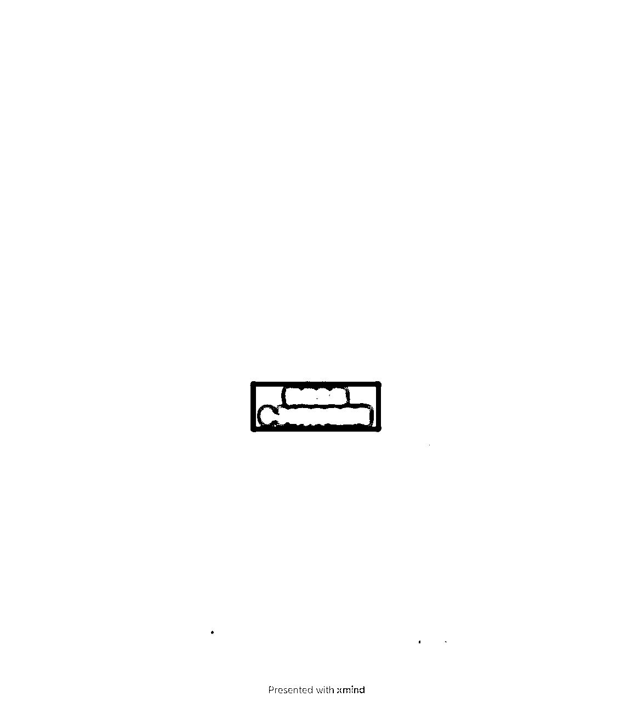

也正因如此才要提前囤够 50 篇，图才够饱满。

3、发售可用素材
准备两类好评：对内容的好评、对主理人的好评。素材来自内测期积累，没有内测就没素材。

我还把单张好评拼成合集图，冲击力更强。

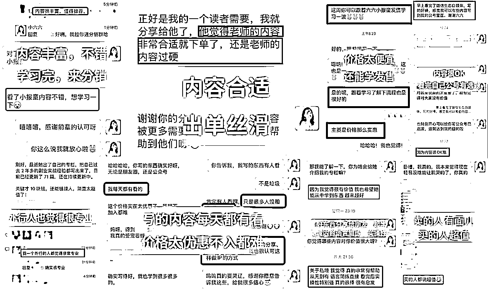

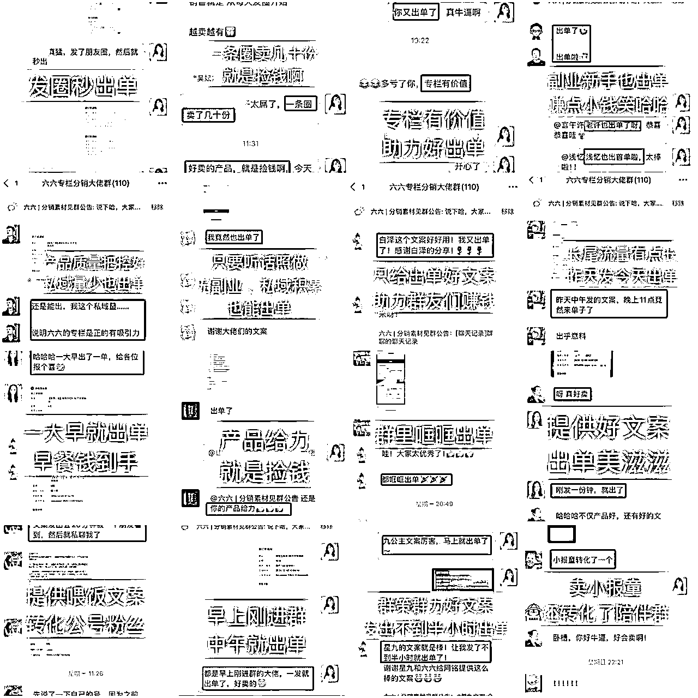

4、可直接复制的推广文案
很多人懒得写或不会写，文案不给就拉低参与度。我首批准备了 10 条：

*   2 条主理人经历背书
*   2 条专栏卖点切入
*   3 条用户证言
*   1 条读者问题+对应章节
*   2 条价格实惠

另外配了一个微信消息版简版方案，包含海报生成、分销奖励、两张目录图、5 条文案、分销方案链接。把简版收藏成合集，新人进群直接发，沟通效率很高。

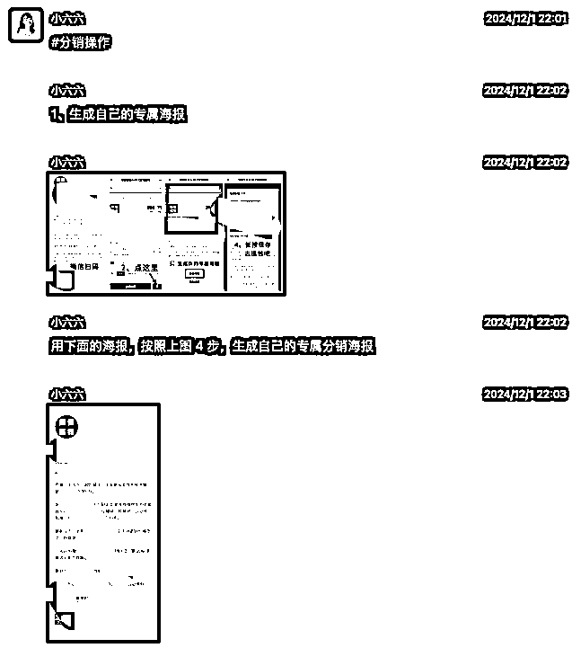

KOL、内容、周期都齐了，可以开干。

# 四、发售过程，灵活应变

发售周期 12 月 2 日-10 日，分前期、中期、后期。

前期靠初始分销群把势能带起来。结果：3 天破千。

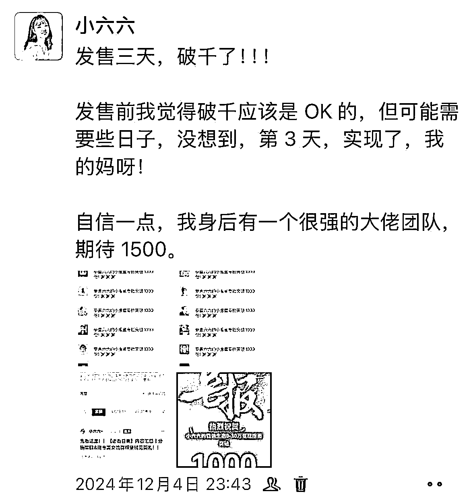

这个里程碑本身就是很好的传播点，“成功是成功之母”。

中期分销热情会自然衰减，通常 3-4 天进入疲劳期。针对 9 天的周期，我做了两件事：

1、写一篇 6000 字分享稿，去约我已付费的资源，做两场大型分享，为发售输血。
那段时间我基本是凌晨 3 点睡早上 7 点起，直到周三请假在家闭关写稿。

2、持续补新人。
A. 用小报童每季度 15 个免费链接去邀请潜在分销者验货后转化。
B. 从 1000+ 读者中筛选熟人，定向邀约分销。大部分人都会回应。

同时在分销群运营上：

*   群昵称改成“六六｜分销素材见群公告”，每发言一次都在提醒。
*   鼓励发朋友圈，并截图到群里领取发圈红包。

我把整个分销节奏拆成了看见、即时反馈和持续加码三件事来做。

首先是营造公开的榜样效应。谁先打出第一单，就把截图丢到群里晒出来。首单截图我会亲自点名祝贺，并且配发专属的出单红包，让第一批尝到甜头的人被看见，也把大家的注意力拉向“原来真的可以”。

反馈必须快。每天晚上十点我会结算当天的里程碑奖励，达标的人现场发红包，不等到活动结束才统一结算。奖励放出来同时，我也会把日榜贴出来，让排位靠后的伙伴有明确的追赶目标。隔天早上九点半左右，再把前一天的日榜和奖励复盘一遍，用昨天的成绩去点燃今天的行动。

策略上是数据驱动调整。首日的日榜出来后我发现头部太猛、中腰部沉默，于是立刻切换成中小 IP 培育策略。单人出单量不高没关系，基数够大、复利就起来。于是我在群里有意多夸那些中小分销员，经常艾特他们的名字、点名表扬，让他们感受到被认可、被需要，持续出单的动力就上来了。

执行细节由阿铭全包了。他主动扛下海报制作这块活：日榜排名图、整数里程碑海报、分销前十的总榜、分销前三的单人荣誉海报全部由他出品，还会不断收集群里好用的分销话术沉淀成合集。等于既是“喂饭”，也是仪式感的强化，从里子到面子都照顾到了。

我还会做文案的即时收割。只要监测到某个人出单数据异常猛，我就立刻去看他朋友圈用了哪段话术，有效果的当场收进我的素材库，再分发到群里让所有人共用。

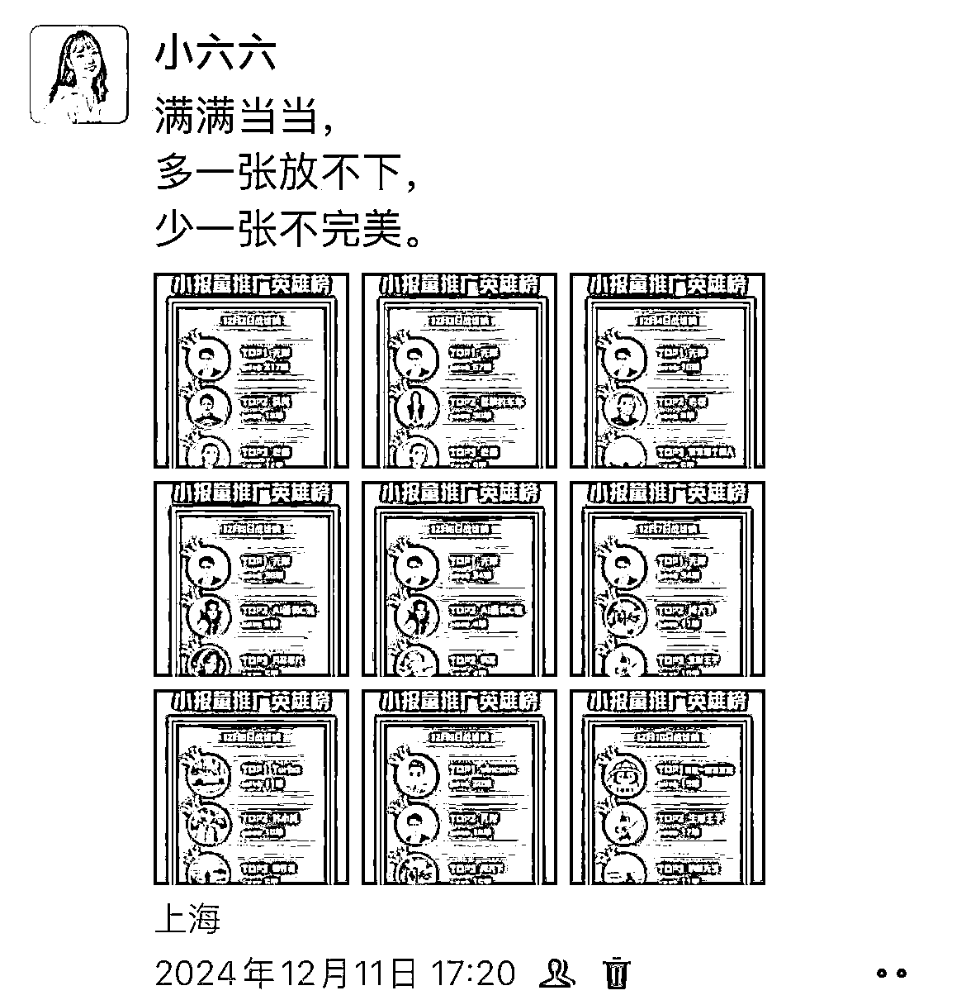

推广周期我特意卡在了周一启动、周二结束，一共九天。前面七天持续投放、持续触达、持续影响，中间顺带过一个周末用来补血，周末时间我去找新的 KOL 注入新鲜流量。最后两天正好是工作日冲刺，周末沉淀+工作日聚焦的组合拳，效果很好。发售最后两天是收获高峰，我一直在群里喊话不要放弃、继续坚持，结果很多人都在末期完成逆袭。听话照做的伙伴基本都出单了，我就把这些结果再丢回群里做二次激励。

时间点也有讲究。发售周期不低于七天，太短影响不足；起止都放在工作日里，因为观察下来周末大家基本不看信息，周内上班反而更关注副业动向。结束日放在周二，是为了保留两个完整的冲刺工作日。经验告诉我，发售收尾和涨价前的 48 小时是最猛的出单窗口，我就在结束前一小时准时涨价。策略验证成功，最后两天就出了 200 多单。

# 五、发售结束，闭环完成

这次发售本身就是一次分销教学。群里不仅在教方法，也有人把自己的用户拉进来观摩我怎么操盘小报童。有收获的人自然会留下，所以收官时我让阿铭提议做复盘闭环：发售结束后我在群里宣布，写一篇不少于 50 字的复盘发到星球，我就发放 10 元陪伴群抵扣券，可自用可转赠。

参与者写了不少，我看完发现能写出东西的，基本都是全程认真跟进并有实质收获的人。

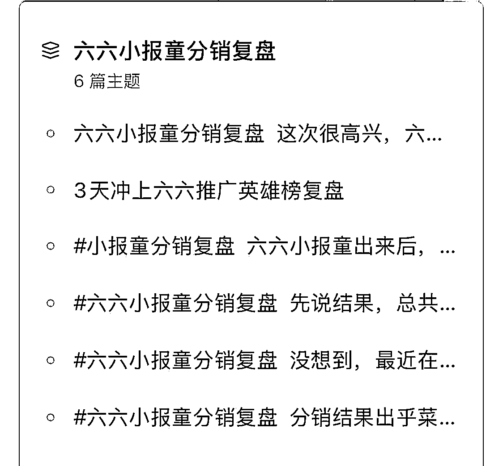

看到这些复盘我挺欣慰的。我的小报童发售达成了，他们也学到了想学的东西，双赢。

# 六、本次发售，三点思考

一）价值先行，传播在后
这次有 50 多位原本不熟的朋友自发分销，他们多半是自己先买了、读后觉得有价值才愿意安利。还有之前把我删掉的大佬又加回来夸我内容好。道理很简单，当你持续提供价值、让别人觉得你有用或未来有用，关系自然靠近；否则也就只能在互联网上互不相识了。

二） IP 成型，产品被需要
没积累、没势能就急着出产品，基本卖不动，因为没人了解你，品质也站不住脚。等你有了专业沉淀和影响力积累再发售，粉丝会说：一直追你的内容，对我帮助很大，你终于出作品了，肯定要支持。当产品出生时就是被需要的，和靠臆想出来的产品，差距是天壤之别。

三）越是低价，越要超预期
售后反馈里常见一句：原来你更新这么多，还这么便宜。超预期交付在低价产品上更关键。很多读者是首次接触你，低价加上高质的第一印象，会让他们更愿意通过这个产品认识你这个人。而做个人 IP 的本质，就是让人认识你、了解你、信任你，最后形成复利商业化。

# 致谢

至此，从内容筹备、发布、内测、发售到复盘，我的小报童全链路经验就分享完毕，希望能给你一些启发。

感谢赚钱，两年时间让我对赚钱有了全新认知，线下聚会也帮我链接到一群优秀的圈友。

感谢小林，朋友、恩师、贵人，从选题到内容把关再到发售指导，每个关键节点都有你，没有你就没有这个专栏。

感谢阿铭在繁忙的主业和家庭中依然全程支持，做海报、收文案、运营分销群，功不可没。

感谢老徐，贵人恩师，多次在星球和朋友圈帮我站台。

感谢飞巴，我的互联网爸爸、恩师贵人，各种提点让我少走弯路。

感谢大冲，亦师亦友，拉人、推广、指点全包。

感谢无岸、老秦、波波、车车、辰风、小瓶、雨飞、易安、醒狮以及 100 多位朋友们，是大家共同创造了这个成绩，荣誉属于每一个人，一起龙哥盟。