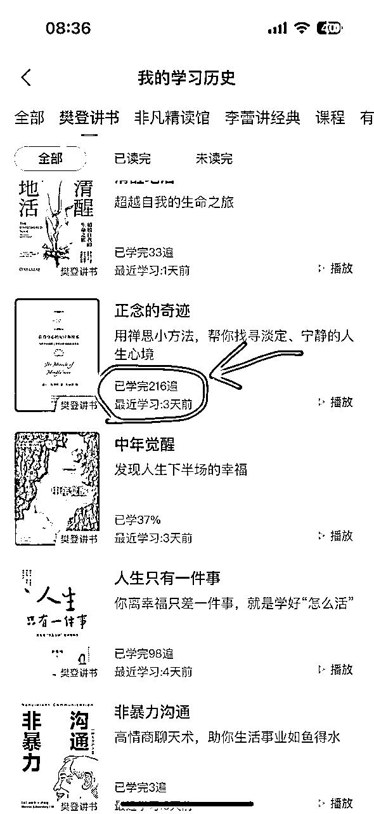
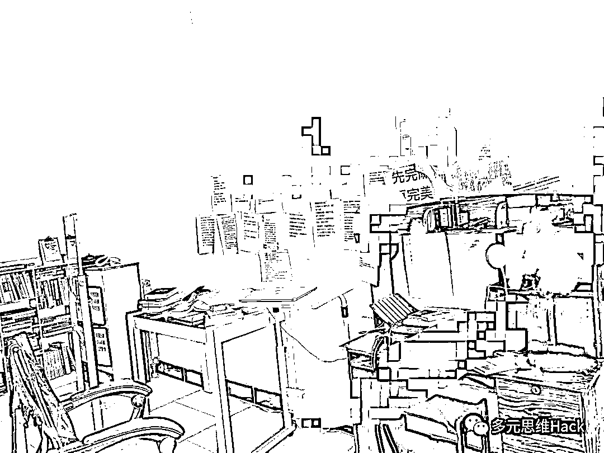
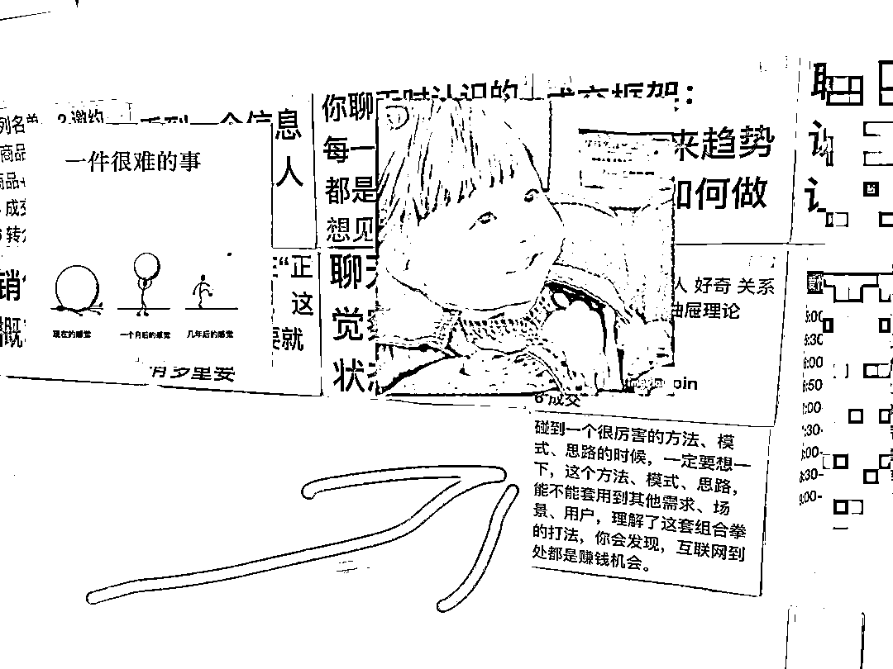
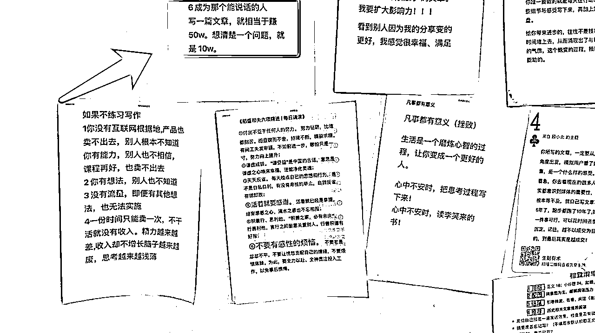

# 认知清楚却执行不了，差的其实是惯性

> 来源：[https://pznme756ly.feishu.cn/docx/JhIJdd1oLo19YoxvImkciiOcnZc](https://pznme756ly.feishu.cn/docx/JhIJdd1oLo19YoxvImkciiOcnZc)

赚钱第8期老圈友，在此分享一次反复被验证的体悟：把赚钱的认知真正落到行动上，关键不在于懂得多少，而在于惯性如何牵引你。

不少人都有类似的撕裂体验 ——

1 明知航海打卡坚持很重要，却很难熬过最初两三天就松懈
2 清楚内容变现靠复利，持续在小红书/抖音/视频号稳定输出才有爆发可能，却提不起劲去产出
3 理解先发布再迭代比追求完美更重要，第一篇笔记/公众号/YouTube/Cursor 项目先上线再优化，却总想等到十全十美才肯开始
4 知道做项目前要找标杆做拆解再模仿，成功率会上去，却仍按本能瞎搞，最后空转
5 懂得赚钱充满不确定性，要聚焦过程、降低预期，结果顺其自然，却每次小动作后都忍不住追问为何没到账，失望焦虑后直接停摆
6 ……

脑子里装的全是正确的原则，到了行动层就掉链子。找到真正原因，并建立可复用的操作方式，赚钱的确定感就会被显著拉升。

就像减脂，管住嘴迈开腿是真理，做到了体重变化几乎是注定的。变现同理。

这些坑我全踩过。书看过不少，案例也搜集过不少，但一段时间下来几乎原地踏步。

后来自行拆解、实操、复盘后，摸到一个极简却极猛的办法。此后我在成长、情绪稳定、变现效率上的提速至少是十倍级。

感觉像是从学步期直接上火箭，被打通了任督二脉，做什么都快。

门槛极低，几乎零成本。但正因太简单，多半会被忽略甚至嘲笑，而这恰恰是阻碍最大的地方。

下面把这个思路展开说说，篇幅较长，约 8000 字。

# 1 从一次数据焦虑的经历说起

2020年5月刚开启公众号日更时，有段时间数据稍差就陷入极度焦虑。

后来接触到一个工具：解离。

把大脑对灾难的臆测，和当下真实情境剥离，焦虑感就会下降。

因为焦虑的本质，是大脑把想象当成事实在处理。

比如一篇数据不佳，大脑会自动连锁：

数据差 = 写作不行
写作不行 = 我不行
我不行 = 以后什么都做不好
什么都做不好 = 人生完了

明明只是单篇文章的问题，被放大成整个人生的终结。一旦认同这条链条，就完全动不了。

解离的操作就是把想法与现实区分开，情绪立刻松动。

我第一次尝试是在上午十点左右，马上见效，焦虑明显缓解。当时还沾沾自喜，觉得以后应该稳了。

可当晚遇到同类情况，又焦虑了。

冷静后我问自己：刚才为什么没立刻想到解离？

这不就是典型的知道却用不上吗？

后来看《正念的奇迹》提到“惯性”，才豁然开朗。

并且越练越发现，它渗透到学习、工作、变现、情绪、运动的每个角落，每件事都在惯性里运行。

PS：《正念的奇迹》我循环听了三百多遍，本身就是在用惯性喂养惯性。

该书在樊登读书有两个版本，旧名《正念的力量》。

* * *

# 2 惯性才是知行脱节的元凶

骑自行车你有经验吧？

车从坡上冲下来，速度很快，后续用刹车效果很差，因为惯性还在推着你往前。

我当年焦虑时想不起解离，也是惯性太重。

近三十年里，遇到类似状况的默认反应就是放大问题、触发情绪。这个模式太熟了，惯性过强。

新情境来临时，旧惯性先一步启动，等我反应过来想用解离，情绪已发车。

为什么首次使用时有效？

因为从看到方法到使用方法的间隔极短。那几分钟内，我被拉进新惯性：遇到问题就用解离。

可这股力量撑不了多久，五分钟后就衰减，我又慢慢滑回老轨道：放大困难→焦虑。

于是再遇到同样的事，焦虑先行，等想起解离已经晚了。

这就是知道却做不到的真相。

再看一个例子。

小明是程序员，长期早上十点起床上班，虽感压力却提不起学习劲头。

某天看完励志视频很燃，第二天五点起床学习。

第三天六点，第四天七点，第五天八点，第六天又十点。

因为十点起床的惯性积累太久，励志视频只能提供一次短暂推力，推力消失后，旧惯性就把他拉回去了。

我们每天每件事都在不同惯性里浸泡，有好有坏。

* * *

# 3 好惯性在的人才会越滚越顺

碰到难题，

A 的第一反应是退缩、回避。
B 的第一反应是找资料、研究、请教。

这是行为层面的惯性。

被质疑时，

A 直接炸毛。
B 根本不放在心上。

这是情绪层面的惯性。

看到机会，

A 第一反应是抱怨。
B 第一反应是找需求、想变现路径。

这是思维层面的惯性。

惯性强的，想学对方很难。A 学不会 B 的行动力，B 也很难学会 A 的拖延。

所以会出现：

优秀的人越走越顺，因为好惯性在复利。
他想偷懒、想发火、想抱怨，都很难，因为好惯性一直在把他拽回来。偶尔犯错也会被拉回正轨。

平庸的人越走越差，因为坏惯性在复利。
他想学习、阅读、思考，都很难，因为坏惯性一直在拖后腿。偶尔努力一下也会被拉回原点。

即便学习同一项技巧，

好惯性的人，会立刻把它融入使用习惯。
坏惯性的人，会下意识把它排斥在外。

不是不想改，是惯性太重，人使不上劲。

这点自己回想就能验证。

我有个朋友，三十岁，公司工资将就，晋升无望。他说自己知道要读书提升，也试过，但两天就放弃，坚持不下来。

他怀疑是方法不对，不断报课找技巧。

真相是：不读书的惯性已经养了三十年，这股无形力量每天都在拉他。

那是不是没救了？

当然不是。有人以前也这样，后来彻底变了样。他们掌握了什么秘诀？

秘诀很简单，就是愿意做一件别人不屑做的小事。

* * *

# 4 如何打破惯性

自行车下坡想刹停，怎么做？

多点刹。

一开始就轻点一下，隔会再点一下，再隔会再点一下。车速会变得平稳，随时能停。

同理，人想在坏惯性里长出好惯性，就要不断给自己一个小推力。

就拿我焦虑来说，解离有效，但惯性太强，遇到事来不及想起。

可前面说过，看到方法后的五分钟内，我是能立刻想起来的。因为那时好惯性的力量够大。

那我为什么不每隔五分钟就复习一次方法呢？用外部提醒把自己一直钉在好惯性里。

随着熟悉度提升，练习次数增加，好惯性的持续时间会变长。一次复习能撑十分钟，后面半小时，一小时，五小时，一天，三天……

慢慢地，我就彻底迁移到新的惯性轨道上。

我就是这么操作的。把解离的方法打印出来，贴在眼前，随时可见。

每次瞥见一次，好惯性就加一分。

几百次下来，现在大部分时候我都处在新惯性里：焦虑苗头一起，解离就自动启动了。

* * *

我墙上贴的东西其实不少，因为我同时在培养多个惯性。

比如一个写作技巧，我以前的习惯从不用。只看一次肯定记不住，于是我把它也贴在视线范围内，每次写稿都能看到。重复够多次后，它就成了我的默认写法，写作效率飙升。

比如赚钱思维。以前看到一个牛逼的模式，我夸一句就过去了。后来我把一个提醒贴在墙上：看到任何好模式，必须思考还能套用到哪些需求、场景、用户上，怎么落地，至少想三个。

重复多了，这个思考回路就内化成本能。遇到真实项目，能自动调取出来用。

再比如我写过的《用清单思维打造赚钱兵器库》，把案例按需求-流量-营销-变现拆解，也是靠高频重复养成惯性。

我的见识、思维、技能、经验，都是靠集中刻意重复砸出来的。2021年418赚钱拉新，我拉了400多人，当天变现二十万加，后续写公号、接广告、带货、做课社群都顺了，最后一年赚到百万。

因为那些东西已经进身体，变成惯性，而不是“看过”。

当你进入好惯性，你想偷懒都懒不掉，因为好惯性一直在拽你。

遇到问题不思考反而难受，多思考一次，惯性就更牢，下次更愿意思考。

强者恒强就是这么来的。

那个励志视频，如果小明每天都看一次，把好惯性维持住，早起就真的会变成习惯。

之前我也写过，动力不足时，光想重要性不够，要把意义清单贴到眼前反复看，不然三分钟热度，坏惯性会把你拽回去。

新知识、新方法、新习惯，起步阶段一定要高频曝光、高频使用，才能长成惯性。不然改变根本不会发生。

# 5 变现上如何做到知行一致

回到开头的清单。

如果你在实操中卡在这些地方，解法其实是一样的，对号入座就好。

1 明明知道要认真打卡，可两天就放弃。

把“认真打卡的人，100%都能拿到结果”打印出来，贴电脑前每天看。动力会完全不一样。

2 明明知道要靠数量堆概率，可没力气发。

把“发满100篇笔记/视频，我能赚100万，每发一篇赚1万”贴出来每天看。你会舍不得睡觉。

3 明明知道要先完成再完美，可总想等完美。

把“这篇笔记/视频越早发，我就离100万更近一步”贴出来。你会立刻放下完美主义。

4 明明知道要对标拆解模仿，可总凭本能乱来。

把“模仿成功案例效率提升十倍，瞎做就是无效勤奋，我就是个蠢货，一辈子赚不到钱”贴出来。你一定会去拆。

5 明明知道要放下结果专注过程，可总想变现。

把“我掌控不了结果，只掌控过程。做好手里的事，莫问前程”贴出来。心态会稳很多。

6 ……

有人会觉得这些话夸张、假。100%、100万、一辈子……

没错，就是要夸张。

因为这句话的作用是点燃行动冲动。看到就热血沸腾，才会去做。

换成保守说法，比如“99%能获得结果”，大脑会立刻挑刺：我肯定是那1%。

大脑天生擅长找负面理由，这是几万年的惯性。

所以一定要夸张到让你看到就想马上行动。只有这样，你才会真正去做那些你明明知道正确的事，从而提高拿到结果的概率。

我当年日更公号时，也怕累没反馈想放弃。那张纸我贴的是 ——

“一篇文章赚50万”

夸张吗？夸张。

假吗？假。

有用吗？

就靠这张纸，我日更了1600多天，收入提升至少十倍，认知、能力、心态、影响力都翻了十倍。

即便现在还没做到一篇文章50万，我依然120%相信未来能做到，因为我一直在正确的方向上迭代。

有无限可能，但不做就是零。

所以，把你想要的结果和达成它必须做的事写下来，打印出来，每天看。

你会有动力去做，然后更有机会拿到结果。

再啰嗦一句。

A 学到一个东西。

B 学到一个东西，贴在眼前高频看高频用。

二者差距不是1倍、10倍，而是有和无的区别。

时间越长，差距越大。

很多人读书、听课、做笔记、实践过几次，却没改变，核心原因就是没有做高频重复的刻意练习。知识、方法、工具，都需要大量重复才能熟能生巧，成为可用的能力。

这还没完。

# 6 更大的惯性：环境

个人的惯性还能靠自律硬扛。

更致命的是环境的惯性。

你有没有过这种体验——原本安排得好好的，想安静看些资料、记录心得、执行计划、回顾总结，可手机一响，群里弹出的不是风口解读就是暴富案例，不是涨粉方法论就是变现成绩单。在这样的信息轰炸里，你还可能专注吗？

答案是，很难。

我们每个人都被一种看不见的“环境引力”裹挟着。它一直在悄悄改变你的方向。想要真正做出改变，你既要对抗自己以前累积下来的旧习惯，也要抵抗身边那些与目标背道而驰的力量。这样看来，贴在屏幕边缘的那张提醒纸条，分量实在太轻了。

因此，如果你想挣脱某个糟糕的循环，最先要做的，不是硬扛，而是远离那些持续制造这种循环的场域。朋友圈、闲聊群、内容社区，该回避就回避，该静音就静音。每多看一条，你就多被拽进去一分。要切断这种牵引，需要足够的魄力、持久的耐心，甚至要接受短期内的不确定感。这不是一次性能完成的事，需要花时间，慢慢修炼。

反过来，当你主动进入一个大家都在“向上生长”的圈子，环境就会成为你的助力。比如，周围的人遇到问题，第一反应是搜索、思考、请教、查教程。你待得久了，这种应对问题的方式，也会不知不觉长到你身上。

赚钱有术就是这样一个圈子。如果你真想在这件事上发生实质变化，不妨多翻翻社区里沉淀下来的高质量内容，多参与实战项目，多观察并拆解那些已经跑通收益闭环的高手——他们如何判断、如何行动、如何坚持。久而久之，你获得结果的概率自然会变得更大。

说到这里，还有一个常被忽略的事：那些看似只属于你个人的习惯，其实会传给孩子。

# 7 你的行为正在成为孩子的模板

人人都被身边的环境塑造，同时也在反向塑造身边的人——孩子是最敏感的接收者。从小在父母身边长大的孩子，最后往往会变成父母的翻版。因为父母每天都在用自己的日常，一点一点把孩子拉进自己熟悉的轨道里。

举个很常见的例子：父母没有阅读习惯，下班就瘫在沙发上刷手机。孩子看到的画面就是“手机最好玩”，你让他去读书，他也很难建立兴趣，慢慢地就和书本疏远了。反过来，父母如果经常捧起书，孩子会认为阅读本来就是生活的一部分，不需要监督，自己就会往书堆里凑。

也许你会说：那就把孩子交给学校去培养。学校当然能起到作用，但效果有限。老师再好，哪怕学校资源再丰富，对孩子习惯的影响力也是分散的、短暂的；真正形成决定性影响的，是父母与孩子日复一日的相处。父母的日常状态是正向的，孩子就泡在正向的环境里；父母的日常状态是负向的，孩子也会被拽进去，越来越像大人。

我当初想到这一点，后背发凉，随即下定决心调整自己：认真读书、持续思考、刻意练习，先把自己带上正轨。也是在那一刻我理解了《人生只有一件事》里的那句话——当你把自己活好了，孩子不用教，自己就会去模仿，去靠近，去变成大人的样子。

所谓教育，不是说给你听，而是做给你看。

最后，再回到开头那个话题。习惯的改变从来不是一蹴而就的。你懂得一种方法、认清一条思路、看明白一个模式，到真正把它做出来、赚到钱，中间还隔着无数次练习。

改变，本质上是一个高频、持续、长期的动作。想告别旧循环，最简单也最实用的做法，是在抬眼就能看到的位置贴一张纸条，写下你最想调整的方向：赚钱、工作、生活、沟通、情感、写作，等等。然后，每天停下来，读一遍上面的纸条，动手做一轮。重复的次数积累起来，新的行为模式就会慢慢变成你的本能。

当知道和做到之间的缝隙被一次次行动填满，你的人生状态自然会不一样。

祝看到这里的你，早日把好习惯变成自己的护城河，让收入和生活一起向上走。

* * *

# 附：我在赚钱的足迹

我是明白，加入赚钱有术到第 8 期了，圈内编号是 20。程序员出身，现在自己创业，运营一个成长社群，叫《日新月异俱乐部》。下面的文章是过去几年陆续发在赚钱有术的，也算是一条成长轨迹，想看的话点开即可——

> 2024 年
> 1. [详解：写作和赚钱的 4 个关系！看完你一定会忍不住想开始写！](https://t.zsxq.com/192OLDlds)
> 2. [7 年赚钱拉新 1100 +，我只做对了一件事](https://t.zsxq.com/19SqL7McC)
> 3. [赚钱急于求成的心态，该如何破除？](https://t.zsxq.com/wD6k5)
> 4. [如何借鉴其他行业经验拓展赚钱思路](https://t.zsxq.com/3wd8r)
> 5. [参加航海实战，如何让自己每天都有正反馈？](https://t.zsxq.com/9e2ns)
> 6. [当思考成为习惯，赚钱会更容易](https://t.zsxq.com/19vgyk7cp)
>
> 2023 年
> 1. [身体残疾卧床 3 年，我在人生最低谷加入赚钱有术，有哪些成长？](https://t.zsxq.com/19KWDvzz0)
>
> 2021 年
> 1. [复盘｜龙哥 3 年前的帖子，帮我每月被动收入 1 万块](https://t.zsxq.com/19jaotwbv)
> 2. [嘉宾问答｜“想去更好的公司，我该如何利用好时间？”](https://t.zsxq.com/1952Q3a92)
> 3. [2883 人向朋友介绍赚钱有术时，说得最多的 16 个词](https://t.zsxq.com/19MYWwvCl)
>
> 2020 年
> 1. [产品想要获得更大收益，应该不断向用户的真实需求靠近](https://t.zsxq.com/19kQ7NILy)
> 2. [我的2019：普通人如何培养自己的用户视角？](https://t.zsxq.com/19fyFdZRL)
> 3. [如何通过分析成功案例，帮自己建立赚钱清单](https://t.zsxq.com/19FNjtIjB)
> 4. [思路详解：如何为某个细分领域用户提供产品，并赚钱](https://t.zsxq.com/19qoI1QQB)
> 5. [学习和赚钱是什么关系？](https://t.zsxq.com/19uQcuMzJ)
> 6. [5000 字深度拆解｜Manchuan 公众号 2 个月涨粉百万，普通人如何复制？](https://t.zsxq.com/19cD1keUB)
>
> 2019 年
> 1. [在赚钱有术，普通人如何从 0 到 1，培养赚钱思维](https://t.zsxq.com/19rA0kWrD)
> 2. [赚钱有术第 3 期，我是如何做到邀请 245 个用户的？](https://t.zsxq.com/1968tlTAx)
> 3. [公众号和抖音之间的赚钱机会](https://t.zsxq.com/19OfzDckK)
> 4. [可复制，零门槛｜如何借别人的流量，打造一个稳定的被动收入系统](https://t.zsxq.com/19sVRn6Yx)
> 5. [做自己擅长的事，把技能树打通，然后再去赚钱](https://t.zsxq.com/19evWC1Xl)
> 6. [信息整合：一个可复用，低门槛的成熟商业模式](https://t.zsxq.com/192zoSooT)
> 7. [产品名字，只有一个目的：降低用户认知成本](https://t.zsxq.com/19QUBrDOT)
> 8. [数据是需求的抽象化｜帮你快速找到 100 个赚钱思路](https://t.zsxq.com/19QrIpsuC)
>
> 2018 年
> 1. [分享一下，抓取其他微信号的方式，而且是精准粉](https://t.zsxq.com/19sKQT9bF)
> 2. [如何几乎零成本做到 1w 多付费学员？](https://t.zsxq.com/198XWAGhV)
> 3. [36 个小而美赚钱项目之一：蛋黄酥白皮书](https://t.zsxq.com/19G4PKUXr)
>
> 2017 年
> 1. [一个零成本，为公众号增粉，并高转化率为付费社群，进而再次付费转化加入小密圈的案例](https://t.zsxq.com/19WJ8NILt)
> 2. [一款软件，webscraper，帮助非技术领域的朋友，做到爬虫可以做的事情](https://t.zsxq.com/19RSl40n5)