前两天我分享过怎么拿 Cursor 去搞定一些轻量提效脚本，那这篇文章咱玩个大点的：用 AI 从零憋出一个功能完整的可视化工具。具体点是——我用不到两天时间，自己动手搭了一个公众号矩阵发布管理平台，从素材抓取到内容自动发出去，全链路都跑通了。

全程只用了 Cursor 和部分 Windsurf，没碰别的工具。可能有人问为啥不用 bolt.new 或 V0 来画首版界面？说实话，不是它们没用，而是眼下没必要再叠工具。对一个自用工作台来说，一个工具能打到 80 分就够了，剩下 20 分后面迭代补上。你要是做面向大众的工具站，那另说；但自己用的东西，赶紧上线、用着顺手才是王道。自用工具和商业项目的开发思路完全两码事，咱就求个快、求个直接。

现在这版已经能完整跑通：看数据、管素材、自动采集、AI 改写、定时发布、多账号矩阵，一条龙。之前我用影刀 RPA 做过类似的事，效率真没法比——AI 改写、矩阵发布、数据抓取这几个环节，现在比原来快好几倍。回头我再写篇文，把以前那套影刀流程直接开源出来。

先看下大概的界面和流程方向：

首页是数据总览，能看到所有公众号的粉丝、阅读数、历史收入、昨天收入这些核心指标。

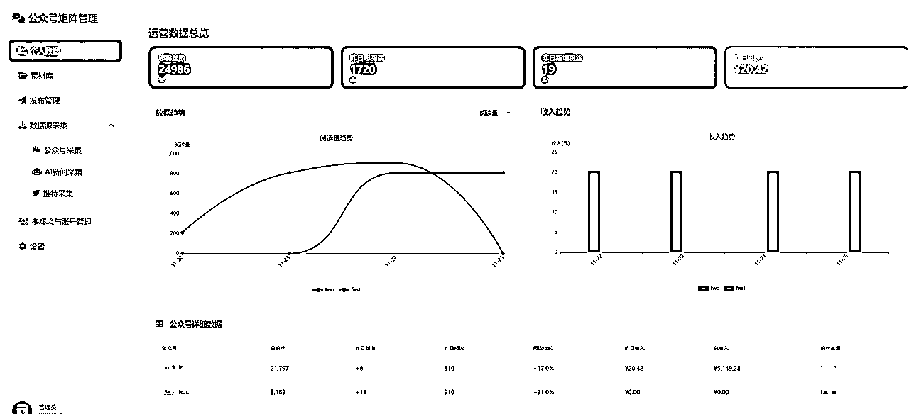

素材管理这边，我给自己搭了个专属本地库，所有采集来的原始数据经过改写后都搁这儿，既能手动加素材，也能批量导入，还能看改动前后的对照，随时发布。

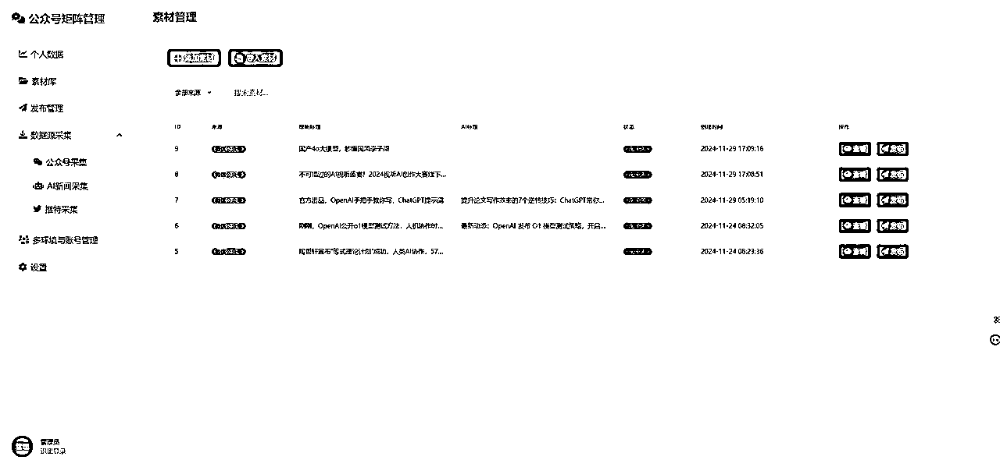

发布的时候可以一次勾选多个公众号。

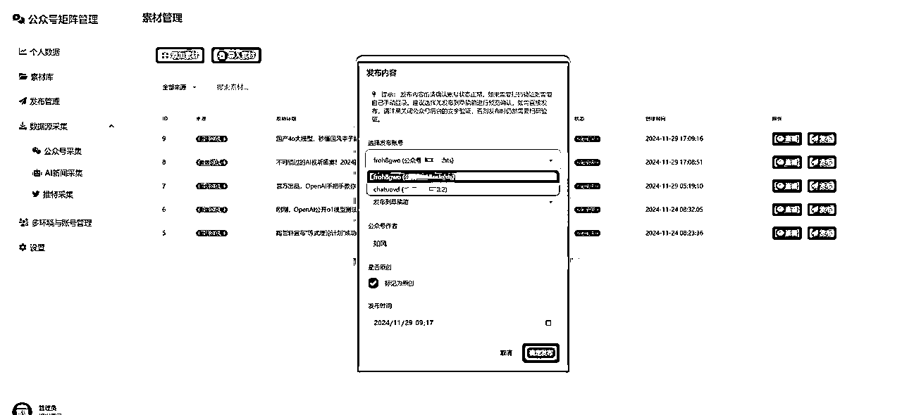

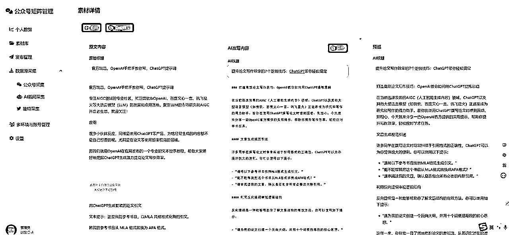

发布任务全扔到任务管理里，每条任务的状态、详情都能查。

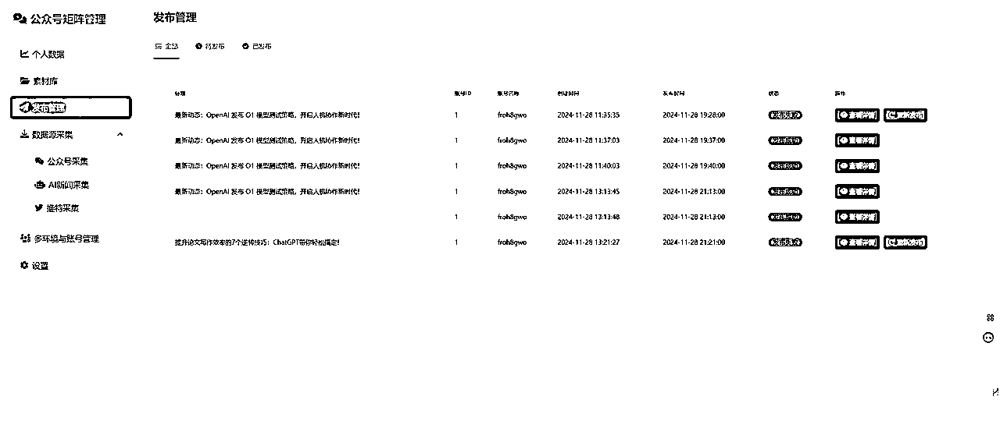

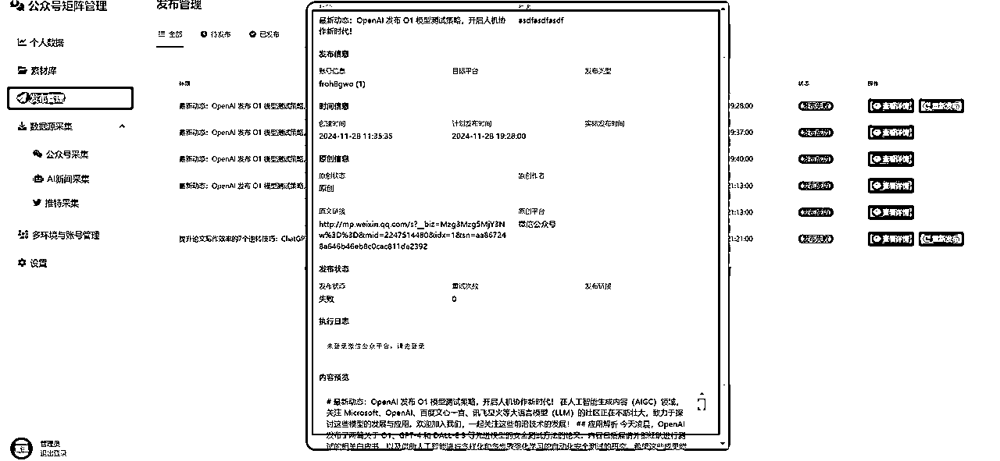

数据采集这块算是唯一没在这次用 Cursor 现写的部分——之前写那两篇采集文章，正好覆盖了龙哥老大提过的第一个超级标的公众号和推特详情数据，就把那边的逻辑直接搬过来了。采回来的原始数据可以一键 AI 改写，再顺手扔进素材库。

之前分享的采集文章：https://ia0969wpr2.feishu.cn/docx/UCQMd2zt0oZIJuxiPhec5ugAnsh  
https://ia0969wpr2.feishu.cn/docx/VF9xdLsdQoTjqWxTM2PcszOqnPb

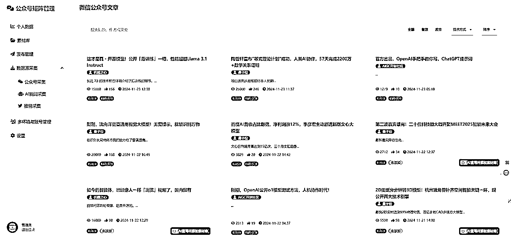

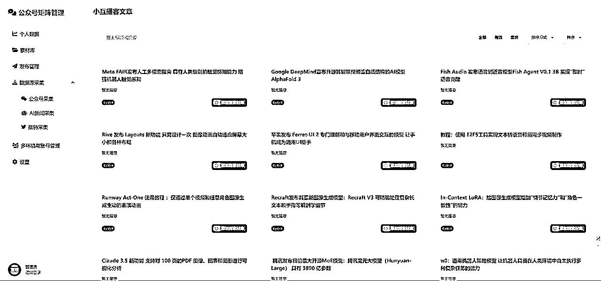

多环境管理就是矩阵的底座：配好几个浏览器，每个浏览器绑一个账号，矩阵化自然就成立了。

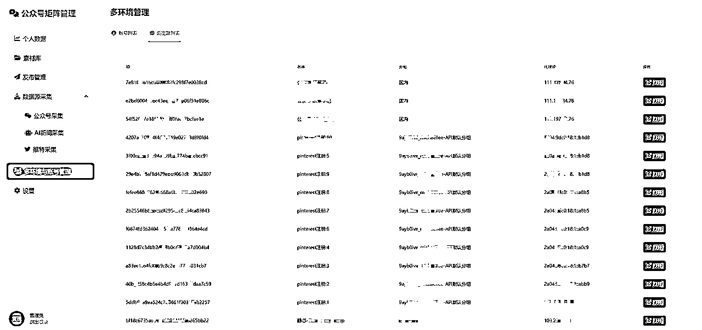

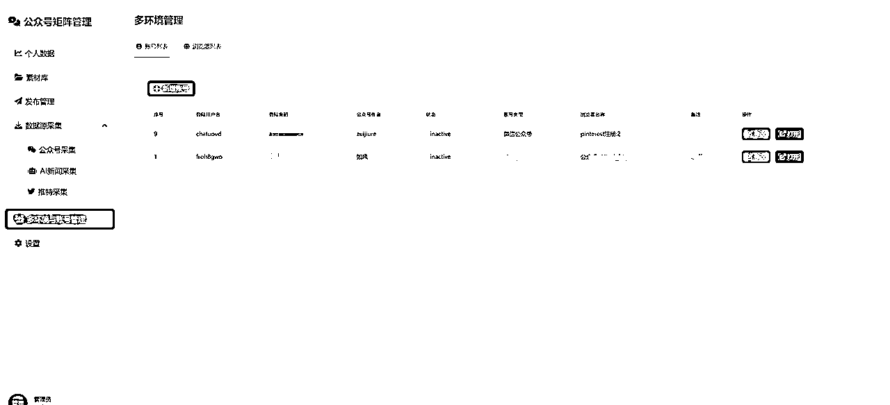

这篇文章里都藏了些啥：

一个是我整个开发过程里最关键的几条提示词。项目前后端加自动化发布、收益抓取、可视化这些逻辑，整体大概花了两天。除了一小撮文案和代码是 tab 补全的，其余所有代码生成、样式布局调整、排错改 bug，全靠 composer 或 windsurf 搞定。那些核心提示词和思路我会列在文里，排错对话就不一条条贴了——眼下 AI 能力这么强，遇到问题直接问 Cursor 就行，开发路上踩的坑也各不相同，逢山开路、遇水架桥，跑不了。

另外还有一些 Google 和 GitHub 的搜索技巧。AI 时代也不是所有代码都得从头造轮子，去翻翻靠谱的开源项目，既能省时间，又能白嫖高质量的代码思路。这块我同样把搜索和整合的方法整理进了文档。

下面是完整的复盘：怎么用 Claude 加 Cursor/Windsurf，把前端设计到后台开发一路趟过去。

回正题。要做一个功能齐全的项目，第一步该干嘛？

其实做产品就跟写长文一样，先写大纲。软件产品也得有清晰规划，先把要做哪些功能拆出来，把骨架撑起来，再一点点往里头填肉、做迭代。现阶段的 AI 模型这么猛，开发一个小而全的产品，与其说是在写代码，不如说是在讲故事——每个功能都是故事的一章，你把大概意思告诉 AI，剩下的交给它去补完。

所以第一版核心功能我是这么规划的：一个多公众号账号管理平台，能轻松管多个账号，实时盯着各个号的阅读量和收益，靠 AI 辅助创作和改写，还支持文章自动发布。这几个功能就是整个项目的承重墙，墙立起来了，后面再细化实现路径就顺了。

按需求再掰成几个模块：个人数据、素材库、发布、数据采集、多环境与账号管理、设置。

每个模块大概干啥也想清楚：

个人数据模块：看所有公众号的昨日阅读、新增粉丝、分享数，还得支持看单个号的详细数据，以及近七天的趋势。

素材库模块：采集到的数据能按我的 AI 工作流自动改写，最好能兼容 dify、coze，还要支持一键发布。

发布模块：分两个 tab，待发布和已发布，操作要顺。

数据采集模块：公众号文章每天实时采集，推文、科技新闻也一并抓。

多环境与账号管理：也分两个 tab，账号列表和浏览器列表。浏览器列表支持查看指纹浏览器信息，账号能新增，还能和浏览器绑定关系。

设置模块：能填我的 Claude、Gemini API key，也能配工作流编排，把 dify、coze 接进来。

后台任务：自动发布、自动登录、收益和阅读数自动获取，都给它安排上。

模块想明白了，接下来就是让 composer 搭框架。可能有人会说自己没技术背景，怎么写框架 prompt？其实特别简单——直接让 AI 给我一个提示词，我再改改就好。我就这么问 Cursor 的：

“我想让 cursor 帮我搭一个框架，实现一个公众号矩阵管理系统。下面是我的功能和开发要求，请你根据这些内容生成一个提示词，让 cursor 明白我的意图并生成项目：项目主要功能是管理不同来源的素材库，并支持多平台发布。前端菜单栏要有：账号列表、素材库、发布管理、数据源采集（子菜单：公众号采集、AI新闻采集、推特采集）、设置。账号列表页有两个 tab：账号管理和浏览器管理。账号管理里有‘新增账号’按钮，列表字段有用户名、密码、浏览器ID、浏览器名称、状态，操作按钮有编辑账号。浏览器管理列表字段有浏览器ID、浏览器名称、备注、代理IP。菜单项要可折叠，还要响应式设计，界面得现代化、好看、元素丰富。”

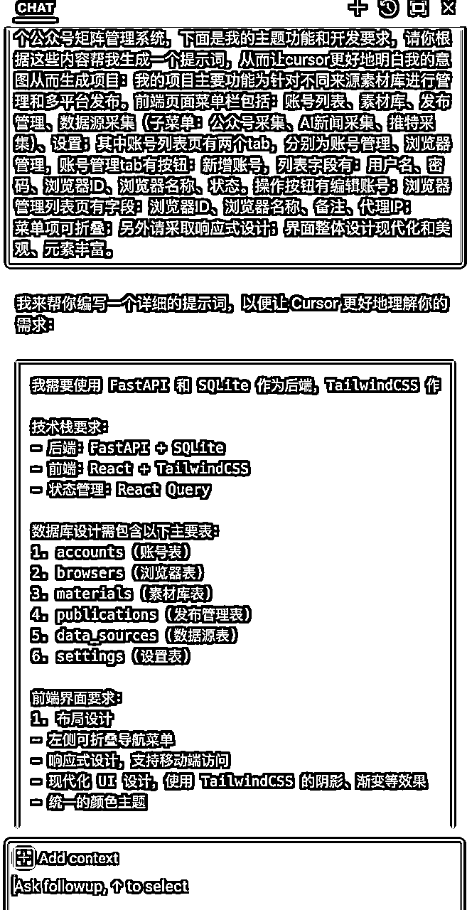

下面这个就是我拿去搭框架的提示词：

```
我需要开发一个公众号矩阵管理系统，请按照以下技术栈和要求进行实现：

技术栈要求：
- 前端：Jinja2 模板引擎 + TailwindCSS
- 后端：FastAPI
- 数据库：SQLite

系统功能和界面要求：
1\. 整体界面设计：
   - 采用响应式设计，确保在不同设备上都能良好展示
   - 现代化、美观的 UI 设计
   - 丰富的界面元素和交互效果
   - 可折叠式侧边菜单栏

2\. 系统主要菜单结构：
   - 账号列表
   - 素材库
   - 发布管理
   - 数据源采集
     * 公众号采集
     * AI新闻采集
     * 推特采集
     * 小红书笔记采集
     * 头条文章采集
   - 设置

3\. 具体页面要求：
   a) 账号列表页面（包含两个 Tab）：
      Tab 1 - 账号管理：
      - 功能按钮：新增账号
      - 列表字段：用户名、密码、浏览器ID、浏览器名称、状态
      - 操作按钮：编辑账号

      Tab 2 - 浏览器管理：
      - 列表字段：浏览器ID、浏览器名称、备注、代理IP
      - 注：浏览器列表数据可以使用 mock 数据

4\. 数据库设计：
   - 使用 SQLite 数据库
   - 需要实现账号表的基础 CRUD 操作

请首先展示系统的基础框架代码，包括：
1\. FastAPI 的主要路由结构
2\. 数据库模型设计
3\. 首页的基础模板实现
4\. 账号列表页面的实现

后续我们可以逐步完善其他功能模块。
```

直接把 Cursor 生成的提示词复制到 composer 里，回车等它把框架吐出来就行。

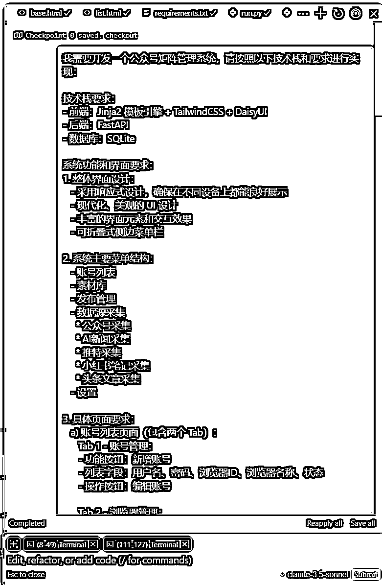

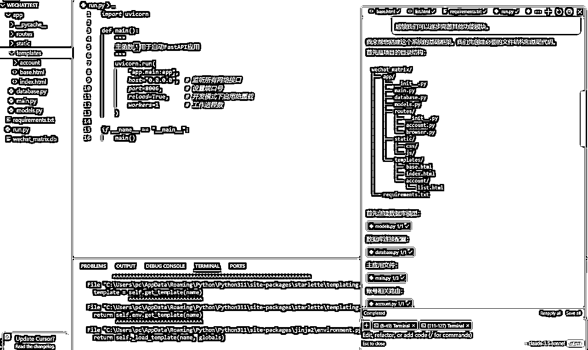

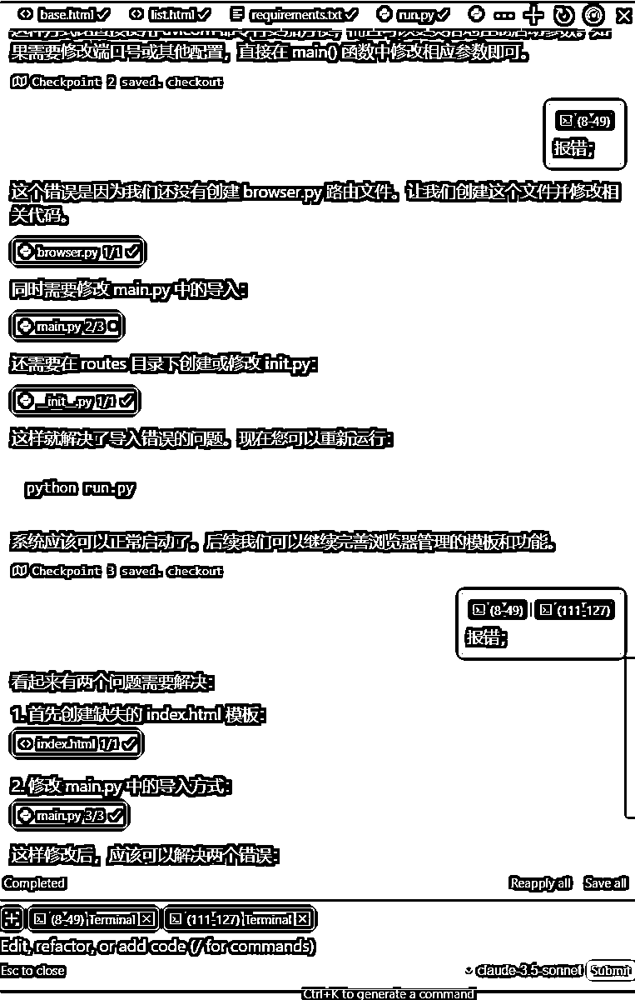

跑完后直接运行，就能看到本地项目已经起来了。从构思到功能设计再到生成提示词，半小时；代码生成到调试运行，不到五分钟——一个基本框架就摆在这儿了。这效率，杠杠的？

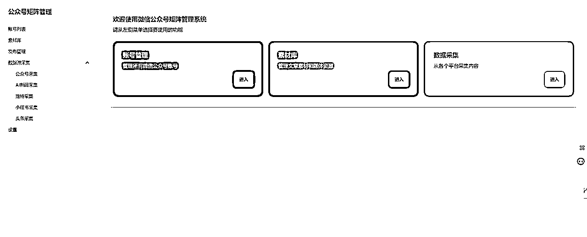

框架搭完，接下来就是各个击破，把每个模块的细节一个一个磨出来。

# 多环境与账号管理开发

## 功能设计

拿多账号环境管理模块举例。要是没思路，直接问 AI。

```
我有多个公众号，希望能够把所有公众号和多环境更方便地进行管理，我想使用指纹浏览器方案，每个浏览器绑定一个公众号。然后在前端页面进行统一的管理。我希望能有一个环境管理列表模块，可以查看所有指纹浏览器。账号列表模块，可以查看所有账号，新增账号。账号中要有环境的关系。如何设计这个关系？请你梳理并设计MVP流程图
```

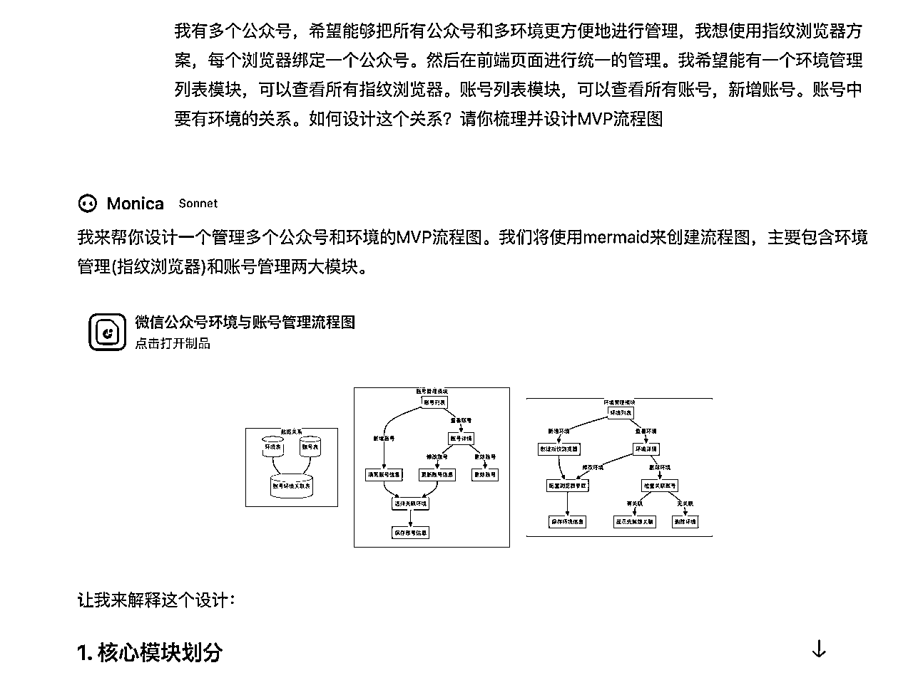

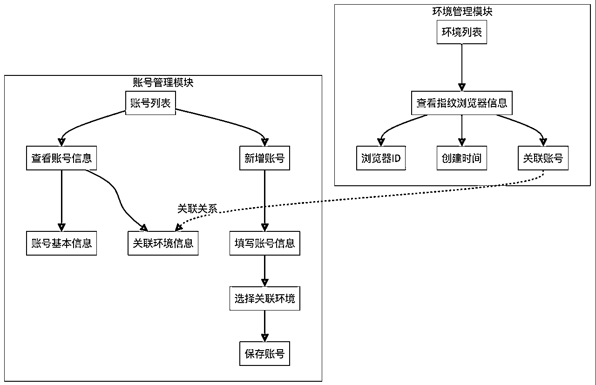

仔细捋了一遍流程图逻辑，没毛病，那就按这个方向写提示词。

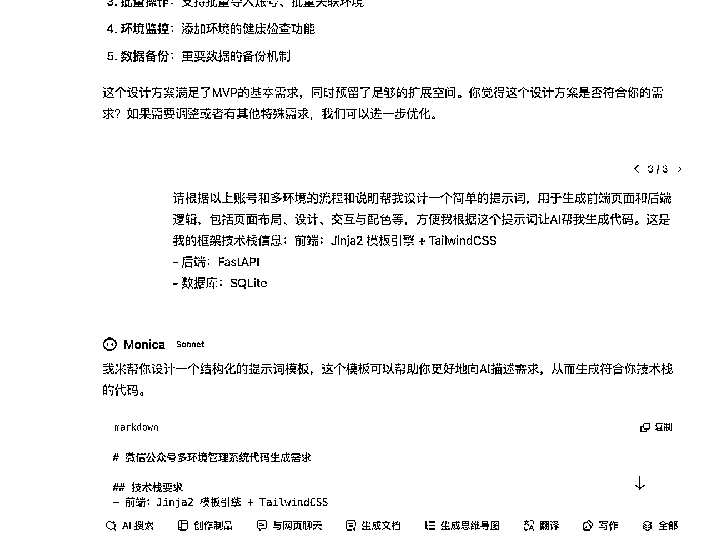

其实 AI 已经帮我把生成主要逻辑的提示词写出来了，像下面这样：

```
环境管理模块
#### 页面要求
- 表格展示所有指纹浏览器环境
- 包含以下字段：
  - 环境名称
  - 指纹浏览器标识
  - 创建时间
  - 状态
  - 操作按钮
- 顶部搜索栏和新增按钮
- 分页功能

#### 交互要求
- 新增/编辑环境使用模态框
- 删除操作需二次确认
- 状态切换使用开关按钮
- 表格支持排序

### 3\. 账号管理模块
#### 页面要求
- 表格展示所有公众号账号
- 包含以下字段：
  - 账号名称
  - 微信ID
  - 关联环境
  - 创建时间
  - 状态
  - 操作按钮
- 顶部搜索栏和新增按钮
- 分页功能

#### 交互要求
- 新增/编辑账号使用模态框
- 关联环境使用下拉选择框
- 删除操作需二次确认
- 状态切换使用开关按钮
- 表格支持排序

### 4\. 配色方案
- 主色调：#3B82F6（蓝色）
- 次要色：#1E40AF（深蓝色）
- 成功色：#10B981（绿色）
- 警告色：#F59E0B（橙色）
- 错误色：#EF4444（红色）
- 文字颜色：
  - 主要文字：#111827
  - 次要文字：#6B7280
  - 淡色文字：#9CA3AF

### 5\. API接口需求
请实现以下RESTful API：

#### 环境管理
- GET /api/environments - 获取环境列表
- POST /api/environments - 创建新环境
- PUT /api/environments/{id} - 更新环境
- DELETE /api/environments/{id} - 删除环境
- GET /api/environments/{id} - 获取环境详情

#### 账号管理
- GET /api/accounts - 获取账号列表
- POST /api/accounts - 创建新账号
- PUT /api/accounts/{id} - 更新账号
- DELETE /api/accounts/{id} - 删除账号
- GET /api/accounts/{id} - 获取账号详情
- GET /api/accounts/{id}/environments - 获取账号关联的环境

### 6\. 数据模型
请使用SQLAlchemy ORM实现上述提到的三个数据表：
- Environment（环境表）
- Account（账号表）
- AccountEnvironment（关联表）

### 7\. 其他要求
- 所有表单需要进行前端验证
- 添加适当的加载状态显示
- 操作后显示反馈信息（成功/失败提示）
- 添加错误处理和异常捕获
- 代码需要添加适当的注释
- 使用TailwindCSS的响应式类进行布局
```

复制到 cursor 里生成出来的结果是这德行——中规中矩，不算惊艳。倒不如把需求写简单点，让 cursor 自由发挥，后面再慢慢调。AI 给的提示词只当个参考，顺手扩一下思路就成。

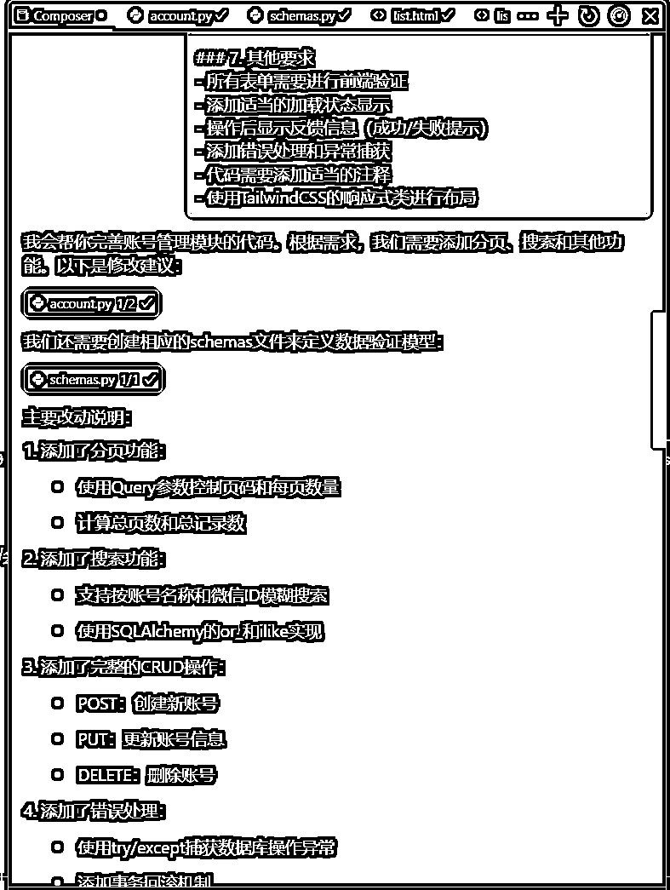


## 指纹浏览器接入

前端页面有了，那浏览器环境怎么接进来？

之前说过，多环境这块得靠指纹浏览器。我自己在用比特浏览器，就拿它当例子。

打开官网的“产品简介”和文档页 https://doc2.bitbrowser.cn/jiekou/liu-lan-qi-jie-kou.html 看一下接入方式：

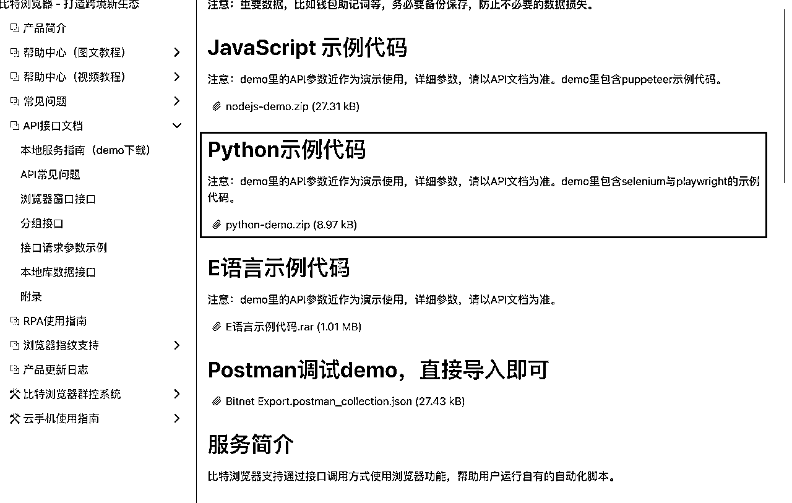

官方支持 python selenium 和 playwright 接入，那就好搞了。

点开接入详情后，要是技术小白看不懂 API、不会写接口咋办？直接把文档链接甩给 cursor，让它写。但更妙的是——同类功能肯定早就有人做过了，咱只需要找到现成的轮子直接搬。怎么找？想想看，用指纹浏览器必不可少的一步是什么？对，先得创建浏览器吧。在文档里翻到那个接口，它正好排在第一个，继续往下，browserFingerPrint 是必传，接口名是 /browser/update，那就没跑了。

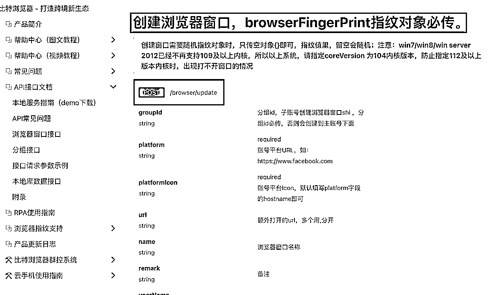

直接在 Google 和 GitHub 搜指定关键词，看看有没有人实现过。双关键词走起：

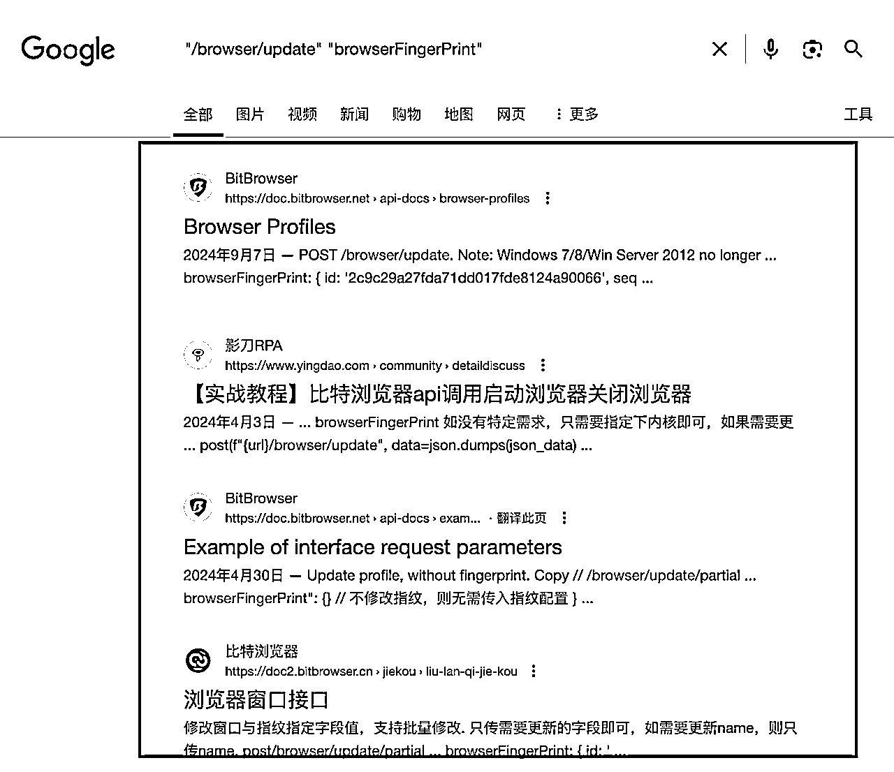

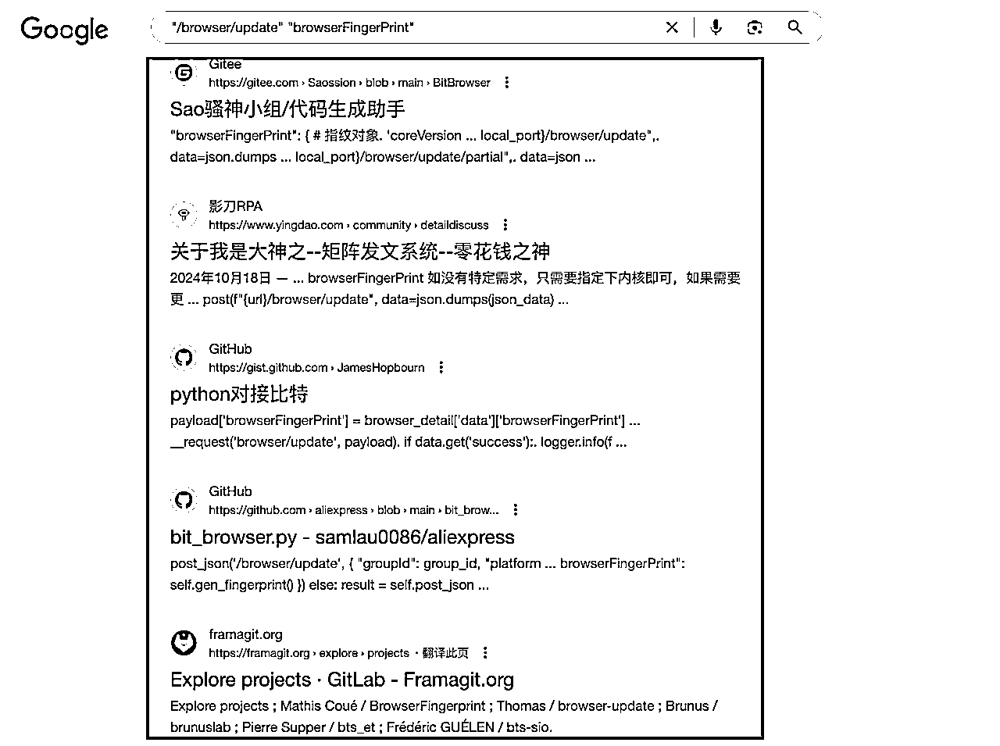

可以啊，至少翻到五六个完整的比特浏览器 SDK，还要啥自行车？随便拿一个就能用。

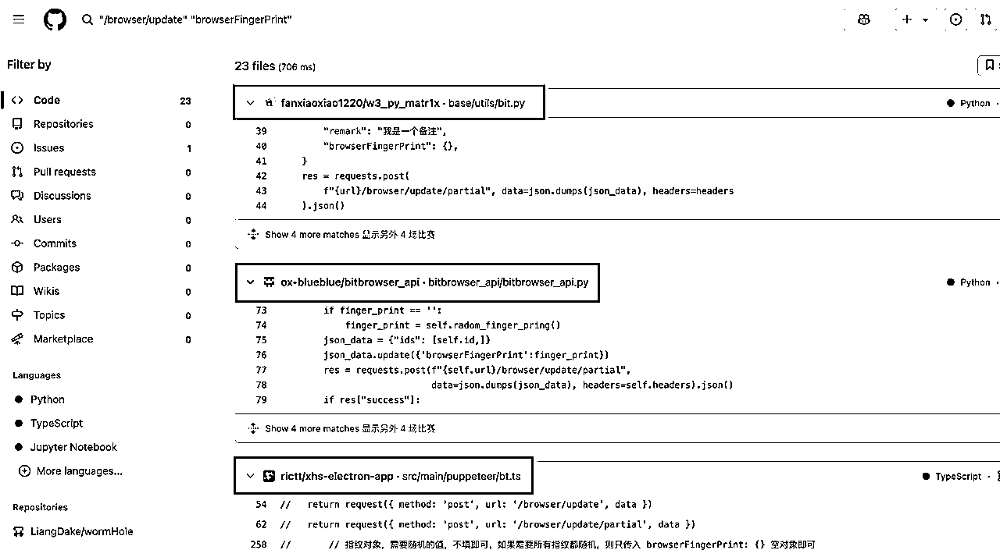

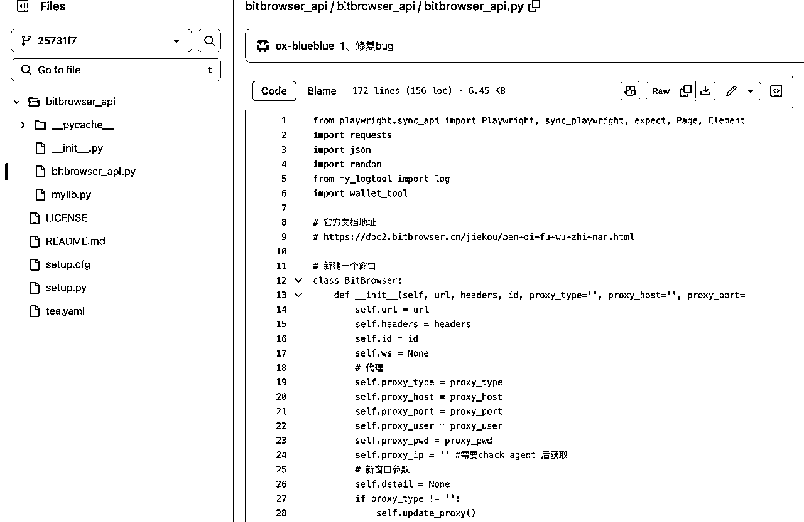

第一步搞定。这波至少省下三个小时——就算让 Claude 从头写调用方法再调试，几个小时妥妥跑不掉。现在直接复制就完事儿。

然后把指纹浏览器官方的返回数据格式甩给 AI，让它把多账号部分补完：

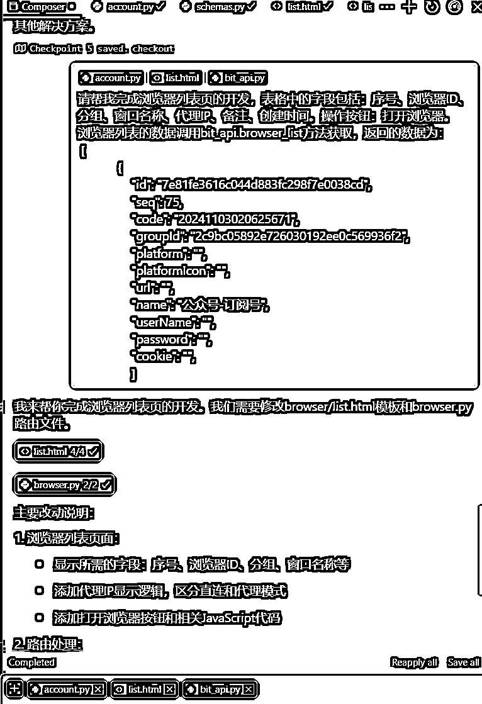

请帮我开发浏览器列表页，表格字段包括：序号、浏览器ID、分组、窗口名称、代理IP、备注、创建时间。操作按钮：打开浏览器。

浏览器列表数据调用 bit_api.browser_list 方法获取，返回格式如下：

[

{
"id": "7e81fe3616c044d883fc298f7e0038cd",
"seq": 75,
"code": "20241103020625671",
"groupId": "2c9bc05892e726030192ee0c569936f2",
"platform": "",
"platformIcon": "",
"url": "",
"name": "公众号-订阅号",
"userName": "",
"password": "",
"cookie": "",
}

直接点 accept，一行代码都不用动，浏览器环境就绪。写到这儿我又得感慨一句 Cursor 真是强得离谱——重写这篇教程时我专门新开了一个项目演示，到现在不到一小时，整个多环境体系就搭完了，而且我本人一行代码没敲，全是 cursor 自己生成、自己排错跑通的。

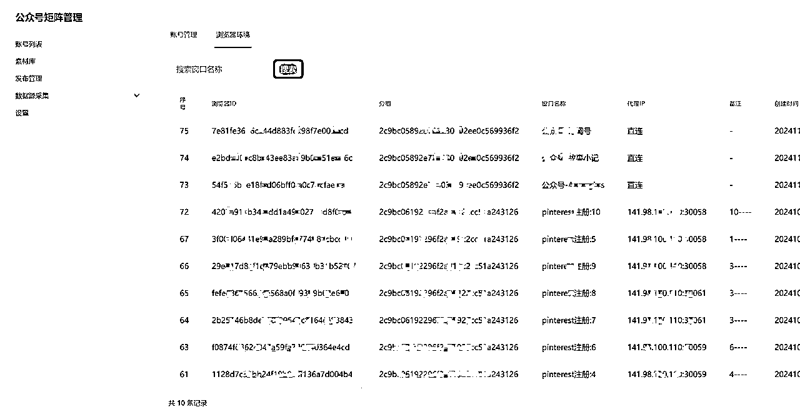

## 实现多账号接入

做账号矩阵，绕不开的一个问题就是：账号和浏览器到底怎么绑定？好在接口已经就绪，接下来就可以设计映射关系页面了。核心诉求就两点：第一，能自由管理浏览器与账号的绑定；第二，把账号的详细信息记录下来，等发布内容的时候顺手就能选中对应账号。

账号管理列表开发起来也简单：点“新增账号”，弹窗里填用户名、密码、作者名称、账号类型，再选一个关联浏览器；列表上把这些字段同步展示出来。这里有个细节要留意——保存浏览器信息时，ID和名称都要存，但渲染列表时只把名称亮出来就行。

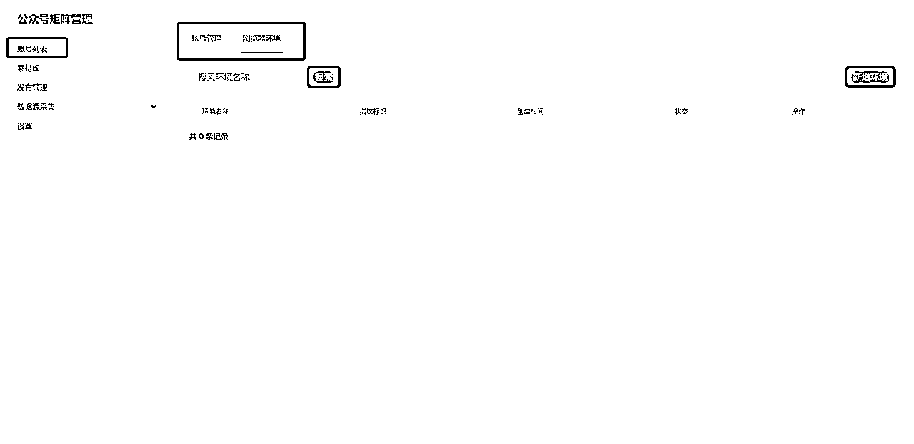

至于其他模块，套路都大差不差，无非是增删改查加一句提示词就能搞定，这里就不铺开讲了。重点说说比较有挑战的自动化上传发布模块。

前面那些前端交互和数据流转搞完以后，真正要解决的是：怎么自动把素材库里的内容发出去，顺便抓回阅读量、收益这些数据信息。

那问题来了，素材库里的任务能不能直接一键推到公众号？答案是可以，但得选对工具。

我对比了两条路：

一条是影刀RPA。它的优势是通用、简单、门槛低，方案本身可行；但硬伤也很明显——社区版不支持免费调度，也就是说我们没法用API去调用它；在矩阵账号管理这块，效率也比较拉胯。

另一条是Playwright。它的优势几乎就是冲着影刀的缺点来的。我们可以借助AI生成代码，用Cursor做元素定位，大部分自动化流程一小时之内就能写完。而影刀靠手动拖拽搭流程，调试下来至少得一两个小时，换个机器还可能踩兼容性的坑。另外，Playwright能无缝对接指纹浏览器，横向扩展也非常顺畅，开十个、二十个甚至更多浏览器来跑矩阵运营都毫无压力。无论写代码的效率还是执行效率，Playwright都是降维打击。

所以最终方案就锁定了Playwright。

从整体任务流来看，还需要两个配合节点：一个是稳定可靠的定时任务调度器，让它按预设时间表发指令；另一个是灵活的手动触发机制，作为定时发布的补充，方便我们随时掌控发布节奏。

落地方式其实之前提过：用Playwright做自动化，核心就是xpath加元素定位，再把定位信息丢给Cursor让它生成代码。具体可以这么干：

1. 把需求和元素定位整理出来，发给Cursor。
2. 建一个README，把当前流程写清楚。
3. 装个插件，把所有元素定位一次性抓下来。
4. 再把这些定位丢进Cursor，或者用逐步提问的方式，引导它把自动化流程跑通。

这里直接推荐谷歌开源的visBug插件，复制页面元素非常方便，拿它和Cursor搭配，定位写代码的效率会高很多。

谷歌商店地址：
https://chromewebstore.google.com/detail/visbug/cdockenadnadldjbbgcallicgledbeoc?hl=zh-CN&utm_source=ext_sidebar

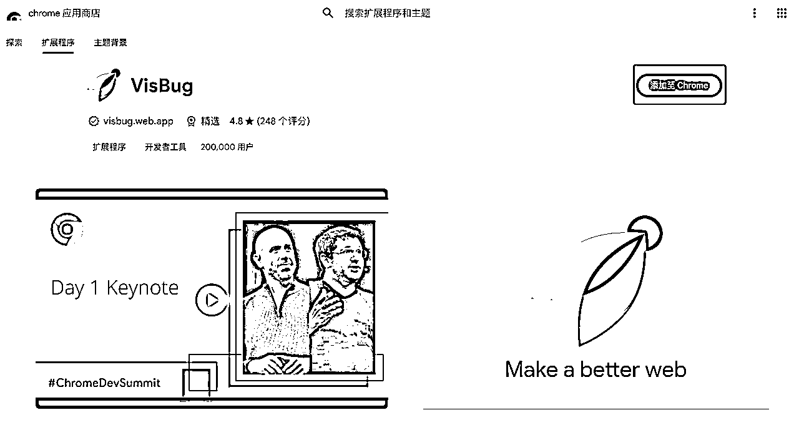

接下来就是按正常发布流程，一个一个元素位置采集下来发给Cursor就行，保姆级教程就不逐帧写了。比如第一步要先创建草稿，然后把图文元素选上：

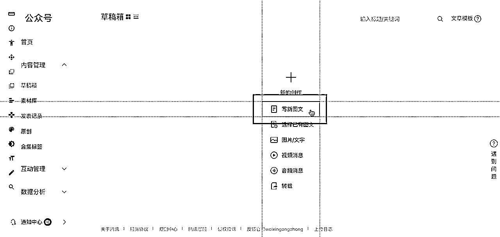

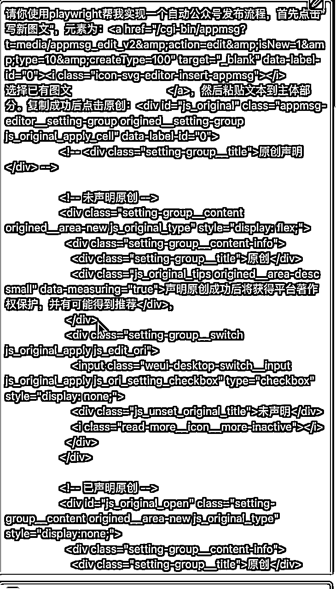

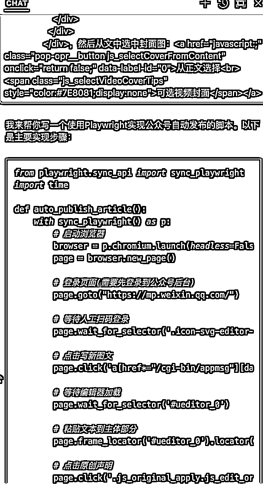

然后执行测试，接下来就是经典的Cursor报错、反馈、修改、再执行循环。跑几轮之后真的会忍不住感叹：AI时代实在太友好了。

到这里，整体流程基本就走完了，初版做出来的界面其实挺朴素。等所有功能都调通后，可以在composer里针对HTML静态页，用bootstrap或shadcn这类UI库重新做一次重构，优化布局、加些页面特效和样式，然后按自己的想法持续调整。

最后简单总结一下用Cursor做产品这件事。本质上就是一套经典的PDCA：Plan（计划）、Do（执行）、Check（检查）、Action（处理）。我们用Cursor开发走的就是这个循环——先想清楚要做什么功能，然后把提示词发给AI让它执行；跑起来看看是否成功，不成功就处理报错，继续改进、继续循环，直到最终结果符合预期。