# 转转2.0二手机玩法拆解：我从二手数码老兵到月入几十万毛利的实操笔记

> 来源：[https://ycncle3i0u5j.feishu.cn/docx/H9GldbOUmoaHlZxMNPzcPjN6noC](https://ycncle3i0u5j.feishu.cn/docx/H9GldbOUmoaHlZxMNPzcPjN6noC)

各位赚钱的伙伴们好，我是成都做二手数码的山人。入行到现在12年了，新机倒过手，维修摊位开过，赛格档口摆过，二手机直播也播过。现在重心放在二手机同行批发、回收、实时竞拍以及转转2.0这块，零售和直播也在慢慢跟进。

一直想把二手机这条路讲清楚，却迟迟没动笔。后来彩虹看到女朋友转来的资源对接，主动联系了我，还帮我搭框架、梳理大纲、跟进进度，真的很感谢。赚钱的团队确实在持续挖掘能落地的赚钱机会，值得入股。

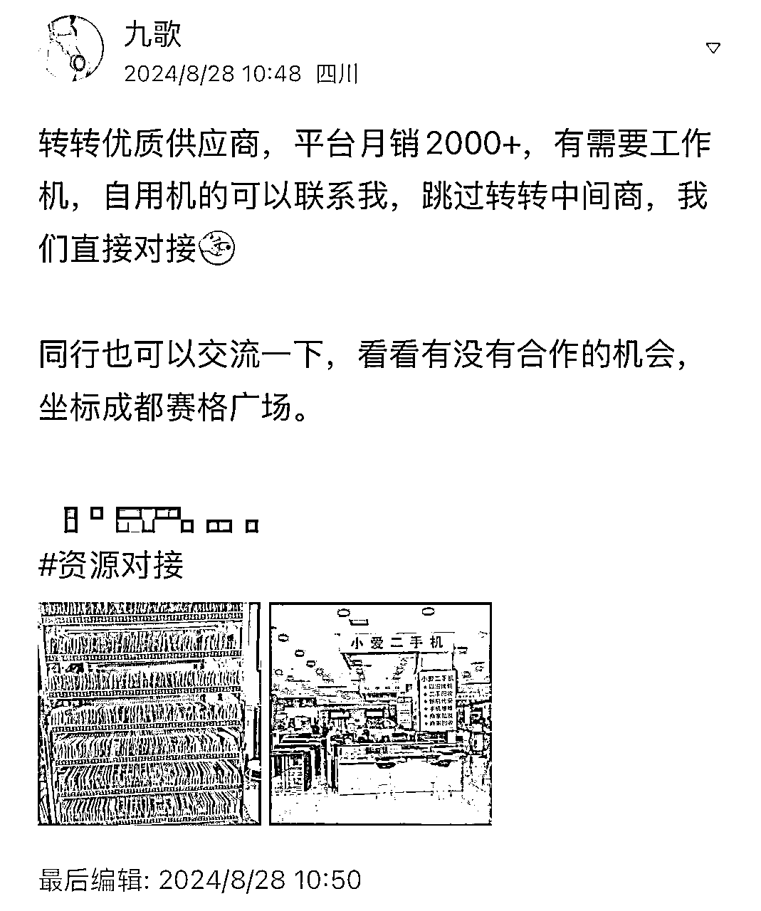

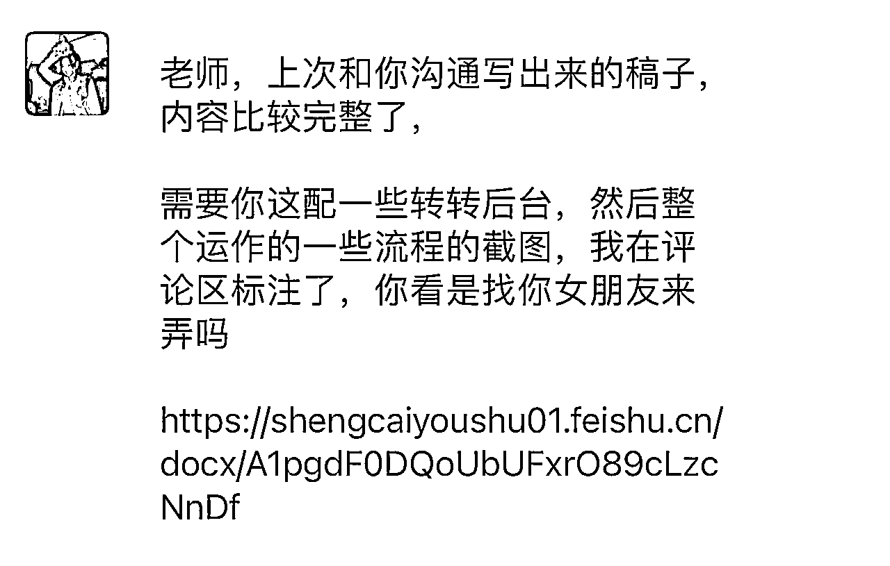

先说结果。转转这条线我从去年11月起步，今年2月是第三个月，毛利干到了40万，正常月份在15万到30万之间波动，净利润大概占毛利的30%到40%。四五月是全年最淡的季节，基本只能保本。

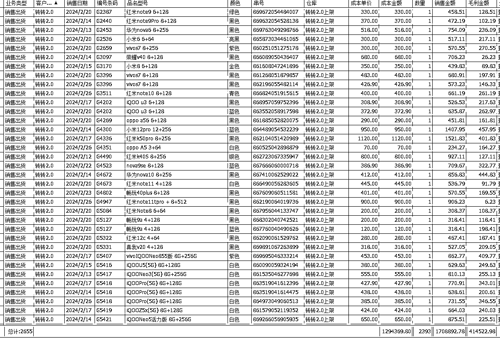

下面就聊聊我为什么会切到转转，以及这个平台到底怎么玩。

## 一、项目是什么样的

转转目前是国内二手数码最大的成交池，流量大、周转快。它跟常规电商不一样：

*   不用自己卷流量，也不用搞矩阵。平台对商家相对公平，成色相同价更低的优先展示，售后率低的也更容易获得曝光。
*   商家只做后端，选品、质检、定价是你的事，前端销售、客服、发货全由平台包揽。这样就把销售压力剥离出来，可以把精力全部放在采购上。

逻辑很简单：从各渠道低价拿机，上转转卖掉。单台净利普遍在50到200元之间，最后的总额就是单台利润乘以出货量。

我们的货源主要来自三路：

1 同行交易平台。主流的有拍机堂、采货侠、拍闲品、小当、回收宝微信小程序等。拍机堂和采货侠是商家互通的集散地，既能买也能出清自己手头不好动的库存。其他平台基本以采购为主。

拍机堂的暗拍页面能看到实拍图和验机报告，价格比实时竞拍拿回来的会略高，但可退货。退货门槛也不低，有些问题机退不掉，水很深，新手别轻易碰。

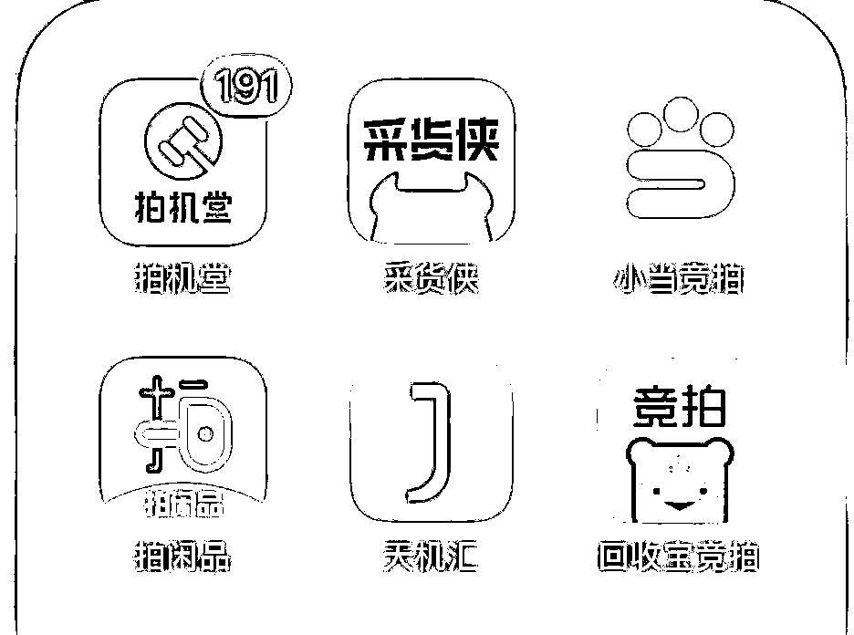

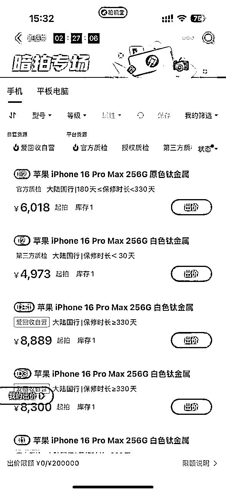

2 私域同行和零售回收。微信里沉淀了几千个商家资源，大多是2019年在川渝各地推过来的。

3 实时竞拍。常用的是闪回收、繁星、小程序、快售宝、小当竞拍。

实时竞拍就是线下门店把回收来的二手机拍照发出来，多家报价，价高者拿。下单后按图判断价值，比如我报419拿到，转转结算价555，单台毛利136元。

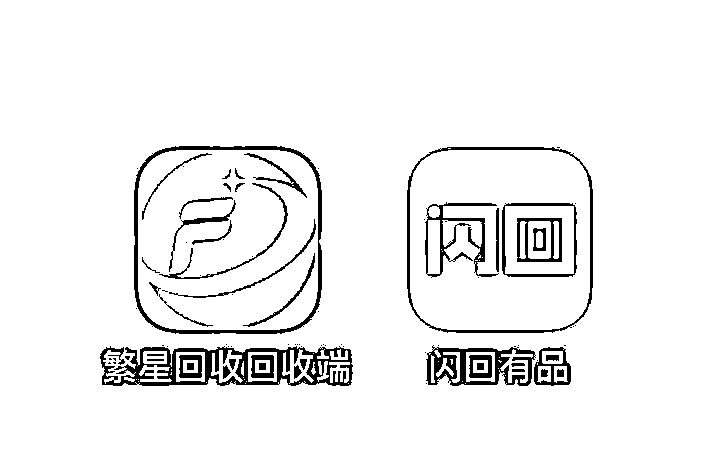

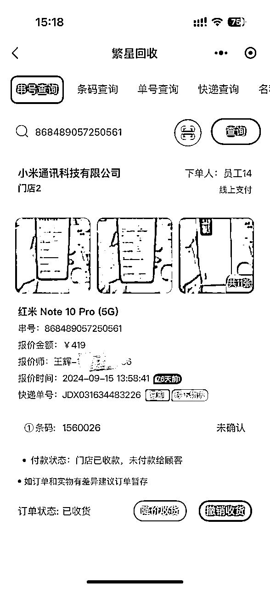

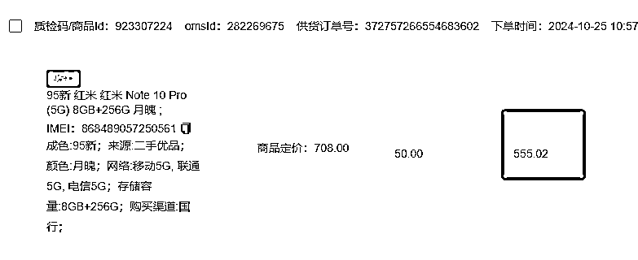

繁星总部就在成都，离办公室很近，收货周期短。现在我们竞拍的主力就是繁星，月收货量在2000台以上。

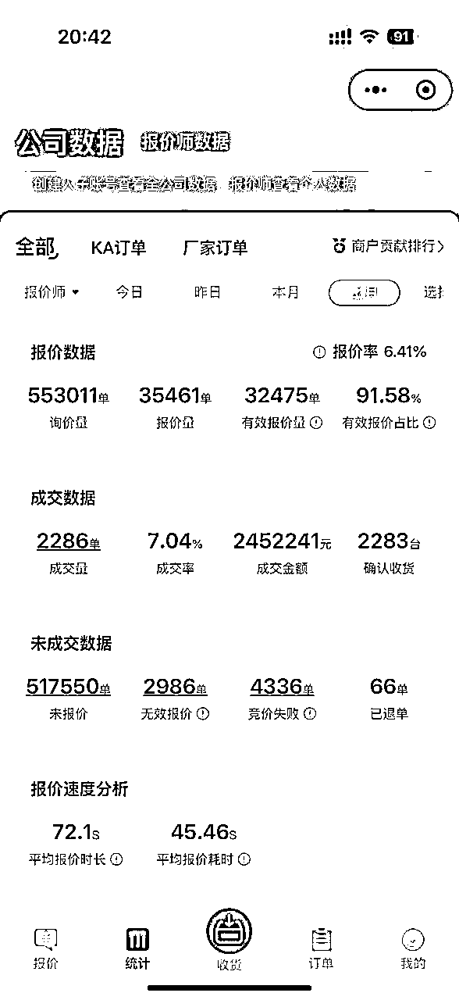

## 二、做的怎么样

项目是从23年11月启动的，启动资金100万，首期团队6人：我带3个拍货验机，1个维修，1个后勤，1个财务。

做转转之前我试过采货侠保卖，属于转转体系的另一个部门。保卖要垫资，单台会被分走几十块毛利，加上当时没经验，最后赔了收场。关掉保卖后转做转转，有了前面的教训，上手快了很多。

过年档期行情最好，我又按转转给的采购清单备了紧俏机型。1月备货，2月出货毛利40万，过年只歇了几天，3月又出了28万毛利，把之前保卖的亏损扳回了一些。

4、5月市场淡季，我又长期没休息，从23年8月到24年3月一直紧绷，索性躺平两个月，基本保本。反思下来，主要是平台拍货的型号太窄，转转卖不动。明年这两个月我打算继续深挖实时竞拍转转的可能性。

平时月毛利15到25万。去年11月开始认真做同行批发，额外每月又增加了10万毛利。11月之前非转转渠道每月只贡献2到5万。

资金规模现在在200到300万之间波动。11月库存最高曾冲到500万，后来出清回落。人力也从起步的6人扩到16人：9个报价师含我自己，7个后端。其中后端1个验机、1个维修、2个后勤、2个同行批发销售、1个财务。

9个报价师里真正成熟的只有4个，其余5个还在跑量期，有两三个半年了还没起色，挺让人头疼。销售端也有一个新人。人员扩了，毛利没明显拉升。成熟报价师月创造毛利3到5万，顶尖能到5到8万，但如果只做转转，很难达到，必须搭配其他渠道。等5个新人成长起来，理论上每月能多出20万以上毛利。

薪酬上报价师是大头，拿毛利的30%，其他岗位成本6000到1万。亏损期会适当补贴。扣掉工资房租后，纯利润大约占毛利的30%到40%。

## 三、从零到一的打法

1 先把规则吃透。再用小批机器做试验，拿到数据再放大。看不到利润就暂停，复盘是哪个环节掉链子。我们也吃过亏，按某个成色价格买入，到手却达不到标准又退不了货。之后就以实物为基准反推差异，不断优化买货策略。

2 人效。很多同行效率拖垮利润。本来3天能上架的货，拖到一周以上，时间成本吃掉利润。必须把责任细化到人，避免互相推诿。

3 库存结构。品类要分散，SKU越多动销越快。出现积压或利润变薄的型号要及时调整。

4 数据复盘。这是核心。下图是我们日常看的采购平台数据。

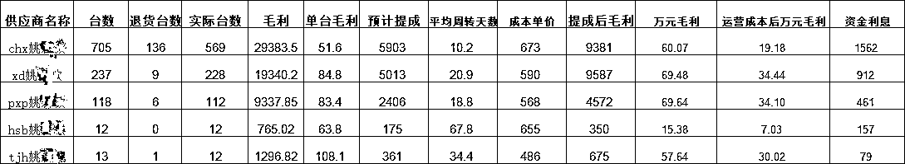

*   单台毛利是底线，低于50基本不做了。
*   动销天数决定资金周转，成本1000元以下的机型最好30天内出完，1000元以上的控制在15天内，时间越长风险越大。
*   台数反映执行力。要求报价师每月至少收600台，不管单台多高，量是基础。
*   资金投产比。好转就看万元资金日收益、各个报价师的回报效率。

## 四、做成靠这几个点

1 采购决定生死。成本越低，空间越大。比如500元拿，转转结算600，毛利100。定价会随市场需求动态调整。

平台有需求大厅，会列出热销缺口机型，细分到机型、成色、颜色、内存，按表索骥找利润点。拿回来后交转转质检、上架，销售客服发货全平台负责。

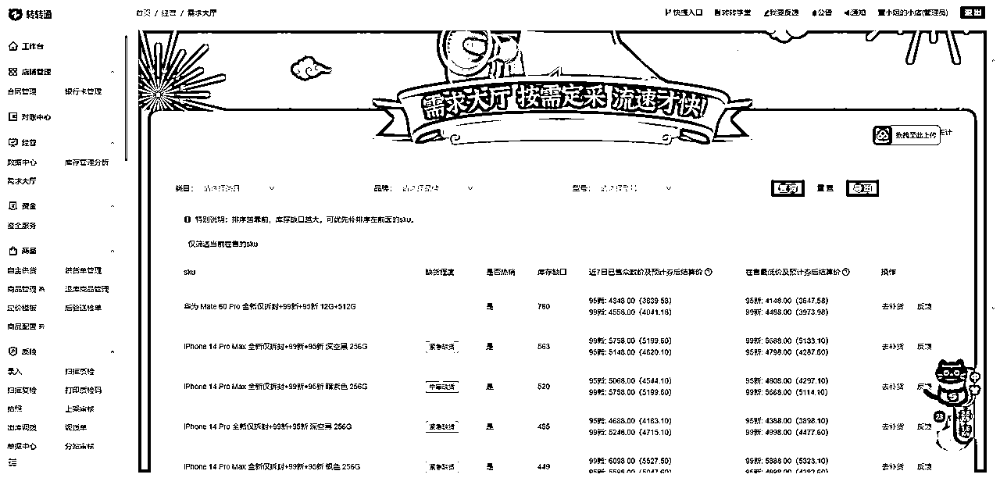

2 备货时机。BD会通知备货窗口，转转也会给备货奖励。风险承受范围内多拿，但同型号同成色不要堆太多，要丰富品类，避免积压导致动销慢、亏损。

3 操盘能力。要懂采购、质检、上架全流程，熟悉各平台规则、质检标准、机型利润区间，能把控团队方向。

4 质检。转转要求至少8成新，不达标会被罚甚至封号。质检必须卡准，既要赚钱也不踩线。培养质检师门槛不高，但要熟练。

5 整备。手机配件坏了可以修后卖溢价。比如后盖破损裸卖400，换个100元的新盖修好卖700，多赚200。开机键、充电口等小毛病外面修也就10元。配一个维修师，月薪6000到1万，能处理上千台非复杂维修，降低成本、提升上架速度。

销售规模目前在月销2000到4000台区间，去年11月起算。

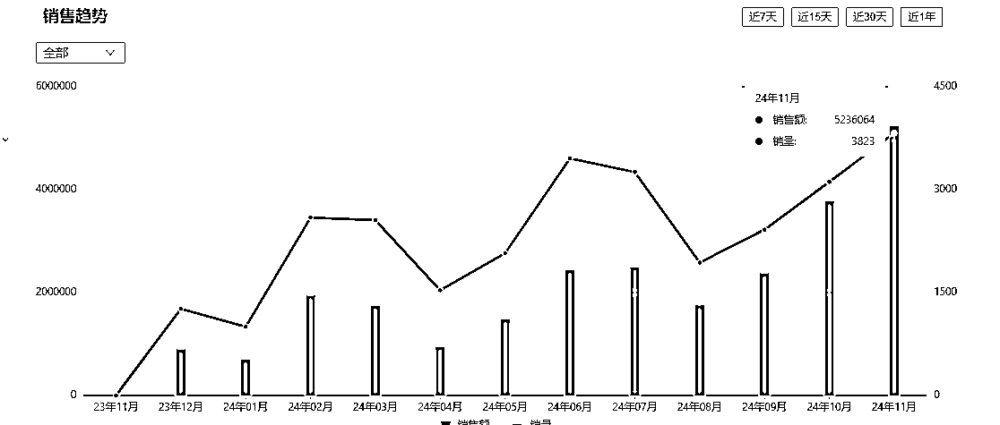

## 五、风险与入局建议

风险主要在四方面：

1 单台毛利能不能稳定在50以上。
2 大促和新品发布的行情波动。618、双11、双12、9月苹果新机发布都会导致价格跳水，要提前控价、清库存。旺季是过年和7、8月暑假，可提前备货。行情只能预判，比如今年苹果发布后价格迅速跌500，历史上不多见。
3 风险承受。整体毛利点只有5%到10%，单台50到300，高端机跌几百就亏，要有抗跌价的能力。
4 报价师难找。优秀的报价师哪家都抢，只能自培。只会报价不懂复盘的，亏几个月也起不来。

入局建议：

*   资金准备100到150万起步。
*   心态要稳，前两个月可能不赚钱，需要熟悉验机标准、上架流程、团队磨合，还要扛住行情波动。
*   团队配置。月销1200台的最低配需要6人：1到2个报价师、1个验机师兼自己收自己验、1个打杂负责拍照清洁上架库存、1个财务做数据、1个维修、1个统筹。
*   不适合小打小闹，想入场要慎重。转转政策在收紧，验机更严、罚款更重，入场的人越来越多，利润空间在压缩。
*   如果你对二手机有兴趣、能吃苦、对个人能力没特别要求，可以去应聘报价师。实时竞拍岗位新人多，公司会带。做得好月薪1万以上，行情好能到2万，也有几个月亏损的，看个人。

这就是我对转转2.0的实操总结。文里提到的平台需要对接的可以联系我，二手机方面有问题欢迎一起交流。