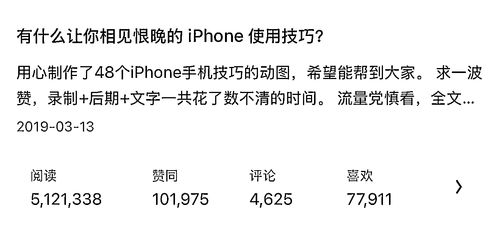

# 新手做自媒体，先学会这套内容传播的底层逻辑

我六年前在知乎写过一条回答，现在翻出来看还是能打。阅读量破 500 万+，被大量🧣账号转发，👸号也因此涨了上万粉丝。内容并不复杂，就是一堆 iPhone 的使用小技巧，配文字配动图，基本就这样。

为什么能爆？运气是一方面，逻辑是主因。

**第一，够简单，够直接，够多人用得上。**
标题好懂，封面好认，内容一眼看明白。门槛低，覆盖面就大。传播，本身就是靠降低门槛换来更多人愿意看、愿意转。

**第二，合集形式自带优势，更容易被收藏、点赞、转发。**
单点技巧有人看，成套技巧才让人存下来。

** *新手想快速建立信心和正反馈，就从合集类内容开始做起。把零散的信息打包，越好存越好转。做内容时要始终记得，把复杂的东西拆成大众能秒懂的信息。***

后来我让 ChatGPT o1 帮我拆解了传播背后的四个维度：传播逻辑本身、用户为什么收藏、平台算法怎么判断价值、合集内容为什么天生讨喜。梳理下来更清楚了。

**想让信息大范围扩散，核心就是降成本。**
降传播成本、降认知成本、别绕弯子。反过来，内容越绕、门槛越高，传播半径就越小。

为什么要降成本？

**注意力稀缺。** 现在是注意力经济，每个人每天要筛掉海量信息。信息越简洁，越容易在三秒内被抓住，否则直接划走。

**认知负荷有限。** 大脑工作记忆很有限，逻辑链太长、结构太乱就放弃了。KISS 原则在传播里同样适用：Keep It Simple, Stupid。

**减少损耗。** 信息传来传去就是传话游戏，每多一次转述就多一次偏差。表达越清晰，信息在流转中损失越少。

**门槛越低，盘子越大。** 用户要花的时间、知识、操作步骤越少，参与的人就越多。科普和营销里，拆解难题用比喻和案例，本质都是在降门槛。

**怎么落地降成本？**

语言上，用大白话说事，别堆术语。能讲故事就讲故事，让人愿意听、记得住。
呈现上，视觉化优先。图表、短视频、动图，比纯文字更省脑。
结构上，先给结论再给细节。分层分段，让不同需求的人都能快速取用。
步骤上，减少思考和操作。推广产品就简化路径，传播观点就给出主干结论+框架。
情绪上，用场景和好奇心做钩子。让人产生共鸣，才有转发欲望。

当然，提高门槛也有意义。内容做得更专业、更深，天然能筛选出小众的核心人群，适合做高端品牌或专业圈层经营。只是这条路很难破圈。

**为什么合集类内容特别容易被收藏？**
因为用户收藏不是为了点赞，是为了以后用。

合集实用，未来可能要查。不会一次吃完，先存着慢慢对比。
有收集癖。清单、书单、攻略合集，有“补全”的爽感。
信息密度高，感觉值。一次收藏顶很多次搜索，越值越舍得存。
怕错过。高质量合集让人有错失焦虑，不收藏不放心。

**平台为什么爱推收藏多的内容？**
收藏是深度互动信号，比点赞更重。点赞是随手，收藏是“我要留着用”。
一旦收藏量起来，算法会判定内容有价值，开始喂给更多相似用户，形成正反馈循环。
收藏夹本身也是二次曝光渠道。别人翻你的收藏，也会把内容重新带活。

**合集天生有传播基因：**
系统完整，像个小资料库。主题+列表，结构清晰，一眼可信。
可迭代。工具合集、技巧合集可以不断更新，用户有理由回访。
省时间。一次打包解决需求，减少用户东拼西凑的成本。
适配两种阅读：碎片时间扫一眼，需要时再深度用。

**高收藏带来长尾和信任：**
多指标一起涨，算法更喜欢。
内容不过时，就一直被搜索和收藏夹带流量。
用户会因为干货信任创作者，关注和复购也随之而来。

想做合集做得好，记住几件事：
选题要痛点且实用，别空大。
呈现要好扫读：序号、小标题、一句话说明+配图。
标题就要说清用户能得到什么。
定期更新，标注更新时间。
结尾软性引导一次收藏和分享即可，别生硬。

总结一句话：想破圈就降门槛，想做大范围传播就让内容“一看就懂、一转就走”。想做深度圈层再提门槛。选对策略，比死磕选题更重要。