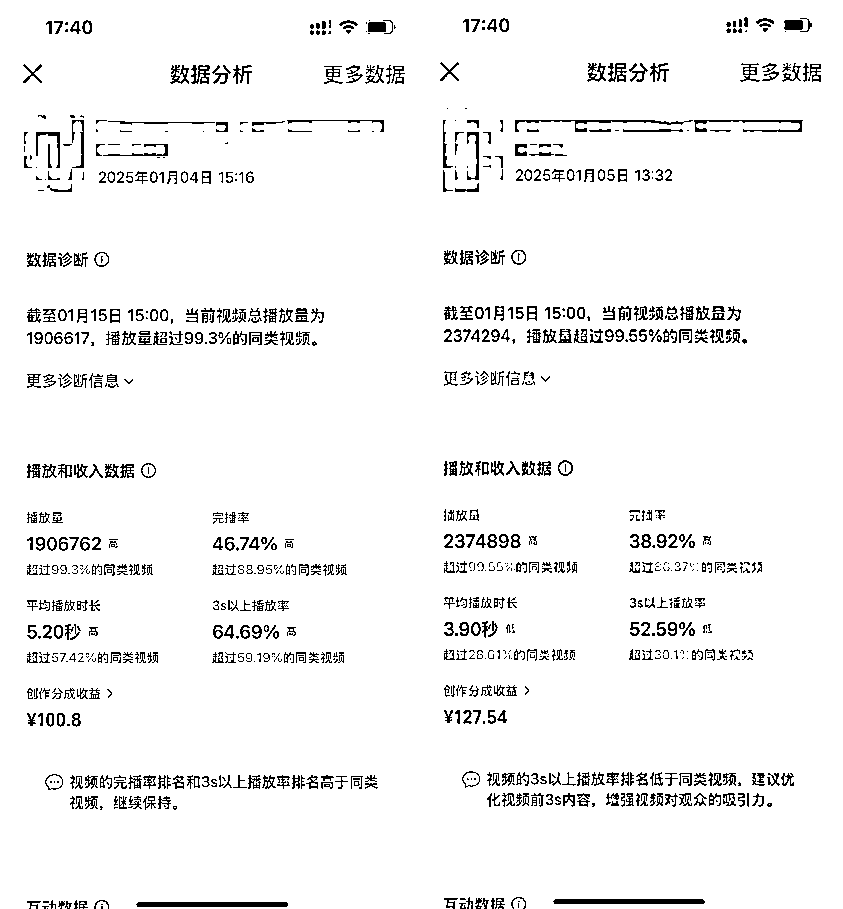
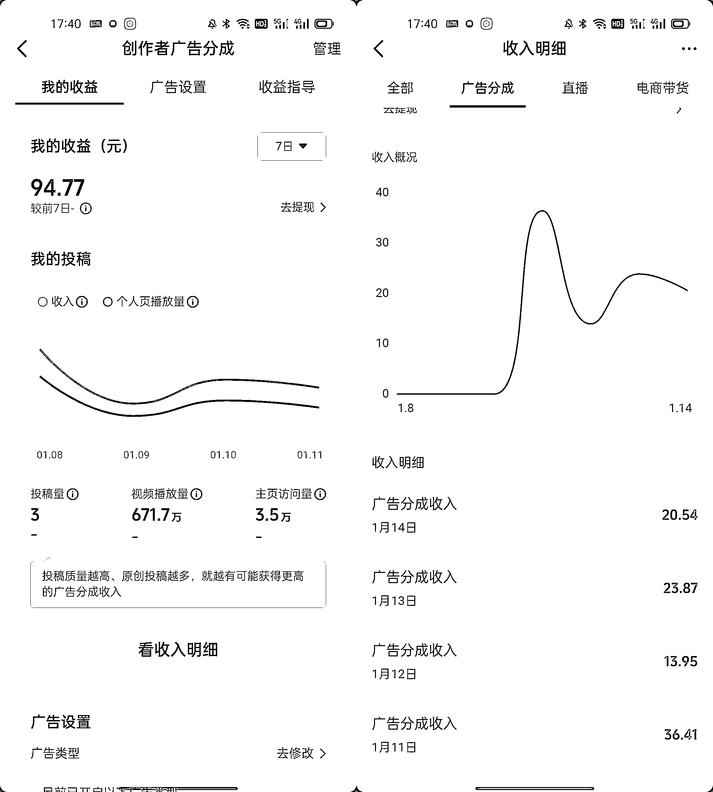
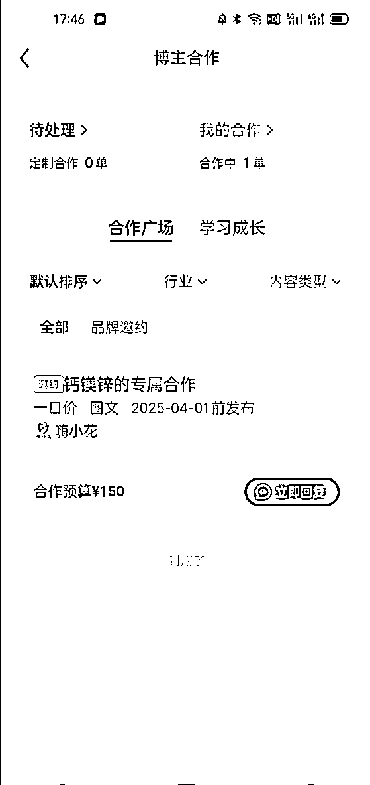
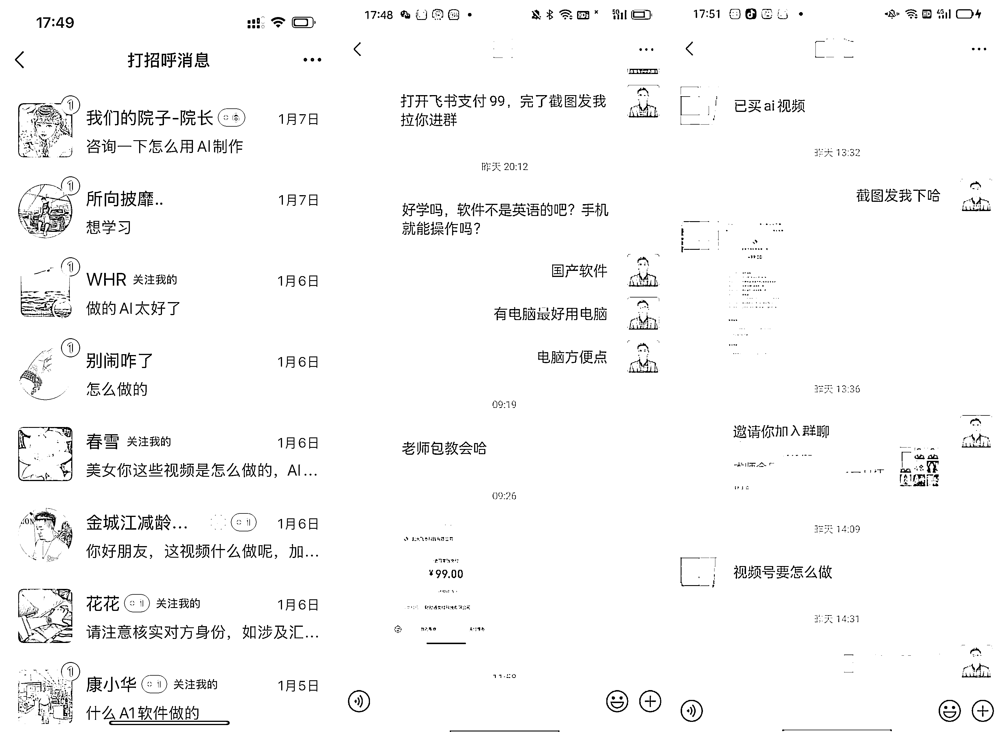
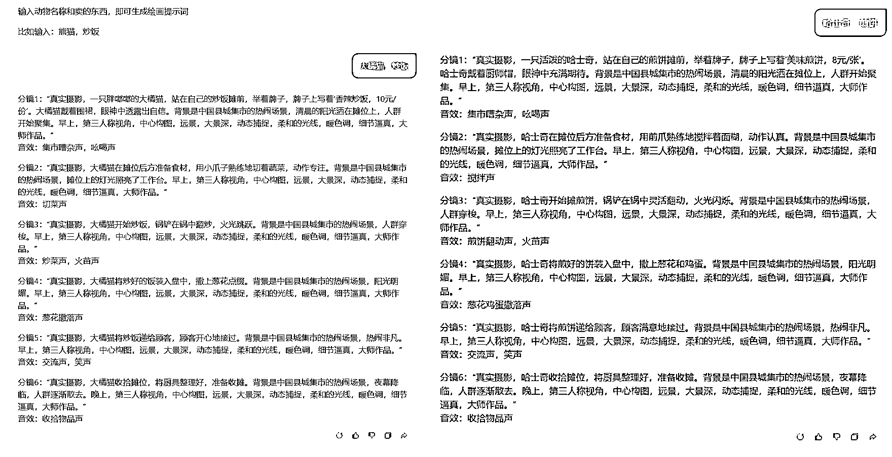
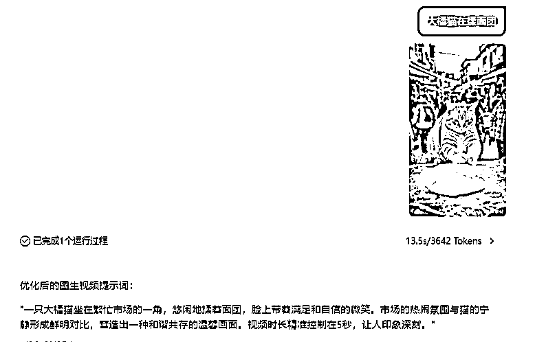

# AI视频变现实测：半个多月涨粉好几万，到底能赚多少钱？

很多人都说2025年是AI视频的风口，光听别人说没用，我干脆自己下场测了一把。这半个多月，我把主流的变现路子都试了一遍，结果比预想的要好。下面是热乎的实测汇报，想搞副业的圈友可以参考。

先晒晒涨粉成绩单：视频号发了16条视频，涨粉2.1万+；抖音同样发了16条，涨了2.5万粉；📕发了13条，涨了1300多粉；快手因为还没注册，暂时没参与。

最猛的是抖音第6条视频，直接干到近千万播放，一夜涨粉1.8万。另外还有不少几十万、上百万播放的小爆款。

说实话，这个流量爆发力是我没想到的。短短几秒的视频，竟然能撬动这么大的流量，真有点“以小博大”的意思。

再聊聊大家最关心的变现情况。

视频号我开了创作分成计划，收益模式大约是每一万次播放给1块钱，一条百万播放的视频，就能到手一两百块。

抖音也开了创作者分成计划。第6条爆了之后粉丝破万，顺利开通。日常不爆的时候，一天也能稳定收个二三十块；要是再出个大爆款，日入几百上千都有可能。

📕这边，我是等抖音火了之后才同步视频的，前几天刚开通蒲公英，就接到了第一条商单，算是开了张。

还有个意外收获是卖教程。后端体系还没建好，想学的人不少我都没敢收，白白浪费了很多流量，可就这样，也卖出去了几百块。

说实话，这些收益并没有传说中“一条视频赚几千”那么夸张（当然爆款真来了也有可能），但至少证明了这条赛道是跑得通的，确实能赚到钱。我白天还有其他事情要忙，基本每天只能更新1条视频，要是把更新频率提上去，变现肯定还能再上一个台阶。

接下来聊聊制作门槛。很多新手一听“AI视频”就觉得高大上，其实目前最基础的玩法就三步：AI画图 → 图生视频 → 剪辑。那些看起来花哨复杂的视频，无非是加了首尾帧转换，再多拼接几条视频而已，本质并不难。

真正的难点只有提示词。这也是无数小白卡住的地方：怎么写才能让AI画出符合自己脑补的画面？怎么写图生视频的提示词才能让动画效果如你所愿？网上确实有不少教程在分享提示词，可它们大多只会给一套固定的模板。比如人家分享的是“猫咪做炒饭”，你想改成“哈士奇做煎饼”就懵了，自己动手改又不知道从哪学起。从零啃提示词知识？太浪费时间，大多数人坚持不下来。

其实，这种事儿完全可以让AI自己干。你可以做一个“提示词生成器”智能体，想做什么，输入一个关键词，它就把完整提示词给你写好了，直接复制到绘画软件里就能出图。

拿到图之后，再把它扔进可灵做图生视频。视频提示词也不用愁，再搞一个“图片转视频提示词优化器”智能体：上传图片，简单说一句你想要的效果，它自动帮你把提示词补齐。复制到可灵里，一条视频就妥妥当当地生成了。

有了这套工具，什么AI知识、提示词技巧都不用学，纯小白也能轻松做出想要的效果，就是这么简单。

给大家搞两个体验下：
动物摆摊做饭提示词生成器：https://yuanbao.tencent.com/chat/xdNNVtMb3vfT
图片转视频提示词优化器：https://yuanbao.tencent.com/chat/wcGgaeNGROtF

最后想说一个很多小白容易踩的误区：以为AI视频做得越复杂越好。其实我们实测下来，内容制作难度和受欢迎程度基本不挂钩。你花好几天打磨的视频，可能还不如别人3分钟做的视频跑量。大家学AI视频的初衷，无非就是把视频做出来、把钱赚到手。你只需要想明白两件事：做什么内容能变现？怎么把内容做出来？其他都别多想。钻研技术那是专业人员的事，普通人先上手拿到结果才是王道。

那做什么内容好呢？当然是跟着热门玩法走，正反馈来得最快。千万别去碰那些过时玩法，浪费时间还难出结果。根据我这段时间的观察，目前流量比较好的几类包括：

- 萌娃：可爱的宝宝叫奶奶、送祝福，流量好到没边。
- 萌宠：动物做饭、动物摆摊、动物日常，账号数据离谱地高。
- 恶搞：人和动物打架、荒诞无厘头的，流量也很大。
- 祝福类：财神送财、老牛拉黄金、十二生肖什么的，流量很猛但特别容易违规限流，新手慎碰。

当然，AI的想象力是无限的，可能还有更多玩法等着被挖掘。至于AI微电影，制作门槛偏高，不太适合新手。上面这些单镜头或少镜头的玩法，做起来简单，发出去就能跑量，正反馈特别快，很容易建立信心。

账号有了流量，变现方式就是我前面说的那些。目前来看，AI视频赛道还是个低门槛、容易拿到结果的好方向。如果你精力允许，多起几个号，收益还能往上走。作为一份副业，完全够用了。

好了，今天的实测分享就到这里。如果你也对AI视频变现感兴趣，欢迎来找我聊聊。