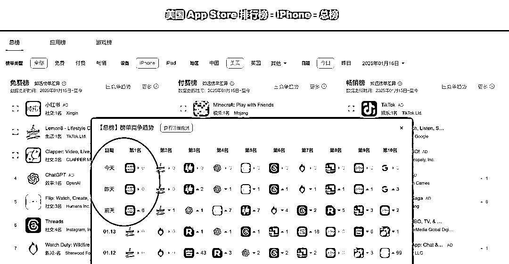
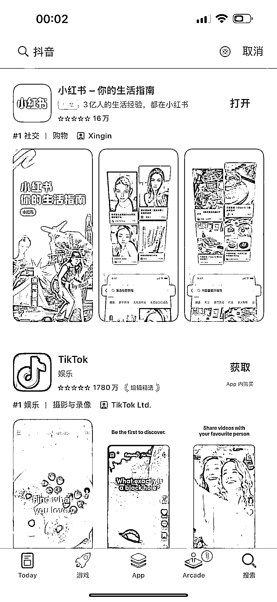
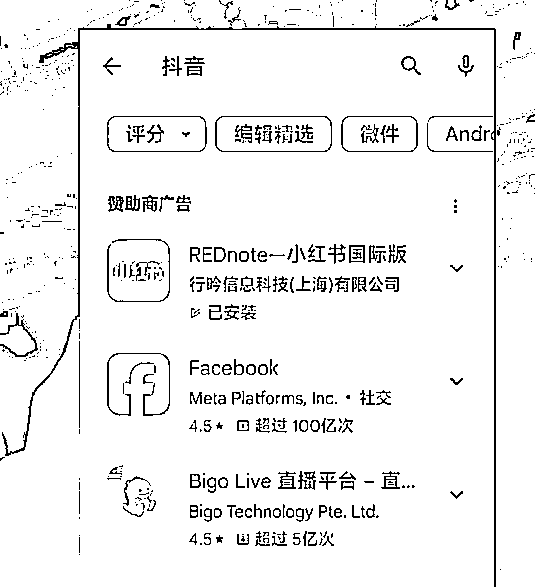
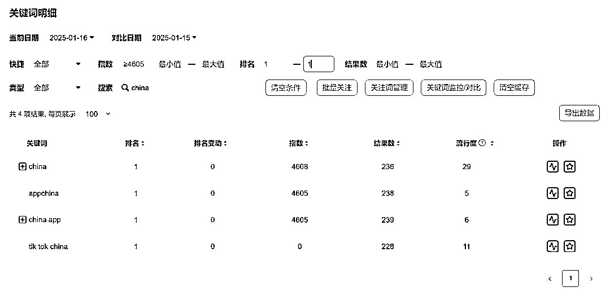

# 📕承接 TikTok 泼天流量，与 ASO 脱不了干系，运营可以得满分！

最近打开📕，是不是感觉像误入了国际聊天室？满屏的英文内容、金发碧眼的面孔，快让人忘了这是中文社区。这波突如其来的“老外潮”，表面看是运气，背后却藏着一套教科书级的流量承接策略——尤其是搜索优化这一环，运营团队真该拿满分。

起因大家都知道了：TikTok在美国面临封禁风险，1月19日极有可能被迫下架。靠着它吃饭的美国创作者们慌了，急着找下一个落脚点。不知为啥，他们看中了📕，误以为这就是抖音的“中文版”，于是蜂拥注册。结果就是📕在美国以及另外五十多个国家的苹果应用商店免费榜上像坐火箭一样往上蹿，一度直接登顶。

为什么偏偏是📕？按理说，TikTok不让用了，用户应该去找抖音才对。可你只要在苹果App Store或谷歌Play Store里搜“抖音”，第一个跳出来的却是“rednote”——也就是📕。这可不是自然结果，而是付费投放的赞助广告。也就是说，📕早就对“抖音”这个关键词做了精准的搜索排名优化。搜索结果里，📕稳稳压过TikTok，排第二位才是正主。这波定向收割，直接把几十个国家的下载榜第一都收入囊中。

搜索“抖音”时的真实结果，天下大同。

再换个角度，搜“tik tok china”这类关联词，📕靠着ASO的覆盖和优化，同样霸占第一屏。许多搞不清状况的用户，顺理成章地被“接”了过去。相关性的强化，让📕和抖音在搜索场景下越来越像“同义词”，榜单推荐、相似应用、社交转发……每条路径都在源源不断地输送新流量。

其实不只是“抖音”，还有不少相似关键词，比如“tik tok china”，都通过ASO策略被牢牢锁定，把那些一时找不到北的老外们全都“接住”了。

说到底，关键词覆盖这件事，并没有想象中那么玄乎。只要策略到位、执行精准，流量增长是肉眼可见的。这次📕给我们上演了一出“搜索优化”的经典实战，有圈内人算过，这波操作省下的推广费，怕是得上亿。也有网友说，这其实是ASM（应用商店竞价广告）和ASO共同发力的结果，而不仅仅是免费优化。无论如何，对普通用户来说，这个机会倒挺有意思——有评论支招：“赶紧起个中文名字，老外可要来找你聊天了。”想要深入了解这套玩法的，欢迎来聊。