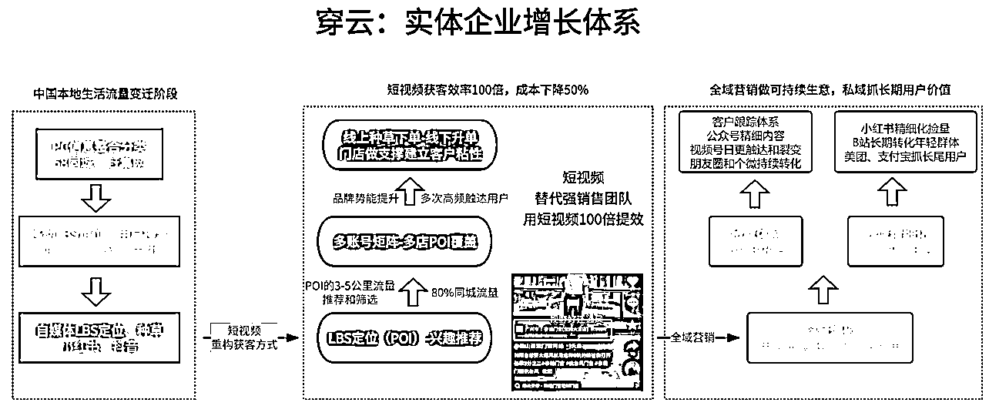
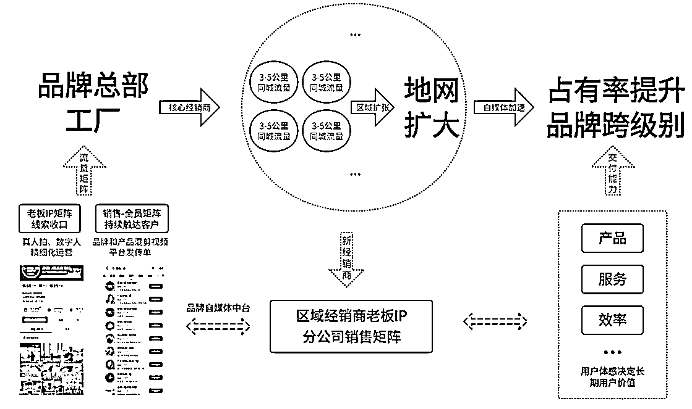
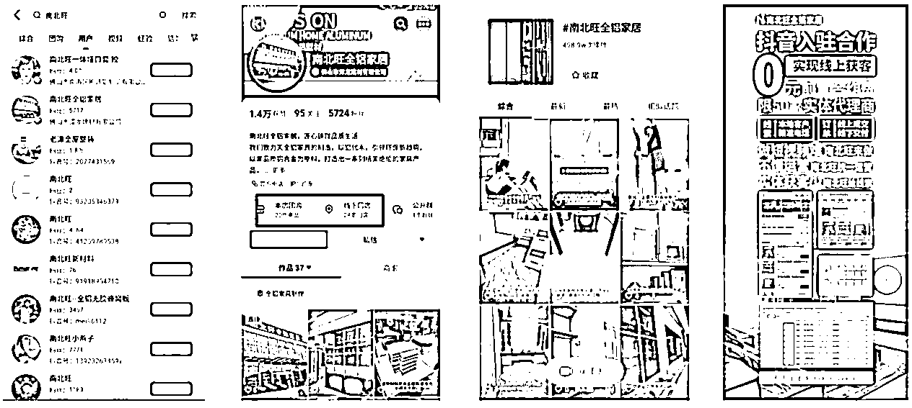
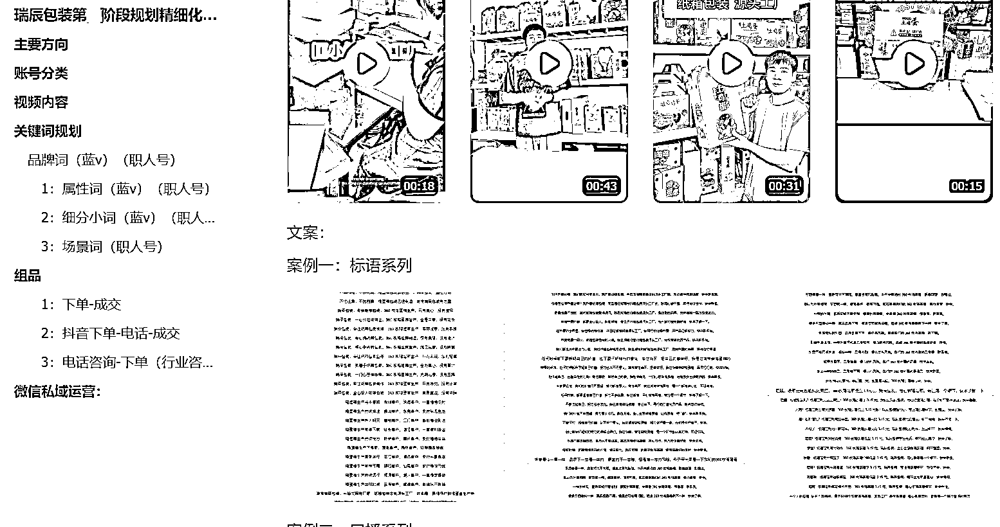

# 制造业的抖音新机会：当“铁疙瘩”遇上短视频，会擦出什么火花？

提起抖音，很多人第一反应是娱乐、带货、吃喝玩乐。但你可能没注意到，这个平台最近两年已经悄悄改变了游戏规则——用“兴趣电商”+“本地生活”两条腿走路，一步步把触角伸到了越来越多意想不到的行业。餐饮、旅游、教培、法律咨询、五金建材……如今，连“冷冰冰”的机械设备也开始涌进来了。

2024年11月28日，抖音生活服务正式开放【机械设备】类目商家入驻。这条消息看似不起眼，却让不少做工业品的人心头一热：一直被线下渠道绑得死死的制造业，是不是终于等来了新的增长曲线？

 images.zsxq.com/Fk9ylOSrhiOyUOTg1gRtbSXjAYjm)
 images.zsxq.com/FrHr4oOXcP15N_j28_lNXyYkIkY0)

**先说一个扎心的现实：传统销售模式，越来越玩不转了。**

制造业里90%的生意靠经销商网络，ToB为主。好处是覆盖广、客户稳，但问题也明显：

一是信息断层。终端客户的需求，要经过一层层经销商才能传到厂家，中间信息损耗大、错位多。更要命的是，现在很多决策者天天泡在短视频平台上，厂家却还在用老路子触达，两边根本不在一个频道上。

二是效率太低。经销商之间内卷严重，但营销手段高度同质化，谁也没办法快速破圈。2023到2024年，我先后跟伟星管业、万鑫精工、南北旺铝材、良辰科技的总部和经销商聊过，大家感受出奇一致：越来越卷，知道有问题，却不知道怎么解决。

三是区域粘性太弱。想跨区拓展，成本高得离谱，尤其那些区域供应链强、品牌影响力弱的企业，明明有好产品，却始终走不出自己的地盘。

数字化转型这块，制造业也严重滞后。消费品牌早就把线上玩出花了，很多机械企业却还停留在线下展会、广告信息流投放阶段。有的工厂一个月投30多万，品牌价值没见涨，获客成本反而越推越高，利润被挤得越来越薄。说白了，以前靠关系、靠人情还能撑一撑，现在是新品牌打不进去，老品牌增长乏力，全都卡在瓶颈里。

更麻烦的是决策路径。机械设备是典型的高价低频产品，客户纠结的维度很多：性能、售后、信任背书……没有强大的品牌影响力，靠单一渠道根本打动不了人。但管理层想做自媒体、短视频时，又只看这一个渠道带来的直接产出，从来不综合评估整体增长效率。这正是传统模式最无解的地方。

**所以，当抖音开放机械设备类目，真正的变量出现了。**

短视频和直播能把复杂的信息讲简单，把抽象的价值变具体。更关键的是抖音的POI（兴趣点）流量分发逻辑——以城市区域为核心，结合兴趣推荐，每发一条视频，就相当于完成了一次陌拜和地推，效率比线下跑市场高出不知道多少倍。

拆开来看，这个逻辑有三层杀伤力：

**第一层：精准触达目标客户。** 展会是大海捞针，短视频矩阵却是精准狙击。比如你在核心区域发一条“工程车操作技巧”的视频，系统会自动把内容推给相关从业者和采购负责人。以前从曝光到形成购买意向隔着千山万水，现在路径被大幅缩短了。

**第二层：打破区域壁垒，形成连锁效应。** 借助POI模型，一个品牌可以把全国核心城市的经销商绑进同一个营销体系，做成“云连锁门店+销售矩阵”。用户搜“挖掘机租赁”，系统直接匹配最近的供应商。全国经销商的数据孤岛被连成一张网，信息协同了，运营效率自然也就上来了。

**第三层：内容建立信任。** 短视频和直播能360°展示产品性能和使用场景，这是过去制造业几乎没试过的玩法。比如一条视频还原工厂真实作业场景，一场直播在恶劣条件下测试工业泵的运转表现，观众看到的是直观实力，信任感比静态图片和文字说明强太多。

**空谈逻辑没用，我们看两个正在跑的真实案例。**

先说南北旺铝材。这是广东一家做定制工业铝材、全屋定制的工厂，一年营收2亿左右。以前全靠线下经销商、展会推广和工程招标拿单。随着竞争加剧，订单越来越少，库存越压越多，营销费用却年年涨。2023年初，老板谭总带着高管开始做抖音IP，内容走科普+趣味+品宣路线，做了一段时间，只有小幅度增长，很快遇到瓶颈。

2024年，穿云团队接手后，重新调整打法：先围绕核心区域经销商搭建POI，做成云连锁形式，再建立招商体系；紧接着启动全员营销矩阵，让每个人都发视频；最后把线索导进私域池，做长线运营。整个转型过程并不顺，作为典型的传统家族企业，南北旺光是在品牌定位（全铝家居）、VI重新设计、全员矩阵（拍剪发一体）、核心区域云连锁搭建这些基建上，就花了半年时间，中间还不断遇到内部和外部协作的阻力。但这又是不得不走的路。若不变，市场占有率下滑、体量萎缩，只是时间问题。

再看瑞辰包装，湖南邵东的包装材料工厂，主要做咖啡纸托、电器外包装、鸡蛋箱、圣诞球等，年营收1亿左右。老板是89年的，接手这个30年的老厂后，以前靠资源、人脉和团队勤奋打出来的路，现在也躲不过无限内卷和竞对乱价。2024年，老板亲自带队做短视频转型，每个月产生的线索最高成交超100万。他们找到穿云团队寻求放大，虽然不是老派工厂，管理层也以80-90为主，但依然花了4个多月完成人员招聘、培训与管理，以及营销基建（全员营销、产品体系梳理、抖音搜索运营）。现在每个月都有线索流进私域，再慢慢做长线转化。推广上，团队从粘蚊球、普通纸箱、鸡蛋箱、圣诞球等产品开始测试，联合100多名员工做短视频矩阵，目前每个月都在稳定增长。按预计，只要1年完整流程跑通，月营收有望翻倍。

这位老板最大的感受是什么？以前跟客户、同行交流，要先花五六分钟自我介绍；现在只要说出工厂名字，对方马上反应：“天天在抖音刷到你们。”这种无形的信任，放到销售转化里，比什么漂亮话都好使。所以他们下一步的发力点，很明确：老板个人IP + 私域运营SOP，把后端转化再做上去。

这两个案例告诉我们：在自媒体环境里拿结果，绝不是靠简单运营一个IP、一两个月就爆发，而是要根据企业实际情况，搭建体系化的营销打法，再用3到12个月去落地执行。而且，做出来的东西要有长期价值——就像穿云团队的供应链项目，三年前的矩阵短视频，到现在还在持续产出线索。

**再看接下来的趋势。**

随着更多制造业玩家涌入，这个赛道会有几个明显的走向：

平台化体系运营会成为主流，组织能力强的企业更容易冒头。未来，工厂和品牌都会把“线上+线下”双轨制当成核心战略。线上用体系化打法做短视频矩阵、布局搜索流量、通过公众号-视频号-社群-朋友圈做私域长线经营；线下则用POI功能做重点区域覆盖。这种玩法跟传统IP型全国流量的套路完全不同，它能盘活现有经销商体系，还会吸引更多新经销商加入，像滚雪球一样越滚越大。

头部效应会出现，但中腰部同样有翻盘机会。像三一重工这样的大企业，早期布局有天然优势。可算法推荐终究看内容质量，它奖励的是勤奋、有方法的团队。中腰部品牌完全有机会靠创意和铺天盖地的视频数量实现突围，快速成长。

拥抱数字化浪潮，“上网”已经成了必答题。抖音这样的新媒体平台，给传统制造业指了一条通往未来的新路——从精准获客到信任构建，再到业务增长，这不只是一个营销工具，更是一套全新的商业逻辑。但是，这个过程本质上是一次二次创业，需要企业投入时间、人力和财力，去搏一个可能的第二增长曲线。老板和员工，都得先做好这个心理准备。