# YouTube 变现：把运营做透，让收益跑起来
作者：龙哥

## YouTube赚钱：运营思路与提升收益的方法

作者： 书情小跟班

日期：2025-01-17

前言：本文是对之前分享内容的补充延伸，文中涉及的关键词可回溯往期帖子查看更详细说明。

## 先聊聊 YouTube 的变现逻辑

市面上流行的入门路径基本都是先从 Shorts 切入，靠短视频的快速分发把账号体量做起来，甚至等到出现爆款，时长自然也就上来了。但这里有个现实问题摆在前面，Shorts 的单价普遍偏低，靠它养号很容易陷入“播放高、收入低”的困境。

当你感觉 Shorts 的回款速度跟不上预期，就需要换个打法了。

Shorts 和长视频的分发规则完全不同。Shorts 的封面作用此前也分析过。

Shorts 的使用场景是快速上下滑，视频往往在用户还没看清封面前就已开始播放，所以封面在 Shorts 上的决策权重很有限，封面在什么场景下才起作用，之前也讲过。

如果目标是快速积累时长，长视频首映是最直接的手段之一。开启首映后系统会主动推送给订阅用户，播放界面右下角还会出现提醒，首映的权重明显高于普通上传。

实际测试中，用大号以首映形式发布内容后，用小号登录观察，YouTube 首页最上方往往会出现大号的首映视频，发布时间集中在首映前后。关注列表中，正在首映的频道会被标出醒目的直播标识，频道列表里一目了然。

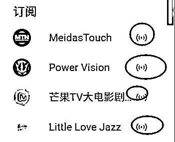

关于用工具让同一段素材反复播放，实现无人值守的思路之前也提到过。如果有技术能力，也可以投入成本自建方案，比如租用服务器，将视频文件上传至服务器后，把直播推流的源地址指向服务器。

性价比最高的做法仍然是“类真人出镜”，这里的“真人”加了引号，是为了区别于完全真实的出镜。

下面用截图来说明，目前该频道的订阅量是 1340

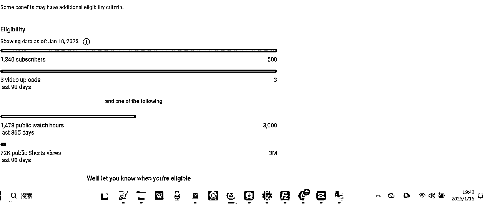

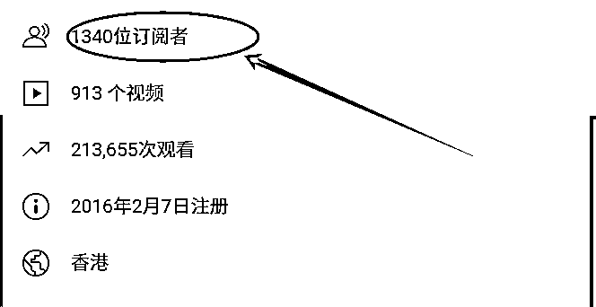

这张截图显示播放次数为 98

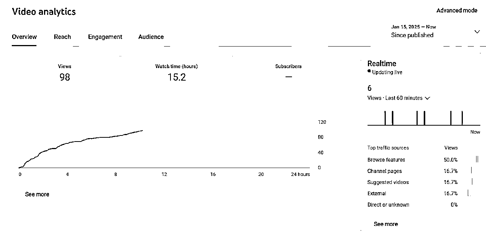

下面两张图取自 2025 年 1 月 15 日的后台数据，直播开始日期为 2025 年 1 月 15 日，播放 110 次，与前述数据基本吻合

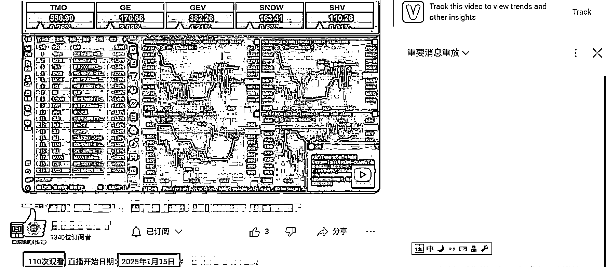

这是 2025 年 1 月 16 日的数据截图，图中自带日期

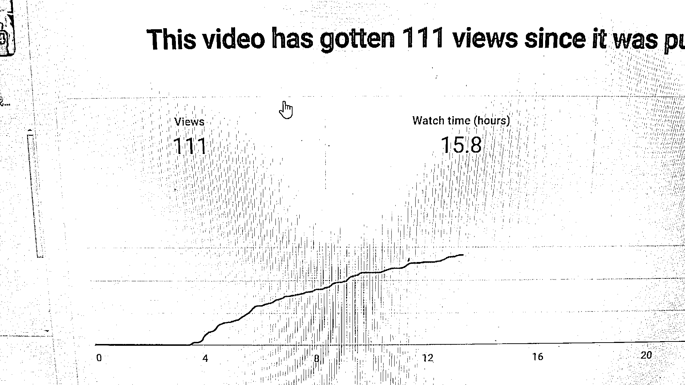

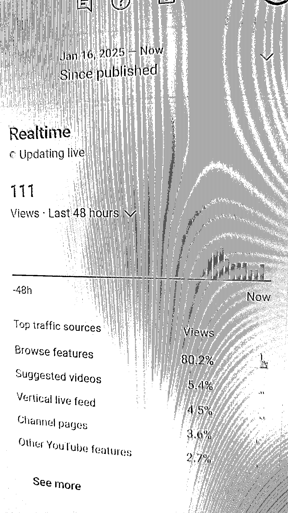

这一张显示 116 次播放，而后台显示 111 次，数值非常接近

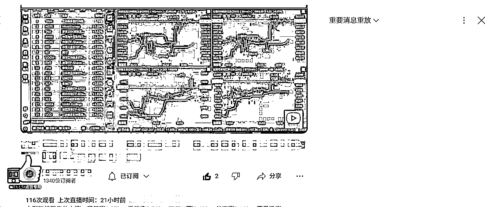

从这张图可以看出其运作方式，页面是动态生成的，会不定期抓取数据，让数值保持变动

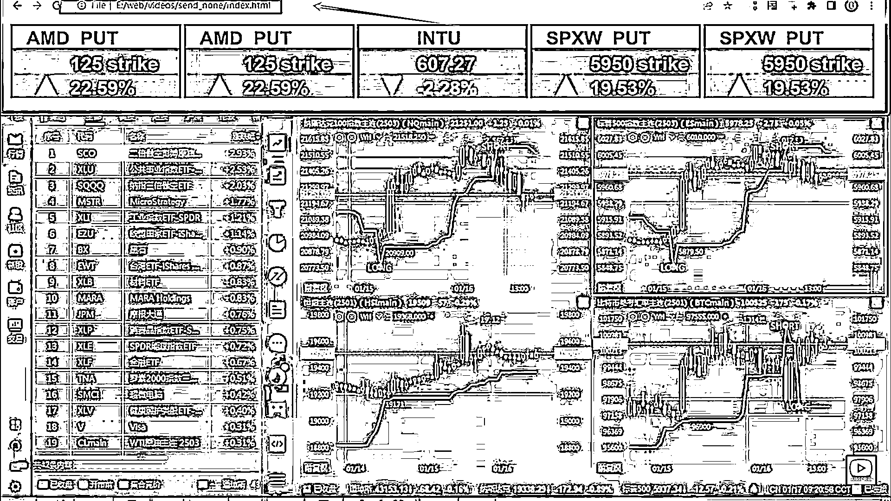

本质上还是之前提到的，用直播来涨时长是最快的方式之一。相比 Shorts，直播的形态更具延展性，外在形式是直播，内在内容可以灵活替换。比如下面这个案例

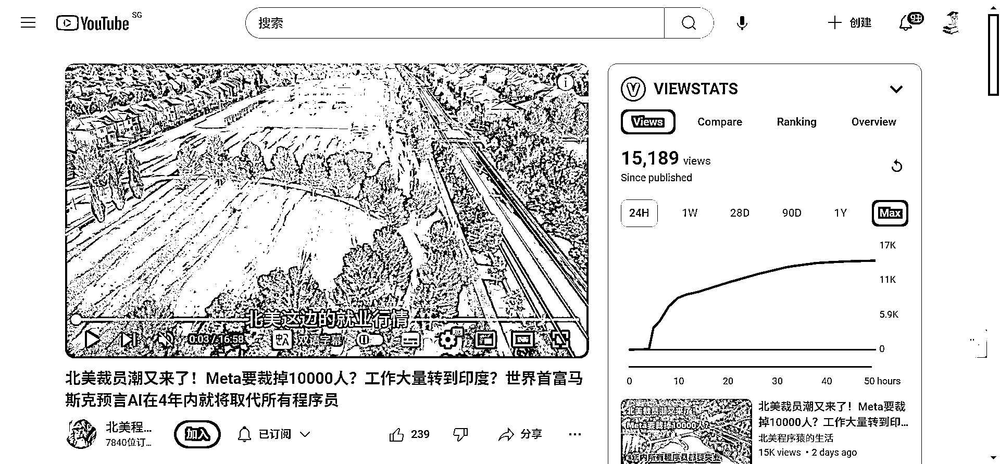

这种呈现方式效果不错，前提是有无人机拍摄素材的储备，素材来源途径多样，大家各凭本事

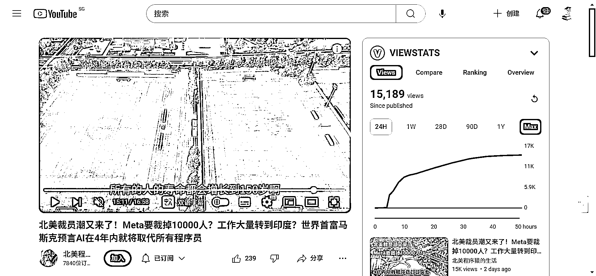

整支视频以航拍美景为主线，极具观赏性。无人机画面作为底图，配合音效与字幕，观感完整

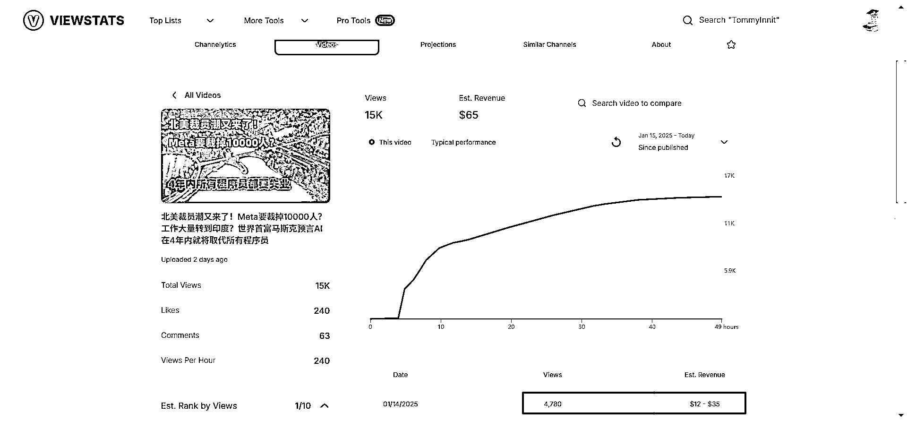

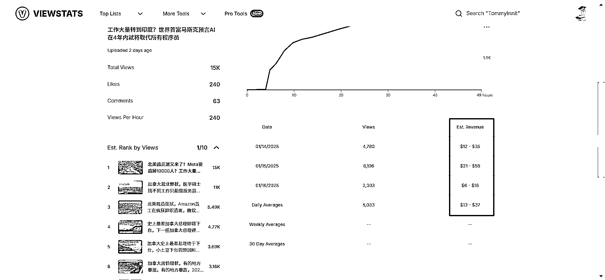

思路可以再拓展，做纯风景向的频道也完全可行，如下图

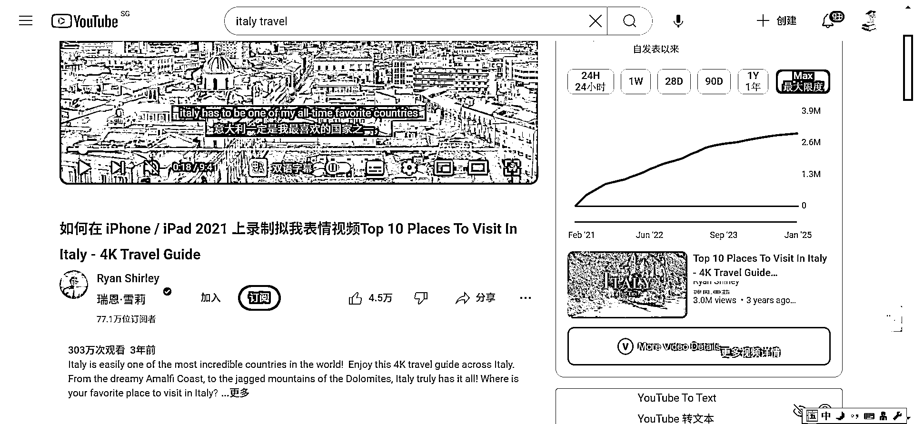

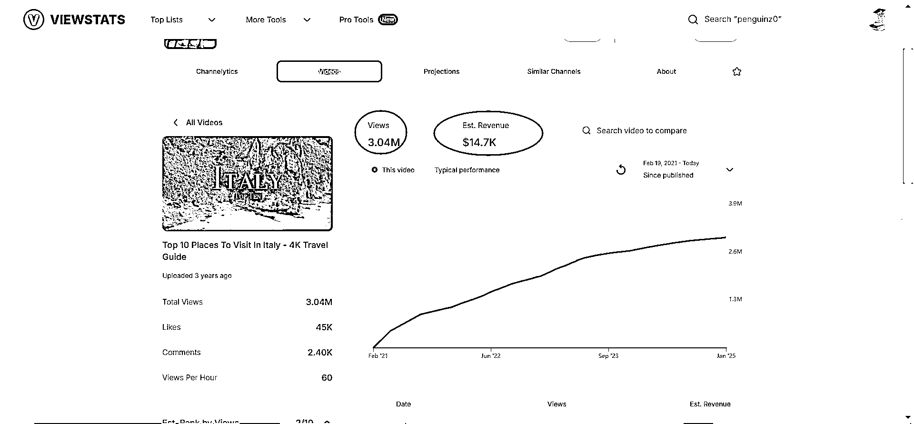

这是收益截图，显示 $14.7K，约合 1.47 万美元。该工具此前也介绍过，测算收益相对更精准，建议大家用它来核对收入

直播投入主要集中在两类成本：

1、借助直播软件对同一视频进行多次重复推送
2、购买服务器，把视频先上传到服务器，再以服务器源进行推流

最后说说普通人可操作的做法，具体形态如下：

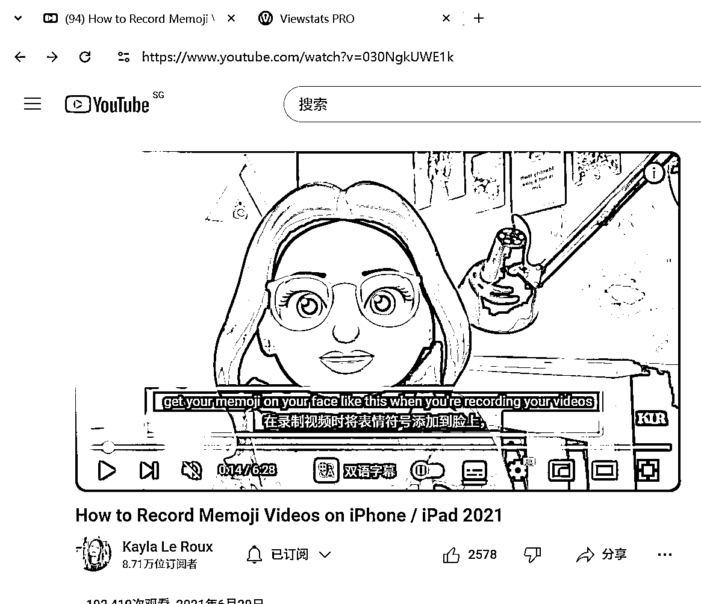

该方法存在设备限制，仅支持苹果生态产品，相关参考链接

[`www.youtube.com/watch?v=030NgkUWE1k`](https://www.youtube.com/watch?v=030NgkUWE1k)

以上只是抛砖引玉。同样是直播玩法，内容形式和场景完全可以做差异化，比如探索低价获取无人机素材的渠道，或者直接戴头套出镜拍摄。

未来我会继续把相关内容更新到飞书文档中。

做 YouTube 的一些常识

* * *

评论区：

暂无评论