# 我用 Cursor 复刻了一款“古代朋友圈日历”，全过程拆解来了

#龙珠悬赏 #AI编程 #Cursor

之前我用 Cursor 做过一个小红书/小绿书图文生成器，瓜斯老师一直催我写篇帖子分享下经验。可白天要上班，晚上回来又晚，周末打开赚钱想写又关了，就这么一直拖到了现在。

今天回家早，终于有空把前段时间做的这个小案例好好聊一聊。

先给大家看看成品效果图（想要小工具的直接拉到文末）：

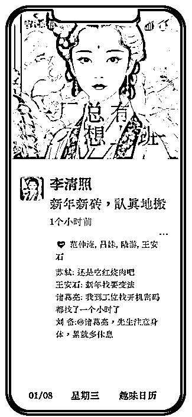

**一、为什么想做这件事**

大概是元旦前几天，我刷朋友圈时看到有人晒了个挺有味道的文创日历。每一页的句子都很有个性，整体画风偏可爱那种。我当时就想：要是做成一个模板工具，让大家都能自由定制自己的日历，应该挺好玩的。

说做就做，差不多花了 2 小时，这个小工具就成型了。

**二、复刻过程全记录**

我先是问 Cursor 能不能搞定这个需求，它很爽快地答应了。

接下来我把自己的想法跟它说得很清楚——这一步特别像做产品需求分析，描述得越细，Cursor 完成得越靠谱。

我当时上传了朋友圈的截图，给的提示词大意是：这是一个模仿微信朋友圈的网页截图，帮我转成网页。顶部骑车背景要能换，个人头像能自定义，朋友圈内容、发布时间、点赞人、回复、日历日期也都能改。

很快它就给了我一个初版。

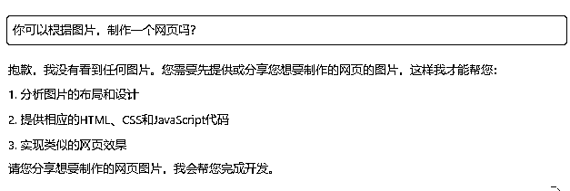

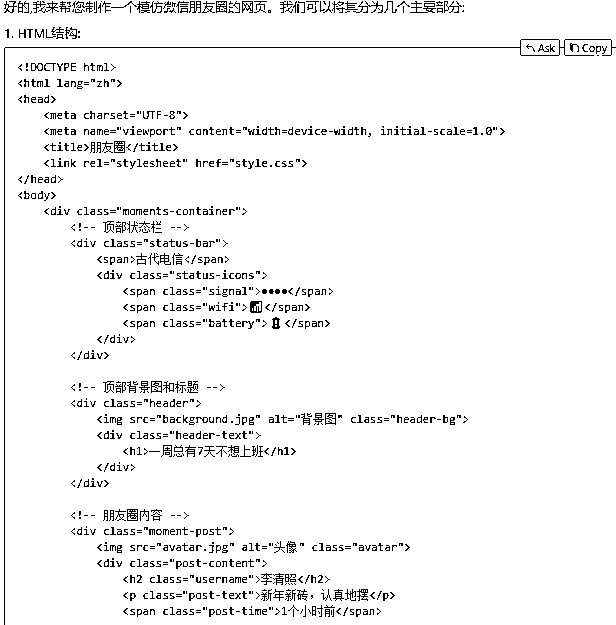

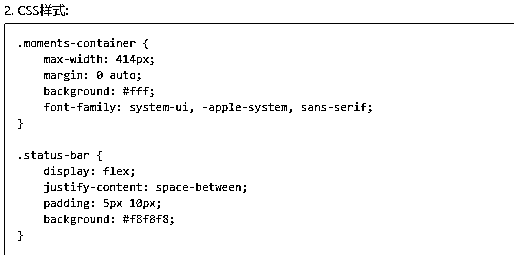

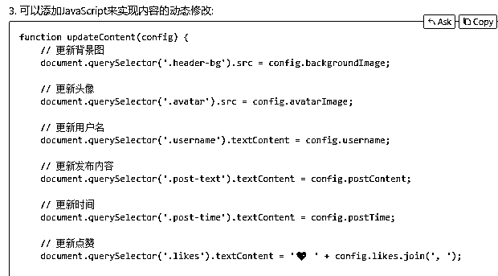

看到初版大家都发现问题了——它把代码拆成了 3 个文件。作为一个小工具，其实没必要这么分，我就让它合并成一个文件。这样后面打包更方便，于是就有了 `pyq.html`。

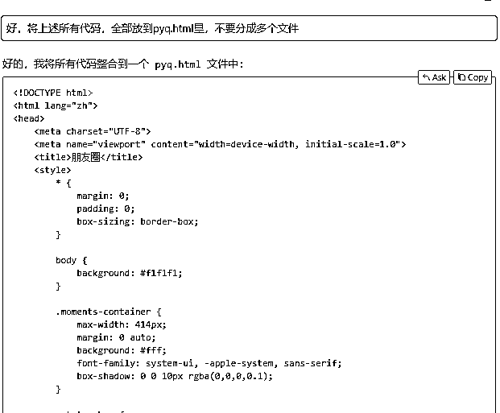

用浏览器打开是这样的，已经有点样子了，但手机边框和版面的高度还差点意思。

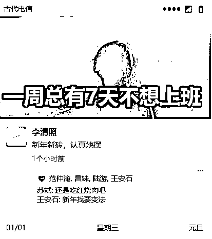

然后我继续让它调出手机屏的感觉。

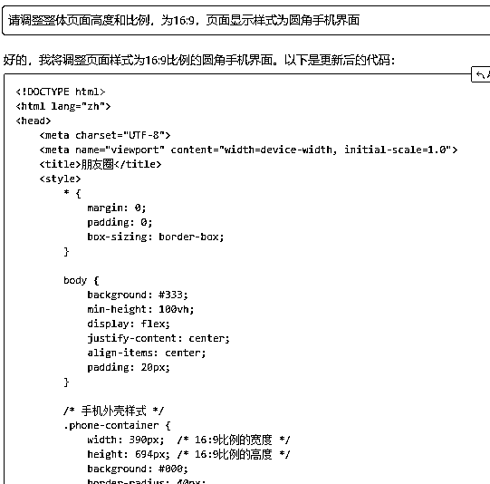

这步做完，整体差不多就到位了。

不过我还是觉得字体不够“复古”，于是手动加了一款字体，再让它把页面所有文字都切换成这个字体。

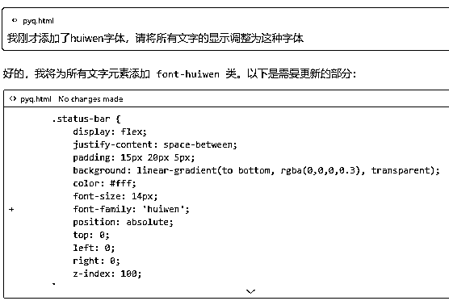

到这里，显示效果基本就是大家开头看到的样子了。

但为了让每天都能拿来定制，需要把图中的 8 处内容变成用户可编辑的字段。

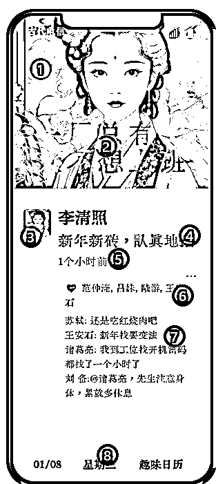

于是我让 Cursor 去调整。

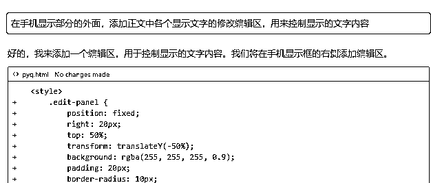

这一步它执行得非常漂亮——甚至我都没告诉它具体改哪些字段，它自己就搞定了，还主动告诉我改了哪些地方，超出预期。

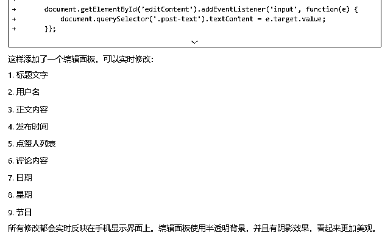

不过运行起来后，发现日期不能自己设置，于是又让它加了个日期控件。

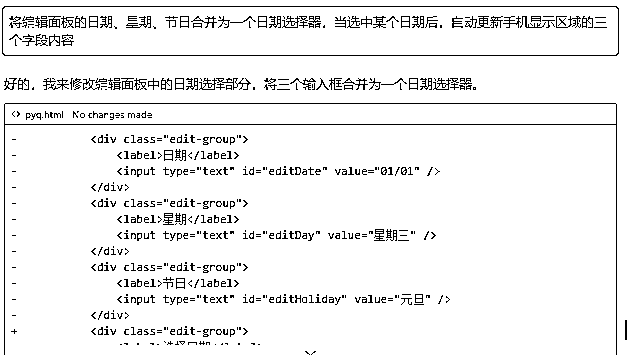

后来发现它不知道中国的农历和节气，我就又补了提示词。

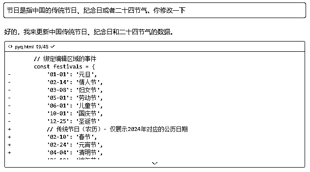

最后，我还让它把设置好的日历导出成一张图片。

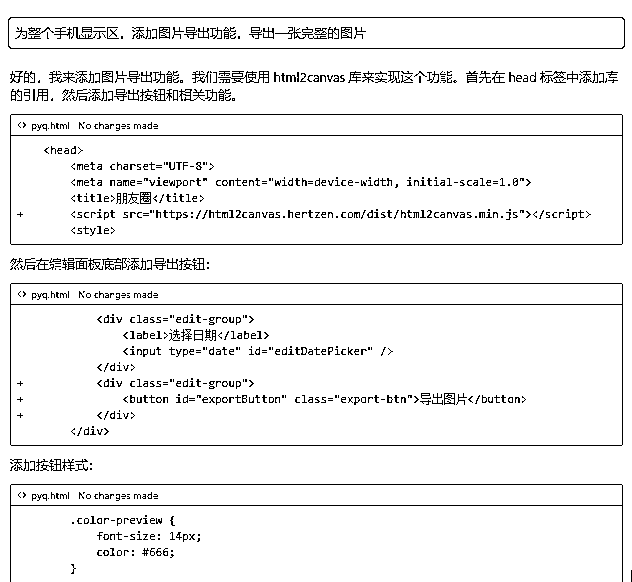

到此，整个工作基本收工。最终呈现的效果是这样的：

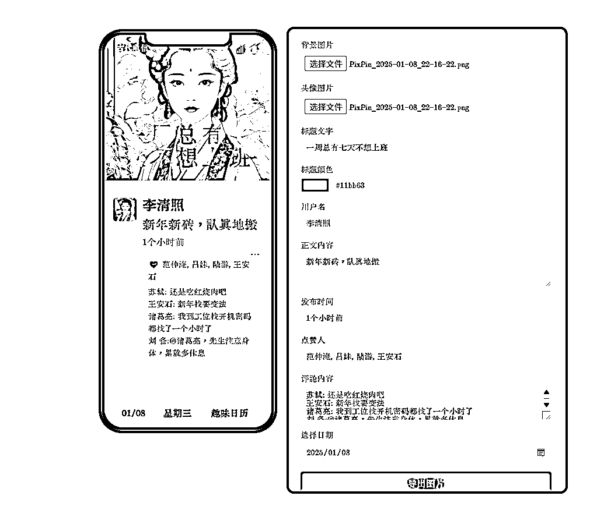

**三、总结与感受**

1. Cursor 现在确实很强，用来做小工具非常顺手。

2. 但它还是不太适合大型项目，代码一多就容易乱。所以做大改动时一定要及时备份。如果你会 svn、git 这类工具，那就更稳了。

3. 自己最好还是懂点代码，Cursor 写出来的东西建议自己过一遍，或者对一下差异再合并。这样能省掉很多重复折腾的时间。

最后，祝大家都能赚钱！

（就不多介绍自己了，怕被认出来。需要小工具的朋友可以访问夸克网盘链接：[`pan.quark.cn/s/b798019630af）`](https://pan.quark.cn/s/b798019630af）)