# 没有编程基础，也能用 AI 从零搞定一个小程序并成功上架？这篇真实复盘值得一看

> 别被“技术门槛”吓退，但也要做好心理准备——这条路没你想的那么轻松。

大家好，我是波本。说起来有点不好意思，我加入赚钱已经三年多，但这却是我第一次认认真真在这里发帖。去年12月跟着Cursor小航海实操，中间试过好几个产品，基本全翻车了。直到月底，我的房贷计算器微信小程序终于成功上线，元旦前我还在熬夜调代码。这篇复盘，就是想完整记录一下这段跌跌撞撞的历程。

先交代一下背景：我并不是完全零基础，懂一点HTML和CSS。但即便这样，全程跟着Cursor走还是觉得费力。所以这篇内容，某种程度上算是对“AI能帮你一键做产品”这种说法的一篇祛魅文，也想给那些担心自己不会写代码的朋友一颗定心丸：别焦虑，慢慢来。

## 一、零基础起步，千万别一上来就碰高难度项目

之前看很多大佬分享，说“从自己的真实需求出发找方向”。我当时特想要一个Instagram下载器，方便随时保存帅哥照片。于是兴冲冲地让Cursor帮我做一个Chrome插件，能下载图片和视频。

最开始特别顺利，插件很快就跑通了，图片都能正常保存。我当时还心想：原来做个插件也就这样嘛，没那么神乎其神。

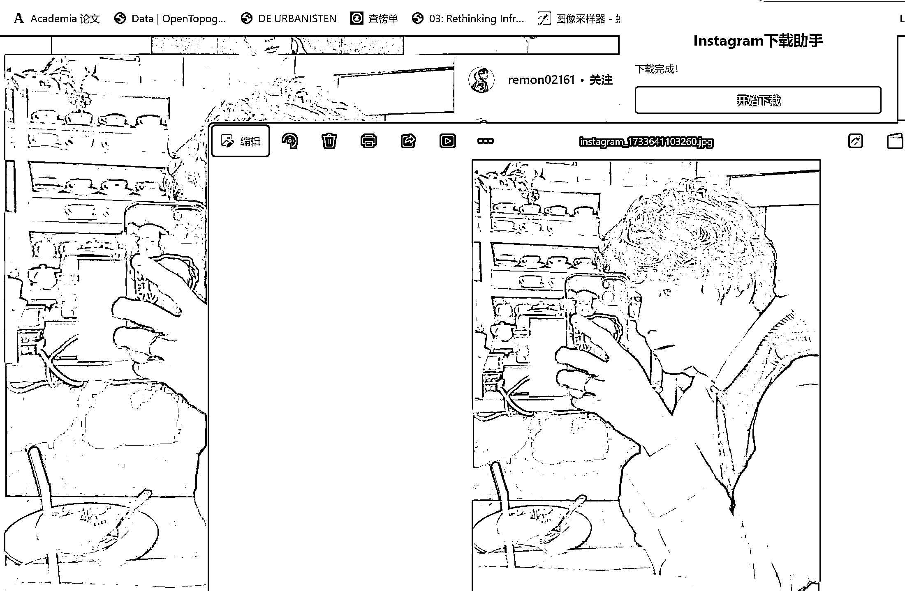

结果越往后改，问题越多。要么只能抓到帖子里第一张图，要么视频下载指令完全没反应，各种小毛病反复横跳。最崩溃的是，前面刚修好的bug，改到后面又被改回去了，就像陷入鬼打墙一样。

后来在航海群里提问，有人提醒我：Cursor在长对话里容易“变傻”，得把修改记录整理到README.md里，不然你不断提新需求，它就会原地打转，根本听不懂你在说什么。

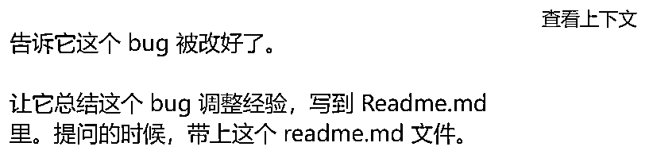

我以为把问题记录清楚就能解决，结果改了半天还是卡壳。没办法，只好请程序员朋友帮忙看代码。他查了半天，告诉我问题出在：我用的Cursor免费模型不够聪明，就算需求描述得再精确，AI还是会在同一个坑里反复横跳，以为自己修好了，其实越写越错。

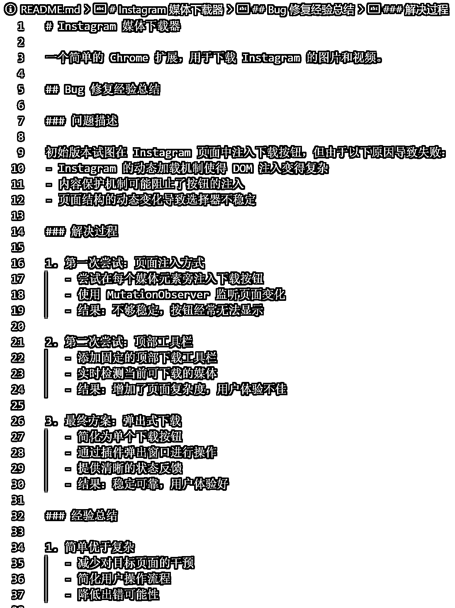

朋友还跟我说，零基础的人想做Instagram下载器，本身就不现实。因为一个帖子里既有静态图又有视频还有动图，哪怕付费升级模型可能好一点，但你不懂代码，根本不知道怎么用技术语言把需求讲清楚，只能大白话描述“我遇到了什么问题”“哪个功能又报错了”。AI听不懂的时候，就只能在一个漏洞上打转，严重影响推进效率。尤其是当一个产品功能越复杂，AI却卡在十分之一的小问题上出不来，真的特别让人崩溃。

他还指出，正确的用法其实是：你能大概看懂AI写的代码，然后抽出一小段有问题的部分让它改，而不是像甩手掌柜一样，把整段代码直接复制粘贴回去。因为很多时候Cursor只改了局部，你如果整段抄回去，必然出bug。

所以这里想强调：完全不懂代码的新手，能靠AI做出一个简单的小工具，已经很了不起了。比如下载器、PDF压缩器、简易导航站这种，不需要调用API，功能也不复杂。千万别一上来就想做个惊天动地的神器，先踏实补点基础，平平淡淡才是真。

## 二、用关键词工具找需求，比拍脑袋靠谱得多

放弃Ins下载器之后，我去闲鱼花了三十多块钱找人代充账号（注意是代充，不是买号，买号是共用一个公开账号，别搞混了）。中途还试了另外两三个产品，也都因为各种原因黄了。

最后绕来绕去发现，还是“计算器”最简单。为了好变现，我决定做一个计算器类的小程序。

但做什么计算器呢？这里再推荐一个免费的关键词工具：腾讯搜一搜平台，网址是 ad.qq.com。

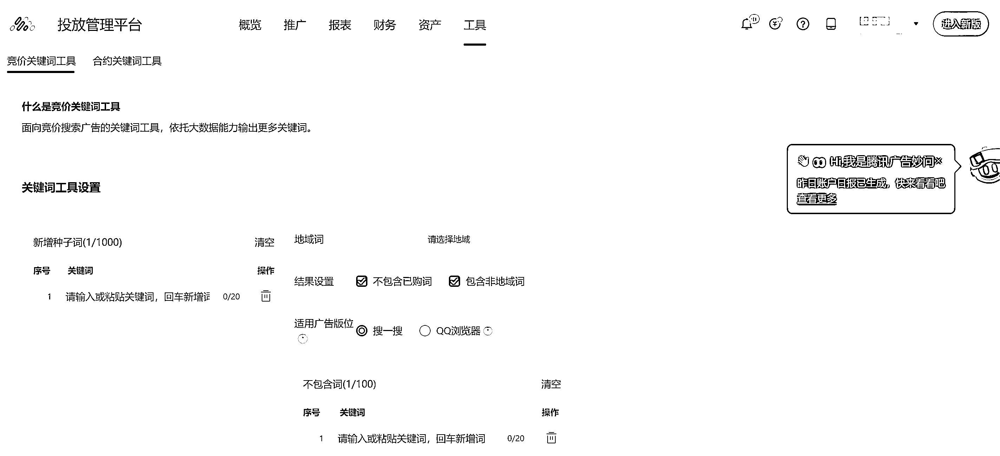

注册时可能会要求填身份，没关系，普通个人不一定能通过，随便填一下进去就行。我们真正要用的是它的关键词工具，能看到用户在微信搜一搜里的真实需求数据。

登录后，按路径“工具 - 投放管理 - 关键词工具”进入。

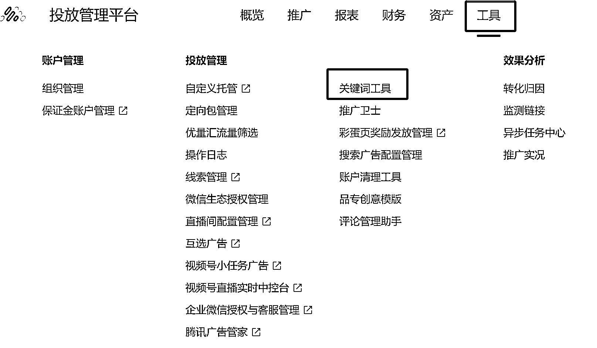

比如我想知道哪些计算类需求搜索量大，直接输入“计算”，其他选项保持默认，点“提交拓词任务”就行。

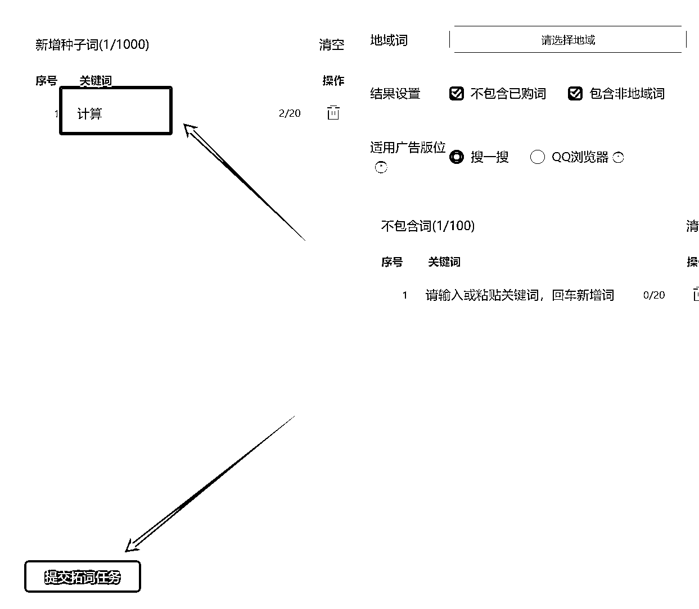

提交后，最下方会显示正在处理，一般一分钟内就好。如果等了几分钟状态不变，刷新一下页面，或者再提交其他关键词，相当于催它一下。

下载下来的CSV文件，关键词已经按月均点击量从高到低排好了，你从上往下慢慢找自己感兴趣的就行。至于要不要筛掉同行买的词，别操心，那不是我们个人玩家该考虑的。

我当时想做房贷计算器，它正好排在第二位，搜索量妥妥的。

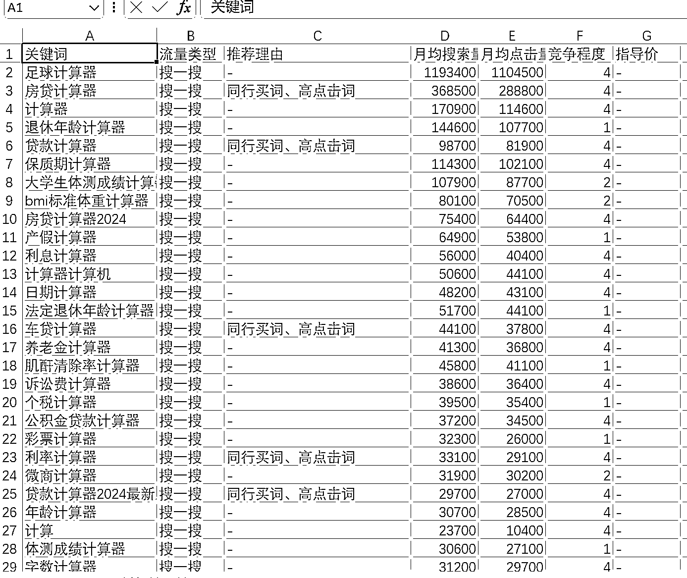

类目定了之后，就开始想里面要放什么功能。直接去参考同行的小程序就行，能看到这个赛道竞争还挺激烈的。

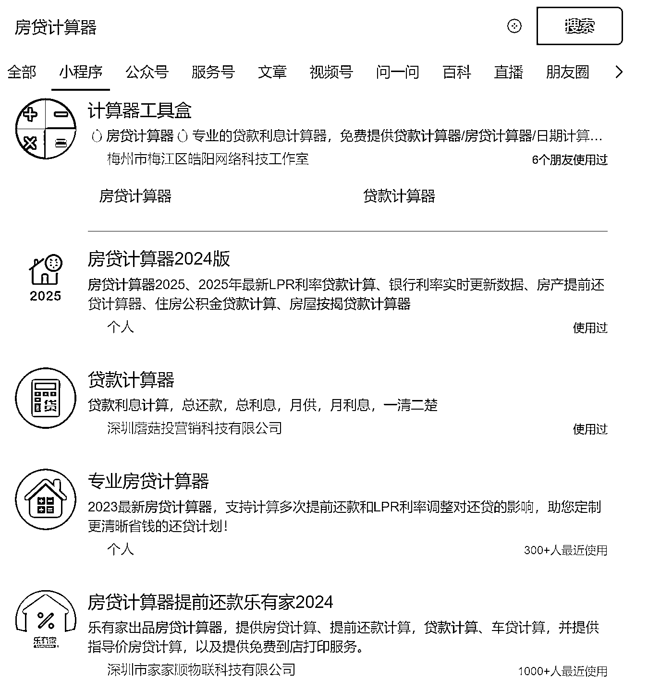

但我没想太多，先完成再说。而且找到现成的产品，反而方便你描述想要的样式，Cursor也能更准确地理解需求，一步到位把基本框架搭好。甚至你连怎么注册小程序都不会，它都会一步步教你，只需要告诉它“我没有代码基础”。

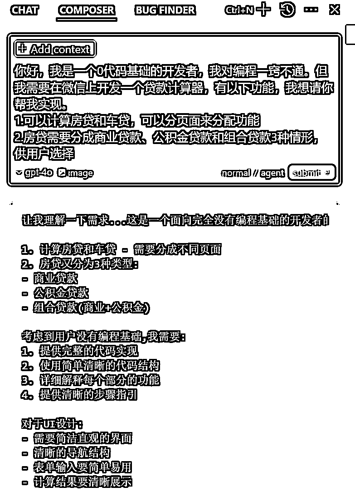

写代码之外，我还会用豆包、Kimi这些AI工具反复验证计算结果，以防Cursor自以为优化好了某个功能，其实并没有。

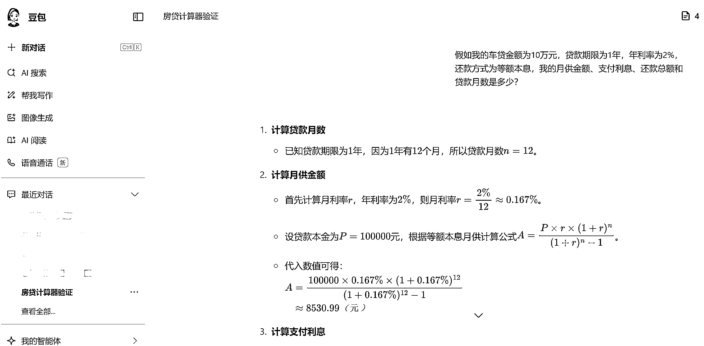

不过不同AI算出来的结果会有差异，尽量接近准确就行。有些算法太复杂，连我自己都拿不准的功能，最后直接下架，换成简单功能整合到一个页面里。界面方面，我用的是微信开发者工具自带的基础模板——那些花里胡哨的模板我看不懂，也不会用。每个功能块Cursor都会帮你单独分好文件包。

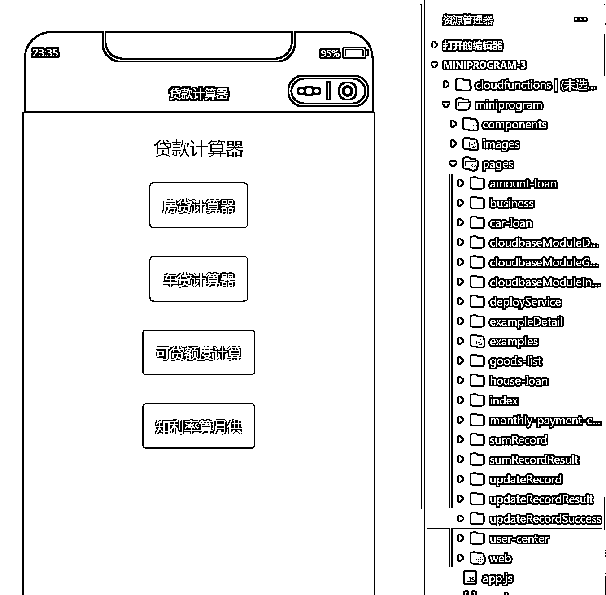

## 三、上架流程：比想象中多几步

功能做得差不多，就可以准备上传了。在微信开发者工具里点右上角的“上传”按钮。

但前提是，你得先注册小程序账号。如果之前注册过👸号，可能会遇到账号占用，换个邮箱或者微信重新注册就行。

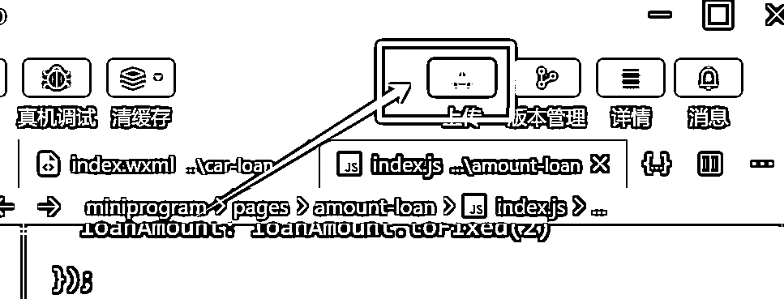

然后按首页指引一步步提交小程序信息、备案、交30块钱年费、上传代码等等。这里特别提醒一下：平台审核不是一个线性流程，很多人以为提交完资料就完事了，结果忘了还有备案和代码审核，白白拖慢进度。

所以每完成一步，一定要回到首页看看还有哪些审核步骤没做。尤其是你要在开发者工具里传了代码后，还得去平台上把“开发版本”再提交一次审核。只有当审核状态显示“你暂无提交审核的版本或版本已发布上线”时，才算这个环节真正走完。

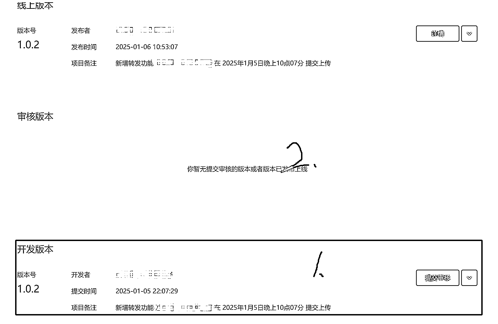

提交信息的时候，如果不会设计Logo，可以直接让豆包生成。不过有时候你明明说了不要文字，它还是给你带字，没关系，后期用PS抹掉就行。

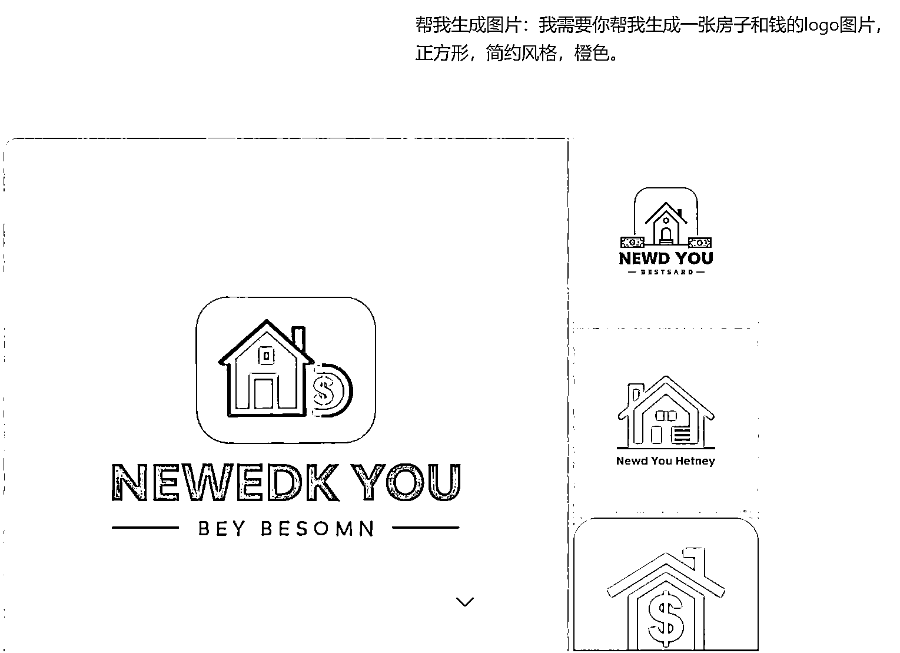

还有个坑要提醒：提交完审核材料之后，记得把手机的防骚扰拦截都打开。因为很可能会拦截到腾讯审核人员的电话，导致反复卡在审核环节，进度又被拖慢。

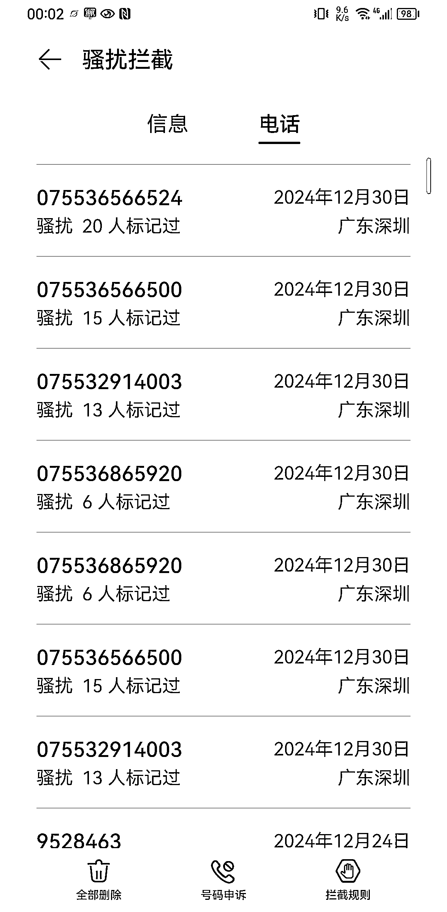

等小程序正式上线，就可以铺SEO关键词来引流了。用户满500人后会自动开通流量主，算是被动收入。不过我现在还没走到那一步，先把该踩的坑都踩完再说。

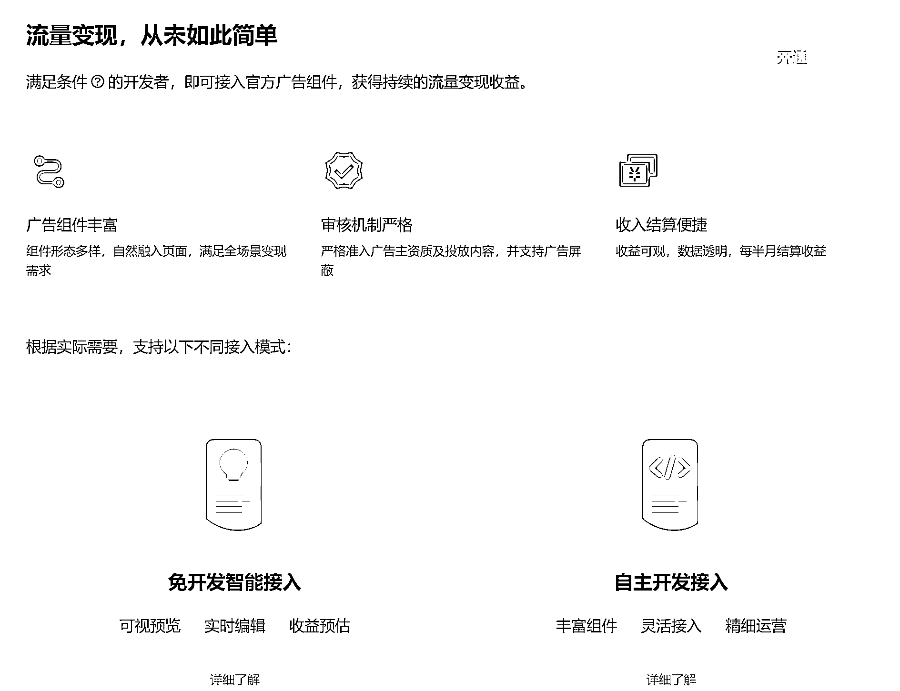

## 四、其他容易踩的坑

最让我意外的一个坑是：小程序都过审了，居然不能转发！我翻遍官方文档和后台设置，才发现转发功能需要作者手动写代码才能开启。我能理解转发功能要个性化设计，但平台方连个基础按钮都不提供，这也太鸡肋了吧。

没办法，只能继续找Cursor改代码。

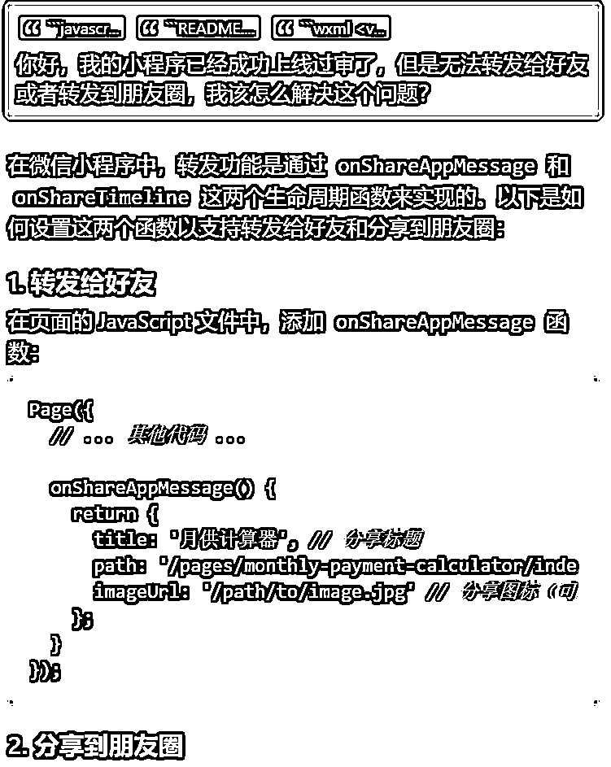

简单设置好转发语，重新提交过审后，效果总算出来了。

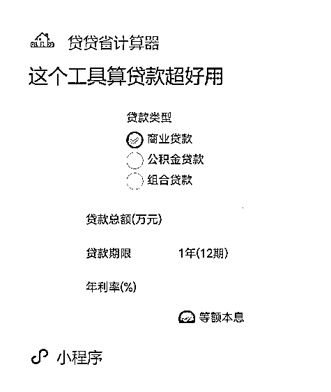

另一个坑是关于命名的。如果关键词不是行业限制性的，一定要尽量用在名字里。原因是微信搜一搜的排名，优先看小程序名称，而不是介绍内容。只在简介里堆SEO词，作用不大（当然后期曝光多了排名也会涨）。别像我一样，明明知道哪些词搜索量最高，却因为命名限制用不了，只能欲哭无泪。

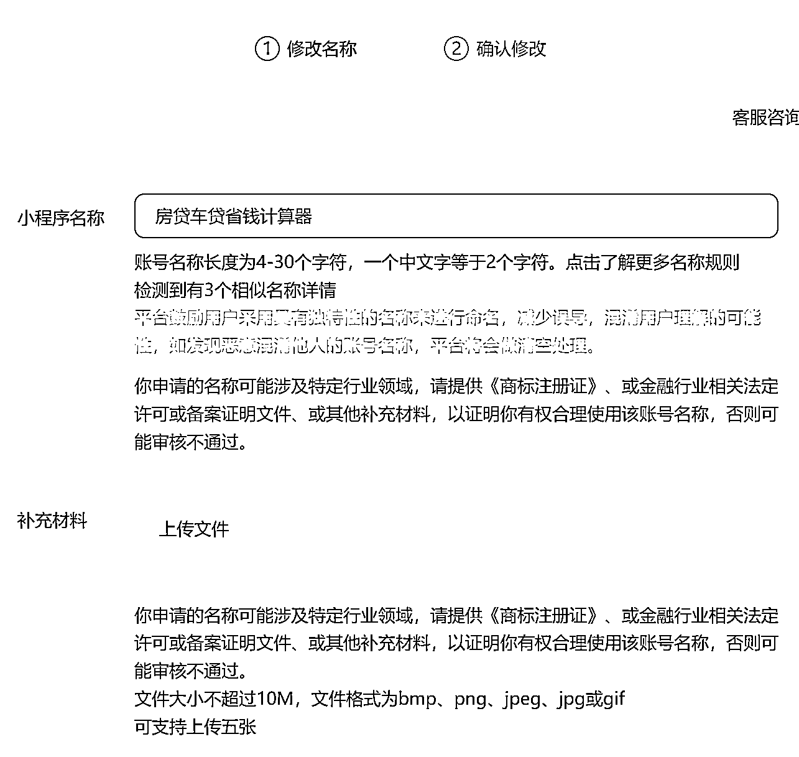

最后，真的感谢这次小航海。从零开始编码到上线一个微信小程序，这段经历对我来说太珍贵了。

虽然以后还要面对搜索排名、流量主收入等更多问题，但至少我迈出了做产品的第一步。希望这篇文章能对同样没有代码基础的朋友有一些启发。我们都在路上，一起加油。